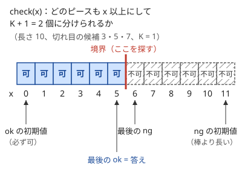
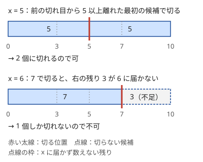

!!! abstract "要点"
    - **何ができるか**：「答えを $x$ にできるか」の判定が $x$ について単調なら、$x$ を二分探索して最適値を求める。最適化の問題が「$x$ で可能か」という判定の問題に置き換わり、判定の中身（貪欲・探索・DP）が問題の本体になる。
    - **いつ使うか**：
        - 最小値を最大化する／最大値を最小化する。
        - 〜を満たす最大（最小）の X を求める。
        - 答えを実数で出力し、誤差 $10^{-6}$ まで許される。
        - 答えの範囲が $10^9$〜$10^{18}$ と広い。
        - 答えを X に固定すると、可否を貪欲・探索・DP で判定できる形になる。
    - **計算量**：判定 1 回の計算量を $T$、答えの候補の幅を $V$ として $O(T \log V)$。$V = 10^{18}$ でも判定は約 60 回で済む。
    - **前提**：[二分探索](../basics/binary-search.md)

<!-- textlint-disable -->
別名：決め打ち二分探索・答えの二分探索・最小値の最大化・最大値の最小化・判定問題・実数の二分探索・判定 DP・二分探索と DP・binary search on the answer・parametric search
<!-- textlint-enable -->

答えで二分探索は、最適値を直接求める代わりに「答えを $x$ にできるか」を何度も判定して、可と不可の境目を探す方法である。判定が $x$ について単調であれば、[二分探索](../basics/binary-search.md)の ok と ng の考え方がそのまま使える。難しいのは二分探索の部分ではなく、$x$ を決めたときの判定をどう作るかである。

## 判定の単調性を確かめる（「ちょうど K」は「K 以上」に直す） {#monotonicity}

答えで二分探索に要るのは、候補 $x$ を小さい順に並べたとき、判定の結果が 1 か所だけで「可」から「不可」へ（または逆へ）切り替わることである。この性質を判定の単調性と呼ぶ。次の図は、長さ 10 の棒を位置 3・5・7 の候補から 1 か所選んで切り、短い方のピースを最大にする問題での判定の結果である。



判定を $\mathrm{check}(x)$ と書く。単調なら、二分探索では次の不変条件を保つ。

- $\mathrm{check}(\mathrm{ok})$ は可、$\mathrm{check}(\mathrm{ng})$ は不可
- 初期値は、判定しなくても可・不可が分かる[番兵](../guide/glossary.md#sentinel)の位置に置く（図では「長さ 0 以上」は必ず可、「棒より長い」は必ず不可）
- $\lvert \mathrm{ok} - \mathrm{ng} \rvert = 1$ になったら止め、ok を答えにする

単調性は「$x$ で達成できる方法が、$x$ より易しい $x'$ でもそのまま条件を満たす」ことを示して確かめる。図の例なら、すべてのピースが 5 以上になる切り方は、そのまま「すべて 4 以上」も満たす。だから 5 が可なら 4 も可である。

「ちょうど $K$」を含む条件は 2 種類に分けて考える。1 つ目は「$x$ 以上の要素がちょうど $K$ 個」「和がちょうど $S$」のように、$x$ で決まる量が $K$ に等しいかを問う判定である。これは $x$ のある範囲でだけ成り立ち、両側が不可になるので単調でない。「$K$ 個以上」のような不等式に直してから二分探索する。

2 つ目は「ちょうど $K$ か所で切る」のように、選ぶ個数が決まっている場合である。この判定は単調で、$x$ で通る切り方は $x$ より小さい値でもそのまま通る。ただし貪欲で判定すると「作れるピースの最大数」が出るので、「$K + 1$ 個以上に分けられるか」に緩めた方が判定しやすい。隣り合うピースをくっつけても長さは減らないので、$K + 1$ 個以上に分けられれば、ちょうど $K + 1$ 個にもできる。だから 2 つの判定は同じ結果になる。

??? question "確認問題：単調でない判定"
    数列 $A$ と整数 $K$ について、「$x$ 以上の要素がちょうど $K$ 個ある」という判定は $x$ について単調か。単調でなければ、どう直せば二分探索できるか。

    ??? success "答え"
        単調ではない。$x$ を小さくすると $x$ 以上の要素は増えるので、「ちょうど $K$ 個」は $x$ のある範囲でだけ成り立ち、両側が不可になる。「$x$ 以上の要素が $K$ 個以上ある」に直すと、$x$ を小さくしても成り立ち続けるので単調になる。この条件を満たす最大の $x$ が $K$ 番目に大きい値である。

## 最大値の最小化・最小値の最大化 {#minimax}

答えで二分探索が最もよく効くのは、「最大値を最小にする」「最小値を最大にする」と問われたときである。理由は、全体の最大や最小を直接動かすのは難しくても、$x$ を決めると条件が要素ごとの制約に分かれるからである。

$$
\max_i c_i \le x \iff \text{すべての } i \text{ で } c_i \le x
$$

左辺は全体を見ないと分からないが、右辺は 1 つずつの制約の「かつ」なので、要素ごとに必要な操作を数えたり、左から貪欲に決めたりできる。最小値の最大化も、$\min_i c_i \ge x$ を「すべての $i$ で $c_i \ge x$」に直せば同じである。

| 問われ方 | 判定 $\mathrm{check}(x)$ | 可の側 | 答え |
| --- | --- | --- | --- |
| 最大値の最小化 | すべてを $x$ 以下にできるか | $x$ が大きい側 | 可の最小 |
| 最小値の最大化 | すべてを $x$ 以上にできるか | $x$ が小さい側 | 可の最大 |
| $f(N) \le X$ となる最大の $N$ | $f(x) \le X$ か（$f$ は単調増加） | $x$ が小さい側 | 可の最大 |

たとえば「$N$ 個の仕事を順に $M$ 人へ区切って割り振り、最も忙しい人の負担を最小にする」なら、判定は「どの人の負担も $x$ 以下にして $M$ 人以内で足りるか」になる。負担が $x$ を超える直前まで 1 人に詰め、超えたら次の人に移れば、必要な人数の最小が数えられる。1 つの仕事だけで $x$ を超えるなら、詰め方によらず無理なので、その時点で不可を返す。

可の側が大きい側か小さい側かは問題で変わる。どちらの場合も、ok を可の側の番兵、ng を不可の側の番兵に置けば、同じ形の二分探索で済む。ok が ng より大きくてもよく、ループの条件を $\lvert \mathrm{ok} - \mathrm{ng} \rvert > 1$ にしておけば向きを気にしなくてよい。

## 判定を貪欲・探索で作る {#greedy-check}

$x$ を決めると、最適化のままでは見えなかった素直な判定が見つかりやすい。代表的な作り方は、貪欲法とグラフの探索である。

**貪欲法で判定する**。棒を切ってすべてのピースを $x$ 以上にしたいなら、左から見て「直前の切れ目から $x$ 以上離れた最初の候補」で切るのがよい。それより右で切ると、そのピースが長くなるだけで、残りが短くなり後の選択肢が減る。早く切っても悪くならないので、この切り方で作れるピースの数が最大である（[貪欲法](../basics/greedy-basics.md)の交換の考え方）。最後に右端の残りが $x$ に届かなければ、直前のピースにくっつければよい。



判定と二分探索を合わせると次のようになる。判定 1 回は $O(N)$ で、それを $O(\log L)$ 回呼ぶので全体で $O(N \log L)$ になる（$L$ は棒の長さで、コードでは `len`）。

```cpp
--8<-- "binary-search-answer/cut-greedy.cpp:core"
```

**探索で判定する**。「移動できる距離を $x$ にしたとき、すべての地点へ行けるか」のように、$x$ を決めると使える辺が決まる問題では、判定はグラフの到達判定になる。辺を張る条件を $x$ で決め、[幅優先探索](../graph/bfs.md)か[深さ優先探索](../graph/dfs.md)で届く頂点を数える。$x$ を大きくすると辺は増えるだけなので、判定は単調である。

貪欲・探索のどちらでも、判定の関数には「何が可なのか」を 1 文のコメントで書いておくとよい。可の意味があいまいなまま書くと、不等号の向きや ok と ng の置き場所を取り違えやすい。

## 判定を DP で作る（決め打ちごとに初期化し直す） {#dp-check}

この節は [DP の基本](../dp/dp-basics.md)を前提にする。$x$ を決めると、DP の状態を小さくできることがある。

- **「x を守ったまま持てる最大」を状態の値にする**：グリッドを進みながら所持金が増減し、途中で負にしてはいけない問題を考える。最初の所持金 $x$ を決めると「$\mathrm{dp}[i][j]$ ＝ マス $(i, j)$ に着いたときの所持金の最大」で判定できる。所持金は多いほどよいので最大だけを持てば足り、負になった状態は到達できないとして捨てる
- **選んだ個数を状態から外す**：平均を最大化する問題では、「平均 $\ge x$」を和の符号の判定に直すと、選んだ個数を DP の状態から外せる（言い換えは[つながりの節](#next-steps)）
- **木の上の判定**：値が $x$ 以上の頂点に印を付けると、ゲームや選び方の問題が「印のある頂点に届くか」という可否の問題になり、[木 DP](../dp/tree-dp.md) で判定できる

DP で判定するときの典型的なバグは、表を前の $x$ の値が残ったまま使い回すことである。表をグローバルに置くなら、判定の関数の最初で全体を初期値に埋め直す。判定の関数の中で作り直すのが確実である。計算量は（状態数 × 遷移数）× $O(\log V)$ になるので、DP 1 回が制限時間の数十分の 1 に収まるかを先に見積もる。

二分探索を外せる場合もある。所持金の例では、ゴールから逆向きに「そのマスに着いた時点で要る所持金の最小」を DP すれば、二分探索なしで答えが出る。決め打ちで解けたら、逆向きに必要量を求められないかも考えるとよい。

## 実数の二分探索（反復回数を固定する） {#real-number}

答えが実数で、誤差 $10^{-6}$ などまで許されるときは、区間 $[\mathrm{lo}, \mathrm{hi}]$ を実数のまま半分にし続ける。不変条件は整数のときと同じで、lo は常に可、hi は常に不可である。

ループは「幅が $\varepsilon$ 以下になるまで」ではなく、回数を 100 回などに固定する。`double` は有効数字がおよそ 16 桁なので、値が $10^9$ 付近だと隣り合う `double` の差は約 $1.2 \times 10^{-7}$ ある。このとき `while (hi - lo > 1e-9)` は幅がそれ以下に縮まず、止まらなくなる。回数を固定すれば必ず止まり、100 回で幅は $2^{-100}$（約 $10^{-30}$）倍になるので、`double` の精度の限界まで縮む。

次のコードは $f(t) = t^3 + t = c$（$c \ge 0$）となる $t \ge 0$ を求める例である。$f(0) = 0 \le c < f(c + 1)$ なので、lo $= 0$（可）と hi $= c + 1$（不可）から始める。

```cpp
--8<-- "binary-search-answer/real-bisection.cpp:core"
```

- **単調でなくても解が 1 つ見つかる**：連続な関数 $f$ について $f(\mathrm{lo}) \le c < f(\mathrm{hi})$ を保てば、中間値の定理により区間の中に $f(t) = c$ となる $t$ がある。どの解を答えてもよい問題なら、$f$ が単調でなくても両端の符号だけで二分探索できる。最小の解を求めるときは単調性が要る
- **出力の桁数**：`cout` の既定は有効数字 6 桁なので、`fixed` と `setprecision` で桁を指定する
- **整数に直せるなら整数で**：入力が小数点以下 2 桁までなら 100 倍して整数で二分探索するなど、整数で比べられるなら誤差の心配がなくなる

??? question "確認問題：止まらないループ"
    答えが $10^9$ 程度の大きさで、`while (hi - lo > 1e-12) { … }` と書いた。何が起きるか。

    ??? success "答え"
        $10^9$ 付近の `double` の間隔は約 $10^{-7}$ なので、lo と hi が隣り合う値になっても幅は $10^{-12}$ より大きい。mid は lo か hi と同じ値に丸められ、区間が縮まなくなって無限ループになる（TLE）。回数を固定すれば起きない。

## 落とし穴 {#pitfalls}

**ng（不可の番兵）が答えの範囲の外にない**。番兵は「判定しなくても結果が分かる値」に置く。答えになりうる値を ng に置くと、その値は一度も調べられずに答えから漏れる。ng は答えの取りうる範囲の 1 つ外側に置き、向きを区別する。最大値の最小化なら ng は下側で、答えの最小値より 1 小さい値（答えが 0 になりうるなら $-1$）を使う。最小値の最大化や条件を満たす最大の $N$ なら、ng は上側の、答えの最大値より 1 大きい値である。

**答えが存在しない場合を忘れる**。「できなければ $-1$ を出力」という問題では、可の側の端（最も易しい候補）でも可とは限らないので、判定なしでは番兵にできない。その端を先に判定し、不可なら二分探索をせずに $-1$ を出す。可と分かれば、そこから先は番兵として使える。

**判定の中でのオーバーフロー**。$x$ が $10^{18}$ 近くまで動くと、$x \times N$ や操作回数の合計が `long long` に収まらない。合計が上限（必要な回数 $K$ など）を超えた時点で打ち切って不可を返す、積を作らずに割り算で比べる（[整数の割り算](../math/integer-division.md)）、`__int128` を使う（[整数のオーバーフロー](../cpp/cpp-integer-overflow.md)）のどれかで避ける。打ち切りは速さの面でも得である。

**中点の計算**。`(ok + ng) / 2` は ok と ng が大きいとあふれる。`ok + (ng - ok) / 2` と書けばあふれず、ok と ng の大小がどちらでも 2 つの間の値になる。

**ok と ng の取り違え**。出力するのは常に可の側の ok である。最大値の最小化では ok が大きい側にあるので、「小さい方を出す」と覚えていると ng を出してしまう。「ok は可、ng は不可」の意味で覚え、判定の true を必ず「可」に対応させる。

**判定が重すぎる**。判定は $O(\log V)$ 回呼ばれる。$V = 10^{18}$ なら約 60 回なので、判定が $O(N^2)$ で $N = 2 \times 10^5$ なら間に合わない。判定は $O(N)$ か $O(N \log N)$ を目安にする。

## 上位の手法へのつながり {#next-steps}

答えで二分探索は、判定を言い換える手法の入口である。

- **K 番目の値**：「K 番目に小さい値 $\le x$」は「$x$ 以下の要素が $K$ 個以上」と同じである。全部を並べられない $N^2$ 個の積などでも、$x$ 以下の個数を速く数えられれば二分探索できる（[K 番目の値を求める](../basics/kth-value.md)）
- **平均・比・中央値**：「平均 $\ge x$」を「$\sum (a_i - x) \ge 0$」に、「中央値 $\ge x$」を「$x$ 以上を $+1$、未満を $-1$ にした和が正」に直してから判定する。偶数個のときは中央値の定め方で「正」か「0 以上」かが変わる（[平均・比の最大化](../basics/fractional-binary-search.md)）
- **並列二分探索**：多数のクエリがそれぞれ「何番目の操作の後に条件を満たすか」を二分探索するとき、全クエリの判定を段ごとにまとめて行う（[並列二分探索](../ds/parallel-binary-search.md)）

## 使い分け {#comparison}

- 判定が作れず、値そのものが谷形（凸）なら[三分探索](../basics/ternary-search.md)を使う
- 調べる対象が固定された配列なら、答えの決め打ちではなく、配列の上の二分探索（`lower_bound`）で済む
- 判定に使う量が、答えを決めなくても逆向きの DP などで直接求まるなら、二分探索を外せる（[判定を DP で作る](#dp-check)の所持金の例）

## 例題 {#examples}

### 典型90 001. Yokan Party（★4） {#typical90_a}

<div class="kp-problems" data-role="example" markdown>

- [典型90 001. Yokan Party（★4）](https://atcoder.jp/contests/typical90/tasks/typical90_a)（diff —）：ようかんの切れ目の候補から K か所を選んで切るとき、最も短いピースの長さの最大値を求める。

</div>

最も短いピースの長さの最大化なので、「すべてのピースを長さ $x$ 以上にして $K + 1$ 個以上に分けられるか」を判定にする。$x$ を小さくしても同じ切り方が通用するので判定は単調で、可の側は $x$ が小さい側にある。「ちょうど $K$ か所」は、余分なピースを隣とくっつけても長さが減らないので「$K + 1$ 個以上」に緩めてよい。判定は左から貪欲に切ればよい。

??? note "解法の詳細"
    - 判定 $\mathrm{check}(x)$：左から切れ目の候補を見ていく。直前に切った位置から $x$ 以上離れたら、そこで切ってピースを 1 つ数える。最後に右端の残りが $x$ 以上なら 1 つ足す。数えたピースが $K + 1$ 個以上なら可。$O(N)$ で判定できる。
    - 番兵：ok $= 0$（長さ 0 以上は必ず満たす）、ng $= L + 1$（ようかん全体より長いピースは作れない）。
    - $\lvert \mathrm{ok} - \mathrm{ng} \rvert > 1$ の間、中点で判定して ok か ng を動かし、最後の ok を出力する。全体で $O(N \log L)$。
    - コードは[判定を貪欲・探索で作る](#greedy-check)の節のものと同じ形である（入力の形は問題に合わせる）。

## 練習問題 {#practice}

<div class="kp-problems" data-role="practice" markdown>

- [ABC146 C. Buy an Integer](https://atcoder.jp/contests/abc146/tasks/abc146_c)（diff 741）：A×N + B×(N の桁数) 円の整数 N のうち、X 円以下で買える最大のものを求める。
- [ABC463 D. Maximize the Gap](https://atcoder.jp/contests/abc463/tasks/abc463_d)（diff 838）：N 個の区間から重ならない K 個を選ぶとき、選んだ区間どうしの間隔の最小値を最大にする（選べなければ -1 を出力する）。
- [ABC257 D. Jumping Takahashi 2](https://atcoder.jp/contests/abc257/tasks/abc257_d)（diff 1203）：どこか 1 つのジャンプ台から出発してすべてのジャンプ台へ行けるようにするための、最小の訓練回数を求める。
- [ABC415 E. Hungry Takahashi](https://atcoder.jp/contests/abc415/tasks/abc415_e)（diff 1212）：グリッドを左上から右か下へ進む間、毎日マスのコインを拾ってから食費を払うとき、一度も払えなくならないための最初のコインの枚数の最小値を求める。
- [ABC174 E. Logs](https://atcoder.jp/contests/abc174/tasks/abc174_e)（diff 1227）：丸太を合計 K 回以下切るとき、最も長い丸太の長さの最小値を求める。
- [ABC026 D. 高橋君ボール1号](https://atcoder.jp/contests/abc026/tasks/abc026_d)（diff 1406）：f(t) = At + B sin(Ctπ) が 100 になる t を、誤差の範囲で求める。

</div>

??? note "練習の方針"
    - **ABC146 C**：値は N について単調増加なので、条件を満たす最大の N を二分探索する。ng は制約の上限より 1 大きい値に置く
    - **ABC463 D**：間隔 $x$ を決め、右端の小さい順に区間を見て、直前に選んだ区間から $x$ 以上離れていれば選ぶ貪欲で、$K$ 個選べるかを判定する。判定の不等号は問題の間隔の定義に合わせる
    - **ABC257 D**：訓練回数 $x$ を決めると跳べる組が決まる。各頂点を始点に探索し、全頂点に届く始点があれば可
    - **ABC415 E**：最初の枚数 $x$ を決め、各マスに着いたときの枚数の最大を DP で持ち、負になったマスは使わない。逆向きに「要る枚数の最小」を DP すれば二分探索なしでも解ける
    - **ABC174 E**：長さ $A$ の丸太を $x$ 以下にするには $\lceil A / x \rceil - 1$ 回切る。合計が $K$ 以下なら可。答えは整数なので整数で二分探索する
    - **ABC026 D**：$f(0) = 0 < 100$ で、$t$ を十分大きくすると $f(t) \ge 100$ になる。両端の大小を保って実数の二分探索をし、回数を固定する（$f$ が単調でなくても解が 1 つ見つかる）

## 力試し {#challenge}

<div class="kp-problems" data-role="challenge" markdown>

- [ABC144 E. Gluttony](https://atcoder.jp/contests/abc144/tasks/abc144_e)（diff 1449）：メンバーと料理の組合せと修行の配分を決め、チームの所要時間の最大値を最小化する。
- [ABC246 G. Game on Tree 3](https://atcoder.jp/contests/abc246/tasks/abc246_g)（diff 2313）：根から子へ駒を進める人と、毎手 1 つの頂点の値を 0 にする人の 2 人ゲームで、両者が最適に動いたときの、駒を止めた頂点の値を求める。

</div>

??? note "力試しの方針"
    - **ABC144 E**：組合せは、消化コストの大きい人ほど食べにくさの小さい料理に当てるのがよく、ソートで決まる。上限 $x$ を決めると、各組で要る修行回数が $\max(0, A_i - \lfloor x / F_i \rfloor)$ と分かるので、合計が $K$ 以下かで判定する。積があふれないよう `long long` で計算する
    - **ABC246 G**：答えを $x$ と決め、値が $x$ 以上の頂点に印を付けると「印のある頂点に駒を止められるか」の勝ち負けの問題になる。各頂点で相手の妨害を何手分しのげるかを木 DP で求めて判定する

## 参考 {#references}

- [drken「競プロ典型 90 問 001 - Yokan Party（2Q, ★4）」](https://drken1215.hatenablog.com/entry/2021/06/12/020300)：例題の判定の貪欲と番兵の置き方
- [drken「AtCoder ABC 146 C - Buy an Integer (3Q, 茶色, 300 点)」](https://drken1215.hatenablog.com/entry/2020/01/05/154700)：練習の方針（条件を満たす最大の N）
- [comet725「ABC463Dを解いた【二分探索】」](https://qiita.com/comet725/items/2d2083b5f12537af27a2)：練習の方針（区間の貪欲による判定）
- [oraclesqlpuzzle「ABC257-D Jumping Takahashi 2」](https://oraclesqlpuzzle.ninja-web.net/kyoupro/05-atcoder-02-abc/kyoupro-abc257-d.html)：練習の方針（探索による判定）
- [ikatakos「日本レジストリサービス（JPRS）プログラミングコンテスト2025#2（AtCoder Beginner Contest 415）E,F,G問題メモ」](https://ikatakos.com/pot/programming_algorithm/contest_history/atcoder/2025/0719_abc415)：判定を DP で作る例と逆向きの DP（解説の部分だけを参照）
- [oraclesqlpuzzle「ABC174-E Logs」](https://oraclesqlpuzzle.ninja-web.net/kyoupro/05-atcoder-02-abc/kyoupro-abc174-e.html)：練習の方針（切る回数による判定）
- [drken「AtCoder ABC 026 D - 高橋君ボール1号 (2Q, 試験管水色)」](https://drken1215.hatenablog.com/entry/2021/07/03/173400)：実数の二分探索と、両端の符号だけで解が見つかること
- [hamayan「Gluttony [AtCoder Beginner Contest 144 E]」](https://blog.hamayanhamayan.com/entry/2019/10/27/233431_2)：力試しの方針（組合せの決め方と判定）
- [drken「AtCoder ABC 246 G - Game on Tree 3 (3D, 黄色, 600 点)」](https://drken1215.hatenablog.com/entry/2022/04/04/023800)：力試しの方針（印を付けて木 DP で判定）
