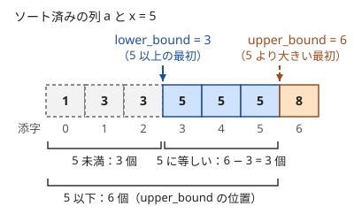

!!! abstract "要点"
    - **何ができるか**：単調な条件の境界を、ok 側と ng 側の不変条件を保ちながら区間を半分ずつ狭めて $O(\log N)$ で見つける。ソート済みの列では `lower_bound`・`upper_bound` で $x$ 以上の最初の位置や、$x$ 以下の要素の個数を求められる。
    - **いつ使うか**：
        - ソート済みの列で $x$ 以上の最初の位置・$x$ 以下の個数を求める。
        - 片方を固定して、もう片方が条件を満たす個数を数える。
        - 左右で最も近い要素を探す。
        - $N \le 2 \times 10^5$ 個の値に対して、$Q \le 2 \times 10^5$ 個の位置・個数の質問がある。
    - **計算量**：判定 1 回の計算量を $T$、探す範囲の幅を $N$ として $O(T \log N)$。ソート済みの列の `lower_bound`・`upper_bound` は 1 回 $O(\log N)$（前処理のソートに $O(N \log N)$）。
    - **前提**：[ソートで考える](../basics/sorting-techniques.md)

<!-- textlint-disable -->
別名：二分法・lower_bound・upper_bound・めぐる式二分探索・partition_point・binary search
<!-- textlint-enable -->

二分探索は、ある位置を境に条件の真偽が 1 回だけ切り替わるとき、その境界を候補の幅の $\log$ 回の判定で見つける方法である。基本の形は「ソート済みの列から $x$ 以上の最初の要素を探す」だが、本当に要るのは列ではなく条件の[単調性](../guide/glossary.md#monotonicity)である。競プロでは、全探索の内側の 1 重のループを二分探索に置き換えて $O(N^2)$ を $O(N \log N)$ にする使い方がよく出る。

## めぐる式（ok と ng の不変条件・初期値は判定しない番兵） {#meguru}

めぐる式二分探索は、境界の両側に 2 つの添字 ok と ng を置き、次の不変条件を保ちながら間を縮める書き方である。条件 $\mathrm{check}(i)$ は、$i$ を大きくすると偽から真へ高々 1 回だけ変わる（または真から偽へ高々 1 回だけ変わる）とする。列の外の番兵まで含めれば、ちょうど 1 回変わる。

- $\mathrm{check}(\mathrm{ok})$ は真、$\mathrm{check}(\mathrm{ng})$ は偽
- 初期値は、判定しなくても真偽が分かる[番兵](../guide/glossary.md#sentinel)の位置に置く。列の添字なら ng $= -1$、ok $= N$ のように列の外に置き、番兵の位置では $\mathrm{check}$ を呼ばない
- $\lvert \mathrm{ok} - \mathrm{ng} \rvert > 1$ の間、中点 mid を判定し、真なら ok $=$ mid、偽なら ng $=$ mid とする

$\lvert \mathrm{ok} - \mathrm{ng} \rvert = 1$ になったとき、ok は「条件を満たす最初（または最後）の位置」そのものである。不変条件から ok は真、隣の ng は偽なので、境界はちょうどその間にある。番兵の ok がそのまま残ったら「条件を満たす位置がない」という意味になる。

次の図は、列 $(2, 3, 3, 5, 7, 7, 7, 9)$ で条件「$a_i \ge 7$」を満たす最初の位置を探す様子である。

<div class="kp-viz" data-viz="binary-search" data-config='{"array": [2, 3, 3, 5, 7, 7, 7, 9], "target": 7}'></div>

図の流れを文章で追うと次のとおりである。

- ng $= -1$、ok $= 8$ から始める。どちらも列の外の番兵である
- mid $= 3$ では $a_3 = 5 < 7$ で偽なので ng $= 3$ にする
- mid $= 5$ では $a_5 = 7$ で真なので ok $= 5$ にする
- mid $= 4$ では $a_4 = 7$ で真なので ok $= 4$ にする。ok $-$ ng $= 1$ になったので止め、答えは 4 である

```cpp
--8<-- "binary-search/meguru.cpp:core"
```

**なぜ速いか**：mid は ok と ng の真ん中にあるので、1 回の判定で幅はおよそ半分になる。幅 $D$ から始めると、幅が 1 になるまでの判定は $\lceil \log_2 D \rceil$ 回である。$D = 2 \times 10^5$ なら 18 回、$D = 10^{18}$ でも 60 回で済む。

**番兵の利点**：ng と ok を列の外に置けば、「すべて真」「すべて偽」「列が空」の場合を分けずに同じループで扱える。mid は常に ng と ok の間にあるので、配列の外を読むこともない。

**向きを気にしなくてよい**：ループの条件を $\lvert \mathrm{ok} - \mathrm{ng} \rvert > 1$ にしておけば、ok と ng のどちらが大きい場合も同じコードで動く。たとえば「$a_i \le x$ を満たす最後の位置」なら、真の側が左にあるので ok $= -1$、ng $= N$ から始めればよい。ok $= -1$ が残ったら、条件を満たす位置はない。

条件 $\mathrm{check}$ は列の比較である必要はない。「添字 $i$ までの和が $S$ 以上か」「時刻 $t$ までに終わるか」のように、単調でさえあれば何でもよい。答えの値そのものを ok と ng にして判定するのが[答えで二分探索](../basics/binary-search-answer.md)である。

??? question "確認問題：最後の位置を探す"
    昇順の列 $a$ で、「$a_i < x$ を満たす最後の $i$」を求めたい。ok と ng の初期値をどう置き、答えが存在しない場合は何で分かるか。

    ??? success "答え"
        $a_i < x$ は左側で真、右側で偽なので、ok $= -1$、ng $= N$ から始める（どちらも判定しない番兵）。終わった時点の ok が答えで、ok $= -1$ のままなら $x$ 未満の要素はない。この ok は `lower_bound` の位置から 1 を引いたものと一致する。

## lower_bound・upper_bound と個数の数え方 {#lower-bound}

C++ の `lower_bound` と `upper_bound` は、昇順に並んだ範囲での二分探索を 1 行で書ける関数である。どちらも位置をイテレータで返すので、先頭を引いて添字にする。

- `lower_bound(a.begin(), a.end(), x)`：$x$ 以上の最初の要素の位置（なければ末尾）
- `upper_bound(a.begin(), a.end(), x)`：$x$ より大きい最初の要素の位置（なければ末尾）

返る位置の添字は「その位置より左にある要素の個数」でもある。だから個数を数えるのに使える。



| 知りたい個数 | 求め方 |
| --- | --- |
| $x$ 未満 | `lower_bound` の添字 |
| $x$ 以下 | `upper_bound` の添字 |
| $x$ に等しい | `upper_bound` $-$ `lower_bound` |
| $x$ 以上 | $N -$ `lower_bound` の添字 |
| 閉区間 $[l, r]$ に入る | `upper_bound(r)` $-$ `lower_bound(l)` |

**左右の最寄り**：$x$ に最も近い要素は、`lower_bound` が指す要素（$x$ 以上で最小）と、その 1 つ手前の要素（$x$ 未満で最大）の 2 つを比べれば分かる。列の両端に $-\infty$ と $+\infty$ の番兵を足しておくと、「手前がない」「後ろがない」の場合分けが要らなくなる。

```cpp
--8<-- "binary-search/count.cpp:core"
```

```cpp
--8<-- "binary-search/count.cpp:query"
```

番兵の値は、後で距離などを計算してもあふれない大きさにする。`long long` の上限は約 $9.2 \times 10^{18}$ で、$4 \times 10^{18}$ の番兵でも $x$ との差を 1 回取るだけなら収まる。しかし距離を 2 つ以上足し合わせると（力試しの ABC119 D の「$x$ から番兵まで」＋「番兵から次の地点まで」など）、番兵どうしの距離 $8 \times 10^{18}$ も足されて上限を超える。そこでこのコード片では番兵を $10^{18}$ にしている。

**降順の列**：降順に並べた列では、比較関数に `greater<>()` を渡す。`lower_bound(a.begin(), a.end(), x, greater<>())` は「$x$ 以下の最初の位置」を返す。

**述語の境界**：`partition_point(a.begin(), a.end(), pred)` は、`pred` が真から偽へ切り替わる最初の位置を返す。めぐる式のループを書かずに、任意の単調な条件で探せる。C++20 からは `ranges::lower_bound(a, x)` のように範囲を 1 つ渡す形も使える（[アルゴリズムの関数](../cpp/cpp-algorithms.md)）。

??? question "確認問題：x 以下の個数"
    昇順の列 $a$ で、$x$ 以下の要素の個数は `lower_bound` と `upper_bound` のどちらで求めるか。$x$ と等しい要素がある場合で確かめよ。

    ??? success "答え"
        `upper_bound` である。`upper_bound` は $x$ より大きい最初の位置を返すので、その左には $x$ 以下の要素がすべて並ぶ。`lower_bound` を使うと、$x$ に等しい要素が数えられずに漏れる。図の列で $x = 5$ なら、`upper_bound` の 6 が正しく、`lower_bound` の 3 では 5 が 3 個足りない。

## 片方を固定してもう片方を二分探索する {#fix-one-side}

2 つ（3 つ）の要素の組を数える・最適化する問題で全組を調べると、$O(N^2)$（$O(N^3)$）かかる。そこで 1 つを全探索で固定し、残りの 1 つが満たすべき条件を「ソート済みの列のある範囲に入る」形に直す。範囲の端は二分探索により $O(\log N)$ で求まるので、全体は 1 段軽くなる。

固定したときに相手の条件が範囲になる理由は、ソートによって「条件を満たす相手」が列の連続した部分に集まるからである。たとえば「$a + b \le D$」なら、$a$ を固定すると $b \le D - a$ は昇順の列の先頭からの範囲になる。

よく出る形は次のとおりである。

- **3 つ組は真ん中を固定する**：$a < b < c$ となる 3 つ組の数は、$b$ を固定すると「$b$ 未満の $a$ の個数」×「$b$ より大きい $c$ の個数」になる。左右を独立に数えられるので、$O(N^3)$ が $O(N \log N)$ になる
- **2 つを固定して 3 つ目を数える**：三角形の 3 辺のように、2 本を決めると 3 本目の上限が決まる形。$O(N^3)$ が $O(N^2 \log N)$ になる（[例題](#abc143_d)）
- **境界で分けて累積和でまとめる**：$\min(a + b, P)$ の総和のように式が場合分けされるなら、$a$ を固定して「$a + b < P$ になる $b$」の境界を二分探索で求める。境界の手前は $b$ の[累積和](../basics/prefix-sum.md)で、後ろは $P \times$ 個数でまとめて足す
- **作った列の上で探す**：列そのものではなく、列から作った単調な量（「$a_i$ より小さい数のうち列に現れないものの個数」など）を配列にして、その上で二分探索する

次のコードは、長さの列から三角形を作れる 3 本の組を数える。ソートした後、短い 2 本 $l_i \le l_j$ を固定すると、3 本目 $l_k$（$k > j$）の条件は $l_k < l_i + l_j$ だけになる。$l_k \ge l_j$ なので、ほかの 2 つの三角不等式は自動で成り立つ。この $k$ の範囲は $j + 1$ から「$l_i + l_j$ 以上の最初の位置」の手前までである。

```cpp
--8<-- "binary-search/triangles.cpp:core"
```

固定する側を小さい順に動かすと、相手の境界も一方向にしか動かないことが多い。そのときは[尺取り法](../basics/two-pointers.md)で $\log$ を外せる。書き間違いは二分探索の方が少ないので、$O(N \log N)$ で間に合うなら二分探索で書いてよい。

## 落とし穴 {#pitfalls}

**`(ok + ng) / 2` のあふれ**。`int` で ok と ng の和が上限（約 $2.1 \times 10^9$）を超えると（どちらも $1.1 \times 10^9$ 程度なら）あふれる。`long long` でも、ng を $5 \times 10^{18}$ や `LLONG_MAX` のような大きな番兵にすると同じことが起きる。差 ng $-$ ok が型に収まる範囲なら、`ok + (ng - ok) / 2` と書けばあふれない。C++20 の `std::midpoint(ok, ng)`（`<numeric>`）は差が収まらない場合もあふれず、ok 側へ丸める。

**負の数の丸め**。C++ の整数の割り算は 0 の方向へ切り捨てるので、`(-1) / 2` は $-1$ ではなく $0$ になる。`while (lo < hi) { mid = (lo + hi) / 2; … }` の中で真なら `hi = mid`、偽なら `lo = mid + 1` とする書き方は、mid が下へ丸められる前提で書かれている。lo $= -1$、hi $= 0$ では mid $=$ hi となり、真のとき区間が縮まず、ループが終わらない。めぐる式は $\lvert \mathrm{ok} - \mathrm{ng} \rvert \ge 2$ のときだけ中点を取る。どちらへ丸めても mid は ok と ng の間（両端を除く）から外れないので、この問題は起きない。

**`std::set` に `std::lower_bound` を使う**。`std::set` と `std::map` のイテレータは、ランダムアクセスできない。`lower_bound(s.begin(), s.end(), x)` は比較こそ $O(\log N)$ 回だが、イテレータを 1 つずつ進めるので 1 回 $O(N)$ かかり、クエリが多いと TLE になる。メンバ関数の `s.lower_bound(x)` を使えば $O(\log N)$ である（[順序付き集合](../ds/ordered-set.md)）。

**ソートし忘れ・ソートの基準の食い違い**。`lower_bound` は範囲が昇順であることを前提にする。昇順でない範囲を渡しても何かの位置を返すので、エラーは出ずに答えだけがずれる。降順にソートしたのに `greater<>()` を渡し忘れる、ペアを第 1 要素でソートしたのに第 2 要素で探す、というずれも同じ症状になる。

**番兵の位置で判定する**。列の外に置いた ng $= -1$ や ok $= N$ は「判定しなくても真偽が分かる」と約束した位置なので、$\mathrm{check}$ を呼ばない。呼ぶと配列の外を読む。これとは別に、ok を列の中や答えの候補の上限など実在の位置に置くときは、そこで本当に真かをループの前に確かめる。たとえば[答えで二分探索](../basics/binary-search-answer.md)の「答えがなければ $-1$」という問題なら、上限の候補が真でなければ $-1$ を出す。

**単調でない条件で探す**。「ちょうど $x$ に等しい最初の位置」のような条件は、等しい要素の前後で両方偽になるので単調でない。「$x$ 以上の最初の位置」を探してから、その要素が $x$ かを確かめる。

## 質問で二分探索する（インタラクティブ問題へ） {#interactive}

[インタラクティブ問題](../misc/interactive.md)では、隠れた情報を質問で聞き出す。質問の回数の上限が $\lceil \log_2 N \rceil$ 程度なら、二分探索を疑う。$N = 2 \times 10^5$ に対して 20 回、$N = 10^9$ に対して 30 回といった上限は、ちょうど $\log_2 N$ を少し超える値になっている。

ここでは[めぐる式](#meguru)をそのまま使う。めぐる式は、$\mathrm{check}(\mathrm{ok})$ が真・$\mathrm{check}(\mathrm{ng})$ が偽を保って間を縮める書き方だった。その判定 $\mathrm{check}(\mathrm{mid})$ を「mid について質問して答えを受け取る」に置き換えればよい。

- **両端の値が分かっている列**：先頭は 0、末尾は 1 と分かっている 0 と 1 の列なら、ok を末尾、ng を先頭に置く。先頭と末尾は質問しなくても値が分かるので、番兵として使える。mid の値を聞き、1 なら ok を、0 なら ng を mid に動かす。最後に ng と ok が隣り合ったところが、0 と 1 の隣り合う位置である。列が単調でなくても、両端の値が違えば境界の 1 つは必ず見つかる
- **範囲の個数を聞ける場合**：各行に印が高々 1 つで、閉区間 $[1, m]$（1-indexed の行）にある印の個数を聞けるなら、「個数が $m$ 未満（印のない行が含まれる）」は $m$ について単調である。$m$ を 1 増やしても個数は高々 1 しか増えないので、一度 $m$ 未満になれば $m$ 未満のままだからである。条件を満たす最小の $m$ を二分探索できる

質問 1 回で幅は半分にしかならないので、初期の幅 $D$ に対して $\lceil \log_2 D \rceil$ 回が要る。上限ぎりぎりの問題では、番兵の位置を質問しないことで 1〜2 回を節約できるかが効く。質問の出力の後に flush する作法などは[インタラクティブ問題](../misc/interactive.md)のページに任せる。

## 上位の手法へのつながり {#next-steps}

このページの境界の探し方は、次の手法の部品になる。

- **答えの値で探す**：列の位置ではなく「答えを $x$ にできるか」の判定で境界を探すと、最大値の最小化・最小値の最大化が解ける（[答えで二分探索](../basics/binary-search-answer.md#minimax)）。全部は並べられない値の $K$ 番目も、「$x$ 以下の個数 $\ge K$」の境界として求める（[K 番目の値を求める](../basics/kth-value.md#why-count)）
- **木の上で探す**：値が書き換わる列で「$l$ から足して初めて条件を破る位置」を探すなら、セグメント木を登って降りる手順で 1 回 $O(\log N)$ にする（[セグメント木上の二分探索](../ds/segment-tree-binary-search.md#what-it-does)）
- **多数の二分探索を同時に進める**：クエリごとに「単調な過程のどの時点で条件を満たすか」を探すなら、全クエリの探索を段ごとにまとめ、過程を段ごとに 1 回だけ流す（[並列二分探索](../ds/parallel-binary-search.md#procedure)）
- **DP を速くする**：長さごとの末尾の最小値を持つ配列は昇順に保たれるので、更新する場所を二分探索で決められる（[最長増加部分列](../dp/lis.md#binary-search)）

## 使い分け {#comparison}

- 固定する側を動かすと相手の境界も単調に動くなら、[尺取り法](../basics/two-pointers.md)で $O(N)$ にできる。二分探索は境界が単調に動かなくても使える
- 列の値が途中で書き換わるなら、ソート済みの配列は使えない。値の挿入・削除だけなら[順序付き集合](../ds/ordered-set.md)の `lower_bound`、区間の和や最大値で境界を探すなら[セグメント木上の二分探索](../ds/segment-tree-binary-search.md)を使う
- 列の位置ではなく答えの値を探すなら[答えで二分探索](../basics/binary-search-answer.md)、全部を並べられない量の K 番目なら[K 番目の値を求める](../basics/kth-value.md)に進む

## 例題 {#examples}

### ABC143 D. Triangles {#abc143_d}

<div class="kp-problems" data-role="example" markdown>

- [ABC143 D. Triangles](https://atcoder.jp/contests/abc143/tasks/abc143_d)（diff 686）：N 本の棒から 3 本を選んで三角形を作れる組の数を求める。

</div>

3 本すべてを選ぶと $O(N^3)$ で、$N \le 2000$ では約 $1.3 \times 10^9$ 通りになり間に合わない。長さをソートして短い 2 本を固定すると、3 本目の条件は「残りの棒のうち 2 本の和より短い」だけになり、その個数は `lower_bound` 1 回で数えられる。

??? note "解法の詳細"
    - 長さを昇順にソートする。添字 $i < j < k$ で選ぶことにすると、同じ組を重複して数えない。
    - $l_i \le l_j \le l_k$ なので、三角形になる条件は $l_k < l_i + l_j$ だけである。ほかの 2 つの不等式は $l_k$ が最長であることから成り立つ。条件は狭義の不等号で、等号のときは三角形にならない。
    - $i, j$ を固定し、範囲 $[j + 1, N)$ で $l_i + l_j$ 以上になる最初の位置を `lower_bound` で求める。その手前までの個数を足す。
    - 全体で $O(N^2 \log N)$。コードは[片方を固定してもう片方を二分探索する](#fix-one-side)の節のものと同じである。$i$ を固定して $j$ を増やすと境界は右へしか動かないので、尺取り法なら $O(N^2)$ にもなる。

## 練習問題 {#practice}

<div class="kp-problems" data-role="practice" markdown>

- [ABC302 D. Impartial Gift](https://atcoder.jp/contests/abc302/tasks/abc302_d)（diff 682）：2 つの数列から 1 つずつ選び、差が D 以下になる組の和の最大値を求める。
- [ABC299 D. Find by Query](https://atcoder.jp/contests/abc299/tasks/abc299_d)（diff 684）：先頭が 0・末尾が 1 の隠れた 0/1 の列について、隣と値が異なる位置を 20 回以内の質問で見つける。
- [ABC205 D. Kth Excluded](https://atcoder.jp/contests/abc205/tasks/abc205_d)（diff 713）：数列に含まれない正の整数のうち、小さい方から K 番目を答えるクエリに答える。
- [ABC321 D. Set Menu](https://atcoder.jp/contests/abc321/tasks/abc321_d)（diff 806）：主菜と副菜のすべての組について min(A + B, P) の総和を求める。
- [ARC084 C. Snuke Festival](https://atcoder.jp/contests/arc084/tasks/arc084_a)（diff 1096）：上段・中段・下段のパーツを 1 つずつ選び、上段 < 中段 < 下段 となる組合せの数を求める。

</div>

??? note "練習の方針"
    - **ABC302 D**：$B$ をソートし、各 $a$ について `upper_bound` で $a + D$ を超える最初の位置を求める。その 1 つ手前が $a + D$ 以下で最大の候補なので、それが $a - D$ 以上なら和を答えの候補にする。候補がなければ $-1$
    - **ABC299 D**：$S_l = 0$・$S_r = 1$ を保つ 2 つの位置 $l, r$ を持ち、中点 $m$ を質問して、値が 0 なら $l = m$、1 なら $r = m$ にする。$r = l + 1$ になったら $l$ が答えで、質問は約 $\log_2 N$ 回で済む。配列の代わりに質問で値を読むだけで、形は[めぐる式](#meguru)と同じである（[質問で二分探索する](#interactive)。入出力の作法は[インタラクティブ問題の例題](../misc/interactive.md#abc299_d)）
    - **ABC205 D**：昇順の $A$ について、$A_i$ より小さい「含まれない数」の個数は $A_i - (i + 1)$（0-indexed）で、$i$ について単調に増える。この配列の上で $K$ に対する境界を二分探索し、境界の手前の $A_i$ から残りの分だけ進めた値が答えになる
    - **ABC321 D**：$B$ をソートして累積和を作る。各 $a$ について $P - a$ 以上になる最初の位置を `lower_bound` で求め、手前は $a \times$ 個数 $+$ $B$ の累積和、後ろは $P \times$ 個数で足す。総和は `long long` で持つ
    - **ARC084 C**：3 つの列をソートし、中段の $b$ を固定する。上段で $b$ 未満の個数は `lower_bound`、下段で $b$ より大きい個数は $N -$ `upper_bound` で求め、積を足す

## 力試し {#challenge}

<div class="kp-problems" data-role="challenge" markdown>

- [ABC119 D. Lazy Faith](https://atcoder.jp/contests/abc119/tasks/abc119_d)（diff 1346）：数直線上の神社と寺の位置が与えられ、各クエリの地点から神社と寺を 1 つずつ訪れる最短距離を答える。

</div>

??? note "力試しの方針"
    - **ABC119 D**：最初に向かうのは、左右の最寄りの神社か寺の 4 か所のどれかで、その先は残りの種類の左右の最寄りへ行けばよい。神社と寺の列の両端に $\pm\infty$ の番兵を足し、`lower_bound` とその 1 つ手前で左右の最寄りを取り、組合せを全部試して最小を答える。番兵の値は距離を足してもあふれない大きさにする

## 参考 {#references}

- [drken「二分探索アルゴリズムを一般化 〜 めぐる式二分探索法のススメ 〜」](https://qiita.com/drken/items/97e37dd6143e33a64c8c)：めぐる式の ok と ng の不変条件と番兵の考え方
- [drken「AtCoder ABC 143 D - Triangles (3Q, 茶色, 400 点)」](https://drken1215.hatenablog.com/entry/2019/10/20/032700)：例題の 2 本を固定して lower_bound で数える方針と、尺取り法の別解
- [drken「AtCoder ABC 302 D - Impartial Gift (3Q, 茶色, 400 点)」](https://drken1215.hatenablog.com/entry/2023/05/30/024900)：練習の方針（upper_bound の 1 つ手前を候補にする）
- [drken「AtCoder ABC 205 D - Kth Excluded (2Q, 茶色, 400 点)」](https://drken1215.hatenablog.com/entry/2024/05/20/004045)：練習の方針（作った単調な配列の上で二分探索する）
- [drken「AtCoder ABC 321 D - Set Menu (2Q, 緑色, 400 点)」](https://drken1215.hatenablog.com/entry/2023/09/30/123700)：練習の方針（境界で分けて累積和でまとめる）
- [drken「AtCoder ABC 077 C - Snuke Festival (ARC 084 C) (3Q, 緑色, 300 点)」](https://drken1215.hatenablog.com/entry/2021/02/25/223800)：練習の方針（真ん中を固定して左右を数える）
- [drken「AtCoder ABC 119 D - Lazy Faith (1Q, 水色, 400 点)」](https://drken1215.hatenablog.com/entry/2019/02/24/230900)：力試しの方針（左右の最寄りと番兵）
