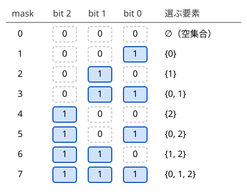
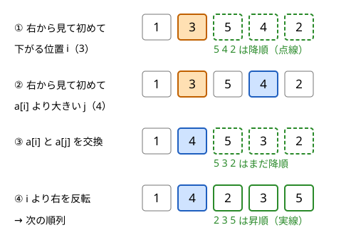

!!! abstract "要点"
    - **何ができるか**：$N \le 20$ 程度なら、部分集合 $2^N$ 通りを整数の各 bit で表して全部試せる。$N \le 8$〜$10$ なら、順列 $N!$ 通りを `next_permutation` で全部試せる。片側だけを全探索して残りを貪欲で決める型もよく出る。
    - **いつ使うか**：
        - $N \le 15$〜$20$ で各要素を「選ぶ／選ばない」。
        - $N \le 8$〜$10$ で並び順・割り当て・頂点の対応を決める。
        - スイッチの on/off、区切る／区切らない。
        - 各要素が 3 択で $N \le 12$ 程度（$3^N$ 通り）。
        - 2 つのグラフが頂点の付け替えで一致するか。
    - **計算量**：1 通りあたりの確認を $O(N)$ とすると、bit 全探索が $O(2^N N)$、$k$ 進の全探索は $O(k^N N)$、順列全探索は $O(N! \cdot N)$。$2^{20} \approx 10^6$、$3^{12} \approx 5.3 \times 10^5$、$8! = 40320$、$10! \approx 3.6 \times 10^6$ が目安である。
    - **前提**：[全探索の設計](../basics/brute-force.md)、[bit 演算の基本と XOR の性質](../basics/bit-operations.md)

<!-- textlint-disable -->
別名：ビット全探索・部分集合の全列挙・2^N 全探索・3 進全探索・next_permutation・N! 全探索・bit brute force
<!-- textlint-enable -->

bit 全探索は、$N$ 個の要素それぞれの 2 択を $0$ 以上 $2^N$ 未満の整数 1 つで表し、整数を 1 ずつ増やすだけで全部の組合せを試す方法である。順列全探索は、並び順を `next_permutation` で辞書順に 1 つずつ作り、全部の並びを試す方法である。どちらも書き方は数行で決まっているので、問題になるのは「何を全探索して、何を残りで決めるか」と、書き間違いの落とし穴である。

## bit 全探索の書き方（mask の i ビット目で要素 i を選ぶ） {#bitmask}

要素に $0$ から $N - 1$ の番号を付け、整数 $\mathrm{mask}$ の $i$ ビット目（$2^i$ の位）が 1 なら要素 $i$ を選ぶ、と決める。次の図は $N = 3$ の場合で、$\mathrm{mask} = 0, 1, \dots, 7$ の 8 個が、部分集合 8 個にちょうど 1 対 1 で対応する。



1 対 1 になる理由は 2 つある。どの部分集合 $S$ からも整数 $\sum_{i \in S} 2^i$ がただ 1 つ決まる。逆に $0$ 以上 $2^N$ 未満の整数の 2 進表記はただ 1 つに決まる。だから `for (mask = 0; mask < (1 << n); mask++)` と回せば、漏れも重複もなく全部の部分集合を 1 回ずつ調べられる。

次のコードは、和がちょうど $X$ になる選び方を数える。外側のループが部分集合を、内側のループが各要素の選ぶ・選ばないを読む。

```cpp
--8<-- "bit-full-search/subsets.cpp:core"
```

全体は $O(2^N N)$ で、$N = 20$ なら約 $2 \times 10^7$ 回の演算で済む。集合の和・差・要素の個数などの書き方は [bitDP の節](../dp/bit-dp.md#subsets-as-integers)の表にまとめてある。

2 択の意味は「選ぶ／選ばない」に限らない。よく出る読み替えは次のとおりである。

- **区切る／区切らない**：長さ $N$ の列の隙間は $N - 1$ 個あるので、区切り方は $2^{N-1}$ 通りである。$i$ ビット目が 1 なら要素 $i$ と $i + 1$ の間で区切る、と決める
- **on／off、表／裏、白／黒**：各要素の状態そのものを bit にする
- **符号の向き**：$+1$ と $-1$ を bit で選ぶ（[片側を bit で決めて残りは貪欲](#half-greedy)）

!!! tip "空集合と全体集合"
    $\mathrm{mask} = 0$ は「何も選ばない」、$\mathrm{mask} = 2^N - 1$ は「全部選ぶ」である。「少なくとも 1 つ選ぶ」「全部は消せない」などの条件があれば、その mask を飛ばすのを忘れない。

## k 進の全探索（3^N） {#base-k}

各要素が 3 択（3 つのグループのどれに入れるか、「使わない・A に使う・B に使う」など）なら、$0$ 以上 $3^N$ 未満の整数を 3 進数と見て、$i$ 桁目で要素 $i$ の行き先を決める。2 進のときと同じ理由で、整数と割り当て方は 1 対 1 に対応する。

3 進数の桁は bit 演算では取り出せないので、3 で割った余りを取ってから 3 で割る操作を $N$ 回繰り返す。次のコードは、$N$ 個の荷物を 3 台に分けて積み、最も重い台の重さを最小にする。

```cpp
--8<-- "bit-full-search/base3.cpp:core"
```

- **$3^N$ は整数で作る**：`pow(3, n)` の戻り値は `double` なので、整数へ直すときに丸めの誤差が入りうる。ループで 3 を掛けて作る
- **大きさの目安**：$3^{12} = 531441$、$3^{13} \approx 1.6 \times 10^6$、$3^{15} \approx 1.4 \times 10^7$ である。1 通りあたり $O(N)$ の処理なら $N \le 13$ 程度が安心できる範囲である
- **4 択なら 2 bit ずつ**：$4^N = 2^{2N}$ なので、要素 $i$ に $2i$ ビット目と $2i + 1$ ビット目を割り当てれば bit 演算のまま書ける
- **選択肢の数が要素ごとに違う**：桁ごとに基数を変えた整数（混合基数）でも書ける。ただし再帰で 1 つずつ決める方が読みやすい（[再帰による全列挙](../basics/recursive-enumeration.md)）

??? question "確認問題：グループの名前を区別しない場合"
    $N$ 人を 3 つのグループに分ける方法を、グループに名前のない分け方として数えたい。3 進の全探索で $3^N$ 通りを数えると、何が起きるか。

    ??? success "答え"
        グループの名前を入れ替えただけの割り当てを、別の分け方として数えてしまう。たとえば 3 つのグループがどれも空でない分け方は、名前の付け方が $3! = 6$ 通りあるので 6 回ずつ数えられる。ところが全員が 1 つのグループに入る分け方は、名前の付け方が 3 通りしかないので 3 回しか数えられない。だから単純に 6 で割るだけでは合わない。最小値や最大値を求めるだけなら重複して調べても答えは変わらないが、数え上げでは「まだ組のない最小番号の人をどの組に入れるか」で決める[再帰による全列挙](../basics/recursive-enumeration.md)を使う。

## 決めてから整合性を確かめる型 {#assume-and-check}

隠れた状態（誰が正直者か、どのスイッチが on か）を手がかりから推理する問題がある。推理の手順を考えるより、状態を全部仮定して矛盾がないかを確かめる方が速く確実である。状態が各人の 2 択で $N \le 15$ 程度なら、仮定は $2^N$ 通りしかない。

手順は次のとおりである。

1. $\mathrm{mask}$ で全員の状態を 1 つ仮定する
2. 仮定のもとで、すべての手がかりと矛盾しないかを確かめる
3. 矛盾しない仮定のうち、問われている量（正直者の人数など）の最大・最小・個数を答える

この型の要点は、2 の確認で「仮定のもとで正しいと分かっている情報」だけを使うことである。たとえば「正直者の証言は正しく、不親切な人の証言は正しいとは限らない」なら、仮定で正直者とした人の証言だけを確かめ、不親切な人の証言は読み飛ばす。不親切な人の証言は、たまたま正しくても矛盾にはならない。

推理で解こうとすると、「A が正直なら B も正直、B が正直なら C は……」と連鎖をたどる必要があり、場合分けの漏れが起きやすい。全部仮定すれば、確認は「仮定と手がかりを突き合わせる」だけの単純な処理になる。

??? question "確認問題：不親切な人の証言を確かめると"
    上の型で、不親切と仮定した人の証言について「証言が正しければ矛盾」として扱うと、答えはどう変わるか。

    ??? success "答え"
        不親切な人は正しいことを言ってもよいので、その扱いは条件を強めすぎている。本当はありうる仮定を誤って捨てるので、正直者の人数の最大値が小さく出ることがある。問題文が「不親切な人は必ず嘘をつく」と言っていない限り、不親切な人の証言は確かめない。

## 片側を bit で決めて残りは貪欲 {#half-greedy}

この節は[貪欲法の考え方と正当性](../basics/greedy-basics.md)を前提にする。選び方の全体は大きすぎて全探索できないが、その一部だけを全探索すると、残りが貪欲で決まる形になることがある。サインは、制約のうち 1 つだけが極端に小さいこと（$H \le 10$ で $W \le 1000$、3 種類の値の符号、など）である。

**縦横に切る問題**：$H \times W$ の盤面を縦横の線で切り分けるとき、$H$ だけが小さいなら横の切れ目 $2^{H-1}$ 通りを全探索する。横の切り方を決めると、盤面は横長の帯に分かれ、縦の切れ目だけが残る。縦の切れ目は左から列を足していき、条件を破る直前で切るのが最適である。どんな切り方と比べても、貪欲の $k$ 本目の切れ目はその切り方の $k$ 本目より左にならない（$k - 1$ 本目が左にないなら、そこから条件を破らずに伸ばせる範囲も左にならない、という帰納法による）。だから貪欲の本数は最小である。全体は $O(2^{H-1} \cdot HW)$ になる。この型は[力試しの問題](#challenge)にある。

**絶対値の和を符号の全探索で外す**：$\lvert X \rvert = \max(X, -X)$ なので、絶対値の和は符号の選び方についての最大値に書き直せる。

$$
\lvert X \rvert + \lvert Y \rvert + \lvert Z \rvert = \max_{s, t, u \in \{+1, -1\}} (sX + tY + uZ)
$$

$X, Y, Z$ はそれぞれ選んだ要素の値の合計とする。符号 $(s, t, u)$ を 8 通りのどれかに固定すると、要素 $i$ の評価値 $s x_i + t y_i + u z_i$ が決まり、目的は「評価値の和の最大化」になる。和を最大にするには、評価値の大きい順に必要な個数だけ取ればよい。「どの要素を選ぶか」と「どの符号か」の 2 つの最大化は順序を入れ替えてよいので、8 通りそれぞれの答えの最大が全体の答えである。

どちらも、全探索する側は「決めると残りの問題が単純になる」ものを選んでいる。全探索の対象を選ぶときは、制約の小さい方、または決めると独立な問題に分かれる方を探すとよい。

この型は、$2^N$ の全探索を 2 つに割る[半分全列挙](../basics/meet-in-the-middle.md)と混同されやすい。半分全列挙は両側とも全列挙して突き合わせるが、この型は片側だけを全列挙し、もう一方は貪欲（や簡単な DP）で最適を直接決める。

## 順列全探索と next_permutation（昇順から始める・重複要素） {#permutations}

並び順・訪問順・割り当て・頂点の対応を決める問題で $N \le 8$〜$10$ なら、$N!$ 通りの順列を全部試す。C++ では `next_permutation` が、列を辞書順で次の並びに書き換え、最後の並び（降順）だったときは `false` を返して昇順に戻す。

```cpp
--8<-- "bit-full-search/permutations.cpp:core"
```

- **昇順から始める**：`next_permutation` は今の並びより辞書順で後の並びしか作らない。入力の順のまま始めると、それより前の並びが抜ける。必ず `sort` してから `do { … } while (next_permutation(…));` の形で回す
- **重複要素**：同じ値があると、同じ並びは 1 回だけ出る。`1 1 2` なら $3! = 6$ ではなく 3 通りである。値を区別して数えたいときは、番号 $0, 1, \dots, N - 1$ の順列を回して、番号から値を引く
- **割り当て・対応は番号の順列で**：「頂点 $i$ を頂点 $p_i$ に対応させる」「人 $i$ に仕事 $p_i$ を割り当てる」のように、順列 $p$ を写像として読む。2 つのグラフが頂点の付け替えで一致するかは、$p$ を全部試し、すべての組 $i, j$ で「$i, j$ 間の辺の有無と $p_i, p_j$ 間の辺の有無が同じ」になる $p$ が 1 つでもあれば一致する（[小さいグラフの全探索](../graph/small-graph-brute-force.md)）

`next_permutation` の中身は次の 3 手である。まず、右端から見て初めて $a_i < a_{i+1}$ となる位置 $i$ を探す。次に、右端から見て初めて $a_j > a_i$ となる $j$ と交換する。最後に $i$ より右を反転する。そのような $i$ がなければ列全体が降順なので、全体を反転して昇順に戻し、`false` を返す。



$i$ より右は降順なので、その部分だけではもう辞書順で後の並びがない。だから位置 $i$ の値を、右側にある「$a_i$ より大きい最小の値」に替えるのが、辞書順で次の並びの最小の変え方である。交換した後も右側は降順のままなので、反転すれば昇順、つまり右側の最小の並びになる。1 回の呼び出しは $O(N)$ で済む。

**順列の数の目安**：$8! = 40320$、$9! = 362880$、$10! = 3628800$、$11! \approx 4.0 \times 10^7$、$12! \approx 4.8 \times 10^8$ である。1 通りあたり $O(N)$ の確認をするなら、$N = 10$ で約 $3.6 \times 10^7$ 回で間に合う。$N = 11$ 以上は確認を軽くしないと厳しい。

**巡回なら先頭を固定する**：出発点に戻る巡回路では、どこから数えても同じ巡回なので、先頭を頂点 $0$ に固定して残りの $(N - 1)!$ 通りだけを回せばよい。$N$ 倍速くなる。

??? question "確認問題：入力の順のまま回すと"
    `a = {2, 1, 3}` を `sort` せずに `do { … } while (next_permutation(a.begin(), a.end()));` で回すと、何通りの並びを調べるか。

    ??? success "答え"
        辞書順で `2 1 3` 以降の並び、つまり `2 1 3`・`2 3 1`・`3 1 2`・`3 2 1` の 4 通りだけである。`1 2 3` と `1 3 2` が抜ける。最後の `3 2 1` の次で `false` が返り、列は `1 2 3` に戻ってループが終わる。

## 落とし穴 {#pitfalls}

**`1 << i` のあふれ**：`1` は `int`（32 bit）なので、`1 << 31` は $2^{31}$ ではなく負の値 $-2^{31}$ になる（C++20 から規格で値が決まった。それより前も、GCC では同じ値になる）。`1 << 32` 以上はシフトの幅が型の bit 数以上なので、どの版でも未定義動作である。bit 全探索の $N$ は 20 程度なので普段は困らないが、mask を `long long` にして 32 bit 以上を使うときは `1LL << i` と書く（[整数のオーバーフロー](../cpp/cpp-integer-overflow.md)）。

**`==` と `&` の優先順位**：C++ では `==` が `&` より先に結合する。「$i$ ビット目が 0 か」のつもりで `mask >> i & 1 == 0` と書くと `(mask >> i) & (1 == 0)` になり、`1 == 0` は 0 なので常に偽になる。`mask & 1 << i == 0` も同じで、常に偽である。ビットの判定は `((mask >> i) & 1) == 0` のように括弧で囲む。`-Wall` を付けると「`&` の中の比較に括弧を付けよ」という警告が出るので、警告を消さずに読む。

**`(mask & (1 << i)) == 1` は $i \ge 1$ で常に偽**：`mask & (1 << i)` の値は 0 か $2^i$ で、1 にはならない。「0 でないか」で判定するか（`if (mask & (1 << i))`）、`(mask >> i) & 1` のように右へずらしてから 1 と比べる。

**空集合・全体集合の扱い**：$\mathrm{mask} = 0$（何も選ばない）が問題の条件で許されないのに答えに含めてしまう誤りが多い。逆に「1 つも選ばない」も数えるべきなのに、ループを 1 から始めて落とすこともある。

**`next_permutation` の前の `sort` 忘れ**：入力の順のまま回すと、辞書順でそれより前の並びが調べられない。入力例がたまたま昇順だと例は合ってしまうので気づきにくい。

**ループの中が重い**：$2^{20} \approx 10^6$ 通りそれぞれで $O(N^2)$ や `set` の操作をすると間に合わなくなる。全体の計算量は「通り数 × 1 通りの処理」で見積もり（[計算量の見積もり](../basics/complexity-estimation.md#count-candidates)）、1 通りの処理は $O(N)$ 程度に抑える。

??? question "確認問題：この判定はどこが悪いか"
    `if (mask & 1 << i == 1)` と書いた。意図は「$i$ ビット目が 1 なら」である。どう動くか。

    ??? success "答え"
        `==` が先に結合するので `mask & ((1 << i) == 1)` になる。`(1 << i) == 1` は $i = 0$ のときだけ真（1）なので、$i = 0$ では `mask & 1` で正しく動くが、$i \ge 1$ では `mask & 0` で常に偽になる。$i = 0$ だけ正しく動くので、小さい例では気づきにくい。

## 上位の手法へのつながり {#next-steps}

このページの「集合を整数で表して全部試す」は、次の手法の部品になる。

- **集合を状態にする DP**：順列の全探索のうち、将来に効くのが「使ったものの集合」と「最後に使ったもの」だけなら、$N!$ 通りを状態 $2^N N$ 個の DP にまとめられる（[bitDP](../dp/bit-dp.md#motivation)）
- **部分集合への分け方**：集合をグループに分ける遷移は、部分集合の部分集合を列挙して全体 $O(3^N)$ になる（[部分集合を列挙する DP](../dp/subset-enumeration-dp.md#submask-loop)）。部分集合にわたる和をまとめて求めるだけなら $O(2^N N)$ にできる（[高速ゼータ変換](../comb/zeta-mobius-subset.md)）
- **半分ずつ列挙する**：$N \le 40$ 程度なら前半と後半をそれぞれ bit 全探索し、ソートと二分探索で組み合わせる（[半分全列挙](../basics/meet-in-the-middle.md#combine-halves)）
- **小さいグラフの全探索**：頂点の対応（$N!$ 通り）や辺の部分集合を全部試す型は、グラフの同型判定や彩色に使う（[小さいグラフの全探索](../graph/small-graph-brute-force.md#isomorphism)）

## 使い分け {#comparison}

- **$N$ が 40 程度まで**：$2^{40}$ は全探索できない。前半と後半を $2^{20}$ 通りずつ列挙して突き合わせる[半分全列挙](../basics/meet-in-the-middle.md)を考える
- **途中までの選び方が合流する**：「訪れた集合と最後の位置」のように、途中の状態が集合で表せて、先の選び方がその状態だけで決まるなら、$N!$ や $2^N$ の全探索を [bitDP](../dp/bit-dp.md) にまとめられる。$N = 16$〜$20$ の訪問順は順列全探索では間に合わず、bitDP の出番である
- **要素ごとに選択肢の数が違う・途中で打ち切りたい**：[再帰による全列挙](../basics/recursive-enumeration.md)で 1 つずつ決めると書きやすく、枝刈りもできる
- **2 択の条件が偶奇（mod 2）だけで書ける**：スイッチと電球のような問題は、$N$ が大きくても mod 2 の連立方程式として[掃き出し法](../math/gaussian-elimination.md#mod-2)で解ける

## 例題 {#examples}

### ABC182 C. To 3 {#abc182_c}

<div class="kp-problems" data-role="example" markdown>

- [ABC182 C. To 3](https://atcoder.jp/contests/abc182/tasks/abc182_c)（diff 292）：整数の各桁を残すか消すかを選び、3 の倍数にするための最小の消去数を求める。

</div>

$N \le 10^{18}$ なので桁数は高々 19 で、各桁を「残す／消す」の 2 択にすると $2^{19} \approx 5.2 \times 10^5$ 通りしかない。3 の倍数かどうかは、残した桁の和を 3 で割った余りで判定できる。全部の桁を消すことは許されない。残す桁が 1 つもない mask は飛ばす。

??? note "解法の詳細"
    - $N$ を文字列として読み、桁数を $D$ とする。$i$ ビット目が 1 なら $i$ 桁目を残す、と決める。
    - $\mathrm{mask} = 1, \dots, 2^D - 1$（0 は全部消すので除く）について、残した桁の和 $s$ と消した桁の数を求める。$s \bmod 3 = 0$ なら、消した桁の数で答えを更新する。
    - どの mask でも 3 の倍数にならなければ $-1$ を出力する。全体で $O(2^D D)$。
    - 桁の和の余りを場合分けすれば $O(D)$ でも解けるが、場合分けの漏れを考えなくてよいのが全探索の利点である。

## 練習問題 {#practice}

<div class="kp-problems" data-role="practice" markdown>

- [ABC145 C. Average Length](https://atcoder.jp/contests/abc145/tasks/abc145_c)（diff 340）：N ≤ 8 個の町をすべて回る順序それぞれについて、経路の長さの平均を求める。
- [ABC232 C. Graph Isomorphism](https://atcoder.jp/contests/abc232/tasks/abc232_c)（diff 685）：頂点数 N ≤ 8 の 2 つの単純無向グラフが、頂点の番号を付け替えて一致するか（同型か）を判定する
- [ABC128 C. Switches](https://atcoder.jp/contests/abc128/tasks/abc128_c)（diff 805）：スイッチの on/off の組合せのうち、すべての電球が点くものの数を求める。
- [ABC197 C. ORXOR](https://atcoder.jp/contests/abc197/tasks/abc197_c)（diff 809）：数列をいくつかの連続した区間に区切り、各区間の OR をすべて XOR した値の最小値を求める。
- [ABC147 C. HonestOrUnkind2](https://atcoder.jp/contests/abc147/tasks/abc147_c)（diff 977）：各人の証言から、正直者の人数としてありうる最大値を求める。
- [ABC100 D. Patisserie ABC](https://atcoder.jp/contests/abc100/tasks/abc100_d)（diff 1331）：ケーキを M 個選び、綺麗さ・おいしさ・人気度それぞれの合計の絶対値の和を最大化する。

</div>

??? note "練習の方針"
    - **ABC145 C**：訪問順 $N!$ 通りを `next_permutation` で回し、各順の経路の長さを足し合わせて $N!$ で割る。小数で出力するので桁数を指定する
    - **ABC232 C**：頂点の対応 $p$ を $8!$ 通り回す。各 $p$ で、一方のグラフのすべての辺 $(a, b)$ に対し、もう一方に辺 $(p_a, p_b)$ があるかを隣接行列で確かめる。辺の数が同じなら、片側からの確認で足りる
    - **ABC128 C**：スイッチの状態を $2^N$ 通り回し、各電球について、つながったスイッチのうち on の個数の偶奇が指定どおりかを確かめる
    - **ABC197 C**：隣り合う要素の間の $N - 1$ か所それぞれに bit を 1 つ対応させ、bit が 1 の場所で区切ると決める。$2^{N-1}$ 通りそれぞれで、左から OR をためて区切りごとに XOR へ足し込む。全体で $O(2^N N)$ である
    - **ABC147 C**：正直者の集合を $2^N$ 通り仮定し、正直者とした人の証言だけを確かめる（[決めてから整合性を確かめる型](#assume-and-check)）
    - **ABC100 D**：3 つの値の符号の向きを 8 通り固定し、各ケーキの評価値を大きい順に $M$ 個取る（[片側を bit で決めて残りは貪欲](#half-greedy)）。合計は `long long` で持つ

## 力試し {#challenge}

<div class="kp-problems" data-role="challenge" markdown>

- [ABC159 E. Dividing Chocolate](https://atcoder.jp/contests/abc159/tasks/abc159_e)（diff 1450）：チョコレートを縦横に切り分け、どのブロックも白いマスが K 個以下になるための最小の切る回数を求める。

</div>

??? note "力試しの方針"
    - **ABC159 E**：$H \le 10$ なので横の切れ目を $2^{H-1}$ 通り全探索する。各通りで、左から列を足していき、どれかの帯の白いマスが $K$ を超える直前で縦に切る。1 列だけで $K$ を超える帯があれば、その横の切り方は不可能として捨てる。横と縦の切る回数の合計の最小が答えである

## 参考 {#references}

- [drken「AtCoder ABC 182 C - To 3 (3Q, 灰色, 300 点)」](https://drken1215.hatenablog.com/entry/2020/11/30/014517)：例題の制約と、桁の bit 全探索・全部消す場合の除外
- [hamayan「Average Length [AtCoder Beginner Contest 145 C]」](https://blog.hamayanhamayan.com/entry/2019/11/16/233917)：練習の方針（next_permutation による訪問順の列挙）
- [oraclesqlpuzzle「ABC232-C Graph Isomorphism」](https://oraclesqlpuzzle.ninja-web.net/kyoupro/05-atcoder-02-abc/kyoupro-abc232-c.html)：練習の方針（頂点の対応の全探索）
- [drken「AtCoder ABC 128 C - Switches (3Q, 緑色, 300 点)」](https://drken1215.hatenablog.com/entry/2019/06/15/135300)：練習の方針（スイッチの状態の全探索）と、mod 2 の連立方程式としての見方
- [drken「AtCoder ABC 147 C - HonestOrUnkind2 (2Q, 緑色, 300 点)」](https://drken1215.hatenablog.com/entry/2019/12/14/180200)：仮定して整合性を確かめる型と、正直者の証言だけを確かめること
- [drken「AtCoder ABC 100 D - Patisserie ABC (1Q, 水色, 400 点)」](https://drken1215.hatenablog.com/entry/2018/06/16/234000)：絶対値を符号の 8 通りの最大に直し、大きい順に取ること
- [drken「AtCoder ABC 159 E - Dividing Chocolate (1Q, 水色, 500 点)」](https://drken1215.hatenablog.com/entry/2020/03/23/002300)：横を全探索して縦を貪欲に決める型と、不可能な場合の除外
- [cpprefjp「std::next_permutation」](https://cpprefjp.github.io/reference/algorithm/next_permutation.html)：戻り値と、最後の並びの次で昇順に戻ること
