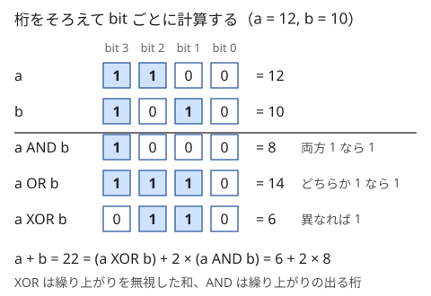
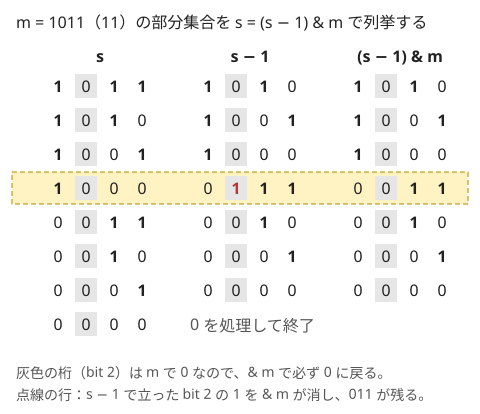

!!! abstract "要点"
    - **何ができるか**：XOR の打ち消し（$x \oplus x = 0$）、$a + b = (a \oplus b) + 2(a \text{ AND } b)$、$0$〜$n$ の XOR の周期などで式を簡単にする。部分集合の部分集合は $s \gets (s - 1) \text{ AND } m$ で列挙できる。
    - **いつ使うか**：
        - XOR・AND・OR が問題文に出る。
        - 自分以外の XOR・同じ値で打ち消す。
        - 2 進表記の 1 の個数。
        - $N \le 18$ 程度で、集合とその部分集合の組をすべて調べる（全体で $3^N$）。
    - **計算量**：AND・OR・XOR・シフト・popcount はどれも $O(1)$。$m$ の部分集合の列挙は $2^{\mathrm{popcount}(m)}$ 個で、$N$ 要素のすべての集合とその部分集合の組は合計 $3^N$ 個。
    - **前提**：なし

<!-- textlint-disable -->
別名：ビット演算・bitwise operations・popcount・submask・最下位ビット・XOR の打ち消し
<!-- textlint-enable -->

bit 演算は、整数を 2 進表記の桁の並びとみなし、桁ごとに計算する演算である。演算の定義は易しいが、競技プログラミングでは「XOR は 2 回で消える」「足し算と XOR の差は繰り上がり」といった性質を式変形に使う場面と、`1 << 31` や演算子の優先順位によるバグの方が問題になる。ここでは定義の確認は短くし、性質と落とし穴に重点を置く。

## AND・OR・XOR・シフトと演算子の優先順位 {#operators}

AND・OR・XOR は、2 つの整数の同じ桁どうしを独立に計算する。桁をそろえて並べると、各桁の結果はその桁の 2 つの値だけで決まる。



図の最後の行のように、AND・XOR と足し算の間には決まった関係がある（[XOR の性質](#xor-properties)）。C++ の演算子と、よく使う形は次のとおりである。添字 $i$ は最下位を 0 とする。

- `(x >> i) & 1`：$x$ の bit $i$ を取り出す（0 か 1）
- `x | (1LL << i)`・`x & ~(1LL << i)`・`x ^ (1LL << i)`：bit $i$ を 1・0 にする、反転する
- `x << k`・`x >> k`：$x \cdot 2^k$・$\lfloor x / 2^k \rfloor$（$x \ge 0$ のとき）

演算子の優先順位は、算術（`+`・`-`）→ シフト（`<<`・`>>`）→ 比較（`<`・`==`）→ `&` → `^` → `|` → `&&` の順に強い。bit 演算は比較より弱いので、直感と逆になる式がある。

- `x & 1 == 0` は `x & (1 == 0)`、すなわち `x & 0` で、常に偽になる。`(x & 1) == 0` と書く
- `1 << n - 1` は `1 << (n - 1)` である。`(1 << n) - 1`（下位 $n$ 桁がすべて 1）のつもりなら括弧が要る
- `a ^ b < c` は `a ^ (b < c)` になる

`-Wall` を付けると `x & 1 == 0` には括弧を勧める警告が出る。ただし警告に頼らず、bit 演算を含む式は常に括弧で囲むのが確実である。

## XOR の性質（打ち消し・a + b との関係・0〜n の XOR） {#xor-properties}

XOR は順番を入れ替えても、どこから計算しても結果が同じ（交換法則と結合法則）である。さらに次の 2 つが成り立つので、XOR は「同じ値を 2 回かけると消える足し算」として扱える。

$$
x \oplus 0 = x, \qquad x \oplus x = 0
$$

0 は XOR の[単位元](../guide/glossary.md#identity-element)で、各値は自分自身が逆元になる。ここから次の型が出てくる。

- **移項**：$a \oplus c = b$ の両辺に $a$ を XOR すると $c = a \oplus b$ になる。方程式の移項と同じで、符号は変わらない
- **自分以外の XOR**：全体の XOR を $T$ とすると、$A_i$ を除いた XOR は $T \oplus A_i$ である。逆に「自分以外の XOR」が全員分与えられたら、それらの XOR から全体を復元できる場合がある（$N$ が偶数なら、各 $A_i$ が $N - 1$ 回、すなわち奇数回現れて $T$ になる）
- **区間の XOR**：累積 XOR $P_0 = 0$、$P_{i+1} = P_i \oplus a_i$ とすると、半開区間 $[l, r)$ の XOR は $P_r \oplus P_l$ である。累積和の引き算が XOR に変わるだけで、$[0, l)$ の分が 2 回現れて消える

**足し算との関係**。1 桁ずつ足すとき、XOR は繰り上がりを無視した和の桁で、AND は繰り上がりが出る桁である。繰り上がりは 1 つ上の桁に足されるので 2 倍になる。

$$
a + b = (a \oplus b) + 2(a \text{ AND } b) = (a \text{ OR } b) + (a \text{ AND } b)
$$

ここから $a \oplus b \le a + b$ で、等号は $a \text{ AND } b = 0$（同じ桁に 1 が重ならない）ときに限る。「和と XOR が等しい」という条件は、「どの桁にも 1 が 2 つ以上ない」と言い換えられる。

**0〜n の XOR**。$f(n) = 0 \oplus 1 \oplus \dots \oplus n$ は $n \bmod 4$ だけで次のように決まる。

| $n \bmod 4$ | 0 | 1 | 2 | 3 |
| --- | --- | --- | --- | --- |
| $f(n)$ | $n$ | $1$ | $n + 1$ | $0$ |

理由は、偶数 $2k$ と次の $2k + 1$ が最下位の桁だけ違うので、$2k \oplus (2k + 1) = 1$ になることである。$n \bmod 4 = 3$ なら $0$〜$n$ は $(n + 1)/2$ 組（偶数個）の対に分かれ、1 が偶数回で $0$ になる。$n \bmod 4 = 1$ なら奇数組で $1$ になる。$n$ が偶数なら $f(n) = f(n - 1) \oplus n$ で、$n \bmod 4 = 0$ は $0 \oplus n = n$、$n \bmod 4 = 2$ は $1 \oplus n = n + 1$ になる。$a$ 以上 $b$ 以下の XOR は、区間の XOR と同じく $f(b) \oplus f(a - 1)$ で求まる。

```cpp
--8<-- "bit-operations/xor-range.cpp:core"
```

??? question "確認問題：和と XOR"
    非負整数 $a, b$ が $a + b = 10$、$a \oplus b = 6$ を満たすとき、$a \text{ AND } b$ はいくつか。また $a + b = 10$、$a \oplus b = 5$ を満たす $a, b$ はあるか。

    ??? success "答え"
        $a + b = (a \oplus b) + 2(a \text{ AND } b)$ より、$a \text{ AND } b = (10 - 6)/2 = 2$ である（例：$a = 2$、$b = 8$）。$a \oplus b = 5$ なら $10 - 5 = 5$ が奇数で 2 で割れないので、そのような $a, b$ はない。$a + b$ と $a \oplus b$ は最下位の桁が必ず一致する（偶奇が同じ）。

## popcount・最下位ビット {#popcount}

popcount は 2 進表記の 1 の個数で、集合を整数で表したときの要素数にあたる。GCC では `__builtin_popcountll(x)` が `long long` を受け取る。末尾に `ll` のない `__builtin_popcount` は `unsigned int` を受け取るので、`long long` を渡すと上位 32 桁が黙って切り捨てられる（[落とし穴](#pitfalls)）。C++20 の `std::popcount` は符号なし整数しか受け取らない（[数・ビット・乱数の関数](../cpp/cpp-math-functions.md)）。

最下位の 1（一番下の 1 の桁）は、次の 2 つの式で扱う。

- `x & -x`：最下位の 1 だけを残した値。$-x$ は 2 の補数で「全桁を反転して 1 を足す」なので、最下位の 1 より下は 0 のまま、その桁だけが $x$ と一致し、上の桁はすべて反転する
- `x & (x - 1)`：最下位の 1 を 0 にした値。$x - 1$ は最下位の 1 を 0 にし、それより下をすべて 1 にするので、AND を取ると最下位の 1 だけが消える

`x & (x - 1)` を 0 になるまで繰り返すと、1 の個数の回数だけで止まるので、立っている桁を順に処理するのに使える。また `(x & (x - 1)) == 0` は「$x$ が 2 のべき乗か 0」の判定になる。最上位の桁は、GCC の `__lg(x)` か C++20 の `std::bit_width(x) - 1` で求める（どちらも $x > 0$ のとき）。

最下位の 1 を取り出す・消す操作は、次の節の部分集合の列挙と、[BIT](../ds/fenwick-tree.md) の添字の動かし方（`i & -i` を足す・引く）に使われる。

## 部分集合の部分集合の列挙（3^N） {#submask}

$m$ の 1 の桁だけからなる整数（$m$ の部分集合。submask とも言う）をすべて列挙したいとき、$0$〜$m$ をすべて調べて `(s & m) == s` かを確かめると、$m$ が大きいと間に合わない。$s$ から始めて $s \gets (s - 1) \text{ AND } m$ を繰り返すと、$m$ の部分集合だけを大きい順にちょうど 1 回ずつたどれる。



$s - 1$ は最下位の 1 を 0 にし、それより下の桁をすべて 1 にする。そこへ $m$ との AND を取ると、下の桁は $m$ にある桁だけが残る。結果は「$s$ より小さい $m$ の部分集合のうち最大のもの」になるので、漏れも重複もない。

??? note "証明"
    $s$ を $m$ の部分集合、$s$ の最下位の 1 を bit $p$ とする。$t = (s - 1) \text{ AND } m$ は、bit $p$ より上が $s$ と同じ、bit $p$ が 0、bit $p$ より下が $m$ と同じである。$s$ より小さい $m$ の部分集合 $u$ を上の桁から $s$ と比べ、最初に違う桁を $q$ とすると、そこで $s$ は 1、$u$ は 0 である。$s$ の bit $p$ より下は 0 なので $q \ge p$ である。$q = p$ なら $u$ は bit $p$ より上が $t$ と同じで、下の桁は $m$ の部分集合なので $u \le t$ になる。$q > p$ なら bit $q$ で $t$ は 1、$u$ は 0 で、それより上は等しいので $u < t$ である。よって $t$ は $s$ より小さい部分集合の最大で、列挙は大きい順に 1 つも飛ばさない。

```cpp
--8<-- "bit-operations/submask.cpp:core"
```

ループの終わり方に注意する。$s = 0$ も $m$ の部分集合だが、`for (s = m; s > 0; s = (s - 1) & m)` と書くと 0 を処理せずに止まる。逆に止める条件を書かないと、$(0 - 1) \text{ AND } m = m$ に戻って無限に回る。0 を処理してから `break` する形が安全である。

**全体で $3^N$ になる理由**。$N$ 要素のすべての集合 $t$ について、$t$ の部分集合 $s$ を列挙すると、組 $(t, s)$ の数は $3^N$ である。各要素は「$t$ に入らない」「$t$ に入り $s$ に入らない」「$s$ に入る」の 3 通りで、組と 3 通りの選び方の列が 1 対 1 に対応するからである（式では $\sum_t 2^{\mathrm{popcount}(t)} = \sum_k \binom{N}{k} 2^k = 3^N$）。

```cpp
--8<-- "bit-operations/submask.cpp:all-pairs"
```

$3^{15} \approx 1.4 \times 10^7$、$3^{16} \approx 4.3 \times 10^7$、$3^{18} \approx 3.9 \times 10^8$ なので、$N \le 16$ 程度なら軽く、$N = 18$ は中身の軽いループでなければ苦しい。$2^N \times 2^N = 4^N$ と見積もると多すぎて諦めてしまうので、3 通りの数え方を覚えておく。この形は「集合 $t$ を、1 つのグループ $s$ と残り $t \setminus s$ に分ける」DP の遷移にそのまま使う（[部分集合を列挙する DP](../dp/subset-enumeration-dp.md)）。

??? question "確認問題：列挙の回数"
    $N = 20$ のとき、すべての集合 $t$ とその部分集合 $s$ の組を列挙すると何回になるか。2 秒の制限で間に合うか。

    ??? success "答え"
        $3^{20} \approx 3.5 \times 10^9$ 回で、中身が軽くても C++ の目安（1 秒に $10^8$〜数×$10^8$ 回）を大きく超える。部分集合の和をまとめて求めたいだけなら、[高速ゼータ変換](../comb/zeta-mobius-subset.md)で $O(2^N N)$ にできないかを考える。

## 落とし穴（1 << 31 のあふれ・符号付きの右シフト） {#pitfalls}

**`1 << k` は int で計算される**。`1` は `int` なので、`long long b = 1 << 31;` は `int` で計算してから広げられ、$-2147483648$ になる（C++20 以降は値が決まっているので、警告も出ない）。$k \ge 32$ では未定義動作で、`-O2` では 0 などのでたらめな値になる。`long long` の桁を扱うときは `1LL << k` と書く（[整数のオーバーフロー](../cpp/cpp-integer-overflow.md)）。

**`__builtin_popcount` に `long long` を渡す**。`unsigned int` に切り詰められ、上位 32 桁の 1 が数えられない。警告は出ない。`long long` には `__builtin_popcountll` を使う。`__builtin_ctz`・`__builtin_clz` も同じで、さらに 0 を渡すと未定義動作になる。

**負の数の右シフトは割り算と丸めが違う**。C++20 以降、符号付きの右シフトは符号の桁で埋める（算術シフト）と決まり、`-7 >> 1` は $-4$（下へ丸める）になる。一方 `-7 / 2` は $-3$（0 へ丸める）である。負になりうる値を `>> 1` で半分にすると、`/ 2` と結果が変わる。bit 演算の対象は非負の値か符号なし型に限ると安全である。

**桁の数が足りない**。値が $10^{18}$ まであるなら 60 桁（$2^{60} \approx 1.15 \times 10^{18}$）を調べる。`for (int i = 0; i < 30; i++)` のように `int` の感覚で桁数を決めると、上の桁を見落とす。

**優先順位**。`x & 1 == 0`・`1 << n - 1` などは[演算子の優先順位](#operators)のとおり意図と違う式になる。bit 演算を含む式は括弧で囲む。

??? question "確認問題：どこが誤りか"
    $0 \le x < 2^{60}$ の `long long x` について、bit 40 が立っているかを `if (x & (1 << 40))` で調べた。何が起きるか。

    ??? success "答え"
        `1 << 40` は `int` のシフトで、幅が 32 以上なので未定義動作である（GCC は警告を出すが、値は 0 などになる）。bit 40 が立っていても判定が偽になりうる。`(x >> 40) & 1` か `x & (1LL << 40)` と書く。

## 上位の手法とのつながり {#next-steps}

このページの性質は、次の手法の部品になる。

- **bit ごとに独立に考える**：AND・OR・XOR の結果は桁ごとに独立に決まる。そこで 1 の個数を桁ごとに数え、$2^k$ を掛けて足す。全ペアの XOR の和や、$0$〜$N$ の popcount の和がこの型である（[bit ごとに独立に考える](../basics/bitwise-independence.md)）。足し算は繰り上がりがあるので桁ごとに分けられない
- **集合を整数で表す**：要素 $i$ を bit $i$ に対応させると、和集合は OR、共通部分は AND、要素数は popcount になる。小さい $N$ の全探索（[bit 全探索と順列全探索](../basics/bit-full-search.md)）と、集合を状態にする DP（[bitDP](../dp/bit-dp.md#subsets-as-integers)）の土台である
- **部分集合の列挙**：$3^N$ の列挙は、集合をグループに分ける DP の遷移になる（[部分集合を列挙する DP](../dp/subset-enumeration-dp.md)）
- **XOR を足し算とみなす**：XOR は繰り上がりのない足し算なので、掃き出し法で「選んだ値の XOR で作れる値」を調べられる（[XOR 基底](../math/xor-basis.md)）。XOR が絡む問題の型は [XOR](../patterns/xor.md) のページにまとめてある

## 例題 {#examples}

### ABC269 C. Submask {#abc269_c}

<div class="kp-problems" data-role="example" markdown>

- [ABC269 C. Submask](https://atcoder.jp/contests/abc269/tasks/abc269_c)（diff 384）：N の 2 進表記で 1 が立っている bit だけを使って表せる整数を、すべて昇順に出力する。

</div>

求めるのは $N$ の部分集合の全列挙そのものである。$N < 2^{60}$ と大きいので $0$〜$N$ を調べることはできないが、$N$ の 1 の個数が 15 個以下と制約にあるので、部分集合は $2^{15} = 32768$ 個以下で済む。$s \gets (s - 1) \text{ AND } N$ で列挙し、大きい順に出てくるので反転して出力する。

??? note "解法の詳細"
    - $s = N$ から始め、$s$ を記録してから $s \gets (s - 1) \text{ AND } N$ に進む。$s = 0$ を記録したら止める。[部分集合の部分集合の列挙](#submask)のコードと同じである
    - 値は $2^{60}$ 近くまであるので、$N$ と $s$ は `long long` で持つ
    - 記録した列を反転すれば昇順になる（ソートしてもよい）。計算量は $O(2^{\mathrm{popcount}(N)})$
    - 別の方法として、$N$ の 1 の桁の位置を配列に集め、その上で bit 全探索をしてもよい

## 練習問題 {#practice}

<div class="kp-problems" data-role="practice" markdown>

- [ABC213 A. Bitwise Exclusive Or](https://atcoder.jp/contests/abc213/tasks/abc213_a)（diff 33）：A xor C = B となる C を求める。
- [ABC356 D. Masked Popcount](https://atcoder.jp/contests/abc356/tasks/abc356_d)（diff 886）：0 から N までの各 k について popcount(k AND M) を足した値を求める。
- [ABC121 D. XOR World](https://atcoder.jp/contests/abc121/tasks/abc121_d)（diff 1164）：A 以上 B 以下の整数をすべて XOR した値を求める。

</div>

??? note "練習の方針"
    - **ABC213 A**：両辺に A を XOR して移項すると $C = A \oplus B$ になる
    - **ABC356 D**：和の順序を入れ替え、M で 1 の桁 $d$ ごとに「$0$〜$N$ のうち bit $d$ が 1 の数の個数」を足す。bit $d$ は長さ $2^{d+1}$ の周期で 0 と 1 が $2^d$ 個ずつ並ぶ。個数は周期の数と半端な部分から $O(1)$ で求まる（下のコード）。答えは 998244353 で割った余りを出力する
    - **ABC121 D**：$f(n) = 0 \oplus \dots \oplus n$ を $n \bmod 4$ で求め、$f(B) \oplus f(A - 1)$ を出力する（$A = 0$ なら $f(B)$）。[XOR の性質](#xor-properties)のコードがそのまま使える

    ```cpp
    --8<-- "bit-operations/count-bit.cpp:core"
    ```

## 参考 {#references}

- [drken「AtCoder ABC 269 C - Submask (3Q, 灰色, 300 点)」](https://drken1215.hatenablog.com/entry/2024/07/07/222412)：例題の制約と、$(s - 1) \text{ AND } N$ による列挙・0 の扱い
- [drken「AtCoder ABC 213 A - Bitwise Exclusive Or (6Q, 灰色, 100 点)」](https://drken1215.hatenablog.com/entry/2021/08/09/011200)：XOR の移項
- [drken「AtCoder ABC 356 D - Masked Popcount (1Q, 緑色, 400 点)」](https://drken1215.hatenablog.com/entry/2024/06/08/041849)：bit ごとに 1 の個数を数える方針と法
- [drken「AtCoder ABC 121 D - XOR World (1Q, 緑色, 400 点)」](https://drken1215.hatenablog.com/entry/2019/03/09/224100)：$[0, B]$ と $[0, A - 1]$ への分解と、偶数と次の奇数の対で 1 になること
