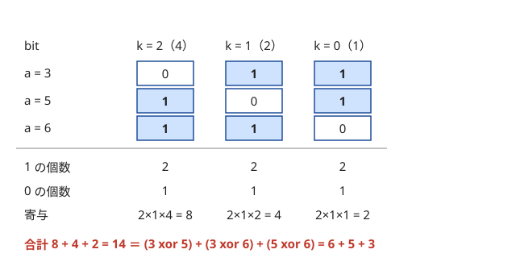

!!! abstract "要点"
    - **何ができるか**：XOR・AND・OR の結果の bit $k$ は、元の値の bit $k$ だけで決まる。だから bit ごとに 0 と 1 の個数を数え、bit $k$ の答えに $2^k$ を掛けて足せば、全ペア・全区間の集計が $O(N^2)$ から $O(NB)$ になる。値そのものの最大化・最小化は上の bit から決める。繰り上がりで bit どうしが干渉する足し算には、そのままでは使えない。
    - **いつ使うか**：
        - 全ペア・全区間の XOR の総和を求める。
        - AND・OR・XOR の最大化・最小化。
        - $x$ を選んで $\max_i (a_i \oplus x)$ を最小化する。
        - $a + b = a \oplus b$（繰り上がりがない）という条件がある。
        - $A_i < 2^{30}$〜$2^{60}$ で、全ペア（$N \le 2 \times 10^5$）の値を集計する。
    - **計算量**：値が $2^B$ 未満のとき、bit ごとに数える集計は $O(NB)$。上位ビットで 2 つに分ける再帰も $O(NB)$。$B$ は 30〜60 なので、$N = 2 \times 10^5$ でも $10^7$ 回程度で済む。
    - **前提**：[bit 演算の基本と XOR の性質](../basics/bit-operations.md)、[主客転倒・寄与](../thinking/contribution.md)

<!-- textlint-disable -->
別名：bit ごとの寄与・桁ごとに見る・bit ごとに分解・上位ビットから決める・XOR の和・bitwise decomposition
<!-- textlint-enable -->

bit ごとに独立に考えるとは、XOR・AND・OR を含む集計や最適化を、bit $k$ ごとの、0 と 1 だけの小さな問題へ分けて解く考え方である。0 と 1 だけなら「1 の個数」「偶奇」で数えられ、最後に $2^k$ の重みを付けて足し戻せばよい。[主客転倒・寄与](../thinking/contribution.md)の「答えを部品の寄与の和に分ける」を、bit を部品にして使ったものと見てよい。

## bit ごとの寄与（0 の個数 × 1 の個数 × 2^k） {#per-bit-contribution}

全ペアの XOR の和 $\sum_{i < j} (a_i \oplus a_j)$ を素朴に求めると、ペアが $N(N-1)/2$ 個あるので $N = 2 \times 10^5$ では約 $2 \times 10^{10}$ 回になり間に合わない。そこで和を bit ごとに分ける。

整数 $x$ は $x = \sum_k 2^k \cdot \mathrm{bit}_k(x)$ と書ける（$\mathrm{bit}_k(x)$ は $x$ の bit $k$ で 0 か 1）。XOR は bit ごとの演算なので $\mathrm{bit}_k(a \oplus b) = \mathrm{bit}_k(a) \oplus \mathrm{bit}_k(b)$ で、ほかの bit の影響を受けない。和の順序を入れ替えると次のようになる。

$$
\sum_{i < j} (a_i \oplus a_j) = \sum_k 2^k \cdot \#\{(i, j) \mid i < j,\ \mathrm{bit}_k(a_i) \ne \mathrm{bit}_k(a_j)\}
$$

bit $k$ が 1 の要素を $c_k$ 個とすると、bit $k$ が異なるペアは「1 の要素から 1 つ、0 の要素から 1 つ」選ぶので $c_k (N - c_k)$ 個ある。答えは $\sum_k c_k (N - c_k) 2^k$ で、$c_k$ を数えるのは bit ごとに $O(N)$ だから全体で $O(NB)$ になる。



図は $a = (3, 5, 6)$ の例である。3 組の XOR は $6, 5, 3$ で和は 14 である。bit ごとに数えればペアを 1 つも作らずに同じ 14 が出る。

```cpp
--8<-- "bitwise-independence/pair-xor-sum.cpp:core"
```

AND と OR も同じ形で数えられる。違うのは「bit $k$ が 1 になるペアの数」だけである。

| 演算 | bit $k$ が 1 になる条件 | ペアの数 |
| --- | --- | --- |
| XOR | 0 と 1 が 1 つずつ | $c_k (N - c_k)$ |
| AND | 両方とも 1 | $\binom{c_k}{2}$ |
| OR | 少なくとも一方が 1 | $\binom{N}{2} - \binom{N - c_k}{2}$ |

??? question "確認問題：区間ではなく部分集合なら"
    $N$ 個の整数から空でない部分集合を選ぶ方法は $2^N - 1$ 通りある。すべての部分集合について「選んだ要素の XOR」を足した値は、bit ごとにどう数えればよいか。

    ??? success "答え"
        bit $k$ が 1 になるのは、bit $k$ が 1 の要素を奇数個選んだときである。$c_k \ge 1$ なら、そのような部分集合は $2^{N-1}$ 通りある（bit $k$ が 1 の要素を 1 つ決めておき、それを入れるか入れないかで偶奇を合わせられる）。$c_k = 0$ なら 0 通り。答えは「どれかの要素で 1 になっている bit」すなわち全要素の OR を $S$ として $S \cdot 2^{N-1}$ になる。

## 区間の XOR は累積 XOR の 0・1 の個数で {#range-xor}

すべての区間 $[l, r)$ の XOR の和も bit ごとに数えられる。鍵は、XOR が自分自身で打ち消せる（$x \oplus x = 0$）ことで、[累積和](../basics/prefix-sum.md)と同じ形の累積 XOR が使えることである。添字は 0-indexed で、$s_0 = 0$、$s_{i+1} = s_i \oplus a_i$ とすると次が成り立つ。

$$
a_l \oplus a_{l+1} \oplus \dots \oplus a_{r-1} = s_l \oplus s_r
$$

これで「区間の XOR」が「$0 \le l < r \le N$ を満たす $s$ のペアの XOR」に言い換わる。$s_0, \dots, s_N$ の $N + 1$ 個について、前の節と同じく bit ごとに 0 と 1 の個数を数えれば、全区間の和は $O(NB)$ で求まる。

問題が「長さ 2 以上の区間」だけを求めるなら、長さ 1 の区間（$a_i$ そのもの）の和 $\sum_i a_i$ を最後に引けばよい。次のコードは、右端 $r$ を動かしながら「$s_r$ と bit $k$ が異なる $s_l$ ($l < r$) の個数」を足していく形で書いている。全体の 0・1 の個数から $c(N + 1 - c)$ と一度に求めても同じである。

```cpp
--8<-- "bitwise-independence/pair-xor-sum.cpp:range"
```

$a = (3, 5, 6)$ なら $s = (0, 3, 6, 0)$ で、$s$ の全ペアの XOR の和は 23、そこから $3 + 5 + 6 = 14$ を引いた 9 が長さ 2 以上の区間の和（$6 + 3 + 0$）である。

AND・OR は累積で打ち消せない。逆の操作がないので、区間の AND を $s_l$ と $s_r$ から求めることはできない。区間の AND・OR が要るときは、bit ごとに「1 の個数の累積和」を持って区間の中の 1 の個数を数えるか、[Sparse Table](../ds/sparse-table.md#idempotent) を使う。1 の個数が区間の長さに等しければ AND の bit が 1、1 個以上なら OR の bit が 1 である。

## 上の bit から決める貪欲（上限は桁 DP の考え方） {#top-down}

2 つの非負整数の大小は、異なる最も上の bit で決まる。bit $k$ の重み $2^k$ は、それより下の bit をすべて 1 にした値 $2^k - 1$ より大きいからである。だから「1 つの値を最大（最小）にする」問題では、上の bit から順に、その bit を 1 にできるか（0 にできるか）を確かめて決めてよい。下の bit をどう決めても、上の bit の 1 つの差を取り返せない。

たとえば「2 つ選んだときの AND の最大値」は次のように求める。候補の集合を全体から始め、上の bit $k$ から順に「候補のうち bit $k$ が 1 の要素が 2 個以上あるなら、候補をそれらに絞る」をくり返す。最後に残った候補から 2 つ選べば、その AND が最大である。bit ごとに候補を 1 回なめるので $O(NB)$ である。

```text
cand ← 全要素
for k = B−1 から 0 まで:
    one ← cand のうち bit k が 1 の要素
    if |one| ≥ 2: cand ← one       # bit k を答えに含められる
答え ← cand から 2 つ選んだ AND
```

**和の最大化は上の bit 優先にならない**。$f(X) = \sum_i (X \oplus a_i)$ のように、目的が bit ごとの寄与の和になっている場合は事情が違う。bit $k$ の寄与は「$X$ と bit $k$ が異なる $a_i$ の個数」×$2^k$ で、個数は最大 $N$ なので、下の bit の寄与が上の bit を上回ることがある。上限がなければ、bit ごとに「0 の $a_i$ が多ければ $X$ の bit を 1」と独立に決めればよい。順序は関係ない。

**上限 $X \le K$ があると bit どうしがつながる**。$X \le K$ は bit ごとに分かれない条件だからである。そこで $X$ が $K$ と初めて食い違う bit $d$ で場合分けする。$d$ より上の bit を $K$ と同じにし、bit $d$ を（$K$ が 1 のところで）0 にすると、$d$ より下は自由に選べる。上が $K$ と同じで bit $d$ が $K$ より小さいので、下の bit をどう選んでも $X < K$ になるからである。自由な部分は上限なしと同じく、bit ごとに多数決で決められる。$d$ の選び方は $K$ の 1 の bit の数だけあり、$X = K$ の場合も足して、$B + 1$ 通り以下の候補を比べればよい。これは[桁 DP](../dp/digit-dp.md) の「上限と一致しているか」のフラグを、場合分けで書いたものである。

```text
best ← f(K)                        # X = K の場合
for d = B−1 から 0 まで:
    if K の bit d が 1:
        X ← K の bit d より上をそのまま、bit d を 0 に
        bit d より下の各 bit j は、bit j が 0 の a_i が多ければ 1
        best ← max(best, f(X))
```

たとえば $a = (4, 0, 0)$、$K = 4$ なら、候補は $X = K = 4$ と、$d = 2$ で食い違う $X = 3$（下の 2 bit は 0 の $a_i$ が 3 個なので 1）の 2 つである。$f(4) = 8$、$f(3) = 13$ を比べて 13 が答えになる。

??? question "確認問題：上限つきの貪欲"
    $f(X) = \sum_i (X \oplus a_i)$ を $0 \le X \le K$ で最大にしたい。上の bit から「1 にしても $K$ を超えず、その bit の寄与が増えるなら 1 にする」貪欲は正しいか。

    ??? success "答え"
        正しくない。$a = (4, 0, 0)$、$K = 4$ とする。bit 2 を 1 にすると寄与は $1 \cdot 4$ から $2 \cdot 4$ に増えるので貪欲は $X = 4$ を選び、下の bit は $K$ を超えないよう 0 になって $f(4) = 0 + 4 + 4 = 8$。ところが $X = 3$ なら $f(3) = 7 + 3 + 3 = 13$ で大きい。bit 2 で 4 を得る代わりに、bit 1 と bit 0 でそれぞれ 3 個ずつ立つ分（$6 + 3 = 9$）を失っている。和の最大化では、$K$ と食い違う位置で場合分けする。

## 上位ビットで 2 つに分けて再帰する {#split-by-top-bit}

この節は、上の bit から決める考え方（[前の節](#top-down)）と再帰を使う。同じ木を明示的に作るのが [Binary Trie](../ds/binary-trie.md#build) である。

「$x$ を 1 つ選んで $\max_i (a_i \oplus x)$ を最小にする」では、要素ごとに望む $x$ の bit が違う。bit $k$ で $a_i$ に 0 と 1 が混ざっていると、$x$ の bit $k$ をどちらにしても、どれかの要素は bit $k$ が 1 になる。このとき最大値は $2^k$ 以上で、その最大値を作るのは bit $k$ が 1 になった側のグループだけである。もう一方のグループの値は $2^k$ 未満なので、下の bit をどう決めても最大値には関わらない。

これを式にする。集合 $S$ の bit $k$ 以下だけを見たときの答えを $f(S, k)$ とし、$S$ を bit $k$ が 0 の $S_0$ と 1 の $S_1$ に分ける。

$$
f(S, k) =
\begin{cases}
0 & (k < 0) \\
f(S, k-1) & (S_0 \text{ と } S_1 \text{ の一方が空}) \\
2^k + \min\bigl(f(S_0, k-1),\ f(S_1, k-1)\bigr) & (\text{どちらも空でない})
\end{cases}
$$

一方が空なら、$x$ の bit $k$ を全員の bit $k$ にそろえれば全員 0 にでき、bit $k$ は答えに入らない。両方あるときは、$x$ の bit $k$ を $S_1$ に合わせると $S_0$ 側が 1 になって答えは $2^k + f(S_0, k-1)$、逆なら $2^k + f(S_1, k-1)$ なので、小さい方を選ぶ。

```text
solve(S, k):
    if k < 0 or S が空: return 0
    S0, S1 ← S を bit k で分ける
    if S0 が空: return solve(S1, k−1)
    if S1 が空: return solve(S0, k−1)
    return 2^k + min(solve(S0, k−1), solve(S1, k−1))
```

再帰の 1 段（同じ $k$）では、各要素はちょうど 1 つの $S$ に入っているので、分ける手間は合わせて $O(N)$ である。段は $B$ 個なので全体で $O(NB)$ になる。$a$ を先にソートしておくと、bit $k$ で分けたグループは配列の連続した区間になり、新しい配列を作らずに添字の範囲で再帰できる。

この再帰は、上位ビットから 0・1 で枝分かれする二分木を深さ優先にたどっているのと同じである。木を明示的に持てば、要素の追加・削除やクエリごとに違う $x$ にも対応できる（[Binary Trie](../ds/binary-trie.md#build)）。

## 足し算では使えない理由（繰り上がり） {#addition}

足し算は bit ごとに独立ではない。$a + b$ の bit $k$ は $a$ と $b$ の bit $k$ だけでなく、下の bit からの繰り上がりで変わる。この関係は次の式で表せる（[XOR の性質](../basics/bit-operations.md#xor-properties)）。

$$
a + b = (a \oplus b) + 2\,(a \text{ AND } b)
$$

XOR は「繰り上がりを無視した足し算」で、AND が繰り上がりを表す。だから「$\bigoplus_{i<j} (a_i + a_j)$」や「$\sum_{i<j} ((a_i + a_j) \text{ AND } 2^k)$」のように、足した結果の bit を見る問題では、bit $k$ だけを見て数えることはできない。逆に $\sum_i (X \oplus a_i)$ のように XOR してから足すのは、bit ごとの寄与の和に分けてよい。分けられないのは、足してから bit を見るときである。

使えないときの直し方は 3 つある。

- **繰り上がりが起きない条件に言い換える**：$a + b = a \oplus b$ は $a \text{ AND } b = 0$、すなわち「同じ bit に 1 が重ならない」と同値である。この条件の下では、$(a, b)$ の bit の組は bit ごとに $(0, 0), (0, 1), (1, 0)$ の 3 通りになり、bit ごとに独立に数えられる。上限 $a + b \le L$ があれば、[上の節](#top-down)と同じく $L$ と食い違う bit で場合分けする。区間の和と XOR が等しい区間を数える問題では、この条件が区間を縮めても保たれるので、[尺取り法](../basics/two-pointers.md)が使える
- **下の bit をまとめて見る**：$a + b$ の bit $k$ は、$a \bmod 2^{k+1}$ と $b \bmod 2^{k+1}$ の和だけで決まる。和が $[2^k, 2^{k+1})$ か $[3 \cdot 2^k, 2^{k+2})$ に入れば 1 である。bit ごとに余りをソートし、[二分探索](../basics/binary-search.md)で範囲に入るペアを数えると、bit ごとに $O(N \log N)$ で済む
- **和そのものは線形性で足す**：$\sum_{i<j} (a_i + a_j)$ のように、足した結果を bit で見ないなら、bit に分ける必要はない。各 $a_i$ は $N - 1$ 回現れるので $(N-1)\sum a_i$ である

??? question "確認問題：どの集計なら bit に分けられるか"
    次のうち、bit ごとの 0・1 の個数だけで計算できるものはどれか。(1) $\sum_{i<j} (a_i \text{ OR } a_j)$、(2) $\bigoplus_{i<j} (a_i + a_j)$、(3) $\sum_{i<j} (a_i \oplus a_j)^2$。

    ??? success "答え"
        (1) だけである。(2) は足した結果の bit を見るので繰り上がりが入る。(3) は 2 乗が bit をまたいで掛け合わせるので、bit $j$ と bit $k$ の組ごとに「両方が 1 になるペアの数」が要り、bit ごとの個数だけでは足りない（bit の組を数えれば $O(NB^2)$ で解ける）。

## 落とし穴 {#pitfalls}

**`1 << k` のあふれ**。`1 << k` は `int` なので $k \ge 31$ で `int` に収まらない（$k \ge 32$ は未定義動作）。$2^k$ は `1LL << k` と書く。`(x >> k) & 1` の `x` も `long long` にしておく。

**個数 × 個数 × $2^k$ のあふれ**。$c_k (N - c_k)$ は $N = 3 \times 10^5$ で約 $2.3 \times 10^{10}$ になり、$2^{59}$ を掛けると `long long` に収まらない。答えを mod で求める問題なら、個数と $2^k$ をそれぞれ mod で割ってから掛ける。mod がない問題では、値の上限 $2^B$ と $N^2$ の積が $9.2 \times 10^{18}$（`long long` の上限）を超えないかを先に見積もる（[整数のオーバーフロー](../cpp/cpp-integer-overflow.md)）。区間の XOR の和も同じで、和は最大で約 $(N+1)^2/4 \cdot 2^B$ になる。$N = 2 \times 10^5$、$B = 30$ では約 $1.1 \times 10^{19}$ で `long long` を超える。

**調べる bit の範囲が足りない**。$A_i < 2^{60}$ なら bit 0〜59 の 60 個を調べる。$A_i \le 10^{12}$ なら $2^{40} > 10^{12}$ なので 40 個で足りる。ループを 30 で止めると上の bit の寄与が消える。$X$ を選ぶ問題では、$X$ の上限 $K$ の bit まで含めて範囲を決める。

**区間の AND・OR を累積で引こうとする**。$s_r \text{ AND } \dots$ のような打ち消しはできない。AND・OR には逆の操作がないので、累積から引けない（[区間の XOR の節](#range-xor)）。

**和の最大化で上の bit を優先する**。$\sum_i (X \oplus a_i)$ のような寄与の和では、下の bit の寄与が上の bit を上回りうる（[上の bit から決める貪欲](#top-down)の確認問題）。上の bit を優先してよいのは、1 つの値の大小を比べるときである。

## 使い分け {#comparison}

- 要素をいくつでも選んで XOR したときに作れる値（最大値・個数・K 番目）は、bit ごとには分けられない。[XOR 基底](../math/xor-basis.md)で掃き出す
- 要素の追加・削除をしながら「$x$ との XOR の最小・最大」を何度も答えるなら [Binary Trie](../ds/binary-trie.md#xor-min-max) に載せる。1 回だけなら[上位ビットで分ける再帰](#split-by-top-bit)で足りる
- $X \le K$ のような上限が、和の最大化や数え上げと組み合わさるなら [桁 DP](../dp/digit-dp.md) の形で書くと場合分けを間違えにくい
- XOR を含む問題全体の入口は [XOR](../patterns/xor.md)、bit 以外の「独立に分ける」言い換えは[言い換えの典型](../thinking/reformulation.md)にある

## 例題 {#examples}

### ABC147 D. Xor Sum 4 {#abc147_d}

<div class="kp-problems" data-role="example" markdown>

- [ABC147 D. Xor Sum 4](https://atcoder.jp/contests/abc147/tasks/abc147_d)（diff 1205）：N 個の整数のすべてのペアについて、XOR の総和を求める。

</div>

$N \le 3 \times 10^5$ なのでペアを全部作ると間に合わない。XOR は bit ごとに独立なので、bit $k$ ごとに 1 の要素の数 $c_k$ を数え、$c_k (N - c_k) \cdot 2^k$ を足す。値は $2^{60}$ 未満で、答えは $10^9 + 7$ で割った余りを出す。

??? note "解法の詳細"
    - $k = 0, 1, \dots, 59$ のそれぞれで、$\mathrm{bit}_k(A_i) = 1$ の個数 $c_k$ を数える。bit $k$ が 1 になるペアは $c_k (N - c_k)$ 個である。
    - $c_k (N - c_k) \bmod (10^9 + 7)$ と $2^k \bmod (10^9 + 7)$ を掛けて答えに足す。$2^k$ は `1LL << k` で作ってから mod を取る（$k \ge 31$ で `1 << k` はあふれる）。
    - 全体で $O(60N)$。コードは[bit ごとの寄与の節](#per-bit-contribution)のものと同じ形である。

## 練習問題 {#practice}

<div class="kp-problems" data-role="practice" markdown>

- [ABC365 E. Xor Sigma Problem](https://atcoder.jp/contests/abc365/tasks/abc365_e)（diff 1102）：長さ 2 以上のすべての区間について、区間の XOR の総和を求める。
- [ABC117 D. XXOR](https://atcoder.jp/contests/abc117/tasks/abc117_d)（diff 1423）：K 以下の非負整数 X で、Σ(X xor A_i) の最大値を求める。
- [ABC129 E. Sum Equals Xor](https://atcoder.jp/contests/abc129/tasks/abc129_e)（diff 1547）：a + b ≤ L かつ a + b = a xor b となる非負整数の組 (a, b) の数を求める。

</div>

??? note "練習の方針"
    - **ABC365 E**：累積 XOR $s_0, \dots, s_N$ のペアの XOR の和を bit ごとに数え、最後に長さ 1 の区間の和 $\sum A_i$ を引く
    - **ABC117 D**：上限がなければ bit ごとに多数派の逆を選ぶ。$X \le K$ は、$X$ が $K$ と初めて食い違う bit で場合分けし、その下を自由に決める（桁 DP でも書ける）。上の bit から貪欲に 1 にすると誤る
    - **ABC129 E**：$a + b = a \oplus b$ を「同じ bit に 1 が重ならない」に言い換えると、bit ごとに 3 通りになる。$L$（2 進で与えられる）の上の桁から、$L$ と一致したままの組と、どこかで $L$ より小さくなって残りが自由な組（自由な桁が $d$ 個なら $3^d$ 通り）に分けて数える

## 力試し {#challenge}

<div class="kp-problems" data-role="challenge" markdown>

- [ABC281 F. Xor Minimization](https://atcoder.jp/contests/abc281/tasks/abc281_f)（diff 1714）：x を選んで、全要素と x の XOR の最大値を最小にする。

</div>

??? note "力試しの方針"
    - **ABC281 F**：[上位ビットで 2 つに分けて再帰する](#split-by-top-bit)の $f(S, k)$ をそのまま使う。$A_i < 2^{30}$ なので bit 29 から始める。ソートしておけば、分けたグループを添字の区間で表せる

## 参考 {#references}

- [drken「AtCoder ABC 147 D - Xor Sum 4 (1Q, 水色, 400 点)」](https://drken1215.hatenablog.com/entry/2020/04/25/032000)：例題の bit ごとの寄与と mod の扱い
- [ikatakos「AtCoder Beginner Contest 147 C～F問題メモ」](https://ikatakos.com/pot/programming_algorithm/contest_history/atcoder/2019/1208_abc147)：例題の方針の確認（解説の部分だけを参照）
- [oraclesqlpuzzle「ABC365-E Xor Sigma Problem」](https://oraclesqlpuzzle.ninja-web.net/kyoupro/05-atcoder-02-abc/kyoupro-abc365-e.html)：練習の方針（区間の XOR を bit ごとに数える）
- [drken「AtCoder ABC 117 D - XXOR (1Q, 水色, 400 点)」](https://drken1215.hatenablog.com/entry/2019/02/03/224200)：上限 K と食い違う bit での場合分けと桁 DP
- [drken「AtCoder ABC 129 E - Sum Equals Xor (1D, 水色, 500 点)」](https://drken1215.hatenablog.com/entry/2019/06/10/150000)：和と XOR が等しい条件の言い換えと、L 以下の数え方
- [drken「AtCoder ABC 281 F - Xor Minimization (2D, 青色, 500 点)」](https://drken1215.hatenablog.com/entry/2022/12/13/144200)：上位ビットで分ける再帰と、ソートして区間で扱う実装
