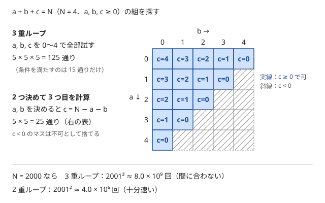

!!! abstract "要点"
    - **何ができるか**：何を全探索するかを選び直して、試す通り数を減らす。いくつか決めれば残りが計算で決まる、答えの候補の側を試す、小さい次元だけを試して残りを速く求める、などの型がある。
    - **いつ使うか**：
        - 変数が 2〜3 個で、いくつか決めれば残りが計算で決まる。
        - 答えの候補（暗証番号・中心の座標など）が N によらず少ない。
        - 一方の次元だけ極端に小さい（$H \le 8$ など）。
        - $K \le 10^{12}$ で約数を扱う（約数の個数は最大 6720）。
        - 小さい盤面を回転・平行移動して重ねる・敷き詰める。
    - **計算量**：（決める変数の通り数）×（残りを求めて確かめる計算量）。3 変数のうち 2 つを決めて残りを計算すれば $O(N^2)$。
    - **前提**：[計算量の見積もり](../basics/complexity-estimation.md)

<!-- textlint-disable -->
別名：全列挙・工夫した全探索・総当たり・何を全探索するか・候補が少ない・盤面の全探索・ポリオミノ・brute force
<!-- textlint-enable -->

全探索の設計は、すべての候補を試す方針のまま、「何を候補として並べるか」を選び直して通り数を減らす考え方である。全探索の計算量は（通り数）×（1 通りを確かめる手間）なので、同じ問題でも並べる対象によって桁が変わる。素直に並べて間に合わないとき、全探索をすぐ捨てずに、対象を入れ替えられないかを先に考える。

## 何を全探索するか（2 つ決めて 3 つ目を計算する） {#what-to-enumerate}

変数が 3 つあり、等式で結ばれているなら、2 つを決めた時点で 3 つ目は計算で決まる。3 つ目をループで探すのは無駄である。

たとえば「1 万円札・5 千円札・千円札の枚数 $a, b, c$ が合計 $N$ 枚で、金額が $Y$ 円になる組を探す」とする。$a, b, c$ をそれぞれ $0$〜$N$ で回す 3 重ループは $(N + 1)^3$ 回で、$N = 2000$ なら約 $8 \times 10^9$ 回になり間に合わない。$a$ と $b$ を決めれば $c = N - a - b$ と決まるので、2 重ループの $(N + 1)^2 \approx 4 \times 10^6$ 回で済む。



この方法で漏れがない理由を確かめる。条件を満たす組 $(a, b, c)$ があれば、ループはいつか同じ $(a, b)$ を試す。そのとき $c$ は $N - a - b$ と計算され、元の組の $c$ と一致する。重複もない。$(a, b)$ ごとに $c$ は 1 つしか決まらないからである。

一般に、変数が $k$ 個で独立な 1 次の等式が $m$ 本あれば、うまく選んだ $k - m$ 個を決めれば残りが決まる。どの $k - m$ 個でもよいわけではない。$x + y = S$ と $x + y + z = T$ では、$z$ を決めても $x, y$ は決まらないが、$x$ を決めれば $y, z$ が決まる。ただし、計算で出した値が本当に許される範囲にあるかは、ループが保証してくれない。次のコードは $0 \le x, y, z \le K$ かつ $x + y + z = S$ となる組を数える例で、$z$ を計算した後に範囲を確かめている。

```cpp
--8<-- "brute-force/fix-two.cpp:core"
```

「決めれば残りが決まる」は等式に限らない。残りの最良の値がすぐ分かる場合も同じである。たとえば 2 種類のセット商品の数を決めると、残りの単品の数は「足りない分だけ買う」で決まる。決める側の変数は、通り数が少ない方、または残りを計算しやすい方を選ぶ。

??? question "確認問題：決めた後に確かめること"
    $0 \le x, y, z \le K$ で $x + y + z = S$ となる組を数えるのに、$x, y$ を $0$〜$K$ で回して $z = S - x - y$ とした。数える前に何を確かめる必要があるか。

    ??? success "答え"
        $0 \le z \le K$ を確かめる。$x + y > S$ なら $z$ は負になり、$x + y < S - K$ なら $z$ は $K$ を超える。どちらも数えてはいけない。式に割り算が入るとき（$c = (Y - 10000a - 5000b) / 1000$ など）は、割り切れるかも確かめる。

## 決めてから整合性を確かめる {#decide-then-check}

未知の値が直接は求まらなくても、一部を決めると残りが 1 つの情報から導け、それが全部の情報と合うかを確かめられることがある。このときは「決める → 導く → すべての条件で確かめる」の 3 段で全探索する。

例として、中心 $(C_x, C_y)$（どちらも $0$〜$100$ の整数）と高さ $H$ が未知のピラミッドを考える。地点 $(x, y)$ の高さは $\max(H - \lvert x - C_x \rvert - \lvert y - C_y \rvert, 0)$ で、いくつかの地点の高さ $h_i$ が分かっている。

1. **決める**：中心 $(C_x, C_y)$ を $101 \times 101$ 通り試す
2. **導く**：$h_i \ge 1$ の地点を 1 つ選び、$H = h_i + \lvert x_i - C_x \rvert + \lvert y_i - C_y \rvert$ とする
3. **確かめる**：すべての地点で $\max(H - \lvert x_i - C_x \rvert - \lvert y_i - C_y \rvert, 0) = h_i$ かを調べる

中心は約 $10^4$ 通り、確かめるのは地点 1 つあたり $O(1)$ なので、全体で $O(10^4 \cdot N)$ である。2 で $h_i \ge 1$ の地点を選ぶのは、高さ 0 の地点では $\max$ で 0 に潰れていて、$H$ が 1 つに決まらないからである。答えが 1 つに決まる問題なら、$h_i \ge 1$ の地点は必ずある（全部 0 なら $H$ が決まらない）。

この型は「仮定して矛盾がないかを調べる」と言い換えられる。誰が正直者かを仮定して証言と矛盾しないか調べる問題も同じ形で、仮定の通り数が $2^N$ なら[bit 全探索](../basics/bit-full-search.md#assume-and-check)になる。確かめる段では、導くのに使った条件も含めて全部を調べると、場合分けの漏れが防げる。

## 候補が少ないことに気づく（答えの側・小さい次元・約数の個数・log 回の収束） {#small-candidates}

入力が大きいからといって、全探索が無理とは限らない。通り数は入力の大きさではなく、並べる対象の数で決まる。次の表は、対象を選び直すと通り数がどれだけ変わるかの例である。

| 問題の形 | 素直な対象 | 選び直した対象 | 通り数 |
| --- | --- | --- | --- |
| 長さ $N$ の数字列から 3 桁を選んで作れる番号の種類 | 位置の 3 つ組 $\binom{N}{3}$ | 番号 000〜999 | $1000 \times O(N)$ |
| $H \times W$ の表から行と列を選ぶ（$H \le 8$） | 行と列の選び方 $2^{H + W}$ | 行の選び方だけ | $2^H \times O(HW)$ |
| $K \le 10^{12}$ の約数で積が $K$ になる組 | $1$〜$K$ の値 | $K$ の約数 | 約数は 6720 個以下 |
| 値を半分にして分ける操作の回数 | 値 $1$〜$H$ | 半分にする深さ | $\log_2 H$ 段 |

**答えの側を並べる**。数字列から 3 桁を選ぶ例で、$N = 3 \times 10^4$ なら位置の組は約 $4.5 \times 10^{12}$ 通りある。しかし作られる番号は 000〜999 の 1000 通りしかない。番号を 1 つ決め、数字列の左から「次に要る数字が最初に現れる位置」を貪欲に取っていけば、作れるかを $O(N)$ で判定できる。最初に現れる位置を取るのが最善なのは、後ろに残る文字が最も多くなり、続きの数字を探す範囲が広いからである。

**小さい次元だけを並べる**。$H \le 8$ なら行の選び方は $2^8 = 256$ 通りしかない。行を決めると、列を使えるか（選んだ行で値がそろうか）は列ごとに独立して分かる。だから列は選び方を並べず、まとめて数えればよい。ただし、選んだ列どうしでも値はそろっていなければならない。そこで、使える列をそろった値ごとに数え、最も多い値の列をすべて選ぶ。

**約数の個数の上限を知る**。$K \le 10^{12}$ の約数は最大 6720 個で、$10^9$ 以下なら 1344 個、$10^{18}$ 以下でも 103680 個である。約数の組を 2 重ループで試しても約 $4.5 \times 10^7$ 回で済む。詳しくは[約数の個数の上界と高度合成数](../math/divisor-count-bound.md)、見積もり方は[候補の数で見積もる](../basics/complexity-estimation.md#count-candidates)にある。

**log 回で収束する操作**。値が毎回半分になる操作は、$H = 10^{12}$ でも約 40 段で 1 になる。分裂して数が増えるように見えても、同じ値どうしをまとめれば、段ごとに高々 2 通り（$\lfloor x/2 \rfloor$ と $\lceil x/2 \rceil$。切り捨てだけで分かれるなら 1 通り）しか残らない。メモ化して数えれば、値の種類は $O(\log H)$ である（[再帰的な構造](../basics/recursion-structure.md)）。

## 片側を全探索して残りを速く求める（貪欲・二分探索・累積和） {#half-enumeration}

2 つの選択を両方とも全探索すると $O(N^2)$ になるとき、一方だけを全探索し、もう一方の最良の選び方を速く求める。「何を全探索するか」を決めた後で、残りの部分にほかの手法を当てる型である。

- **貪欲**：符号の向きや「どの種類を使うか」など、小さな離散の選択だけを全探索する。選択を決めると、残りは「評価値の大きい順に $M$ 個取る」のような[貪欲法](../basics/greedy-basics.md)で決まる。選択が $k$ 個の二択なら $2^k \times O(N \log N)$ である（[片側を bit で決めて残りは貪欲](../basics/bit-full-search.md#half-greedy)）
- **二分探索**：$i$ を全探索し、条件を満たす $j$ がソート済みの配列の連続した範囲になるなら、その境目を[二分探索](../basics/binary-search.md)で求める。全体で $O(N \log N)$
- **累積和**：分け目 $k$ を全探索し、左側の最良と右側の最良を、前から・後ろから作った[累積和](../basics/prefix-sum.md)や累積最小で $O(1)$ で引く。全体で $O(N)$

分け目を全探索する型の処理の流れは、次のようになる。

```text
L[k] = 添字 [0, k) の中での最良（k = 0..N、前から順に更新して作る）
R[k] = 添字 [k, N) の中での最良（k = N..0、後ろから順に更新して作る）
答え = すべての k についての L[k] と R[k] の組合せの最良
```

$L$ と $R$ の境界を半開区間 $[0, k)$ と $[k, N)$ にそろえると、$k = 0$（左が空）と $k = N$（右が空）も同じ式で扱える。空の側の初期値（和なら 0、最小なら $+\infty$）を決めておく。

[半分全列挙](../basics/meet-in-the-middle.md)と混同しやすいが、半分全列挙では両側をどちらも $2^{N/2}$ 通り全列挙してから組み合わせる。この型で全探索するのは片側だけで、もう一方は列挙せずに最良を直接求める。

## 盤面を動かして全部試す（回転・平行移動） {#move-board}

この節の後半は、マスの集合を整数で表すので[bit 演算の基本と XOR の性質](../basics/bit-operations.md)を使う。小さな盤面や型を回転・平行移動して重ねる・敷き詰める問題では、動かし方を全部試せばよい。難しいのは計算量ではなく、動かす範囲の取り方と実装の誤りである。

通り数は、型ごとの「回転 4 通り × 平行移動の通り数」を全部の型について掛けたものである。$4 \times 4$ の盤面に型を 3 つ置くとき、移動量を縦横とも $-3$〜$3$ で試すと型 1 つあたり $4 \times 49 = 196$ 通り、3 つで約 $7.5 \times 10^6$ 通りである。各型を左上に詰めてから（行・列の空きを取り除く正規化）移動量を $0$〜$3$ にすれば、型 1 つあたり $4 \times 16 = 64$ 通り、3 つで約 $2.6 \times 10^5$ 通りに減る。

実装では次の点を守る。

- **回転は関数にする**：$h \times w$ の型を時計回りに 90 度回すと、$(i, j)$ は $w \times h$ の $(j, h - 1 - i)$ に移る。回すたびに新しい配列を作り、元の配列を上書きしない
- **移動量は負の側も試す**：型の端の行や列に空きがあると、型の左上が盤面の外に出る置き方も正しい。正規化しないなら、移動量を $-(h - 1)$ から始める
- **はみ出しは不可にする**：型のマスが盤面の外に出たら、そのマスを無視せず、その置き方を捨てる
- **試すたびに盤面を作り直す**：前の置き方で塗ったマスが残ると誤判定になる

次のコードは、盤面の空きマスに型を置ける「回転と移動量の組」を数える例である。回転は `rotate90` という関数にまとめてある。

```cpp
--8<-- "brute-force/board-shift.cpp:core"
```

盤面が $4 \times 4$ のように 16 マス以下なら、置いたマスの集合を 16 ビットの整数で表せる。重なりの判定は AND で、全体を埋めたかの判定は OR で書ける。ただし左シフトで平行移動すると、右端からはみ出したマスが次の行に回り込むので、シフトの前に盤面に収まるかを確かめる。

## 上位の手法へのつながり {#next-steps}

全探索の設計は、多くの手法の出発点である。どこを変えるかで行き先が分かれる。

- **残りを速くする**：[片側を全探索して残りを速く求める](#half-enumeration)の型で、残りに二分探索・累積和・[尺取り法](../basics/two-pointers.md)・データ構造を当てる。水の問題の多くはこの形をしている
- **重複をまとめる**：全探索の途中で「ここまでの選び方が違っても、残りの選び方に効く情報が同じ」と気づいたら、その情報を状態にしてまとめると [DP](../dp/dp-basics.md) になる
- **指数個を並べる**：選ぶ・選ばないを全部試すなら [bit 全探索と順列全探索](../basics/bit-full-search.md)、深さが入力で変わるなら[再帰による全列挙](../basics/recursive-enumeration.md)、$2^N$ が重すぎて $2^{N/2}$ なら間に合うなら[半分全列挙](../basics/meet-in-the-middle.md)
- **1 つを固定して数える**：組の数を数える問題で、1 つの要素を固定して相手の数を数える型は[一部を固定して数える](../thinking/fix-variable.md)
- **頂点が少ないグラフ**：頂点の順番や辺の選び方を全部試す型は[小さいグラフの全探索](../graph/small-graph-brute-force.md)

## 落とし穴 {#pitfalls}

**計算で決めた値の範囲を確かめない**。2 つ決めて 3 つ目を計算したとき、3 つ目が負になる・上限を超える・割り切れない場合がある。ループの変数は範囲内に収まっていても、計算した値は収まっているとは限らない。条件を 1 つの `if` にまとめて書く。

**ループの端を取り違える**。「0 枚」を含めるか、上限の $N$ を含めるか（`<=` と `<` のどちらで書くか）は、問題の制約の不等号から決める。0 枚の場合を落とすと、使わない種類がある答えを見逃す。

**通り数の見積もりで、掛ける量・割る量を落とす**。行の選び方 $2^8$ に、1 通りあたりの確かめる手間 $O(HW)$ を掛け忘れると、間に合うかを誤る。逆に、組合せ $\binom{100}{5} \approx 7.5 \times 10^7$ を $100^5 = 10^{10}$ と見積もると、間に合う全探索を捨ててしまう。

**決まらない情報から導く**。[決めてから整合性を確かめる](#decide-then-check)の例で、高さ 0 の地点から $H$ を導くと、$\max$ で潰れた値を使うことになり正しい $H$ が出ない。導くのに使う情報は、値が 1 つに決まるものを選ぶ。

**同じ組を 2 回数える**。「候補を 2 つに絞り、それぞれを固定して相手を数える」と、両方の候補を含む組が 2 回数えられる。組を（小さい方, 大きい方）の形にそろえて集合に入れるか、2 回目の固定で 1 回目の候補を相手から除く。回転で同じ形になる型（正方形など）も、置き方の数を数える問題では重複に注意する。

**盤面の移動で負の側を試さない**。型の端に空きがあるときに移動量を 0 から始めると、正しい置き方を見逃す（[盤面を動かして全部試す](#move-board)）。

## 使い分け {#comparison}

- 二択の選択が $N \le 20$ 個あり、全部の組合せを試すなら [bit 全探索と順列全探索](../basics/bit-full-search.md)
- $N \le 40$ 程度で $2^N$ は重いが、半分ずつなら間に合うなら[半分全列挙](../basics/meet-in-the-middle.md)
- 全探索の途中の情報をまとめられるなら [DP](../dp/dp-basics.md)

## 例題 {#examples}

### ABC085 C. Otoshidama {#abc085_c}

<div class="kp-problems" data-role="example" markdown>

- [ABC085 C. Otoshidama](https://atcoder.jp/contests/abc085/tasks/abc085_c)（diff 584）：1 万円札・5 千円札・千円札が合計 N 枚で Y 円になる組合せがあるか判定し、あれば 1 つ答える。

</div>

3 種類の枚数を全部回すと $(N + 1)^3$ 回で間に合わない。1 万円札の枚数 $a$ と 5 千円札の枚数 $b$ を決めれば、千円札は $c = N - a - b$ 枚と決まる。あとは金額が $Y$ になるかを調べるだけである。

??? note "解法の詳細"
    - $a$ を $0$〜$N$、$b$ を $0$〜$N - a$ で回す。$b$ の上限を $N - a$ にすると $c = N - a - b \ge 0$ が保証され、範囲の確かめが不要になる。
    - $10000a + 5000b + 1000c = Y$ なら $a, b, c$ を出力して終える。最後まで見つからなければ $-1, -1, -1$ を出力する。
    - ループは $(N + 1)(N + 2) / 2$ 回で、$N = 2000$ でも約 $2 \times 10^6$ 回である。金額は最大 $2 \times 10^7$ なので `int` に収まる。

## 練習問題 {#practice}

<div class="kp-problems" data-role="practice" markdown>

- [SUMITRUST2019 D. Lucky PIN](https://atcoder.jp/contests/sumitrust2019/tasks/sumitb2019_d)（diff 838）：長さ N の数字列から 3 桁を選んで作れる暗証番号の種類数を求める。
- [ABC469 D. The Big Two](https://atcoder.jp/contests/abc469/tasks/abc469_d)（diff 1102）：N 人から 2 人を選ぶとき、M 回のどの大会でも、選んだ 2 人の少なくとも一方が決勝に出ているような選び方の数を求める。
- [ABC112 C. Pyramid](https://atcoder.jp/contests/abc112/tasks/abc112_c)（diff 1147）：いくつかの地点の高さの情報から、ピラミッドの中心座標と高さを特定する。
- [典型90 063. Monochromatic Subgrid（★4）](https://atcoder.jp/contests/typical90/tasks/typical90_bk)（diff —）：グリッドから行と列をいくつか選び、交差するマスがすべて同じ数になるときのマスの数の最大値を求める。
- [ABC307 C. Ideal Sheet](https://atcoder.jp/contests/abc307/tasks/abc307_c)（diff 1307）：2 枚のシートを平行移動して重ね、切り出した結果を目標のシートに一致させられるか判定する。

</div>

??? note "練習の方針"
    - **Lucky PIN**：位置の組ではなく番号 000〜999 を全探索し、数字列の左から貪欲に照合して作れるかを $O(N)$ で判定する（[答えの側を並べる](#small-candidates)）
    - **The Big Two**：条件を満たす 2 人は、1 回目の大会の決勝に出た 2 人のどちらかを必ず含む。候補を 2 人に絞り、それぞれを固定する。固定した人が出ていない大会のすべてに出ている人が、相手になれる。両方を含む組の重複に注意する
    - **Pyramid**：中心 $101 \times 101$ 通りを全探索し、高さ 1 以上の地点から $H$ を導いて、全地点と矛盾しないか確かめる（[決めてから整合性を確かめる](#decide-then-check)）
    - **Monochromatic Subgrid**：$H \le 8$ の行の選び方を全探索する。各列で、選んだ行の値がすべて等しければその値を数え、最も多い値の列数 × 選んだ行数が候補になる
    - **Ideal Sheet**：2 枚のシートの置き場所を、負の側も含めて全部試す。試すたびに切り出し先を作り直し、黒いマスがはみ出したら不可とする

## 力試し {#challenge}

<div class="kp-problems" data-role="challenge" markdown>

- [ABC322 D. Polyomino](https://atcoder.jp/contests/abc322/tasks/abc322_d)（diff 1310）：3 つのポリオミノを回転と平行移動で置き、4×4 のマス目をちょうど埋められるか判定する。

</div>

??? note "力試しの方針"
    - **Polyomino**：各ポリオミノの回転 4 通りと平行移動を全部試し、重ならずに 16 マスをちょうど埋めるかを調べる。回転は関数にまとめ、はみ出しを必ず不可にする。マスの集合を 16 ビットで表すと判定が短く書ける

## 参考 {#references}

- [drken「AtCoder ABC 085 C - Otoshidama (5Q, 茶色, 300 点)」](https://drken1215.hatenablog.com/entry/2024/05/15/005149)：例題の全探索の対象と範囲の取り方
- [c-yan「AtCoder 三井住友信託銀行プログラミングコンテスト2019 参戦記」](https://qiita.com/c-yan/items/cd3076c0a66eada87152)：練習の方針（番号 000〜999 の側を全探索する）
- [dvoraker3「競プロ典型 90 問の類題+＠ リンク集」](https://qiita.com/dvoraker3/items/8388ab6e1dc3af55070e)：Lucky PIN を候補の側の全探索として分類
- [comet725「ABC469Dを解いた【候補の絞り込み】」](https://qiita.com/comet725/items/5783b8e77e3ef99c72c6)：練習の方針（候補を 2 人に絞る・重複を除く）
- [drken「AtCoder ABC 112 C - Pyramid (2Q, 緑色, 300 点)」](https://drken1215.hatenablog.com/entry/2018/11/06/120500)：決めてから整合性を確かめる型
- [Reputeless「tenkei_90」](https://github.com/Reputeless/tenkei_90)：練習の問題の分類
- [drken「AtCoder ABC 307 C - Ideal Sheet (2Q, 水色, 300 点)」](https://drken1215.hatenablog.com/entry/2024/06/10/001849)：平行移動の範囲（負の側を含む）とはみ出しの扱い
- [drken「AtCoder ABC 322 D - Polyomino (1Q, 水色, 400 点)」](https://drken1215.hatenablog.com/entry/2023/10/02/230400)：回転の座標変換と 16 ビットでの表現、シフトの回り込み
