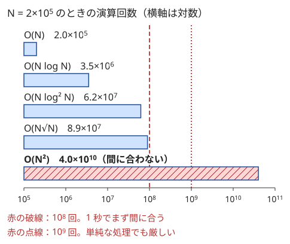

!!! abstract "要点"
    - **何ができるか**：制約の大きさから許される計算量を逆算し、使える手法の候補を絞る。C++ の単純な処理なら 1 秒に $10^8$〜数×$10^8$ 回を目安に、ループの回数・log の数・定数倍・メモリを見積もる。
    - **いつ使うか**：
        - $N \le 8$ / $20$ / $40$ / $400$ / $5000$ / $2 \times 10^5$ / $10^{18}$ のような制約の大きさ。
        - 実行時間制限が 5 秒など長い（重めの全探索が想定されている）。
        - $Q \le 2 \times 10^5$ 個のクエリ（1 回あたり $O(\log N)$ 以下が必要）。
        - テストケースが $T$ 個あり、$N$ の総和が $2 \times 10^5$ 以下。
        - while の中に for があって入れ子に見えるが、各要素は一度しか動かない。
    - **計算量**：目安は 1 秒に $10^8$〜数×$10^8$ 回。$\log_2 N$ は $N = 2 \times 10^5$ で約 18、$10^{18}$ で約 60。ならし計算量は操作の合計で数える。
    - **前提**：なし

<!-- textlint-disable -->
別名：計算量・オーダー・制約から手法を逆算する・制約から考える・TLE の見積もり・ならし計算量・償却計算量・定数倍・time complexity・amortized analysis
<!-- textlint-enable -->

計算量の見積もりは、書く前に「この方針で間に合うか」を数で判断する作業である。制約は出題者が想定解の計算量に合わせて決めるので、逆に読めば解法の候補が絞れる。このページでは表の読み方より、ループの形だけでは読めない計算量（ならし・調和級数・候補の数）と、同じ計算量でも差が出る定数倍に重点を置く。

## 制約 → 許される計算量 → 疑う手法の表 {#constraint-table}

制約の最大値を計算量の式に入れ、$10^8$ 回前後に収まる式を探すと、想定される計算量が見える。次の表は ABC でよく見る制約の帯と、そこから疑う手法である。演算回数は式に最大値を入れた値で、定数倍は含まない。

| 制約の目安 | 許される計算量 | 演算回数の目安 | 疑う手法 |
| --- | --- | --- | --- |
| $N \le 8$〜$10$ | $O(N! \cdot N)$ | $10! \cdot 10 \approx 3.6 \times 10^7$ | [順列全探索](../basics/bit-full-search.md) |
| $N \le 15$〜$20$ | $O(2^N N)$、$O(3^N)$（$3^N$ は $N \le 15$ 程度まで） | $2^{20} \cdot 20 \approx 2.1 \times 10^7$、$3^{15} \approx 1.4 \times 10^7$ | bit 全探索・[bitDP](../dp/bit-dp.md) |
| $N \le 40$ | $O(2^{N/2} N)$ | $2^{20} \cdot 40 \approx 4.2 \times 10^7$ | [半分全列挙](../basics/meet-in-the-middle.md) |
| $N \le 100$〜$500$ | $O(N^3)$ | $500^3 \approx 1.3 \times 10^8$ | 区間 DP・ワーシャルフロイド法 |
| $N \le 2000$〜$5000$ | $O(N^2)$ | $5000^2 = 2.5 \times 10^7$ | 二重ループ・2 次元の DP |
| $N \le 2 \times 10^5$ | $O(N \log N)$、$O(N \sqrt{N})$ | $3.5 \times 10^6$、$8.9 \times 10^7$ | ソート・二分探索・セグメント木 |
| $N \le 10^{12}$ | $O(\sqrt{N})$ | $10^6$ | 約数の列挙・素因数分解 |
| $N \le 10^{18}$ | $O(\log N)$ | 約 60 | 二分探索・ダブリング・繰り返し二乗法 |

表の読み方には 3 つの注意がある。1 つ目に、境目は目安である。同じ $N = 5000$ の $O(N^2)$ でも、中身が `long long` の足し算なら速く、`map` の操作なら遅い。2 つ目に、制約が複数あるときは、それぞれの最大値を同時に入れる（$N, Q \le 2 \times 10^5$ でクエリごとに $O(N)$ なら $4 \times 10^{10}$ 回）。3 つ目に、$N$ ではなく答えの候補や値の種類など、別の量で全探索する方が速いことがある（[候補の数で見積もる](#count-candidates)）。帯ごとのより細かい表とページの一覧は[逆引き辞典（制約・計算量から）](../guide/reverse-index-constraints.md)にある。



棒グラフは横軸が対数なので、1 目盛りが 10 倍である。$N = 2 \times 10^5$ では $O(N \log^2 N)$ と $O(N \sqrt{N})$ までは $10^8$ 回の手前に収まり、$O(N^2)$ だけが 2 桁以上はみ出す。この差が「$N = 2 \times 10^5$ なら $O(N^2)$ は無理で、log が 2 つ付くまでは許される」という判断の根拠である。

## 見積もりの手順（ループの回数・log の数・定数倍・メモリ） {#how-to-estimate}

見積もりは次の 4 段で行う。どれも最悪ケースの入力を想定する。

1. **ループの回数を掛ける**：入れ子のループは回数の積、並んだループは和になる。ただし内側の回数が外側の変数によらず合計で抑えられるなら、積ではなく和で数える（[ならし計算量](#amortized)）
2. **log の数を数える**：ソート・二分探索・`set` や `map` の操作・セグメント木の 1 回の操作に、それぞれ $\log$ が 1 つ付く。二分探索の判定の中で `set` の `lower_bound` を呼ぶと $\log$ は 2 つになる。$\log_2 (2 \times 10^5) \approx 18$ なので、log 1 つで約 18 倍、2 つで約 300 倍と考える
3. **定数倍を見る**：同じ計算量でも、1 回の操作の重さで数倍以上の差がつくことがある（[定数倍](#constant-factor)）
4. **メモリを見積もる**：ABC の多くはメモリ制限 1024 MiB で、`int` なら約 $2.7 \times 10^8$ 個、`long long` なら約 $1.3 \times 10^8$ 個が上限である。$5000 \times 5000$ の `long long` の表（約 191 MiB）は入るが、$2 \times 10^5 \times 2 \times 10^5$ の表は入らない

実行時間の目安は、C++ の単純な処理で 1 秒に $10^8$ 回ならまず間に合い、数×$10^8$ 回は中身次第である。制限は問題ごとに違うので、何秒あるのかを問題文で確かめる。

??? question "確認問題：二分探索の中の set"
    $N = 2 \times 10^5$ 個の要素を `set` に入れ、答えを 0〜$10^9$ の範囲で二分探索する。判定 1 回で $N$ 回の `lower_bound` を呼ぶとき、全体の計算量と回数の目安はいくつか。

    ??? success "答え"
        判定 1 回が $O(N \log N)$、それを $O(\log V)$ 回（$V = 10^9$ で約 30 回）呼ぶので、全体で $O(N \log N \log V)$ になる。回数は $2 \times 10^5 \times 18 \times 30 \approx 10^8$ で、`set` の定数倍を考えるときわどい。判定の中では `set` を使わず、ソートした配列を前から走査するなどして log を 1 つ減らせないかを考える。

## ならし計算量（ポインタが戻らない・各要素が一度入って一度出る） {#amortized}

ならし計算量は、1 回ずつの操作の重さではなく、全体の操作の合計で計算量を数える考え方である。1 回の操作が重くなることはあっても、重い操作の回数が全体で限られていれば、合計は小さく抑えられる。

数え方の基本は「何かが一方向にしか進まない」ことを見つけることである。代表的な形は 3 つある。

- **ポインタが戻らない**：[尺取り法](../basics/two-pointers.md)の右端と左端は、どちらも全体で $N$ 回しか進まない。for の中に while があっても、while の回数の合計は $N$ 以下である。まだ現れていない最小の値（mex）を探すポインタも、値が追加されるだけなら戻らない
- **各要素が一度入って一度出る**：スタックやキューに入る回数が全体で $N$ 回なら、取り出す回数も $N$ 回以下である。左側で自分より小さい最も近い要素を求める処理（[単調スタック](../ds/monotonic-stack.md)）がこの形になる
- **消す量は入れた量を超えない**：全体を一括で書き換えるたびに、触った要素の記録だけを消す。消す回数の合計は、記録した回数の合計（初期値の $N$ 個とクエリの数）を超えない（[全体への操作を変数で持つ](../ds/global-offset.md)）

次のコードは 2 つ目の形の例である。for の中に while があるが、各添字は 1 回だけ積まれ、取り出されるのは高々 1 回なので、while の回数の合計は $N$ 以下である。コードでは取り出した回数 `pops` を数え、最後に `assert` でこのことを確かめている。

```cpp
--8<-- "complexity-estimation/amortized-stack.cpp:core"
```

ならし計算量の議論が崩れるのは、一方向に進むはずのものが戻るときである。尺取り法で左端を毎回 0 に戻す、mex の候補を毎回 0 から探し直す、一括の書き換えで配列の全体を毎回初期化する、のどれも最悪で $O(N^2)$ や $O(NQ)$ になる。コードを見て「戻る箇所」がないかを確かめる。

??? question "確認問題：戻るポインタ"
    長さ $N$ の列で、各 $i$ について「$i$ から右へ、和が $K$ を超える直前まで進んだ位置」を求める。$i$ ごとに $j = i$ から進め直すと計算量はいくつか。すべての要素が正なら、どう直せば線形になるか。

    ??? success "答え"
        $i$ ごとに $j$ を $i$ から進め直すと、最悪で $O(N^2)$ になる。すべての要素が正なら、$i$ を 1 つ進めても和は減るだけなので、届く位置は左へ戻らない。前の $j$ を引き継いで進めれば、$j$ は全体で $N$ 回しか進まず $O(N)$ になる（尺取り法）。

## 調和級数の計算量（倍数の列挙） {#harmonic-series}

調和級数の計算量は、$d = 1, 2, \dots, M$ のそれぞれについて $d$ の倍数を全部たどる処理の計算量である。$d$ ごとの回数は $M / d$ で、合計は次のようになる。

$$
\frac{M}{1} + \frac{M}{2} + \dots + \frac{M}{M} \approx M \ln M
$$

$M = 10^6$ なら約 $1.4 \times 10^7$ 回で、二重ループに見えても $O(M \log M)$ で済む。値 $A_i \le 10^6$ を添字にした配列を作り、各 $d$ について倍数の個数や和を集める処理がこの形である。

二重ループに見えるのに速いのは、外側の $d$ が大きいほど内側の回数が減るからである。内側を `j += d` ではなく `j++` で回して `if (j % d == 0)` と判定すると、どの $d$ でも $M$ 回回って $O(M^2)$ になる。理由と型は[調和級数と倍数の列挙](../math/harmonic-sum.md)にある。

## 候補の数で見積もる（階乗・ベル数・約数の個数の最大） {#count-candidates}

全探索の計算量は「調べる候補の数 × 1 候補あたりの処理」である。ループの形が複雑な探索（再帰・バックトラック）では、式を立てるより、候補の数を直接見積もる方が速い。

| 候補 | 個数の目安 |
| --- | --- |
| 順列 $N!$ | $8! = 40320$、$10! = 3628800$、$12! \approx 4.8 \times 10^8$ |
| 組分け（ベル数 $B_N$） | $B_{10} = 115975$、$B_{12} = 4213597$ |
| 5 個の組合せ $\binom{N}{5}$ | $\binom{100}{5} = 75287520$（$N^5 / 120$ に近い） |
| 約数の個数の最大 | $10^6$ 以下で 240、$10^9$ 以下で 1344、$10^{12}$ 以下で 6720 |

ここで効くのは、見かけの指数より実際の数がずっと小さいことである。$\binom{N}{5}$ は $N^5$ の約 $1/120$ で、$N = 100$ でも $10^{10}$ ではなく $7.5 \times 10^7$ である。$N$ が大きいと、約数の個数の最大は $\sqrt{N}$ よりずっと少なく、$10^{12}$ 以下の数でも 6720 個しかないので、約数ごとに重い処理をしても間に合う（[約数の個数の上界と高度合成数](../math/divisor-count-bound.md)）。組分けの数は[第 2 種スターリング数とベル数](../comb/bell-number.md)、再帰で列挙する方法は[再帰による全列挙](../basics/recursive-enumeration.md)にある。

バックトラックの探索では、途中で行き止まりになる枝が多いので、各ステップの選択肢の積は上界にすぎない。たとえば $H \times W \le 16$ のマスにそれぞれ 3 通りの置き方を試すと上界は $3^{16} \approx 4.3 \times 10^7$ だが、置けない枝が切られるので実際はずっと少ない。上界で間に合えばそれで判断し、上界が大きすぎるときは、小さい入力で実際に数えてみると見当がつく。

## 定数倍（配列と set・map の差・メモリの連続性・bitset） {#constant-factor}

この節は [STL コンテナの使い分け](../ds/stl-containers.md)を前提にする。同じ計算量でも、1 回の操作の重さで実行時間は数倍以上変わることがある。計算量の見積もりが制限時間の数分の 1 を超えるときは、定数倍も見積もる。

- **配列と set・map**：`set` や `map` の操作は $O(\log N)$ に加えて、木をたどるたびに離れた場所のメモリを読むので、配列の添字アクセスよりかなり遅い。キーが $10^6$ 程度までの整数なら配列で持つ。値の範囲が広くても、先に[座標圧縮](../basics/coordinate-compression.md)すれば配列にできる
- **メモリの連続性**：配列を先頭から順に読むと速く、飛び飛びに読むと遅い。2 次元の表は後ろの添字を内側のループで回し、行ごとに連続して読む。`vector<vector<int>>` を大量に作るより、1 次元の `vector` に `i * W + j` で詰める方が速いことがある
- **確保と再帰**：ループの中で `vector` や `string` を毎回作り直すと、確保と解放の分だけ遅くなる。外で 1 回確保して使い回す。再帰も関数を呼ぶたびに重さがあり、`vector` を値渡しすると呼ぶたびに複製が作られる。大きな引数は参照で渡す
- **bitset**：0 と 1 の列の AND・OR・シフトは、`bitset` を使うと 64 個ずつまとめて計算でき、約 $1/64$ になる。ただし計算量の次数は変わらない（[bitset による高速化](../misc/bitset-speedup.md)）
- **入出力**：$10^6$ 個を超える入出力では、`cin` の同期を切り、改行は `endl` ではなく `'\n'` で出す（[入出力と定数倍](../cpp/cpp-io.md)）

逆に、[例題](#typical90_bc)のように、計算量の式に表れない小さな定数で救われることもある。

## 複数テストケースは合計（ΣN）で見積もる {#multiple-testcases}

テストケースが $T$ 個ある問題では、「$N$ の総和は $2 \times 10^5$ 以下」のように合計にも制約が付くことが多い。このときは各ケースの計算量を足し合わせて見積もる。各ケースが $O(N_i \log N_i)$ なら、合計は $O(\sum N_i \log \sum N_i)$ で、1 ケースだけの場合と変わらない。

ただし、計算量が $N$ の 1 次でないときは注意がいる。各ケースが $O(N_i^2)$ なら、合計は最悪で $(\sum N_i)^2$ になる（1 ケースに全部が集まる場合）。各ケースで $N$ によらない重さの処理（$O(\text{値の上限})$ の配列の初期化や前計算）をすると、$T$ 倍になる。

- **ケースごとの初期化は使った分だけ**：大きさが値の上限の配列を毎回 0 で埋めると、$T = 2 \times 10^5$ と上限 $2 \times 10^5$ で $4 \times 10^{10}$ 回になる。使った添字だけを戻すか、ケースの $N$ の大きさで作り直す
- **前計算はケースの外で 1 回**：階乗の表や篩はケースのループの前に 1 回だけ作る
- **$T$ だけに制約があり総和に制約がない**：そのときは $T \times (\text{1 ケースの最悪})$ で見積もる

## 落とし穴 {#pitfalls}

**最悪ケースで見積もらない**。入力例は小さく、ランダムな入力でも最悪にならないことが多い。すべて同じ値、すでにソート済み、一直線のグラフ（パス）など、ループが最も回る入力を考えてから判断する。

**log の数を数え忘れる**。`map` を添字のように使った DP、二分探索の判定の中の `set`、セグメント木の上の二分探索をさらに二分探索で包む、などで log が 2 つ・3 つと増える。$\log^2$ は $N = 2 \times 10^5$ で約 300 倍、$\log^3$ は約 5000 倍である。

**ならしのつもりで戻している**。尺取り法の左端、mex のポインタ、スタックを毎回作り直すなど、一方向に進むはずのものを戻すと、ならし計算量の議論が崩れる。逆に、入れ子のループを見ただけで $O(N^2)$ と決めつけて正しい方針を捨てることもある。内側の回数の合計を数える。

**長い実行時間制限を見落とす**。実行時間制限が 5 秒など長いのは、重めの全探索を想定した合図のことがある。2 秒の前提で無理と判断した方針でも通りうる。

**途中の値のオーバーフロー**。見積もりとは別に、回数を数えて全探索すると決めたら、積や和が `long long` に収まるかも確かめる。5 個の積の余りなら、1 つ掛けるごとに余りを取る（[整数のオーバーフローと __int128](../cpp/cpp-integer-overflow.md)）。

## 例題 {#examples}

### 典型90 055. Select 5（★2） {#typical90_bc}

<div class="kp-problems" data-role="example" markdown>

- [典型90 055. Select 5（★2）](https://atcoder.jp/contests/typical90/tasks/typical90_bc)（diff —）：最大 100 個の整数から 5 個を選ぶ組合せのうち、積の余りが条件を満たすものを数える。

</div>

5 個の選び方を 5 重ループで全部試すのが素直な方法である。$O(N^5)$ と書くと、$N = 100$ で $10^{10}$ 回に見えて間に合わなそうに思える。しかし添字を $i > j > k > l > m$ の順に限れば、回るのは $\binom{100}{5} = 75287520 \approx 7.5 \times 10^7$ 通りで、定数倍は約 $1/120$ である。1 回の処理は掛け算と余りだけなので、全探索で間に合う。実行時間制限も 5 秒あり、余裕がある。

??? note "解法の詳細"
    - 5 重ループの添字を $i > j > k > l > m$（または $i < j < k < l < m$）に限り、同じ組を 1 回ずつ数える。回数は $\binom{N}{5} \le 75287520$ である。
    - 積は 1 つ掛けるごとに $P$ で余りを取る。こうすれば途中の値は「余り × 次の数」までで済み、`long long` に収まる。5 個をまとめて掛けると途中の値があふれて誤った答えになる。
    - 外側のループで途中までの積を保っておけば、内側のループの処理は掛け算 1 回と余り 1 回で済む。

## 練習問題 {#practice}

<div class="kp-problems" data-role="practice" markdown>

- [HHKB2020 C. Neq Min](https://atcoder.jp/contests/hhkb2020/tasks/hhkb2020_c)（diff 352）：数を 1 つずつ追加するたびに、まだ現れていない最小の非負整数を出力する。
- [ABC278 D. All Assign Point Add](https://atcoder.jp/contests/abc278/tasks/abc278_d)（diff 559）：全体への一括代入・一点への加算・一点の取得のクエリを処理する。
- [典型90 072. Loop Railway Plan（★4）](https://atcoder.jp/contests/typical90/tasks/typical90_bt)（diff —）：$H \times W \le 16$ のグリッドで、山のマスを避けて同じマスを通らずに戻ってくる最長の経路を求める。
- [ABC196 D. Hanjo](https://atcoder.jp/contests/abc196/tasks/abc196_d)（diff 1277）：H×W ≤ 16 のマス目を、枚数の決まった 1×2 の畳と 1×1 の畳で敷き詰める方法の数を求める。

</div>

??? note "練習の方針"
    - **HHKB2020 C**：答えの候補を指すポインタを持ち、値が追加されるたびに「出現済みなら進める」を繰り返す。値は追加されるだけなので答えは減らず、ポインタは戻らない。ポインタが進む回数は全体で $N + 1$ 回以下なので、全体で $O(N)$ になる
    - **ABC278 D**：一括代入の値を 1 つの変数に持ち、各要素にはその値からの差分だけを記録する。一括代入のときは記録した差分だけを消す。差分は配列で持ち、触った添字を列へ記録しておけば、一括代入のときはその添字だけを戻せばよい。消す回数の合計は記録した回数（初期値の $N$ 個とクエリの数）を超えないので、ならしで線形になる
    - **典型90 072**：同じマスを通らない経路の数は、$H \times W \le 16$ のグリッドなら数万通り程度に収まる。始点を全マスで試し、バックトラックで経路を全部たどる
    - **ABC196 D**：左上のマスから順番で「1×1 の畳にする・1×2 の畳を縦に置く・横に置く」の 3 択を試す。上界は $3^{16} \approx 4.3 \times 10^7$ である。置けない枝は途中で切られるので実際はずっと少なく、全探索で間に合う

## 確認問題 {#quiz}

??? question "確認問題：N = 40 の部分集合"
    $N = 40$ 個の要素から部分集合を選ぶ問題で、$2^N$ 通りを全部試すのは間に合うか。間に合わないなら、どの計算量なら間に合うか。

    ??? success "答え"
        $2^{40} \approx 1.1 \times 10^{12}$ なので間に合わない。半分の 20 個ずつに分けると、それぞれ $2^{20} \approx 10^6$ 通りで、片方をソートしてもう片方から二分探索すれば $O(2^{N/2} N)$ で済む（[半分全列挙](../basics/meet-in-the-middle.md)）。

??? question "確認問題：クエリごとに O(N)"
    $N, Q \le 2 \times 10^5$ で、各クエリが区間 $[l, r)$ の和を聞く。クエリごとに区間を足し合わせると間に合うか。

    ??? success "答え"
        最悪で $N Q = 4 \times 10^{10}$ 回なので間に合わない。値が変わらないなら[累積和](../basics/prefix-sum.md)で前計算して 1 回 $O(1)$、更新も混ざるなら [BIT](../ds/fenwick-tree.md) などで 1 回 $O(\log N)$ にする。

## 参考 {#references}

- [drken「計算量オーダーの求め方を総整理！ 〜 どこから log が出て来るか 〜」](https://qiita.com/drken/items/872ebc3a2b5caaa4a0d0)：1 秒あたりの演算回数の目安と log が出る場面
- [drken「特集！知らないと損をする計算量の話」](https://qiita.com/drken/items/18b3b3db5735241465ef)：STL の操作の計算量と値域の配列
- [E869120「競プロ典型 90 問 055 解説」](https://github.com/E869120/kyopro_educational_90/blob/main/editorial/055.jpg)：例題の回数の見積もり（定数倍が 1/120）とオーバーフローの注意
- [E869120「競プロ典型 90 問 055 問題」](https://github.com/E869120/kyopro_educational_90/blob/main/problem/055.jpg)：例題の制約と実行時間制限（5 秒）
- [Reputeless「競プロ典型 90 問 055 - Select 5」](https://github.com/Reputeless/tenkei_90/blob/main/055.md)：例題の積の余りの取り方
- [E869120「競プロ典型 90 問 072 解説」](https://github.com/E869120/kyopro_educational_90/blob/main/editorial/072.jpg)：練習の方針（経路の通り数の感覚とバックトラック）
- [E869120「競プロ典型 90 問 072 問題」](https://github.com/E869120/kyopro_educational_90/blob/main/problem/072.jpg)：練習の制約（$H \times W \le 16$）
- [drken「HHKB プログラミングコンテスト 2020 C - Neq Min (3Q, 灰色, 300 点)」](https://drken1215.hatenablog.com/entry/2020/10/11/200000)：練習の方針（戻らないポインタとならし計算量）
- [drken「AtCoder ABC 278 D - All Assign Point Add (2Q, 茶色, 400 点)」](https://drken1215.hatenablog.com/entry/2023/05/05/002000)：練習の方針（一括代入と差分の記録、消す回数の合計）
- [hamayan「Hanjo [AtCoder Beginner Contest 196 D]」](https://blog.hamayanhamayan.com/entry/2021/03/21/124541)：練習の方針（3 択の全探索と上界 3^16）
