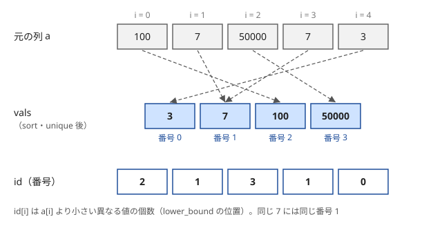
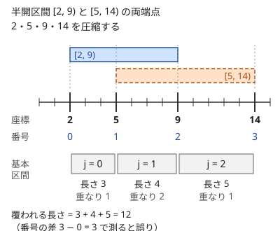

!!! abstract "要点"
    - **何ができるか**：値を sort・unique・lower_bound で $0$〜$K-1$ の番号に置き換え、大小関係だけを残したまま配列の添字にできるようにする。BIT・セグ木・いもす法と組んで使う。
    - **いつ使うか**：
        - 値は $10^9$ まであるが、個数は $2 \times 10^5$ 以下。
        - 大小関係（順位）だけが重要。
        - 値を配列の添字にしたいが、値の範囲が広すぎる。
    - **計算量**：前処理 $O(N \log N)$。値から番号を引くのは 1 回 $O(\log K)$、番号から元の値へは $O(1)$（$K$ は異なる値の個数）。値をすべて先に知っている必要がある。
    - **前提**：[二分探索](../basics/binary-search.md)

<!-- textlint-disable -->
別名：座圧・値の圧縮・離散化・coordinate compression
<!-- textlint-enable -->

座標圧縮は、値そのものの代わりに「全体で何番目に小さい値か」という番号を使う方法である。値が $10^9$ まであっても、現れる値が $N$ 個なら番号は $N$ 個以下で済むので、長さ $N$ の配列の添字にできる。大小の比較と等しいかどうかの判定は、番号どうしで行っても結果が変わらない。

## sort → unique → lower_bound の 3 段 {#three-steps}

座標圧縮の手順は、値を集めて並べ、重複を消し、各値の位置を二分探索で引く 3 段である。次の図は $a = (100, 7, 50000, 7, 3)$ を圧縮した結果で、異なる値は 4 個なので番号は $0$〜$3$ になる。



番号の意味は「$a_i$ より小さい、異なる値の個数」である。並べて重複を消した列 vals では、$a_i$ の位置より左にちょうどその個数の値があり、`lower_bound` は「$a_i$ 以上の最初の位置」を返すので、その位置が番号になる。この定義から次の 2 つが成り立つ。

- $a_i < a_j \iff \mathrm{id}_i < \mathrm{id}_j$、$a_i = a_j \iff \mathrm{id}_i = \mathrm{id}_j$（大小と等しさが保たれる）
- $\mathrm{vals}[\mathrm{id}_i] = a_i$（番号から元の値に戻せる）

```cpp
--8<-- "coordinate-compression/compress.cpp:core"
```

- **`unique` は消さない**：`unique` は残す要素を前に詰め、その終わりの位置を返すだけである。vector の長さは変わらない。`erase` まで書かないと、後ろに残ったごみも番号に数えてしまう
- **並べてから `unique`**：`unique` が消すのは隣り合う重複だけなので、先に `sort` する
- **番号は 0 から**：問題が「1 番目から」と数えるなら、出力のときに 1 を足す

計算量は、並べるのに $O(N \log N)$、$N$ 回の `lower_bound` が合わせて $O(N \log K)$ である。値を番号に変えた後の処理は、値の大きさ（$10^9$）ではなく番号の個数 $K \le N$ だけで決まる。

??? question "確認問題：lower_bound を upper_bound にしたら"
    上のコードの `lower_bound` を `upper_bound` に変えると、番号はどうなるか。

    ??? success "答え"
        `upper_bound` は「$a_i$ より大きい最初の位置」を返す。vals には $a_i$ がちょうど 1 つあるので、どの値も番号が 1 ずつ大きくなり、$1$〜$K$ の番号になる。大小関係は保たれるが、`vals[id]` で元の値に戻すと 1 つ右の値を読み、最大の値では配列の外を読む。0 から振るなら `lower_bound` を使う。

## 区間を扱うときは両端点を入れる {#intervals}

区間を圧縮するときは、区間の左端と右端の両方を vals に入れる。端点だけを集めると、隣り合う 2 つの座標の間の部分は、どの区間にとっても「全部入る」か「全く入らない」かのどちらかになる。この隣り合う座標の間を基本区間と呼ぶ。区間の操作は基本区間をまとめて扱えばよく、基本区間は高々 $2N - 1$ 個である。



[半開区間](../guide/glossary.md#half-open-interval) $[l, r)$ で扱うと、端点の扱いが素直になる。$l$ と $r$ をそのまま入れて並べた列を、[3 段の節](#three-steps)と同じく $\mathrm{vals}$ と呼ぶ。番号 $j$ を基本区間 $[\mathrm{vals}_j, \mathrm{vals}_{j+1})$ に対応させる。区間 $[l, r)$ は番号 $\mathrm{id}(l)$ から $\mathrm{id}(r) - 1$ までの基本区間をちょうど覆う。

閉区間 $[l, r]$ で与えられたら、$[l, r + 1)$ に直してから $l$ と $r + 1$ を入れる。$r$ を入れたまま閉区間として扱うと、点 $r$ だけの部分と $r$ から次の座標までの部分が 1 つの基本区間に混ざり、区間の終わりが正しく表せない。

次のコードは、$N$ 個の半開区間のどれかに覆われる部分の長さの合計を求める。両端点を圧縮し、基本区間ごとに[いもす法](../basics/imos.md)で重なりの数を数える。

```cpp
--8<-- "coordinate-compression/covered-length.cpp:core"
```

??? question "確認問題：右端を入れ忘れたら"
    区間 $[2, 9)$ と $[5, 14)$ のうち、左端 2・5 だけを圧縮した。何が困るか。

    ??? success "答え"
        区間の終わり 9・14 に対応する番号がないので、`lower_bound` は 9 に対して vals の末尾の次（番号 $2 = K$）を返す。差分を引く位置が表せず、「9 で 1 つ減る」という情報が失われる。区間の終わりに意味がある以上、右端も必ず入れる。

## 圧縮後の番号で長さを測らない（元の値を残す） {#keep-original}

座標圧縮で保たれるのは大小関係だけで、値の差（距離・長さ）は保たれない。番号が 1 違う 2 つの値は、元の値では 1 違うこともあれば $10^9$ 違うこともある。長さ・距離・値の和を答えるときは、番号から $\mathrm{vals}$ で元の値に戻して計算する。

- 基本区間 $j$ の長さは $\mathrm{vals}_{j+1} - \mathrm{vals}_j$ である（[両端点の節](#intervals)の図では 3・4・5）。番号の差 $1$ を足すと、覆われる長さは 3 になって誤る
- 値の和を答える問題で番号の和を出してしまう誤りもよくある。BIT に載せる値は番号ではなく元の値にする
- 圧縮のために元の配列を書き換えると、元の値が分からなくなる。圧縮した番号は別の配列に持つか、$\mathrm{vals}$ を残す

逆に、番号そのものが答えになるのは、値の隙間に意味がない問題である。[例題](#abc213_c)のように「何もない行と列を詰める」なら、詰めた後の座標は圧縮した番号そのもの（に 1 を足したもの）になる。

値の隙間に意味がある問題では、端点だけの圧縮では足りないことがある。たとえば閉区間 $[l, r]$ を $l$ と $r$ のまま圧縮すると、「どの区間にも覆われない最小の整数」の候補である $r + 1$ が vals にない。こうした問題では、答えの候補になる値（$r + 1$ や、下限の $0$・$1$ など）も vals に入れておくか、基本区間の中身（長さや最初の値）を元の座標から求める。

## BIT・セグメント木・いもす法と組む {#with-ds}

座標圧縮は単独で使うより、値を添字にしたいデータ構造の前処理として使うことが多い。番号は $0$〜$K-1$ に詰まっているので、長さ $K$ の配列・BIT・セグ木をそのまま使える。

- **値の大小で数える**：「$j < i$ で $a_j < a_i$ となる $j$ の個数」は、$a$ を圧縮して [BIT](../ds/fenwick-tree.md) の位置 $\mathrm{id}_j$ に 1 を足しながら、$\mathrm{id}_i$ 未満の和を取れば $O(N \log N)$ で求まる。[転倒数](../ds/inversion-number.md)も同じ形である。値を添字にした BIT・セグ木の使い方は[値を添字にする BIT・セグメント木](../ds/segment-tree-on-values.md)で詳しく述べる
- **区間への操作**：区間の両端点を圧縮すれば、基本区間の列に対して[いもす法](../basics/imos.md)や[セグメント木](../ds/segment-tree.md)・[遅延セグメント木](../ds/lazy-segment-tree.md)を使える（[練習問題](#practice)の Long Bricks）
- **時刻の列で処理する**：開始・終了の時刻を圧縮するか、(時刻, 種類) の組を並べて左から処理する（[イベントソート](../basics/event-sort.md)）。2 次元の点なら、一方の座標で並べて、もう一方を圧縮して BIT に載せる（[平面走査](../ds/sweep-line-2d.md)）
- **2 次元**：$x$ 座標と $y$ 座標は独立に圧縮してよい（[例題](#abc213_c)）。ただし $x$ と $y$ の値どうしを比べる問題なら、同じ vals にまとめて圧縮する

圧縮には、使う値をすべて先に集める必要がある。後から来るクエリの値も添字に使うなら、クエリを先に全部読んでその値も vals に入れる（[オフライン](../guide/glossary.md#offline)。[クエリの先読み](../ds/offline-queries.md)）。前の答えで次のクエリが決まる問題では先読みができないので、`std::set`・`std::map` や、必要な所だけ作る動的なセグ木を使う。

## map で足りる場合との使い分け {#vs-map}

値ごとに個数を数えたい、値に情報を結び付けたいだけなら、座標圧縮をせずに `std::map`（または `std::unordered_map`）を使えば足りる。座標圧縮が要るのは、番号が $0$〜$K-1$ に詰まっていることを使うときである。

| したいこと | 向く方法 |
| --- | --- |
| 値ごとの個数・情報を持つ | `map`・`unordered_map` |
| 順位（何番目に小さいか）を出す | 座標圧縮 |
| 値の範囲 $[l, r)$ の和・個数を何度も求める | 座標圧縮 ＋ BIT・セグ木 |
| 区間の端点でいもす法をする | 座標圧縮（または `map` の差分を順に累積） |
| 値が後から増える（先読みできない） | `set`・`map` |

`map` は 1 回の操作に $O(\log K)$ かかり、定数倍も配列より重い。座標圧縮した配列なら、番号を引いた後の操作は配列の添字アクセスで済む。逆に、圧縮は値を全部集めてからでないとできない。コンテナの詳しい使い分けは[STL のコンテナ](../ds/stl-containers.md)を見るとよい。

`map` でも圧縮できる。値をすべて `map` に入れてから、小さい順に 0, 1, 2, … と番号を振ればよい。結果は sort・unique・lower_bound と同じだが、vector で書く方が速く、`vals` で元の値に戻すのも簡単である。

## 落とし穴 {#pitfalls}

**`erase` を書き忘れる**。`unique` だけでは vector の長さが変わらず、`vals.size()` が異なる値の個数にならない。番号は正しく見えても、$K$ を配列の大きさや答えに使うと誤る。`vals.erase(unique(…), vals.end())` を 1 行で書く癖を付ける。

**vals にない値で `lower_bound` を引く**。クエリの値など、圧縮のときに入れていない値を引くと、「その値以上の最初の値」の番号が返り、エラーにはならない。末尾を越えると番号が $K$ になり、配列の外を読む。値を使う所をすべて先に集めるか、`it != vals.end() && *it == x` を確かめてから使う。ただし、これは値そのものの番号が要るときの話である。範囲の境界として引くだけなら vals になくてもよく、$[l, r)$ に入る値の番号はちょうど `lower_bound(l)` から `lower_bound(r)` の 1 つ手前までになる。

**閉区間の右端に 1 を足し忘れる**。閉区間 $[l, r]$ を $l$ と $r$ だけで圧縮していもす法をすると、差分を $\mathrm{id}(r)$ で引けば点 $r$ が抜け、$\mathrm{id}(r) + 1$ で引けば $r$ の次の座標の手前まで覆ってしまう。$[l, r + 1)$ に直してから $l$ と $r + 1$ を入れる（[両端点の節](#intervals)）。

**値の型**。値が `int` の範囲（約 $\pm 2.1 \times 10^9$）を超えうるとき（$10^9$ に足し引きした座標、$10^{18}$ までの値など）は、vals を `long long` にする。番号は $K \le N$ なので `int` でよい。負の値もそのまま並べられるので、ずらす必要はない。

**比べる値どうしを別々に圧縮する**。2 つの列 $A$ と $B$ を比べる（「$A_i \le B_j$」を数えるなど）のに、$A$ と $B$ を別々に圧縮すると、番号どうしの大小が元の大小と一致しない。比べる値はすべて 1 つの vals にまとめる。

## 上位の手法へのつながり {#next-steps}

このページの「値を 0〜K−1 の番号に置き換える」は、次の手法の部品になる。

- **値を添字にしたデータ構造**：圧縮した値を BIT・セグメント木の添字にすると、「$x$ 以下の個数・和」や上位 $K$ 個の和を $O(\log N)$ で求められる（[値を添字にする BIT・セグメント木](../ds/segment-tree-on-values.md#index-by-value)）。転倒数はこの代表例である（[転倒数](../ds/inversion-number.md#count-with-bit)）
- **平面走査**：2 次元の点や長方形を一方の座標の順に処理し、もう一方の座標を圧縮して BIT に載せる（[平面走査](../ds/sweep-line-2d.md#idea)）
- **DP の値を値の添字で持つ**：「値 $v$ で終わる最良」を値の添字のセグメント木に持つと、最長増加部分列の重み付きや数え上げに広がる（[最長増加部分列](../dp/lis.md#segment-tree)）
- **クエリを先読みする**：後から来るクエリの値もまとめて圧縮するには、クエリを先に全部読む必要がある（[クエリの先読み](../ds/offline-queries.md#compress)）

## 例題 {#examples}

### ABC213 C. Reorder Cards {#abc213_c}

<div class="kp-problems" data-role="example" markdown>

- [ABC213 C. Reorder Cards](https://atcoder.jp/contests/abc213/tasks/abc213_c)（diff 481）：数の書かれたカードがある行と列だけを残して詰めたときの、各カードの新しい座標を求める。

</div>

盤面は $10^9 \times 10^9$ まであるので、行や列を実際に消していくことはできない。カードのない行を消しても、残る行どうしの上下の順は変わらない。だから最後に残るのは「カードのある行」だけである。各カードの新しい行は、カードのある行のうち上から何番目かで決まる。列も同じで、行と列は互いに影響しないので、別々に圧縮すればよい。

??? note "解法の詳細"
    - 全カードの行番号を集めて圧縮し、各カードの行を番号に置き換える。列も同じく独立に圧縮する。
    - 同じ行に複数のカードがあれば同じ番号になる（unique で重複を消すため）。
    - 番号は 0 から振られるので、1 を足して出力する。全体で $O(N \log N)$ で、盤面の大きさ $H$・$W$ によらない。

## 練習問題 {#practice}

<div class="kp-problems" data-role="practice" markdown>

- [ABC113 C. ID](https://atcoder.jp/contests/abc113/tasks/abc113_c)（diff 878）：各市に、所属する県の番号と県の中での誕生順を並べた ID を付ける。
- [ABC036 C. 座圧](https://atcoder.jp/contests/abc036/tasks/abc036_c)（diff 956・参考値）：各値が全体で何番目に小さい値か（同じ値は同じ番号）を出力する。
- [典型90 029. Long Bricks（★5）](https://atcoder.jp/contests/typical90/tasks/typical90_ac)（diff なし）：区間にレンガを順に積んでいくとき、各レンガが置かれる高さを求める。

</div>

??? note "練習の方針"
    - **ABC113 C**：県ごとに誕生年の列を作って並べ、各市の誕生年を自分の県の列の中で `lower_bound` すれば、県の中での順位が分かる。圧縮を県ごとに分けて行う形である。出力は県の番号と順位をそれぞれ 6 桁に 0 で埋めてつなげる
    - **ABC036 C**：3 段の手順そのもの。番号は 0 から振る
    - **典型90 029**：閉区間 $[L, R]$ を半開区間 $[L - 1, R)$ に直し、$L - 1$ と $R$ を圧縮する（マス $i$ を $[i - 1, i)$ と見る書き方で、本文の $[L, R + 1)$ と基本区間の並びは同じになる。どちらでもよい）。基本区間ごとの高さを配列に持ち、各レンガで区間の最大値を取って 1 を足し、その値で区間を塗る。素朴に塗ると最悪 $O(N^2)$ なので、満点には区間の最大値の取得と区間の代入を遅延セグメント木で行う

## 参考 {#references}

- [drken「AtCoder ABC 213 C - Reorder Cards (3Q, 茶色, 300 点)」](https://drken1215.hatenablog.com/entry/2021/08/11/023013)：例題の方針（行と列を独立に圧縮する）
- [drken「AtCoder ABC 036 C - 座圧 (試験管緑色)」](https://drken1215.hatenablog.com/entry/2021/08/10/003714)：sort・unique・erase・lower_bound の 3 段の書き方
- [drken「AtCoder ABC 113 C - ID (3Q, 緑色, 300 点)」](https://drken1215.hatenablog.com/entry/2019/03/21/234900)：練習の方針（県ごとに並べて二分探索で順位を付ける）
- [Reputeless「029 - Long Bricks (★5)」](https://github.com/Reputeless/tenkei_90/blob/main/029.md)：練習の方針（半開区間に直して両端点を圧縮する）
- [E869120「kyopro_educational_90 sol/029-02.cpp」](https://github.com/E869120/kyopro_educational_90/blob/main/sol/029-02.cpp)：圧縮する値として $L - 1$ と $R$ を入れること
