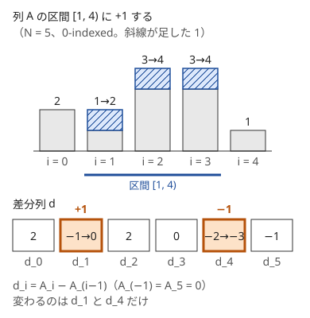

!!! abstract "要点"
    - **何ができるか**：区間に ±1 する操作の最小回数や可否を、隣接差の列（差分列）の 2 点の操作に言い換えて解く。狭義の条件は $a_i - i$ で広義に直し、回文の条件は左右の差の列に直してから差分を取る。
    - **いつ使うか**：
        - 区間に $+1$・$-1$ する操作の最小回数・可否。
        - 数列を単調にする・回文にするための最小の操作回数。
        - 円形に並んだ箱から一斉に取り除く操作で空にできるか。
        - 操作が区間に一律の値を足す形で、隣接差では 2 か所だけが変わる。
    - **計算量**：差分列を作るのは $O(N)$。最小回数は正の部分の和などで $O(N)$ で求まり、mod $M$ の代表を選ぶ型は並べ替えで $O(N \log N)$。
    - **前提**：[いもす法](../basics/imos.md)

<!-- textlint-disable -->
別名：差分列・差分で言い換える・区間 ±1 の最小回数・区間操作を 2 点の操作に・difference sequence
<!-- textlint-enable -->

差分列への言い換えは、列に対する区間の操作を、隣どうしの差の列（差分列）に対する 2 点の操作に書き直す考え方である。区間は $O(N^2)$ 通りあって組み合わせを直接は考えにくいが、差分列の上では「どの点をいくつ増やし、どの点をいくつ減らすか」だけの問題になる。[いもす法](../basics/imos.md)が差分列を計算の道具に使うのに対し、ここでは問題そのものを言い換えるために使う。

## 区間の操作を差分列の 2 点の操作に直す {#to-point-operations}

添字は 0-indexed とする。長さ $N$ の列 $A$ に対し、両端の外を 0 とみなして（$A_{-1} = A_N = 0$）、長さ $N + 1$ の差分列を次で定める。

$$
d_i = A_i - A_{i-1} \qquad (0 \le i \le N)
$$

$d$ の和は $A_N - A_{-1} = 0$ である。逆に和が 0 の $d$ からは、左から累積して $A$ がただ 1 つに戻る。だから $A$ を考えることと $d$ を考えることは同じである。

半開区間 $[l, r)$（$0 \le l < r \le N$）のすべての要素に $x$ を足すと、変わるのは $d_l$（$+x$）と $d_r$（$-x$）の 2 つだけである。区間の内側では隣どうしが同じだけ増えるので差は変わらない。



$d$ を両端の外まで含めて $N + 1$ 個取るのが要点である。$l = 0$ や $r = N$ の区間（接頭辞・接尾辞）も、$d_0$ や $d_N$ を変える普通の 2 点の操作として扱える。端の差を省くと、接頭辞への操作が「1 点だけを変える特別な操作」に見えて、場合分けが増える。

この対応は逆向きにも使える。隣り合う 2 項について「$A_i$ を 1 減らし、$A_{i+1}$ を 1 増やす」操作は、累積和 $S_k = A_0 + \dots + A_{k-1}$ で見ると $S_{i+1}$ だけを 1 減らす 1 点の操作である。$A$ 自身が $S$ の差分列だからである（[例題の ABC459 F](#abc459_f) で使う）。

区間の操作の問題では、まず差分列の上で次の 3 つを確かめる。

- 1 回の操作で、どの 2 点がどう変わるか（足す値・組める点の組）
- 目標の状態は、差分列ではどう書けるか（すべて 0、すべて非負など）
- 差分列で見えなくなる情報は何か（全体へ一律に足した量。[円環の節](#circular)）

## 最小回数・可否を差分列の正負で考える {#min-operations}

差分列に直すと、最小回数は「1 回の操作で差分列をどれだけ動かせるか」から下限を出し、その回数で作れることを示せば求まる。代表的な 3 つの型を示す。

**区間に $+1$ だけで、すべて 0 の列から $A$ を作る**（各 $A_i \ge 0$）。最小回数は次のとおりである。

$$
\sum_{i=0}^{N} \max(d_i, 0) = \sum_{i=0}^{N-1} \max(A_i - A_{i-1}, 0)
$$

下限の理由は、1 回の操作で $+1$ される差分は $d_l$ の 1 つだけだからである。正の $d_i$ はそれぞれ $d_i$ 回 $+1$ される必要がある。作り方は、左から見て $d_i > 0$ の位置で区間を $d_i$ 本始め、$d_i < 0$ の位置で $-d_i$ 本を終えればよい。位置 $i$ の直前に開いている本数は $A_{i-1}$ で、終える本数 $A_{i-1} - A_i$ はそれ以下（$A_i \ge 0$）なので、終える区間が足りなくなることはない。

**区間に $+1$ と $-1$ のどちらもでき、$A$ をすべて 0 にする**。最小回数は $\frac{1}{2} \sum_{i=0}^{N} \lvert d_i \rvert$ で、和が 0 なので正の部分の和と等しい。$i < j$ の 2 点は、区間 $[i, j)$ への $+1$ か $-1$ で動かせる。片方は $+1$、もう片方は $-1$ になる。1 回で $\sum \lvert d_i \rvert$ は 2 までしか減らない。逆に、正の点と負の点を 1 つずつ選んで近づけると、毎回ちょうど 2 減る。

**長さがちょうど $K$ の区間に $\pm 1$ して、$A$ をすべて 0 にする**。操作 $[l, l + K)$ が変えるのは $d_l$ と $d_{l+K}$ なので、差分列の添字は $K$ で割った余りごとの鎖 $r, r + K, r + 2K, \dots$ に分かれる。鎖の中では、隣り合う 2 点の間で 1 単位ずつ運ぶ操作になる。そこで次のように判定し、数える。

- **可否**：どの鎖でも差分の和が 0 であること。操作は鎖の中の和を変えないので必要で、和が 0 なら先頭から順に次の点へ運べば作れる
- **最小回数**：鎖の先頭からの和を $c_0, c_1, \dots$ とすると、鎖の $t$ 番目と $t + 1$ 番目の間を通る量はちょうど $\lvert c_t \rvert$ である。その和が答えになる

3 つの型をまとめて書くと次のようになる。どれも $O(N)$ である。

```cpp
--8<-- "difference-sequence/min-ops.cpp:core"
```

1 回の操作で変わる差分の個数と向きが分かれば、「正の部分の和」「鎖ごとの和」のように、点ごとの量に分けて下限と構成を考えられる。可否の判定では、差分列の上の[不変量](../thinking/invariant.md#necessary-and-sufficient)（鎖ごとの和など）が必要条件になることが多い。

## 狭義の条件は a_i − i で広義に直してから差分を取る {#strict-to-weak}

この節は[広義単調増加](../guide/glossary.md#non-decreasing)の定義を前提にする。整数の列 $A$ が狭義単調増加であることは、$B_i = A_i - i$ が広義単調増加であることと同じである。$A_i < A_{i+1}$ は整数なら $A_i + 1 \le A_{i+1}$ で、両辺から $i + 1$ を引けば $B_i \le B_{i+1}$ になる。差分列で書けば、内側の差 $B_i - B_{i-1}$（$1 \le i \le N - 1$）がすべて 0 以上という条件になる。

この変換は操作を変えない。区間に $\pm 1$ する操作は、$A$ でも $B$ でも同じ区間に $\pm 1$ する操作である。$i$ を引く部分は操作によらず固定だからである。だから「狭義単調にする」問題は、「差分列の内側をすべて非負にする」問題として、[最小回数の節](#min-operations)の考え方で数えられる。

たとえば「区間に $+1$ する操作で $A$ を狭義単調増加にする最小回数」を考える。$e_i = A_i - A_{i-1} - 1$（$1 \le i \le N - 1$）が負の位置で、それぞれ $-e_i$ 回の $+1$ が要る。1 回の操作で $+1$ される内側の差は $d_l$ の 1 つだけなので、$\sum \max(-e_i, 0)$ 回は必要である。区間の右端を $N$ に取れば $-1$ が内側に入らないので、接尾辞に足す操作だけでこの回数を達成できる。

同じ変換は、ほかの条件にも使える。

- 狭義単調減少は $A_i + i$ が広義単調減少
- 隣との差が $K$ 以上（$A_{i+1} - A_i \ge K$）は $A_i - Ki$ が広義単調増加
- $A_i - i$ のように添字と値を 1 つの量にまとめる変換は、組の条件でも使う（[i と j を分離する](../thinking/reformulation.md#separate-indices)）

## 回文にする操作は左右の差の列に直してから差分を取る {#palindrome}

回文の条件は、対称な 2 つの位置 $i$ と $N - 1 - i$ の値が等しいことである（$0 \le i < h$、$h = \lfloor N / 2 \rfloor$。$N$ が奇数なら中央の要素は条件に入らない）。そこで、左右の差の列を次で定める。

$$
e_i = A_i - A_{N-1-i} \qquad (0 \le i < h)
$$

回文にすることは、$e$ をすべて 0 にすることと同じである。区間に $+1$ する操作は、$e$ では次のどれかになる。

- 区間が左半分に収まるとき：$e$ の同じ区間に $+1$
- 区間が右半分に収まるとき：$e$ の、左右を折り返した区間に $-1$
- 区間が中央をまたぐとき：中央をはさんで対称な部分は左右とも $+1$ されて差が変わらない。残った片側だけの操作と同じになる

どの場合も、$e$ の区間への $+1$ か $-1$ の操作である。$e$ の区間は右端 $r = h$（中央に接する区間）まで取れる。だから $e$ の差分列を、両端の外を 0 として長さ $h + 1$ で取れば、どの操作も 2 点の操作になる。すると[最小回数の節](#min-operations)の「$+1$ と $-1$ のどちらもできる」型になり、最小回数は正の部分の和である。

値を $M$ で割った余りとして扱う問題（区間に足して $\bmod M$ を取る）を考える。このとき差分 $c_i$ は、$0 \le c_i < M$ の余りとしてしか決まらない。実際に動かす量 $d_i$ は $c_i$ か $c_i - M$ のどちらかに選べばよく、和を 0 にする必要がある。

- $\sum c_i$ は $M$ の倍数で、$k = \sum c_i / M$ 個の $d_i$ を $c_i - M$ にすれば和が 0 になる
- 回数は正の部分の和なので、$M$ を引くのは大きい方から $k$ 個がよい。答えは、残った小さい方の $(h + 1) - k$ 個の $c_i$ の和である
- $c_i + M$ や $c_i - 2M$ を選ぶと損をする。ある $d_i \ge M$ があれば和が 0 なので負の $d_j$ もあり、$d_i$ から $M$ を引いて $d_j$ に $M$ を足すと正の部分の和が減るからである。$d_i \le -M$ のときも同様に、正の $d_j$ から $M$ を引いて $d_i$ に $M$ を足すと正の部分の和が減る

並べ替えが入るので $O(N \log N)$ である（$M$ が小さければ数え上げのソートで $O(N + M)$）。この型の具体例は[例題の ABC454 F](#abc454_f)にある。

## 円環で一斉に行う操作 {#circular}

円形に並んだ列では、差分列も円形になる。$d_i = A_i - A_{i-1}$（添字は $\bmod N$）の $N$ 個で、区間の操作は円環上の 2 点を変える。直線と違って両端の外の 0 がないので、次の 2 点に気をつける。

- **全体に一律に足した量が見えない**：円環の全体へ $+1$ しても差分列は変わらない。差分列から元の列に戻すには、1 つの値か全体の和を別に持つ必要がある
- **自由な端がない**：直線では接頭辞・接尾辞の操作の片側が $d_0$・$d_N$ に逃げたが、円環ではどの操作も円環上の 2 点を必ず変える

一斉に $1, 2, \dots, N$ のような等差数列を足す（取り除く）操作は、差分列で見ると「ほぼ全体に一律の値」と「切れ目の 1 点」に分かれる。起点を $s$ として位置 $s, s + 1, \dots$ に $1, 2, \dots, N$ を足すとする。隣との差は $N - 1$ か所で $+1$ になり、切れ目（$N$ の次に $1$ が来る位置 $s$）の 1 か所だけが $-(N - 1)$ になる。全体の和から操作の回数 $T$ が決まる。一律の $+T$ を先に引くと、1 回の操作は「切れ目の 1 点から $N$ を引く」だけになる。各位置の差分が何回の切れ目になったかが決まるので、それが 0 以上の整数かを調べれば可否が分かる（[練習問題](#practice)の AGC010 B）。

等差数列を足す操作は 2 回差分を取ると数点の操作になる（[2 階の差分](../basics/imos.md#second-order)）。円環で一斉に足す操作は、1 回目の差分で一律の部分を取り除き、残りを点の操作として数えるのが典型である。

## 落とし穴 {#pitfalls}

**端の差を落とす**。差分列を $d_1, \dots, d_{N-1}$ の内側だけで定めると、接頭辞や接尾辞への操作が 1 点の操作になり、正の部分の和の式が合わなくなる。$A_{-1} = A_N = 0$ として $N + 1$ 個を取る。ただし「狭義単調にする」のように条件が内側の差にしかかからない問題では、端の $d_0$・$d_N$ は自由に捨ててよい点として扱う。どちらの場合かを、最初に目標の状態を差分列で書いて確かめる。

**狭義のまま差分を取る**。狭義単調増加の条件を「差分が非負」と書くと 1 ずれる。先に $A_i - i$ へ直すか、「差分が 1 以上」と書く。

**mod で考えるときの代表**。余りの世界の差分 $c_i$ をそのまま「必要な回数」とみなすと、$c_i - M$ を選ぶ方が少ない場合を落とす。和が 0 になる代表の選び方を考える（[回文の節](#palindrome)）。

**値のあふれ**。差分の絶対値の和は、値の絶対値が $10^9$ 以下、$N = 2 \times 10^5$ で最大 $4 \times 10^{14}$ 程度になる。[例題の ABC459 F](#abc459_f) のように $\sum i \cdot (\dots)$ で数える式は、さらに $N$ 倍になりうる。`long long` で持ち、負の数の割り算は切り捨ての向きを確かめる（C++ の `/` は 0 の向きに丸める）。

## 上位の手法へのつながり {#next-steps}

- **操作と取得が交互に来る**：区間加算のたびに一点の値を読むなら、差分列を[フェニック木](../ds/fenwick-tree.md#variants)に持ち、一点加算と接頭辞の和で読む。区間の和を読むなら[遅延セグメント木](../ds/lazy-segment-tree.md)を使う
- **切り替え点を DP の状態にする**：区間の反転や区間の操作を差分列の点へ直すと、置いた点の個数をフェーズにした DP になる（[フェーズを状態に持つ DP](../dp/dp-phase.md)）
- **単調にする最小コスト**：操作の回数ではなく「変えた量の絶対値の和」を最小にして単調にするなら、区分線形な関数を持つ [Slope Trick](../dp/slope-trick.md#operations) を使う
- **不変量**：差分列の上で操作が保つ量（鎖ごとの和・和の mod）を探すと、可否の必要条件が見つかる（[不変量・単調量](../thinking/invariant.md)）

## 例題 {#examples}

### ABC459 F. -1, +1 {#abc459_f}

<div class="kp-problems" data-role="example" markdown>

- [ABC459 F. -1, +1](https://atcoder.jp/contests/abc459/tasks/abc459_f)（diff 2163）：整数列で、隣り合う 2 項の左を 1 減らし右を 1 増やす操作を繰り返し、列を狭義単調増加にする最小の操作回数を求める。

</div>

操作は隣り合う 2 点の $\mp 1$ なので、累積和 $S_k = A_0 + \dots + A_{k-1}$ で見ると $S_{i+1}$ を 1 減らす 1 点の操作である（[区間の操作を差分列の 2 点の操作に直す](#to-point-operations)の逆向き）。最終的な列の累積和を $S'$ とすると、回数は $\sum_k (S_k - S'_k)$ で、$S'_k \le S_k$ でなければ作れない。だから「各 $S'_k$ をできるだけ大きく保ったまま狭義単調増加にする」問題になる。狭義の条件は $B_i = A_i - i$ で広義に直す。

長さ $L$・和 $s$ の広義単調増加の整数列の中では、値を $\lfloor (s + j) / L \rfloor$（$j = 0, \dots, L - 1$）と均した列が、すべての接頭辞の和を同時に最大にする。均した列でない列では最大と最小の差が 2 以上ある。最小の値の最後の位置を $i$、最大の値の最初の位置を $j$ とすると、$B_j$ から $B_i$ へ 1 を移しても単調性は保たれ、$i$ 以降 $j$ 未満で終わる接頭辞の和は増え、ほかは変わらないからである。そこで $B$ を左から見て、隣のブロックと単調性がぶつかる間はブロックを併合して均し直す。

??? note "解法の詳細"
    - $B_i = A_i - i$ とする。ブロック（長さ, 和）をスタックに積み、新しい要素を長さ 1 のブロックとして加える。
    - スタックの一番上のブロックの最大（均したときの右端 $\lceil s / L \rceil$）が、今のブロックの最小（左端 $\lfloor s / L \rfloor$）より大きい間は、2 つを併合する。各要素は 1 回積まれて 1 回降ろされるだけなので $O(N)$ である。
    - 最後に各ブロックを均した値 $B'_i$ を並べる。回数は $\sum_k (S_k - S'_k) = \sum_i i \cdot (B'_i - B_i)$ である（$\sum_i B'_i = \sum_i B_i$ を使って書き直した）。
    - 負の数の切り捨てに注意する。$B_i$ は負になりうるので、`floor_div` を自分で書く。
    - 併合が要る理由の筋：ブロックの境目では $S'$ と $S$ が一致し（境目を越えて運ばない）、ブロックの内側ではどの境目も越えて運ぶ。単調性がぶつかるのは、左のブロックから右へ運ばないと単調にできないときなので、2 つを 1 つのブロックとして均し直すのが最もよい。

    ```cpp
    --8<-- "difference-sequence/level.cpp:core"
    ```

### ABC454 F. Make it Palindrome 2 {#abc454_f}

<div class="kp-problems" data-role="example" markdown>

- [ABC454 F. Make it Palindrome 2](https://atcoder.jp/contests/abc454/tasks/abc454_f)（diff 2169）：0 以上 M 未満の整数の列で、区間の各要素に 1 を足して M で割った余りにする操作により、列を回文にする最小の回数を求める。

</div>

[回文の節](#palindrome)の型そのものである。対称な位置の差 $e_i = (A_i - A_{N-1-i}) \bmod M$ を作ると、区間の操作は $e$ の区間への $\pm 1$（$\bmod M$）になる。さらに $e$ の差分列を取れば 2 点の操作になり、和を 0 にする代表の選び方を貪欲に決める。

??? note "解法の詳細"
    - $h = \lfloor N / 2 \rfloor$ とし、$e_i = (A_i - A_{N-1-i}) \bmod M$（$0 \le i < h$）を作る。中央をまたぐ操作は片側だけの操作に置き換えてよい。
    - $e_{-1} = e_h = 0$ として、差分 $c_i = (e_i - e_{i-1}) \bmod M$（$0 \le i \le h$）を $h + 1$ 個作る。区間の操作は「$c$ のある点を $+1$、別の点を $-1$（$\bmod M$）」になる。
    - $k = \sum c_i / M$ とする（割り切れる）。$c$ を小さい順に並べ、小さい方から $(h + 1) - k$ 個の和が答えである。大きい方の $k$ 個は $c_i - M$（負の向き）として動かす。
    - 並べ替えで $O(N \log N)$。$\sum c_i$ は $NM$ 程度になるので `long long` で持つ。

## 練習問題 {#practice}

<div class="kp-problems" data-role="practice" markdown>

- [ABC466 E. Range Flip](https://atcoder.jp/contests/abc466/tasks/abc466_e)（diff 1027）：表と裏に数が書かれたカードの列で、区間の裏返しを K 回以下行った後の、上を向いた数の和の最大値を求める。
- [AGC010 B. Boxes](https://atcoder.jp/contests/agc010/tasks/agc010_b)（diff 1892）：円形に並んだ箱から、ある箱を起点に 1, 2, …, N 個を一斉に取り除く操作で、すべての箱を空にできるか判定する。

</div>

??? note "練習の方針"
    - **ABC466 E**：裏返したかどうかの列を $f$ とし、XOR の差分列を端の外まで含めて $N + 1$ 点で取る。$K$ 回以下の区間の裏返しで作れる $f$ は、差分列の 0 でない点が $2K$ 個以下の $f$ とちょうど対応する（点の個数は必ず偶数）。そこで差分の点を左から $2K$ 個以下置く DP にし、各位置の表裏は置いた個数の偶奇で決める（[いもす法の区間反転の節](../basics/imos.md#range-flip)）
    - **AGC010 B**：全体の和を $N(N + 1)/2$ で割って操作の回数 $T$ を決める（割り切れなければ不可）。円環の差分 $A_{i+1} - A_i$ から一律の $T$ の分を除くと、各位置が切れ目になった回数が $N$ で割って求まる。それがすべて 0 以上の整数なら可能である（[円環で一斉に行う操作](#circular)）

## 確認問題 {#quiz}

??? question "確認問題：広義に直すのを忘れると"
    $A = (1, 1, 1)$ を、区間に $+1$ する操作で狭義単調増加にしたい。差分列の内側 $(0, 0)$ がすでに非負だから 0 回、としてよいか。

    ??? success "答え"
        よくない。狭義の条件は $A_i - A_{i-1} \ge 1$ なので、見るべきは $e = (-1, -1)$ である。答えは 2 回で、たとえば $[1, 3)$ と $[2, 3)$ に $+1$ して $(1, 2, 3)$ にする。広義の差分列で考えるなら、先に $B = (1, 0, -1)$ に直してから差を取る。

??? question "確認問題：区間から 1 を引いて 0 にする"
    $A = (3, 1, 4, 1, 5)$ を、区間から 1 を引く操作だけですべて 0 にしたい。最小で何回か。

    ??? success "答え"
        10 回である。$-1$ で 0 にする操作を逆にたどると、0 から $+1$ で $A$ を作る操作になるので、回数は同じである。差分列は $d = (3, -2, 3, -3, 4, -5)$ で、正の部分の和は $3 + 3 + 4 = 10$ になる。先頭の $d_0 = A_0$ を数え忘れると 7 回と誤る。

??? question "確認問題：円環の差分列だけでは足りない理由"
    円形に並んだ列 $A$ の差分列 $d$（$N$ 個）が分かっているとき、$A$ は決まるか。

    ??? success "答え"
        決まらない。全体に同じ値を足しても $d$ は変わらないので、$A$ は定数の差を除いてしか決まらない。1 つの値（たとえば $A_0$）か全体の和を別に知っていれば決まる。一斉に足す操作の問題で、全体の和から操作の回数を先に決めるのはこのためである。

??? question "確認問題：狭義単調減少"
    整数の列を狭義単調減少にしたい。広義の条件に直すには、何を足せばよいか。

    ??? success "答え"
        $A_i + i$ が広義単調減少であればよい。$A_i > A_{i+1}$ は整数なら $A_i \ge A_{i+1} + 1$ で、両辺に $i$ を足すと $A_i + i \ge A_{i+1} + (i + 1)$ になる。

## 使い分け {#comparison}

- 区間に足して最後に各点の値を読むだけなら[いもす法](../basics/imos.md)である。最小回数や可否を問われ、操作の組み合わせを選ぶ必要があるなら差分列への言い換えを使う
- 境界の数を数えるなら、差分列の 0 でない項の数と見て[ランレングス圧縮](../basics/run-length-encoding.md)で数える
- 隣り合う要素の入れ替えの回数なら、差分列ではなく転倒数で言い換える（[言い換えの典型の操作の節](../thinking/reformulation.md#operations)）

## 参考 {#references}

- [FisherGoGo「ABC 454 F - Make it Palindrome 2」](https://github.com/FisherGoGo/ACM/blob/main/%E5%81%9A%E9%A2%98%E7%AC%94%E8%AE%B0/%E5%A5%BD%E9%A2%98/ABC454F_Make_it_Palindrome_2.md)：例題 ABC454 F の操作の内容と方針（中央をまたぐ操作の除去・左右の差・差分・小さい方から選ぶ貪欲）
- [wangsenyuan「algorithm-practice」の abc459/f/solution.go](https://github.com/wangsenyuan/algorithm-practice/blob/main/src/atcoders/abc/abc400/abc450/abc459/f/solution.go)：例題 ABC459 F の方針（$A_i - i$ への変換・ブロックの併合・回数の式）を解答コードで確かめた
- [yaohaoyou「Trick」](https://github.com/yaohaoyou/yhy/blob/main/Blog/Trick.md)：ABC459 F で狭義単調を $a_i - i$ の広義単調に直す要点
- [drken「AtCoder AGC 010 B - Boxes (青色, 500 点)」](https://drken1215.hatenablog.com/entry/2019/04/04/165100)：練習 AGC010 B の方針（操作の回数を和から決め、差分で切れ目の回数を求める）
- [comet725「ABC466Eを解いた【分割統治法+DP】」](https://qiita.com/comet725/items/d9928d9fdb242140f987)：練習 ABC466 E の方針（切り替えの位置の偶奇で表裏を決める DP）
- [いもす研「いもす法」](https://imoz.jp/algorithms/imos_method.html)：区間加算と隣接差の対応
