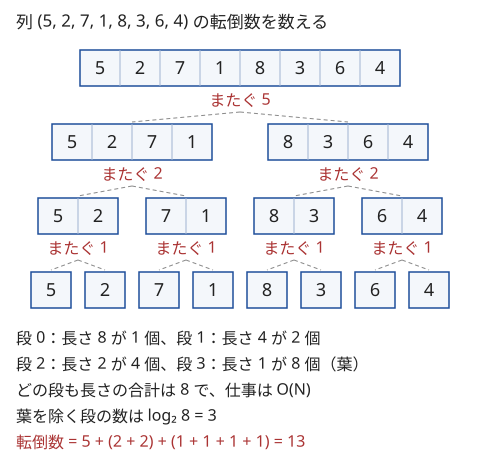

!!! abstract "要点"
    - **何ができるか**：区間を半分に分けて左右を再帰で解き、中央を「またぐもの」だけを $O(\text{長さ})$ で処理すれば、全体が $O(N \log N)$ になる。マージソートでの転倒数、最大値の位置での分割、区間クエリの左右の DP の合成に使う。
    - **いつ使うか**：
        - 区間・部分列の全部の組について数える。
        - 閉区間 $[L, R]$ の品物だけを使うナップサックを多数のクエリで答える。
        - $N, Q \le 2 \times 10^5$ で、区間ごとに計算し直すと間に合わない。
        - 左右に分けたとき、中央をまたぐものだけなら速く数えられる。
        - 区間の最大値の位置で左右に分けると、それぞれが同じ形の問題になる。
    - **計算量**：またぐものの処理が区間の長さに比例するなら $O(N \log N)$、$O(\text{長さ} \log \text{長さ})$ なら $O(N \log^2 N)$。区間ナップサックは容量の上限を $C$ として $O(NC \log N + QC)$。
    - **前提**：[再帰的な構造](../basics/recursion-structure.md)

<!-- textlint-disable -->
別名：divide and conquer・分割統治法・マージソート・中央をまたぐ区間・区間ナップサック
<!-- textlint-enable -->

分割統治は、列を左右に分け、左だけ・右だけで決まるものを再帰に任せ、左と右にまたがるものだけをその場で処理する方法である。全部の組や全部の区間を相手にする問題でも、またぐものには「左の部分と右の部分が独立に選べる」という形があり、素朴な $O(N^2)$ より速く扱える。どこで分けるか（中央か最大値の位置か）と、またぐものを何で処理するか（ソート・DP の表）が設計の中心になる。

## 漸化式 T(N) = 2T(N/2) + O(N) と計算量 {#recurrence}

分割統治の計算量は、1 回の呼び出しで行う「またぐものの処理」の重さと、分け方で決まる。区間 $[l, r)$ を受け取る関数の形は次のとおりである（0-indexed、半開区間）。

```text
solve(l, r):
    if r - l <= 1: 長さ 0・1 の答えを直接返す      # 再帰の止まる所
    m = (l + r) / 2
    solve(l, m)                                     # 左だけで決まるもの
    solve(m, r)                                     # 右だけで決まるもの
    cross(l, m, r)                                  # i < m <= j の組・区間だけを処理する
```

長さ $N$ の区間での時間を $T(N)$ とすると、$T(N) = 2T(N/2) + (\text{cross の時間})$ である。[再帰木](../guide/glossary.md#recursion-tree)を描くと、段 $d$ には長さ $N / 2^d$ の区間が $2^d$ 個並び、長さ 1 の区間（葉）を除くと、段の数は $\lceil \log_2 N \rceil$ である。次の図は長さ 8 の列の例で、どの段でも区間の長さの合計は 8 になっている。



cross の時間が区間の長さに比例するなら、各段の合計は $O(N)$ で、段が $O(\log N)$ 個なので全体は $O(N \log N)$ になる。どの組も「2 つが初めて別の半分に分かれる区間」でちょうど 1 回だけ数えられる。だから重複や漏れは起きない。

| cross の時間（長さ $L$ の区間） | 全体 | 例 |
| --- | --- | --- |
| $O(L)$ | $O(N \log N)$ | マージソート・転倒数 |
| $O(L \log L)$ | $O(N \log^2 N)$ | cross の中でソートや BIT を使う |
| $O(L \cdot C)$ | $O(NC \log N)$ | 区間ナップサック（$C$ は表の幅） |
| $O(L^2)$ | $O(N^2)$ | 速くならない |

最後の行が示すように、cross を素朴に全組で調べると分けた意味がない。またぐものを長さに比例する時間（か、それに log が付く程度）で処理できるかが、分割統治が使えるかの分かれ目である。

分け方が偏ると段の数が増える。中央で分ければ段は $\log_2 N$ だが、最大値の位置のように問題が決める位置を使うと、単調な列では毎回 1 個しか減らず、段が $N$ になる。その場合の計算量の守り方は[最大値の位置で分ける](#split-at-max)節で扱う。

## またぐものの数え方（マージソートで転倒数） {#crossing}

またぐ組を速く数えられる理由は、「$i$ が左、$j$ が右」と決まった時点で、添字の条件 $i < j$ が自動的に満たされることにある。残る条件は値だけの条件になるので、左右をそれぞれソートしておけば[尺取り法](../basics/two-pointers.md)や二分探索で数えられる。

転倒数（$i < j$ かつ $a_i > a_j$ の組の数）で確かめる。区間 $[l, r)$ の転倒数は、左 $[l, m)$ の中の転倒数、右 $[m, r)$ の中の転倒数、またぐ組の転倒数の和である。またぐ組は「左の値 > 右の値」の組の数で、添字の順はもう関係しない。

- 再帰から戻った時点で、左と右はそれぞれ昇順に並べ替えてあるとする
- 2 つを先頭から合わせていく（マージ）。右の値 $a_j$ を出すとき、左にまだ残っている値はすべて $a_j$ より大きい
- だから右の値を出すたびに「左の残りの個数」を足せば、またぐ転倒の数になる。マージ自体が $O(L)$ なので、全体は $O(N \log N)$ である

```cpp
--8<-- "divide-and-conquer/merge-inversion.cpp:core"
```

完全なプログラム：[`merge-inversion.cpp`](https://github.com/yuukougun/kyopro-atlas/blob/main/snippets/divide-and-conquer/merge-inversion.cpp)（GitHub）
{ .kp-code-src }

等しい値の扱いはマージの比較で決まる。$a_i \le a_j$ のときに左を先に出せば、等しい組は数えない（狭義の転倒）。$a_i < a_j$ のときだけ左を出すと、等しい組も数えてしまう。転倒数そのものは BIT で数える方が短く書けることが多い（[転倒数](../ds/inversion-number.md#count-with-bit)）。分割統治の形は、またぐ条件が BIT に載らない形のときに効く。

**区間をまたぐ場合**：「すべての区間 $[i, j)$ について数える・合計する」問題では、中央 $m$ をまたぐ区間は「左の接尾辞 $[i, m)$」と「右の接頭辞 $[m, j)$」の組である。左の接尾辞の和・最大値などは、$m$ から左へ 1 つずつ伸ばしながら求められる。右の接頭辞も同じように求めると、区間の値は 2 つの値の組み合わせで書ける。条件が「左の値 + 右の値 $\le K$」の形なら、ソートと尺取り法で $O(L \log L)$ で数えられる。

**応用の型**：

- 「$i < j$ かつ（値の条件）」の組を数える。左右に分けると添字の条件が消え、値の条件だけを左右のソート済みの列で数える
- 区間の値が「左の接尾辞の量」と「右の接頭辞の量」の組み合わせで書ける（区間の和・最大値・最小値）
- 番号の小さい点と大きい点の組から作るもの全体を扱う。左の集合と右の集合の組だけを、集合どうしの演算（凸包のミンコフスキー和など）でまとめて作る

## 最大値の位置で分ける {#split-at-max}

区間の最大値の位置で分ける分割統治は、「最大値をまたぐことはできない」「最大値がほかを支配する」形の問題に使う。区間 $[l, r)$ の最大値の位置を $m$ とすると、$m$ を含まない区間や操作は $[l, m)$ か $[m + 1, r)$ のどちらかに収まるので、左右が同じ形の小さな問題になる。

中央で分けないので、そのままでは計算量が保証されない。守ることは 3 つある。

- **最大値の位置を速く引く**：区間ごとに走査すると、単調な列で $O(N^2)$ になる。[Sparse Table](../ds/sparse-table.md) で $O(1)$ で引くか、[Cartesian tree](../ds/monotonic-stack.md#cartesian-tree)（最大値で割る再帰の木そのもの）を単調スタックで $O(N)$ で作る。同じ値があるときは「最も左」のように 1 つに決める
- **1 回の処理を小さくする**：各区間で $O(1)$ なら、区間は $N$ 個なので全体は $O(N)$ である。またぐものを数えるなら、左右の短い方の端点だけを全部試し、長い方は累積和や二分探索で数える。短い側の端点 1 つにつき長い側を $O(1)$ で数えられれば合計は $O(N \log N)$、二分探索を使うと $O(N \log^2 N)$ になる
- **再帰の深さ**：単調な列では深さが $N$ になる。$N = 5 \times 10^5$ では再帰がスタックを使い果たすことがあるので、明示的なスタックで回す（[再帰の深さとスタック](../basics/recursion-structure.md#stack)）

短い方の端点を試す回数の合計を $O(N \log N)$ に抑えられるのは、各要素が「短い側」に入るたびに、その要素を含む区間の長さが半分以下になるからである。長さは $N$ から始まり 1 より小さくならないので、1 つの要素が短い側に入るのは $\log_2 N$ 回以下である。

次のコードは、[例題の ARC189 D](#arc189_d)（隣の真に小さい要素を吸収し続けたときの最終的な大きさ）を、最大値で割る分割統治で解いたものである。区間の最大値の位置を Sparse Table で引き（`argmax(l, r)`。構築の部分は省いた）、再帰の代わりにスタックに区間を積む。

```cpp
--8<-- "divide-and-conquer/split-at-max.cpp:core"
```

完全なプログラム：[`split-at-max.cpp`](https://github.com/yuukougun/kyopro-atlas/blob/main/snippets/divide-and-conquer/split-at-max.cpp)（GitHub）
{ .kp-code-src }

**応用の型**：

- 区間の最大値（最小値）が条件に入る区間を数える。最大値の位置 $m$ で分けると、$m$ を含む区間 $[i, j)$（$l \le i \le m < j \le r$）は、どれも最大値が $A_m$ である。短い側の端点を全部試し、長い側を累積和の二分探索で数える（合計 $O(N \log^2 N)$）
- 大きい要素が小さい要素を吸収・支配する操作で、最大値が区間の中を動けなくする（区間の外とは最大値を通してしかつながらない）

## 区間クエリを中央で分けて左右の DP を合わせる（区間ナップサック） {#range-knapsack}

この節は [0-1 ナップサック](../dp/knapsack-01.md)の表の作り方を前提にする。「区間 $[l, r)$ の品物だけを使って容量 $c$ 以下での価値の最大を答える」クエリが多数来るとき、クエリごとに DP すると $O(NQC)$ かかる。クエリを全部先に読み（[オフライン](../guide/glossary.md#offline)）、品物の列を中央で分けると、中央をまたぐクエリには左右の表を 1 回ずつ作るだけで答えられる。

![品物 0〜7 の中央 m = 4 で分け、クエリ \[1, 7) を左の品物 \[1, 4) と右の品物 \[4, 7) に分ける。左の表 L[1] は m から左へ、右の表 R[7] は m から右へ 1 品ずつ足して作り、容量を x と c − x に配って足した値の最大が答えになる](../img/divide-and-conquer/range-knapsack.svg)

品物の列 $[lo, hi)$ と、そこに収まるクエリの集まりを受け取り、中央 $m$ で次のようにする。

1. クエリを 3 つに分ける。$r \le m$ なら左へ、$l \ge m$ なら右へ回し、$l < m < r$ なら中央をまたぐのでここで答える
2. 左の接尾辞の表 $L[i]$（品物 $[i, m)$ の表）を $i = m - 1, m - 2, \dots, lo$ の順に作る。$L[i]$ は $L[i + 1]$ に品物 $i$ を足したもので、$O(C)$ でできる。空の表 $L[m]$ はすべての容量で 0 にする（こうすると表の値が「容量 $x$ 以下での最大」になる）
3. 右の接頭辞の表 $R[j]$（品物 $[m, j)$ の表）を $j = m + 1, \dots, hi$ の順に同じように作る
4. またぐクエリ $(l, r, c)$ には、容量を左に $x$、右に $c - x$ 配って $\max_x (L[l][x] + R[r][c - x])$ を答える。表の値が「容量 $x$ 以下での最大」なので、配り方 $x = 0, \dots, c$ を全部試すだけでよい

この合わせ方が正しいのは、またぐクエリの品物が左 $[l, m)$ と右 $[m, r)$ にちょうど分かれ、左で選ぶものと右で選ぶものが容量を分け合う以外に影響しないからである。表を 1 品ずつ伸ばして作るので、$m$ をまたぐすべての $l$・$r$ の表が、区間の長さ $\times C$ の時間でそろう。

コードでは 1 本の配列 `tab` の $i < m$ の行を $L[i]$、$j > m$ の行を $R[j]$ に使い、$m$ の行が空の表になる。

```cpp
--8<-- "divide-and-conquer/range-knapsack.cpp:core"
```

完全なプログラム：[`range-knapsack.cpp`](https://github.com/yuukougun/kyopro-atlas/blob/main/snippets/divide-and-conquer/range-knapsack.cpp)（GitHub）
{ .kp-code-src }

表を作る時間は各段 $O(NC)$ で、段は $O(\log N)$ 個なので $O(NC \log N)$ である。各クエリはどこか 1 つの区間でだけ答え、1 つ $O(C)$ なので合計 $O(QC)$ である。メモリは表 $N + 1$ 行を使い回して $O(NC)$ で済む。

この形が使える条件は 2 つある。1 つは、表に品物を 1 つ足すのが安い（表の幅 $C$ に比例する）ことである。もう 1 つは、2 つの表を合わせて 1 つの値を答えるのが安いことである。表どうしを全部合わせる（max-plus の畳み込み）と $O(C^2)$ かかるが、答える値が「容量 $c$ のときの最大」の 1 つだけなら $O(C)$ で済む。同じ考え方で、結合法則を満たす演算の区間の積を前計算するのが [Disjoint Sparse Table](../ds/sparse-table.md#disjoint-sparse-table) である。

**応用の型**：

- 区間の要素だけを使う DP を多数のクエリで答える。足すのは安いが取り除けない DP（max・min のナップサック）で効く。取り除ける DP なら[戻す DP](../dp/knapsack-undo.md) も候補になる
- 各 $i$ について「$i$ を除いた全体」を答えるなら、中央で分けるまでもなく[前後からの DP のマージ](../dp/knapsack-undo.md#prefix-and-suffix)で済む

## 他の分野の分割統治（分割統治 DP・分割統治 FFT・CDQ）への案内 {#other-fields}

分割統治は多くの手法の骨組みになっている。どれも「何を半分に分けるか」と「またぐものを何で処理するか」の組で見分けられる。

| 手法 | 分けるもの | またぐものの処理 |
| --- | --- | --- |
| [Monge](../dp/monge.md#monotone-minima)（Monotone minima・分割統治 DP） | DP の行（各行の最小の位置が単調） | 真ん中の行の最小の位置を求め、上下の探索範囲を絞る |
| [オンライン畳み込み](../math/online-convolution.md#online)（分割統治 FFT） | 添字（DP の値の確定順） | 左で確定した値が右に与える寄与を FFT でまとめて足す |
| [CDQ 分割統治](../ds/cdq-divide-and-conquer.md#procedure) | 操作の時刻 | 左の更新が右のクエリに与える影響を BIT で処理する |
| [重心分解](../tree/centroid-decomposition.md) | 木の頂点（重心で割る） | 重心を通るパスを数える |
| [セグメント木](../ds/segment-tree.md)・[マージソート木](../ds/merge-sort-tree.md) | 添字（再帰木をそのまま持つ） | 各ノードに区間の集約・ソート済みの列を持ち、クエリで使う |
| [時間軸の分割統治](../dp/knapsack-undo.md#offline-divide-and-conquer) | クエリの時刻 | 区間を覆うノードに要素を載せ、DFS で足して戻す |

CDQ 分割統治は[またぐものの数え方](#crossing)の延長である。転倒数で「添字の条件が消える」のと同じように、時刻で分けると「更新が先」という条件が消え、残りの 2 つの条件を平面走査と BIT で数える。

## 落とし穴 {#pitfalls}

**cross の中で配列の全体を触る**。またぐものの処理で、長さ $N$ の作業用の配列や BIT を毎回まるごと初期化すると、区間は約 $2N$ 個あるので $O(N^2)$ になる。触ってよいのは $[l, r)$ の範囲だけである。BIT を使い回すなら、足した位置だけを引いて戻す。

**再帰が止まらない**。$m = (l + r) / 2$ で分けるとき、長さ 1 の区間で止めないと $[l, l + 1)$ が $[l, l)$ と $[l, l + 1)$ に分かれ続ける。止める条件は `r - l <= 1` にし、長さ 0 の区間も呼ばれて大丈夫なように書く。

**作業用の vector を呼び出しごとに確保する**。マージのたびに長さ $L$ の vector を作ると、計算量は変わらないが確保の定数倍が重い。長さ $N$ の作業用の配列を 1 本持ち、$[l, r)$ の部分だけを使う。

**等しい値の扱い**。マージの比較の `<=` と `<` で、等しい組を数えるかが変わる。最大値の位置で分けるときも、同じ値が並ぶと「最大値がほかを支配する」は成り立たないことがある（[例題の ARC189 D](#arc189_d)）。小さい乱数の列で素朴な解法と比べると見つけやすい。

**答えのあふれ**。組の数は $N(N-1)/2$ で、$N = 2 \times 10^5$ なら約 $2 \times 10^{10}$ になる。数える変数は `long long` にする。

## 例題 {#examples}

### ARC189 D. Takahashi is Slime {#arc189_d}

<div class="kp-problems" data-role="example" markdown>

- [ARC189 D. Takahashi is Slime](https://atcoder.jp/contests/arc189/tasks/arc189_d)（diff 2006）：各スライムが隣の真に小さいスライムを吸収し続けるとき、到達できる最大の大きさを全員分求める。

</div>

スライムが吸収した範囲は常に連続した区間で、大きさはその区間の和である。区間 $[l, r)$ の最大値の位置を $m$ とすると、区間の外のすぐ隣はどちらも $A_m$ 以上である。だから $m$ については、区間の中を吸収しきれるかと、吸収しきった後に外の境界を越えられるかを分けて考えられる。後者は区間の和と親の区間の結果で決まるので、最大値で割る再帰の上から順に決められる（[最大値の位置で分ける](#split-at-max)）。

素朴に各スライムから吸収をくり返すと、1 人 $O(N)$ で全体 $O(N^2)$ になる。$N$ は $5 \times 10^5$ まであるので、分割統治で全員分をまとめて $O(N \log N)$（Cartesian tree なら $O(N)$）で求める。

??? note "解法の詳細"
    区間 $[l, r)$ の最大値の位置を $m$（同じ値なら最も左）とし、区間の和を $S$ とする。区間の外のすぐ隣の要素は、再帰の木での祖先で、どちらも $A_m$ 以上である。

    - **区間を吸収しきれるか**：$m$ の隣に $[l, r)$ の中で真に小さい要素があれば、それを吸収した時点で $m$ は区間のどの要素より大きくなり、区間全体を吸収できる。区間の長さが 1 なら何もしなくてよい。どちらでもないとき（$m = l$ で右隣が同じ値）は、$m$ はどの隣も吸収できず、答えは $A_m$ である
    - **区間を吸収した後**：区間の全体を吸収した状態から最後にどこまで育つかを $g$ とする。親（区間を作った最大値）の値を $A_p$ として、$S > A_p$ なら親を吸収でき、その後は親の区間の要素がどれも $A_p$ 以下なので、親の区間を吸収した状態と同じになる。よって $g = g_{\text{親}}$ である。$S \le A_p$ なら親を吸収できず、反対側の境界は親の祖先で $A_p$ 以上なので、$g = S$ で止まる。根では $g = S$（列全体の和）
    - **計算の順**：$g$ は親から子へ決まるので、根から順に区間をスタックに積んで処理する。最大値の位置を Sparse Table で引けば $O(N \log N)$ である。最大値の位置の列を Cartesian tree として先に作れば $O(N)$ になる

    「区間の最大値は区間を吸収しきれる」と決めつけると、同じ値の最大値が並ぶ場合に誤る。$(5, 5, 5)$ ではどのスライムも何も吸収できない。上の「隣に真に小さい要素があるか」の場合分けで扱う。

### ABC426 G. Range Knapsack Query {#abc426_g}

<div class="kp-problems" data-role="example" markdown>

- [ABC426 G. Range Knapsack Query](https://atcoder.jp/contests/abc426/tasks/abc426_g)（diff 2119）：区間の品物だけを使うナップサックの最大価値を、多数のクエリについて求める。

</div>

クエリごとに区間の品物で DP すると、区間の長さ × 容量の時間がクエリの数だけかかり、間に合わない。容量の上限 $C$ が数百と小さいので、表の幅 $C$ に比例する処理なら何度でもできる。[区間クエリを中央で分けて左右の DP を合わせる](#range-knapsack)の手順そのままで、$O(NC \log N + QC)$ になる。

??? note "解法の詳細"
    クエリを全部読み、品物の列全体を受け取る分割統治に渡す。各区間では、中央をまたぐクエリのために左の接尾辞の表と右の接頭辞の表を作り、容量の配り方を全部試して答える。中央をまたがないクエリは、収まる側の子へ回す。長さ 1 の区間に残ったクエリは、その品物 1 つを入れられるかで答える。表は「容量 $x$ 以下での価値の最大」の意味で持ち、価値の合計は `long long` にする。

## 練習問題 {#practice}

<div class="kp-problems" data-role="practice" markdown>

- [CHOKUDAI_S001 J. 転倒数](https://atcoder.jp/contests/chokudai_S001/tasks/chokudai_S001_j)（diff なし）：隣接交換で数列をソートするときの交換回数（転倒数）を求める。
- [ARC075 E. Meaningful Mean](https://atcoder.jp/contests/arc075/tasks/arc075_c)（diff 1979）：平均が K 以上になる連続部分列の個数を求める。

</div>

??? note "方針"
    - **CHOKUDAI_S001 J**：交換回数は転倒数に等しい（[転倒数](../ds/inversion-number.md)）。[マージソートで数える](#crossing)と $O(N \log N)$ で求まる。BIT で数えても同じ計算量である
    - **ARC075 E**：各項から $K$ を引いた累積和 $S$ を作ると、$i < j$ かつ $S_i \le S_j$ の組を数える問題になる。等号の向きが違う転倒数なので、マージソートで左右をまたぐ組を数える方法で $O(N \log N)$ になる（解説はどちらも BIT で数えている）

## 力試し {#challenge}

<div class="kp-problems" data-role="challenge" markdown>

- [ABC478 G. Division Point Hull](https://atcoder.jp/contests/abc478/tasks/abc478_g)（diff 2582）：N 個の点から番号の小さい点と大きい点を選んで p:q に内分した点をすべて考え、それらの凸包の面積を求める。
- [ABC282 Ex. Min + Sum](https://atcoder.jp/contests/abc282/tasks/abc282_h)（diff 2621）：2 つの列 A・B について、区間の A の最小値と区間の B の和の合計が S 以下になる区間の個数を求める。
- [KEYENCE2019 E. Connecting Cities](https://atcoder.jp/contests/keyence2019/tasks/keyence2019_e)（diff 2623）：一列に並ぶ都市を結ぶ完全グラフで、辺の重みが番号の差と両端の値で決まるときの最小全域木の重みを求める。

</div>

??? note "方針"
    - **ABC478 G**：点を番号で半分に分ける。両方が左・両方が右の組は再帰に任せる。またぐ組の内分点は「左の点を $q$ 倍したもの」と「右の点を $p$ 倍したもの」の和なので、その全体の凸包は左右の凸包の[ミンコフスキー和](../geometry/advanced-geometry.md#minkowski-sum)になる。3 つの凸包をまとめて凸包を取り直す。座標を $p + q$ 倍のまま整数で扱う
    - **ABC282 Ex**：区間の最小値の位置で分け、左右の短い方の端点を全部試し、長い方の端点を $B$ の累積和の二分探索で数える。短い方だけを試すので、全体で $O(N \log^2 N)$ になる
    - **KEYENCE2019 E**：番号で半分に分け、中央をまたぐ辺は「各点から反対側の代表 1 点への辺」だけを残す（ほかの辺は閉路の最も重い辺になり不要）。候補は $O(N \log N)$ 本になり、クラスカル法で解ける

## 確認問題 {#quiz}

??? question "確認問題：cross が O(L²) なら"
    長さ $L$ の区間でまたぐ組を全部の組で調べる（$O(L^2)$）と、全体の計算量はどうなるか。

    ??? success "答え"
        段 0 だけで $O(N^2)$ かかり、全体も $O(N^2)$ になる。段 $d$ の合計は $2^d \cdot (N / 2^d)^2 = N^2 / 2^d$ で、段 0 が支配する。素朴に全組を調べるのと変わらないので、またぐものを長さにほぼ比例する時間で処理できることが分割統治の前提である。

??? question "確認問題：マージで等しい値の組を数えてしまう比較"
    マージで「$a_i < a_j$ なら左を出し、そうでなければ右を出して左の残りの個数を足す」と書いた。列 $(2, 2)$ の転倒数はいくつと出るか。

    ??? success "答え"
        1 と出る。$a_i = a_j = 2$ で右を先に出し、左に残る 1 個を足してしまう。転倒数は 0 が正しい。等しいときは左を先に出す（`a[i] <= a[j]` で左）ようにする。

??? question "確認問題：最大値で分けて、毎回区間を全部走査したら"
    列 $(1, 2, \dots, N)$ で、区間の最大値の位置を毎回区間を走査して求め、最大値で分ける分割統治をすると、計算量はどうなるか。

    ??? success "答え"
        最大値は常に右端なので、区間は 1 個ずつしか縮まない。長さ $N, N - 1, \dots, 1$ の区間を走査して $O(N^2)$ になり、再帰の深さも $N$ になる。Sparse Table か Cartesian tree で最大値の位置を引き、スタックで回す。

## 使い分け {#comparison}

| やりたいこと | 向く方法 |
| --- | --- |
| 列全体の転倒数を 1 回求める | [BIT](../ds/inversion-number.md#count-with-bit) が短い。マージソートでもよい |
| 区間の集約（和・最大値）をオンラインで多数答える | [セグメント木](../ds/segment-tree.md)・[Sparse Table](../ds/sparse-table.md) |
| 区間の DP をオフラインで多数答える（足すだけで戻せない） | [中央で分けて左右の表を合わせる](#range-knapsack) |
| 区間の DP で、要素を取り除ける（数え上げなど） | [戻す DP](../dp/knapsack-undo.md) と区間の出し入れ |
| 区間の最大値が条件に入る組・区間を全部数える | [最大値の位置で分ける](#split-at-max)か、[単調スタック](../ds/monotonic-stack.md)で各要素が最大になる範囲を求める |

区間の最大値で分ける問題の多くは、「各要素が最大値になる極大な区間」を単調スタックで求め、その要素の寄与として数える書き方にもなる。区間を分けて状態を親から子へ渡す（例題の ARC189 D）ときは、分割統治の形の方が考えやすい。

## 参考 {#references}

- [drken「AtCoder ARC 189 D - Takahashi is Slime (3D, 黄色, 700 点)」](https://drken1215.hatenablog.com/entry/2025/01/04/101100)：例題 arc189_d の制約と、最大値の位置で区間を分ける方針、同じ値の最大値が並ぶときの注意
- [kmjp「AtCoder ABC #426 : G - Range Knapsack Query」](https://kmjp.hatenablog.jp/entry/2025/10/06/1000)：例題 abc426_g の、中央をまたぐクエリを左の接尾辞と右の接頭辞の表で答える方針と計算量
- [kmjp「AtCoder Beginner Contest 478 : G - Division Point Hull」](https://kmjp.hatenablog.jp/entry/2026/10/08/0900)：力試し abc478_g の、番号で分けてまたぐ組をミンコフスキー和で作る方針
- [vain0x「競プロ参戦記 第10回「転倒数」 Chokudai Speed Run 001 [J]」（note）](https://note.com/vain0x/n/n0037d6468812)：練習 chokudai_S001_j の問い（バブルソートの交換回数）
- [drken「AtCoder ARC 075 E - Meaningful Mean (青色, 600 点)」](https://drken1215.hatenablog.com/entry/2020/04/24/015400)：練習 ARC075 E の累積和で転倒数に帰着する方針
- [kmjp「AtCoder ARC #075 : E - Meaningful Mean」](https://kmjp.hatenablog.jp/entry/2017/06/03/1030)：練習 ARC075 E の S_i ≤ S_j の組の数え上げへの帰着
- [kmjp「AtCoder ABC #282 (HHKBプログラミングコンテスト2022 Winter) : Ex - Min + Sum」](https://kmjp.hatenablog.jp/entry/2022/12/18/0930)：力試し ABC282 Ex の最小値の範囲で短い側を試す方針
- [drken「キーエンス プログラミング コンテスト 2019 E - Connecting Cities (橙色, 600 点)」](https://drken1215.hatenablog.com/entry/2019/01/15/081500)：力試し KEYENCE2019 E の中央で分ける分割統治
