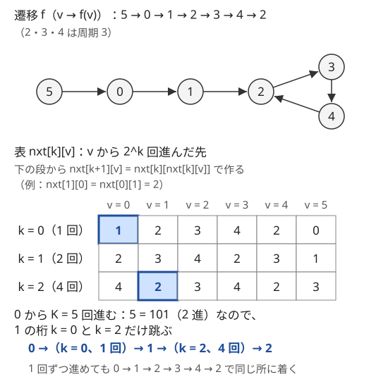

!!! abstract "要点"
    - **何ができるか**：各状態から次の状態がただ 1 つに決まる遷移を $K$ 回（$K \le 10^{18}$）進めた先と、途中で通った状態の和や最小値を $O(\log K)$ で求める。「$2^k$ 回進んだ先」の表を $\mathrm{nxt}[k+1][v] = \mathrm{nxt}[k][\mathrm{nxt}[k][v]]$ で作り、$K$ を 2 進展開して 1 の桁だけ跳ぶ。
    - **いつ使うか**：
        - $K \le 10^{18}$ 回の移動・操作で、始点やクエリが多い。
        - 各状態から次の状態がただ 1 つに決まる。
        - 途中の和・最小値も必要。
        - 条件を満たす最大の回数を求める。
    - **計算量**：状態数を $N$、段数を $L = \lceil \log_2 (K_{\max} + 1) \rceil$（$K \le 10^{18}$ なら 60）として、前計算 $O(NL)$、1 回の問い合わせ $O(L)$、メモリ $O(NL)$。
    - **前提**：[周期性の検出](../basics/periodicity.md)、[bit 演算の基本と XOR の性質](../basics/bit-operations.md)

<!-- textlint-disable -->
別名：binary lifting・倍化・2^k 回後の表・ダブリング上の二分探索・doubling
<!-- textlint-enable -->

ダブリングは、「1 回進む」の表から「2 回進む」「4 回進む」「8 回進む」…の表を順に作り、$K$ 回の移動を $K$ の 2 進表記の 1 の桁の数だけの跳躍に置き換える手法である。$K$ が $10^{18}$ でも跳ぶ回数は 60 回以下で済む。1 つの始点から 1 回だけ進めるなら[周期性の検出](../basics/periodicity.md)でも解けるが、始点やクエリが多いとき、途中の和が要るとき、「条件を満たす最大の回数」を問われたときにダブリングが効く。

このページでは、状態を $0, 1, \dots, N-1$ の番号で表し、$v$ の次の状態を $f(v)$ と書く。$f$ を $t$ 回続けて使った先を $f^t(v)$ と書く（$f^0(v) = v$）。

## 表の作り方と K の 2 進展開 {#table}

ダブリングの表は次のように定める。

$$
\mathrm{nxt}[k][v] = f^{2^k}(v) \quad (v \text{ から } 2^k \text{ 回進んだ先})
$$

$k = 0$ の段は $f$ そのものである。$2^{k+1}$ 回進むことは、$2^k$ 回進んでからさらに $2^k$ 回進むことなので、1 つ下の段を 2 回引けば次の段が作れる。

$$
\mathrm{nxt}[0][v] = f(v), \qquad \mathrm{nxt}[k+1][v] = \mathrm{nxt}[k]\bigl[\mathrm{nxt}[k][v]\bigr]
$$

$K$ 回進んだ先は、$K$ を 2 進展開して $K = 2^{k_1} + 2^{k_2} + \cdots$ と書き、各 $2^{k_i}$ 回分を表で 1 回ずつ跳べば求まる。次の図は、6 つの状態の遷移で表を 3 段作り、状態 0 から $K = 5 = 101_{(2)}$ 回進んだ例である。



正しさの根拠は $f^{a+b} = f^a \circ f^b$ だけである。同じ関数を使う回数を足し算しているだけなので、跳ぶ順番は桁の小さい方からでも大きい方からでもよい。$K$ の 1 の桁は高々 $L$ 個なので、1 回の問い合わせは $O(L)$ である。表は $L$ 段 × $N$ 個で、各要素を $O(1)$ で埋めるので、前計算は $O(NL)$ である。

```cpp
--8<-- "doubling/kth-next.cpp:core"
```

桁の判定は `K >> k & 1` と書く。`1 << k` と書くと `int` のシフトになり、$k \ge 31$ で壊れる（[bit 演算の落とし穴](../basics/bit-operations.md#pitfalls)）。

??? question "確認問題：何段必要か"
    $K \le 10^{18}$ のとき、表の段 $k$ は $0$ から何まで要るか。$K \le 10^{12}$ ならどうか。

    ??? success "答え"
        $2^{59} \approx 5.8 \times 10^{17} < 10^{18} < 2^{60} \approx 1.15 \times 10^{18}$ なので、$K$ は 2 進で 60 桁に収まる。段は $k = 0, \dots, 59$ の 60 段要る。$K \le 10^{12}$ なら $2^{40} \approx 1.1 \times 10^{12}$ なので $k = 0, \dots, 39$ の 40 段で足りる。

## 途中の和・最小値を同じ表に持つ（半開で持つ） {#aggregates}

各状態 $v$ に値 $w_v$ があり、$K$ 回進む間に通った状態の $w$ の和を求めたいことがある。このときは、跳んだ先と一緒に、跳ぶ間の和も表に持つ。

$$
\mathrm{sum}[k][v] = w_{v} + w_{f(v)} + \cdots + w_{f^{2^k - 1}(v)}
$$

すなわち、時刻 $0, 1, \dots, 2^k - 1$ にいた $2^k$ 個の状態の和で、着いた先（時刻 $2^k$）は含めない。時刻について[半開区間](../guide/glossary.md#half-open-interval) $[0, 2^k)$ で持つと、前半 $[0, 2^k)$ と後半 $[2^k, 2^{k+1})$ がちょうど分かれるので、そのまま足せる。

$$
\mathrm{sum}[k+1][v] = \mathrm{sum}[k][v] + \mathrm{sum}[k]\bigl[\mathrm{nxt}[k][v]\bigr]
$$

問い合わせでも、跳ぶたびに「今いる状態から跳ぶ間の和」を足してから移る。跳んだ先は次の跳躍の始点として数えられるので、どの状態も 1 回ずつだけ数えられる。

```cpp
--8<-- "doubling/sum-table.cpp:core"
```

両端を含む閉区間で持つと、つなぎ目の状態（時刻 $2^k$）を前半と後半の両方で数えてしまう。最小値・最大値なら、同じ値を 2 回見ても結果が変わらないので害はない。一方、和や個数では二重に数える。半開で持てば、和と最小値のどちらも同じ形で書ける。

持てる値は、和・最小値・最大値のように[結合法則](../guide/glossary.md#associativity)を満たす演算で 2 つの区間の値をまとめられるものである。アフィン変換の合成のように順序で結果が変わる演算も持てるが、そのときは「先に通る区間」と「後に通る区間」の順に合わせる。表を作るときは $\mathrm{sum}[k][v]$ が前、$\mathrm{sum}[k][\mathrm{nxt}[k][v]]$ が後である。問い合わせでは、ここまでの累積の後ろに今の跳躍の値をつなぐ。跳ぶ順番が下の桁からでも上の桁からでも、跳躍は道の順に並ぶので結果は同じになる。

??? question "確認問題：閉区間で持つと"
    $\mathrm{sum}[k][v]$ を時刻 $0$ から $2^k$ まで（両端を含む $2^k + 1$ 個）の和として定め、$\mathrm{sum}[k+1][v] = \mathrm{sum}[k][v] + \mathrm{sum}[k][\mathrm{nxt}[k][v]]$ で作ると、何がずれるか。

    ??? success "答え"
        前半の終わりと後半の始まりが同じ時刻 $2^k$ の状態なので、その $w$ が 2 回足される。正しくは、そこから $w_{\mathrm{nxt}[k][v]}$ を 1 回引く必要があり、問い合わせでも跳ぶたびに同じ補正が要る。半開で持てば補正は要らない。

## ダブリング上の二分探索（条件を満たす最大の回数） {#binary-search-on-doubling}

「進んだ回数 $t$ についての条件が、$t$ が小さいほど成り立ちやすい」とき、条件を満たす最大の $t$ は表の上の段から順に決められる。たとえば「$t$ 回進む間にいた $t$ 個の状態（時刻 $0, \dots, t-1$）の $w$（すべて正）の和が $S$ 以下に収まる最大の回数」がそうである。表は[前の節](#aggregates)の半開の $\mathrm{sum}$ を使い、和は大きな値で頭打ちにしておく（[落とし穴](#pitfalls)）。

上の段 $k = L-1$ から下へ順に、「今の位置からさらに $2^k$ 回跳んでも条件を満たすなら跳ぶ」を繰り返す。跳んだ回数の合計が答えである。

```cpp
--8<-- "doubling/max-steps.cpp:core"
```

これは答えの $t$ を 2 進表記で上の桁から決めていることにあたる。条件を満たす最大の回数を $t^*$ とする。段 $k$ に来たとき、ここまでに跳んだ回数 $t$ は $t^*$ の $k$ より上の桁と一致している（不変条件）。

- $t + 2^k \le t^*$ なら、単調性から $t + 2^k$ 回でも条件を満たすので跳ぶ。$t^*$ の桁 $k$ は 1 である
- $t + 2^k > t^*$ なら条件を満たさないので跳ばない。$t^*$ の桁 $k$ は 0 である

最後の段まで来ると $t = t^*$ になる。[二分探索](../basics/binary-search.md)で範囲を半分にしていくのと同じことを、範囲の幅が 2 の冪になるように合わせて行っている。1 回の問い合わせは $O(L)$ で、$K$ ごとに表を引き直す二分探索（$O(L^2)$）より速い。

単調性がないと使えない。値が負になりうる和で「和が $S$ 以下」を問うと、途中で一度超えてから戻る道があり、跳ぶかどうかの判断が正しくなくなる。また、答えが $2^L - 1$ を超えうるとき（$w$ が 0 の状態だけの閉路を回り続けられるなど）は、上限に張り付いたかを別に確かめる。

## 置換の K 回合成 {#permutation-power}

数列の操作「$B_i = A_{X_i}$」（$X$ は置換とは限らない）を $K$ 回行う問題では、添字の写像 $X$ を $K$ 回合成すればよい。1 回目の後は $B_i = A_{X_i}$、2 回目の後は $C_i = B_{X_i} = A_{X_{X_i}}$ である。$X$ を $K$ 回続けて使う写像を $X^K$ と書くと、$K$ 回の後の第 $i$ 項は $A_{X^K(i)}$ になる。値を動かす向きではなく、添字がどこから来たかを $X$ でたどる向きになる。

すべての始点 $i$ について同じ $K$ を求めるだけなら、表の全段を持つ必要はない。持つのは、今の段の写像 $p = X^{2^k}$ と、処理済みの桁の分の写像 $\mathrm{res}$ の 2 つだけである。$K$ の下の桁から順に見て、1 の桁なら $\mathrm{res}$ に $p$ を合成する。どの桁でも、最後に $p$ を自分自身と合成して $X^{2^{k+1}}$ にする。数の[繰り返し二乗法](../math/mod-pow.md)を写像に置き換えたもので、時間は $O(N \log K)$、メモリは $O(N)$ で済む。

```cpp
--8<-- "doubling/func-power.cpp:core"
```

この書き方は $X$ が置換（全単射）でなくても使える。写像の合成は結合法則を満たし、同じ写像のべき乗どうしは順序を入れ替えても結果が変わらないからである。置換なら別の解き方もある。置換は互いに素な巡回に分かれるので、長さ $\ell$ の巡回の上では $K \bmod \ell$ 回だけ進めばよく、全体を $O(N)$ で求められる（[Functional graph](../graph/functional-graph.md)）。

あみだくじのように「1 回分の操作」が手続きで与えられるときは、まず 1 回分を素朴にシミュレーションして写像（置換）にし、それを $K$ 回合成する。1 回分の作り方と合成の向きを取り違えないよう、小さい例で 1 回分の写像を手で確かめるとよい。

## 段数とメモリの見積もり {#memory}

段数 $L$ は「$K$ の最大値を 2 進で書いたときの桁数」である。$K \le 10^{18}$ なら 60、$K \le 10^{12}$ なら 40、$K \le 10^9$ なら 30 で足りる。段を 1 つ多くしても困らないが、少ないと $K$ の上の桁を黙って無視し、誤った答えを出す。

メモリは $L \times N$ 個である。$N = 2 \times 10^5$、$L = 60$ なら、`int` の $\mathrm{nxt}$ で約 48 MB、`long long` の $\mathrm{sum}$ を加えるとさらに約 96 MB になる。表をいくつも持つと合計がすぐ数百 MB に届くので、問題のメモリ制限と比べておく。減らす方法は 3 つある。

- **段を $K$ の上限に合わせる**：$10^{18}$ と決め打たず、制約の $K$ に合わせる
- **始点が全部で $K$ が 1 つなら $O(N)$**：[置換の K 回合成](#permutation-power)の写像の繰り返し二乗法で済む
- **クエリを先に読めるなら 2 段分だけ持つ**：各クエリの今の位置を配列に持ち、段 $k$ の表で 1 の桁のクエリをまとめて跳ばしてから、段 $k$ から段 $k+1$ を作り、段 $k$ を捨てる。下の桁から跳ぶので、段を作る順と跳ぶ順がそろう。メモリは $O(N + Q)$ になる（[オフライン](../guide/glossary.md#offline)の処理）。上の段から決める[ダブリング上の二分探索](#binary-search-on-doubling)ではこの手は使えない

## 落とし穴 {#pitfalls}

**段数が足りない**。$K \le 10^{18}$ で段を 59 にすると、$2^{59}$ 以上の桁が無視される。小さい入力では気づけないので、$2^{L} > K_{\max}$ を式で確かめてから $L$ を決める。

**`1 << k` のあふれ**。桁の判定を `K & (1 << k)` と書くと、`1 << k` は `int` なので、$k = 31$ で負の数（`INT_MIN`）になって上位の桁まで拾ってしまい、$k \ge 32$ では未定義動作になる。`K >> k & 1` か `1LL << k` と書く。

**和の表のオーバーフロー**。使わない上の段まで和を作ると、$\mathrm{sum}[59][v]$ は $2^{59}$ 個の値の和で、$w \le 10^9$ なら `long long` を超える。符号付き整数のあふれは[未定義動作](../cpp/cpp-integer-overflow.md)である。段を $K$ の上限に合わせるか、比べたい上限（$S$ など）より大きい値で頭打ちにする（`min(INF, a + b)`。$2 \times \mathrm{INF}$ が `long long` に収まる値を選ぶ）。

**「K 回目」と「K 回後」の取り違え**。「$K$ 個目の箱」「$K$ 日目」は、最初の状態から $K - 1$ 回進んだ所であることが多い。$K = 1$ のときに何回跳ぶべきかを確かめる。

**状態に必要な情報が入っていない**。次の状態が今の状態だけで決まらない（向きや残り時間にもよる）と、表が作れない。状態を組にして番号を振り直す。考え方は[周期性の検出](../basics/periodicity.md)と同じである。

**1-indexed のまま表を引く**。入力の $A_i$ が 1-indexed なら、読むときに 1 を引いて 0-indexed にそろえる。そろえ忘れると、表の範囲外を読む。

## 使い分け {#comparison}

| 場面 | 選ぶもの | 理由 |
| --- | --- | --- |
| 1 つの始点から 1 回だけ $K$ 回進む | 周期の検出 | $O(N)$ で済む。ダブリングでもよい |
| 始点やクエリが多い・途中の和 | ダブリング | 表を作れば各問い合わせが $O(\log K)$ |
| 条件を満たす最大の回数 | ダブリング | 上の段から跳ぶ二分探索 |
| 遷移が線形（和・個数の漸化式） | 行列累乗 | 状態ベクトルの線形変換を合成する |
| 木で親へ上る | LCA の表 | ダブリングの $f$ を親にしたもの |

- **周期の検出**：状態が $N$ 個なら、$N$ 回進むまでに同じ状態が 2 度現れる。尾の長さと周期を求めれば、残りは周期で割った余りの回数だけ進めばよい（[周期性の検出](../basics/periodicity.md)）。始点ごとに尾と周期が違うので、始点が多いと扱いにくい
- **行列累乗**：「各状態の個数」が線形に移り変わるときに使う（[行列累乗](../math/matrix-power.md)）。次の状態がただ 1 つに決まる遷移も $N \times N$ の行列で書けるが、$O(N^3 \log K)$ かかる。この形ならダブリングを使う
- **LCA**：根付き木で $f(v)$ を親（根の親は根自身）とすると、表は「$2^k$ 個上の祖先」になる。[最小共通祖先](../tree/lca.md)はこの表の上で深さをそろえて上る
- **Sparse Table**：配列の添字に $f(i) = i + 1$ を使い、半開の区間 $[i, i + 2^k)$ の最小値を持った表である（[Sparse Table](../ds/sparse-table.md)）。最小値は重なっても困らないので、同じ段の 2 つの区間を重ねて $O(1)$ で答えられる

??? question "確認問題：周期の検出で足りるか"
    $N = 2 \times 10^5$ 個の状態の遷移と $Q = 2 \times 10^5$ 個のクエリ $(v_j, K_j)$ が与えられ、各クエリで $v_j$ から $K_j$ 回進んだ先を答える。始点ごとに周期の検出をするとどうなるか。

    ??? success "答え"
        1 回の周期の検出は最悪で $O(N)$ かかるので、全体で $O(NQ) = 4 \times 10^{10}$ になり間に合わない。ダブリングなら前計算 $O(N \log K)$、各クエリ $O(\log K)$ で済む。なお、[Functional graph](../graph/functional-graph.md) の構造（各成分の閉路と、閉路に入るまでの木）を先に求めれば周期の検出でも答えられるが、実装はダブリングの方が短い。

## 例題 {#examples}

### ABC167 D. Teleporter {#abc167_d}

<div class="kp-problems" data-role="example" markdown>

- [ABC167 D. Teleporter](https://atcoder.jp/contests/abc167/tasks/abc167_d)（diff 754）：各町のテレポーターで決まった町へ移動するとき、町 1 から K ≤ 10^18 回移動した後の町を求める。

</div>

各町の行き先が 1 つに決まるので、町を状態、テレポーターを $f$ にすれば、$f^K(\text{町 } 1)$ を求める問題そのものである。$K \le 10^{18}$ なので段は 60 段にする。始点が 1 つなので、周期の検出でも解ける。

??? note "解法の詳細"
    - 入力の $A_i$ から 1 を引き、$f(v) = A_{v+1} - 1$（0-indexed）とする。
    - $\mathrm{nxt}[0] = f$、$\mathrm{nxt}[k+1][v] = \mathrm{nxt}[k][\mathrm{nxt}[k][v]]$ を $k = 0, \dots, 58$ について作る。
    - $v = 0$ から、$K$ の桁 $k$ が 1 なら $v \leftarrow \mathrm{nxt}[k][v]$ とし、最後の $v$ に 1 を足して出力する。全体で $O(N \log K)$。
    - 周期の検出で解くなら、町 1 から訪れた時刻を記録して進め、初めて再訪した町で尾の長さと周期が分かる。$K$ が尾の長さより小さいときはそのまま答える。

### ABC241 E. Putting Candies {#abc241_e}

<div class="kp-problems" data-role="example" markdown>

- [ABC241 E. Putting Candies](https://atcoder.jp/contests/abc241/tasks/abc241_e)（diff 1248）：飴の個数 X に A_{(X mod N)} 個を足す操作を K ≤ 10^12 回行った後の飴の個数を求める。

</div>

飴の総数 $X$ そのものは大きくなるが、次に足す量は $X \bmod N$ だけで決まる。そこで $v = X \bmod N$ を状態にし、状態 $v$ で足す量 $w_v = A_v$ と次の状態 $f(v) = (v + A_v) \bmod N$ を考える。答えは $K$ 回の間に通った状態の $w$ の和なので、[途中の和を持つ表](#aggregates)がそのまま使える。

??? note "解法の詳細"
    - 状態 $v \in \{0, \dots, N-1\}$（0-indexed で、$A_v$ は入力の $A_{v+1}$）。$f(v) = (v + A_v) \bmod N$、$w_v = A_v$。
    - $\mathrm{nxt}$ と半開の $\mathrm{sum}$ を、$K \le 10^{12} < 2^{40}$ なので 40 段作る。
    - $v = 0$、和 $= 0$ から、$K$ の 1 の桁ごとに $\mathrm{sum}[k][v]$ を足して $v \leftarrow \mathrm{nxt}[k][v]$ とする。最後の和を出力する。全体で $O(N \log K)$。
    - 和は `long long` で持つ。始点が 1 つなので、状態 $X \bmod N$ の周期を検出して「尾の和＋周期の和 × 回数＋余り」で求めてもよい。

## 練習問題 {#practice}

<div class="kp-problems" data-role="practice" markdown>

- [ABC367 E. Permute K times](https://atcoder.jp/contests/abc367/tasks/abc367_e)（diff 1370）：各 i について B_i = A_{X_i} とする操作を K ≤ 10^18 回行った後の数列を求める。
- [ABC258 E. Packing Potatoes](https://atcoder.jp/contests/abc258/tasks/abc258_e)（diff 1545）：じゃがいもを順に箱に詰めていくとき、K 個目の箱に入るじゃがいもの数を答えるクエリに答える。
- [ABC013 D. 阿弥陀](https://atcoder.jp/contests/abc013/tasks/abc013_4)（diff 1730）：あみだくじを D 回つなげたときの、各縦線の行き先を求める。

</div>

??? note "練習の方針"
    - **ABC367 E**：$K$ 回の後の第 $i$ 項は $A_{X^K(i)}$ である。すべての $i$ について同じ $K$ なので、[写像の繰り返し二乗法](#permutation-power)で $X^K$ を求めればメモリは $O(N)$ で済む。合成の向き（値ではなく添字をたどる）に注意する
    - **ABC258 E**：箱の最初に入るじゃがいもの番号（$\bmod N$）を状態にする。状態ごとに「その箱に入る個数」と「次の箱の最初の番号」を、重さの合計の周回分を割り算でまとめてから、2 周分の累積和の上の二分探索か尺取り法で求める。$K$ 個目の箱は最初の箱から $K - 1$ 回進んだ所である
    - **ABC013 D**：あみだくじ 1 回分を、縦線の番号を並べた配列で横線ごとに隣を入れ替えてシミュレーションする。入れ替えた後の配列は「位置 $j$ に着く縦線」なので、逆置換にして「縦線 $i$ が着く位置」にしてから $D$ 回合成する

## 参考 {#references}

- [drken「AtCoder ABC 167 D - Teleporter (2Q, 茶色, 400 点)」](https://drken1215.hatenablog.com/entry/2020/06/20/190700)：表の定義と 2 進展開の跳び方、周期の検出による別解（例題）
- [recuraki「ABC241 E - Putting Candies をダブリング、周期検出、フロイドの循環検出で解く」](https://qiita.com/recuraki/items/e26c220f2bc01f58e185)：位置の表と和の表を一緒に持つ方法（例題）
- [OI Wiki「倍增」](https://oi-wiki.org/basic/binary-lifting/)：和を持つときに始点を含め終点を含めない持ち方（考え方だけを参考にし、文章と図は使っていない）
- [oraclesqlpuzzle「ABC367-E Permute K times」](https://oraclesqlpuzzle.ninja-web.net/kyoupro/05-atcoder-02-abc/kyoupro-abc367-e.html)：練習の方針（添字の写像の合成）
- [oraclesqlpuzzle「ABC258-E Packing Potatoes」](https://oraclesqlpuzzle.ninja-web.net/kyoupro/05-atcoder-02-abc/kyoupro-abc258-e.html)：練習の方針（箱の開始位置を状態にする、累積和と二分探索で 1 箱分を求める）
- [oraclesqlpuzzle「ABC013-D 阿弥陀」](https://oraclesqlpuzzle.ninja-web.net/kyoupro/05-atcoder-02-abc/kyoupro-abc013-d.html)：練習の方針（1 回分の置換を作ってから合成する）
