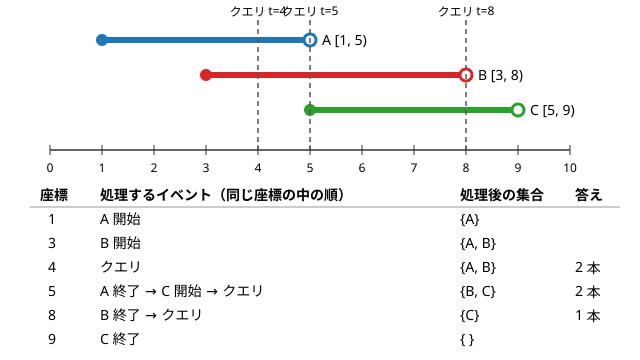

!!! abstract "要点"
    - **何ができるか**：区間の開始・終了と時刻のクエリを (座標, 種類) の組にして並べ、左から順に処理しながら、その時点で有効なものの集合や合計を更新する。2 次元の点を一方の座標の順に処理し、もう一方の座標を集合で持てば、「x も y も大きい相手」との組を扱える（平面走査の基本形）。
    - **いつ使うか**：
        - 区間の開始・終了と、時刻のクエリが混ざる。
        - x 座標も y 座標も大きい相手と組にする・数える。
        - 締め切りや有効期間がある。
        - クエリを先に全部読んでよい。
        - 座標は $10^9$ まで、区間とクエリは合わせて $2 \times 10^5$ 個程度。
    - **計算量**：イベントが $N$ 個なら、ソートに $O(N \log N)$。走査はイベント 1 つにつき集合の操作 1 回で、set・multiset なら $O(\log N)$、合計だけなら $O(1)$。全体で $O(N \log N)$。
    - **前提**：[ソートで考える](../basics/sorting-techniques.md)

<!-- textlint-disable -->
別名：イベントソート・開始と終了をイベントにする・event sorting
<!-- textlint-enable -->

イベントソートは、時間や座標の上で起きる出来事（区間の始まり・終わり、点、クエリ）を 1 つの列に並べ、小さい座標から順に処理する方法である。座標が $10^9$ まであっても、何かが変わるのはイベントの座標だけなので、手間は座標の範囲ではなくイベントの数で決まる。難しいのは並べることではなく、同じ座標のイベントをどの順に処理するかと、走査の途中で何を持つかである。

## イベントの作り方と同じ座標での処理順 {#make-events}

イベントは (座標, 種類, 番号) の組で作る。区間 $[l, r)$ は「$l$ で開始」と「$r$ で終了」の 2 つ、クエリは「$t$ で問う」の 1 つになる。組をそのままソートすると、座標が同じものは種類の番号の順に並ぶ。だから**種類の番号の付け方が、同じ座標での処理順を決める**。

区間を[半開区間](../guide/glossary.md#half-open-interval) $[l, r)$ で持つなら、時刻 $t$ のクエリに含まれるのは $l \le t < r$ の区間である。$r = t$ の区間はもう含まず、$l = t$ の区間は含むので、同じ座標では「終了 → 開始 → クエリ」の順に処理すればよい。次の図は、3 本の区間と 3 つのクエリをこの順で処理した様子である。



座標 5 に注目すると、A の終了を先に処理するので、時刻 5 のクエリは A を数えない。クエリを A の終了より先に処理すると（開始 → クエリ → 終了の順）、A を余分に数えて 3 本と答えてしまう。

各クエリに、その時刻を含む区間の本数と重みの最小値を答えるコードは次のとおりである。同じ値の重みが重なりうるので multiset で持ち、消すときは 1 つだけ消す。答えは番号の位置に書き込み、入力の順に出力する。

```cpp
--8<-- "event-sort/interval-query.cpp:core"
```

完全なプログラム：[`interval-query.cpp`](https://github.com/yuukougun/kyopro-atlas/blob/main/snippets/event-sort/interval-query.cpp)（GitHub）
{ .kp-code-src }

処理順の決め方は区間の端の扱いで変わる。

| 区間の形 | 時刻 $t$ に含まれる条件 | 同じ座標での順 |
| --- | --- | --- |
| 半開区間 $[l, r)$ | $l \le t < r$ | 終了 → 開始 → クエリ |
| 閉区間 $[l, r]$ | $l \le t \le r$ | 開始 → クエリ → 終了 |
| 閉区間を $[l, r + 1)$ に直す | $l \le t < r + 1$ | 終了 → 開始 → クエリ |

閉区間は、終了のイベントを $r + 1$ に置いて半開区間に直すと、ほかの区間と同じ規則で扱える。座標が整数のときはこれが最も間違えにくい。

合計や個数だけを持つなら、イベントは「座標と増減」だけでよく、[いもす法](../basics/imos.md)を座標の大きい場合に広げたものになる。開始で $+w$、終了で $-w$ を足し、隣り合うイベントの座標の間では値が変わらないので、区間の長さを掛けてまとめて数えられる（[ABC188 D の方針](#practice)）。

??? question "確認問題：同じ座標の開始と終了の順"
    半開区間 $[l, r)$ が何本かあり、同時に有効な区間の最大本数を求めたい。イベントを (座標, 増減) で作り、増減を $+1$・$-1$ として、イベントを 1 つ処理するたびに本数の最大を更新する。同じ座標で $+1$ を $-1$ より先に処理すると、何が起きるか。

    ??? success "答え"
        $[1, 3)$ と $[3, 5)$ のように端が接する区間を、重なっていると数えてしまう。座標 3 で $[3, 5)$ の開始を先に処理すると、その瞬間に本数が 2 になり、最大が 2 と記録される。正しくは同時に有効なのは 1 本である。終了（$-1$）を先に処理するか、同じ座標のイベントをすべて処理し終えてから最大を更新すれば正しくなる。タプルを $(\text{座標}, \text{増減})$ にしてソートすれば、$-1 < +1$ なので自然に終了が先になる。

## 集合（set・multiset）を更新しながら走査する {#with-set}

合計や個数では足りず、「今有効なものの中で最小・最大」「条件を満たす最も近いもの」を問われたら、走査しながら有効なものを集合に入れておく。開始で `insert`、終了で削除し、クエリでは `begin()`・`rbegin()`・`lower_bound` で答える。集合の使い方は[順序付き集合](../ds/ordered-set.md)にまとめてある。

何を集合に入れるかで、典型的な型が分かれる。

- **有効なものの最小・最大**：「各時刻に、有効な区間の重みの最小値」は、重みを multiset に入れて `begin()` を見る。最小か最大の一方だけなら優先度付きキューでも書けるが、途中の要素を消せないので、終了を後回しにする工夫（取り出したときに有効かを確かめる）が要る
- **値ごとの個数で種類数を数える**：「各位置に何種類の値があるか」は、値ごとに有効な区間の本数を数え、本数が 0 から 1 になったら種類数に $+1$、1 から 0 になったら $-1$ する。同じ値の区間が重なっても二重に数えない
- **締め切りや有効期間を時刻のずれで表す**：時刻 $D$ に出発して速さ 1 で進む人が、時刻 $[S, T)$ に位置 $X$ で起きる出来事に出会うのは $S \le D + X < T$、すなわち $S - X \le D < T - X$ のときである。出来事を出発時刻の軸の区間 $[S - X, T - X)$ に直せば、出発時刻を座標にしたイベントソートになる（[力試し](#challenge)の型）

いずれの型も、クエリの答えを走査の順に求めるので、クエリを先に全部読める（[オフライン](../guide/glossary.md#offline)で解ける）ことが条件である。前の答えを使って次のクエリが決まる問題では、並べ替えができないので使えない。

## 平面走査の基本（一方の座標で並べ、もう一方を集合で） {#plane-sweep}

2 次元の点について「x 座標も y 座標も大きい相手」を扱うときは、x 座標の順に点を処理し、y 座標を集合で持つ。x の順に見ていけば、「x が小さい」という条件は「すでに処理した」と言い換えられ、残る条件は y だけになる。これが平面走査の基本形である。

代表は、赤い点と青い点を「x も y も青の方が大きい」組にして、組の数を最大にする問題である（[ARC092 C の例題](#arc092_a)）。青い点を x の小さい順に見ると、使える赤い点（x が小さいもの）は増える一方になる。青い点が来たら、使える赤い点のうち y が青より小さく、その中で y が最大のものと組にする。y が大きい赤い点ほど、組める青い点が少なく後で使いにくいので、先に使ってしまうのがよい。

```cpp
--8<-- "event-sort/red-blue-pairs.cpp:core"
```

完全なプログラム：[`red-blue-pairs.cpp`](https://github.com/yuukougun/kyopro-atlas/blob/main/snippets/event-sort/red-blue-pairs.cpp)（GitHub）
{ .kp-code-src }

ここでも同じ座標での処理順が効く。条件が「x が真に大きい」なので、同じ x の赤い点はまだ使えない。だから同じ x では青を先に処理する。条件が「x 以上」なら逆に赤を先に入れる。y の側も同じで、「真に小さい」なら `lower_bound(y)` の 1 つ前、「以下」なら `upper_bound(y)` の 1 つ前を取る。

??? note "y が最大の赤い点を選んでよい理由（交換の議論）"
    青い点を x の順に処理し、今の青い点 $B$ と組める赤い点のうち y が最大のものを $R$ とする。前の青い点までは貪欲と同じ選び方をする最適な組み方を 1 つ取る。$R$ は貪欲でまだ使っていないので、この組み方でも前の青い点とは組んでいない。この組み方で $B$ が $R$ と組んでいなければ、次のどれかである。

    - $B$ がどれとも組んでいない：$R$ も未使用なら $(B, R)$ を足せて最適に反する。$R$ が後の青い点 $B'$ と組んでいれば、$R$ の相手を $B'$ から $B$ に替えても組の数は変わらない
    - $B$ が $R'$ と組み、$R$ はどれとも組んでいない：$B$ の相手を $R'$ から $R$ に替えても組の数は変わらない
    - $B$ が $R'$ と組み、$R$ は後の青い点 $B'$ と組んでいる、$(B, R')$・$(B', R)$ を $(B, R)$・$(B', R')$ に組み替える。$B'$ は $B$ より後なので x が $B$ 以上であり、$R'$ は $B$ と組めたので $R'$ の x は $B$ より小さい。また $R'$ の y は $R$ 以下で、$R$ の y は $B'$ より小さい。だから $B'$ と $R'$ も組める

    どの場合も、$B$ までは貪欲と同じ選び方をする最適な組み方がある。$B$ が組める赤い点を持たないときは、$B$ を使わなくても損をしない。これを青い点ごとにくり返せば、貪欲で最大の組数になる（[交換論法](../basics/exchange-argument.md)）。

箱に品物を入れる問題も同じ形である。「品物の縦横がどちらも箱以下」なら、箱を青い点、品物を赤い点と見て、縦の順に走査し、横の大きさを multiset で持てばよい（[ABC245 E の方針](#practice)）。

## BIT・セグ木と組む平面走査へ（データ構造の章） {#to-data-structures}

集合で足りるのは、もう一方の座標について「最小・最大」「ある値に最も近いもの」を問うときである。「y が $[a, b)$ にある点の個数」や「左端が $p$ 以上の区間の本数」のように、範囲の中の個数や和を問われたら、std::set では個数を速く数えられない（`distance` は要素数に比例する）。この場合は、もう一方の座標を[座標圧縮](../basics/coordinate-compression.md)して [BIT](../ds/fenwick-tree.md) やセグメント木に載せる。

- **区間に含まれる区間の数**：区間 $[l, r]$ を点 $(l, r)$ と見る。区間とクエリを右端の順に並べ（同じ右端では区間を先に）、区間が来たら左端の位置に $+1$、クエリ $[p, q]$ が来たら「左端が $p$ 以上の個数」を数える（[ABC106 D の方針](#practice)）
- **長方形の中の点の数**：「上端での値 − 下端の 1 つ前での値」に分けて、1 本の走査で求める

これらは[平面走査](../ds/sweep-line-2d.md)のページで扱う。クエリを答えやすい順に並べ替えて最後に元の順に戻す考え方は[クエリの先読み](../ds/offline-queries.md)にまとめてある。

## 落とし穴 {#pitfalls}

**同じ座標の処理順を決めていない**。`pair<long long, int>` でイベントを作ると、同じ座標では第 2 要素の小さい順に並ぶ。種類を 0・1・2 のどれにしたかで答えが変わるので、コメントで順を書き、区間の端の形（半開か閉か）から決める。閉区間は終了を $r + 1$ に置いて半開区間に直すと迷わない。

**同じ座標のイベントを処理し終える前に値を読む**。区間の重なりの最大を、イベントを 1 つ処理するたびに更新すると、処理順によっては同じ座標の途中の状態を読んでしまう。同じ座標のイベントをすべて処理してから値を読むと、処理順の影響を受けない。

**multiset の `erase(値)` で同じ値がすべて消える**。`s.erase(x)` は値 $x$ をすべて消す。1 つだけ消すには `s.erase(s.find(x))` と書く。

**答えを走査の順に出力する**。クエリはソートで順番が入れ替わる。イベントにクエリの番号を持たせ、答えを番号の位置に書き込んでから、入力の順に出力する。

**区間の長さを掛けるときのオーバーフロー**。座標が $10^9$ まで、値が $10^9$ までなら、値と長さの積は $10^{18}$ に届く。合計は `long long` で持つ。

**クエリが前の答えに依存する**。前の答えで次のクエリが決まる問題（オンラインでの回答が必要な問題）では、クエリを並べ替えられない。この場合は、座標を添字にしたデータ構造を走査なしで直接更新する。

## 例題 {#examples}

### ABC309 C. Medicine {#abc309_c}

<div class="kp-problems" data-role="example" markdown>

- [ABC309 C. Medicine](https://atcoder.jp/contests/abc309/tasks/abc309_c)（diff 348）：複数の薬をそれぞれ決まった日まで飲み続けるとき、1 日に飲む錠数が初めて K 錠以下になる日を求める。

</div>

薬 $i$ は 1 日目から $a_i$ 日目まで（閉区間）毎日 $b_i$ 錠飲む。閉区間を半開区間 $[1, a_i + 1)$ に直すと、薬 $i$ の分は $a_i + 1$ 日目から減る。1 日目の錠数はすべての $b_i$ の和で、そこから「$a_i + 1$ 日目に $b_i$ 減る」というイベントを日の順に処理すればよい。開始のイベントはすべて 1 日目なので、終了のイベントだけを並べれば足りる。

??? note "解法の詳細"
    - 1 日目の錠数 $\sum b_i$ が $K$ 以下なら、答えは 1 である。
    - そうでなければ、薬を $a_i$ の小さい順に並べ、順に錠数から $b_i$ を引く。引いた直後に $K$ 以下になったら、答えは $a_i + 1$ である。
    - 同じ $a_i$ の薬が続くときに、途中で $K$ 以下になって止めてもよい。残りの同じ日のイベントは錠数を減らすだけなので、答えの日は変わらない。
    - 錠数の和は最大 $3 \times 10^5 \times 10^9 = 3 \times 10^{14}$ になるので `long long` で持つ。ソートが支配的で $O(N \log N)$。

### ARC092 C. 2D Plane 2N Points {#arc092_a}

<div class="kp-problems" data-role="example" markdown>

- [ARC092 C. 2D Plane 2N Points](https://atcoder.jp/contests/arc092/tasks/arc092_a)（diff 1268）：赤い点と青い点を、x 座標も y 座標も青の方が大きくなるように組にするときの、最大の組数を求める。

</div>

[平面走査の基本](#plane-sweep)の代表例である。青い点を x の小さい順に見ると、組める赤い点の候補は増える一方になる。青い点ごとに、組める赤い点のうち y が最大のものを選ぶ。y が大きい赤い点ほど後で組める青い点が少ないので、先に使ってよい（正しさは同じ節の交換の議論）。

??? note "解法の詳細"
    - 制約は $N \le 100$ なので、青い点ごとに全部の赤い点を調べる $O(N^2)$ で間に合う。調べるのは「未使用で、x も y も青より小さい赤い点のうち、y が最大のもの」である。
    - 座標の制約が大きい場合は、[節のコード](#plane-sweep)のように x の順にイベントを並べ、y を multiset で持てば $O(N \log N)$ になる。
    - この問題では x 座標も y 座標も赤と青を合わせてすべて異なるので、同じ座標の処理順は答えに効かない。座標が重なりうる問題では、条件が「真に大きい」なので同じ x では青を先に処理し、その x の赤を使わないようにする。

## 練習問題 {#practice}

<div class="kp-problems" data-role="practice" markdown>

- [ABC478 D. Range Set Insertion Query](https://atcoder.jp/contests/abc478/tasks/abc478_d)（diff 729）：N 個の空の集合に、区間 [L, R] の番号の集合すべてへ値 X を入れる操作を Q 回行った後、各集合の要素数を求める。
- [ABC188 D. Snuke Prime](https://atcoder.jp/contests/abc188/tasks/abc188_d)（diff 933）：利用期間と 1 日の料金が決まったサービスを使うとき、1 日 C 円で全サービスを使える契約も選べる場合の総費用の最小値を求める。
- [ABC106 D. AtCoder Express 2](https://atcoder.jp/contests/abc106/tasks/abc106_d)（diff 1319）：M 本の区間のうち、各クエリの区間 [p, q] に完全に含まれるものの数を答える。
- [ABC245 E. Wrapping Chocolate](https://atcoder.jp/contests/abc245/tasks/abc245_e)（diff 1571）：縦と横の大きさが決まったチョコを、それぞれ別の箱に縦横とも収まるように入れられるか判定する。

</div>

??? note "練習の方針"
    - **ABC478 D**：操作を「$L$ で値 $X$ が入る」「$R + 1$ で値 $X$ が抜ける」の 2 つのイベントにする。位置を 1 から $N$ まで進めながら値ごとに有効な操作の数を数え、0 から 1 になったら要素数に $+1$、1 から 0 になったら $-1$ する。座標が $N$ 以下なので、ソートの代わりに位置ごとのリストに振り分けてもよい
    - **ABC188 D**：$a_i$ 日目に $+c_i$、$b_i + 1$ 日目に $-c_i$ のイベントを作り、座標の順に処理する。隣り合うイベントの座標 $x < y$ の間は料金の合計 $s$ が変わらないので、$\min(s, C) \times (y - x)$ を足す。積は `long long` で計算する
    - **ABC106 D**：区間とクエリを右端の順に並べ、同じ右端では区間を先に処理する。区間が来たら左端の位置の個数に $+1$ し、クエリ $[p, q]$ では左端が $p$ 以上の個数を数える。この問題は座標が 500 以下なので配列で数えれば足り、座標が大きければ BIT を使う（[BIT・セグ木と組む平面走査へ](#to-data-structures)）。2 次元累積和でも解ける
    - **ABC245 E**：箱を縦の小さい順に処理し、縦が箱以下のチョコを先に multiset（横の大きさ）へ入れる。箱ごとに、横が箱以下で最大のチョコを入れる。条件が「以下」なので、同じ縦ではチョコを先に入れ、`upper_bound` の 1 つ前を取る。入れられた数が $N$ なら可

## 力試し {#challenge}

<div class="kp-problems" data-role="challenge" markdown>

- [ABC128 E. Roadwork](https://atcoder.jp/contests/abc128/tasks/abc128_e)（diff 1840）：時刻と場所が決まった通行止めがあるとき、各人が出発してから最初に止まる位置を求める。

</div>

??? note "力試しの方針"
    - **ABC128 E**：時刻 $D$ に座標 0 を出発した人は、時刻 $D + X$ に位置 $X$ を通る。問題の時刻の 0.5 のずれは、整数の時刻では $S \le D + X < T$（半開区間 $[S, T)$）に直る。止まるのは $S - X \le D < T - X$ のときなので、通行止めを出発時刻の軸の区間 $[S - X, T - X)$ に直す。開始で $X$ を multiset に入れ、終了で 1 つ消し、出発時刻のクエリでは最小の $X$（空なら $-1$）を答える。半開区間なので、同じ座標では終了と開始をクエリより先に処理する

## 使い分け {#comparison}

- 座標が小さく（$10^6$ 程度まで）、値を読むのが最後だけなら、配列に $\pm$ を書き込む[いもす法](../basics/imos.md)で済む
- 座標が大きくても個数や合計を読むだけなら、[座標圧縮](../basics/coordinate-compression.md)してからいもす法を使うか、イベントを座標の順に並べて累積する。どちらも同じ計算である
- 有効なものの最小・最大や、最も近いものを問うなら、イベントソートと set・multiset を組む
- もう一方の座標の範囲の個数・和を問うなら、BIT・セグメント木と組む[平面走査](../ds/sweep-line-2d.md)を使う

## 参考 {#references}

- [drken「AtCoder ABC 309 C - Medicine (3Q, 灰色, 350 点)」](https://drken1215.hatenablog.com/entry/2024/06/01/030100)：例題の閉区間の扱いと、終わる日の順に引いていく方針
- [drken「AtCoder ABC 091 C - 2D Plane 2N Point (ARC 092 C) (1Q, 水色, 400 点)」](https://drken1215.hatenablog.com/entry/2021/07/05/183800)：例題の貪欲の順と選び方、交換による正しさの議論
- [comet725「ABC478Dを解いた【イベントソート】」](https://qiita.com/comet725/items/53e6c3b9804e2f235a01)：練習の方針（開始と終了のイベントと、値ごとの個数の 0・1 の切り替わり）
- [Konini64「ABC478回答メモ」](https://qiita.com/Konini64/items/6fefc9fe50142dc107a8)：練習の問いの確認（各集合の要素数を求めること）
- [oraclesqlpuzzle「ABC188-D Snuke Prime」](https://oraclesqlpuzzle.ninja-web.net/kyoupro/05-atcoder-02-abc/kyoupro-abc188-d.html)：練習の方針（$b_i + 1$ に置く終了のイベントと、イベントの間をまとめて数えること）
- [drken「AtCoder ABC 106 D - AtCoder Express 2 (1Q, 水色, 400 点)」](https://drken1215.hatenablog.com/entry/2018/09/06/020200)：練習の方針（右端の順の走査と BIT、2 次元累積和）
- [drken「AtCoder ABC 245 E - Wrapping Chocolate (1D, 水色, 500 点)」](https://drken1215.hatenablog.com/entry/2022/03/30/003800)：練習の方針（箱の順の走査と multiset、境界の扱い）
- [drken「AtCoder ABC 128 E - Roadwork (1D, 青色, 500 点)」](https://drken1215.hatenablog.com/entry/2019/06/15/174200)：力試しの方針（時刻のずれで区間に直すことと、同じ座標での処理順）
