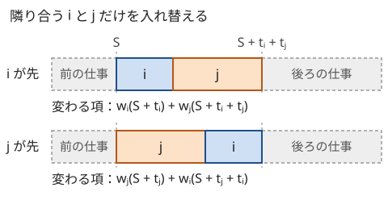

!!! abstract "要点"
    - **何ができるか**：並べる順で結果が変わる問題で、隣り合う 2 つを入れ替えたときに変わる項だけを比べ、「$i$ を先に置くべき条件」を式で導いて比較関数にする。導いた比較が推移的（狭義の弱順序）かを確かめ、その順に並べてから貪欲や DP を行う。
    - **いつ使うか**：
        - 並べる順番で結果が変わる。
        - 文字列・数を並べて連結した結果を最大（最小）にする。
        - 2 つを入れ替えたときの差が、その 2 つだけで決まる。
    - **計算量**：ソートの $O(N \log N)$ 回の比較。連結の比較は 1 回が文字列の長さに比例する。
    - **前提**：[貪欲法の考え方と正当性](../basics/greedy-basics.md)

<!-- textlint-disable -->
別名：隣接交換・exchange argument・ソートの比較関数を作る・連結して最大・最小・a+b と b+a
<!-- textlint-enable -->

交換論法と比較関数の設計は、$N!$ 通りの並べ方を調べる代わりに、隣り合う 2 つの入れ替えだけを考えて最適な順を 1 つのソートで決める方法である。難しいのは証明そのものより、入れ替えの差を「$i$ だけの量」と「$j$ だけの量」の比較に分けることと、導いた比較が `sort` に渡せる形（狭義の弱順序）になっているかを確かめることである。正当性の示し方の全体は[貪欲法の考え方と正当性](../basics/greedy-basics.md#proof)にある。

## 隣接交換で比較を導く {#adjacent-swap}

並べる順で結果が変わり、どの要素も「1 つの強さ」をすぐには持たない問題では、隣り合う 2 つの順だけを比べて基準を作る。例として次の問題を考える。

> 仕事が $N$ 個あり、仕事 $i$ は処理時間 $t_i$・重み $w_i$（どちらも 0 以上）を持つ。1 つずつ順に処理し、仕事 $i$ の終了時刻を $C_i$ とするとき、$\sum_i w_i C_i$ を最小にする順を求める。

$t_i$ の小さい順も $w_i$ の大きい順も、それだけでは正しくない。そこで、ある順で隣り合う $i, j$ を入れ替えたときに何が変わるかを書く。$i, j$ の直前までの処理時間の和を $S$ とする。



前の仕事は $i, j$ の順に関係なく同じ時刻に終わる。後ろの仕事は、$i, j$ のどちらが先でも時刻 $S + t_i + t_j$ から始まるので、これも変わらない。変わるのは $i$ と $j$ の 2 項だけで、その差は次のようになる。

$$
\bigl(w_j(S + t_j) + w_i(S + t_j + t_i)\bigr) - \bigl(w_i(S + t_i) + w_j(S + t_i + t_j)\bigr) = w_i t_j - w_j t_i
$$

差に $S$ が残らないことが要点である。これで「$i$ を先に置く方が得 $\iff t_i w_j < t_j w_i$」が、周りの並びによらずに言える。$w$ がどれも正なら両辺を $w_i w_j$ で割って $t_i / w_i < t_j / w_j$、すなわち $t / w$ の小さい順という 1 つのキーになる。

処理の流れをまとめると次のようになる。

```text
1. 並びの中の隣り合う i, j について、「i, j の順」と「j, i の順」の値を式で書く
2. 前と後ろの要素に関わる項が両方で等しいことを確かめ、消す
3. 残った差を「i だけの量」と「j だけの量」の比較に分ける  →  key(i) < key(j)
4. その比較が狭義の弱順序かを確かめる（分けられれば自動的に満たす）
5. key の順にソートし、その順で貪欲・DP を行う
```

手順 2 が成り立たない問題に、隣接交換をそのまま使うことはできない。たとえば $i, j$ の順で「後ろへ渡す状態」が変わるなら、後ろの要素の値も変わる。それでも、状態が大きいほど後ろにとって得になる（単調）と言えるなら、渡す状態が大きい方の順を選べばよい。1 次関数を順に合成する問題（[練習問題](#practice)の ABC366 F）がこの形である。

??? note "証明：隣り合う入れ替えだけで全体の最適が言える理由"
    手順 3・4 で得た比較を $\prec$ と書き、$\prec$ が狭義の弱順序だとする。任意の並び $P$ を取る。$P$ が $\prec$ の順になっていなければ、隣り合う $P_k, P_{k+1}$ で $P_{k+1} \prec P_k$ となる組がある（なければ、狭義の弱順序の推移性から $P$ 全体が $\prec$ の順に並んでいる）。この 2 つを入れ替えると、手順 3 から値は悪くならない。入れ替えるたびに「$\prec$ で逆順になっている組」の数が 1 減るので、有限回で $\prec$ の順の並びに着く。$\prec$ で同等な要素どうしは入れ替えても値が同じなので、$\prec$ の順の並びはどれも同じ値である。よって $\prec$ の順の並びは、どの $P$ と比べても悪くない。

    この証明は推移性を使っている。比較が推移的でないと、「隣り合う組はどれも逆順でない」のに最適でない並びが残る（[次の節](#strict-weak-ordering)の例）。

ソートは $O(N \log N)$ 回の比較で済み、全体の計算量は「比較 1 回の計算量 × $O(N \log N)$」になる。キーが数なら比較は $O(1)$ である。この例のコードは[比は掛け算で比べる](#ratios)の節に置く。

## 比較が狭義の弱順序になっているか {#strict-weak-ordering}

導いた条件「$i$ を先に置く方が得」をそのまま `sort` の比較関数にするには、それが[狭義の弱順序](../guide/glossary.md#strict-weak-ordering)である必要がある。要件の一覧と、満たさないときに `sort` が壊れる様子は[ソートで考える](../basics/sorting-techniques.md#strict-weak-ordering)と[比較関数と順序](../cpp/cpp-comparators.md)にある。ここでは、交換論法で作った比較に特有の確かめ方を書く。

**分けられれば満たす**。条件が $\mathrm{key}(i) < \mathrm{key}(j)$ の形に分けられれば、数の大小なので狭義の弱順序である。だから手順 3 で、まず「$i$ だけの量」と「$j$ だけの量」に分けることを目指す。

**分けられないと壊れることがある**。2 台の機械の例で見る。仕事 $i$ は機械 1 で $a_i$、続けて機械 2 で $b_i$ だけかかる。仕事を 1 つの順で両方の機械に通し、最後の仕事が機械 2 を出る時刻を最小にしたい。隣接交換で計算すると、$\min(a_i, b_j) < \min(a_j, b_i)$ なら $i$ を先に置いて悪くならない（Johnson の規則）。入れ替えで機械 2 の空く時刻が変わるので手順 2 は成り立たないが、空く時刻は早いほど後ろにとって得なので、[前の節](#adjacent-swap)の単調性の形で言える。この条件は分けられず、同等の関係が推移しない。

| 仕事 | $(a, b)$ | 比べた結果 |
| --- | --- | --- |
| $x$ | $(1, 2)$ | $x$ と $y$ は同等 |
| $y$ | $(1, 1)$ | $y$ と $z$ は同等 |
| $z$ | $(2, 1)$ | $x$ を $z$ より先に置く |

並び $z, y, x$ は、隣り合うどの組も「逆順」ではない。それでも終了時刻は 6 で、最適な $x, y, z$ の 5 より悪い（全順列で確かめた）。比較が推移しないと、`sort` がこのような並びで止まりうる。

**直し方は、グループに分けてからそれぞれのキーで並べる**。この例では、$a_i < b_i$ の仕事を先に置いて $a$ の小さい順に並べる。残りの仕事は後に置き、$b$ の大きい順に並べる。グループの中では条件が 1 つのキーに分けられ、グループの間では「前のグループが先」で矛盾しない。複数の括弧列をつなぐ問題も、合計の符号で 2 組に分ける同じ形である（[括弧列](../patterns/bracket-sequence.md#ordering)）。

**確かめ方**。導いた比較に自信がなければ、要素を 3 つ乱数で作って推移性と同等の推移性を調べるか、小さい $N$ で全順列の最適値と比べる（[ストレステストと実験](../guide/stress-testing.md#procedure)）。g++ の `-D_GLIBCXX_DEBUG` は `comp(a, a)` が false かを調べるだけで、推移しない比較は見つけられないことがある。

## 比は掛け算で比べる・分母 0 {#ratios}

隣接交換の条件は $t_i w_j < t_j w_i$ のような「掛け算の形」で出てくることが多い。比のキー $t / w$ に直してから `double` で比べると誤差で順を取り違える。そのため、比較関数は掛け算の形のまま書く（誤差の具体例は[ソートで考える](../basics/sorting-techniques.md#ratio-and-ties)）。

掛け算の形のまま書くときは、0 と符号に注意する。$t_i w_j < t_j w_i$ は、点 $(t_i, w_i)$ と $(t_j, w_j)$ を原点から見た向きを比べている。狭義の弱順序になるのは、原点から見た向きの幅が 180 度未満のときである。すなわち、すべての点が原点を通るある直線の片側（開いた半平面）と、その直線上の片側の半直線に入るときである。

- **どちらも 0 以上で、$(0, 0)$ がない**：狭義の弱順序である。$w = 0$ の要素は比が $+\infty$ として最後に、$t = 0$ の要素は最初に来る。$w = 0$ どうしも同等として正しく扱われる
- **$(0, 0)$ がある**：どの要素とも同等になり、同等の推移を壊す。$(1, 1)$ と $(2, 1)$ は順が決まるのに、どちらも $(0, 0)$ と同等になる。$(0, 0)$ はどこに置いても値を変えないので、並べる前に除く
- **点が原点の両側に散らばる**（ある向きとその反対向きがどちらもある）：掛け算の形のままでは推移しない。$w$ の符号が混じっても、$t > 0$ がそろっていれば向きの幅は 180 度未満なので、掛け算のままでよい。両側に散らばるなら、符号でグループに分けるか、[偏角ソート](../geometry/argument-sort.md)と同じく半平面ごとに比べる
- **比のキーに直すとき**：負の $w$ で割ると不等号の向きが変わる。$t / w$ の小さい順と言えるのは $w$ がすべて正のときだけである

次のコードは、処理時間 $t_i$・重み $w_i$ の仕事を並べて $\sum w_i C_i$ を最小にする例（[隣接交換で比較を導く](#adjacent-swap)）を、$(0, 0)$ を除いてから掛け算の比較でソートする。$t, w \le 10^6$ なら積は $10^{12}$ 程度で `long long` に収まる。積が $10^{18}$ を超えうるなら `__int128` を使う（[整数のオーバーフローと __int128](../cpp/cpp-integer-overflow.md)）。

```cpp
--8<-- "exchange-argument/weighted-order.cpp:core"
```

完全なプログラム：[`weighted-order.cpp`](https://github.com/yuukougun/kyopro-atlas/blob/main/snippets/exchange-argument/weighted-order.cpp)（GitHub）
{ .kp-code-src }

## 連結の比較（a+b と b+a） {#concatenation}

数字の文字列をすべて並べて連結し、整数として最大にするなら、隣り合う $a, b$ について $a + b$ と $b + a$（$+$ は連結）を比べ、大きくなる方を先に置く。前後の文字列は入れ替えに関係なく同じ位置に残るので、隣接交換の条件そのものである。

文字列の大きい順に並べるのは誤りである。$9$ と $91$ では、文字列としては $91$ の方が大きいが、$919 < 991$ なので $9$ を先に置くべきである。$a + b$ と $b + a$ は同じ長さなので、文字列として比べれば整数としての大小になる（先頭の 0 も含めて正しい）。

この比較が狭義の弱順序である理由は、キーに分けられることにある。$a$ を整数として読んだ値を $v_a$、文字数を $\lvert a \rvert$ とすると、$a + b$ の値は $v_a \cdot 10^{\lvert b \rvert} + v_b$ である。

$$
a + b > b + a \iff v_a (10^{\lvert b \rvert} - 1) > v_b (10^{\lvert a \rvert} - 1) \iff \frac{v_a}{10^{\lvert a \rvert} - 1} > \frac{v_b}{10^{\lvert b \rvert} - 1}
$$

右端のキーは $a$ を無限にくり返した小数 $0.aaa\ldots$ の値で、$a$ だけで決まる。だから推移的である。英字の文字列で辞書順最小の連結を作る場合も、$10$ を文字の種類の数に替えれば同じ議論が通り、$a + b < b + a$ で並べればよい。

```cpp
--8<-- "exchange-argument/concat.cpp:core"
```

完全なプログラム：[`concat.cpp`](https://github.com/yuukougun/kyopro-atlas/blob/main/snippets/exchange-argument/concat.cpp)（GitHub）
{ .kp-code-src }

比較 1 回は $O(\lvert a \rvert + \lvert b \rvert)$ なので、全体は文字列の最大の長さを $L$ として $O(L N \log N)$ である。比較のたびに連結した文字列を作るので、定数倍は重い。

連結する個数を $K$ 個に絞る問題では、「選んだ集合をどう並べるか」はこの比較で決まり、「どれを選ぶか」は別に考える。先頭に 0 がある文字列の扱いが要になり、選び方は素直でない（[練習問題](#practice)の ABC471 F）。

## 順に並べてから DP（DP の章へ） {#then-dp}

いくつかを選び、選んだものを好きな順に処理する問題では、選び方と並べ方を分けて考える。選んだ集合が何であっても、隣接交換で導いた順が最適だとする。すると、全体を先にその順でソートしておけば、選んだものは自動的に最適な順に並ぶ。残るのは「前から見て選ぶか選ばないか」の DP で、[ナップサック DP](../dp/knapsack-01.md)の形になる。

- 締め切りのある仕事から選ぶなら、締め切りの順に並べてから「使った時間」を状態にする
- 1 次関数を選んで合成するなら、合成の順を比の大小で決めてから「選んだ個数」を状態にする（[練習問題](#practice)の ABC366 F）

比較の基準の作り方と DP の状態の決め方は[並べ替えてから DP する](../dp/exchange-argument-dp.md)にまとめる。

並べ方が「1 つのキーの順」ではなく「大きい順に左端か右端へ置く」と決まる問題もある。このときは、端に置くことを交換論法で示したうえで、左右に何個置いたかを状態にした DP になる（[力試し](#challenge)の ABC163 E）。

## 入れ替えで改善できるかを考える型 {#improve-by-swap}

交換論法は並べ順だけでなく、どれを選ぶかの構造を決めるのにも使う。最適解を 1 つ取り、「選んだものと選ばなかったものを 1 つずつ入れ替えたら良くならないか」を考える。良くなる入れ替えが残っていれば最適でないので、最適解は「その入れ替えができない形」に限られる。

この型が効くのは、値が「選んだものの和」と「選び方全体で決まる量（種類の数など）」の和になっているときである。全体で決まる量を 1 つ固定すると、残りは和だけの問題になり、入れ替えの議論で選び方が決まる。固定する値を 1 つずつ動かしながら、入れ替えを 1 回ずつ行って答えを更新する。具体例は[例題](#abc116_d)の ABC116 D である。

この型の入れ替えは、[貪欲法の考え方と正当性](../basics/greedy-basics.md#proof)の「最適解を貪欲解に近づける入れ替え」と同じ形をしている。違いは、入れ替えの候補を毎回取り出すために[優先度付きキュー](../ds/priority-queue.md)などで速く選ぶ必要があることである。

## 落とし穴 {#pitfalls}

**入れ替えで周りが変わるのに隣接交換をする**。手順 2（前と後ろの項が等しい）を確かめずに 2 項だけ比べると、後ろへ渡す状態の違いを見落とす。終了時刻のように和で決まる状態は順によらないが、関数の合成や「その時点の最大値」のように順で変わる状態は、単調性を別に示す。

**比較に `<=` を書く、比を `double` で比べる**。`<=` は狭義の弱順序を壊し、[比較関数と順序](../cpp/cpp-comparators.md#less-equal-pitfall)のとおり実行時に落ちることがある。`double` の比は、違う比が同じ値に丸められて順を取り違え、誤答になる。掛け算で比べ、`<` か `>` を書く。

**$(0, 0)$ や負の値を見落とす**。$t_i w_j < t_j w_i$ の形の比較は、$(0, 0)$ があると壊れ、点が原点の両側に散らばると推移しない。制約に 0 や負の値が含まれるかを最初に読み、[比の節](#ratios)のとおり除くかグループに分ける。

**掛け算でのオーバーフロー**。$t, w \le 10^9$ なら積は $10^{18}$ に近く、`long long` の上限（約 $9.2 \times 10^{18}$）に余裕がない。積の和や 3 つの積を比べるときは `__int128` を使う。

**比較を分けられないまま `sort` に渡す**。$\min$ や場合分けを含む条件は、狭義の弱順序でないことが多い。グループに分けてキーで並べるか、小さい $N$ の全順列で確かめる。

## 上位の手法へのつながり {#next-steps}

- **並べてから DP**：選ぶ集合と順を分け、並べる基準を交換論法で作ってから DP をする（[並べ替えてから DP する](../dp/exchange-argument-dp.md)）
- **木の上で比の小さい順に親へまとめる**：「親より先に子は選べない」という制約つきで順序を決める問題では、比の最も良い塊を、親の塊の直後に訪れるものとして併合する操作をくり返す。ここでも 2 つの塊の順を比で比べる（[比で親に併合する貪欲](../tree/tree-ratio-greedy.md#why-ratio)）
- **辞書順最小の文字列を作る**：連結の比較は、前から 1 文字ずつ決める貪欲と組み合わせることがある（[辞書順最小を前から決める貪欲](../basics/lexicographic-greedy.md)）
- **締め切りと優先度付きキュー**：処理時間と締め切りがあり、すべては終えられない問題では、締め切りの順に入れて損な仕事を捨てる（[優先度付きキューを使う貪欲](../basics/greedy-priority-queue.md)）

## 例題 {#examples}

### ABC131 D. Megalomania {#abc131_d}

<div class="kp-problems" data-role="example" markdown>

- [ABC131 D. Megalomania](https://atcoder.jp/contests/abc131/tasks/abc131_d)（diff 588）：処理時間と締め切りが決まった仕事を、すべて締め切りまでに終えられるか判定する。

</div>

締め切りの早い順に並べて順に処理し、どこかで締め切りを過ぎたら不可、最後まで過ぎなければ可である。締め切りの早い順でよい理由は隣接交換で言える。

??? note "解法の詳細"
    - すべての締め切りを守る並びで、隣り合う $i, j$ について、$j$ の締め切り $B_j$ が $i$ の締め切り $B_i$ より早いのに $i$ が先にあるとする。入れ替えた後、$j$ は前より早く終わるので締め切りを守る。$i$ は入れ替える前の $j$ と同じ時刻に終わる。その時刻は $B_j$ 以下で、$B_j \le B_i$ なので $i$ も守る。前と後ろの仕事の終了時刻は変わらない。
    - よって、すべてを守れる順があれば、締め切りの早い順にしてもすべてを守れる。締め切りの順に並べ、処理時間の和を足しながら締め切りと比べる。
    - 計算量はソートの $O(N \log N)$。処理時間の和は大きくなりうるので `long long` で持つ。

### ABC116 D. Various Sushi {#abc116_d}

<div class="kp-problems" data-role="example" markdown>

- [ABC116 D. Various Sushi](https://atcoder.jp/contests/abc116/tasks/abc116_d)（diff 1712）：寿司を K 個選び、おいしさの和と種類数の 2 乗の和を最大化する。

</div>

種類数 $x$ を固定して考える。種類数がちょうど $x$ ではなく「$x$ 種類以上」とゆるめても、実際の種類数で評価した値は下がらないので、答えの最大値は変わらない。$x$ 種類を使うなら、各種類の最もおいしい寿司を、おいしい順に $x$ 種類分選ぶのがよい。残りの $K - x$ 個は、それ以外の寿司からおいしい順に選ぶ。どちらも入れ替えて悪くならないことで示せる。

??? note "解法の詳細"
    - 種類ごとに最もおいしい寿司（代表）と、それ以外の寿司（残り）に分ける。
    - $x$ は、$K$ と種類の数の小さい方から始める。代表をおいしい順に $x$ 個選び、足りない $K - x$ 個は残りのおいしい順で埋める。
    - $x$ を 1 減らすたびに、選んだ代表のうち最もおいしくないもの $v$ を外し、まだ選んでいない残りの中で最もおいしいもの $w$ を入れる。入れ替えるのは $v < w$ のときだけで、そうでなければ選び方を変えない。おいしさの和に $x^2$ を足した値の最大が答えである。
    - 残りの候補は優先度付きキューか、おいしい順に並べた配列の位置で持つ。全体で $O(N \log N)$。

## 練習問題 {#practice}

<div class="kp-problems" data-role="practice" markdown>

- [ABC366 F. Maximum Composition](https://atcoder.jp/contests/abc366/tasks/abc366_f)（diff 1819）：N 個の 1 次関数 f_i(x) = A_i x + B_i から異なる K 個を選んで好きな順に合成し、1 に適用した値の最大を求める。
- [ABC471 F. Concat (maximize)](https://atcoder.jp/contests/abc471/tasks/abc471_f)（diff 1895）：数字からなる N 個の文字列から K 個を選んで好きな順に連結し、整数として読んだ値を最大にする（先頭に 0 がある文字列もある）。

</div>

??? note "練習の方針"
    - **ABC366 F**：$p$ を先に（内側に）適用し、続けて $q$ を適用すると $A_q(A_p x + B_p) + B_q$ になる。順を入れ替えた値と引くと $x$ の項は消え、$B_p(A_q - 1) - B_q(A_p - 1)$ が残る。値は後ろの関数にとって大きいほど得なので（$A > 0$）、この符号で順を決めてよい。その順に並べてから「何個選んだか」を状態にした DP をする（[順に並べてから DP](#then-dp)）
    - **ABC471 F**：選んだ $K$ 個の並べ方は $a + b$ と $b + a$ の比較で決まる（[連結の比較](#concatenation)）。どの $K$ 個を選ぶかは別に考える必要があり、先頭に 0 がある文字列の扱いが要になる

## 力試し {#challenge}

<div class="kp-problems" data-role="challenge" markdown>

- [ABC163 E. Active Infants](https://atcoder.jp/contests/abc163/tasks/abc163_e)（diff 2037）：幼児を並べ替えて、活発度 × 移動距離の和を最大化する。
- [ABC467 F. Email Scheduling Optimization](https://atcoder.jp/contests/abc467/tasks/abc467_f)（diff 2052）：各メールに書く時間 A_j と返信までの時間 B_j があり、A・B の 1 点更新のたびに、メールを 1 通ずつ好きな順に書いて送るとき、すべての返信が届く最小の時刻を答える。

</div>

??? note "力試しの方針"
    - **ABC163 E**：活発度の最も大きい幼児は、空いている位置の左端か右端に置いてよい。活発度の最も大きい幼児 $p$ が端でない位置にいるなら、元の位置から見て遠い側の端にいる幼児と入れ替える。$p$ の距離の増えは相手の距離の減り以上で（三角不等式）、$A_p$ が最大なので値は下がらないからである。端に置くと空いている位置はまた区間になるので、大きい順に同じ議論が続く。「左に $i$ 人・右に $j$ 人置いた」を状態にした $O(N^2)$ の DP で解く
    - **ABC467 F**：隣り合う $i, j$（$B_i < B_j$）を $i, j$ の順に書くと、遅い方の返信は前の和を $S$ として $S + A_i + A_j + B_j$ になり、$j, i$ の順の 2 つの時刻はどちらもこれ以下である。よって $B$ の大きい順に書けばよく、答えはその順での $\max_i (A_1 + \dots + A_i + B_i)$ になる。書き換えに対応するには、$B$ の値を[座標圧縮](coordinate-compression.md)して大きい順に並べた[セグメント木](../ds/segment-tree.md)に載せ、各ノードに「$A$ の和」と「ノードの中での $(\text{前の } A \text{ の和}) + B_i$ の最大」を持つ。左右の合成は、和は足し、最大は $\max(\text{左の最大}, \text{左の和} + \text{右の最大})$ である。$B$ が等しいメールは同じ葉に $A$ の和をまとめ、その葉に誰もいないときの最大は $-\infty$ にする。クエリは先読みして、現れうる $B$ の値をすべて圧縮しておく

## 確認問題 {#quiz}

??? question "確認問題：比の順で並べてよい問題とそうでない問題"
    「$a_i / b_i$ の小さい順に並べればよい」と言える問題と、言えない問題の違いは何か。

    ??? success "答え"
        隣り合う $i, j$ の入れ替えで、前と後ろの要素に関わる項が変わらず、残った差が $a_i b_j - a_j b_i$ の符号だけで決まり、$b$ がすべて正である問題なら言える。差に前の要素の和などが残る問題、入れ替えで後ろへ渡す状態が変わる問題、$b$ に 0 や負の値がある問題では、そのままでは言えない。

??? question "確認問題：連結の比較を文字列の大小に替えてよいか"
    数字の文字列を連結して最大にするとき、「長さが同じ文字列どうしなら大きい順に並べればよい」は正しいか。

    ??? success "答え"
        正しい。長さが同じなら $a + b > b + a$ は $a > b$（文字列としての大小）と同じになる。$a + b$ と $b + a$ の先頭 $\lvert a \rvert$ 文字は $a$ と $b$ で、そこが違えば大小が決まり、同じなら $a = b$ で入れ替えても変わらないからである。長さが違うときだけ、$9$ と $91$ のような食い違いが起きる。

## 使い分け {#comparison}

- 各要素の強さが、ほかの要素によらない 1 つの数ですぐ決まるなら、そのキーでソートすれば済む（[ソートで考える](../basics/sorting-techniques.md#greedy-order)）。交換論法が要るのは、強さが 2 つの量の組み合わせで決まるとき
- 並べ方ではなく「選び方」が貪欲でよいかを示すなら、[貪欲法の考え方と正当性](../basics/greedy-basics.md#proof)の交換論法の形で言う
- 入れ替えの差に周りの要素が残り、比較を作れないときは、DP で並べ方ごと探す（bitDP なら $N \le 20$ 程度）

## 参考 {#references}

- [drken「AtCoder ABC 131 D - Megalomania (3Q, 茶色, 400 点)」](https://drken1215.hatenablog.com/entry/2019/06/22/224800)：例題の締め切り順と隣接交換の議論
- [drken「AtCoder ABC 116 D - Various Sushi (2D, 青色, 400 点)」](https://drken1215.hatenablog.com/entry/2019/05/15/002400)：例題の種類数の固定と入れ替えの順
- [drken「AtCoder ABC 163 E - Active Infants (2D, 黄色, 500 点)」](https://drken1215.hatenablog.com/entry/2020/04/21/153400)：力試しの端に置く議論と DP
- [ikatakos「AtCoder Beginner Contest 467 E,F問題メモ」](https://ikatakos.com/pot/programming_algorithm/contest_history/atcoder/2026/0718_abc467)：力試しの ABC467 F の方針（$B$ の降順に書く貪欲と、セグメント木のノードに持つ値。解法の部分だけを参照）
- [cppreference「C++ named requirements: Compare」](https://en.cppreference.com/cpp/named_req/Compare)：比較関数の要件（狭義の弱順序）
