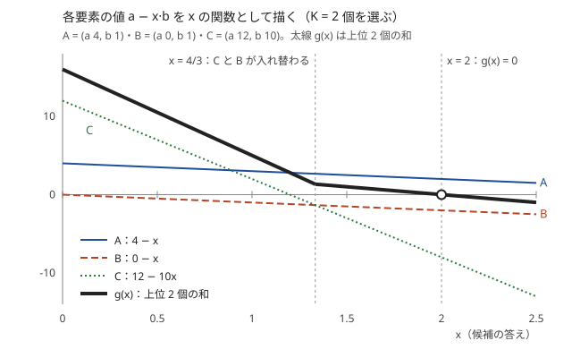
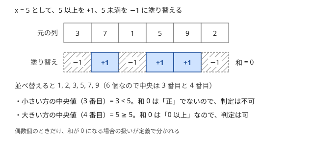

!!! abstract "要点"
    - **何ができるか**：平均・比・中央値の最大化を、答え $x$ を決めた判定問題にして $x$ を二分探索する。「平均 $\ge x$」は「$\sum (a_i - x) \ge 0$」に、「中央値 $\ge x$」は「$x$ 以上を $+1$、未満を $-1$ にした和が正」に言い換えられ、割り算のない和の判定になる。
    - **いつ使うか**：
        - 平均・濃度・割合・$(\sum a) / (\sum b)$ の最大（最小）を求める。
        - 中央値の最大値・最小値を求める。
        - 全区間の中央値を集めた中央値を求める。
        - 選び方の和の最大化なら解けるが、割り算（平均・比）が入ると直接は最大化できない。
    - **計算量**：判定 1 回の計算量を $T$ として、平均・比は実数の二分探索で $O(T)$ を 50〜100 回（回数は固定）。中央値は答えが要素のどれかなので、整数の二分探索で $O(T \log V)$（$V$ は値の幅）。
    - **前提**：[答えで二分探索](../basics/binary-search-answer.md)、[累積和](../basics/prefix-sum.md)

<!-- textlint-disable -->
別名：平均の最大化・比の最大化・中央値の最大化・分数計画・濃度の最大化・中央値の二分探索・中央値の中央値・fractional programming・Dinkelbach
<!-- textlint-enable -->

平均・中央値の最大化は、平均や比や中央値を直接最大化する代わりに、「答えを $x$ 以上にできるか」を判定して $x$ を二分探索する手法である。割り算や並べ替えを含む量が、$x$ を決めると「各要素を変換した値の和の符号」になるので、和の最大化を解く手持ちの道具（累積和・貪欲・DP・最長路・全域木）がそのまま判定に使える。

## 平均の言い換え（x を引いた和の符号で判定する） {#average}

平均の最大化が難しいのは、要素を 1 つ足すと分子と分母の両方が変わるからである。和の最大化なら「大きいものから取る」「DP で和の最大を持つ」で済む。平均では、小さめの要素を足しても平均の上がる場合があり、選び方の良し悪しが個数に左右される。

そこで答えを $x$ に決め、「平均が $x$ 以上になる選び方はあるか」を判定する。選んだ要素の集合を $T$（空でない）とすると、個数 $\lvert T \rvert$ は正なので両辺に掛けて次のように変形できる。

$$
\frac{1}{\lvert T \rvert} \sum_{i \in T} a_i \ge x
\iff \sum_{i \in T} a_i \ge x \lvert T \rvert
\iff \sum_{i \in T} (a_i - x) \ge 0
$$

右端の式には割り算も個数も現れない。各要素を $a_i - x$ に置き換えた列で「選び方の和の最大が 0 以上か」を調べれば判定になる。

判定は $x$ について単調である。$x$ を小さくすると各 $a_i - x$ が増えるので、和が 0 以上だった選び方はそのまま 0 以上である。だから可の側は $x$ が小さい側にあり、[答えで二分探索](../basics/binary-search-answer.md)の形にそのまま乗る。答えは実数になることが多いので、反復回数を固定した実数の二分探索を使う（[実数の二分探索](../basics/binary-search-answer.md#real-number)）。

## 比 Σa / Σb の言い換え（a_i − x·b_i） {#ratio}

平均は、各要素に「重さ」$b_i = 1$ を付けた比 $(\sum a_i) / (\sum b_i)$ の特別な場合である。食塩水の濃度（食塩の量 / 全体の重さ）、経路の（美しさの和）/（コストの和）なども同じ形をしている。$b_i > 0$ なら、平均と同じ変形ができる。

$$
\frac{\sum_{i \in T} a_i}{\sum_{i \in T} b_i} \ge x
\iff \sum_{i \in T} (a_i - x \, b_i) \ge 0
\qquad \left(\sum_{i \in T} b_i > 0\right)
$$

各要素の値を $a_i - x \, b_i$ に置き換えれば、判定は「置き換えた値の和の最大が 0 以上か」になる。最小化なら不等号を逆にし、「和の最小が 0 以下か」を判定する。

二分探索の初期値には次の事実が使える。比 $(\sum a_i) / (\sum b_i)$ は、選んだ要素の個別の比 $a_i / b_i$ の最小と最大の間にある（$b_i > 0$ のとき）。各 $a_i$ は $\max_j (a_j / b_j) \cdot b_i$ 以下なので、足し合わせて $\sum b_i$ で割れば上からおさえられるからである。よって可の番兵には個別の比の最小、不可の番兵には個別の比の最大より少し大きい値を置けばよい。

??? question "確認問題：分母が負になりうるとき"
    $b_i$ が負の値を取りうる問題で、$\frac{\sum a_i}{\sum b_i} \ge x \iff \sum (a_i - x b_i) \ge 0$ を使ってよいか。

    ??? success "答え"
        使えない。両辺に $\sum b_i$ を掛けるとき、$\sum b_i < 0$ なら不等号の向きが逆になる。$\sum b_i > 0$ が保証されているか（たとえば $b_i$ がすべて正か）を必ず確かめる。$\sum b_i = 0$ の選び方は比そのものが定まらないので、問題の定義に従って除く。

## 判定を累積和・貪欲で行う {#simple-check}

置き換えた後の判定は、「元の問題が和の最大化だったら、どう解くか」を考えれば作れる。易しい形は 2 つある。

**連続部分列なら累積和**。「長さ $K$ 以上の連続部分列の平均の最大値」は、$d_i = a_i - x$ の列で「長さ $K$ 以上の区間の和の最大が 0 以上か」を調べればよい。$[l, r)$ の和は[累積和](../basics/prefix-sum.md) $S$ を使って $S_r - S_l$ である。右端 $r$ を左から動かし、$l \le r - K$ の範囲の $S_l$ の最小値を持ち続ければ、判定は $O(N)$ になる。

```cpp
--8<-- "fractional-binary-search/average-subarray.cpp:core"
```

$r$ を 1 つ進めると、左端の候補が $S_{r-K}$ の 1 つだけ増える。左端の候補は増えるだけで減らないので、尺取り法のように左端を進めて候補を捨てる操作は要らず、最小値を 1 つ持って前の値と比べて更新すれば足りる。「区間に条件を満たす要素が $K$ 個以上」のように左端の候補の範囲が右端とともに広がる制約でも、同じように最小値を持ち続けられる（[例題の ABC469 E](#abc469_e)）。

**個数が決まっているなら上位 $K$ 個**。「$N$ 個から $K$ 個選ぶ」なら、各要素の値 $a_i - x \, b_i$ を計算し、大きい順に $K$ 個取った和が 0 以上かを判定する。個数が $K$ に決まっているので、和を最大にするには値の大きい $K$ 個を取ればよい。判定 1 回はソートで $O(N \log N)$ である（`nth_element` なら $O(N)$）。

個数を自由に選べるなら、値が正の要素をすべて取れば和は最大になる（正の要素がなければ、最大の 1 個だけを取る）。ただし空の選び方を許すと和は 0 になり、判定が常に可になってしまう（[実数の精度と分母 0](#precision)）。

## 「濃度の高い順に K 個」が誤りである理由 {#greedy-pitfall}

比の最大化でよくある誤りは、「個別の比 $a_i / b_i$ が高い順に $K$ 個取ればよい」と考えることである。比は重さで重み付けした平均なので、比が少し高くても重い要素を入れると、全体が大きく引っ張られる。

$K = 2$ で、A $=(a, b) = (4, 1)$、B $=(0, 1)$、C $=(12, 10)$ の 3 つから選ぶ例を考える。個別の比は A が 4、C が 1.2、B が 0 である。比の高い順なら A と C を取り、全体は $16 / 11 \approx 1.45$ になる。一方 A と B を取ると $4 / 2 = 2$ で、こちらの方が大きい。重い C は全体を比 1.2 の側へ強く引き寄せるのに対し、軽い B は比 0 でも全体への影響が小さい。



置き換えた値 $a_i - x \, b_i$ で見ると、何が起きているかが分かる。各要素の値は $x$ の 1 次関数で、傾きは $-b_i$ である。重い要素ほど傾きが急なので、$x$ が大きくなると順位を下げる。図では $x = 4/3$ で C と B が入れ替わり、上位 2 個の和 $g(x)$ は $x = 2$ で 0 になる。だから答えは 2 である。

どれを選ぶべきかは $x$（つまり答え）によって変わり、比の順という固定の順では決まらない。答えを決め打ちすると初めて並べ方が決まる、というのがこの手法の要点である。$g(x)$ は 1 次関数の上位 $K$ 個の和なので、$x$ について減少し、0 を 1 回だけまたぐ。これが二分探索できる理由でもある。

??? question "確認問題：比の高い順で正しくなる場合"
    $K$ 個選ぶ比の最大化で、比の高い順に $K$ 個取れば必ず最適になるのは、どんな場合か。

    ??? success "答え"
        たとえば、すべての $b_i$ が等しい場合である（ほかに、$K = 1$ や $K = N$ のような自明な場合もある）。このとき比は $a_i$ の平均に比例するので、$a_i$（すなわち比）の大きい順に取ればよい。図で言えば、すべての直線の傾きが等しく、$x$ を動かしても順位が入れ替わらない。$b_i$ がばらつくと順位が $x$ で入れ替わるので、決め打ちが要る。

## 中央値の言い換え（x 以上を +1、未満を −1）と偶数個のときの不等号 {#median}

この節は平均の言い換え（[前の節](#average)）と同じ考え方を中央値に使う。中央値は並べ替えないと決まらないので直接は扱いにくいが、「中央値が $x$ 以上か」は個数の比較で書ける。

$m$ 個の値の[中央値](../guide/glossary.md#median)を、小さい方から $\lceil m / 2 \rceil$ 番目の値とする（偶数個なら中央の 2 つの小さい方）。中央値が $x$ 以上であることは、「$x$ 未満の値が $\lceil m / 2 \rceil - 1$ 個以下」すなわち「$x$ 以上の値が $\lfloor m / 2 \rfloor + 1$ 個以上」と同じである。$x$ 以上を $+1$、未満を $-1$ に置き換えると、和は（$x$ 以上の個数）−（$x$ 未満の個数）なので、次のようになる。

$$
\text{中央値} \ge x \iff (x \text{ 以上の個数}) > (x \text{ 未満の個数}) \iff \sum c_i > 0
$$

偶数個のとき中央の 2 つの大きい方（小さい方から $\lfloor m / 2 \rfloor + 1$ 番目）を中央値とする問題では、条件が「$x$ 以上の値が $\lceil m / 2 \rceil$ 個以上」になり、和は「0 以上」になる。奇数個なら和は奇数で 0 にならないので、2 つの定義は一致する。違いが出るのは偶数個で和がちょうど 0 のときだけである。



| 中央値の定義（$m$ 個） | 判定「中央値 $\ge x$」 |
| --- | --- |
| 小さい方から $\lceil m / 2 \rceil$ 番目（偶数個は小さい方） | $\sum c_i > 0$ |
| 小さい方から $\lfloor m / 2 \rfloor + 1$ 番目（偶数個は大きい方） | $\sum c_i \ge 0$ |

中央値は必ずどれかの要素の値なので、答えは整数の二分探索で求まり、実数の誤差の心配はない。ok は「判定が可の値」、ng は「不可の値」として、要素の最小値（必ず可）と最大値 + 1（必ず不可）から始めればよい。判定が単調なのは、$x$ を小さくすると $+1$ が増えるだけだからである。

連続部分列の中央値なら、判定は平均と同じく累積和で $O(N)$ になる。次のコードは「長さ $K$ 以上の連続部分列の中央値（偶数個は小さい方）の最大値」を求める。

```cpp
--8<-- "fractional-binary-search/median-subarray.cpp:core"
```

??? question "確認問題：最小化のとき"
    「中央値の最小値」を求めるときは、どんな判定にすればよいか。

    ??? success "答え"
        「中央値が $x$ 以下にできるか」を判定し、可の最小の $x$ を答える。小さい方の中央値なら、中央値 $\le x$ は「$x$ 以下の値が $\lceil m / 2 \rceil$ 個以上」である。$x$ 以下を $+1$、より大きいものを $-1$ にすると、和が 0 以上かで判定できる。定義によって不等号が変わるので、偶数個の場合を小さな例で確かめる。

## 判定を DP・DAG の最長路・全域木で行う {#dp-check}

この節は [DP の基本](../dp/dp-basics.md)と[答えで二分探索の判定 DP](../basics/binary-search-answer.md#dp-check)を前提にする。選び方に制約があっても、「置き換えた値の和の最大（最小）」を求める方法があれば、それが判定になる。

- **DP**：「隣り合う 2 つの少なくとも一方を選ぶ」のような制約なら、「$\mathrm{dp}[i][s]$ ＝ 先頭 $i$ 個を決め、最後の要素を選んだか（$s$）のときの、置き換えた値の和の最大」で判定できる。選んだ個数を状態に持たなくてよいのが、言い換えの利点である。個数を持つと状態が $N$ 倍になる
- **DAG の最長路**：有向グラフの経路で（美しさの和）/（コストの和）を最大化するなら、辺の重みを $b_e - x \, c_e$ にして始点から終点への最長路が 0 以上かを調べる（[DAG 上の DP](../dp/dp-dag.md)）。辺の重みが負になっても、閉路がないので最長路は DP で求まる
- **全域木**：連結を保つ辺の選び方で（コストの和）/（長さの和）を最小化するなら、重みを $c_e - x \, t_e$ にして「連結にする辺の集合の重みの和の最小が 0 以下か」を調べる。重みが負の辺は、閉路を作っても和を減らすのですべて取る。残りは[最小全域木](../graph/minimum-spanning-tree.md)のクラスカル法と同じく、つながっていない 2 点を結ぶ辺だけを軽い順に取る

どの場合も、判定のたびに $x$ が変わり、辺や要素の重みが変わる。DP の表や Union-Find は判定の関数の中で作り直す。全体の計算量は（判定 1 回）×（反復回数）なので、判定 1 回が制限時間の 100 分の 1 程度に収まるかを先に見積もる。

## 領域の中央値（2 次元累積和） {#median-2d}

この節は [2 次元累積和](../basics/prefix-sum-2d.md)を前提にする。$N \times N$ の格子から $K \times K$ の正方形を選び、その中の値の中央値を最小（最大）にする問題では、正方形は $(N - K + 1)^2$ 個あり、それぞれを並べ替えると間に合わない。

中央値の言い換えを使うと、判定は「$x$ 以下の値を一定数以上含む正方形があるか」になる。$x$ 以下のマスを 1、それ以外を 0 にした格子の 2 次元累積和を作る。すると各正方形の中の個数は、4 項の足し引きにより $O(1)$ で求まる。判定 1 回は $O(N^2)$、全体は値の幅 $V$ について $O(N^2 \log V)$ である。

必要な個数は、正方形の $K^2$ 個のうち中央値が何番目かで決まる。「上から何番目」「下から何番目」の言い換えで 1 ずれやすいので、$K = 2$（偶数個）と $K = 3$ で確かめる。

## 全区間の中央値の中央値（転倒数で数える） {#median-of-medians}

この節は [BIT](../ds/fenwick-tree.md) と[転倒数](../ds/inversion-number.md)を前提にする。長さ $N$ の列のすべての区間（$N(N+1)/2$ 個）について中央値を求め、それらをまた並べたときの中央値を求める問題では、区間ごとに中央値を出すだけで $O(N^2)$ 個になる。

二分探索を 2 重に使う。外側では答え $x$ を決め、「中央値が $x$ 以上の区間が何個あるか」を数える。その個数が全区間の半分ほど（必要な個数は問題の中央値の定義から決める）以上なら、答えは $x$ 以上である。$x$ を大きくすると個数は減るので単調である。

区間の数え方が本体である。$x$ 以上を $+1$、未満を $-1$ にした列の累積和を $S_0, \dots, S_N$ とする。区間 $[l, r)$ の中央値が $x$ 以上であることは、中央値の定義に合わせて $S_r - S_l > 0$ か $S_r - S_l \ge 0$ になる。前者なら $S_l < S_r$、後者なら $S_l \le S_r$ となる組 $(l, r)$（$l < r$）を数える問題になる。これは転倒数（$S_l > S_r$ の組）の数え方と同じで、$S$ の値に $N$ を足して $0$〜$2N$ の添字にずらし、BIT で $O(N \log N)$ で数えられる。全体は $O(N \log N \log V)$ である。

## 実数の精度と分母 0 {#precision}

平均や比の答えは実数なので、実数の二分探索の注意がそのまま当てはまる。この手法で特に起きやすい誤りを挙げる。

- **反復回数を固定する**：`while (hi - lo > 1e-9)` は、値が大きいと `double` の間隔より幅が縮まず止まらない。100 回などに固定する。範囲 $[0, 1]$ で誤差 $10^{-6}$ なら 20 回で幅は $10^{-6}$ 程度になるが、余裕を持って 50〜100 回にしても判定が軽ければ間に合う
- **空の選び方を許さない**：空の集合は和が 0 なので、「和の最大が 0 以上」の判定に空を混ぜると、どの $x$ でも可になる。DP の初期値を 0 にして「何も選ばない」状態を答えに含めていないか、区間の長さが 0 の $[r, r)$ を含めていないかを確かめる
- **分母の符号**：変形には $\sum b_i > 0$ が要る。$b_i$ に 0 や負の値がありうる問題では、そのまま変形できない
- **整数で比べられるなら比べる**：答えの候補が分数 $p / q$ と分かっているなら、$\sum a_i \ge (p / q) \sum b_i$ を $q \sum a_i \ge p \sum b_i$ と整数で比べられる。積があふれないかは確かめる
- **出力の桁数**：`cout` の既定は有効数字 6 桁なので、`fixed` と `setprecision` で桁を指定する

中央値は答えが要素の値なので、整数の二分探索で済み、これらの心配はない。

## Dinkelbach 法 {#dinkelbach}

Dinkelbach 法は、比の最大化を二分探索より少ない反復で解く方法である。判定と同じ部分問題を解くが、和が 0 以上かを見るだけでなく、和を最大にした選び方 $T$ そのものを使う。

1. 適当な選び方の比を $x$ とする
2. 値 $a_i - x \, b_i$ の和を最大にする選び方 $T$ を求める
3. その最大値が 0 なら $x$ が答えである。正なら $x \leftarrow (\sum_{i \in T} a_i) / (\sum_{i \in T} b_i)$ として 2 に戻る

3 で最大値が正なら、$T$ の比は $x$ より大きいので、$x$ は毎回真に増える。選び方は有限個なので必ず止まる。反復は二分探索より少なく済むことが多い。部分問題を正確に（選び方ごと）解ける必要があり、誤差の扱いも二分探索より気を使う。ABC では反復回数を固定した二分探索で足りることがほとんどである。

## 落とし穴 {#pitfalls}

**最小化で不等号の向きを取り違える**。比の最小化では「$\sum (a_i - x \, b_i) \le 0$ にできるか」を判定し、可の側は $x$ が大きい側になる。判定の関数に「何が可か」を 1 文のコメントで書いてから、ok と ng の番兵を置く。

**個数の制約を判定で落とす**。「ちょうど $K$ 個選ぶ」問題で、値が正の要素をすべて取る判定にすると、個数の制約を破った選び方で可と答えてしまう。上位 $K$ 個のように、制約を満たす選び方の中での最大を求める。

**中央値の定義を確かめない**。偶数個のときに中央の 2 つのどちらを取るかで、判定が「和が正」か「和が 0 以上」かに分かれる。問題文の定義を読み、$m = 2$ の小さな例で判定の結果を手で確かめる。

## 使い分け {#comparison}

- 平均ではなく和の最大化なら、二分探索は要らない。比の分母がすべて等しい（$b_i$ が一定）なら、比の大きい順に取ればよい
- 中央値を 1 つの点として選び、距離の和 $\sum \lvert x - a_i \rvert$ を最小にする問題は、[絶対値の和の最小化と中央値](../basics/median-absolute.md)の話で、二分探索は要らない
- 「$K$ 番目に大きい比」のように順位を問われたら、「比が $x$ 以上の組が $K$ 個以上あるか」を数える判定にする（[K 番目の値](../basics/kth-value.md)）
- 値を更新しながら中央値を何度も答えるなら、二分探索ではなく、2 つの優先度付きキューや BIT で中央値を保つ

## 例題 {#examples}

### ABC469 E. Pro Exam Eligibility {#abc469_e}

<div class="kp-problems" data-role="example" markdown>

- [ABC469 E. Pro Exam Eligibility](https://atcoder.jp/contests/abc469/tasks/abc469_e)（diff 1566）：o と x からなる文字列で、o を K 個以上含む連続した区間を選ぶとき、区間に占める o の割合の最大値を求める。

</div>

o を 1、x を 0 とすれば、割合は区間の平均である。平均 $\ge a$ を「各要素から $a$ を引いた区間の和 $\ge 0$」に言い換え、$a$ を範囲 $[0, 1]$ で実数の二分探索をする。判定は累積和で、右端ごとに「o を $K$ 個以上含むような左端」の累積和の最小値を持てば $O(N)$ である。

??? note "解法の詳細"
    - 置き換え：o を $1 - a$、x を $-a$ にした列の累積和 $S$ を作る。区間 $[l, r)$ の和は $S_r - S_l$ である。
    - 左端の範囲：右端 $r$ を固定すると、$[l, r)$ が o を $K$ 個以上含む $l$ は、ある位置以下の範囲になる。その位置は $r$ とともに右へ動くだけなので、$S_l$ の最小値を前から更新しながら持てる。境界の位置は $a$ によらないので前計算してよいが、$S_l$ の最小値は判定のたびに求める。
    - 判定：ある $r$ で $S_r - \min S_l \ge 0$ なら可。判定 1 回は $O(N)$ である。
    - 二分探索：割合は $[0, 1]$ に入るので、lo $= 0$、hi $= 1$ から反復回数を固定して縮める。許される誤差が $10^{-6}$ なら 30 回ほどで足りる。全体は $O(N \times \text{反復回数})$。
    - コードの形は[判定を累積和・貪欲で行う](#simple-check)の「長さ $K$ 以上」と同じで、左端の制約だけが違う。

### ABC203 D. Pond {#abc203_d}

<div class="kp-problems" data-role="example" markdown>

- [ABC203 D. Pond](https://atcoder.jp/contests/abc203/tasks/abc203_d)（diff 1622）：N×N の池から K×K の区画を選ぶとき、区画の中央値の最小値を求める。

</div>

中央値の最小化なので、「中央値が $x$ 以下の区画があるか」を判定して、可の最小の $x$ を答える。中央値が $x$ 以下であることは、区画の中の $x$ 以下のマスの個数が一定数以上であることと同じで、その個数は 2 次元累積和で区画ごとに $O(1)$ で数えられる。

??? note "解法の詳細"
    - 中央値の位置：区画の $K^2$ 個の値のうち、大きい方から $\lfloor K^2 / 2 \rfloor + 1$ 番目を中央値とする。これが $x$ 以下なのは、$x$ より大きい値が $\lfloor K^2 / 2 \rfloor$ 個以下、すなわち $x$ 以下の値が $K^2 - \lfloor K^2 / 2 \rfloor$ 個以上のときである。
    - 判定：$x$ 以下のマスを 1、ほかを 0 にした格子の 2 次元累積和を作り、すべての $K \times K$ の区画で個数を調べる。1 つでも必要数以上なら可。判定 1 回は $O(N^2)$。
    - 二分探索：答えはマスの値のどれかなので整数で探す。ng $= -1$（マスの値は 0 以上なので、中央値が $-1$ 以下の区画はない）、ok $=$ 値の最大値（必ず可）から始め、可の最小を出力する。全体は $O(N^2 \log V)$。
    - 「大きい方から何番目」を「$x$ 以下の個数」に直すところで 1 ずれやすい。$K = 1, 2$ の小さな格子で確かめる。

### ABC324 F. Beautiful Path {#abc324_f}

<div class="kp-problems" data-role="example" markdown>

- [ABC324 F. Beautiful Path](https://atcoder.jp/contests/abc324/tasks/abc324_f)（diff 1815）：DAG の経路で（美しさの和）/（コストの和）の最大値を求める。

</div>

比の最大化なので、答え $x$ を決めて各辺の重みを（美しさ）$- x \times$（コスト）に置き換え、頂点 1 から $N$ への経路の重みの和の最大が 0 以上かを判定する。辺は番号の小さい頂点から大きい頂点へ向かうので、番号順の DP で最長路が求まる。

??? note "解法の詳細"
    - 言い換え：経路の辺の集合を $P$ として、$\frac{\sum_{e \in P} b_e}{\sum_{e \in P} c_e} \ge x \iff \sum_{e \in P} (b_e - x \, c_e) \ge 0$。コストは正なので変形できる。
    - 判定：$\mathrm{dp}[v]$ ＝ 頂点 1 から $v$ までの重みの和の最大とし、$\mathrm{dp}[1] = 0$、ほかは $-\infty$ で始める。頂点を番号の小さい順に見て、辺 $v \to w$ ごとに $\mathrm{dp}[w] = \max(\mathrm{dp}[w], \mathrm{dp}[v] + b_e - x \, c_e)$ と更新する。$\mathrm{dp}[N] \ge 0$ なら可。判定 1 回は $O(N + M)$。
    - 番号順でよい理由：どの辺も番号の小さい頂点から大きい頂点へ向かうので、$v$ を見る時点で $v$ へ入る辺はすべて処理済みである。
    - 二分探索：重みが負になる辺もあるが、閉路がないので問題ない。lo $= 0$ と十分大きい hi から 100 回ほど反復する。全体は $O((N + M) \times \text{反復回数})$。

## 練習問題 {#practice}

<div class="kp-problems" data-role="practice" markdown>

- [ABC034 D. 食塩水](https://atcoder.jp/contests/abc034/tasks/abc034_d)（diff 1549）：N 個の食塩水から K 個を選んで混ぜたときの濃度の最大値を求める。
- [ABC294 F. Sugar Water 2](https://atcoder.jp/contests/abc294/tasks/abc294_f)（diff 1891）：砂糖水を 1 つずつ選んで混ぜてできる濃度のうち、大きい方から K 番目を求める。
- [ABC236 E. Average and Median](https://atcoder.jp/contests/abc236/tasks/abc236_e)（diff 1893）：隣り合う 2 つの少なくとも一方を選ぶとき、選んだ値の平均の最大値と中央値の最大値をそれぞれ求める。

</div>

??? note "練習の方針"
    - **ABC034 D**：濃度 $x$ を決め、各食塩水の値を（食塩の量）$- x \times$（重さ）にする。値の大きい順に $K$ 個取った和が 0 以上なら可。濃度の高い順に取るのは誤りである（[「濃度の高い順に K 個」が誤りである理由](#greedy-pitfall)）
    - **ABC294 F**：$x$ を決め、混ぜた濃度が $x$ 以上になる組の数が $K$ 個以上かを判定する。濃度 $\ge x$ を、一方の砂糖水だけで決まる項と他方だけで決まる項の和 $\ge 0$ に変形する。一方をソートしておけば、もう一方の各要素について二分探索で個数を数えられる
    - **ABC236 E**：平均は $a_i - x$ に置き換え、「最後の要素を選んだか」を状態に持つ DP で和の最大が 0 以上かを判定する。中央値は $x$ 以上を $+1$、未満を $-1$ にして同じ DP をし、偶数個は小さい方を取る定義なので和が正かで判定する

## 力試し {#challenge}

<div class="kp-problems" data-role="challenge" markdown>

- [ARC101 D. Median of Medians](https://atcoder.jp/contests/arc101/tasks/arc101_b)（diff 2073）：数列のすべての区間の中央値を集めた列の中央値を求める。
- [ARC026 D. 道を直すお仕事](https://atcoder.jp/contests/arc026/tasks/arc026_4)（diff 2297）：連結を保つように辺を選ぶとき、（コストの和）/（長さの和）の最小値を求める。

</div>

??? note "力試しの方針"
    - **ARC101 D**：答え $x$ を決め、中央値が $x$ 以上の区間の個数を数える。$+1$ と $-1$ の累積和で、条件を満たす $(l, r)$ の組を転倒数と同じく BIT で数える（[全区間の中央値の中央値](#median-of-medians)）。区間の中央値の定義と、全区間の個数に対する必要数を問題文から正確に読む
    - **ARC026 D**：比の最小化なので、重みを $c_e - x \, t_e$ にして「連結にする辺の集合の重みの和の最小が 0 以下か」を判定する。負の辺はすべて取り、残りはクラスカル法と同じく軽い順に、つながっていない 2 点を結ぶ辺だけ取る

## 参考 {#references}

- [ikatakos「AtCoder Beginner Contest 469 D,E,F,G問題メモ」](https://ikatakos.com/pot/programming_algorithm/contest_history/atcoder/2026/0801_abc469)：例題 ABC469 E の方針（平均への帰着と累積和の判定。解説の部分だけを参照）
- [oraclesqlpuzzle「ABC203-D Pond」](https://oraclesqlpuzzle.ninja-web.net/kyoupro/05-atcoder-02-abc/kyoupro-abc203-d.html)：例題 ABC203 D の中央値の位置と判定
- [drken「AtCoder ABC 324 F - Beautiful Path (2D, 青色, 500 点)」](https://drken1215.hatenablog.com/entry/2023/10/21/012800)：例題 ABC324 F の比の言い換えと DAG の DP
- [drken「AtCoder ABC 034 D - 食塩水 (1D, 試験管水色)」](https://drken1215.hatenablog.com/entry/2023/10/21/021300)：練習 ABC034 D の上位 K 個による判定
- [oraclesqlpuzzle「ABC294-F Sugar Water 2」](https://oraclesqlpuzzle.ninja-web.net/kyoupro/05-atcoder-02-abc/kyoupro-abc294-f.html)：練習 ABC294 F の式変形と数え方
- [oraclesqlpuzzle「ABC236-E Average and Median」](https://oraclesqlpuzzle.ninja-web.net/kyoupro/05-atcoder-02-abc/kyoupro-abc236-e.html)：練習 ABC236 E の DP による判定と中央値の不等号
- [drken「AtCoder ABC 107 D - Median of Medians (ARC 101 D) (2D, 黄色, 700 点)」](https://drken1215.hatenablog.com/entry/2018/09/08/011500)：力試し ARC101 D の方針（累積和の大小の組を BIT で数える）
- [drken「AtCoder ARC 026 D - 道を直すお仕事 (試験管黄色)」](https://drken1215.hatenablog.com/entry/2023/10/21/032420)：力試し ARC026 D の負の辺をすべて取る判定
- [OI Wiki「分数规划」](https://oi-wiki.org/misc/frac-programming/)：比の最大化の二分探索と Dinkelbach 法の位置づけ（構成の参考のみ。文章と図は使わない）
