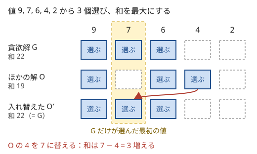

!!! abstract "要点"
    - **何ができるか**：その場で最もよいものを選び続ける方針で、最適解を求める（ソートと 1 回の走査で済むことが多い）。使う前に、交換論法（最適解を貪欲解に近づけても悪くならない）や帰納法で正しさを確かめ、怪しいときは小さいケースの全探索と比べる。
    - **いつ使うか**：
        - 強いもの・安いものから順に使う。
        - 1 回ごとに最大（最小）のものを選ぶ操作を繰り返す。
        - その場で一番よいものを選んでも後悔しない（入れ替えても悪くならない）。
    - **計算量**：基準でソートして $O(N \log N)$、そのあと 1 回の走査で $O(N)$ という形が多い。操作を $K$ 回繰り返す問題も、同じ値をまとめれば $K$ によらず $O(N \log N)$ になる。
    - **前提**：[ソートで考える](../basics/sorting-techniques.md)

<!-- textlint-disable -->
別名：グリーディ・Greedy・貪欲・交換しても悪化しない・マトロイド
<!-- textlint-enable -->

貪欲法は、全体を見通さずに、各段階で「今いちばんよいもの」を選んで確定させていく方法である。書くのは易しいが、正しいとは限らない。貪欲法の本体は、選び方そのものより「その選び方で損をしない理由」を示すことにある。理由が言えないときは、小さい入力で全探索と答えを比べてから提出する。

## 正当性の示し方（交換論法・帰納法・常に先行している・マトロイド） {#proof}

貪欲法が正しいことを示す型は、おおむね次の 4 つである。どれも「貪欲が選んだものを、最適解の中に残してよい」ことを言っている。

**交換論法**。任意の最適解 $O$ と貪欲解 $G$ を比べる。$G$ の選んだもので $O$ の選ばなかった最初のもの $g$ を $O$ に足し、代わりに $O$ だけが持つものを 1 つ除く。この入れ替えで答えが悪くならないことを示す。入れ替えた $O'$ もまた最適解で、$G$ と一致する部分が 1 つ増える。これを繰り返すと $G$ に一致するので、$G$ も最適である。

次の図は「値 9, 7, 6, 4, 2 から 3 個選んで和を最大にする」で、大きい順に取る貪欲が正しい理由を示したものである。



$O$ は 7 を選ばず、代わりに 7 以下の 4 を選んでいる。4 を 7 に替えると、ほかの選択には影響せず、和は $7 - 4 \ge 0$ だけ増える。どんな $O$ でも、選ばなかった大きい値と選んだ小さい値を入れ替えれば減らないので、大きい順の 3 個が最適である。

入れ替えで「ほかの選択に影響しない」が成り立つかが要点である。選んだものどうしが重さの合計などで結びついていると、入れ替えた後に制約を破ることがある（[貪欲が失敗する例](#when-greedy-fails)）。

**帰納法**。「最初の $k$ 回の貪欲な選択を含む最適解がある」を $k$ についての帰納法で示す。$k = 0$ は自明で、$k$ から $k + 1$ へは交換論法の 1 回分を使う。交換論法を形式的に書いたものと考えてよい。

**常に先行している**。貪欲の途中経過が、どの解の途中経過にも負けていないことを示す。たとえば重ならない区間をできるだけ多く選ぶ問題で、右端の小さい順に選ぶ貪欲を考える。貪欲が $k$ 番目に選んだ区間の右端は、どの解の $k$ 番目の右端以下になる（$k$ についての帰納法）。貪欲の方が常に早く空くので、ほかの解が $k + 1$ 個目を置けるなら、貪欲も置ける。詳しくは[区間スケジューリング](../basics/interval-scheduling.md)で扱う。

**マトロイド**。「選んでよい集合」の族が次の 3 つを満たし、重みがどれも非負のとき、重みの大きい順に「足しても選んでよい集合のままなら足す」貪欲で、重みの和が最大になる。負の重みがあるときは、重みが負になったところで止める。

- 空集合は選んでよい
- 選んでよい集合の部分集合も、選んでよい
- 選んでよい集合 $A, B$ で $\lvert A \rvert < \lvert B \rvert$ なら、$B$ の要素のうち $A$ に足しても選んでよいままのものがある（交換の性質）

「$K$ 個まで選ぶ」や「閉路を作らない辺の集合」がこの形で、後者で辺を軽い順に足すのがクラスカル法の[最小全域木](../graph/minimum-spanning-tree.md)である（全域木はどれも辺の数が同じなので、重みの符号を反転して重い順に足すのと同じになる）。コンテストでマトロイドを持ち出して証明することは少ないが、「この形なら重い順の貪欲で正しい」という見当として覚えておくとよい。

??? question "確認問題：入れ替えで悪くならない理由"
    $N$ 個の品物の値段 $A_i$ が与えられ、ちょうど $K$ 個を買う。合計の最小は、安い順に $K$ 個を買えばよい。交換論法で理由を説明せよ。

    ??? success "答え"
        安い順の $K$ 個でない買い方 $O$ があるとする。$O$ が買わなかった品物の中に、$O$ が買ったある品物より安いものがある。その 2 つを入れ替えると、個数は $K$ のままで、合計は増えない。入れ替えるたびに安い順の $K$ 個と一致する品物が増えるので、いずれ一致する。よって安い順の $K$ 個の合計は、どの買い方の合計以下である。

## 基準を決めて強い順に使う {#strongest-first}

「何度でも使えるもの」と「1 回だけ使えるもの」が混ざっている問題では、何度でも使えるものの最強を基準にすると、残りの判断が単純になる。基準以下の 1 回限りのものは、代わりに基準を使っても同じ回数でダメージが減らないので、使う必要がない。基準より強い 1 回限りのものは、強い順に使えば回数が少なく済む。

[例題](#abc085_d)の形で書くと次のとおりである。何度でも使える攻撃 $a_i$ と、1 回だけ使える攻撃 $b_i$（$a_i \le b_i$）があり、合計 $H$ 以上のダメージを最少の回数で与える。

1. 基準 $a_{\max} = \max_i a_i$ を求める
2. $b_i$ を大きい順に並べ、$a_{\max}$ より大きい間だけ使う（$H$ に届いたらやめる）
3. 届かなければ、残り $H'$ を $a_{\max}$ で埋める。回数は $\lceil H' / a_{\max} \rceil$ である

```cpp
--8<-- "greedy-basics/strongest-first.cpp:core"
```

正しさは交換論法で確かめる。最適な使い方を 1 つ取り、次の入れ替えを順に行う。どれも回数を変えず、合計のダメージを減らさない。

- 何度でも使える攻撃の回を、すべて $a_{\max}$ に替える
- $a_{\max}$ 以下の $b_i$ を使った回を、$a_{\max}$ に替える
- 使っていない $b_j$ が、使った $b_i$ や $a_{\max}$ より大きければ、その回を $b_j$ に替える

最後に残るのは「$a_{\max}$ より大きい $b$ を大きい順にいくつか使い、残りは $a_{\max}$」の形である。この形の中で回数が最少なのは、$H$ に届くまで $b$ を使い続けるものなので、手順の答えと一致する。

「1 回限りのものを使った後は、もう何度でも使えない」という制約がある問題もある。この場合は、まず制約をゆるめた問題（使った後も使える）を解き、その最適解が元の制約を守るように並べ替えられるかを考える。例題では、同じ刀を「くり返し使ってから最後に 1 回だけの攻撃」の順にすれば制約を守れる。

## 同じ値をまとめて処理する {#batch-same-values}

「毎回いちばん大きいものを選び、選んだものは値が 1 減る」を $K$ 回繰り返す問題では、1 回ずつシミュレーションすると $O(K \log N)$ かかる。$K$ が $10^9$ を超えると間に合わない。そこで、同じ値に並んだものをまとめて 1 段ずつ下げる。

値を大きい順に $a_0 \ge a_1 \ge \dots \ge a_{N-1}$ と並べ、末尾に番兵 $a_N = 0$ を足す。次の性質を保ちながら $i = 0, 1, \dots$ と進める。

- 段 $i$ を処理する直前、上位 $w = i + 1$ 個はすべて値 $a_i$ にそろっていて、残りは元の値のままである

段 $i$ では、上位 $w$ 個を値 $a_i$ から $a_{i+1}$ まで下げる。かかる回数は $t \times w$（$t = a_i - a_{i+1}$）で、得る値の合計は等差数列の和 $\frac{(a_i + a_{i+1} + 1) \, t}{2} \times w$ である。

- $t \times w \le K$ なら段を全部使い、$K$ から $t \times w$ を引く
- そうでなければ、丸ごと使える段は $d = \lfloor K / w \rfloor$ で、余り $K \bmod w$ 回は値 $a_i - d$ のものに使う

```cpp
--8<-- "greedy-basics/batch-same-values.cpp:core"
```

$i$ は高々 $N$ 回しか進まないので、ソートを含めて $O(N \log N)$ である。貪欲の正しさは、「どの回も、そのとき使える最大の値を使う」が交換論法で示せることによる。値が 0 になったものは使っても増えないので、番兵の 0 で止めてよい。

同じ問題は、[答えで二分探索](../basics/binary-search-answer.md)でも解ける。値が $a_i$ のものからは値 $a_i, a_i - 1, \dots$ の回が得られるので、値 $x$ 以上の回は全部で $\sum_i \max(0, a_i - x + 1)$ 回あり、$x$ について単調に減る。これが $K$ 以上になる最大の $x$（$x \ge 1$）を二分探索し、$x$ より大きい回をすべて使って残りを $x$ で埋める。$x = 1$ でも $K$ に届かなければ、値が正の回をすべて使う。

## 反例の探し方（小さいケースの全探索と比べる） {#counterexamples}

貪欲が正しいかに自信がないときは、提出の前に全探索と答えを比べる。手順は次のとおりである。

1. 全探索（または確実に正しい DP）を書く。遅くてよい
2. 入力を小さい範囲で作る。要素数は 3〜5、値は 1〜10 程度にする
3. 全部の入力を順に、または乱数で多数作り、貪欲と答えが違う入力を探す
4. 見つかった最小の反例を手で追い、貪欲のどの判断が損をしたかを調べる

小さい入力から順に試すと、見つかる反例が小さく、原因を追いやすい。乱数で作るときも、値の範囲を狭くすると同じ値や境界の入力が出やすい。手順の詳細は[ストレステスト](../guide/stress-testing.md)にまとめる。

次のコードは、硬貨 $\{1, x, y\}$ で金額 $m$ を払う最少枚数について、「大きい硬貨から使えるだけ使う」貪欲と DP を比べ、最初の反例を探すものである。$y \le 4$ まで調べると、硬貨 $\{1, 3, 4\}$ と金額 6 で、貪欲は $4 + 1 + 1$ の 3 枚、最適は $3 + 3$ の 2 枚になる。

```cpp
--8<-- "greedy-basics/coin-counterexample.cpp:core"
```

日本の硬貨（1・5・10・50・100・500 円）では大きい順の貪欲が正しい。これは硬貨の組がたまたまそうなっているだけで、硬貨の問題一般の性質ではない。

??? question "確認問題：硬貨の貪欲"
    硬貨が $\{1, 5, 7\}$ のとき、大きい硬貨から使えるだけ使う貪欲が最少枚数にならない金額を 1 つ挙げよ。

    ??? success "答え"
        たとえば 10 円である。貪欲は $7 + 1 + 1 + 1$ の 4 枚だが、$5 + 5$ の 2 枚で払える。7 を先に取ったせいで、5 を 2 枚使う道がなくなった。

## 貪欲が失敗する例と DP への切り替え {#when-greedy-fails}

貪欲が失敗するのは、今の選択が後の選択肢を狭めるのに、その影響を「今の良さ」だけでは測れないときである。典型は、選んだものが共通の容量を取り合う場合である。

重さの上限が 10 のナップサックに、(重さ 6, 価値 7)・(重さ 5, 価値 5)・(重さ 5, 価値 5) の 3 つを入れる。価値と重さの比が最も大きいのは 1 つ目なので、比の順の貪欲は 1 つ目を入れる。すると残りの容量は 4 で、ほかは入らず、価値は 7 である。2 つ目と 3 つ目を入れれば価値は 10 になる。

交換論法で言えば、「1 つ目を入れない解」に 1 つ目を入れて何かを出す入れ替えが、容量を超えてしまう。入れ替えの 1 回が成り立たないので、証明が通らない。

貪欲が通らないと分かったら、次の順に考える。

- **状態が小さいなら DP にする**：残りの容量・今の位置・最後に選んだものなど、先の選び方に効く量が小さい範囲に収まるなら、それを状態にして [DP](../dp/dp-basics.md) で解く。上の例は[ナップサック DP](../dp/knapsack-01.md)、硬貨の例は金額を状態にした DP で解ける
- **基準を変えて貪欲を作り直す**：反例で負けた判断を見て、別の順（比ではなく差、左端ではなく右端など）を試す。隣り合う 2 つの順を入れ替えたときの差を式にすると、正しい順が見つかることがある（[交換論法](../basics/exchange-argument.md#adjacent-swap)）
- **分けてよいなら貪欲でよい**：品物を好きな量だけ分けて入れられる場合は、比の大きい順に詰める貪欲が正しい。分けられると、容量を取り合っても少しずつ入れ替えられるからである

??? question "確認問題：比の順が正しい場合と正しくない場合"
    上のナップサックで、品物を好きな割合だけ切って入れてよいとする。価値の最大はいくつか。

    ??? success "答え"
        比の大きい順に、1 つ目（比 $7/6$）を全部入れ、残りの容量 4 に 2 つ目（比 1）を $4/5$ だけ入れる。価値は $7 + 4 = 11$ で、切れない場合の最適 10 より大きい。切れる場合は、比の小さいものを少し出して比の大きいものを同じ重さだけ入れる入れ替えが、容量を変えずにいつでもできるので、交換論法が通る。

## 落とし穴 {#pitfalls}

**証明せずにサンプルが合ったので出す**。貪欲はサンプルを通しやすい。反例は大きなテストにだけ含まれることが多い。1 文でよいので「なぜ入れ替えても悪くならないか」を言えるか確かめ、言えなければ[小さいケースの全探索と比べる](#counterexamples)。

**基準を取り違える**。見た目の強さだけで並べ、何と比べて強いのかを忘れる。例題で $b_i$ をすべて先に使うと、$a_{\max}$ 以下の $b_i$ でも 1 回使ってしまい、回数が増える。並べる値が「1 回あたりに得るもの」になっているか、選ぶ順で効果が変わらないかを確かめる。効果が順番で変わるなら[交換論法](../basics/exchange-argument.md#adjacent-swap)で比較関数を作る。

**等号の扱い**。同じ値や端点の一致で、判定が変わる問題がある。たとえば区間を右端の順に選ぶとき、端点を共有する 2 つの区間を重なるとみなすかどうかで、比較の不等号（$<$ と $\le$）が変わる。同点や等号になる入力を必ず試す。

**1 回ずつシミュレーションして TLE**。操作回数 $K$ が $10^9$ 以上なら、1 回ずつ進めると間に合わない。[同じ値をまとめる](#batch-same-values)か、二分探索で境目を求める。

**切り上げとオーバーフロー**。「$H$ 以上にする回数」は $\lceil H / a \rceil$ で、整数なら `(h + a - 1) / a` と書く（$h, a > 0$ のとき）。値と回数がどちらも $2 \times 10^9$ なら、値の和や等差数列の和は約 $4 \times 10^{18}$ になり、`int` では足りない。途中の積も含めて `long long` に収まるかを見積もる。

## 上位の手法へのつながり {#next-steps}

貪欲法は、何を「いちばんよい」とするかと、それをどう速く取り出すかで、いくつかの型に分かれる。

- **並べる順を式で決める**：2 つを入れ替えたときの差から比較関数を作る（[交換論法](../basics/exchange-argument.md#adjacent-swap)）。並べる順の基本は[ソートで考える](../basics/sorting-techniques.md#greedy-order)
- **候補が増えたり減ったりする**：毎回の最大を[優先度付きキュー](../basics/greedy-priority-queue.md)で取り出す。締め切りや時刻の順に候補を入れる型もここに入る
- **区間を選ぶ・突く**：右端の小さい順に選ぶ（[区間スケジューリング](../basics/interval-scheduling.md)）。「常に先行している」で示す代表である
- **前から 1 文字ずつ決める**：辞書順最小は、残りで条件を満たせるかを判定しながら最小を置く（[辞書順最小を前から決める](../basics/lexicographic-greedy.md)）
- **判定の中の貪欲**：[答えで二分探索](../basics/binary-search-answer.md#greedy-check)の判定は、答えを決めると貪欲で書けることが多い
- **マトロイドの貪欲**：クラスカル法の[最小全域木](../graph/minimum-spanning-tree.md)が代表である。クラスカル法は辺を軽い順に見て、閉路を作らなければ足す

## 例題 {#examples}

### ABC085 D. Katana Thrower {#abc085_d}

<div class="kp-problems" data-role="example" markdown>

- [ABC085 D. Katana Thrower](https://atcoder.jp/contests/abc085/tasks/abc085_d)（diff 954）：振ると a_i、投げると b_i のダメージを与える刀が N 本あるとき、合計 H 以上のダメージを与える最小の回数を求める。

</div>

刀は何度でも振れるが、投げるとその刀は使えなくなる。まず「投げた刀も振れる」とゆるめて考える。ゆるめた問題では、振るときは最も強い $a_{\max}$ だけを使えばよく、投げるのは $a_{\max}$ より強い $b_i$ だけを強い順に使えばよい。ゆるめた問題の最適解は、同じ刀を「振ってから最後に投げる」順に並べれば元の制約を守るので、元の問題の最適解でもある。

??? note "解法の詳細"
    - $a_{\max} = \max_i a_i$ を求め、$b$ を大きい順にソートする。
    - $b_i > a_{\max}$ の間、$H$ から $b_i$ を引いて回数を 1 増やす。$H \le 0$ になったら終わる。
    - $H$ が残れば、回数に $\lceil H / a_{\max} \rceil$ を足す。$a_{\max} \ge 1$ なので必ず届く。
    - 計算量はソートの $O(N \log N)$。コードは[基準を決めて強い順に使う](#strongest-first)の節と同じ形である。正しさの説明も同じ節にある。

## 練習問題 {#practice}

<div class="kp-problems" data-role="practice" markdown>

- [ABC459 D. Adjacent Distinct String](https://atcoder.jp/contests/abc459/tasks/abc459_d)（diff 701）：文字列の文字を並べ替えて、隣り合う 2 文字がどれも異なるようにできるかを判定し、できるなら 1 つ作る。
- [ABC216 E. Amusement Park](https://atcoder.jp/contests/abc216/tasks/abc216_e)（diff 1084）：乗るたびに楽しさが 1 減るアトラクションに合計 K 回まで乗るときの、楽しさの合計の最大値を求める。

</div>

??? note "練習の方針"
    - **ABC459 D**：最も多い文字の個数が $\lceil N / 2 \rceil$ を超えるとできない（その文字どうしを隔てる文字が足りない）。超えなければ、直前と違う文字のうち残りの最も多いものを置く貪欲で作れる。「残りの文字数 $r$ に対し、直前の文字の残りは $\lfloor r / 2 \rfloor$ 以下、ほかの文字は $\lceil r / 2 \rceil$ 以下」を帰納法で保てる。だから行き詰まらない
    - **ABC216 E**：毎回いちばん楽しいアトラクションに乗る貪欲が正しい。$K$ が大きいので、[同じ値をまとめて処理する](#batch-same-values)の形で段ごとに数える。答えで二分探索でも解ける

## 参考 {#references}

- [drken「AtCoder ABC 085 D - Katana Thrower (3Q, 緑色, 400 点)」](https://drken1215.hatenablog.com/entry/2024/05/15/012834)：例題の、制約をゆるめてから貪欲にする考え方と、強い順に使う理由
- [hamayan「Amusement Park [AtCoder Beginner Contest 216 E]」](https://blog.hamayanhamayan.com/entry/2021/08/29/231101)：同じ値をまとめて段ごとに処理する方法と、回数が途中で尽きるときの扱い
- [comet725「ABC459Dを解いた【Counter】」](https://qiita.com/comet725/items/097da34b603464d309cd)：練習の方針（可否の条件と、多い文字から置く貪欲）
- [cry999「AtCoder ABC459 D - Adjacent Distinct String：貪欲法が動く条件を証明する」](https://zenn.dev/cry999/articles/20260704-atcoder-abc459-d-adjacent-distinct-string)：練習の方針（貪欲が行き詰まらないことの帰納法による証明）
