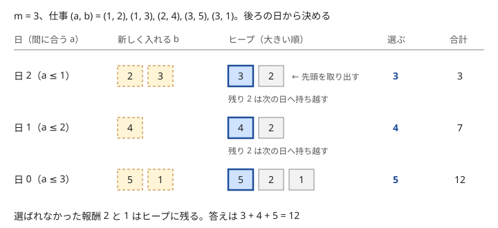

!!! abstract "要点"
    - **何ができるか**：締め切りのある仕事の選び方や、毎回最大（最小）を取り出す操作の繰り返しを、候補を優先度付きキューに入れて $O(N \log N)$ で処理する。小さい順に $K$ 個を列挙するときは、取り出したものから次の候補を作って入れる。
    - **いつ使うか**：
        - 日が進むと選択肢が増え、各日に 1 つ選ぶ
        - 締め切りまでに何個できるか・報酬の最大
        - 毎回いちばん大きい（小さい）ものを取り出して更新する
        - 組合せの和の小さい方から K 番目（K が小さい）
        - $K \le 2 \times 10^5$ 程度で、小さい順に $K$ 個取り出せば足りる
        - 一度選んだものを、後でよいものが来たら入れ替えたい
    - **計算量**：候補が $N$ 個で取り出しが $M$ 回なら $O((N + M) \log N)$。小さい順に $K$ 個の列挙は、1 回の取り出しで入れる候補が定数個なら $O(K \log K)$
    - **前提**：[貪欲法の考え方と正当性](../basics/greedy-basics.md)、[優先度付きキュー](../ds/priority-queue.md)

<!-- textlint-disable -->
別名：priority_queue で貪欲・ヒープで貪欲・締め切り付きスケジューリング・後悔付き貪欲・小さい順に K 個を列挙・K-best enumeration
<!-- textlint-enable -->

優先度付きキューを使う貪欲は、「今選べる候補の中で最もよいもの」を毎回選ぶ貪欲法で、選べる候補の集合が少しずつ増えたり減ったりする場合に使う。候補の集合をそのつど並べ直すと 1 回 $O(N \log N)$ かかるが、[優先度付きキュー](../ds/priority-queue.md)に入れておけば、追加と最大の取り出しがどちらも $O(\log N)$ で済む。難しいのはキューの操作ではなく、「何を、どの順に入れれば、毎回最大を選ぶだけで正しくなるか」を見つけることである。

以下、日や添字は 0-indexed で書く。C++ の `priority_queue<T>` は最大を取り出し、最小を取り出すには `priority_queue<T, vector<T>, greater<T>>` と書く。

## 毎回最大を取り出す（同じ値はまとめる） {#take-max}

最も単純な型は、「いちばん大きいものに操作をする」を $M$ 回繰り返すことである。たとえば「$M$ 回まで、好きな数を 1 つ選んで半分（切り捨て）にでき、全体の和を最小にする」なら、毎回いちばん大きい数を半分にすればよい。キューから最大 $x$ を取り出し、$\lfloor x / 2 \rfloor$ を入れ直す操作を $M$ 回行うので、$O((N + M) \log N)$ である。

毎回最大を選んでよい理由は、1 回の操作で得をする量（和の減り方）が、次の 2 つを満たすからである。

- 値が大きいほど得が大きい：$x$ を半分にすると $\lceil x / 2 \rceil$ 減り、これは $x$ について単調に増える
- 同じ数に操作を重ねるほど得が小さくなる：$x$ の次は $\lfloor x / 2 \rfloor$ を半分にするので、得は $\lceil x / 2 \rceil$ 以下になる

2 つ目により、各数の「1 回目・2 回目・…の得」は減っていく列になる。どの選び方も、各数について「得の列の先頭から何個か」を取ることになる。よって全体の得の大きい方から $M$ 個を取れば最適で、それを 1 つずつ取るのが毎回最大を選ぶ貪欲である。2 つ目が崩れる（2 回目の方が得が大きい）問題では、この貪欲は正しくない。

**同じ値はまとめる**。「乗るたびに楽しさが 1 減るアトラクションに合計 $K$ 回まで乗る」のように、操作 1 回の変化が小さく $K$ が $10^9$ 程度まであると、1 回ずつ取り出すと間に合わない。このときは値を大きい順に並べ、最大の値 $v$ を持つ $c$ 個を「次に大きい値 $v'$ まで、全部を一緒に下げる」と考える。それには $c (v - v')$ 回かかり、得の合計は等差数列の和で求まる。残りの回数 $r$ がそれより少なければ、$q = \lfloor r / c \rfloor$ 段だけ $c$ 個を一緒に下げる（値 $v, v - 1, \dots, v - q + 1$ を $c$ 回ずつ取る）。余りの $r \bmod c$ 回は、下げきった後の値 $v - q$ を足す。最後の種類の下は $v' = 0$ とする（楽しさが 0 以下の回は乗っても得がない）。値の種類ごとに $O(1)$ で進むので、ソートを合わせて $O(N \log N)$ になる。このときはキューより、ソートした配列を前から見る方が書きやすい。

## 後ろの日から決める（使えるようになった候補をキューに入れる） {#from-last-day}

「仕事 $i$ を行うと、その $a_i$ 日後に報酬 $b_i$ がもらえる。1 日に 1 件まで行い、$m$ 日後までにもらえる報酬の合計を最大にする」という型を考える。日 $d$（$0 \le d < m$）に行える仕事は $d + a_i \le m$、すなわち $a_i \le m - d$ を満たすものである。

前の日から決めようとすると、今日どれを選ぶべきかが後の日の都合で決まり、選びにくい。そこで後ろの日から決める。日 $d$ を $m - 1$ から $0$ へ動かすと、行える仕事の条件 $a_i \le m - d$ はゆるくなる一方なので、候補は増えるだけで減らない。日 $d$ に新しく行えるようになる仕事（$a_i = m - d$）をキューに入れ、その中の最大を 1 つ取り出して選ぶ。



最大を選んでよい理由は、交換して悪くならないことで示せる。日 $d$ にキューにある仕事は、日 $d$ にも、それより前のすべての日にも行える。後ろの日から順に示すので、日 $d$ より後の日は貪欲と同じ選び方をしている最適解をとる。$x$ はまだ選ばれていないので、最適解が $x$ を行う日があるなら、それは $d$ より前である。最適解が日 $d$ に別の仕事 $y$ を行い（または何もせず）、キューの最大 $x$ を別の日 $d'$（$d' < d$）に行っているなら、$x$ と $y$ の日を入れ替えてもどちらも間に合う。$x$ をどこにも使っていないなら、日 $d$ の仕事を $x$ に替える。どちらでも合計は減らない。

```text
by_a[k] = a_i = k の仕事の報酬の一覧（k > m の仕事は捨てる）
for d = m-1 downto 0:
    by_a[m - d] の報酬をすべてキューに入れる
    キューが空でなければ、最大を取り出して合計に足す
```

```cpp
--8<-- "greedy-priority-queue/from-last-day.cpp:core"
```

完全なプログラム：[`from-last-day.cpp`](https://github.com/yuukougun/kyopro-atlas/blob/main/snippets/greedy-priority-queue/from-last-day.cpp)（GitHub）
{ .kp-code-src }

各仕事は 1 回入れて高々 1 回取り出すので、$O((N + m) \log N)$ である。日に関係する量が $10^9$ 程度まで大きいときは、日を 1 つずつ動かさずに、次の節のように「次に何かが起きる日」まで飛ばす。

この節の考え方（選べる候補が増える向きに時間を進める）は、[後ろから・逆順に考える](../thinking/reverse-thinking.md)の典型でもある。前から進めたいときは、[選んだものを後から入れ替える](#regret)の節の書き方を使う。

## 時刻順に入れて締め切りの早いものから処理する（時刻は次のイベントまで飛ばす） {#earliest-deadline}

「候補 $i$ は時刻 $t_i$ から閉区間 $[t_i, e_i]$ の間だけ処理でき、1 単位時間に 1 つ処理できる。処理できる個数を最大にする」という型では、時刻を前へ進めながら、その時刻に処理できるものの中で締め切り $e_i$ が最も早いものを処理する。キューには締め切り $e_i$ を入れ、最小を取り出す。

締め切りの早いものを選んでよい理由も交換で示せる。時刻 $t$ に処理できる候補のうち締め切りが最も早いものを $x$ とする。最適解が時刻 $t$ に $y$ を処理しているなら、$x$ と $y$ の処理を入れ替える。$x$ を後で処理していた時刻 $t'$ は $e_x$ 以下で、$e_x \le e_y$ なので、$y$ を $t'$ に回しても締め切りに間に合う。$x$ をどこでも処理していないなら、$y$ を $x$ に替えるだけでよい。

処理の流れは次のとおりである。候補はあらかじめ $t_i$ の順に並べておく。

1. キューが空なら、現在時刻を次の候補の $t_i$ まで一気に進める（何も起きない時刻を飛ばす）
2. $t_i \le$ 現在時刻の候補をすべてキューに入れる
3. 締め切りが現在時刻より前のもの（$e_i <$ 現在時刻）を、キューの先頭から捨てる
4. キューが空でなければ 1 つ取り出して処理し、個数を数え、現在時刻を 1 進める

すべての候補を入れ終え、キューも空になったら終わる。

時刻が $10^{18}$ まであっても、1 の飛ばし方により、ループは「候補を入れる」「捨てる」「処理する」のどれかで必ず進む。各候補はそれぞれ 1 回ずつなので、ソートを合わせて $O(N \log N)$ である。時刻を 1 ずつ進めると、時刻の範囲に比例して TLE になる。

[区間スケジューリング](../basics/interval-scheduling.md)（重ならない区間を最も多く選ぶ）は「終わりの早い順」で決まる。この型は区間の中のどの 1 点で処理してもよいので、時刻とキューの 2 つが要る。

## 最大値を固定して上位 K 個を保つ {#fix-max-keep-k}

「$K$ 個を選び、選んだものの $A$ の最大値と $B$ の和の積を最小にする（$A$・$B$ は非負）」のように、評価が「1 つの最大値」と「残りの和」でできている型では、最大値を固定すると残りが単純になる。

$A$ の小さい順に並べ、$i$ 番目を最大値の候補 $A_i$ として固定する。すると選べるのは並びの先頭から $i$ 番目までで、その中から $B$ の小さい $K$ 個を選べばよい。$i$ を 1 つ進めるたびに $B_i$ を 1 つ足し、「小さい $K$ 個」を最大ヒープで保つ。$K$ 個を超えたら最大を捨て、捨てた分を和から引く。$A_i \times$ 和を評価するのは、ヒープに $K$ 個たまった $i \ge K - 1$ からである。$i$ ごとに $O(\log K)$ なので、ソートを合わせて $O(N \log N)$ である。

固定した $A_i$ が実際の最大値でなくてもよい理由は、不等式で分かる。先頭から $i$ 番目までの中から選んだ $K$ 個の $A$ の最大値は $A_i$ 以下で、$B$ の和は非負なので、「$A_i \times$ 和」は実際の値以上になる。$A$・$B$ に負の値があると不等号が逆になり、この方法は使えない。一方、最適解の要素のうち並べた順で最も後ろのものを $i^\ast$ 番目とする。こう取れば、$A$ が同じ値の要素があっても最適解は先頭から $i^\ast$ 番目までに収まるので、$i = i^\ast$ のときの値は最適値以下になる。よって、すべての $i$ についての最小が最適値と一致する。

この型は、「最大値（または最小値）を全探索し、残りは条件を満たす中で最もよいものを取る」という固定の考え方と、上位 $K$ 個の和を保つヒープを合わせたものである。要素の削除や $K$ の変化が要るときは、[上位 K 個の和を保つ](../ds/top-k-multiset.md)の 2 つの集合で持つ方法を使う。

## 小さい順に K 個を列挙する（取り出したら次の候補を入れる） {#k-best}

「2 つの数列から 1 つずつ選んだ和」「品物を重複を許して選んだ合計金額」のように、候補が多すぎて全部は並べられないが、小さい方から $K$ 個だけ要る型では、キューに「次に小さくなりうる候補」だけを入れておく。最小を取り出すたびに、それから作れる次の候補（子）を入れる。

この方法が正しく動くには、候補の間に次の関係（親子）を決める必要がある。

- 最小の候補（根）が 1 つ決まっている
- 根以外の各候補には親があり、親の値は子の値以下である
- 各候補は、根から親子をたどって必ず届く

このとき、キューから取り出される順は値の小さい順になる。ある候補 $x$ がまだ出ていないなら、$x$ の祖先のどれかがキューにあり、その値は $x$ 以下だからである。$x$ より大きい値が $x$ より先に出ることはない。

親が 1 つだけになるように決めると、同じ候補が 2 回入ることもない。たとえば昇順の数列 $a$・$b$ の和 $a_i + b_j$ なら、$(i, j)$ の親を $(i, j - 1)$（$j = 0$ なら $(i - 1, 0)$）と決める。取り出した $(i, j)$ からは、$(i, j + 1)$ と、$j = 0$ のときだけ $(i + 1, 0)$ を入れる。

```cpp
--8<-- "greedy-priority-queue/k-best.cpp:core"
```

完全なプログラム：[`k-best.cpp`](https://github.com/yuukougun/kyopro-atlas/blob/main/snippets/greedy-priority-queue/k-best.cpp)（GitHub）
{ .kp-code-src }

1 回の取り出しで入れる子は高々 2 個なので、キューの大きさは $O(K)$ で、全体は $O(K \log K)$ である。親を 1 つに決めにくいときは、入れた**組** $(i, j)$ を `set` で覚えて、2 回目を飛ばしてもよい。値で覚えると、別の組で同じ和になるものまで飛ばしてしまう。同じ値の候補を 1 つと数える問題（ありうる金額の $K$ 番目など）でだけ、値で重複を除く。

$K$ が $N^2$ 程度まで大きく、小さい順に 1 つずつ取り出すと間に合わないときは、「$x$ 以下が何個あるか」を数えて二分探索する（[K 番目の値を求める](../basics/kth-value.md)）。

## 選んだものを後から入れ替える（後悔付き貪欲。一般形は Alien DP のページ） {#regret}

前から順に候補を見て、「とりあえず選んでおき、後でよりよい候補が来たら、選んだ中で最も悪いものと入れ替える」という貪欲を、後悔付き貪欲（取り消し付きの貪欲）と呼ぶ。選んだものを最小ヒープで持てば、最も悪いものが $O(\log N)$ で分かる。

[後ろの日から決める](#from-last-day)の型も、この形で前から解ける。仕事を「最後に行える日」$m - a_i$ の早い順に見て、報酬を最小ヒープに入れる。その時点で行える日の数（$m - a_i + 1$）よりヒープが大きくなったら、最小の報酬を捨てる。最後にヒープに残った報酬の和が答えである。選んだ仕事は、すべての $k$ について「最後に行える日が $k$ 以下の仕事が $k + 1$ 個以下」なら、締め切りの順に日 0 から並べればどれも間に合う。入りきらなくなったときに最も安い 1 つを捨てれば、この条件を保ったまま報酬の和が最大になる。

??? note "最も安い 1 つを捨ててよい理由"
    仕事 $i$ の最後に行える日を $\ell_i = m - a_i$ と書く。「全体の最適解 $O$ で、ここまでに見た仕事のうち $O$ に入るものは、すべてヒープにある」ように $O$ をとれることを、捨てるたびに保てばよい。最後のヒープは条件を満たし、$O$ を含むので、和は最適値以上になる。

    $\ell_j = k$ の仕事 $j$ を入れてヒープが $k + 2$ 個になり、最小の報酬の $z$ を捨てるとする。$O$ が $z$ を含まなければそのままでよい。含むなら、ヒープの $k + 2$ 個はどれも $\ell \le k$ で、$O$ はそのうち $k + 1$ 個以下しか含まないので、ヒープの中に $O$ に入っていない仕事 $w$ がある。$O$ の $z$ を $w$ に替えると、$b_w \ge b_z$ なので和は減らない。

    条件が崩れうるのは、$\ell_w \le t < \ell_z$ の $t$ で「$\ell \le t$ の仕事が $t + 1$ 個以下」が 1 個増える場合だけである。$t < k$ なので $\ell \le t$ の仕事はすでに見ており、$O$ に入るものはヒープにある。ヒープの中の $\ell \le t$ の仕事は $j$ を入れる前から $t + 1$ 個以下で、その中に $O$ に入らない $w$ があるから、$O$ が含むのは $t$ 個以下である。1 個増えても $t + 1$ 個以下なので、条件は保たれる。

入れ替えの得を値として持つと、さらに広い問題が解ける。「各日に株を 1 株買うか、1 株売るか、何もしないかを選び、利益を最大にする」型では、価格 $p$ の日に次を行う。

1. ヒープ（最小）の先頭 $q$ が $p$ より小さければ、$q$ で買って $p$ で売ったとして $p - q$ を利益に足し、$q$ を取り出す
2. $p$ をヒープに入れる。1 で売ったなら、$p$ をもう 1 つ入れる

1 で売ったときに入れる 2 つ目の $p$ が「取り消し」の印である。後で価格 $r > p$ の日にこの $p$ が取り出されると、$r - p$ が足され、利益は「$q$ で買って $r$ で売った」ときの $r - q$ に変わる。日 $p$ の売りを取り消して、$r$ で売り直したことになる。正しさの証明はこの型ごとに要る。選ぶ個数について答えが凸になる問題の一般的な扱いは、 [Alien DP](../dp/alien-dp.md#penalty) のページと、関数の形を直接持つ [Slope Trick](../dp/slope-trick.md#breakpoints) のページで扱う。

## 落とし穴 {#pitfalls}

**取り出す向きを取り違える**。`priority_queue<int>` は最大を出す。最小が欲しいのに `greater` を付け忘れると、締め切りの遅いものから処理してしまう。値に $-1$ を掛けて入れる書き方は、取り出した値を戻し忘れやすいので、`greater` を使う方が安全である。

**空のキューの `top`**。日によっては選べる候補がない。`pq.empty()` を確かめずに `top()` を呼ぶと未定義動作になり、手元では動いて提出で落ちることがある。

**時刻を 1 ずつ進める**。時刻・日付が $10^9$ や $10^{18}$ まであるなら、「次に候補が入る時刻」まで飛ばす（[時刻順に入れて締め切りの早いものから処理する](#earliest-deadline)）。逆に、飛ばした後も処理を 1 つしたら時刻を 1 進めることを忘れない。

**締め切りを過ぎたものを捨て忘れる**。キューの先頭は「締め切りが最も早いもの」なので、取り出す前に先頭が過ぎていないかを確かめて捨てる。捨てずに数えると、間に合わない候補まで数えてしまう。

**列挙で同じ候補を 2 回入れる**。小さい順に $K$ 個を列挙するとき、$(i, j)$ から $(i + 1, j)$ と $(i, j + 1)$ の両方を入れると、$(i + 1, j + 1)$ が 2 回入り、同じ組を 2 回数える。親を 1 つに決めるか、入れた組を `set` で覚えて重複を除く（値を覚えると、同じ和の別の組まで除いてしまう）。

**和のオーバーフロー**。報酬や和は `int` の範囲を超えやすい。合計や、値の積（[最大値を固定して上位 K 個を保つ](#fix-max-keep-k)の $A_i \times$ 和）は `long long` で持つ。

## 例題 {#examples}

### ABC137 D. Summer Vacation {#abc137_d}

<div class="kp-problems" data-role="example" markdown>

- [ABC137 D. Summer Vacation](https://atcoder.jp/contests/abc137/tasks/abc137_d)（diff 1313）：報酬を受け取れる期限が決まった日雇いの仕事を 1 日 1 件まで選ぶとき、報酬の合計の最大値を求める。

</div>

仕事 $i$ は、した日の $A_i$ 日後に報酬をもらえ、$M$ 日後までにもらえる分だけが数えられる。[後ろの日から決める](#from-last-day)の型そのもので、日を $M - 1$ から $0$ へ進めながら、その日に新しく間に合う仕事（$A_i = M - d$）の報酬をキューに入れ、最大を 1 つ選ぶ。

??? note "解法の詳細"
    - 仕事を $A_i$ ごとに分けておく。$A_i > M$ の仕事はどの日にも間に合わないので捨てる。
    - 日 $d = M - 1, M - 2, \dots, 0$ の順に、$A_i = M - d$ の仕事の報酬を最大ヒープに入れる。ヒープが空でなければ最大を取り出して答えに足す。
    - 交換で正しさが示せる：日 $d$ のヒープにある仕事はどれも日 $d$ 以前のすべての日に行えるので、最大の仕事を日 $d$ に置いても損をしない。
    - 計算量は $O((N + M) \log N)$。コードは[後ろの日から決める](#from-last-day)の節のものと同じ形である。

### ABC325 D. Printing Machine {#abc325_d}

<div class="kp-problems" data-role="example" markdown>

- [ABC325 D. Printing Machine](https://atcoder.jp/contests/abc325/tasks/abc325_d)（diff 1367）：コンベア上を通過する商品に 1 秒に 1 個ずつ印字できるとき、印字できる商品の最大数を求める。

</div>

各商品は時刻 $T_i$ から $T_i + D_i$ までの閉区間で印字でき、印字した次の時刻からまた印字できる。[時刻順に入れて締め切りの早いものから処理する](#earliest-deadline)の型で、締め切り $T_i + D_i$ を最小ヒープに入れ、時刻は次に商品が入る時刻まで飛ばす。時刻は $10^{18}$ 程度まであるので `long long` で持つ。

??? note "解法の詳細"
    - 商品を $(T_i, T_i + D_i)$ にして $T_i$ の順に並べ、現在時刻 $t$ と、まだ入れていない商品を指す添字を持つ。
    - ヒープが空なら、$t$ を次の商品の $T_i$ まで進める。$T_i \le t$ の商品の締め切りをすべてヒープに入れる。
    - ヒープの先頭の締め切りが $t$ より前なら捨てる。残っていれば 1 つ取り出し、個数を 1 増やし、$t$ を 1 進める。
    - すべての商品を入れ終え、ヒープも空になったら終わる。各商品は入れる・捨てるか取り出すの 2 回だけなので、$O(N \log N)$ である。

## 練習問題 {#practice}

<div class="kp-problems" data-role="practice" markdown>

- [ABC141 D. Powerful Discount Tickets](https://atcoder.jp/contests/abc141/tasks/abc141_d)（diff 823）：1 枚使うごとに値段が半分になる割引券を M 枚使い分けて、支払いの合計の最小値を求める。
- [ABC376 E. Max × Sum](https://atcoder.jp/contests/abc376/tasks/abc376_e)（diff 1063）：添字を K 個選ぶとき、選んだ A の最大値と選んだ B の和の積の最小値を求める。
- [ABC297 E. Kth Takoyaki Set](https://atcoder.jp/contests/abc297/tasks/abc297_e)（diff 1176）：N 種類の値段のたこ焼きを重複を許して選ぶとき、合計金額としてありうる値のうち小さい方から K 番目を求める。

</div>

??? note "練習の方針"
    - **ABC141 D**：値段を最大ヒープに入れ、最大を取り出して半分（切り捨て）にして入れ直すことを $M$ 回行う。最後にヒープの和を出す（[毎回最大を取り出す](#take-max)）
    - **ABC376 E**：$A$ の小さい順に並べ、$A_i$ を最大値として固定する。先頭から $i$ 番目までの $B$ の小さい $K$ 個の和を最大ヒープで保ち、$A_i \times$ 和の最小を取る（[最大値を固定して上位 K 個を保つ](#fix-max-keep-k)）。テストケースが複数あるので、ヒープと和を毎回作り直す
    - **ABC297 E**：最初に各値段（1 個だけ買う金額）を最小ヒープに入れる。最小の金額を取り出し、それに各値段を足した金額を入れる。同じ金額は何通りにも作れるので、取り出した金額を `set` で覚えて 2 回目以降は飛ばす。異なる金額を $K$ 個取り出したときの最後の値が答えである。何も買わない 0 を最初に入れると何番目を答えにするかが 1 つずれるので、0 を数えるかは問題文で確かめる（[小さい順に K 個を列挙する](#k-best)）

## 確認問題 {#quiz}

??? question "確認問題：後ろの日から決める型を、前の日から決めるとどう困るか"
    日 0 に「今行える仕事のうち報酬が最大のもの」を選ぶと、$a_i$ が小さく後の日にも行える仕事を早く使ってしまい、$a_i$ が大きく日 0 にしか行えない仕事が入らなくなることがある。$m = 3$、仕事 $(a, b) = (1, 9), (1, 8), (3, 1)$ で、日 0 に 9、日 1 に 8 を選んだとする。日 2 に行える $a \le 1$ の仕事は残っておらず、報酬 1 の仕事は日 0 にしか間に合わないので、合計 17 になる。正しくは日 0 に報酬 1、日 1 と日 2 に 9 と 8 で合計 18 である。後ろから進めると、候補が増える一方になるのでこの問題が起きない。

??? question "確認問題：2 つの昇順の列の和を小さい順に列挙するとき、$(i, j)$ から $(i + 1, j)$ と $(i, j + 1)$ を入れ、重複を除かないと何が起きるか"
    $(i + 1, j + 1)$ には $(i, j + 1)$ と $(i + 1, j)$ の 2 つの親があるので、2 回入る。$K$ 個の中に同じ組が何度も現れ、答えが小さくずれる。キューの大きさも増える。親を 1 つに決める（$(i, j)$ からは $(i, j + 1)$ と、$j = 0$ のときだけ $(i + 1, 0)$ を入れる）か、入れた組を `set` で覚える。

## 使い分け {#comparison}

- 候補も値も最初から決まっていて、途中で変わらないなら、ソートして前から見るだけで済む（キューは要らない）
- 候補の追加と、最大・最小の取り出しだけならヒープ、任意の要素の削除や前後の要素が要るなら `multiset`（[優先度付きキュー](../ds/priority-queue.md)のページの使い分け）
- 重ならない区間を最も多く選ぶなら、[区間スケジューリング](../basics/interval-scheduling.md)（終わりの早い順に選ぶ）
- 小さい順に $K$ 番目で、$K$ が大きいなら [K 番目の値を求める](../basics/kth-value.md)（個数で二分探索）
- 選ぶ個数ごとの最適値が要り、取り消しの形が複雑なら [Alien DP](../dp/alien-dp.md#penalty) や [Slope Trick](../dp/slope-trick.md)

## 参考 {#references}

- [drken「AtCoder ABC 137 D - Summer Vacation (1Q, 水色, 400 点)」](https://drken1215.hatenablog.com/entry/2020/12/29/195900)：後ろの日から決める方針と、最大を選んでよい理由
- [drken「AtCoder ABC 325 D - Printing Machine (1Q, 水色, 450 点)」](https://drken1215.hatenablog.com/entry/2023/10/22/184800)：締め切りの早いものから処理する理由と、時刻を飛ばす実装
- [drken「AtCoder ABC 141 D - Powerful Discount Tickets (2Q, 緑色, 400 点)」](https://drken1215.hatenablog.com/entry/2019/09/16/032000)：練習の方針（毎回最大を半分にする貪欲）
- [oraclesqlpuzzle「ABC376-E Max × Sum」](https://oraclesqlpuzzle.ninja-web.net/kyoupro/05-atcoder-02-abc/kyoupro-abc376-e.html)：練習の方針（A の順に並べて B の小さい K 個を保つ）
- [drken「AtCoder ABC 297 E - Kth Takoyaki Set (1Q, 緑色, 500 点)」](https://drken1215.hatenablog.com/entry/2025/02/07/012850)：練習の方針（最小を取り出して次の候補を入れ、重複を set で除く）
- [ikatakos「AtCoder Beginner Contest 250 G,Ex問題メモ」](https://ikatakos.com/pot/programming_algorithm/contest_history/atcoder/2022/0508_abc250)：株の売買の型で、価格を 2 回入れて売りを取り消す仕組み（解法の部分だけを参照）
