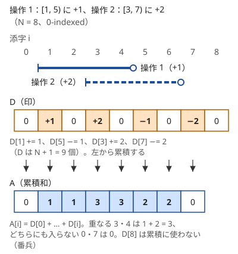
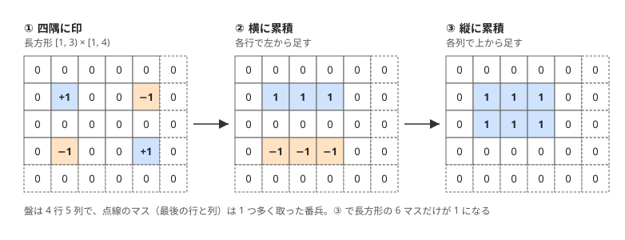

!!! abstract "要点"
    - **何ができるか**：区間 $[l, r)$ に $x$ を足す操作を $D[l] \mathrel{+}= x$、$D[r] \mathrel{-}= x$ と記録し、最後に累積和を取って一度に反映する。$Q$ 回の区間加算が $O(N + Q)$ になり、2 次元では長方形の四隅に印を置く。
    - **いつ使うか**：
        - 区間にまとめて加算し、最後に各点の値を知りたい。
        - 各時刻に何人いるか・ちょうど $k$ 個重なる長さ。
        - 長方形にまとめて加算する（重なった枚数ごとの面積）。
        - 区間に一律の値を足すたびに隣接差の和を答える。
        - 等差数列になっている区間・区間に $1, 2, 3, \dots$ を足す。
        - $N, Q \le 2 \times 10^5$ で区間への加算が多数あり、値を読むのは最後だけ。
    - **計算量**：区間加算 1 回は $O(1)$、最後の累積和が $O(N)$ で、全体は $O(N + Q)$。2 次元は長方形 1 つが $O(1)$、累積が $O(HW)$。座標が大きいときは端点のソートが加わり $O(Q \log Q)$。
    - **前提**：[累積和](../basics/prefix-sum.md)

<!-- textlint-disable -->
別名：imos 法・差分配列・difference array・2 次元いもす法・階差・隣接差・等差数列の区間加算
<!-- textlint-enable -->

いもす法は、区間への加算を「区間の始まりで増え、終わりで元に戻る」という 2 点の変化に置き換えて記録し、最後に[累積和](../basics/prefix-sum.md)で全体の値に戻す方法である。区間を 1 つずつ塗ると 1 回 $O(N)$ かかるが、印を付けるだけなら 1 回 $O(1)$ で済む。累積和が「和を前計算して区間の和を読む」道具なのに対し、いもす法は逆向きの「区間に足して最後に点の値を読む」道具である。

## 1 次元のいもす法（閉区間なら右端 + 1 に −x） {#imos-1d}

長さ $N$ の列 $A$（初めはすべて 0）の半開区間 $[l, r)$ に $x$ を足す操作を何度も行い、最後に各要素の値を知りたいとする。いもす法では、長さ $N + 1$ の配列 $D$ を用意し、操作ごとに次の 2 か所だけを書き換える。

$$
D[l] \mathrel{+}= x, \qquad D[r] \mathrel{-}= x
$$

すべての操作を記録したら、$A[i] = D[0] + D[1] + \dots + D[i]$ と左から累積する。添字はすべて 0-indexed である。



次の動く図では、同じ例で $D$ に印を 1 か所ずつ書き込み、そのあと左から累積して $A$ を 1 マスずつ埋める様子をステップ送りで確かめられる。累積の途中の値 $\mathrm{cur}$ は、カーソルまでの $D$ の和である。

<div class="kp-viz" data-viz="imos" data-config='{"n": 8, "ops": [{"l": 1, "r": 5, "x": 1}, {"l": 3, "r": 7, "x": 2}]}'></div>

正しい理由は、1 つの操作が累積和に与える影響を見ると分かる。$D[l]$ の $+x$ は $i \ge l$ のすべての $A[i]$ に入り、$D[r]$ の $-x$ は $i \ge r$ のすべての $A[i]$ に入る。両方が入る $i \ge r$ では打ち消し合うので、差し引きで $x$ が残るのはちょうど $l \le i < r$ である。累積和は足し算なので、操作が何個あっても、それぞれの影響を足し合わせたものになる。

```cpp
--8<-- "imos/imos-1d.cpp:core"
```

境界で迷いやすいのは次の 3 点である。

- **配列の長さ**：$r = N$ のとき $D[N]$ に書くので、$D$ は $N + 1$ 個取る。$D[N]$ は累積に使わない[番兵](../guide/glossary.md#sentinel)である
- **閉区間**：問題文が閉区間 $[l, r]$ なら、半開区間 $[l, r + 1)$ と同じなので $-x$ は $D[r + 1]$ に置く。「右端 + 1」を忘れると、右端の要素だけ足されない
- **1-indexed の入力**：問題文の閉区間 $[L, R]$（1-indexed）は、0-indexed の半開区間 $[L - 1, R)$ である。$D[L - 1] \mathrel{+}= x$、$D[R] \mathrel{-}= x$ と書けば $+1$ の付け忘れが起きにくい

いもす法で作った $D$ は、完成した列 $A$ の隣接差 $D[i] = A[i] - A[i - 1]$（$A[-1] = 0$）そのものである。区間加算は隣接差の 2 か所だけを変える。累積和は、隣接差から元の列に戻す操作である。この見方は[隣接差で見る](#adjacent-difference)節で使う。

??? question "確認問題：印を付けたまま値を読む"
    $D$ に印を付け終える前に、$A[3]$ の値を知りたくなった。$D[3]$ を読めばよいか。

    ??? success "答え"
        よくない。$D[3]$ は位置 3 で値がどれだけ変わるかであって、値そのものではない。$A[3]$ は $D[0] + \dots + D[3]$ なので、読むたびに足すと $O(N)$ かかる。途中で何度も読むなら[途中で値を読むなら BIT・遅延セグ木](#online)の節の方法に切り替える。

## 座標が大きいとき（座標圧縮・イベントのソート） {#large-coordinates}

区間の端点が $10^9$ まであるときは、長さ $10^9$ の配列 $D$ を取れない。印が付くのは端点だけで、端点の間では値が変わらないことを使う。

1 つ目の方法はイベントのソートである。各区間 $[l, r)$ から「座標 $l$ で $+x$」「座標 $r$ で $-x$」の 2 つのイベントを作り、座標の順に並べる。左から順に値を足していくと、隣り合う 2 つのイベントの座標 $p < q$ の間 $[p, q)$ では値が一定なので、「値 $c$ の長さ $q - p$」とまとめて数えられる。同じ座標のイベントは全部を足してから次へ進む。ソートが $O(Q \log Q)$ で、配列の長さは座標の幅によらない。詳しい作り方は[イベントソート](../basics/event-sort.md)にある。

2 つ目の方法は[座標圧縮](../basics/coordinate-compression.md)である。現れる端点 $l$ と $r$ をすべて集め、重複なく小さい順に $X[0] < X[1] < \dots$ と並べて、$X[j]$ に番号 $j$ を振る。番号の上でいもす法を行う。このとき次の 2 点に気をつける。

- 右端 $r$（閉区間なら $r + 1$）も圧縮の候補に入れる。入れ忘れると $-x$ を置く場所がない（[区間を扱うときは両端点を入れる](../basics/coordinate-compression.md#intervals)）
- 番号 $j$ の区間の長さは、圧縮前の座標の差 $X[j + 1] - X[j]$ で測る。番号の差で測ると長さが 1 になってしまう

「ちょうど $k$ 人がいた日数を $k$ ごとに求める」型（[練習問題](#practice)の ABC221 D）は、どちらの方法でも、値が $c$ の区間の長さを $\mathrm{cnt}[c]$ に足していけば答えが出る。

## 区間長や開始時刻の範囲に直して加算する {#by-length}

いもす法を足す先の添字は、時刻や位置とは限らない。「長さ $k$ ごとに個数を答える」「開始時刻ごとに数える」のように、答えの添字の区間ごとに $+1$ する形に直せれば、いもす法でまとめられる。

**区間長ごとの加算**：この段落だけは、[力試し](#challenge)の ABC260 E に合わせて位置を 1 から $M$ で数える（1-indexed）。長さ $M$ の列の連続区間 $[l, r]$（閉区間）のうち条件を満たすものの数を、長さ $k = r - l + 1$ ごとに求めたいとする。条件が「区間を広げても満たしたまま」なら、左端 $l$ ごとに条件を満たす最小の右端 $r_l$ があり、$r_l \le r \le M$ のすべてで満たす。このとき左端 $l$ が数えるのは長さ $r_l - l + 1$ から $M - l + 1$ までの区間なので、長さの配列にいもす法で $+1$ する。左端ごとに 2 か所の印で済むので、印を置くのと累積は $O(M)$ である。全体はこれに $r_l$ を求める手間を足したもので、ABC260 E では[尺取り法](../basics/two-pointers.md)で $O(N + M)$（$N$ は条件に出てくる組の数）になる。

**開始時刻の範囲に直す**：時間の長さを $L$ と書く（ABC462 D の問題では $D$ だが、ここでは配列 $D$ と区別する）。「区間 $[S_i, T_i]$ にいる人のうち、長さ $L$ の時間 $[x, x + L]$ をまるごと含む人」は、開始時刻 $x$ が $S_i \le x \le T_i - L$ の範囲にあるときだけ数える。人ごとの区間を開始時刻の区間に直し、開始時刻の配列にいもす法で $+1$ すれば、各 $x$ で条件を満たす人数 $c_x$ が分かる（[練習問題](#practice)の ABC462 D）。閉区間なので、$+1$ は $S_i$ に、$-1$ は $T_i - L + 1$ に置く。終わりの側を $L$ だけ縮めるのが要点で、$T_i - S_i < L$ の人は区間が空なので印を付けない。

どちらも、数えたい対象（左端・人）を「答えの添字の区間」に変換するのが本体で、いもす法はそれをまとめる道具である。

## 隣接差で見る（区間加算は 2 点の増減・等差数列の区間） {#adjacent-difference}

列 $A$ の隣接差 $d_i = A[i] - A[i - 1]$（$1 \le i \le N - 1$）を見ると、区間 $[l, r)$ に $x$ を足す操作で変わるのは $d_l$（$+x$。$l \ge 1$ のとき）と $d_r$（$-x$。$r \le N - 1$ のとき）の 2 つだけである。区間の内側では両隣が同じだけ増えるので差は変わらない。これは[1 次元のいもす法](#imos-1d)の $D$ の書き換えと同じ式である。

この見方は、区間加算のたびに隣接差を使った量を答える問題に効く。たとえば $\sum_{i=1}^{N-1} \lvert d_i \rvert$ を毎回答えるなら、操作のたびに $d_l$ と $d_r$ の古い絶対値を引き、新しい絶対値を足せば $O(1)$ で更新できる。列全体を持ち直す必要はない。端の $l = 0$ や $r = N$ では対応する隣接差がないので、その側は何もしない。

**等差数列の区間**：$A[l], A[l + 1], \dots, A[r - 1]$ が等差数列であることは、$d_{l+1} = d_{l+2} = \dots = d_{r-1}$ と同じである。長さ 2 以上の連続部分列は、隣接差の連続した区間 1 つに対応する。だから等差数列になっている連続部分列を数えるには、隣接差を同じ値が続く塊に分け（[ランレングス圧縮](../basics/run-length-encoding.md)）、長さ $m$ の塊から $m(m + 1) / 2$ 個を数え、長さ 1 の部分列 $N$ 個を足せばよい。異なる塊にまたがる区間は差が等しくないので、重なりなく数えられる。

区間の操作を隣接差の 2 点の操作に直し、最小回数や可否を考える問題は[差分列への言い換え](../basics/difference-sequence.md#min-operations)で扱う。

??? question "確認問題：1 回の加算で変わる量"
    区間 $[l, r)$ に $x$ を足したとき、$\sum_{i=1}^{N-1} \lvert A[i] - A[i - 1] \rvert$ は最大でどれだけ増えるか。

    ??? success "答え"
        変わるのは $d_l$ と $d_r$ の 2 つだけで、どちらも絶対値の変化は $\lvert x \rvert$ 以下である（三角不等式）。だから増える量は最大で $2 \lvert x \rvert$ である。$l = 0$ や $r = N$ で片側の差がなければ、最大で $\lvert x \rvert$ になる。

## 区間反転を切り替え点 2 つで表す {#range-flip}

0 と 1 の列の区間 $[l, r)$ を反転する（0 と 1 を入れ替える）操作も、いもす法と同じ形で書ける。足し算の代わりに XOR を使い、$D[l] \mathrel{\oplus}= 1$、$D[r] \mathrel{\oplus}= 1$ と記録して、最後に左から XOR の累積を取る。位置 $i$ の累積が 1 なら、$i$ は奇数回反転された。

この見方を逆に使うと、「区間の反転を $K$ 回以下行う」ことは「列の上に切り替え点を $2K$ 個以下置く」ことと同じになる。切り替え点とは、そこから先の表と裏が入れ替わる位置である。

- $K$ 回の反転は、それぞれの両端が切り替え点になるので、切り替え点は $2K$ 個以下である（同じ位置に重なった 2 つは打ち消すので、消してよい）
- 逆に、切り替え点を左から $p_1 < p_2 < \dots$ と並べ、$[p_1, p_2)$、$[p_3, p_4)$、… を反転すれば作れる。個数が奇数なら、最後の点と列の右端 $N$ を組にする

例として、各位置に表の値と裏の値があり、反転の後に上を向いた側の値の和を最大にしたいとする（[練習問題](#practice)の ABC466 E）。区間の組み合わせを直接選ぶのは難しいが、切り替え点は左から 1 つずつ置くかどうかを決めればよい。そこで $\mathrm{dp}[i][j]$ ＝「先頭 $i$ 個の向きを決め、切り替え点を $j$ 個置いたときの、上を向いた値の和の最大値」とすると、位置 $i$ が表か裏かは $j$ の偶奇で決まる。各位置で「切り替えない（$j$ のまま）」か「ここで切り替える（$j + 1$）」を選ぶ[DP](../dp/dp-basics.md) になる。初期値は $\mathrm{dp}[0][0] = 0$、ほかは $-\infty$ で、答えは $j \le 2K$ の $\mathrm{dp}[N][j]$ の最大である。状態数が $N \times (2K + 1)$ なので $O(NK)$ で解ける。

## 2 階の差分（区間に 1, 2, 3, … を足す） {#second-order}

区間 $[l, r)$ に定数ではなく $1, 2, \dots, r - l$ を足したいときは、差分を 2 段に取る。足す列 $B$（$B[i] = i - l + 1$、$l \le i < r$。ほかは 0）の隣接差を取ると、次の形になる。

- $l \le i < r$ では 1（位置 $l$ では $0$ から $1$ へ、内側では 1 ずつ増える）
- 位置 $r$ では $-(r - l)$（$r - l$ から $0$ に戻る）

この隣接差の列は「$[l, r)$ に 1 を足す」と「位置 $r$ に $-(r - l)$ を足す」の和なので、それぞれをいもす法でもう一度差分にできる。2 段目の配列 $E$ には 4 か所の印が付く。

$$
E[l] \mathrel{+}= 1, \quad E[r] \mathrel{-}= 1, \quad E[r] \mathrel{-}= (r - l), \quad E[r + 1] \mathrel{+}= (r - l)
$$

最後に $E$ の累積和を取ると隣接差の列になり、もう一度累積和を取ると値になる。たとえば $N = 6$、$[1, 4)$ なら、$E$ の印は位置 1 の $+1$、位置 4 の $-4$、位置 5 の $+3$ である。1 回目の累積は $0, 1, 1, 1, -3, 0$、2 回目は $0, 1, 2, 3, 0, 0$ になる。$E$ は $r + 1$ まで書くので $N + 2$ 個取る。

```cpp
--8<-- "imos/second-order.cpp:core"
```

初項 $s$・公差 $c$ の等差数列 $s, s + c, s + 2c, \dots$ を足すときは、$s + c(k - 1) = (s - c) + c \cdot k$ と分ける。定数 $s - c$ の部分は 1 段のいもす法で、$c \cdot (1, 2, 3, \dots)$ の部分は上の 4 か所の印を $c$ 倍して置けばよい。一般に $k$ 次の多項式を区間に足すには $k + 1$ 段の差分を取り、累積和を $k + 1$ 回取る（いもす法の原典の「次数の拡張」の節）。

## 2 次元いもす法（四隅に ±1、横と縦に累積） {#imos-2d}

$H$ 行 $W$ 列の盤で、長方形 $[x_1, x_2) \times [y_1, y_2)$（行が $[x_1, x_2)$、列が $[y_1, y_2)$）に 1 を足す操作をまとめて行うときは、$(H + 1) \times (W + 1)$ の配列 $D$ の四隅に印を付ける。

$$
D[x_1][y_1] \mathrel{+}= 1, \quad D[x_1][y_2] \mathrel{-}= 1, \quad D[x_2][y_1] \mathrel{-}= 1, \quad D[x_2][y_2] \mathrel{+}= 1
$$

その後、各行で横に累積し、続けて各列で縦に累積する。横の累積で、行 $x_1$ には列 $[y_1, y_2)$ だけが 1、行 $x_2$ には同じ範囲だけが $-1$ の帯ができる。縦の累積で、この 2 本の帯が行 $[x_1, x_2)$ の間だけ 1 を残す。結果は長方形の中だけが 1 になる。



```cpp
--8<-- "imos/imos-2d.cpp:core"
```

長方形 1 つの記録が $O(1)$、累積が $O(HW)$ なので、長方形が $N$ 個なら全体は $O(N + HW)$ である。横と縦はどちらを先に累積してもよい。ただし両方を必ず行う。片方だけでは帯のままになる。

座標が「長方形の角の点」で与えられるときは、マス $(x, y)$ を単位の正方形 $[x, x + 1) \times [y, y + 1)$ と見る。角が $(a, b)$ と $(c, d)$ の長方形は、マスの範囲 $[a, c) \times [b, d)$ になり、そのまま上の式に入る（[練習問題](#practice)の典型90 028）。3 次元以上も同じで、$2^d$ 個の角のうち、各軸で終わりの側を取った個数が偶数の角に $+1$、奇数の角に $-1$ を置き、各軸の向きに 1 回ずつ累積する（2 次元の四隅の式もこの規則である）。

## 途中で値を読むなら BIT・遅延セグ木 {#online}

いもす法は「加算をすべて終えてから一度だけ累積する」ことで速くなる。加算と値の読み出しが交互に来る場合は、読むたびに累積すると 1 回 $O(N)$ かかり、$Q$ 回で $O(NQ)$ になる。

- **区間加算と 1 点の値**：$D$ をそのまま [BIT](../ds/fenwick-tree.md) に載せる。区間加算は $D$ の 2 点への加算、点 $i$ の値は $D$ の接頭辞の和なので、どちらも $O(\log N)$ になる
- **区間加算と区間の和・最小値**：[遅延セグメント木](../ds/lazy-segment-tree.md)を使う。和だけなら BIT 2 本でもできる
- **読み出しがすべての加算の後**：途中で読まないので、いもす法で足りる。BIT にすると $\log N$ 倍遅くなるだけである

木のパスや部分木への加算をまとめるときは、[木の上のいもす法](../tree/tree-imos.md)を使う。

## 落とし穴 {#pitfalls}

**境界の添字と配列の長さ**。入力が閉区間か半開区間かを問題文で確かめ、0-indexed の半開区間に直してから印を付ける（[1 次元のいもす法](#imos-1d)の 3 点）。配列は、1 次元で $N + 1$ 個、2 階の差分で $N + 2$ 個、2 次元で $(H + 1) \times (W + 1)$ 個取る。足りないと範囲外への書き込みになる。

**座標圧縮で右端を入れ忘れる**。圧縮の候補に $l$ だけを入れると、$-x$ を置く位置の番号がない。$r$（閉区間なら $r + 1$）も必ず入れる。長さは圧縮前の座標の差で測る。

**累積の前に値を読む**。$D[i]$ は変化量であって値ではない。値は累積和を取った後に読む。途中で読む必要があるなら[BIT・遅延セグ木](#online)に切り替える。

**値のあふれ**。$x$ が $10^9$ で操作が $2 \times 10^5$ 回なら、値は $2 \times 10^{14}$ に達する。$D$ と累積の配列は `long long` で持つ。2 階の差分では 1 回の操作で各要素に最大 $N$ 程度を足すので、値は $NQ$ 程度まで大きくなる。

**2 次元で片方の向きしか累積しない**。横だけ、縦だけの累積では長方形にならない。2 回の二重ループの添字の範囲（番兵の行と列を含める）もそろえる。

## 使い分け {#comparison}

- 値が固定で区間の和を何度も読むなら[累積和](../basics/prefix-sum.md)、区間に足して最後に点の値を読むならいもす法である
- 加算と読み出しが交互に来るなら、BIT（区間加算・1 点の値）か遅延セグメント木（区間加算・区間の集約）を使う
- 端点が大きいときは、端点だけを並べる[イベントソート](../basics/event-sort.md)か[座標圧縮](../basics/coordinate-compression.md)と組む
- 区間の操作の最小回数や可否を問われたら、隣接差の 2 点の操作に言い換える[差分列への言い換え](../basics/difference-sequence.md#min-operations)を考える

## 例題 {#examples}

### ABC183 D. Water Heater {#abc183_d}

<div class="kp-problems" data-role="example" markdown>

- [ABC183 D. Water Heater](https://atcoder.jp/contests/abc183/tasks/abc183_d)（diff 662）：各人が決まった時間帯に毎分一定量のお湯を使うとき、どの時刻も給湯器の上限 W 以下に収まるか判定する。

</div>

人ごとに「時刻 $S_i$ から $T_i$ の直前まで、毎分 $P_i$ を使う」区間加算が与えられ、すべての加算の後で各時刻の使用量を見ればよい。読み出しは最後だけなので、そのまま 1 次元のいもす法になる。時刻ごとの使用量が分かれば、最大が $W$ 以下かを調べるだけである。

??? note "解法の詳細"
    - 時刻は 0 から $2 \times 10^5$ 程度までの整数なので、その長さ + 1 の配列 $D$ を取る。
    - 人 $i$ について $D[S_i] \mathrel{+}= P_i$、$D[T_i] \mathrel{-}= P_i$ とする。使うのは $T_i$ の直前までなので、半開区間 $[S_i, T_i)$ として扱う。
    - 左から累積し、どこかで $W$ を超えたら `No`、最後まで超えなければ `Yes` を出力する。
    - 全体で $O(N + T)$（$T$ は時刻の上限）。使用量の合計は `int` を超えうるので `long long` で持つ。

## 練習問題 {#practice}

<div class="kp-problems" data-role="practice" markdown>

- [ABC369 C. Count Arithmetic Subarrays](https://atcoder.jp/contests/abc369/tasks/abc369_c)（diff 323）：数列の連続部分列のうち、等差数列になっているものの個数を求める。
- [典型90 064. Uplift（★3）](https://atcoder.jp/contests/typical90/tasks/typical90_bl)（diff —）：区間に一律の値を足すたびに、隣り合う要素の差の絶対値の和を答える。
- [ABC462 D. Accomplice](https://atcoder.jp/contests/abc462/tasks/abc462_d)（diff 798）：各人が館にいた時間帯と犯行にかかる時間 D から、犯人 2 人と犯行の開始時刻の組としてありうるものの数を求める。
- [ABC221 D. Online games](https://atcoder.jp/contests/abc221/tasks/abc221_d)（diff 832）：各プレイヤーのログイン期間から、ちょうど k 人がログインしていた日数を k ごとに求める。
- [ABC466 E. Range Flip](https://atcoder.jp/contests/abc466/tasks/abc466_e)（diff 1027）：表と裏に数が書かれたカードの列で、区間の裏返しを K 回以下行った後の、上を向いた数の和の最大値を求める。
- [典型90 028. Cluttered Paper（★4）](https://atcoder.jp/contests/typical90/tasks/typical90_ab)（diff —）：長方形の紙を N 枚置いたとき、ちょうど k 枚が重なっている部分の面積を k ごとに求める。

</div>

??? note "練習の方針"
    - **ABC369 C**：隣接差を同じ値が続く塊に分ける。長さ $m$ の塊から長さ 2 以上の部分列が $m(m + 1) / 2$ 個でき、長さ 1 の部分列 $N$ 個を足す（[隣接差で見る](#adjacent-difference)）
    - **典型90 064**：隣接差の列を持ち、区間に $V$ を足すたびに両端の 2 つの差だけを更新して、絶対値の和を差分で直す。端（区間が列の先頭か末尾を含む側）は更新しない
    - **ABC462 D**：犯行にかかる時間（問題の $D$）を $L$ と書く。人ごとに、犯行の開始時刻 $x$ としてありうる範囲 $[S_i, T_i - L]$ を求め、開始時刻の配列にいもす法で $+1$ する（$-1$ は $T_i - L + 1$ に置く）。各 $x$ で人数 $c$ から $c(c - 1) / 2$ を足す（[区間長や開始時刻の範囲に直して加算する](#by-length)）
    - **ABC221 D**：日付が大きいので、ログインの始まりと終わり（最後の日の翌日）をイベントにして並べ、隣り合う座標の間の人数ごとに日数を足す（[座標が大きいとき](#large-coordinates)）
    - **ABC466 E**：裏返しを切り替え点に言い換え、切り替え点を $2K$ 個以下置く DP にする。位置ごとに表か裏かは置いた個数の偶奇で決まる（[区間反転を切り替え点 2 つで表す](#range-flip)）
    - **典型90 028**：紙の角の座標をマスの範囲に直し、2 次元いもす法で各マスの枚数を求めて、枚数ごとにマスを数える（[2 次元いもす法](#imos-2d)）

## 力試し {#challenge}

<div class="kp-problems" data-role="challenge" markdown>

- [ABC260 E. At Least One](https://atcoder.jp/contests/abc260/tasks/abc260_e)（diff 1692）：条件を満たす連続区間の数を、区間の長さ k ごとに求める。

</div>

??? note "力試しの方針"
    - **ABC260 E**：位置は 1 から $M$ で数える（1-indexed）。区間を広げても条件は崩れないので、左端ごとに条件を満たす最小の右端が決まり、左端を右へ動かすと右端も戻らない（尺取り法）。左端 $l$ と最小の右端 $r_l$ が分かれば、長さ $r_l - l + 1$ から $M - l + 1$ までに $+1$ をいもす法で置き、最後に累積する。条件を満たす右端がない左端は何もしない（[区間長や開始時刻の範囲に直して加算する](#by-length)）

## 参考 {#references}

- [いもす研「いもす法」](https://imoz.jp/algorithms/imos_method.html)：いもす法の原典。1 次元・2 次元の手順と、高次元・高次（多項式）への拡張
- [drken「AtCoder ABC 183 D - Water Heater (3Q, 茶色, 400 点)」](https://drken1215.hatenablog.com/entry/2020/11/15/225100)：例題の区間の扱い（半開区間）と方針
- [drken「AtCoder ABC 369 C - Count Arithmetic Subarrays (3Q, 灰色, 300 点)」](https://drken1215.hatenablog.com/entry/2024/09/01/153129)：練習の方針（隣接差のランレングス圧縮）
- [Reputeless「tenkei_90」](https://github.com/Reputeless/tenkei_90)：典型90 028・064 の方針（2 次元いもす法、隣接差の両端の更新）
- [comet725「ABC462Dを解いた【imos法】」](https://qiita.com/comet725/items/08fa48c68e736d690de7)：練習の方針（開始時刻の範囲に直すいもす法）
- [iwamutsu256「AtCoder Beginner Contest 462 参加記録と解答例 (A～E問題)」](https://qiita.com/iwamutsu256/items/424aaf7ee6c55d1f44da)：ABC462 D の終わりの側を $T_i - D + 1$ に置く理由（解き方の部分だけを参照）
- [oraclesqlpuzzle「ABC221-D Online games」](https://oraclesqlpuzzle.ninja-web.net/kyoupro/05-atcoder-02-abc/kyoupro-abc221-d.html)：練習の方針（イベントと座標圧縮）
- [ikatakos「AtCoder Beginner Contest 466 E,F問題メモ」](https://ikatakos.com/pot/programming_algorithm/contest_history/atcoder/2026/0711_abc466)：区間反転を切り替え点 2 つに言い換える DP（解法の部分だけを参照）
- [comet725「ABC466Eを解いた【分割統治法+DP】」](https://qiita.com/comet725/items/d9928d9fdb242140f987)：練習の方針（切り替え点の数を状態にした DP）
- [oraclesqlpuzzle「ABC260-E At Least One」](https://oraclesqlpuzzle.ninja-web.net/kyoupro/05-atcoder-02-abc/kyoupro-abc260-e.html)：力試しの方針（左端ごとの右端と区間長のいもす法）
