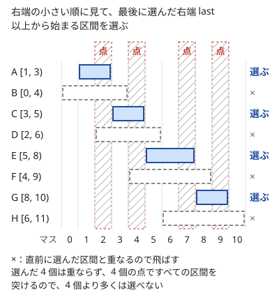

!!! abstract "要点"
    - **何ができるか**：重ならない区間をできるだけ多く選ぶには、右端の小さい順に、選んだ区間と重ならないものを取ればよい。すべての区間を最少の点で突く問題も、右端でソートして右端に点を置く同じ貪欲で解け、2 つの答えは一致する。
    - **いつ使うか**：
        - 重ならない区間をできるだけ多く選ぶ。
        - すべての区間を最少の点（串）で突く。
        - $N \le 2 \times 10^5$ 本の区間で、座標は $10^9$ まで。
    - **計算量**：右端でのソートに $O(N \log N)$、その後の走査は $O(N)$。座標の大きさには依存しない。
    - **前提**：[貪欲法の考え方と正当性](../basics/greedy-basics.md)

<!-- textlint-disable -->
別名：区間スケジューリング問題・区間を点で突く・Activity Selection・interval scheduling
<!-- textlint-enable -->

区間スケジューリングは、時間帯の決まった仕事（区間）の中から、互いに重ならないものをできるだけ多く選ぶ問題である。右端の小さい順に見て、選べるものを選んでいくだけで最適になる。同じ貪欲で「すべての区間を最少の点で突く」問題（区間の串刺し）も解け、選んだ区間の右端がそのまま点の位置になる。

このページでは区間を[半開区間](../guide/glossary.md#half-open-interval) $[l, r)$ で書き、閉区間を使うときは「閉区間 $[l, r]$」と明記する。半開区間の $[1, 3)$ と $[3, 5)$ は端が接するだけで重ならない。

## 右端の順に選ぶ理由（交換論法） {#why-right-end}

区間スケジューリングの貪欲は次のとおりである。最後に選んだ区間の右端を last とし、最初は $-\infty$ にしておく。

```text
区間を右端 r の小さい順に並べる
last = −∞
各区間 [l, r) について順に：
    l ≥ last なら（最後に選んだ区間と重ならないなら）選び、last = r にする
```

右端の順に見ているので、選んだ区間と重なるかは「最後に選んだ区間」とだけ比べれば足りる。それより前に選んだ区間の右端は last 以下なので、$l \ge \mathrm{last}$ ならそれらとも重ならない。

次の図は 8 個の区間を右端の順に並べ、貪欲で選んだ様子である。A・C・E・G の 4 個が選ばれ、ほかの区間は直前に選んだ区間と重なるので飛ばされる。各区間 $[l, r)$ はマス $l$ 〜 $r - 1$ を占め、網かけの列は選んだ区間の右端の直前のマスで、後で述べる[串刺し](#stabbing)の点にあたる。



**なぜ正しいか**。最初に選ぶ区間を考える。右端が最小の区間 $g$ を選んで損をしないことを示せば、残りは「$g$ の右端以降から始まる区間」だけの同じ問題になり、帰納法で全体が正しいと言える。

最適解 $O$ を 1 つ取り、その中で右端が最小の区間を $o$ とする。$O$ から $o$ を除いて $g$ を入れても、個数は変わらない。しかも重なりは生じない。$O$ の区間は互いに重ならず、$o$ の右端が最小なので、$O$ のほかの区間はどれも $o$ の右端以降から始まる。一方、$g$ の右端は $o$ の右端以下だからである。よって $g$ を含む最適解があり、最初に $g$ を選んでよい。これが[交換論法](../basics/exchange-argument.md)で、「最適解を貪欲の選び方に 1 つずつ入れ替えても悪くならない」ことを示している。

直感としては、右端が小さい区間を選ぶほど、後ろに残る時間が長くなる。どの区間を選んでも「1 個」として数えるのは同じなので、後ろに最も多くの余地を残すものを取るのがよい。

**実装**。ソートの比較を右端にすることだけが要点である。

```cpp
--8<-- "interval-scheduling/max-disjoint.cpp:core"
```

右端が同じ区間どうしの順は問わない。右端が同じなら、どちらを選んでも last は同じ値になるからである。左右を反転して「左端の大きい順に選ぶ」も同じ理由で正しい。

## 区間の串刺し（最少の点で突く） {#stabbing}

区間の串刺しは、どの区間にも 1 個以上の点が入るように点を置くとき、点の最少個数を求める問題である。「すべての要望の範囲で橋を 1 本以上壊す」「すべての時間帯に 1 回以上見回る」のように、問題文では点が別の物に言い換えられていることが多い。

閉区間 $[l, r]$ で考えると、手順は次のとおりである。

```text
区間を右端 r の小さい順に並べる
各区間 [l, r] について順に：
    最後に置いた点がこの区間に入っていなければ、点を r に置く
```

右端の順に処理しているので、最後に置いた点 $p$ は今の区間の右端 $r$ 以下にある。だから「点が入っているか」は $l \le p$ を調べるだけで分かる。点を右端に置くのは、まだ突かれていない区間の中で右端が最小のものを突く点のうち、右端に置いたものが後ろの区間を最も多く突くからである。

```cpp
--8<-- "interval-scheduling/stabbing.cpp:core"
```

**最大個数と最少の点の数は一致する**。互いに重ならない区間が $k$ 個あれば、1 個の点はそのうち 1 個しか突けないので、点は $k$ 個以上いる。逆に、区間スケジューリングの貪欲で選んだ $k$ 個の区間に 1 個ずつ点を置くと、すべての区間が突ける。点の位置は区間の表し方で決まる。閉区間なら、貪欲（条件 $l > \mathrm{last}$）で選んだ区間の右端 $r$ に置く。整数の半開区間なら、貪欲（条件 $l \ge \mathrm{last}$）で選んだ区間の右端の直前 $r - 1$ に置く。飛ばした区間は、直前に選んだ区間と重なり、右端はそれ以上なので、その選んだ区間に置いた点を含むからである。だから「重ならない区間の最大個数 ＝ すべてを突く点の最少個数」で、2 つの問題は同じ貪欲で解ける。[右端の順に選ぶ理由](#why-right-end)の図の網かけの列がその点である。

**区間の表し方をそろえる**。整数の点で半開区間 $[l, r)$ を突くなら、入る点は $l, l + 1, \dots, r - 1$ なので、閉区間 $[l, r - 1]$ に直して上の手順を使う。点を $r$ に置くと区間の外になる。

**点の代わりに幅のある範囲で突く**。1 回で幅 $D$ の範囲 $[x, x + D - 1]$ を壊せるなら、まだ壊れていない区間のうち右端が最小のものの右端 $r$ から $[r, r + D - 1]$ を壊せばよい（[例題](#abc230_d)）。理由は点のときと同じで、その区間を壊す範囲は $x \le r$ を満たし、$x = r$ に寄せると右へ最も遠くまで届く。

??? question "確認問題：閉区間のときの不等号"
    閉区間 $[l, r]$ で「重ならない区間の最大個数」を求める。端点を共有する $[1, 3]$ と $[3, 5]$ は重なるとみなす。区間スケジューリングの貪欲の条件 $l \ge \mathrm{last}$ をどう直せばよいか。

    ??? success "答え"
        $l > \mathrm{last}$ にする。閉区間では右端の点 $\mathrm{last}$ も区間に含まれるので、$l = \mathrm{last}$ だと 2 つの区間が点 $\mathrm{last}$ を共有して重なる。整数の閉区間なら、$[l, r + 1)$ と半開区間に直して $l \ge \mathrm{last}$ を使ってもよい。

## 左端の順・長さの順が失敗する例 {#counterexamples}

右端の順以外の自然な基準は、どれも最適にならない。貪欲が正しいかを確かめるには、小さな反例を探すのが早い。

| 選ぶ基準 | 反例（半開区間） | 基準どおりの結果 | 最適 |
| --- | --- | --- | --- |
| 左端の小さい順 | $[0, 10)$・$[1, 2)$・$[3, 4)$ | $[0, 10)$ の 1 個 | 2 個 |
| 長さの短い順 | $[0, 5)$・$[4, 6)$・$[5, 10)$ | $[4, 6)$ の 1 個 | 2 個 |
| 重なる相手の少ない順 | 10 個あまりの区間で作れる | 最適より少ない | — |

- **左端の小さい順**：早く始まる区間が長いと、その間に収まる短い区間をすべて失う。始まりの早さは、後ろに残る時間を表していない
- **長さの短い順**：短い区間が 2 つの区間の境目にまたがると、1 個を選ぶために 2 個を失う
- **重なる相手の少ない順**：小さな例では正しく見えるが、反例がある。手で探しにくい誤りなので、[全探索との比較](../guide/stress-testing.md)で確かめるのがよい

どの基準も「選んだ区間の右端」を直接小さくしていないことが失敗の原因である。交換論法で入れ替えた $g$ が $o$ と同じように後ろを妨げないのは、右端を比べたときだけである。

??? question "確認問題：左端の大きい順"
    左端の大きい順に見て、選んだ区間と重ならないものを選ぶ貪欲は正しいか。

    ??? success "答え"
        正しい。数直線を左右に反転すると、左端の大きい順は右端の小さい順になる。重なりの関係は反転しても変わらないので、右端の順の貪欲と同じ理由で最適である。

## 処理時間と締め切りがある場合（優先度付きキューの貪欲へ） {#deadlines}

区間スケジューリングでは、各仕事の時間帯が決まっている。仕事に処理時間 $p_i$ と締め切り $d_i$ だけがあり、いつ始めるかを自分で決められる問題は別の型で、右端でソートするだけでは解けない。よく出るのは次の 3 つである。

- **すべての仕事を締め切りまでに終えられるか**：締め切りの早い順に処理すればよい。隣り合う 2 つの順を入れ替えても悪くならないことを示す、[交換論法](../basics/exchange-argument.md)の典型である
- **締め切りまでに終えられる仕事の数を最大にする**：締め切りの早い順に仕事を加えていき、処理時間の合計が今の締め切りを超えたら、加えた中で処理時間の最も長いものを捨てる。捨てる候補を最大値の取り出せる[優先度付きキュー](../ds/priority-queue.md)で持つ
- **開始可能な時刻と締め切りを持つ処理時間 1 の仕事を、締め切りまでにできるだけ多く処理する**：時刻を進めながら、始められるようになった仕事をキューに入れ、締め切りの最も早いものから処理する（取り出した仕事の締め切りが過ぎていれば捨てる）

どれも「締め切りの早いものを優先する」点で区間スケジューリングの右端の順と同じ考え方だが、選んだものを後から捨てる・入れるといった操作が加わる。詳しくは[優先度付きキューを使う貪欲](../basics/greedy-priority-queue.md)にまとめる。

## 区間に重みがあるなら DP {#weighted}

区間ごとに重み（報酬）$w_i$ があり、重ならない区間の重みの和を最大にするなら、貪欲は使えない。$[0, 10)$ の重みが 5、$[1, 2)$ と $[3, 4)$ の重みが 1 なら、右端の順の貪欲は 2 個を選んで 2 になるが、最適は $[0, 10)$ だけの 5 である。個数を数えるときは「どの区間も 1 個」で同じだったから入れ替えられたが、重みがあると入れ替えで和が減る。

この場合は右端の順に並べて [DP](../dp/dp-basics.md) をする。

$$
\mathrm{dp}[i + 1] = \max\bigl(\mathrm{dp}[i],\ \mathrm{dp}[j] + w_i\bigr)
$$

- **状態**：$\mathrm{dp}[i]$ ＝ 右端の小さい方から $i$ 個の区間だけを使うときの、重みの和の最大。$\mathrm{dp}[0] = 0$ で、答えは $\mathrm{dp}[N]$
- **遷移**：区間 $i$ を選ばないなら $\mathrm{dp}[i]$。選ぶなら、右端が $l_i$ 以下の区間とだけ組める。そのような区間は並べた列の先頭の $j$ 個なので、$\mathrm{dp}[j] + w_i$
- **計算量**：$j$ は右端の列を[二分探索](../basics/binary-search.md)して求めるので、全体で $O(N \log N)$

```cpp
--8<-- "interval-scheduling/weighted.cpp:core"
```

座標が $2 \times 10^5$ 程度までなら、「$\mathrm{dp}[t]$ ＝ 時刻 $t$ までに終わる区間だけを使うときの最大」と時刻を添字にしてもよい。座標が大きいときは[座標圧縮](../basics/coordinate-compression.md)してから同じ DP をする。

## 落とし穴 {#pitfalls}

**`pair` をそのままソートする**。`pair<l, r>` の既定の比較は左端が先なので、`sort` するだけでは左端の順の誤った貪欲になる。比較関数で右端を比べるか、`pair<r, l>` の順に入れてからソートする。

**閉区間と半開区間で不等号を取り違える**。端点を共有する 2 区間を重なるとみなすかは問題で決まる。問題文の区間が閉区間なら、重ならない条件は $l > \mathrm{last}$ である。半開区間に直すときは $[l, r + 1)$ にし、どちらで書いているかをコメントに残す。

**last の初期値が区間と衝突する**。last を 0 で始めると、座標に 0 があり、閉区間で $l > \mathrm{last}$ を使うとき、$l = 0$ の区間を選べなくなる。座標の下限より小さい値（`LLONG_MIN` や $-1$）を[番兵](../guide/glossary.md#sentinel)にするか、「まだ選んでいない」ことを別の変数で持つ。

**串刺しの点を半開区間の右端に置く**。整数の点で半開区間 $[l, r)$ を突くとき、$r$ は区間の外である。置く位置は $r - 1$ で、閉区間に直してから考えると間違えにくい。

**区間の向きを確かめない**。入力が「2 点 $a$・$b$」で与えられ、$a > b$ もありうるなら、入れ替えて $l \le r$ にしてから使う。

## 確認問題 {#quiz}

??? question "確認問題：島と橋"
    島 $1, 2, \dots, N$ が一列に並び、橋 $j$ は島 $j$ と $j + 1$ を結ぶ。要望「島 $a$ と島 $b$（$a < b$）を行き来できなくする」を満たすには、どの橋の区間を突けばよいか。閉区間で答えよ。

    ??? success "答え"
        橋の番号の閉区間 $[a, b - 1]$ である。島 $a$ から島 $b$ へ行くには橋 $a, a + 1, \dots, b - 1$ をすべて渡るので、そのどれか 1 本を壊せばよい。区間を右端 $b - 1$ の小さい順に並べ、最後に壊した橋がこの区間になければ橋 $b - 1$ を壊す。

## 使い分け {#comparison}

- **重ならない区間の最大個数・すべてを突く点の最少個数**：このページの右端の順の貪欲
- **区間に重みがある**：右端の順に並べて DP（[区間に重みがあるなら DP](#weighted)）
- **すべての区間を割り当てる部屋・機械の最少数**：答えは、ある点を同時に含む区間の数の最大である。端点で $+1$・$-1$ を数える[いもす法](../basics/imos.md)か[イベントソート](../basics/event-sort.md)で求める
- **ある範囲を区間の和集合で覆う最少の本数**：串刺しとは逆向きの問題である。今まで覆えた所までに左端がある区間のうち、右端が最も遠いものを選ぶことを繰り返す
- **時間帯が決まっておらず、処理時間と締め切りがある**：[優先度付きキューを使う貪欲](../basics/greedy-priority-queue.md)

## 例題 {#examples}

### ABC230 D. Destroyer Takahashi {#abc230_d}

<div class="kp-problems" data-role="example" markdown>

- [ABC230 D. Destroyer Takahashi](https://atcoder.jp/contests/abc230/tasks/abc230_d)（diff 963）：幅 D のパンチで、区間状の壁をすべて壊すための最小の回数を求める。

</div>

壁は閉区間 $[L_i, R_i]$ で、1 回のパンチは幅 $D$ の範囲を壊すので、点の代わりに幅 $D$ の範囲で突く串刺しである。右端の小さい順に壁を見て、まだ壊れていない壁があれば、その右端からパンチを打つ。右端が最小の壊れていない壁は必ずどこかで打つ必要があり、その壁を壊せる範囲のうち右端から打つものが、後ろの壁を最も多く巻き込む。

??? note "解法の詳細"
    - 壁を右端 $R_i$ の小さい順に並べる。最後のパンチで壊れた範囲の右端を $e$ とし、最初は $-\infty$ にしておく。
    - 壁 $[L_i, R_i]$ について、$L_i \le e$ ならすでに壊れている。右端の順に見ているので、最後のパンチの範囲 $[e - D + 1, e]$ の左端は $R_i$ 以下にあり、$L_i \le e$ だけで重なりを判定できる。
    - $L_i > e$ なら、$x = R_i$ でパンチを打って回数を 1 増やし、$e = R_i + D - 1$ にする。
    - 打つ位置を $x = R_i$ にしてよい理由：この壁を壊すパンチは $x \le R_i$ を満たす。まだ残っている壁はどれも右端が $R_i$ 以上なので、$x$ を $R_i$ まで右へ寄せても、壊せていた壁を壊せなくなることはなく、右へ届く範囲は広がる。
    - 計算量はソートの $O(N \log N)$ が支配的で、走査は $O(N)$ で済む。$R_i + D - 1$ は `long long` で計算する。

## 練習問題 {#practice}

<div class="kp-problems" data-role="practice" markdown>

- [ARC106 C. Solutions](https://atcoder.jp/contests/arc106/tasks/arc106_c)（diff 1225）：区間の選び方の正しい方法と誤った方法で答えの差がちょうど M になるような、区間の集合を作る。
- [ABC103 D. Islands War](https://atcoder.jp/contests/abc103/tasks/abc103_d)（diff 1278）：要望ごとの区間すべてで橋を 1 本以上取り除くための、最小の本数を求める。

</div>

??? note "練習の方針"
    - **ARC106 C**：正しい方法は右端の順、誤った方法は左端の順の貪欲である。右端の順は最適なので差は負にならない。差を $M$ にするには、左端が最も小さい長い区間 1 本の中に、短い区間を $M + 1$ 個入れ、残りは長い区間の外に重ならないよう並べる。この構築は $M \ge 1$ のためのもので、$M = 0$ は重ならない区間を $N$ 個並べるだけなので先に分けておく。左端の順は長い区間を取って中の $M + 1$ 個を失い、右端の順は長い区間だけを失う。$M$ が負のときや大きすぎるときに作れない理由も、2 つの貪欲の動きから考える
    - **ABC103 D**：要望 $(a, b)$ は橋の番号の閉区間 $[a, b - 1]$ を突く問題になる（[確認問題](#quiz)）。右端の順に見て、最後に壊した橋が区間になければ橋 $b - 1$ を壊す

## 参考 {#references}

- [oraclesqlpuzzle「ABC230-D Destroyer Takahashi」](https://oraclesqlpuzzle.ninja-web.net/kyoupro/05-atcoder-02-abc/kyoupro-abc230-d.html)：例題の方針（右端の順に、壊れていない壁の右端から打つ）
- [drken「AtCoder ABC 103 D - Islands War (1Q, 水色, 400 点)」](https://drken1215.hatenablog.com/entry/2018/07/21/224200)：区間の串刺しと区間スケジューリングの答えが一致すること（弱双対性・強双対性）、練習の方針
- [drken「AtCoder ARC 106 C - Solutions (水色, 500 点)」](https://drken1215.hatenablog.com/entry/2020/10/25/002400)：練習の方針（右端の順と左端の順の差を作る構築と、作れない場合）
