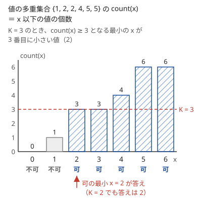

!!! abstract "要点"
    - **何ができるか**：$N^2$ 個の積・和のように全部は列挙できない値の $K$ 番目を、「$x$ 以下の個数 $\ge K$」となる最小の $x$ として二分探索で求める。$x$ 以下の個数を速く数えられることが条件になる。
    - **いつ使うか**：
        - $N^2$ 個（以上）の値の $K$ 番目。
        - 大きい方から $M$ 個の和。
        - $N \le 2 \times 10^5$ で、$K$ が $N^2$ 程度まで大きい。
        - 全部は列挙できないが「$x$ 以下が何個あるか」は数えられる。
    - **計算量**：$x$ 以下の個数を 1 回数える計算量を $C$、値の範囲の幅を $V$ として $O(C \log V)$。2 つの列の積・和なら、ソートの後 $O(N \log N \log V)$（尺取りで数えれば $O(N \log V)$）。
    - **前提**：[答えで二分探索](../basics/binary-search-answer.md)、[尺取り法](../basics/two-pointers.md)

<!-- textlint-disable -->
別名：K 番目を二分探索で求める・順位を数える・N^2 個の K 番目・K-th smallest
<!-- textlint-enable -->

K 番目の値は、値を並べる代わりに「$x$ 以下の値は何個あるか」を数え、その個数が初めて $K$ に届く $x$ を[答えで二分探索](../basics/binary-search-answer.md)によって探す方法である。全体を並べるのは無理でも、個数を数えるだけなら、ソートや式を使って速くできることが多い。難しいのは二分探索ではなく、個数の数え方である。

## なぜ count(x) ≥ K となる最小の x が答えか {#why-count}

$N = 2 \times 10^5$ 個の整数から 2 つ選んだ積は約 $2 \times 10^{10}$ 個ある。全部を作ってソートすると、メモリと時間のどちらも足りない。そこで、値の[多重集合](../guide/glossary.md#multiset) $S$（同じ値を何度も含んでよい集合）について、次の関数を考える。

$$
\mathrm{count}(x) = (S \text{ の中で } x \text{ 以下の値の個数})
$$

$\mathrm{count}(x)$ は $x$ について広義単調増加である。$x$ が $S$ の値を通り過ぎるたびに、その値の個数だけ増える階段になる。次の図は $S = \{1, 2, 2, 4, 5, 5\}$ の $\mathrm{count}(x)$ である。



$S$ を小さい順に $c_1 \le c_2 \le \dots \le c_T$ と並べると、$K$ 番目の値 $c_K$ は「$\mathrm{count}(x) \ge K$ となる最小の $x$」に等しい。理由は次の 2 つである。

- $\mathrm{count}(c_K) \ge K$：$c_1, \dots, c_K$ はどれも $c_K$ 以下だからである。
- $x < c_K$ なら $\mathrm{count}(x) \le K - 1$：$x$ 以下の値は $c_K$ より小さいので $c_1, \dots, c_{K-1}$ の中にしかない。

つまり「$K$ 番目の値 $\le x$」と「$\mathrm{count}(x) \ge K$」は同じ条件であり、判定 $\mathrm{count}(x) \ge K$ は $x$ について単調である。ok を「$\mathrm{count} \ge K$ が成り立つ側」、ng を「成り立たない側」として[二分探索](../basics/binary-search.md)すれば、最後の ok が答えになる。

- **番兵**：ng は最小の値より小さい値（$\mathrm{count} = 0$）、ok は最大の値以上の値（$\mathrm{count} = T$）に置く。値に負の数があるなら ng も負にする。
- **答えは必ず $S$ の値になる**：整数の $x$ をすべて候補にして探しても、$\mathrm{count}$ が増えるのは $S$ の値の位置だけなので、求まる最小の $x$ は $S$ に含まれる値である。
- **大きい方から $K$ 番目**：「$x$ 以上の値の個数 $\ge K$」となる最大の $x$ を探す。全体の個数 $T$ が分かるなら、小さい方から $T - K + 1$ 番目と言い換えてもよい。

## 数え方の型（ソート＋二分探索・尺取り、符号で場合分け、包除） {#counting-patterns}

$\mathrm{count}(x)$ の数え方は、値の作られ方で決まる。二分探索で $\mathrm{count}$ を $O(\log V)$ 回（$V = 2 \times 10^{18}$ でも約 61 回）呼ぶので、1 回を $O(N \log N)$ 以下にするのが目安である。

**ソート＋二分探索・尺取り（2 つの列の積・和）**。値が $a_i \times b_j$（すべて正）なら、$a_i$ を固定すると条件は $b_j \le \lfloor x / a_i \rfloor$ になる。$b$ をソートしておけば、$i$ ごとに `upper_bound` で数えられる（[個数の数え方](../basics/binary-search.md#lower-bound)）。1 回 $O(N \log N)$ である。さらに $a$ もソートすると、$a_i$ が大きくなるほど境目 $\lfloor x / a_i \rfloor$ は小さくなる。$b$ の上の位置を戻さずに動かせるので、[尺取り法](../basics/two-pointers.md)で 1 回 $O(N)$ に減る。和 $a_i + b_j$ も、条件 $b_j \le x - a_i$ で同じように数える。

**符号で場合分け（負の数を含む積）**。値に負の数や 0 があると、$a_i$ を固定したときの $a_i \times a_j$ の増え方が $a_i$ の符号で変わる。並べた列 $a$ の上で、条件を満たす $j$ の範囲は次のようになる。

| $a_i$ の符号 | $a_i \times a_j$ の動き（$j$ を増やす） | $a_i a_j \le x$ となる $j$ |
| --- | --- | --- |
| 正 | 増える | 先頭の部分 |
| 負 | 減る | 末尾の部分 |
| 0 | いつも 0 | $x \ge 0$ ならすべて、そうでなければなし |

割り算 $x / a_i$ で境目を作ると、負の数の切り捨ての向きを間違えやすい。積が `long long` に収まるなら、掛け算で比べて境目を二分探索する方が安全である。$i < j$ の組だけを数えるときは、順序付きの組 $(i, j)$ をすべて数えてから、$i = j$ の分（$a_i^2 \le x$ となる $i$ の個数）を引いて 2 で割る。

```cpp
--8<-- "kth-value/pair-product.cpp:core"
```

完全なプログラム：[`pair-product.cpp`](https://github.com/yuukougun/kyopro-atlas/blob/main/snippets/kth-value/pair-product.cpp)（GitHub）
{ .kp-code-src }

**包除（倍数や欠けた数）**。数える対象が「$N$ か $M$ のちょうど一方で割り切れる数」のように集合の演算で決まるなら、$\lfloor x / N \rfloor$ のような式の足し引きで $O(1)$ で数えられる。「列に含まれない正の整数」なら、$x$ 以下の正の整数 $x$ 個から列の中で $x$ 以下のものを引けばよい。どちらも、個数の式が立てば後は同じ二分探索である。

??? question "確認問題：符号で場合分けの表"
    ソート済みの $a = (a_0, \dots, a_4) = (-3, -1, 0, 2, 5)$（0-indexed）と $x = -2$ を考える。$a_0 = -3$ について $a_0 a_j \le -2$ となる $j$ はどれか。$a_2 = 0$ についてはどうか。

    ??? success "答え"
        $a_0 a_j$ は $j$ の順に $9, 3, 0, -6, -15$ と減るので、$-2$ 以下になるのは末尾の $j = 3, 4$ の 2 個である。$a_2 = 0$ との積はいつも 0 で、$x = -2 < 0$ なので 1 個もない。

## 上位 M 個の和（同じ値の分の調整） {#top-m-sum}

「大きい方から $M$ 個の値の和」は、$M$ 番目に大きい値 $t$ が分かれば求まる。全部を並べなくてよいのは、上位 $M$ 個の中身が $t$ だけで決まるからである。

- $t$ より大きい値はすべて上位 $M$ 個に入る。その個数 $c$ は $M$ 未満である（$M$ 個以上あれば $M$ 番目は $t$ より大きくなる）。
- 残りの $M - c$ 個の枠は、値がちょうど $t$ のもので埋まる。$t$ に等しい値が何個あっても、どれを選んでも和は同じである。

よって答えは「$t$ より大きい値の和 $+ (M - c) \times t$」になる。$t$ は「$x$ 以上の値の個数 $\ge M$」となる最大の $x$ として二分探索で求め、$c$ と和は $x = t + 1$ で数える。値が $a_i + b_j$ なら、$b$ をソートして末尾からの累積和を作っておく。$a_i$ を固定すると、$b_j \ge x - a_i$ となる $j$ は末尾の部分になる。その個数を $k$ とすれば、和は $a_i \times k + (\text{末尾の } k \text{ 個の } b \text{ の和})$ である。

```cpp
--8<-- "kth-value/top-m-sum.cpp:core"
```

完全なプログラム：[`top-m-sum.cpp`](https://github.com/yuukougun/kyopro-atlas/blob/main/snippets/kth-value/top-m-sum.cpp)（GitHub）
{ .kp-code-src }

$c$ を「$t$ 以上の値の個数」で数えると、$t$ に等しい値をすべて足してしまい、$M$ 個を超える。$t$ ちょうどの値が何個あるかは問題によって大きく変わるので、必ず「$t$ より大きい」と「ちょうど $t$」に分ける。

## 落とし穴 {#pitfalls}

**$\mathrm{count}(x) = K$ となる $x$ を探す**。同じ値が複数あれば $\mathrm{count}$ は 1 段で 2 以上増えるので、$\mathrm{count}(x) = K$ となる $x$ は存在しないことがある。図の $K = 2$ では $\mathrm{count}(1) = 1$、$\mathrm{count}(2) = 3$ である。判定は必ず「$\ge K$」にする（[判定の単調性](../basics/binary-search-answer.md#monotonicity)）。

**「以下」と「未満」の取り違え**。$\mathrm{count}$ を「$x$ 未満の個数」で数えたなら、答えは「$x$ 未満の個数 $< K$」となる最大の $x$ である。判定の形と答えの側（最小の ok か最大の ok か）を組で決め、片方だけ変えない。迷ったら、図のような小さな例で $K = 1$ と $K = T$ を手で確かめる。

**$K$ の数え始め**。問題によっては「0 番目から数えて $K$ 番目」や「大きい方から $K$ 番目」を問う。0 番目から数えるなら判定を $\ge K + 1$ にし、大きい方からなら[前の節](#why-count)の言い換えを使う。

**番兵の置き場所**。値に負の数があるのに ng $= 0$ や ng $= -1$ から始めると、答えが負のとき見つからない。積なら ng を「積の下限 $- 1$」（$\lvert a_i \rvert \le 10^9$ なら $-10^{18} - 1$）にする。

**負の数の割り算**。C++ の `/` は 0 の向きに切り捨てる。$x$ と $a_i$ の符号が違い、割り切れないときは、`x / a[i]` が $\lfloor x / a_i \rfloor$ と一致しない。例えば `5 / -2` は $-2$ だが、$\lfloor -2.5 \rfloor = -3$ である。負の $a_i$ との積を数えるこのページの型では、$x > 0$ でも起きる。割り算で境目を作るなら[負の数でも正しい floor_div](../math/integer-division.md#floor-ceil) を使うか、掛け算で比べる。

**個数と積のオーバーフロー**。個数は $N^2 = 4 \times 10^{10}$ に届くので `int` ではあふれる。値の絶対値が約 $3 \times 10^9$ を超えると、積は `long long` にも収まらない（上限は約 $9.2 \times 10^{18}$）。そのときは割り算で比べるか `__int128` を使う（[積が上限を超えるかの判定](../cpp/cpp-integer-overflow.md#overflow-check)）。

**組の数え方**。$i < j$ の組を順序付きの組で数えると、$i = j$ の分と 2 回ずつの重複が入る。逆に「同じ人を 2 回選んでよい」「$(i, j)$ と $(j, i)$ を別に数える」問題もある。何を 1 個と数えるかを問題文で確かめ、小さな例の全列挙と照らす。

## 例題 {#examples}

### ABC341 D. Only one of two {#abc341_d}

<div class="kp-problems" data-role="example" markdown>

- [ABC341 D. Only one of two](https://atcoder.jp/contests/abc341/tasks/abc341_d)（diff 829）：N か M のちょうど一方で割り切れる正の整数のうち、小さい方から K 番目を求める。

</div>

$K$ が大きく、条件を満たす数を 1 つずつ数え上げると間に合わない。$x$ 以下で条件を満たす数の個数は、倍数の個数の包除を使えば $O(1)$ で求まる。これが $K$ 以上になる最小の $x$ を二分探索する。

??? note "解法の詳細"
    - $L = \operatorname{lcm}(N, M)$ とする。$x$ 以下で $N$ の倍数は $\lfloor x / N \rfloor$ 個、$M$ の倍数は $\lfloor x / M \rfloor$ 個で、両方の倍数（$L$ の倍数）は両方に数えられている。「ちょうど一方」からは両方の倍数を除くので、$\mathrm{count}(x) = \lfloor x / N \rfloor + \lfloor x / M \rfloor - 2 \lfloor x / L \rfloor$ である。
    - $L$ は `N / gcd(N, M) * M` の順で計算する（先に掛けると大きくなる）。
    - 上限の見積もり：$N \ne M$ なので、大きい方を $P$、小さい方を $Q$ とする。$Q$ が $P$ を割り切らなければ $L \ge 2P$ で、$P$ の倍数のうち $L$ の倍数は多くとも 1 つおきである。$Q$ が $P$ を割り切るなら、$Q$ の倍数のうち $P$ の倍数は $P / Q \ge 2$ 個に 1 つである。どちらでも $2KP$ 以下に条件を満たす数が $K$ 個以上あるので、ok $= 2KP$ を番兵にできる。ng $= 0$ である。制約の範囲で $2KP$ が `long long` に収まることを確かめておく（約 61 回という回数も、この大きさから来る）。
    - 二分探索は約 61 回、各回 $O(1)$ である。

### ABC155 D. Pairs {#abc155_d}

<div class="kp-problems" data-role="example" markdown>

- [ABC155 D. Pairs](https://atcoder.jp/contests/abc155/tasks/abc155_d)（diff 1845）：N 個の整数から 2 つを選んだ積を小さい順に並べたときの K 番目を求める。

</div>

$N \le 2 \times 10^5$ で組は約 $2 \times 10^{10}$ 個あり、並べられない。$x$ 以下の積の個数を数えて二分探索する。値に負の数と 0 があるので、[数え方の型](#counting-patterns)の符号の場合分けを使う。

??? note "解法の詳細"
    - $A$ をソートする。各 $i$ について、$A_i$ の符号で「先頭の部分」「末尾の部分」「すべてかなし」を分ける。$A_i A_j \le x$ となる $j$ の個数は、掛け算の比較による二分探索で数える（$\lvert A_i \rvert \le 10^9$ なので積は `long long` に収まる）。
    - 合計から $A_i^2 \le x$ となる $i$ の個数を引き、2 で割ると $i < j$ の組の個数になる。
    - 番兵は ng $= -10^{18} - 1$、ok $= 10^{18}$。$\mathrm{count}(x) \ge K$ なら ok、そうでなければ ng を動かす。
    - 1 回の数え上げは $O(N \log N)$ で、二分探索は約 61 回なので、全体の計算量は $O(N \log N \log V)$ である。コードは[数え方の型](#counting-patterns)のものと同じ形である。

## 練習問題 {#practice}

<div class="kp-problems" data-role="practice" markdown>

- [ABC205 D. Kth Excluded](https://atcoder.jp/contests/abc205/tasks/abc205_d)（diff 713）：数列に含まれない正の整数のうち、小さい方から K 番目を答えるクエリに答える。
- [ABC364 D. K-th Nearest](https://atcoder.jp/contests/abc364/tasks/abc364_d)（diff 1136）：数直線上の N 点と Q 個の質問点について、質問点から K 番目に近い点までの距離を答える。
- [ARC037 C. 億マス計算](https://atcoder.jp/contests/arc037/tasks/arc037_c)（diff 1824・参考値）：a_i × b_j の N^2 個の値のうち、小さい方から K 番目を求める。

</div>

??? note "練習の方針"
    - **ABC205 D**：$x$ 以下の「含まれない数」の個数は、$x$ から「列の中で $x$ 以下のもの」の個数を引いたものである。後者は `upper_bound` で数えられるので、クエリごとに二分探索する。各 $A_i$ の手前にある「含まれない数」の個数 $A_i - i$（$i$ は 1-indexed）を前計算すれば、1 クエリ $O(\log N)$ にもできる。
    - **ABC364 D**：質問点 $b$ について、距離 $d$ 以内の点の個数は、ソートした座標の上で閉区間 $[b - d, b + d]$ に入る個数で、`upper_bound` と `lower_bound` の差で数えられる。この個数は $d$ について単調に増えるので、個数が $K$ 以上になる最小の $d$ を答えで二分探索する。1 クエリ $O(\log N \log X)$（$X$ は座標の幅）である。
    - **ARC037 C**：値はすべて正なので、$a_i$ を固定すると条件は $b_j \le \lfloor x / a_i \rfloor$ になる。$b$ をソートして `upper_bound` で数える。答えは $10^{18}$ 以下なので、ok の番兵は $10^{18}$ でよい。

## 力試し {#challenge}

<div class="kp-problems" data-role="challenge" markdown>

- [ABC149 E. Handshake](https://atcoder.jp/contests/abc149/tasks/abc149_e)（diff 1905）：2 人の組（握手）の値のうち、大きい方から M 組の和を求める。

</div>

??? note "力試しの方針"
    - **ABC149 E**：値は 2 人の値の和で、[上位 M 個の和](#top-m-sum)の形そのものである。組は同じ人どうしを含む順序付きの $N^2$ 通りなので、コードで $b = a$ とすればよい。$M$ 番目に大きい和 $t$ を二分探索する。$t$ より大きい和は累積和でまとめて足し、足りない分を $t$ で埋める。

## 確認問題 {#quiz}

??? question "確認問題：count(x) = K で止めてよいか"
    値が $\{3, 3, 3, 8\}$ で $K = 2$ のとき、「$\mathrm{count}(x) = K$ となる $x$ を探す」二分探索は何を返すか。

    ??? success "答え"
        $\mathrm{count}(x)$ は $x < 3$ で 0、$3 \le x < 8$ で 3、$x \ge 8$ で 4 である。$\mathrm{count}(x) = 2$ となる $x$ はない。探索は見つからずに終わるか、でたらめな値を返す。正しくは「$\mathrm{count}(x) \ge 2$ となる最小の $x$」で、答えは 3 である。

??? question "確認問題：大きい方から K 番目"
    値の多重集合 $S$（$T$ 個）で、大きい方から $K$ 番目を求めたい。$\mathrm{count}(x)$（$x$ 以下の個数）だけを使うなら、どんな判定にすればよいか。

    ??? success "答え"
        大きい方から $K$ 番目は、小さい方から $T - K + 1$ 番目である。判定を $\mathrm{count}(x) \ge T - K + 1$ にして最小の $x$ を探す。$T$ が数えられないときは、「$x$ 以上の個数 $\ge K$」となる最大の $x$ を直接探す。

??? question "確認問題：上位 M 個の和で t 以上を数えると"
    値が $\{9, 7, 7, 7, 2\}$ で $M = 2$ のとき、$t = 7$ である。「$t$ 以上の値の和」をそのまま答えにすると何が起きるか。

    ??? success "答え"
        $9 + 7 + 7 + 7 = 30$ になり、正しい答え $9 + 7 = 16$ より大きい。$t$ より大きい値（9 の 1 個、$c = 1$）の和 9 に、$(M - c) \times t = 7$ を足して 16 とする。

## 使い分け {#comparison}

- $K$ が $2 \times 10^5$ 程度までと小さいなら、小さい順に 1 つずつ取り出す方が素直である（[小さい順に K 個を列挙する](../basics/greedy-priority-queue.md#k-best)）。$K$ が $N^2$ 程度まで大きいときに、このページの方法を使う。
- 集合に追加・削除があり、そのたびに $K$ 番目を答えるなら、値ごとの個数を BIT などで持つ（[K 番目の値を求めるデータ構造](../ds/kth-element.md#vs-kth-value)）。
- 列の区間ごとに $K$ 番目を答えるなら、[Wavelet Matrix](../ds/wavelet-matrix.md) などの区間のデータ構造を使う。
- 比や平均の $K$ 番目は、「比 $\ge x$」を和の符号に言い換えてから個数を数える（[平均・比の最大化](../basics/fractional-binary-search.md#ratio)）。

## 参考 {#references}

- [oraclesqlpuzzle「ABC340-D Only one of two」](https://oraclesqlpuzzle.ninja-web.net/kyoupro/05-atcoder-02-abc/kyoupro-abc341-d.html)：例題 abc341_d の包除による個数の式と二分探索（記事の題の ABC340 は誤記で、中身は abc341_d）
- [drken「AtCoder ABC 155 D - Pairs (1Q, 青色, 400 点)」](https://drken1215.hatenablog.com/entry/2020/04/23/142200)：例題 abc155_d の符号による場合分けと、自分自身との組・重複の除き方
- [drken「AtCoder ARC 037 C - 億マス計算 (試験管青色)」](https://drken1215.hatenablog.com/entry/2021/07/03/041500)：練習 arc037_c の数え方と番兵
- [drken「AtCoder ABC 205 D - Kth Excluded (2Q, 茶色, 400 点)」](https://drken1215.hatenablog.com/entry/2024/05/20/004045)：練習 abc205_d の欠けた数の個数と前計算
- [hamayan「Handshake [AtCoder Beginner Contest 149 E]」](https://blog.hamayanhamayan.com/entry/2020/01/01/024415)：力試し abc149_e の M 番目の値と累積和、同じ値の分の調整
- [kmjp「AtCoder ABC #149 : E - Handshake」](https://kmjp.hatenablog.jp/entry/2019/12/30/0900)：力試し abc149_e の組の数え方（同じ人の組を含み、順序を区別する）
