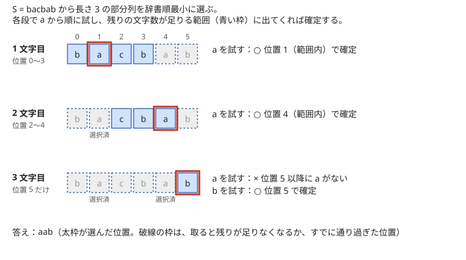

!!! abstract "要点"
    - **何ができるか**：条件を満たすもののうち辞書順最小を、先頭から 1 つずつ「小さい候補から試し、残りで条件を満たせるならその候補に確定」で作る。残りで実現できるかの判定を速く正しく行うことが問題の本体になる。
    - **いつ使うか**：
        - 辞書順最小（最大）の文字列・列を出力する（なければ −1）。
        - 条件を満たす中で最も小さいもの。
        - 辞書順で K 番目。
    - **計算量**：長さ $L$、各位置の候補 $\sigma$ 種類、判定 1 回 $T$ として $O(L \sigma T)$。判定を前計算の表や個数で $O(1)$ にすれば $O(L \sigma)$ になる。
    - **前提**：[貪欲法の考え方と正当性](../basics/greedy-basics.md)

<!-- textlint-disable -->
別名：辞書順最小・lexicographically smallest・辞書順 K 番目・先頭から貪欲に決める
<!-- textlint-enable -->

辞書順最小を前から決める貪欲は、答えの文字列や列を先頭から 1 文字ずつ確定させていく方法である。各位置では小さい候補から順に試し、「この候補を置いても、残りをうまく決めれば条件を満たせるか」を判定して、最初に通った候補で確定する。貪欲の部分はどの問題でも同じ形で、問題ごとに違うのは判定の作り方である。

## 先頭から決める理由（辞書順の性質） {#why-front}

[辞書順](../string/string-basics.md)では、2 つの文字列を先頭から比べ、最初に異なる位置の文字の大小で全体の大小が決まる。後ろの文字がどれほど小さくても、手前の 1 文字の差は覆らない。だから辞書順最小を求めるには、まず先頭をできるだけ小さくし、その中で 2 文字目をできるだけ小さくし、…と前から順に決めればよい。

ただし「できるだけ小さく」は「条件を満たす完成形がある範囲で」という意味である。そこで次の手順をとる。

```text
P ← 空の接頭辞
各位置について：
    候補 c を小さい順に試す：
        P + c で始まり、条件を満たす完成形が 1 つでもあるなら
            P ← P + c として次の位置へ（以降の候補は試さない）
    どの候補も通らなければ、条件を満たすものは存在しない（−1 を出力する）
```

保つ性質は「$P$ は答え（条件を満たすものの辞書順最小）の接頭辞である」ことだ。最初は空なので成り立つ。$P$ が答えの接頭辞なら、答えの次の文字は「$P + c$ で始まる完成形がある最小の $c$」である。それより小さい $c'$ で始まる完成形はない。また $c$ より大きい文字で始まるものは、$c$ で始まる完成形のどれよりも大きい。したがって判定に通った最初の候補を足しても性質は保たれ、最後に $P$ が答えそのものになる。

この議論では、判定が正しいこと（完成形が本当にあるときだけ通すこと）しか使っていない。判定を省いて最小の文字を置くと、後で条件を満たせなくなって行き止まる（[落とし穴](#pitfalls)）。逆に、判定さえ正しく速く作れれば、どんな条件でもこの手順で答えが出る。

最大を求めるときは候補を大きい順に試せばよい。長さが決まっていない問題では、「ここで終わる」も候補の 1 つになる。接頭辞は元の文字列より小さいので（"ab" < "abc"）、最小を求めるなら「終わる」を最初に試す。



図は、文字列 $S$ の長さ $K$ の部分列のうち辞書順最小を求める例である（詳しくは[次の節](#feasibility)）。3 文字目では a を試したが、位置 5 以降に a がないので判定に落ち、次の b に決まっている。

??? question "確認問題：辞書順最小がない場合"
    「a と b からなり、b を含む文字列」全体（長さは自由）には辞書順最小のものがあるか。

    ??? success "答え"
        ない。b・ab・aab・aaab・… はどれも条件を満たし、後のものほど辞書順で小さいので、いくらでも小さいものがある。長さに上限がない集合では、先頭から決める手順が「a を置いても完成できる」と判定し続けて止まらない。問題が長さを決めているか、候補が有限であることを確かめてから使う。

## 残りで実現できるかの判定（次の出現位置の表・個数の数え上げ） {#feasibility}

判定は「確定した接頭辞 $P$ に候補 $c$ を足したとき、残りを決めて条件を満たせるか」という存在の問いである。素直に残りを全探索すると間に合わないので、多くの問題では残りの側を数や表に要約して $O(1)$ か $O(\sigma)$（$\sigma$ は文字の種類数）で答える。代表的な要約は次の 3 つである。

- **残りの長さ・個数で決まる**：長さ $N$ の文字列 $S$ から長さ $K$ の部分列を取るとき、$j$ 文字目（0-indexed）を位置 $p$ から取ると、後ろには $N - 1 - p$ 文字が残る。残り $K - 1 - j$ 文字がそろう条件は $p \le N - K + j$ である。判定は位置の比較 1 回になる
- **次の出現位置の表**：$\mathrm{nxt}[i][c]$ を「位置 $i$ 以降で文字 $c$ が最初に現れる位置（なければ番兵 $N$）」とすると、候補 $c$ を取れる最も前の位置が $O(1)$ で分かる。表は後ろから $O(\sigma N)$ で作れる（[部分列の判定](../string/subsequence-matching.md)）
- **文字ごとの個数**：並べ替えや「残りの文字を全部使う」問題では、残りの位置と残りの文字を、文字ごとの個数の組に要約する。個数だけで判定の式が書けることが多い（[判定が重い型](#heavy-check)）

部分列の例では、同じ文字が何か所かにあるなら最も前の出現を取る。前で取るほど後ろに残る文字が多くなり、その後に選べる部分列の集合は広がるだけだからである。判定と合わせると次のようになる。表の前計算が $O(\sigma N)$、貪欲が $O(\sigma K)$ である。

```cpp
--8<-- "lexicographic-greedy/smallest-subsequence.cpp:core"
```

表を作らずに毎回 $S$ を走査して候補を探すと、1 文字ごとに $O(N)$ かかり全体で $O(NK)$ になる。$N, K$ が $10^5$ なら間に合わない。

判定を作るときは、確定した接頭辞の影響を必ず含める。たとえば「元の文字列と異なる位置が $K$ 個以下」という条件なら、接頭辞の中ですでに生じた違いの数を差し引いた残りの上限で、残りの部分を判定する。

## 順序の制約は入次数 0 を小さい順に（トポロジカルソート） {#topological}

「$a_i$ は $b_i$ より前に置く」という制約をすべて満たす $1, \dots, N$ の順列のうち辞書順最小を求めるときは、制約を辺 $a_i \to b_i$ の有向グラフにする。そして[トポロジカルソート](../graph/topological-sort.md)の Kahn 法で入次数 0 の頂点を小さい順に取り出す。入次数 0 の頂点を[優先度付きキュー](../ds/priority-queue.md)（最小を取り出す向き）に入れておけば、全体で $O(N \log N + M)$ である。

これは先頭から決める貪欲そのものである。次に置ける頂点は、まだ置いていない頂点を前に要求しない頂点、すなわち残りのグラフで入次数 0 の頂点に限られる。そして入次数 0 のどの頂点を置いても、残りを並べきれるかは「残りのグラフに閉路がないか」だけで決まり、どれを選んだかによらない。判定が候補によらず同じ結果になるので、入次数 0 の中の最小を取ればよい。取り出した頂点の数が $N$ に届かずにキューが空になったら、閉路があるので答えは存在しない。

辞書順最小と「番号の小さい頂点をできるだけ前に置く」は別の問題である。後者は 1 の位置を最小にし、その中で 2 の位置を最小にし、…と決める。こちらは辺を逆向きにしたグラフで、入次数 0 の頂点を大きい順に取り出して末尾から並べる方法が知られている。どちらを問われているかを問題文で確かめる。

??? question "確認問題：2 つの「小さい順」"
    $N = 3$ で、制約は「3 は 1 より前」だけとする。辞書順最小の順列と、1 をできるだけ前に置く順列はそれぞれ何か。

    ??? success "答え"
        辞書順最小は (2, 3, 1) である。最初に入次数 0 の頂点は 2 と 3 で、小さい 2 を置く。次に 3、最後に 1 となる。1 をできるだけ前に置くなら、1 の前に 3 だけを置いた (3, 1, 2) で、1 は 2 番目に来る。辞書順最小の (2, 3, 1) では 1 は 3 番目なので、2 つの答えは異なる。

## 辞書順 K 番目（先頭ごとの個数と K を比べる） {#kth}

条件を満たすものを辞書順に並べた $K$ 番目（1-indexed）も、先頭から 1 文字ずつ決める。各位置で候補 $c$ を小さい順に見て、「$P + c$ で始まる完成形の個数」$\mathrm{cnt}(c)$ と $K$ を比べる。

- $K \le \mathrm{cnt}(c)$ なら、答えは $P + c$ で始まる。$c$ に確定して次の位置へ進む（$K$ はそのまま）
- $K > \mathrm{cnt}(c)$ なら、$P + c$ で始まる $\mathrm{cnt}(c)$ 個はすべて答えより前にある。$K$ から $\mathrm{cnt}(c)$ を引き、次の候補を見る

辞書順に並べた列の中で、$P + c$ で始まるものは連続した区間を占める。この手順は、その区間の長さで $K$ を飛ばしながら答えのある区間へ降りていくことにあたる。辞書順最小は $K = 1$ の場合で、「個数が 1 以上か」が判定になっている。長さが決まっていないときは、$P$ 自身が条件を満たすなら「ここで終わる」が最初の 1 個になる。

a が $A$ 個、b が $B$ 個の文字列の $K$ 番目なら、先頭を a にしたときの個数は残り $A + B - 1$ 文字に a を $A - 1$ 個置く並べ方の数 $\binom{A+B-1}{A-1}$ である（[二項係数](../comb/binomial-coefficient.md)）。

```cpp
--8<-- "lexicographic-greedy/kth-ab-string.cpp:core"
```

個数はすぐに巨大になる。$\binom{120}{60}$ は約 $10^{35}$ で `long long` に収まらない。$K$ を超えた個数は「$K$ 以上」とさえ分かれば比較の結果が変わらないので、コードのように上限で頭打ちにして足し算する。個数を DP で数えるときも同じである（[DP の復元](../dp/dp-reconstruction.md)）。

$K$ が小さいと別の近道がある。長さ $L$ の文字列 $t$ の接頭辞（長さ $1$ から $L - 1$）は、どれも $t$ より辞書順で小さい。だから「部分文字列すべて」のように接頭辞で閉じた集合では、$K$ 番目の長さは $K$ 以下で、長さ $K$ 以下の候補だけを列挙して並べれば足りる。

??? question "確認問題：a 2 個・b 2 個の 4 番目"
    a が 2 個、b が 2 個の文字列のうち辞書順で 4 番目のものを、先頭から決める手順で求めよ。

    ??? success "答え"
        baab である。先頭を a にすると残りは a 1 個・b 2 個で $\binom{3}{1} = 3$ 個しかなく、$4 > 3$ なので先頭は b、$K = 4 - 3 = 1$ になる。残りは a 2 個・b 1 個で、a で始まるものは $\binom{2}{1} = 2 \ge 1$ 個なので a。残り a 1 個・b 1 個で a 始まりは 1 個 $\ge 1$ なので a、最後に b。全部を並べると aabb・abab・abba・baab・baba・bbaa で、4 番目は確かに baab である。

## 判定が重い型 {#heavy-check}

この節は[DP の復元](../dp/dp-reconstruction.md)の考え方を一部使う。前から決める枠組みは同じでも、判定の式を見つけることが問題の大半を占める型がある。

**個数の組から最適値を式で出す**。文字列 $S$ を並べ替えた $T$ のうち、$S$ と文字が異なる位置が $K$ 個以下のものの辞書順最小を考える。位置 $i$ まで決めたとき、残りの位置での「異なる位置の数の最小」が分かれば判定できる。残りの位置にある $S$ の文字 $c$ の個数を $s_c$、まだ使っていない文字 $c$ の個数を $t_c$ とすると、文字 $c$ で一致させられる位置は $\min(s_c, t_c)$ 個までで、文字ごとに独立なので、すべて同時に達成できる。したがって

$$
\text{残りの不一致の最小} = (\text{残りの長さ}) - \sum_c \min(s_c, t_c)
$$

で、これが「$K$ − 接頭辞までの不一致の数」以下なら候補を通す。判定 1 回は $O(\sigma)$、全体で $O(N \sigma^2)$ である。

**後ろからの DP で判定の表を作る**。状態を持つ条件（「連続して同じ文字が 3 つ並ばない」「和が $X$ になる」など）では、$\mathrm{ok}[i][s]$ ＝「位置 $i$ から状態 $s$ で始めて、最後まで条件を満たせるか」を後ろから DP で埋めておく。前から決めるときは、候補 $c$ を置いた後の状態 $s'$ で $\mathrm{ok}[i+1][s']$ を引くだけで判定が $O(1)$ になる。$K$ 番目なら可否の代わりに個数を持つ。前から DP すると「先頭から $i$ 文字目までの最適」は分かっても「ここから先を完成できるか」は分からないので、向きを逆にするのが要点である。

**判定を差分で更新する**。判定に使う個数を毎回数え直すと $O(N)$ かかる。候補を確定するたびに個数を 1 つずつ減らして持ち回れば、判定の前計算を全体で 1 回に抑えられる。

## 落とし穴 {#pitfalls}

**判定せずに最小の文字を取って行き止まる**。$S = $ bacbab から長さ 3 の部分列を取るとき、全体で最小の a のうち後ろの位置 4 を取ると、残りは b 1 文字で長さ 3 にならない。小さい文字を取る前に「残りでそろうか」を判定する。最も前の出現を取る、という選び方の規則も判定とは別に要る。

**それらしい近道を確かめずに使う**。「? を埋めて $T$ を含む辞書順最小の文字列」で、$T$ を置ける最も後ろの位置に置けばよいと考えがちだが、誤りである。$S = $ ab?、$T = $ b なら、位置 2 に置くと abb、もともとの b（位置 1）を使って ? を a にすると aba で、後者の方が小さい。置き方を全部試して最小を取るか、前から決める判定に落とし込む。近道を使うなら小さいケースの全探索と比べる（[反例の探し方](../basics/greedy-basics.md)）。

**確定した接頭辞を判定に入れ忘れる**。残りの部分だけを見て判定すると、接頭辞ですでに使った文字・生じた違い・進んだ状態が抜ける。判定の入力は「接頭辞 + 候補」で決まる状態にする。

**K 番目の個数のあふれ**。個数は二項係数や DP で指数的に増える。`long long` の上限を超える前に、$K$ より大きい値は上限で頭打ちにする。掛け算で数えるなら、掛ける前に上限を割った値と比べる。

**数の列と文字列の辞書順を混同する**。数の列 (9) と (10) は列としては 9 < 10 だが、文字列 "9" と "10" は 1 文字目の '1' < '9' で "10" の方が小さい。C++ の `vector<int>` どうしの `<` は要素ごとの辞書順で、`string` は文字コードの辞書順である。出力の形がどちらの比較を求めているかを確かめる。

## 使い分け {#comparison}

- 文字列を並べて連結した結果を辞書順最小にするのは、位置ごとに文字を決める問題ではない。2 つの順序を $a + b$ と $b + a$ で比べる[交換論法](../basics/exchange-argument.md)を使う
- 残りの判定が状態を持つ DP になるなら、判定の表を後ろから作る[DP の復元](../dp/dp-reconstruction.md)の形で考える
- 部分列の判定や次の出現位置の表は[部分列の判定](../string/subsequence-matching.md)、順序の制約はトポロジカルソートのページで詳しく扱う

## 例題 {#examples}

### ABC076 C. Dubious Document 2 {#abc076_c}

<div class="kp-problems" data-role="example" markdown>

- [ABC076 C. Dubious Document 2](https://atcoder.jp/contests/abc076/tasks/abc076_c)（diff 846）：? を含む文字列の ? を埋めて、T を部分文字列に含む辞書順最小の文字列を作る。

</div>

答えでは $T$ がどこかに現れる。$T$ を置く位置 $i$ を決めると、残りの ? はどれも他に影響しないので、すべて a にするのが辞書順最小である（どの ? についても、a より小さい文字はなく、他の位置の判定を変えない）。$\lvert S \rvert \le 50$ と小さいので、置ける位置をすべて試し、できた候補の最小を答えればよい。置ける位置がなければ、指定の文字列を出力する。

??? note "解法の詳細"
    - 位置 $i$（$0 \le i \le \lvert S \rvert - \lvert T \rvert$）に $T$ を置けるのは、すべての $k$ で $S[i + k]$ が ? か $T[k]$ に等しいとき。
    - 置けるなら、$S$ の写しの $[i, i + \lvert T \rvert)$ を $T$ で上書きし、残りの ? を a にして候補とする。
    - 候補の辞書順最小を出力する。全体で $O(\lvert S \rvert (\lvert S \rvert + \lvert T \rvert))$。
    - 「最も後ろに置く」だけでは誤る例は[落とし穴](#pitfalls)にある。前から決める形で解くなら、位置ごとに a から順に試し、「確定した接頭辞と矛盾せずに $T$ を置ける位置が残るか」を判定すればよい。

## 練習問題 {#practice}

<div class="kp-problems" data-role="practice" markdown>

- [ABC202 D. aab aba baa](https://atcoder.jp/contests/abc202/tasks/abc202_d)（diff 966）：a が A 個・b が B 個の文字列のうち、辞書順で K 番目のものを求める。
- [ABC223 D. Restricted Permutation](https://atcoder.jp/contests/abc223/tasks/abc223_d)（diff 1069）：「a は b より前」の条件をすべて満たす順列のうち、辞書順最小のものを求める。
- [ARC097 C. K-th Substring](https://atcoder.jp/contests/arc097/tasks/arc097_a)（diff 1108）：文字列の異なる部分文字列のうち、辞書順で K 番目（K ≤ 5）を求める。
- [典型90 006. Smallest Subsequence（★5）](https://atcoder.jp/contests/typical90/tasks/typical90_f)（diff —）：文字列の長さ K の部分列のうち、辞書順最小のものを求める。

</div>

??? note "練習の方針"
    - **ABC202 D**：先頭を a にしたときの個数 $\binom{A+B-1}{A-1}$ と $K$ を比べて 1 文字ずつ決める。個数を階乗の割り算で求めると途中の値があふれやすいので、パスカルの三角形で作る（[辞書順 K 番目](#kth)のコードと同じ形）
    - **ABC223 D**：制約を辺にして、入次数 0 の頂点を最小ヒープから取り出す Kahn 法。取り出せた数が $N$ 未満なら閉路があるので $-1$ を出力する
    - **ARC097 C**：$K$ 番目の部分文字列の長さは $K$ 以下なので、各開始位置から長さ $K$ までの部分文字列を集め、並べて重複を除き $K$ 番目を出す
    - **典型90 006**：$j$ 文字目は位置 $N - K + j$ 以下から取る。次の出現位置の表で、a から順に範囲内に出るかを調べる（[判定の節](#feasibility)のコード）

## 力試し {#challenge}

<div class="kp-problems" data-role="challenge" markdown>

- [ABC009 C. 辞書式順序ふたたび](https://atcoder.jp/contests/abc009/tasks/abc009_3)（diff 1915）：文字列を並べ替え、元と異なる位置が K 個以下になるもののうち辞書順最小を求める。

</div>

??? note "力試しの方針"
    - **ABC009 C**：各位置で残りの文字を小さい順に試す。置いた後、残りの位置の不一致の最小を「残りの長さ − 文字ごとの $\min(s_c, t_c)$ の和」で求め、それが「$K$ − ここまでの不一致の数」以下なら確定する（[判定が重い型](#heavy-check)）

## 参考 {#references}

- [drken「AtCoder ABC 076 C - Dubious Document 2 (4Q, 緑色, 300 点)」](https://drken1215.hatenablog.com/entry/2025/01/22/125627)：例題の方針（置く位置の全探索と、残りの ? を a にすること）
- [drken「競プロ典型 90 問 006 - Smallest Subsequence（1Q, ★5）」](https://drken1215.hatenablog.com/entry/2021/10/10/195200)：残りの文字数による判定と次の出現位置の表
- [drken「AtCoder ABC 223 D - Restricted Permutation (1Q, 緑色, 400 点)」](https://drken1215.hatenablog.com/entry/2025/02/07/003505)：優先度付きキューの Kahn 法と、答えがない場合の判定
- [drken「AtCoder ABC 097 C - K-th Substring (ARC 097 C) (3Q, 緑色, 300 点)」](https://drken1215.hatenablog.com/entry/2018/06/06/174000)：K 番目の長さが K 以下になる理由
- [ikatakos「エイシングプログラミングコンテスト2021（AtCoder Beginner Contest 202）D,E,F問題メモ」](https://ikatakos.com/pot/programming_algorithm/contest_history/atcoder/2021/0522_abc202)：先頭を a にしたときの個数と K の比較（解説の部分だけを参照）
- [drken「AtCoder ABC 009 C - 辞書式順序ふたたび (1Q, 試験管青色)」](https://drken1215.hatenablog.com/entry/2023/05/06/013800)：力試しの判定（文字ごとの個数による不一致の最小）
