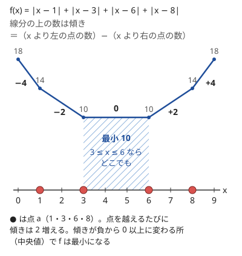

!!! abstract "要点"
    - **何ができるか**：$\sum_i \lvert x - a_i \rvert$ を最小にする $x$ を、ソートして中央値を取るだけで求める。$x$ を右へ動かしたときの傾きが「左の点の数 − 右の点の数」になるので、左右の数がつり合う中央値で最小になる。マンハッタン距離の和は $x$ と $y$ に分けて、それぞれ中央値を取る。
    - **いつ使うか**：
        - $\sum_i \lvert x - a_i \rvert$ を最小化する。
        - マンハッタン距離の和が最小になる点を求める。
        - 全員を 1 か所に集める移動の和を最小にする。
    - **計算量**：ソートに $O(N \log N)$（`nth_element` なら平均 $O(N)$）、最小値の計算に $O(N)$。
    - **前提**：[ソートで考える](../basics/sorting-techniques.md)

<!-- textlint-disable -->
別名：中央値で絶対値最小・Σ|x − a_i|・マンハッタン距離の和の最小
<!-- textlint-enable -->

絶対値の和の最小化は、数直線上の点 $a_0, \dots, a_{N-1}$（0-indexed）からの距離の和 $f(x) = \sum_i \lvert x - a_i \rvert$ を最小にする $x$ を求める問題である。答えは[中央値](../guide/glossary.md#median)で、ソートすれば求まる。問題の多くは、この形をそのまま問わず、式の変形・座標の分解・二分探索の判定の中に隠して出す。

## なぜ中央値か（傾きの変化） {#why-median}

$f(x)$ が中央値で最小になる理由は、$x$ を動かしたときの傾きを数えると分かる。$x$ がどの点とも重ならない位置にあるとき、$x$ を右へ 1 だけ動かすと、$x$ より左の点からは 1 ずつ遠ざかり、右の点には 1 ずつ近づく。したがって傾きは次のようになる。

$$
\text{傾き} = (\text{$x$ より左の点の数}) - (\text{$x$ より右の点の数})
$$

$x$ が点を 1 つ右へ越えるたびに、その点が右から左へ移るので、傾きは 2 増える。左端より左では傾きは $-N$、右端より右では $+N$ で、その間で単調に増える。$f$ は折れ線で、傾きが負の間は右へ進むほど小さくなり、0 以上になった所から大きくなる。傾きが負から 0 以上に変わるのは、左右の点の数がつり合う所、すなわち中央値である。



図の 4 点 $1, 3, 6, 8$ では、$x$ が 3 と 6 の間にあると左右に 2 点ずつあり、傾きは 0 になる。この区間のどこでも $f(x) = 10$ で最小である。

実装は、ソートして 0-indexed で $a[N/2]$（$N/2$ は切り捨て）を $x$ にし、差の絶対値の和を取るだけである。

```cpp
--8<-- "median-absolute/median-sum.cpp:core"
```

最小値は、ソート済みの $a$ の外側から組にした差の和 $\sum_{i < N/2} (a_{N-1-i} - a_i)$ とも等しい。これを使うと、中央値が最適であることを傾きを使わずに示せる。

??? note "証明（外側から組にする）"
    ソート済みの 0-indexed の $a$ で、$a_i$ と $a_{N-1-i}$（$i < N/2$）を組にする。三角不等式から、どの $x$ でも $\lvert x - a_i \rvert + \lvert x - a_{N-1-i} \rvert \ge a_{N-1-i} - a_i$ である。等号は $x$ が 2 点の間にあるときだけ成り立つ。組ごとに足すと、すべての $x$ で $f(x) \ge \sum_{i < N/2} (a_{N-1-i} - a_i)$ となる。$N$ が奇数なら、真ん中の点の項 $\lvert x - a_{N/2} \rvert \ge 0$ も足す。中央値 $a_{N/2}$ はどの組の 2 点の間にもあり、真ん中の点の項も 0 にするので、等号が成り立つ。

最小は、候補が実数か整数かによらず、点 $a_i$ のどれかで達成される。折れ線の頂点は $a_i$ の位置にしかないからである。だから $a_i$ が整数なら、「$x$ は整数に限る」という条件が付いても答えは変わらない。

??? question "確認問題：値が重なるとき"
    $a = (2, 2, 2, 9)$ のとき、$f(x)$ を最小にする $x$ の範囲と最小値を求めよ。

    ??? success "答え"
        $x = 2$ だけで最小になり、最小値は 7 である。$x < 2$ では傾きが $-4$、$2 < x < 9$ では左に 3 点・右に 1 点で傾きが $+2$ になる。同じ値の点は、越えるときに傾きが一度に（重なった数 × 2）増えるので、傾き 0 の区間がなくなる。ソートした $a$ の $a[2] = 2$ を取れば、このときも正しい。

## 偶数個のとき（中央の 2 つの間ならどこでもよい） {#even-count}

$N$ が偶数のとき、ソートした 0-indexed の $a$ で、閉区間 $[a_{N/2-1}, a_{N/2}]$ のどこに $x$ を置いても $f(x)$ は同じ最小値になる。この区間では左右の点の数がどちらも $N/2$ で、傾きが 0 だからである。

このため、偶数・奇数で場合分けする必要はない。0-indexed の $a[N/2]$ は、奇数なら真ん中、偶数なら中央の 2 つのうち右の方で、どちらでも最小を与える。$a[(N-1)/2]$（偶数なら左の方）でもよい。統計の定義に合わせて 2 つの平均 $(a_{N/2-1} + a_{N/2}) / 2$ を取る必要はなく、整数の問題で割り切れない値を作ると、丸め方を考える手間が増えるだけである。

重み $w_i$ の付いた $\sum_i w_i \lvert x - a_i \rvert$ でも、考え方は同じである。重みは、同じ位置にいる人数や、移動 1 あたりの費用を表す。傾きは（左の重みの和）−（右の重みの和）なので、座標の小さい順に重みを足していき、累積が全体の半分以上になった最初の点を $x$ とすればよい。この点を重み付き中央値と呼ぶ。重みが大きくて点を $w_i$ 個に展開できないときに使う。

## 変数変換で帰着する（a_i − i） {#change-variables}

$\lvert x - a_i \rvert$ の形が見えていなくても、式を変形すると絶対値の和の最小化になることが多い。典型は、選ぶ変数 $b$ に添字 $i$ が足されている形である。

$$
\sum_i \lvert A_i - (b + i) \rvert = \sum_i \lvert b - (A_i - i) \rvert
$$

$B_i = A_i - i$ とおけば、$b$ は $B$ の中央値にすればよい。$A$ がソート済みでも $B$ はソート済みとは限らないので、$B$ を作ってからソートし直す。

同じ変換が使える場面には、次のようなものがある。

- **連続した位置に集める**：数直線上の人を、隣り合う位置 $x, x+1, \dots, x+N-1$ に 1 人ずつ並べ直すときの移動の和の最小。人を座標の小さい順に並べた 0-indexed の $a_i$ を位置 $x + i$ へ動かせばよく（順序を入れ替えても移動の和は減らない）、$a_i - i$ の中央値を $x$ にする
- **公差 $d$ の等差数列に直す**：各 $A_i$ を増減して公差 $d$ の等差数列 $(c, c+d, c+2d, \dots)$ にする操作の回数の最小。$A_i - i \cdot d$ の中央値を $c$ にする
- **1 つの値にそろえる**：$\pm 1$ の操作を繰り返して全員を同じ値にする回数の最小は、そのまま $\sum_i \lvert x - A_i \rvert$ である

??? question "確認問題：変換した列の中央値"
    $A = (1, 2, 4, 9)$（1-indexed で $A_1 = 1$）とする。$\sum_{i=1}^{4} \lvert A_i - (b + i) \rvert$ を最小にする整数 $b$ と、その最小値を求めよ。

    ??? success "答え"
        $B_i = A_i - i$ は $(0, 0, 1, 5)$ である。中央の 2 つは 0 と 1 なので、$b = 0$ か $b = 1$ で最小になり、最小値は $\lvert 0 - 0 \rvert + \lvert 0 - 0 \rvert + \lvert 0 - 1 \rvert + \lvert 0 - 5 \rvert = 6$ である（$b = 1$ でも $1 + 1 + 0 + 4 = 6$）。

## x と y に分ける {#separate-axes}

平面上の点 $(X_i, Y_i)$ からのマンハッタン距離の和は、$x$ の部分と $y$ の部分に分かれる。

$$
\sum_i \bigl( \lvert x - X_i \rvert + \lvert y - Y_i \rvert \bigr) = \sum_i \lvert x - X_i \rvert + \sum_i \lvert y - Y_i \rvert
$$

右辺の 1 つ目は $x$ だけ、2 つ目は $y$ だけで決まるので、それぞれを独立に最小にすればよい。$x$ は $X$ の中央値、$y$ は $Y$ の中央値である。こうして選んだ点 $(x, y)$ は、与えられた点のどれとも一致しないことがある。問題が「任意の格子点」を許すなら、それで構わない。

分けられるのは、距離が軸ごとの和になっているからである。ユークリッド距離 $\sqrt{(x - X_i)^2 + (y - Y_i)^2}$ の和は分けられず、中央値では解けない。チェビシェフ距離 $\max(\lvert x - X_i \rvert, \lvert y - Y_i \rvert)$ は、45 度回転でマンハッタン距離に直してから分ける（[マンハッタン距離と 45 度回転](../geometry/manhattan-chebyshev.md#rotate-45)。軸ごとに分ける話は[x と y を独立に扱う](../geometry/manhattan-chebyshev.md#axis-independence)にもある）。回転した座標では、元の格子点に戻せる点が限られることに注意する。

グリッド上で「全員を 1 マスに集める上下左右の移動回数」も同じで、行と列に分けてそれぞれ中央値を取る。各行・各列に何人いるかしか分からないときは、[重み付き中央値](#even-count)を使う。

## 距離の和で判定して二分探索する {#with-binary-search}

この節は[答えで二分探索](../basics/binary-search-answer.md)を前提にする。「点を合計 $K$ 回以下動かして、すべてを幅 $l$ の区間（平面なら一辺 $l$ の正方形）に収められる最小の $l$」のような問題では、絶対値の和が二分探索の判定の中に現れる。

$l$ を大きくすると必要な移動は減るだけなので、「$l$ のとき必要な移動の最小 $\le K$」は $l$ について単調である。正方形なら $x$ と $y$ の移動は独立なので、[軸ごとに分けて](#separate-axes)足せばよい。残るのは、1 次元で次の値を求めることである。

$$
g(l) = \min_x \sum_i \mathrm{dist}(a_i, [x, x + l])
$$

ここで $\mathrm{dist}(a, [x, x+l])$ は点 $a$ から閉区間 $[x, x+l]$ までの距離で、$a$ が区間に入っていれば 0 である。求め方は 2 通りある。

- **絶対値の和に直す**：$\mathrm{dist}(a, [x, x+l]) = \bigl( \lvert x - a \rvert + \lvert x - (a - l) \rvert - l \bigr) / 2$ が成り立つ。$x$ についての和は $2N$ 個の点 $a_i$ と $a_i - l$ からの絶対値の和になるので、その中央値を区間の左端 $x$ にすればよい。$a$ をソートしておけば、$a_i - l$ の列もソート済みなので、2 つの列を併合すれば $O(N)$ で中央値が分かる
- **外側から組にする**：ソート済みの $a$ で、$a_i$ と $a_{N-1-i}$ を組にする。区間の幅が $l$ なので、組の 2 点の間隔が $l$ を超える分は必ず縮めなければならない。逆に、組の区間 $[a_i, a_{N-1-i}]$ は入れ子で外側ほど広いので、間隔が $l$ を超える最も内側の組の中に、それより内側の組をすべて覆うように区間を置ける。すると縮める分はちょうどそれだけで足りるので、$g(l) = \sum_{i < N/2} \max(0, a_{N-1-i} - a_i - l)$ になる（[なぜ中央値か](#why-median)の証明で、組ごとの下限を考えたのと同じ理由である）

後者のほうが短く書ける。どちらも判定 1 回が $O(N)$ で、全体は座標の範囲を $V$ として $O(N \log N + N \log V)$ である。

```cpp
--8<-- "median-absolute/window-cost.cpp:core"
```

移動の合計は「点の数 × 座標の幅」程度まで大きくなり、`int` に収まらない。`long long` で計算し、判定で $K$ と比べる。

## 二乗和の最小（平均）との違い {#vs-squares}

「ずれの和を最小にする」と書かれていても、ずれの測り方で最適な $x$ は変わる。混同しやすい 3 つを並べる。

| 最小にする量 | 最適な $x$ | 理由 |
| --- | --- | --- |
| $\sum_i \lvert x - a_i \rvert$ | 中央値 | 傾き（左の数 − 右の数）が 0 になる |
| $\sum_i (x - a_i)^2$ | 平均 $\frac{1}{N} \sum_i a_i$ | 微分 $2 \sum_i (x - a_i)$ が 0 になる |
| $\max_i \lvert x - a_i \rvert$ | 最小と最大の中点 | 両端の点だけで決まる |

二乗和は、外れた値を二乗で重く数えるので、最適な $x$ は外れ値に引っ張られて平均になる。絶対値の和では、外れ値がどれだけ遠くても「右に 1 点ある」としか数えないので、中央値は動かない。たとえば $a = (1, 2, 100)$ なら、絶対値の和は中央値 2 で最小（99）、二乗和は平均 $103/3$ 付近で最小になる。

二乗和で $x$ が整数に限られるときは、$\sum_i (x - a_i)^2$ が $x$ の 2 次関数で軸が平均なので、平均の切り捨てと切り上げの 2 つを試して小さい方を取る。どの量でも、最小にする関数は下に凸なので[三分探索](../basics/ternary-search.md)でも解けるが、上の公式で直接求めるほうが速く、誤りも少ない。

??? question "確認問題：二乗和との取り違え"
    $a = (0, 0, 0, 10)$ について、$\sum_i \lvert x - a_i \rvert$ と $\sum_i (x - a_i)^2$ を最小にする整数 $x$ をそれぞれ求めよ。

    ??? success "答え"
        絶対値の和は中央値の範囲 $[0, 0]$ の $x = 0$ で最小になり、値は 10 である。二乗和は平均 2.5 が軸なので、$x = 2$ と $x = 3$ を比べる。$x = 2$ なら $3 \cdot 4 + 64 = 76$、$x = 3$ なら $3 \cdot 9 + 49 = 76$ で、どちらも 76 になる。

## 落とし穴 {#pitfalls}

**平均を使ってしまう**。「みんなの真ん中」と考えて平均を取ると、絶対値の和では誤りになる。絶対値の和なら中央値、二乗和なら平均と、[式の形で選ぶ](#vs-squares)。

**変換した後の列をソートし忘れる**。$B_i = A_i - i$ のように変換した列は、元の列がソート済みでも順序が崩れる。中央値は変換後の列をソートして（または `nth_element` で）取る。

**和のオーバーフロー**。$N = 2 \times 10^5$、座標が $\pm 10^9$ なら、和は $4 \times 10^{14}$ 程度になる。差 `v - x` は最大 $2 \times 10^9$ で `int` にぎりぎり収まるが、足し始めるとすぐあふれる。入力を受けた時点で `long long` にしておく。

**$x$ の候補が限られる**。「与えられた点のどれかに集める」「$x$ は閉区間 $[L, R]$ の中」のように候補が制限されるときは、中央値そのものは選べないことがある。$f$ は下に凸なので、区間なら中央値を $[L, R]$ に切り詰めた値が最適である。候補が飛び飛びなら、中央値のすぐ左とすぐ右の候補を 1 つずつ調べ、$f$ の小さい方を取る（距離が近い方とは限らない）。

候補ごとの $f$ の値は、ソートした $a$ と[累積和](../basics/prefix-sum.md)で求める。`lower_bound` で $x$ より小さい点の個数 $k$ を求め、左側の和を $S_L$、右側の和を $S_R$ とすると、$f(x) = (kx - S_L) + (S_R - (N-k)x)$ が $O(\log N)$ で計算できる。

**軸に分けられない距離に使う**。ユークリッド距離の和や、斜めにも移動できる問題は、[x と y に分ける](#separate-axes)ことができない。距離が軸ごとの和になっているかを先に確かめる。

## 上位の手法へのつながり {#next-steps}

絶対値の和の最小化は、凸な折れ線を傾きで扱う考え方の入口である。

- **中央値を保ちながら点を追加・削除する**：点を 1 つずつ追加しながら、そのたびに $\min_x \sum_i \lvert x - a_i \rvert$ を答える問題がある。小さい半分と大きい半分を、2 つの優先度付きキューや multiset で分けて持つ（[上位 K 個の和と中央値の管理](../ds/top-k-multiset.md#median)）。それぞれの和も持てば、最小値も $O(\log N)$ で更新できる
- **Slope Trick**：$\lvert x - a \rvert$ を足していく操作を、傾きが変わる点の集まりとして 2 つのヒープで持ち、DP の値の関数をまとめて更新する（[Slope Trick](../dp/slope-trick.md#two-heaps)）。傾きが点を越えるたびに 2 増えるという、[なぜ中央値か](#why-median)の見方がそのまま土台になる
- **三分探索**：下に凸な関数の最小を一般に求める方法である。中央値のように公式が分からない凸関数（絶対値と二乗の和など）では[三分探索](../basics/ternary-search.md)を使う
- **中央値を最大化する問題**：「選び方を工夫して中央値を最大にする」は、ここでの最小化とは別の問題で、答えを決めて $+1$・$-1$ に塗り替える二分探索で解く（[平均・中央値の最大化](../basics/fractional-binary-search.md)）

## 例題 {#examples}

### ARC100 C. Linear Approximation {#arc100_a}

<div class="kp-problems" data-role="example" markdown>

- [ARC100 C. Linear Approximation](https://atcoder.jp/contests/arc100/tasks/arc100_a)（diff 1089）：整数 b を選んで Σ|A_i − (b + i)| を最小化する。

</div>

$\lvert A_i - (b + i) \rvert = \lvert b - (A_i - i) \rvert$ と変形すると、$B_i = A_i - i$ からの絶対値の和の最小化になる（[変数変換で帰着する](#change-variables)）。$b$ は $B$ の中央値にすればよい。

??? note "解法の詳細"
    - 0-indexed で読み、$B_i = A_i - (i + 1)$ を作る（問題の添字は 1 から始まる）。どちらの添字で引いても、$B$ 全体が同じ数だけずれて $b$ がずれるだけなので、最小値は変わらない。
    - $B$ をソートし、$b = B[N/2]$ とする。$N$ が偶数でも、中央の 2 つの間ならどこでも最小なのでこれでよい。
    - $\sum_i \lvert B_i - b \rvert$ を `long long` で計算して出力する。全体で $O(N \log N)$。

## 練習問題 {#practice}

<div class="kp-problems" data-role="practice" markdown>

- [典型90 070. Plant Planning（★4）](https://atcoder.jp/contests/typical90/tasks/typical90_br)（diff なし）：平面上の N 点からのマンハッタン距離の和が最小になる点で、その和を求める。
- [ABC330 F. Minimize Bounding  Square](https://atcoder.jp/contests/abc330/tasks/abc330_f)（diff 1718）：点を合計 K 回以下動かして、すべてを辺の長さ d の正方形に収められる最小の d を求める。

</div>

??? note "練習の方針"
    - **典型90 070**：$x$ 座標と $y$ 座標を分け、それぞれ中央値からの絶対値の和を足す。座標の差と和は `long long` で計算する
    - **ABC330 F**：一辺 $d$ を二分探索する。$x$ と $y$ を分け、各軸でソートした座標の外側から組にした間隔が $d$ を超える分を足して、合計が $K$ 以下かで判定する

## 参考 {#references}

- [drken「AtCoder ABC 102 C - Linear Approximation (ARC 100 C) (2Q, 緑色, 300 点)」](https://drken1215.hatenablog.com/entry/2019/12/22/122300)：例題の変数変換と、中央値で絶対値の和が最小になること
- [Reputeless「tenkei_90 070.md」](https://github.com/Reputeless/tenkei_90/blob/main/070.md)：練習の方針（x と y を独立に考えて中央値を取る）
- [drken「AtCoder ABC 330 F - Minimize Bounding Square (2D, 青色, 525 点)」](https://drken1215.hatenablog.com/entry/2023/11/27/154100)：二分探索の判定で、区間への距離の和を 2N 個の点の中央値で求めること
- [drken「全国統一プログラミング王決定戦 本選 C - Come Together (300 点)」](https://drken1215.hatenablog.com/entry/2019/02/18/173100)：行と列に分けて重み付き中央値を取る型
