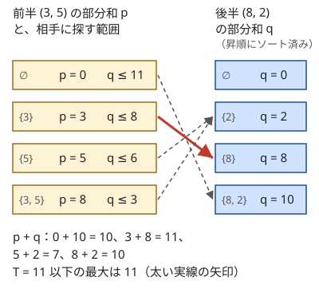

!!! abstract "要点"
    - **何ができるか**：$N \le 40$ 程度の部分集合の問題を前半と後半に分け、それぞれ $2^{N/2}$ 通りを列挙してから、ソートと二分探索（または尺取り）で組み合わせる。$2^{40} \approx 1.1 \times 10^{12}$ 通りの全探索が、$2^{20} \approx 10^6$ 個の列 2 本の突き合わせに変わる。
    - **いつ使うか**：
        - $N \le 40$ で部分集合を選ぶ（$2^N$ は無理だが $2^{N/2}$ は間に合う）。
        - 2 つの独立な選択を組み合わせて条件を満たす。
        - $H + W \le 40$ 程度のグリッドで、左上から右下への経路をすべて考える。
    - **計算量**：$O(N \cdot 2^{N/2})$（半分ずつの列挙・ソート・二分探索）。メモリは $O(2^{N/2})$ で、$N = 40$ なら `long long` が約 $10^6$ 個（約 8 MB）。
    - **前提**：[bit 全探索と順列全探索](../basics/bit-full-search.md)、[二分探索](../basics/binary-search.md)

<!-- textlint-disable -->
別名：Meet in the Middle・半分全探索・折半全列挙
<!-- textlint-enable -->

半分全列挙は、全部を一度に列挙すると多すぎる選び方を、前半の選び方と後半の選び方の組に分けて扱う方法である。前半と後半をそれぞれ全部列挙しておき、「前半がこの値なら、後半に要るのはこの値（この範囲）」という相手を、ソートした列の上の[二分探索](../basics/binary-search.md)で探す。列挙の量が $2^N$ から $2^{N/2}$ の 2 倍に減るのが速さの源である。

## 前半・後半を列挙して突き合わせる（ソート＋二分探索・尺取り） {#combine-halves}

前半と後半の部分和を列挙し、片方をソートして相手を探すのが基本の形である。題材として「$N$ 個の正の整数からいくつか選んだ和のうち、$T$ 以下で最大のもの」を考える。値が $10^9$ まであると部分和の DP は表が大きすぎ、$N = 40$ だと[bit 全探索](../basics/bit-full-search.md)の $2^{40}$ 通りも間に合わない。

**なぜ分けてよいか**。$A$ を前半 $A_0, \dots, A_{h-1}$ と後半 $A_h, \dots, A_{N-1}$ に分ける（$h = \lfloor N/2 \rfloor$）。どの部分集合も「前半から選んだもの」と「後半から選んだもの」の組としてちょうど 1 通りに表せて、和は前半の和 $p$ と後半の和 $q$ の足し算になる。だから部分集合を全部調べることは、前半の部分和の列 $P$ と後半の部分和の列 $Q$ から 1 つずつ取る組 $(p, q)$ を全部調べることと同じである。さらに条件 $p + q \le T$ は $q \le T - p$ と書ける。$p$ を決めると、$q$ への条件は範囲 1 つになる。

**なぜ速いか**。組は $\lvert P \rvert \times \lvert Q \rvert = 2^N$ 通りあるが、全部は作らない。$Q$ をソートしておけば、$p$ ごとに「$T - p$ 以下で最大の $q$」を二分探索で $O(\log \lvert Q \rvert)$ で見つけられる。$p$ は $2^{h}$ 個しかないので、組の全体を調べたのと同じ答えが $O(2^{N/2} \cdot N)$ で出る。

次の図は $A = (3, 5, 8, 2)$、$T = 11$ の例である。前半 $(3, 5)$ の部分和 $p$ ごとに、ソートした後半の部分和から $T - p$ 以下で最大のものを選んでいる。



図で $p$ を小さい順に見ると、相手の上限 $T - p$ は大きい順に下がり、見つかる $q$ の位置も列の後ろから前へ一方向にだけ動く。そこで $P$ もソートしておけば、二分探索の代わりに[尺取り法](../basics/two-pointers.md)で相手を動かせる。突き合わせは両方の列の長さの和に比例する時間で済む。$p + q \le T$ を満たす組の数を数える問題でも同じ形で使える。

処理の流れは次のとおりである。

1. 前半と後半の部分和をそれぞれ列挙する（空集合の和 0 も入れる）
2. 後半の列 $Q$ をソートする（尺取りなら前半の列 $P$ もソートする）
3. $p \in P$ ごとに、$Q$ から相手を二分探索する。最大値なら「$T - p$ 以下で最大」、組の数なら「$T - p$ 以下の個数」（`upper_bound` の位置）、ちょうど一致なら「$T - p$ に等しい個数」（`equal_range` の幅）を使う
4. 見つけた相手から答えを更新する

部分和の列は、要素を 1 つ足すたびに「今の列」と「今の列のすべてに $x$ を足した列」をマージして作れる。どちらも昇順なので、マージの結果も昇順になり、ソートを別にしなくてよい。この作り方なら列挙は $O(2^{N/2})$ で、全体の重さは二分探索の $O(2^{N/2} \cdot N)$ になる。突き合わせを尺取りにすれば、全体も $O(2^{N/2})$ に下がる。

```cpp
--8<-- "meet-in-the-middle/max-sum.cpp:core"
```

突き合わせの相手の決まり方で、使う道具が変わる。

| 相手の条件 | 例 | 道具 |
| --- | --- | --- |
| $q \le T - p$（範囲） | 和が $T$ 以下 | ソート＋`upper_bound`、または尺取り |
| $q = T - p$（一致） | 和がちょうど $T$ | ソート＋`equal_range`、または連想配列で個数を数える |
| $q = p$（同じ値） | XOR が 0、2 つの文字列が一致 | 連想配列、またはソートして同じ値の個数を数える |

部分集合でなくても、「2 つの選択の組で、組み合わせ方が足し算・XOR・積のように単純」なら同じ形になる。たとえば 4 つの列から 1 つずつ選んで和を 0 にする問題は、$(a, b)$ の和の列と $(c, d)$ の和の列を作って突き合わせればよい。

??? question "確認問題：N = 40 でどれだけ速くなるか"
    $N = 40$ の部分集合の和を、bit 全探索で $2^{40}$ 通り調べる場合と、半分全列挙で調べる場合とで、演算回数はおよそ何倍違うか。半分全列挙は、二分探索 $2^{20}$ 回と、列挙・ソートで同程度の手間がかかるとし、二分探索 1 回を 20 回の比較と見積もる。また、$N = 41$ のとき前半と後半の要素数をどう分け、それぞれの部分和の列の長さはいくつになるか。

    ??? success "答え"
        bit 全探索は $2^{40} \approx 1.1 \times 10^{12}$ 回で、1 秒に $10^8$ 回としても数時間かかる。半分全列挙は $2 \times 2^{20} \times 20 \approx 4.2 \times 10^7$ 回程度で、比はおよそ $2.6 \times 10^4$ 倍になる。列挙そのものは $2^{20} \approx 10^6$ 個ずつなので、1 秒に十分収まる。

        $N = 41$ なら前半を $\lfloor 41/2 \rfloor = 20$ 個、後半を残りの 21 個にする。列の長さは前半が $2^{20} \approx 1.0 \times 10^6$、後半が $2^{21} \approx 2.1 \times 10^6$ で、どちらも十分に列挙できる。

## ちょうど K 個などの制約は個数ごとに分けて持つ {#by-count}

「ちょうど $K$ 個選ぶ」のように、和のほかに選んだ個数にも条件があるときは、部分和の列を選んだ個数ごとに分けて持つ。前半から $c$ 個選んだ和の列を $P_c$、後半から $d$ 個選んだ和の列を $Q_d$ とする。$c + d = K$ となる組 $(P_c, Q_{K-c})$ ごとに、[前半・後半を列挙して突き合わせる](#combine-halves)のと同じく $Q_{K-c}$ をソートして二分探索する。

個数を混ぜたまま 1 本の列にすると、二分探索で見つかる相手の個数が分からず、条件 $c + d = K$ を確かめられない。個数で分けておけば、$c$ を決めた時点で相手の列が 1 本に決まる。分けても列の長さの合計は $2^{N/2}$ のままなので、計算量は変わらない。

```cpp
--8<-- "meet-in-the-middle/by-count.cpp:core"
```

このコードは個数を `popcount`（C++20。[<bit> の関数](../cpp/cpp-math-functions.md#bit-functions)）で求め、bit 全探索で列挙してから列ごとにソートしている。列挙は $O(2^{N/2} \cdot N)$ だが、二分探索と同じ重さなので全体は変わらない。

個数に限らず、「値の範囲が小さい付加的な量」に条件があれば同じ考え方が使える。付加的な量（個数・余り・最後に選んだ要素など）で列を分け、条件を満たす量の組ごとに突き合わせる。前半の量を決めると相手の量が 1 つに決まる形なら、前半の各値は相手の列を 1 本だけ探せばよく、計算量は変わらない。

## グリッドの経路を対角線で分ける {#grid-diagonal}

この節は、格子の経路の数を二項係数で数える考え方（[格子路の数え上げ](../comb/lattice-paths.md)）を使う。$N \times N$ のグリッドを左上から右下へ右か下にだけ進む経路は $\binom{2N-2}{N-1}$ 本ある。$N = 20$ では $\binom{38}{19} \approx 3.5 \times 10^{10}$ 本で、全部は辿れない。経路の上の値の XOR や和について条件を数える問題では、経路を真ん中で 2 つに切って半分全列挙する。

**どこで切るか**。行と列の番号を 0-indexed で $(i, j)$ とすると、どの経路も $i + j = N - 1$ の反対角線のマスをちょうど 1 回通る。そこまでの前半は $N - 1$ 歩で、各歩は右か下の 2 択なので、前半の経路は高々 $2^{N-1}$ 本である。後半も右下から逆向きに $N - 1$ 歩で、高々 $2^{N-1}$ 本である。$N = 20$ なら $2^{19} \approx 5.2 \times 10^5$ 本ずつで、全部辿れる。

**何で突き合わせるか**。前半の経路と後半の経路は、同じ対角線のマスで出会うときだけ 1 本の経路につながる。そこで突き合わせの鍵を（対角線のマス, 値）の組にする。

1. 左上から対角線まで深さ優先で辿り、対角線のマスごとに「そこまでの XOR の値 → 経路の本数」を連想配列に数える
2. 右下から逆向きに対角線まで辿り、着いたマスの連想配列から、全体の条件を満たす値の本数を足す

対角線のマスの値は、前半と後半のどちらか一方にだけ入れる。両方に入れると、XOR なら打ち消し合い、和なら 2 回足されて、答えが変わる。

切る位置は「どの経路も 1 回だけ通る線」であることが要る。反対角線はこの性質をもつので、経路の数え落としも二重の数えもない。この「途中の状態で両側からの探索を出会わせる」考え方は、文字列を前半と後半に分ける問題や、最短手数のパズルを初期状態と目標の状態の両方から探索する問題（両側探索）にも使える。

## 「片側を全探索して残りは貪欲」との違い {#vs-greedy}

半分全列挙と混同されやすいのが、bit 全探索の応用の「片側を全探索して残りは貪欲」の型（[片側を bit で決めて残りは貪欲](../basics/bit-full-search.md#half-greedy)）である。どちらも「全部は調べられないので一部だけを全探索する」点は同じだが、残りの扱いが違う。

| | 片側を全探索して残りは貪欲 | 半分全列挙 |
| --- | --- | --- |
| 全探索する側 | 小さい方の次元（$H \le 10$ の行の分け方など） | 前半と後半の両方 |
| 残りの決め方 | 全探索した側を決めると、貪欲で最適が 1 つに決まる | 残りも全部列挙し、相手を二分探索・連想配列で探す |
| 制約の形 | 片方の次元だけが小さい（$H \le 10$、$W \le 1000$） | 選ぶ要素の数が 40 程度まで |
| 計算量 | $O(2^H \times \text{貪欲 1 回})$ | $O(N \cdot 2^{N/2})$ |

見分ける問いは「片側を決めたら、もう片側は 1 つの選び方に決まるか」である。決まるなら貪欲の型で、半分全列挙は要らない。決まらず、2 つの側が「和」や「XOR」のような 1 つの値だけを通して関わるなら、半分全列挙で両側を列挙して突き合わせる。

## 値の範囲が小さければナップサック DP {#vs-knapsack}

「選んだ和が $T$ 以下」「和がちょうど $T$」の問題は、[部分和 DP](../dp/subset-sum.md)や[ナップサック DP](../dp/knapsack-01.md#choose-by-size)でも解ける。どちらを使うかは、要素数 $N$ と値（和）の範囲 $T$ のどちらが小さいかで決める。

| 制約 | 使う方法 | 計算量 |
| --- | --- | --- |
| $T$ が $10^5$〜$10^6$ 程度まで | 部分和・ナップサックの DP | $O(NT)$ |
| $N \le 40$、値（$T$）が $10^9$ 程度と大きい | 半分全列挙 | $O(N \cdot 2^{N/2})$ |
| 可否だけで、$NT$ が $10^9$〜$10^{10}$ 程度 | DP を [bitset](../misc/bitset-speedup.md#subset-sum-shift) で | $O(NT / 64)$ |

DP の表は和の値で添字を付けるので、値が大きいと表が作れない。半分全列挙で持つのは値の大きさによらず $2^{N/2}$ 個の和だけである。だから $N$ が小さく値の大きいときに向く。逆に $N$ が 50 程度を超えると、$2^{N/2}$ が $3 \times 10^7$ を超えて半分全列挙では苦しくなる。値の範囲が小さいことを確かめて DP にする。

## 落とし穴 {#pitfalls}

**列をソートし忘れる**。`upper_bound` や `equal_range` はソート済みの列でしか正しく動かず、ソートを忘れてもコンパイルエラーにならない。個数ごとに分けた列は、列ごとにソートする。マージで作るなら最初から昇順になる。

**一致する組の個数を数え損なう**。部分和には同じ値がいくつも現れる。和がちょうど $T$ の組を数えるとき、`binary_search` で「あるかどうか」だけを見ると個数がずれる。`equal_range` の幅か、連想配列に値ごとの個数を数えて足す。答えは最大で $2^{40} \approx 1.1 \times 10^{12}$ になるので `long long` で持つ。

**和や積のあふれ**。$10^9$ の値を 40 個足すと $4 \times 10^{10}$ で `int` に収まらない。部分和は `long long` で持つ。積で組み合わせる型（素数の積の列挙など）では、$p \times q \le N$ を掛け算のまま比べると `long long` もあふれる。$q \le \lfloor N / p \rfloor$ と割り算で比べる（[整数の割り算と余り](../math/integer-division.md)、[整数のオーバーフローと __int128](../cpp/cpp-integer-overflow.md)）。

**空集合を数えるかを確かめない**。前半・後半の列には、どちらも空集合の和 0 が入る。「1 個以上選ぶ」問題で両方とも空の組を数えると 1 だけ多くなる。数え終わってから 1 を引くか、その組だけを除く。

**N が奇数のときの分け方**。前半を $\lfloor N/2 \rfloor$ 個、後半を残りの $N - \lfloor N/2 \rfloor$ 個にする。後半の範囲を「$N/2$ 個」と書くと、$N$ が奇数のとき最後の要素が抜ける。後半は「前半の残り全部」と書く。$N$ が小さい場合（$N = 0, 1$）にも片側が空になるだけで、列は $\{0\}$ になり正しく動く。

**連想配列が遅い**。$2^{20}$ 回の挿入と検索は `map` でも通ることが多いが、木の操作の定数倍が重い。値ごとの個数を数えるだけなら、ソートした列での `equal_range` の方が速い。`unordered_map` は、意図的に衝突させる入力で遅くなることがある（[ハッシュの衝突と安全な設計](../string/hash-safety.md#unordered-map)）。

## 例題 {#examples}

### ABC184 F. Programming Contest {#abc184_f}

<div class="kp-problems" data-role="example" markdown>

- [ABC184 F. Programming Contest](https://atcoder.jp/contests/abc184/tasks/abc184_f)（diff 1423）：N ≤ 40 個の数からいくつか選んだ和のうち、T 以下で最大のものを求める。

</div>

$T$ と各値が $10^9$ まであるので、和を添字にした DP は使えない。$N \le 40$ なので、前半と後半の部分和をそれぞれ列挙し、前半の和 $p$ ごとに後半から「$T - p$ 以下で最大」の和を二分探索する。

??? note "解法の詳細"
    - $A$ を前半 $\lfloor N/2 \rfloor$ 個と後半の残りに分け、それぞれの部分和の列を作る（$2^{20}$ 個以下）。空集合の 0 も入れる
    - 後半の列をソートする。前半の和 $p$ が $T$ を超えるものは飛ばし、残りの $p$ ごとに `upper_bound` で $T - p$ を超える最初の位置を求め、その 1 つ前の値を $q$ とする。後半の列には 0 があるので、$q$ は必ず見つかる
    - $p + q$ の最大が答えである。全体で $O(N \cdot 2^{N/2})$。和は最大で $4 \times 10^{10}$ になるので `long long` で持つ
    - コードは[前半・後半を列挙して突き合わせる](#combine-halves)の節のものと同じ形である

### 典型90 051. Typical Shop（★5） {#typical90_ay}

<div class="kp-problems" data-role="example" markdown>

- [典型90 051. Typical Shop（★5）](https://atcoder.jp/contests/typical90/tasks/typical90_ay)（diff なし）：N ≤ 40 個の品物からちょうど K 個を選び、合計が P 以下になる選び方の数を求める。

</div>

前の例題に「ちょうど $K$ 個」の条件が加わった形である。部分和の列を選んだ個数ごとに分ける。前半の $c$ 個の列と後半の $K - c$ 個の列を組にして、合計が $P$ 以下になる組の数を二分探索で数える。

??? note "解法の詳細"
    - 前半・後半のそれぞれで、選び方を bit 全探索で列挙し、選んだ個数 $c$ の列に和を入れる。列ごとにソートする
    - $c = 0, 1, \dots, K$ について、前半の個数 $c$ の列の各和 $s$ に対し、後半の個数 $K - c$ の列で $P - s$ 以下の値の個数を `upper_bound` で数えて足す。前半・後半の要素数を超える個数の列は飛ばす
    - 答えは最大で $\binom{40}{20} \approx 1.4 \times 10^{11}$ なので `long long` で持つ。全体で $O(N \cdot 2^{N/2})$
    - コードは[ちょうど K 個などの制約は個数ごとに分けて持つ](#by-count)の節のものと同じ形である

## 練習問題 {#practice}

<div class="kp-problems" data-role="practice" markdown>

- [ABC271 F. XOR on Grid Path](https://atcoder.jp/contests/abc271/tasks/abc271_f)（diff 1669）：グリッドの左上から右下へ右か下に進む経路のうち、通ったマスの XOR が 0 になるものを数える。
- [AGC026 C. String Coloring](https://atcoder.jp/contests/agc026/tasks/agc026_c)（diff 1836）：2N 文字を赤と青に塗り、赤を左から読んだ列と青を右から読んだ列が一致する塗り方を数える。

</div>

??? note "練習の方針"
    - **ABC271 F**：$N \le 20$ のグリッドを反対角線で切り、前半は左上から、後半は右下から逆向きに辿る。対角線のマスごとに XOR の値の本数を数え、前半と後半で値が一致する本数を掛けて足す。対角線のマスの値は片側にだけ入れる（[グリッドの経路を対角線で分ける](#grid-diagonal)）
    - **AGC026 C**：$N \le 18$ で、文字列を前半 $N$ 文字と後半 $N$ 文字に分ける。赤が全部で $N$ 文字になることから、条件は「前半の赤を左から読んだ列 ＝ 後半の青を右から読んだ列」かつ「前半の青を右から読んだ列 ＝ 後半の赤を左から読んだ列」に分かれる。後半の塗り方 $2^N$ 通りごとに（青を右から, 赤を左から）の文字列の組を作って出現回数を数え、前半の塗り方ごとに（赤を左から, 青を右から）の組の出現回数を足す。答えは `long long` で持つ

## 力試し {#challenge}

<div class="kp-problems" data-role="challenge" markdown>

- [ABC464 F. Random Vault Heist](https://atcoder.jp/contests/abc464/tasks/abc464_f)（diff 2225）：金額の書かれた N 個の金庫を残りから等確率で 1 つずつ開け、開けた金額の合計が X 以上になったら止めるとき、止めた時点の合計金額の期待値を求める。
- [ABC300 G. P-smooth number](https://atcoder.jp/contests/abc300/tasks/abc300_g)（diff 2343）：p 以下の素数だけを素因数にもつ N 以下の正の整数を数える。

</div>

??? note "力試しの方針"
    - **ABC464 F**：$N \le 40$。残りから等確率で選んでいく過程を、一様ランダムな順列を先頭から見る過程に置き換える（[対称性で確率を求める](../comb/probability-symmetry.md)）。最後に開ける金庫 $i$ を決めると、その前に開ける集合 $S$ が並ぶ確率は大きさ $k = \lvert S \rvert$ だけで決まる。合計が $X - A_i$ 以上 $X$ 未満の $S$ について、個数と金額の和を求めればよい。これを、個数ごとに分けた半分全列挙の列と累積和・尺取りで数える
    - **ABC300 G**：$N \le 10^{16}$、$P \le 100$。$P$ 以下の素数を 2 組に分け（[素因数の指数で考える](../math/prime-exponent-vector.md)）、それぞれの組の素数だけを素因数にもつ $N$ 以下の数を全部列挙する（どちらも数百万個）。どの数も、2 つの組の数の積としてちょうど 1 通りに表せる。両方をソートし、積が $N$ 以下の組を尺取りで数える。積は割り算で比べる（[落とし穴](#pitfalls)）

## 参考 {#references}

- [drken「AtCoder ABC 184 F - Programming Contest (水色, 600 点)」](https://drken1215.hatenablog.com/entry/2020/11/22/224100)：例題の方針（部分和の列挙と二分探索、空集合の扱い）
- [E869120「競プロ典型 90 問」の 051 の解答例](https://github.com/E869120/kyopro_educational_90/blob/main/sol/051.cpp)：例題の方針（個数ごとに分けた列と二分探索）
- [dvoraker3「競プロ典型 90 問の類題+＠ リンク集」](https://qiita.com/dvoraker3/items/8388ab6e1dc3af55070e)：051 の要点が半分全列挙であることと類題
- [oraclesqlpuzzle「ABC271-F XOR on Grid Path」](https://oraclesqlpuzzle.ninja-web.net/kyoupro/05-atcoder-02-abc/kyoupro-abc271-f.html)：練習の方針（対角線で分けて両側から列挙する）
- [miraclepbc「XOR on Grid Path(Meet in the Middle)」](https://www.cnblogs.com/miraclepbc/p/16768972.html)：ABC271 F の制約と、対角線のマスでの突き合わせ
- [drken「AtCoder AGC 026 C - String Coloring (青色, 600 点)」](https://drken1215.hatenablog.com/entry/2018/07/18/210000)：練習の方針（文字列の組を鍵にした突き合わせ）
- [ikatakos「第七回日本最強プログラマー学生選手権～Advance～ -予選- （AtCoder Beginner Contest 464）F,G問題メモ」](https://ikatakos.com/pot/programming_algorithm/contest_history/atcoder/2026/0627_abc464)：力試しの方針（ランダム順列への言い換えと、個数ごとの列の尺取り。解説の部分だけを参照）
- [drken「AtCoder ABC 300 G - P-smooth number (3D, 黄色, 600 点)」](https://drken1215.hatenablog.com/entry/2023/05/02/234200)：力試しの方針（素数を 2 組に分けた列挙と尺取り、積のあふれ）
- [E869120「レッドコーダーが教える、競プロ・AtCoder上達のガイドライン【上級編：目指せレッドコーダー！】」](https://qiita.com/e869120/items/acba3dd8649d913102b5)：半分全列挙の位置づけ（黄色を目指すときの追加の項目）
