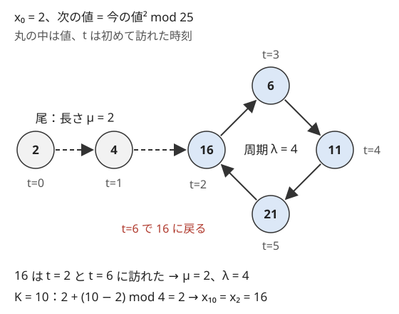
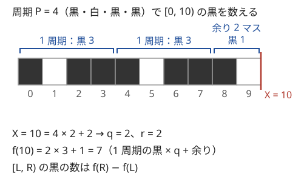

!!! abstract "要点"
    - **何ができるか**：状態が $S$ 種類しかなければ、$S$ 回進むまでに必ず以前と同じ状態が現れる（鳩の巣原理）。初めて訪れた時刻を記録して尾の長さと周期を求め、$K$ 回後の状態や途中の和を割り算で一度に求める。
    - **いつ使うか**：
        - $K \le 10^{18}$ 回の操作をするが、状態の種類は $10^5$〜$10^6$ 程度しかない。
        - $x_{n+1} = f(x_n)$ の形の漸化式で、遠い項や項の和を問われる。
        - 同じ模様が繰り返し敷き詰められた盤面で、広い範囲を数える。
    - **計算量**：状態の種類を $S$ として、前計算 $O(S)$（遷移 1 回が $O(1)$ のとき）。その後は $K$ 回後の状態も最初の $K$ 項の和も 1 回 $O(1)$ で求まる。
    - **前提**：なし

<!-- textlint-disable -->
別名：周期性・周期の検出・ρ 型・ループの検出・シミュレーションの高速化・cycle finding
<!-- textlint-enable -->

周期性の検出は、次の状態が今の状態だけで決まる操作を何度も繰り返すとき、同じ状態に戻った時点でシミュレーションを打ち切り、残りを割り算でまとめる方法である。$K = 10^{18}$ 回をそのまま進めることはできないが、状態が $S$ 種類しかなければ、高々 $S$ 回進めれば列の形がすべて分かる。

## 尾と周期（ρ 型）と K 回後の求め方 {#rho}

状態の列を $x_0, x_1, x_2, \dots$（$x_{t+1} = f(x_t)$）とする。状態が $S$ 種類しかなければ、$x_0, \dots, x_S$ の $S + 1$ 個の中に必ず同じ状態が 2 回現れる（[鳩の巣原理](../thinking/symmetry-pigeonhole-casework.md#pigeonhole)）。最初に再訪が起きた時刻を $t$、その状態を初めて訪れた時刻を $\mu$ とすると、次が成り立つ。

- $x_0, \dots, x_{\mu-1}$ は一度しか現れない。これを尾と呼び、長さは $\mu$ である
- $x_\mu, \dots, x_{t-1}$ がこの順に永遠に繰り返す。周期は $\lambda = t - \mu$ である

繰り返す理由は、次の状態が今の状態だけで決まるからである。$x_t = x_\mu$ なら $x_{t+1} = f(x_t) = f(x_\mu) = x_{\mu+1}$ となり、以降もずっと $\lambda$ だけずれて一致する。尾から輪に入る形がギリシャ文字の ρ に似ているので、ρ 型と呼ぶ。



輪に戻る先は始点 $x_0$ とは限らない。図の例でも、戻る先は $x_0 = 2$ ではなく $x_2 = 16$ である。だから「始点に戻るまで進める」と書くと尾がある場合に止まらない。初めて訪れた時刻を配列 $\mathrm{first}[x]$（未訪問は $-1$）に記録し、すでに記録のある状態に来た時点で止める。

$K$ 回後の状態 $x_K$ は、記録した列 $x_0, \dots, x_{\mu+\lambda-1}$ のうち、次の番号 $\mathrm{idx}(K)$ のものである。

$$
\mathrm{idx}(K) = \begin{cases} K & (K < \mu) \\ \mu + (K - \mu) \bmod \lambda & (K \ge \mu) \end{cases}
$$

$K < \mu$ のときは記録した列をそのまま読む。$K \ge \mu$ のときは、輪に入ってからの歩数 $K - \mu$ を周期で割った余りだけ進めればよい。

```cpp
--8<-- "periodicity/rho.cpp:core"
```

完全なプログラム：[`rho.cpp`](https://github.com/yuukougun/kyopro-atlas/blob/main/snippets/periodicity/rho.cpp)（GitHub）
{ .kp-code-src }

??? question "確認問題：何回で周期が見つかるか"
    状態が $10^5$ 種類のとき、$\mathrm{first}$ に記録しながら進めるループは最大で何回まわるか。

    ??? success "答え"
        最大 $10^5$ 回である。$x_0, \dots, x_{10^5}$ の $10^5 + 1$ 個の中には必ず同じ状態があるので、遅くとも $x_{10^5}$ を見た時点で再訪が起きる。ループでは記録した回数が $\mu + \lambda$ で、これは状態の種類 $10^5$ 以下である。

## 途中の和（尾の和＋周期の和 × 回数＋余り） {#partial-sums}

最初の $K$ 項の和 $\sum_{t=0}^{K-1} v(x_t)$ も、同じ分け方で求まる（$v$ は状態ごとの値）。記録した列 $x_0, \dots, x_{\mu+\lambda-1}$ の累積和を $P_0 = 0$、$P_{t+1} = P_t + v(x_t)$ とする。$K \le \mu$ なら $P_K$ が答えである。$K > \mu$ なら、輪の上の $K - \mu$ 項を $q$ 周と余り $r$ 項に分ける。

$$
q = \left\lfloor \frac{K - \mu}{\lambda} \right\rfloor, \quad r = (K - \mu) \bmod \lambda
$$

$$
\sum_{t=0}^{K-1} v(x_t) = \underbrace{P_\mu}_{\text{尾}} + q \underbrace{(P_{\mu+\lambda} - P_\mu)}_{\text{1 周の和}} + \underbrace{(P_{\mu+r} - P_\mu)}_{\text{余り}}
$$

余りの $r$ 項は輪の入口 $x_\mu$ から数える。輪の始まりは $x_\mu$ であって $x_0$ ではないので、余りを $P_r$ と書くと尾の分がずれる。この式は[累積和](../basics/prefix-sum.md)の区間の和を 3 つ組み合わせたものである。和の代わりに最大値や「途中で条件を満たしたか」を問われたときも、尾・周回・余りに分ける考え方は変わらない。

## 状態に将来を決める情報をすべて入れる {#state-design}

周期の議論は、次の状態が今の状態だけで決まることに頼っている。だから状態には、その後の動きを決める情報をすべて入れ、決めない情報は入れない。

- **将来に効く情報を落とさない**：たとえば「偶数回目と奇数回目で規則が違う」なら、位置だけでは次が決まらない。（位置、回数の偶奇）を状態にし、状態の種類は 2 倍になる。規則が $T$ 回ごとに巡るなら（位置、回数 $\bmod T$）にする
- **増え続ける量を状態に入れない**：積み上がる合計や操作の回数そのものを状態に含めると、同じ状態が二度と現れない。合計が次の動きに $\bmod N$ でしか効かないなら、$\bmod N$ を取った値を状態にし、合計は途中の和として別に足す
- **種類を見積もってから配列で持つ**：$x \bmod M$ を状態にするなら種類は $M$ で、大きさ $M$ の配列で $\mathrm{first}$ を持てる。組を状態にするなら $a \times B + b$ のように 1 つの整数に番号を付ける。種類が配列に収まらないときは連想配列を使う。`map` なら $\log$ が付き、`unordered_map` でも定数倍は配列よりずっと重い

状態を決めたら、種類の数が数百万以下に収まるかを先に見積もる。収まらなければ周期の検出は使えず、[ダブリング](../basics/doubling.md)や式の性質を探すことになる。

## 収束に気づく {#convergence}

周期が 1 の場合は、ある時点から状態が変わらなくなる（[固定点](../guide/glossary.md#fixed-point)に入る）。この場合は記録の配列さえ要らず、状態が変わらなくなるまで進めて打ち切ればよい。

- **すぐ固定点に落ちる**：値が毎回半分以下になる・桁数が減るなど、速く小さくなる操作は、操作回数の上限が巨大でも数十回で固定点に入ることが多い。1 ずつ減るだけの操作はこの限りでない。「$\min(K, \text{変化が止まるまで})$ 回だけシミュレーションする」と書き、止まったらループを抜ける
- **見る範囲が変わらなくなる**：列が爆発的に伸びる操作では、答えに関わる先頭の部分が数回で確定することがある。たとえば 2 以上の数字が毎回 2 倍以上に増えるなら、$5 \times 10^{15}$ 回後には途方もなく長い。このとき $K$ 文字目の答えは、先頭に並ぶ 1 の個数だけで決まる（[練習問題](#practice)の ABC106 C）

収束を疑うのは、操作で値が小さくなる・長さが大きくなるなど、一方向に進む量があるときである。小さな入力で数十回シミュレーションして値を出力すれば、収束するかはすぐ分かる。

## 盤面・剰余の周期を割り算で数える {#periodic-patterns}

模様が周期 $P$ で並ぶ列（位置 $i$ の値が $p[i \bmod P]$）で、広い範囲の個数や和を求めるときは、範囲を「周期の個数」と「余り」に分ける。$[0, X)$ にある黒の数を $f(X)$ とし、1 周期分の累積和 $c_r$（$p[0], \dots, p[r-1]$ の黒の数、$c_0 = 0$）を前計算すると、次の式になる。

$$
f(X) = \left\lfloor \frac{X}{P} \right\rfloor c_P + c_{X \bmod P}, \qquad [L, R) \text{ の黒の数} = f(R) - f(L)
$$



範囲を $f(R) - f(L)$ に分けると、両端がずれた半端な区間を場合分けせずに済む。$L$ が負でも、$\lfloor \cdot \rfloor$ と $0 \le X \bmod P < P$ の約束で計算すれば同じ式でよい。C++ の `/` と `%` は 0 の方向へ丸めるので、負の数では[整数の割り算](../math/integer-division.md)の floor を自分で書く。あるいは $P$ の倍数を全体に足して非負にずらす。

```cpp
--8<-- "periodicity/period-count.cpp:core"
```

完全なプログラム：[`period-count.cpp`](https://github.com/yuukougun/kyopro-atlas/blob/main/snippets/periodicity/period-count.cpp)（GitHub）
{ .kp-code-src }

- **2 次元の盤面**：模様が縦 $P$・横 $Q$ の周期で敷き詰められているなら、同じ考え方を両方向に使う。長方形 $[0, X) \times [0, Y)$ を、完全な周期の塊・端の帯・角の余りに分け、1 周期分の[2 次元累積和](../basics/prefix-sum-2d.md)で数える。任意の長方形は 4 つの $f$ の足し引きにする
- **面積が半端な模様**：三角形の模様などで面積が 0.5 単位になるなら、2 倍した面積を整数で数え、最後に 2 で割る（問題が面積の 2 倍を答えさせるなら割らない）
- **剰余を含む和**：$i \bmod j$ は $i$ について周期 $j$ を持つ。$j$ ごとに $i$ を長さ $j$ の塊 $[kj, (k+1)j)$ に分けると、塊の中では $i \bmod j = i - kj$ である。したがって $\sum A_i (i \bmod j)$ は、$A_i$ と $i A_i$ の累積和から塊ごとに $O(1)$ で求まる。塊の数は $j$ ごとに $\lceil N / j \rceil$ 個である。$j = 1, \dots, M$ で合計すると、調和級数により $O(N \log M + M)$ になる

## シミュレーションを速く進める（ずれ・反転は全体への操作を変数で持つページへ） {#simulation-speedup}

配列全体に同じ操作を繰り返す問題では、何を状態とみなすかで速くする道が分かれる。

- **配列全体が状態**：盤面の全体を 1 つの状態とみなし、出てきた盤面を連想配列に記録して再訪を探す。盤面の種類は膨大でも、実際にたどる列が短く周期に入るなら間に合う。1 回の比較と記録に盤面の大きさ分の時間がかかるので、ハッシュ値で持つなどして見積もる
- **要素ごとに独立に動く**：各要素の行き先が順列で決まるなら、要素ごとに巡回をたどり、巡回の長さで $K$ を割った余りだけ進める。全要素で $O(N)$ である（[順列と巡回](../comb/permutation-cycles.md)）。一般の写像なら尾と輪の構造を持つ（[Functional graph](../graph/functional-graph.md)）
- **ずらす・反転するだけ**：配列を回転する・左右を反転するといった全体への操作は、データを動かさず「先頭がどこか」「向きが逆か」を変数で持てば 1 回 $O(1)$ になる。周期を探す必要もない（[全体への操作を変数で持つ](../ds/global-offset.md)）

1 周で得る量を足し上げる問題では、1 周の和の符号で周回の回数が変わる。和が正なら回れるだけ回るのがよく、和が 0 以下なら 1 周未満で止めるのがよい。正のときも「回れるだけ回って余りを歩く」と「1 周少なく回って残りの 1 周分以内を歩く」の両方を比べないと、余りの部分の最大を取り逃がす（[力試し](#challenge)の ABC175 D）。余りの歩数を $0, \dots, L - 1$ ではなく $1, \dots, L$（$L$ は周期）から選べば、この 2 つの場合を 1 つの形にまとめられる。

## ダブリング・行列累乗との使い分け {#vs-doubling}

$K$ 回の遷移を速く進める手法は 3 つあり、遷移の形と問い方で選ぶ。

| 手法 | 向く場面 | 計算量 |
| --- | --- | --- |
| 周期の検出 | 1 つの始点から $K$ 回後・最初の $K$ 項の和 | $O(S)$ |
| [ダブリング](../basics/doubling.md) | 始点やクエリが多い・途中の最大値・条件を満たす最大の回数 | $O(S \log K)$ の前計算、1 回 $O(\log K)$ |
| [行列累乗](../math/matrix-power.md) | 遷移が線形（次の値が今の値の和・定数倍）で、状態の値そのものが巨大 | 行列の大きさ $d$ として $O(d^3 \log K)$ |

周期の検出は 1 つの始点に対して最も軽く、書くのも短い。始点が変わるたびに $\mathrm{first}$ を作り直すと 1 回 $O(S)$ かかるので、クエリが多いならダブリングにする。すべての始点について尾と輪の構造をまとめて求めるなら、[Functional graph](../graph/functional-graph.md) の分解を使う。$x_{n+1} = x_n + x_{n-1}$ のように値が際限なく大きくなる漸化式は状態が有限でないので周期の検出は使えず、行列累乗を使う（$\bmod$ を取った値の周期を探すこともできるが、周期が長くなりやすい）。

## 落とし穴 {#pitfalls}

**周期を $x_0$ から数える**。輪の入口は $x_\mu$ で、$x_0$ とは限らない。$K \bmod \lambda$ を $x_0$ からの歩数として使うと、尾がある場合に答えがずれる。必ず $K - \mu$ を周期で割る。

**$K < \mu$ を分けない**。$K$ が尾の中に収まるとき、$K - \mu$ は負になる。C++ の `%` は 0 の方向へ丸めるので `(K - mu) % lam` は 0 以下の値になり、$\mu$ に足すと尾の中の別の項を読む（$\mu = 10$、$\lambda = 3$、$K = 0$ なら番号 9 を読む。正しくは 0）。落ちずに答えだけずれ、$\mu - K < \lambda$ のときはたまたま正しい項を読むので、小さな例では気づきにくい。$K < \mu$ なら記録した列をそのまま読む。

**回数と項の番号のずれ**。「$K$ 回操作した後」は $x_K$、「最初の $N$ 項の和」は $x_0, \dots, x_{N-1}$ の和である。問題文が $A_1 = X$ と 1-indexed で書いていれば $A_i = x_{i-1}$ になる。$K = 0$ や $N = 1$ の小さな入力で、素朴なシミュレーションと比べて確かめる。

**和のあふれ**。周回の数 $q$ は $10^{18}$ 近くになりうるので、$q \times (\text{1 周の和})$ は `long long` を超えることがある。値と $q$ の上限を掛けて見積もり、超えるなら `__int128` を使う。答えを $\bmod$ で求める問題なら、$q$ を先に $\bmod$ で割ってから掛ける。

**記録の配列の大きさ**。$x \bmod M$ を状態にしたのに、配列を値の上限の大きさで取るとメモリが足りない。状態の種類を見積もり、その大きさで取る。

## 上位の手法へのつながり {#next-steps}

このページの「同じ状態が現れたら周期で割る」は、次の手法の部品になる。

- **ダブリング**：周期を探す代わりに $2^k$ 回後の表を作り、$K$ を 2 進展開して跳ぶ。始点が多いときや、途中の和も要るときに使う（[ダブリング](../basics/doubling.md#table)）
- **Functional graph**：各頂点から出る辺が 1 本のグラフは、各成分が尾と閉路の ρ の形になる。このページの尾と周期を、すべての始点についてまとめて扱う（[Functional graph](../graph/functional-graph.md#k-steps)）
- **行列累乗**：状態が線形の遷移で変わり、状態の種類が多すぎて周期を待てないときは、遷移を行列にして累乗する（[行列累乗](../math/matrix-power.md#write-as-matrix)）
- **位数**：$a$ と $m$ が互いに素なら、$a^k \bmod m$ の周期は、$a^k \equiv 1$ となる最小の $k$（位数）で決まり、$\varphi(m)$ の約数から探せる（[位数・原始根・離散対数](../math/multiplicative-order.md#order)）

## 例題 {#examples}

### ABC179 E. Sequence Sum {#abc179_e}

<div class="kp-problems" data-role="example" markdown>

- [ABC179 E. Sequence Sum](https://atcoder.jp/contests/abc179/tasks/abc179_e)（diff 1175）：A_1 = X、A_{n+1} = A_n^2 mod M で定まる数列の、最初の N 項の和を求める。

</div>

次の項は今の項だけで決まり、値は $0, \dots, M - 1$ の $M$ 種類しかない。$N$ は大きすぎて全部を計算できないが、$M$ 回以内に同じ値が再び現れ、そこから先は同じ列を繰り返す。尾と周期を求め、和を「尾の和＋1 周の和 × 周回の数＋余り」で求める。

??? note "解法の詳細"
    - 0-indexed で $x_t = A_{t+1}$ とする。$x_0 = X$、$x_{t+1} = x_t^2 \bmod M$ で、求めるのは $x_0, \dots, x_{N-1}$ の和である。
    - 大きさ $M$ の配列 $\mathrm{first}$ を $-1$ で埋め、$x_0$ から順に初めて訪れた時刻を記録する。記録のある値に来たら止め、尾の長さ $\mu$ と周期 $\lambda$ を得る。
    - 記録した列の累積和 $P$ を作り、[途中の和](#partial-sums)の式に $K = N$ を入れる。$N \le \mu$ なら $P_N$ が答えである。
    - 計算量は $O(M)$。和は $M \times N$ 程度まで大きくなるので `long long` で持つ。コードは[尾と周期の節](#rho)のものに、$\mathrm{nxt}[x] = x^2 \bmod M$、$v(x) = x$ を入れた形である。
    - 遷移の表を作ってダブリングでも解ける。$2^k$ 回分の行き先と和を持ち、$O(M \log N)$ になる。

## 練習問題 {#practice}

<div class="kp-problems" data-role="practice" markdown>

- [ABC106 C. To Infinity](https://atcoder.jp/contests/abc106/tasks/abc106_c)（diff 441）：1〜9 の数字列に「各数字 d を d 個並べる」置換を 5000 兆回行った後の、K 文字目を求める。
- [典型90 058. Original Calculator（★4）](https://atcoder.jp/contests/typical90/tasks/typical90_bf)（diff なし）：各桁の和を足す操作を K 回行った後の値を求める。
- [ABC354 D. AtCoder Wallpaper](https://atcoder.jp/contests/abc354/tasks/abc354_d)（diff 1259）：無限に続く白黒の模様のうち、長方形の範囲にある黒い部分の面積を求める。
- [ABC452 E. You WILL Like Sigma Problem](https://atcoder.jp/contests/abc452/tasks/abc452_e)（diff 1318）：長さ N の数列 A と長さ M の数列 B について、すべての組 (i, j) の A_i × B_j × (i mod j) の和を 998244353 で割った余りを求める。

</div>

??? note "練習の方針"
    - **ABC106 C**：2 以上の数字は操作のたびに少なくとも 2 倍に増えるので、5000 兆回後には $K$ 文字目より先まで伸びきる。1 は増えないので、先頭に並ぶ 1 の個数が $K$ 以上なら答えは 1、そうでなければ最初の 1 でない数字が答えである。シミュレーションは要らない
    - **典型90 058**：表示される値は $10^5$ 未満で、次の値も今の値だけで決まる。したがって状態は $10^5$ 通りである。初めて訪れた時刻を記録し、尾と周期で $K$ 回後を求める
    - **ABC354 D**：模様は横に 4、縦に 2（4 と見てもよい）の周期を持つ。三角形のマスがあるので面積を 2 倍の単位で数える（問題が求める答えも面積の 2 倍なので、最後に割らない）。$[0, X) \times [0, Y)$ の黒の面積 $f(X, Y)$ を周期の塊・端・角に分けて求め、長方形は 4 つの $f$ の足し引きで答える。負の座標は周期の倍数を足して非負にずらす
    - **ABC452 E**：$i \bmod j = i - j \lfloor i / j \rfloor$ と分けると、$\sum A_i \cdot i$ と $\sum B_j$ の積の部分と補正の部分になる。補正の部分は、$j$ ごとに $i$ を長さ $j$ の塊に分ける（塊の中で $\lfloor i / j \rfloor$ が一定）と、累積和で塊ごとに $O(1)$ で求まる。塊の数の合計は調和級数で $O(N \log M + M)$ に収まる

## 力試し {#challenge}

<div class="kp-problems" data-role="challenge" markdown>

- [ABC175 D. Moving Piece](https://atcoder.jp/contests/abc175/tasks/abc175_d)（diff 1491）：順列に従ってコマを動かし、1〜K 回の移動で得られるスコアの最大値を求める。

</div>

??? note "力試しの方針"
    - **ABC175 D**：順列なので各始点は尾のない輪の上を回る。始点ごとに輪をたどって長さ $L$ と 1 周の和 $C$ を求め、何歩目まで歩くかを $1, \dots, \min(K, L)$ から選ぶ（[本文](#simulation-speedup)の 2 つの場合を 1 つにまとめた形）。$C > 0$ なら、その歩数に加えて残りで回れるだけ回った分 $\lfloor (K - \text{歩数}) / L \rfloor \times C$ を足す。$C \le 0$ なら回らない。「1 回以上動く」ので歩数 0 は使わない。全始点で $O(N^2)$

## 参考 {#references}

- [drken「AtCoder ABC 179 E - Sequence Sum (1Q, 緑色, 500 点)」](https://drken1215.hatenablog.com/entry/2020/09/20/091500)：例題の尾と周期の分け方、和の計算、ダブリングによる別解
- [drken「AtCoder ABC 106 C - To Infinity (4Q, 茶色, 300 点)」](https://drken1215.hatenablog.com/entry/2018/09/03/224200)：練習の方針（先頭の 1 の並びだけを見る）
- [Reputeless「tenkei_90 058.md」](https://github.com/Reputeless/tenkei_90/blob/main/058.md)：練習の方針（状態が 10^5 通りであることと時刻の記録）
- [E869120「kyopro_educational_90 sol/058.cpp」](https://github.com/E869120/kyopro_educational_90/blob/main/sol/058.cpp)：初めて訪れた時刻を記録して K を周期で縮める実装の形
- [drken「AtCoder ABC 354 D - AtCoder Wallpaper (1D, 水色, 450 点)」](https://drken1215.hatenablog.com/entry/2024/05/19/013556)：練習の方針（周期の塊・端・角への分割、面積を 2 倍して整数で数えること、負の座標のずらし方）
- [ikatakos「AtCoder Beginner Contest 452 E,F,G問題メモ」](https://ikatakos.com/pot/programming_algorithm/contest_history/atcoder/2026/0404_abc452)：練習の方針（剰余を引き算に分け、塊ごとに累積和で数えること。解説の部分だけを参照）
- [drken「AtCoder ABC 175 D - Moving Piece (1Q, 水色, 400 点)」](https://drken1215.hatenablog.com/entry/2020/08/17/182700)：力試しの方針（輪の和の符号による場合分け）
- [recuraki「AtCoder ABC241 E - Putting Candies をフロイドの循環検出やダブリングで解く」](https://qiita.com/recuraki/items/e26c220f2bc01f58e185)：周期の検出とダブリングの使い分け
