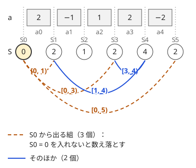

!!! abstract "要点"
    - **何ができるか**：和がちょうど $K$ の区間や和が $M$ の倍数の区間の個数を、条件を $S_r$ と $S_l$ の関係に言い換えて数える。左から $S_l$ の個数を連想配列に記録しながら組を足していく。
    - **いつ使うか**：
        - 和がちょうど K の区間の個数。
        - 和が M の倍数になる区間の個数。
        - $-10^9 \le A_i \le 10^9$ のように負の値を含む。
        - 区間の条件が $S_r$ と $S_l$ の関係（差が $K$・余りが等しい）に書き直せる。
    - **計算量**：`map` で $O(N \log N)$。`unordered_map` なら期待 $O(N)$、余りの種類が $M \le 10^6$ 程度なら配列で $O(N + M)$。
    - **前提**：[累積和](../basics/prefix-sum.md)

<!-- textlint-disable -->
別名：Zero-Sum Ranges・区間和が K・余りが等しい組を数える・累積和の mod・subarray sum equals K
<!-- textlint-enable -->

累積和と連想配列で区間を数える方法は、区間 $[l, r)$ の条件を「$S_r$ と $S_l$ がある関係にある」と書き直し、右端 $r$ ごとに条件を満たす左端 $l$ の個数をまとめて足す方法である。区間は $O(N^2)$ 個あるが、左端の側を値ごとの個数に畳んでおけば、右端 1 つにつき 1 回の検索で済む。このページでは実装を 0-indexed にし、$S_0 = 0$、$S_{i+1} = S_i + a_i$ として $[l, r)$ の和を $S_r - S_l$ と書く。

## S_r − S_l = K となる l を数える（S_0 を入れ忘れない） {#equal-k}

和がちょうど $K$ の区間を数えたいとき、$[l, r)$ の和が $K$ であることは次のように書き直せる。

$$
S_r - S_l = K \iff S_l = S_r - K \quad (0 \le l < r \le N)
$$

右端 $r$ を固定すると、数えるべきは「$l < r$ で $S_l = S_r - K$ となる $l$ の個数」である。$r$ を左から動かしながら、それまでに出た $S_0, \dots, S_{r-1}$ の値ごとの個数を[連想配列](../ds/stl-containers.md#counting-map)に記録しておけば、この個数は 1 回の検索で分かる。

保つ性質は「$r$ を調べる時点で、連想配列には $S_0, \dots, S_{r-1}$ がちょうど 1 回ずつ入っている」ことである。手順は次のとおり。

```text
cnt = {S_0 = 0 が 1 個}
ans = 0
for r = 1, 2, ..., N:
    ans += cnt[S_r − K]   # l < r で S_l = S_r − K のものの個数
    cnt[S_r] += 1         # 調べた後に記録する
```

次の図は $A = (2, -1, 1, 2, -2)$、$K = 2$ の例である。$S = (0, 2, 1, 2, 4, 2)$ で、和が 2 の区間は 5 個ある。たとえば $r = 4$ では $S_4 - K = 2$ を探し、$S_1 = S_3 = 2$ の 2 個が見つかる。これが区間 $[1, 4)$ と $[3, 4)$ である。



5 個のうち $[0, 1)$・$[0, 3)$・$[0, 5)$ の 3 個は左端が $S_0$ である。最初に $S_0 = 0$ を 1 個入れておかないと、先頭から始まる区間をすべて数え落とし、答えは 2 になる。

```cpp
--8<-- "prefix-sum-counting/count-equal-k.cpp:core"
```

完全なプログラム：[`count-equal-k.cpp`](https://github.com/yuukougun/kyopro-atlas/blob/main/snippets/prefix-sum-counting/count-equal-k.cpp)（GitHub）
{ .kp-code-src }

「調べてから記録する」順にするのは、$l < r$（空でない区間）だけを数えるためである。先に $S_r$ を記録すると、$K = 0$ のときに $l = r$ の空区間まで数えてしまう。連想配列を `map` にすると 1 回の検索が $O(\log N)$ なので、全体で $O(N \log N)$ になる。

??? question "確認問題：和が 0 の区間"
    和がちょうど 0 の区間の個数は、累積和のどんな組の個数と等しいか。値ごとの個数が分かっているとき、答えをどう計算するか。

    ??? success "答え"
        $S_l = S_r$（$l < r$）となる組の個数と等しい。値 $v$ をとる累積和が $c_v$ 個あれば、その中から 2 つを選ぶ $\binom{c_v}{2}$ 通りが区間になるので、答えは $\sum_v \binom{c_v}{2}$ である。$S_0$ も数に入れる。

## 余りが等しい組（M の倍数の区間・負の余りの正規化） {#same-remainder}

和が $M$ の倍数になる区間を数えるときは、差が 0 であることを余りの一致に書き直す。

$$
S_r - S_l \equiv 0 \pmod{M} \iff S_r \bmod M = S_l \bmod M
$$

$S_r - S_l$ が $M$ で割り切れることと、2 つを $M$ で割った余りが等しいことは同じだからである。そこで連想配列のキーを $S_r$ そのものではなく $S_r \bmod M$ にし、[和がちょうど K の場合](#equal-k)と同じ手順で「余りが等しい $S_l$ の個数」を足せばよい。余りの種類が $M$ 個以下なので、$M$ が $10^6$ 程度までなら連想配列の代わりに長さ $M$ の配列で数えられ、$O(N + M)$ になる。

負の値を含むときは、C++ の `%` に注意する。C++ の `%` は割られる数と同じ符号になるので、`-1 % 3` は $-1$ で、$2 \bmod 3 = 2$ と別のキーになる。$-1$ と $2$ は $3$ で割った余りが同じなのに、一致を見逃す。`((x % m) + m) % m` として 0 以上 $M$ 未満にそろえる（[整数の割り算と余り](../math/integer-division.md#floor-ceil)）。

```cpp
--8<-- "prefix-sum-counting/count-multiple.cpp:core"
```

完全なプログラム：[`count-multiple.cpp`](https://github.com/yuukougun/kyopro-atlas/blob/main/snippets/prefix-sum-counting/count-multiple.cpp)（GitHub）
{ .kp-code-src }

答えは最大で $\binom{N + 1}{2}$ 個になり、$N = 2 \times 10^5$ なら約 $2 \times 10^{10}$ で `int` に収まらない。個数と答えは `long long` で持つ。

??? question "確認問題：なぜ余りの一致で数えられるか"
    $M = 5$、$S_l = 7$、$S_r = 22$ のとき、区間 $[l, r)$ の和は 5 の倍数か。余りを使って判定せよ。

    ??? success "答え"
        $7 \bmod 5 = 2$、$22 \bmod 5 = 2$ で余りが等しいので、差 $22 - 7 = 15$ は 5 の倍数である。一般に $S_r = qM + t$、$S_l = q'M + t$ なら $S_r - S_l = (q - q')M$ になる。逆に差が $M$ の倍数なら、$S_r$ と $S_l$ は $M$ の倍数だけずれているので余りが等しい。

## 後ろからの累積（数字列の倍数） {#suffix}

数字の列 $D = d_0 d_1 \dots d_{N-1}$（$d_i$ は $i$ 文字目の数字）の部分文字列を 10 進数とみて、$P$ の倍数になるものを数えるときは、前からではなく後ろから累積する。前から作った値 $T_i$（先頭 $i$ 文字が表す数）では、$D[l, r)$ の表す数は $T_r - T_l \cdot 10^{r-l}$ になる。$l$ と $r$ の両方に依存する $10^{r-l}$ が残るので、単純な差に書けない。

後ろから作る $U_i$ ＝「$D[i, N)$ が表す数を $P$ で割った余り」（$U_N = 0$）とすると、$D[l, r)$ が表す数を $x$ として

$$
U_l - U_r \equiv x \cdot 10^{N-r} \pmod{P}
$$

となる。$10$ と $P$ が互いに素なら $10^{N-r}$ を掛けても $P$ の倍数かどうかは変わらないので、「$x$ が $P$ の倍数 ⇔ $U_l \equiv U_r$」になり、[余りが等しい組](#same-remainder)と同じく数えられる。$U_i$ の作り方は[接尾辞の余りで部分文字列を数える](../math/digit-and-mod.md#suffix-remainder)にある。

10 と互いに素でない $P$（2・4・5・6 など）では、この同値が崩れる。$P = 2, 5$ なら 1 の位だけで倍数かどうかが決まるので、別の方法で数える（[P が 2・5 のときの場合分け](../math/digit-and-mod.md#p-2-5)）。

## 円環上の組を数える {#circular}

円周上に $N$ 地点が並び、地点 $i$ から $i + 1$ へ（$N - 1$ からは 0 へ）進む時間が $a_i$ のとき、時計回りに $s$ から $t$（$s \ne t$）へ進む時間が $M$ の倍数になる組 $(s, t)$ を数える。円環のままでは区間の始まりと終わりが一列に並ばないが、$s < t$ と $s > t$ に分ければ一列の累積和で書ける。1 周の和を $T$ とし、累積和 $S_0, \dots, S_{N-1}$（$S_i$ は地点 0 から地点 $i$ への時間）で考える。

- $s < t$ のとき、移動時間は $S_t - S_s$ なので、条件は $S_s \equiv S_t \pmod{M}$
- $s > t$ のとき、移動時間は $T - S_s + S_t$ なので、条件は $S_t + T \equiv S_s \pmod{M}$

どちらも「添字の小さいほう $i$ と大きいほう $j$ の余りの関係」なので、[余りが等しい組](#same-remainder)と同じく $j$ を左から動かし、$i < j$ の余りの個数を連想配列に記録しながら 2 回検索すればよい。

```text
cnt = {}
ans = 0
for j = 0, 1, ..., N − 1:
    ans += cnt[S_j mod M]         # s = i < t = j：S_i ≡ S_j
    ans += cnt[(S_j − T) mod M]   # t = i < s = j：S_i + T ≡ S_j
    cnt[S_j mod M] += 1
```

$a$ を 2 周分 $a_0, \dots, a_{N-1}, a_0, \dots, a_{N-1}$ に伸ばして数えてもよい（[円環は 2 周分に伸ばす](../basics/prefix-sum.md#circular)）。$s$ から $t$ への移動は、伸ばした列の区間 $[l, r)$（$l = s$、$t > s$ なら $r = t$、$t < s$ なら $r = t + N$）のうち $0 \le l < N$ かつ $1 \le r - l \le N - 1$ のものに 1 対 1 で対応する。長さが $N$ 以上の区間は 1 周以上回るので、組に対応しない。この制限があるので、右端 $r$ を $1$ から $2N - 2$ まで動かし、$\max(0, r - N + 1) \le l \le \min(r - 1, N - 1)$ の窓の中で余りが等しい組を数える。窓の扱いは[長さの制限付き](#length-limited)で説明する。

## 長さの制限付き（窓の中だけで数える） {#length-limited}

この節は[尺取り法の固定長の窓](../basics/two-pointers.md#fixed-window)を前提にする。「長さ $L$ 以下の区間だけ」のように左端の範囲が制限されるときは、連想配列に入れる $S_l$ を窓の中のものだけに保つ。

保つ性質は「右端 $r$ を調べる時点で、連想配列には $r - L \le l \le r - 1$ の $S_l$ だけが入っている」ことである。$r$ を 1 つ進めるたびに、次の 2 つを行う。

```text
for r = 1, 2, ..., N:
    cnt[S_{r-1}] += 1                 # 新しく窓に入る左端 l = r − 1
    if r − L − 1 >= 0:
        cnt[S_{r−L−1}] −= 1           # 窓から出る左端 l = r − L − 1
    ans += cnt[S_r − K]               # 条件に合う S_l の値を検索する
```

ここでは和がちょうど $K$ の場合を書いた。余りなら、キーと検索の値をどちらも $S \bmod M$ にする。条件によってはキーと検索の値を別の式に変える（下の $B_i$ がその例）。

制限は問題文に書かれていなくても、条件から出てくることがある。「区間和を $K$ で割った余りが区間の長さに等しい区間」では、余りは $K$ 未満なので、長さ $r - l$ も $K$ 未満に限られる。この範囲なら条件は

$$
S_r - S_l \equiv r - l \pmod{K} \iff S_r - r \equiv S_l - l \pmod{K}
$$

と、$r$ だけの式と $l$ だけの式に分かれる（[i と j を分離する](../thinking/reformulation.md#separate-indices)）。$B_i = (S_i - i) \bmod K$ とおけば、長さ $K - 1$ 以下の窓の中で $B$ の余りが等しい組を数える問題になる。$S_i - i$ は各要素から 1 を引いた列の累積和でもある。

窓を忘れて全体で数えると、長さ $K$ 以上で余りがたまたま一致する区間まで数えてしまう。窓から消すときに個数が 0 になったキーは、`map` に残っても答えは変わらないが、要素数を使うなら消しておく。

## 尺取りとの使い分け（負の値） {#vs-two-pointers}

「和がちょうど $K$ の区間を数える」は、すべての値が正なら[尺取り法](../basics/two-pointers.md#negative-values)でも数えられる。値が正なら、区間を右に広げると和は増え、左を縮めると減るので、右端を進めても条件を満たす左端は戻らない。

負の値が 1 つでもあると、この単調性が崩れる。区間を広げると和が減る場合があるので、左端を進めすぎて数え落としたり、戻る必要が出たりする。累積和と連想配列は和の単調性を使わず、$S_l$ の値の一致だけを見るので、値の符号によらず使える。

| 条件 | 値がすべて正 | 負の値を含む |
| --- | --- | --- |
| 和がちょうど $K$ | 尺取り法・このページ | このページ |
| 和が $M$ の倍数 | このページ | このページ（余りを正規化） |
| 和が $K$ 以下 | 尺取り法 | 座標圧縮と BIT（[つながり](#next-steps)） |

「ちょうど」や「倍数」は値の一致に書けるので連想配列が合う。「以下」「以上」は一致ではなく大小なので、連想配列ではなく尺取りや BIT で数える。

## 上位の手法へのつながり {#next-steps}

$S_r$ と $S_l$ の関係に書き直すという考え方は、和以外の演算や、数える以外の問いにも広がる。

- **区間の XOR**：$X_0 = 0$、$X_{i+1} = X_i \oplus a_i$ とすると、$[l, r)$ の XOR は $X_r \oplus X_l$ である。XOR が $K$ の区間は $X_l = X_r \oplus K$ となる $l$ を数えればよく、手順は[和がちょうど K の場合](#equal-k)と同じである
- **個数が等しい区間**：「A と B が同じ数だけ含まれる区間」は、A を $+1$、B を $-1$、ほかを $0$ に置き換えると和が 0 の区間になる。種類が 3 つ以上なら、個数の差の組 $(c_A - c_B, c_B - c_C)$ をキーにする
- **最長・最短の区間**：連想配列に個数ではなく「その値が最初に出た位置」を記録すると、和が $K$ の最長の区間が求まる。最短なら最後に出た位置を上書きで記録する
- **和が K 以下の区間（負の値あり）**：$S_l \ge S_r - K$ となる $l$ の個数を数える。一致ではないので、$S$ を[座標圧縮](../basics/coordinate-compression.md)して [BIT](../ds/fenwick-tree.md) に入れ、範囲の個数を数える。$O(N \log N)$ になる
- **区間和の余りの総和**：すべての区間の和を $M$ で割った余りを足し合わせる問題では、$S_r \bmod M < S_l \bmod M$ の組で $M$ を足し戻す回数を数える。これは[転倒数](../ds/inversion-number.md)の数え方になる

## 落とし穴 {#pitfalls}

**$S_0$ を入れ忘れる**。最初に `cnt[0] = 1` をしないと、先頭から始まる区間をすべて数え落とす。手で確かめるなら、$A = (K)$（要素 1 つで和が $K$）の答えが 1 になるかを見る。

**記録と検索の順を逆にする**。$S_r$ を記録してから $S_r - K$ を検索すると、$K = 0$ のときに長さ 0 の区間まで数える。「検索してから記録」で $l < r$ を保つ。

**負の余りを直さない**。C++ の `%` は負の数に負の余りを返すので、$-1$ と $M - 1$ が別のキーになる。累積和が負になりうるなら、余りを取るたびに `((x % m) + m) % m` で直す。

**個数と累積和のあふれ**。$\lvert a_i \rvert \le 10^9$、$N = 2 \times 10^5$ なら累積和は $2 \times 10^{14}$ に達する。答えも $2 \times 10^{10}$ 程度になるので、どちらも `long long` で持つ。

**`[]` で検索して要素を増やす**。`map` の `cnt[x]` は、`x` がなければ値 0 の要素を作る。答えは変わらないが、検索のたびに要素が増えてメモリと時間を使う。検索だけなら `find` か `count` を使う（[コンテナの落とし穴](../ds/stl-containers.md#pitfalls)）。直後に同じキーを記録するなら、どのみち要素ができるので `[]` で引いてよい。

**`unordered_map` が遅くなる**。ハッシュの衝突を狙った入力で、`unordered_map` は 1 回 $O(N)$ まで遅くなることがある。迷ったら `map` を使う。

## 例題 {#examples}

### ABC233 D. Count Interval {#abc233_d}

<div class="kp-problems" data-role="example" markdown>

- [ABC233 D. Count Interval](https://atcoder.jp/contests/abc233/tasks/abc233_d)（diff 726）：整数列の連続部分列のうち、和がちょうど K になるものの個数を求める。

</div>

$A_i$ に負の値があるので、尺取り法は使えない。区間 $[l, r)$ の和は $S_r - S_l$ なので、$S_l = S_r - K$ となる $l < r$ を右端ごとに数える。左から $S_l$ の個数を連想配列に記録しながら足していけばよい。

??? note "解法の詳細"
    - 累積和を `long long` で作る。$\lvert A_i \rvert \le 10^9$、$N \le 2 \times 10^5$ なので累積和は $2 \times 10^{14}$ まで、$K$ も $10^{15}$ まであるので `int` では足りない。
    - 連想配列に $S_0 = 0$ を 1 個入れてから、$r = 1, \dots, N$ の順に「$S_r - K$ の個数を答えに足す → $S_r$ を記録する」を繰り返す。
    - コードは[和がちょうど K の節](#equal-k)のものと同じ形である。`map` で $O(N \log N)$。

## 練習問題 {#practice}

<div class="kp-problems" data-role="practice" markdown>

- [ABC473 E. K-Divisible Subarrays](https://atcoder.jp/contests/abc473/tasks/abc473_e)（diff 966）：数列をいくつかの連続部分列に分割するとき、和が K の倍数である部分の個数の最大値を求める。
- [ABC367 D. Pedometer](https://atcoder.jp/contests/abc367/tasks/abc367_d)（diff 1037）：円周上の休憩所の組のうち、時計回りの移動時間が M の倍数になるものの数を求める。
- [ABC164 D. Multiple of 2019](https://atcoder.jp/contests/abc164/tasks/abc164_d)（diff 1232）：数字列 S の部分文字列のうち、整数とみて 2019 の倍数になるものの個数を求める（|S| ≤ 2×10^5）。
- [ABC105 D. Candy Distribution](https://atcoder.jp/contests/abc105/tasks/abc105_d)（diff 1458）：区間和が M の倍数になる区間の数を求める。

</div>

??? note "練習の方針"
    - **ABC473 E**：和が $K$ の倍数 ⇔ 累積和の余りが等しい。左から見て、直前に区切った位置以降の余りを集合に入れ（区切った位置の余りも入れる）、すでにある余りが出たら 1 個数えて集合を空にし、今の余りだけを入れ直す。最も早く終わる区間から取っても損をしない（[貪欲法](../basics/greedy-basics.md)の交換の考え方）
    - **ABC367 D**：[円環上の組を数える](#circular)。$s < t$ と $s > t$ に分け、累積和の余りの関係（$S_s \equiv S_t$ と $S_t + T \equiv S_s$）を左から数える。2 周分に伸ばして窓で数えてもよい
    - **ABC164 D**：[後ろからの累積](#suffix)。10 と 2019 は互いに素なので、接尾辞の余りが等しい組を数える。末尾の空の接尾辞の余り 0 も数に入れる
    - **ABC105 D**：[余りが等しい組](#same-remainder)。$M$ が大きいので配列ではなく連想配列で余りの個数を数え、$\sum \binom{c}{2}$ を `long long` で足す

## 力試し {#challenge}

<div class="kp-problems" data-role="challenge" markdown>

- [ABC146 E. Rem of Sum is Num](https://atcoder.jp/contests/abc146/tasks/abc146_e)（diff 1762）：区間和を K で割った余りが区間の長さに等しい区間の数を求める。

</div>

??? note "力試しの方針"
    - **ABC146 E**：余りは $K$ 未満なので長さも $K$ 未満に限られる。$(S_i - i) \bmod K$ の一致に書き直し、長さ $K - 1$ 以下の窓の中で数える（[長さの制限付き](#length-limited)）

## 参考 {#references}

- [drken「AtCoder ABC 233 D - Count Interval (2Q, 茶色, 400 点)」](https://drken1215.hatenablog.com/entry/2024/11/23/150237)：例題の言い換えと、連想配列で検索してから記録する手順
- [drken「AtCoder ABC 105 D - Candy Distribution (2Q, 水色, 400 点)」](https://drken1215.hatenablog.com/entry/2018/08/13/125300)：余りの一致で数えること、S_0 と long long の注意
- [drken「AtCoder ABC 164 D - Multiple of 2019 (1Q, 水色, 400 点)」](https://drken1215.hatenablog.com/entry/2020/04/29/171300)：後ろからの累積と、10 と 2019 が互いに素であることの使い方
- [drken「AtCoder ABC 367 D - Pedometer (1Q, 緑色, 400 点)」](https://drken1215.hatenablog.com/entry/2024/08/21/084614)：円環を 2 周分に伸ばし、差が N 未満の組を数える方針
- [drken「AtCoder ABC 146 E - Rem of Sum is Num (1D, 青色, 500 点)」](https://drken1215.hatenablog.com/entry/2024/11/23/183549)：長さが K 未満に限られることと、S_i − i への変換と窓
- [ikatakos「AtCoder Beginner Contest 473 D,E,F,G問題メモ」](https://ikatakos.com/pot/programming_algorithm/contest_history/atcoder/2026/0829_abc473)：練習の ABC473 E の貪欲の方針（解説の部分だけを参照）
