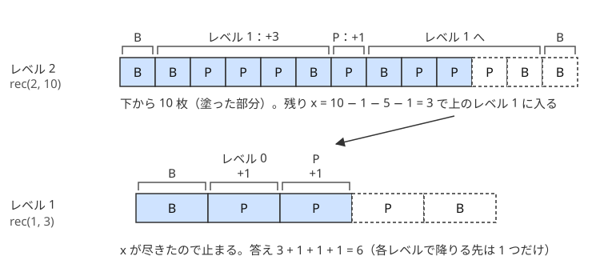

!!! abstract "要点"
    - **何ができるか**：レベル $N$ のものがレベル $N - 1$ のものの組合せで定義される構造の $K$ 番目を、各レベルの長さを前計算して再帰でたどって求める。長さが指数的に増えるので、必要な深さは $\log K$ 程度で済む。
    - **いつ使うか**：
        - レベル $N$ のものがレベル $N - 1$ のものを並べて作られる。
        - 長さが 2 倍・3 倍で増える構造の $K$ 番目を問われる。
        - フラクタル図形を描く。
        - レベルは 50 程度まででも、全体の長さが $10^{15}$ を超える。
    - **計算量**：$K$ 番目を探すのは $O(\text{レベル数} \times \text{部品の数})$。長さが倍々に増えるなら、レベル数は $O(\log K)$ に下げられる。図形を描くのは $O(\text{出力の大きさ})$。
    - **前提**：なし

<!-- textlint-disable -->
別名：フラクタル・自己相似・再帰関数・レベル N の構造・recursive structure・fractal
<!-- textlint-enable -->

再帰的な構造は、「レベル $n$ のものは、レベル $n - 1$ のものをいくつかと少しの部品を並べたもの」と定義される列や図形である。全体は長すぎて作れないが、各レベルの長さだけを前計算しておけば、$K$ 番目がどの部品に入るかを上から順に決めて、1 本の道筋だけをたどれる。

## 長さを前計算して K 番目を再帰で探す {#kth-by-length}

レベル $n$ の構造を $S_n$ と書く。$S_n$ が部品 $p_1, p_2, \dots$ を並べたもので、各部品は 1 文字か、より低いレベルの $S_m$ だとする。前計算するのは次の 2 つである。

- $\mathrm{len}[n]$：$S_n$ の全体の長さ
- $\mathrm{all}[n]$：$S_n$ の全体についての答え（数えたいものの個数など）

どちらも定義の式をそのまま使い、レベルの小さい順に求める。たとえば $S_n = S_{n-1} + c + S_{n-1}$ なら $\mathrm{len}[n] = 2\,\mathrm{len}[n-1] + 1$ である。

「$S_n$ の先頭 $k$ 個についての答え」を返す関数 $\mathrm{rec}(n, k)$ は、部品を前から見て、$k$ がどの部品で尽きるかを探す。

```text
rec(n, k):   # S_n の先頭 k 個（0 <= k <= len[n]）についての答え
  n が最小のレベルなら、直接答える
  res = 0
  部品 p を前から順に見る:
    k <= len(p) なら:
      p が S_m なら res + rec(m, k) を返す
      p が 1 文字なら、k が 1 のときだけその文字を数えて返す
    そうでなければ:
      res += all(p)（p を丸ごと数える）、k -= len(p)
  res を返す
```

ここで部品 $p$ が $S_m$ なら $\mathrm{len}(p) = \mathrm{len}[m]$・$\mathrm{all}(p) = \mathrm{all}[m]$ である。$p$ が 1 文字なら $\mathrm{len}(p) = 1$ で、$\mathrm{all}(p)$ は数える文字なら 1、そうでなければ 0 である。

$k$ が部品の途中で尽きるのは 1 か所だけなので、各レベルで再帰を呼ぶのは 1 回だけである。部品を丸ごと通り過ぎるときは前計算の $\mathrm{all}$ を足すだけで済む。だから計算量はレベル数 × 部品の数で、全体の長さによらない。

具体例として、次の「レベル $n$ のバーガー」を考える（[例題](#abc115_d)の構造）。レベル 0 はパティ P が 1 枚で、レベル $n$ は下から「バン B・レベル $n-1$・P・レベル $n-1$・B」を重ねたものである。$\mathrm{len}[n] = 2\,\mathrm{len}[n-1] + 3$、パティの数は $\mathrm{pat}[n] = 2\,\mathrm{pat}[n-1] + 1$ になる。下の図は、レベル 2 の下から 10 枚に含まれるパティを数える様子である。



図のとおり、レベル 2 では $x = 10$ のうち B・下のレベル 1・P の 7 枚を使い、残りの 3 枚で上のレベル 1 へ降りる。降りる先はレベルごとに 1 つだけである。コードでは、部品の並びがそのまま場合分けの順になる。

```cpp
--8<-- "recursion-structure/burger.cpp:core"
```

「$K$ 番目の文字」を問われたときも同じ形で、$\mathrm{all}$ を足す代わりに $k$ を減らすだけになる。$K$ 番目を求める関数と先頭 $K$ 個の集計を求める関数のどちらを書くかは、問われているものに合わせる。

??? question "確認問題：部品が 3 つに増えたら"
    $S_n = S_{n-1} + S_{n-1} + \text{"x"} + S_{n-1}$ のように、同じレベルの部品が 3 つあるとき、$\mathrm{rec}(n, k)$ が再帰を呼ぶ回数は 1 回の呼び出しの中で何回か。

    ??? success "答え"
        1 回だけである。$k$ が途中で尽きる部品は 1 つしかなく、それより前の部品は $\mathrm{all}$ を足して通り過ぎ、後ろの部品は見ない。部品の数は場合分けの数を増やすだけで、計算量はレベル数 × 部品の数のままである。

## 再帰で描く {#draw}

フラクタル図形を出力する問題では、全体を実際に描く。出力の大きさがそのまま計算量の下限なので、レベルは小さい（1 辺が $3^6 = 729$ マスなど）。書き方は「左上の位置とレベルを受け取り、その範囲に描く関数」にすると素直である。

シェルピンスキーのカーペットを例にする。レベル 0 は黒いマス `#` が 1 つで、レベル $n$ は $3^n \times 3^n$ のマスを $3 \times 3$ のブロックに分け、真ん中のブロックを白、残りの 8 つをレベル $n - 1$ にしたものである。

```cpp
--8<-- "recursion-structure/carpet.cpp:core"
```

1 回の呼び出しは 8 つの呼び出しを生むが、レベル 0 の呼び出しの回数は黒いマスの数 $8^n$ と等しく、呼び出しの総数はその $8/7$ 倍未満である。だから計算量は出力の大きさ $O(9^n)$ に収まる。

再帰を使わずに、マスごとに色を決める方法もある。行 $i$・列 $j$（0-indexed）を 3 進数で書いたとき、同じ桁がどちらも 1 になるところがあれば白、なければ黒である。各桁がどのブロックに入るかを上から決めていくのが再帰の各段に当たるので、2 つの方法は同じことを言っている。再帰の定義を位置の $b$ 進数の桁に読み替えると、どのマスも $O(n)$ で判定できる。

## 必要な深さは log K（長さの上限で打ち切る） {#depth}

レベル $N$ が $10^{18}$ のように大きくても、$S_n$ が $S_{n-1}$ で始まる構造なら、$K$ 番目を求めるのに使うのは低いレベルだけである。$S_N$ の先頭 $\mathrm{len}[m]$ 文字は $S_m$ と同じなので、$\mathrm{len}[m] \ge K$ となる最小の $m$ まで下げてよい。長さが毎回 2 倍以上に増えるなら、$m$ は $\log_2 K$ 程度である。

次のコードは $S_0$ を空文字列、$S_n = S_{n-1} + c_n + S_{n-1}$（$c_n$ はレベルごとに決まる文字）としたときに、$S_N$ の $K$ 文字目を求める。$\lvert S_n \rvert = 2^n - 1$ で、$K \le 10^{18} < 2^{60} - 1$ だから、レベルを 60 に下げても答えは変わらない。

```cpp
--8<-- "recursion-structure/kth-char.cpp:core"
```

長さの前計算は、そのまま書くとすぐに `long long` をあふれる。$2^{n}$ は $n = 63$ で `long long` の上限を超える。あふれた長さとの比較は意味を持たないので、次のどちらかで防ぐ。

- **レベルを先に下げる**：上の例のように、$K$ を超えるレベルで打ち切ってから前計算する。$S_n$ が $S_{n-1}$ で始まる構造なら使える。$S_{n-1}$ で終わる構造なら、末尾から数えた $K$ 番目に限って使える
- **長さを上限で止める**：$\mathrm{len}[n] = \min(2\,\mathrm{len}[n-1] + 1, \mathrm{INF})$ のように、$K$ の最大値より大きい $\mathrm{INF}$（$2 \times 10^{18}$ など）で頭打ちにする。この例では $2\,\mathrm{INF} + 1$ も `long long` に収まるので、計算してから $\min$ を取ればよい。部品が多い構造や $\mathrm{INF}$ が大きい場合は、途中の計算があふれうる。そのときは足す前に、$\mathrm{len}[n-1] > (\mathrm{INF} - 1) / 2$ のように上限を超えるかを確かめる

レベルが入力で与えられず、値が半分になっていく再帰（$f(H) = 2 f(\lfloor H/2 \rfloor) + 1$ など）も、深さは $\log_2 H$ 程度で止まる。[練習問題](#practice)の分裂するモンスターはこの形である。

??? question "確認問題：先頭が同じでない構造"
    $S_n = c_n + S_{n-1} + S_{n-1}$ のように、$S_n$ が $S_{n-1}$ で始まらない構造では、$N = 10^{18}$ のときレベルを下げられるか。

    ??? success "答え"
        $S_N$ の先頭 $\mathrm{len}[m]$ 文字が $S_m$ と同じとは限らないので、そのままでは下げられない。ただし $K \ge 2$ なら、$K$ 番目は先頭の $c_N$ の後ろの $S_{N-1}$ に入り、$S_{N-1}$ の $K - 1$ 番目になる。長さが $K$ より十分大きいレベル（60 程度より上）では、これが毎段起きて $K$ が 1 ずつ減るだけである。だから $N - 60$ 段をまとめて降り、$K$ から $N - 60$ を引けばよい。途中で $K$ が 1 になるなら、答えはその段の先頭の文字 $c_{N-K+1}$ である。このように、高いレベルで起きることが一定の形をしているかを確かめると、下げ方が見つかる。

## 再帰の深さとスタック {#stack}

関数を呼ぶたびに、戻り先や局所変数がスタックに積まれる。再帰の深さはスタックの使用量に比例するので、深さが $10^5$ を超えると手元の環境では落ちることがある（[AtCoder と手元の C++ 環境](../cpp/cpp-environment.md#stack-depth)）。

この形の再帰では、深さはレベル数である。前の節のようにレベルを $\log K$ に下げていれば深さは 60 程度で、心配は要らない。注意が要るのは次の場合である。

- **レベルを下げ忘れる**：$N = 10^{18}$ をそのまま再帰に渡すと、深さ $N$ の再帰になり、時間とスタックが足りない
- **長さが 1 ずつしか増えない**：$S_n = S_{n-1} + c$ のように長さが線形にしか増えないと、レベルを下げても $K$ 程度の深さが残る。この場合は再帰をやめ、ループで書く

$K$ 番目を探す再帰は、各レベルで自分を 1 回だけ呼び、その結果をほぼそのまま返す。だから「$n$ と $k$ を書き換えて次の周へ進む」ループに直せる。足し込む値は変数に貯めておけばよい。

ラムダ式で再帰を書くときは、自分自身を引数で受け取る形にする（[ラムダ式](../cpp/cpp-lambda.md#self-argument)）。

## 落とし穴 {#pitfalls}

**長さの前計算があふれる**。レベル 50 のバーガーの長さは $2^{52} - 3$ で `long long` に収まる。しかしレベルの上限が大きい構造で長さを素直に倍にしていくと、レベル 63 前後で上限を超えて負の値になる。あふれた長さとの比較は誤った部品を選ぶ。[レベルを下げるか、上限で止める](#depth)。

**$k$ の境界を 1 つずらす**。「先頭 $k$ 個」（$0 \le k \le \mathrm{len}[n]$）と「$k$ 番目」（$1 \le k \le \mathrm{len}[n]$）のどちらで関数を書いたかを決めておく。「先頭 $k$ 個」なら $k = 0$ が来うるので、部品をちょうど使い切ったところで止める処理が要る。「$k$ 番目」なら $k = \mathrm{len}(p)$ のときは部品 $p$ の中にあるので、降りる側に入れる。最小のレベルで全部の $k$ を試し、実際に作った列と比べれば見つけやすい。

**部品の並びを読み違える**。「下から」「左から」など、問題文の並びの向きを場合分けの順にそのまま写す。バーガーなら下から B・レベル $n-1$・P・レベル $n-1$・B の順に見る。

**$K$ 番目の文字で集計を代用する**。先頭 $K$ 個に含まれる数を問われているのに $K$ 番目の文字だけを求めても答えにならない。通り過ぎた部品の $\mathrm{all}$ を足す形にする。

## 上位の手法へのつながり {#next-steps}

- **分割統治**：再帰的な構造は、問題の側が「半分（3 分の 1）ずつに分かれる」形をしている場合である。入力の列を自分で半分に分け、左右を解いてから「またぐもの」を数えるのが[分割統治](../basics/divide-and-conquer.md#crossing)で、マージソートや転倒数の数え方につながる
- **メモ化再帰**：1 回の呼び出しで再帰を 2 回以上呼び、しかも同じ引数で何度も呼ぶなら、答えを覚えておく[メモ化再帰](../dp/memoized-recursion.md)にする。$f(n) = f(\lfloor n/2 \rfloor) + f(\lfloor n/3 \rfloor)$ のような再帰は、現れる引数の種類が少ないので速くなる
- **桁で考える**：カーペットのように、再帰の各段が「位置のどの桁がどのブロックか」に対応していることが多い。位置を $b$ 進数で書き、桁ごとに条件を見る考え方は、[桁 DP](../dp/digit-dp.md) や bit の扱いにつながる
- **全列挙**：再帰で「作れるものをすべて作る」のは[再帰による全列挙](../basics/recursive-enumeration.md)である。正しい括弧列の列挙は、構造の定義からではなく、1 文字ずつ決める全列挙として書く

## 例題 {#examples}

### ABC115 D. Christmas {#abc115_d}

<div class="kp-problems" data-role="example" markdown>

- [ABC115 D. Christmas](https://atcoder.jp/contests/abc115/tasks/abc115_d)（diff 1088）：レベル L バーガーの下から X 枚の中に含まれるパティの枚数を求める。

</div>

レベル $N \le 50$ のバーガーの全体は $2^{52} - 3$ 枚で、作れない。各レベルの全体の枚数とパティの数を前計算し、下から部品を見て、$X$ が尽きる部品にだけ降りる。降りる先はレベルごとに 1 つなので $O(N)$ で済む。

??? note "解法の詳細"
    - 前計算：$\mathrm{len}[0] = 1$・$\mathrm{pat}[0] = 1$、$\mathrm{len}[n] = 2\,\mathrm{len}[n-1] + 3$・$\mathrm{pat}[n] = 2\,\mathrm{pat}[n-1] + 1$。レベル 50 でも `long long` に収まる。
    - $\mathrm{rec}(n, x)$：レベル $n$ の下から $x$ 枚のパティの数。レベル 0 なら $x$（0 か 1）を返す。そうでなければ、B（1 枚）・レベル $n-1$・P（1 枚）・レベル $n-1$・B の順に、$x$ が残っている間だけ見る。部品を丸ごと通り過ぎるなら $\mathrm{pat}$ か 1 を足して $x$ を減らし、部品の途中で尽きるならその部品のレベル $n-1$ に降りる。
    - コードは[長さを前計算して K 番目を再帰で探す](#kth-by-length)の節のものである。

## 練習問題 {#practice}

<div class="kp-problems" data-role="practice" markdown>

- [ABC153 D. Caracal vs Monster](https://atcoder.jp/contests/abc153/tasks/abc153_d)（diff 129）：体力が半分になって 2 体に分裂するモンスターを、すべて倒すための攻撃回数を求める。
- [ABC357 C. Sierpinski carpet](https://atcoder.jp/contests/abc357/tasks/abc357_c)（diff 371）：レベル N のシェルピンスキーのカーペットを描く。
- [典型90 002. Encyclopedia of Parentheses（★3）](https://atcoder.jp/contests/typical90/tasks/typical90_b)（diff —）：長さ N の正しい括弧列を辞書順にすべて出力する。

</div>

??? note "練習の方針"
    - **ABC153 D**：体力 $H$ のモンスターを倒す回数を $f(H)$ とすると、分裂の 1 回と 2 体分で $f(H) = 2 f(\lfloor H/2 \rfloor) + 1$、$f(1) = 1$ になる。引数は毎回半分になるので、再帰の深さは $\log_2 H$ 程度で済む。答えは $H$ の 2 進数の桁数を $d$ として $2^d - 1$ とも書ける
    - **ABC357 C**：[再帰で描く](#draw)の節のとおり、左上の位置とレベルを受け取って 8 つのブロックに描く。レベルを 1 つずつ上げて、前のレベルの図形を 8 か所に写す書き方でもよい
    - **典型90 002**：`(` を +1、`)` を −1 と数え、途中で負にならず最後が 0 の列が正しい括弧列である。作り方は 2 通りある。1 文字ずつ `(` を先に試す再帰で作るか、$2^N$ 通りの bit 全探索で作って判定する。再帰なら `(` を先に試せば辞書順に出る（ASCII で `(` は `)` より小さい）。bit 全探索なら、上位の bit を先頭の文字にし、0 を `(` に対応させると、整数の小さい順がそのまま辞書順になる

## 参考 {#references}

- [drken「AtCoder ABC 115 D - Christmas (2Q, 緑色, 400 点)」](https://drken1215.hatenablog.com/entry/2019/05/13/114600)：例題の層の数とパティの数の漸化式、部品ごとの場合分け
- [drken「AtCoder ABC 153 D - Caracal vs Monster (4Q, 灰色, 400 点)」](https://drken1215.hatenablog.com/entry/2020/01/26/224500)：練習の方針（分裂の漸化式と $2^d - 1$）
- [drken「AtCoder ABC 357 C - Sierpinski carpet (4Q, 灰色, 250 点)」](https://drken1215.hatenablog.com/entry/2024/06/09/233433)：練習の方針（レベルを 1 つずつ上げて描く）
- [drken「競プロ典型 90 問 002 - Encyclopedia of Parentheses（3Q, ★3）」](https://drken1215.hatenablog.com/entry/2021/06/12/151200)：練習の方針（括弧列の判定と辞書順）
