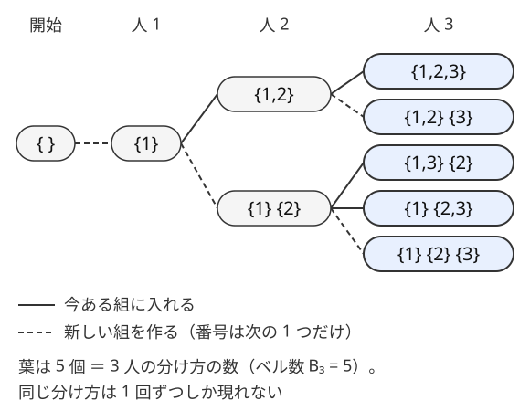

!!! abstract "要点"
    - **何ができるか**：部分的に決めた状態から 1 つずつ決めていく再帰で、条件を満たす数・組分け・敷き詰めを全部列挙する。組分けは「まだ組のない最小番号の人から決める」と同じ分け方を二度数えない。
    - **いつ使うか**：
        - 条件を満たす数・列を小さい順にすべて作る
        - $N \le 10$〜$12$ 人を組・グループに分ける（ベル数 $B_{12} \approx 4.2 \times 10^6$）
        - $2N \le 16$ 人を 2 人組に分ける（$(2N-1)!!$ 通り）
        - タイルの敷き詰め・パズルを途中で打ち切りながら試す
    - **計算量**：再帰木の葉の数 × 葉 1 つあたりの計算量。組分けは $B_N$ 通り（$B_{10} = 115975$、$B_{12} = 4213597$）、2 人組は $(2N-1)!!$ 通り（$2N = 16$ で $2027025$）。枝刈りで葉はさらに減る
    - **前提**：[bit 全探索と順列全探索](../basics/bit-full-search.md)

<!-- textlint-disable -->
別名：DFS による全列挙・バックトラック・枝刈り・組分けの全列挙・グループ分けの全列挙・集合分割の全列挙・backtracking
<!-- textlint-enable -->

再帰による全列挙は、選択を 1 つ決めては次の選択へ進む再帰で、すべての候補をちょうど 1 回ずつ作る方法である。[bit 全探索と順列全探索](../basics/bit-full-search.md)では候補の形が決まっているが、再帰を使うと「前に何を選んだかで次の選択肢が変わる」候補も列挙できる。難しいのは再帰の書き方より、同じ候補を二度作らない決め方と、候補の数の見積もりである。

## 再帰の骨組み（決める・進む・戻す） {#skeleton}

再帰による全列挙の関数は、「ここまで決めた部分」を受け取り、次の 1 か所の選び方を全部試す。ループの入れ子の深さが入力で変わるとき、入れ子を再帰の深さに置き換えたものと考えるとよい。

```text
dfs(ここまで決めた部分):
    全部決まった → 1 つの候補として記録して戻る
    続けても条件を満たせないと分かった → 戻る（枝刈り）
    次の 1 か所の選び方 c それぞれについて:
        c を書き込む（決める）
        dfs(1 つ進めた部分)（進む）
        c を消す（戻す）
```

呼び出しの関係を木にしたものを[再帰木](../guide/glossary.md#recursion-tree)と呼ぶ。根は何も決めていない状態、葉は全部決まった候補（または枝刈りで止まった所）である。全列挙が正しいためには次の 2 つが要る。

- **漏れがない**：どの候補にも、根からその候補へ至る選び方の列がある
- **重複がない**：異なる選び方の列が、同じ候補を作らない

漏れは「その時点で可能な選択を全部試す」ことで防げる。重複は選び方の列と候補が 1 対 1 になるように決め方を工夫して防ぐ。組分け・ペア分け・敷き詰めの節は、どれもこの工夫の型である。C++ では再帰をラムダ式で `auto dfs = [&](auto&& self, int i) -> void { … };` と書く（理由は[ラムダ式](../cpp/cpp-lambda.md#recursive-lambda)）。

## 生成型（桁を 1 つずつ足す） {#generate}

「7・5・3 だけからなる数」「隣り合う桁の差が 1 以下の数」のように、条件を満たす数そのものが少ないときは、$1$ から $N$ まで全部を調べず、条件を満たす数だけを作る。今の数 $x$ の末尾に桁 $d$ を足した $10x + d$ へ進む再帰で、桁ごとの条件（直前の桁との差など）は足すときに確かめる。

この型では葉だけでなく、再帰木のすべての節点が 1 つの数である。$x$ を作った時点で数え、さらに桁を足して深く進む。数は桁を足すほど大きくなるので、$x > N$ になったらその先は全部 $N$ を超え、そこで戻ってよい。

数える個数は、桁の選び方の数から見積もる。7・5・3 だけで 9 桁以下なら $3 + 3^2 + \dots + 3^9 = 29523$ 個である。隣り合う桁の差が 1 以下の数は、各桁の選び方が高々 3 通りなので $d$ 桁で $9 \times 3^{d-1}$ 個以下になる。

「小さい順に」と問われたら注意がいる。深さ優先で作ると $1, 10, 100, \dots$ のような辞書順になり、数の小さい順ではない。数の小さい順は「桁数の小さい順、同じ桁数なら辞書順」なので、次のどちらかにする。

- 必要な桁数までを全部作り、最後に数としてソートする
- 桁数の小さい順に 1 段ずつ作る（キューを使う幅優先探索。1 桁の数を小さい順に入れ、取り出した数には足す桁を小さい順に入れれば、取り出す順が数の小さい順になる）

??? question "確認問題：小さい順にならない"
    1 桁の数から始めて、末尾に 0〜9 のうち直前の桁との差が 1 以下のものを小さい順に足す深さ優先の再帰で、2 桁までの数を作った順に並べる。最初の 5 個は何か。数の小さい順と比べるとどうか。

    ??? success "答え"
        $1, 10, 11, 12, 2$ の順に作られる（1 の次に 1 から始まる 2 桁の 10・11・12 を作り切ってから 2 に戻る）。数の小さい順なら $1, 2, \dots, 9, 10, \dots$ なので、2 が 10〜12 より後に出てしまう。全部作ってからソートするか、桁数ごとに作る。

## 組分け型（最小番号から決めて重複を防ぐ） {#partition}

$N$ 人をいくつかの組に分ける方法を全部試すとき、「人 $i$ に組の番号 $0, 1, \dots, T-1$ を割り当てる」と考えると、組の番号を入れ替えただけの割り当てが別物として出てくる。組に名前がない問題では、同じ分け方を最大で $T!$ 回数えてしまい、割り当ての数 $T^N$ も大きすぎる。

重複を防ぐには、人を番号の順に見て、人 $i$ の行き先を次のどちらかに限る。

- 今ある組のどれかに入る
- 新しい組を作る。新しい組の番号は「今ある組の数」の 1 通りだけにする

こうすると、組の番号は「その組の中で最も番号の小さい人が何番目に現れたか」の順に付く。分け方が決まれば番号の付き方も 1 通りに決まるので、選び方の列と分け方が 1 対 1 になる。言い換えると、まだ組のない人のうち最小番号の人が、新しい組の最初の 1 人になる。



図の 5 個の葉が 3 人の分け方のすべてである。組の数を決めない分け方の数は[ベル数](../comb/bell-number.md#size) $B_N$ で、$B_{10} = 115975$、$B_{12} = 4213597$ と、$N \le 12$ 程度までなら全列挙できる。次のコードは、分け方の総数と「ちょうど $T$ 組」の数を数える。

```cpp
--8<-- "recursive-enumeration/partition.cpp:core"
```

問題の条件は、人 $i$ を組 $g$ に入れる直前に確かめる。たとえば「仲の悪い 2 人を同じ組にしない」なら、$j < i$ で `group[j] == g` の人の中に、$i$ と仲の悪い人がいないかを見る。組ごとの和などを持つときは、組ごとの配列を 1 本持ち、入れるときに足して戻るときに引く。

組の数が $T$ に決まっているなら、次の 2 つで枝刈りできる。

- 組の数が $T$ を超えたら戻る（新しい組を作るのは組の数が $T$ 未満のときだけにする）
- 残りの人数を全員新しい組にしても $T$ に届かないなら戻る

??? question "確認問題：番号付きで数えると"
    4 人を 2 人ずつの 2 組に分ける方法は何通りか。組に番号 0・1 を付け、各人に番号を割り当てる方法で数えると何通り出てしまうか。

    ??? success "答え"
        分け方は人 1 の相手を選ぶ 3 通りである（{1,2} {3,4}・{1,3} {2,4}・{1,4} {2,3}）。番号付きで数えると、どちらの組を 0 番にするかで 2 倍になり、6 通り出てしまう。一般に $T$ 組なら $T!$ 倍になる。最小番号から決める方法なら 3 通りがそのまま出る。

## ペア分け型 {#pairing}

$2N$ 人を 2 人組 $N$ 個に分ける方法は、組分け型の特別な場合で、決め方はさらに単純になる。まだ組のない人のうち最小番号の人を選び、その相手をまだ組のない人の中から選ぶ。2 人に使用済みの印を付けて次へ進み、戻るときに印を消す。

最小番号の人の相手は $2N - 1$ 通り、次の最小番号の人の相手は $2N - 3$ 通り、…と減るので、分け方は

$$
(2N-1)!! = (2N-1) \times (2N-3) \times \dots \times 3 \times 1
$$

通りである。$2N = 16$ なら $2027025$ 通りで、全列挙できる。最小番号の人を固定せず「好きな 2 人を選んで組にする」と、同じ分け方が組を作る順番の数（$N!$ 倍）だけ重複し、$2N = 16$ では間に合わない。使用済みの印は $2N \le 16$ なら整数 1 つのビットで持てる。

## 敷き詰め型（左上の空きマスから置く） {#tiling}

マス目をタイルで隙間なく覆う方法を試すときは、行優先の順で最初の空きマス（左上の空きマス）を探し、そのマスを覆う置き方だけを試す。

このマスは必ずどれかのタイルで覆われる。そして長方形のタイルなら、このマスを覆うタイルの左上の角はこのマスである。長方形の中で行優先の順で最初に来るのは左上の角である。このタイルはまだ置いていないので、その角のマスは今は空いている。このマスより前のマスは全部埋まっているから、角はこのマスしかない。だから「このマスを左上の角にして、置けるタイルと向きを全部試す」だけで漏れがない。置く順番が「左上の空きマスの順」に固定されるので、同じ敷き詰めを置く順番だけ変えて何度も作ることもない。

どこにでも好きな順でタイルを置くと、同じ敷き詰めが $k$ 枚の置く順の分（最大 $k!$ 回）重複し、枝も爆発する。次のコードは $H \times W$ のマス目を $1 \times 2$ のタイル（ドミノ）で敷き詰める方法を数える。

```cpp
--8<-- "recursive-enumeration/tiling.cpp:core"
```

縦に置くとき、真下のマスはまだ空いている。今の時点で置いたタイルの左上の角はどれも今のマスより前にあるので、真下のマスを埋めうるのは真上の行から縦に置いたタイルだけで、その中に今のマスから置いたものはまだないからである。L 字のような長方形でないタイルでは、左上の空きマスを覆うのが形の外接長方形の左上とは限らない。そのときは「形の中で行優先の順で最初のマス」をこの空きマスに合わせて置く。

## 枝刈りと計算量の見積もり（葉の数 × 1 本あたり） {#pruning}

再帰による全列挙の計算量は、再帰木の葉の数に、葉 1 つあたりの計算量（根から葉までの道で行う処理と、葉での判定）を掛けて見積もる。内部の節点は葉の数 × 深さ以下で、子が 2 つ以上ある節点が多ければ葉の数と同じ程度に収まるので、まず葉を数える。枝刈りで止まった所も葉に数える。表の葉の数は答えになる葉の数で、枝刈りで止まった葉はこれとは別にあるが、どの型でも枝刈りのない場合の葉の数（組分けなら $B_N$）を超えない。

| 型 | 答えになる葉の数 | 例 |
| --- | --- | --- |
| 組分け | ベル数 $B_N$ | $B_{10} = 115975$、$B_{12} = 4213597$ |
| ちょうど $T$ 組 | 第 2 種スターリング数 $S(N, T)$（枝刈りで止まった葉は別。上界は $B_N$） | $S(10, 5) = 42525$ |
| 2 人組 | $(2N-1)!!$ | $2N = 16$ で $2027025$ |
| 生成型 | 条件を満たす数の個数 | 7・5・3 だけの 9 桁以下で $29523$ |

枝刈りのない上界が大きすぎても、あきらめるのは早い。枝刈りが効くと、実際に訪れる節点は上界よりずっと少なくなる。ただし、どれだけ減るかは見積もりにくいので、最悪の入力（条件がゆるく、枝が切られない入力）で、葉の数 × 1 本あたりの計算量が 1 秒（およそ $10^8$ 回）に収まるかを先に確かめる。

枝刈りは次の 2 種類が多い。

- **もう条件を満たせない**：生成型で $N$ を超えた、組分けで残りの人数では $T$ 組に届かない、残りの和を作れる値がもうない、など。この先の葉に答えがないと分かった時点で戻る
- **葉で調べることを途中で調べる**：「仲の悪い 2 人が同じ組」は、組に入れた瞬間に分かる。葉まで進んでから全体を調べるより、矛盾した時点で戻る方が速い

葉 1 つあたりの計算量も効いてくる。葉で $O(N)$ かけて全体を作り直すより、決めるたびに差分で値を更新すれば、葉では $O(1)$ で済む。組ごとの和の XOR なら、組 $g$ の和が $s$ から $s'$ に変わるとき、全体の XOR に $s \oplus s'$ を XOR すればよい。計算量の目安は[計算量の見積もり](../basics/complexity-estimation.md)にまとめてある。

## 状態を戻し忘れない（バックトラック） {#backtrack}

再帰の外にある配列や変数（組の番号・使用済みの印・マス目）を書き換えて進むなら、戻るときに必ず元に戻す。これをバックトラックと呼ぶ。戻し忘れると、別の枝に前の枝の決定が残り、試すべき候補が試されなかったり、ありえない候補を数えたりする。

- **書き込みと消去を対にする**：「書く → 再帰 → 消す」を同じ場所に書く。`vector` に積むなら `push_back` と `pop_back`、印なら `true` と `false`、和なら足して引く
- **途中の `return` に注意する**：答えが見つかった時点で再帰から抜けるとき、全体を打ち切るなら戻さなくてよい。探索を続けるなら、`return` の前に戻す処理を通す
- **値で渡す方法もある**：状態を引数のコピーで渡せば戻す処理は要らない。ただし呼び出しのたびに状態全体をコピーするので、状態が大きく葉が多いと、コピーの分だけ遅くなる

戻す処理が正しいかは、再帰が終わった後の状態が最初と同じかで確かめられる。手元で小さい入力を試し、全列挙の数がベル数や $(2N-1)!!$ などの既知の値と一致するかを見るのも有効である。

## 落とし穴 {#pitfalls}

**組やペアを番号付きで数える**。組に名前がない問題で、各人に組の番号を割り当てると、どの組も空でない分け方なら、同じ分け方を $T!$ 回数える。最後に $T!$ で割る方法もあるが、割り当ての数 $T^N$ を全部試すので遅い。最小番号から決める方法なら、重複が初めから出ない。

**数を作るときのオーバーフロー**。$10x + d$ で数を作るとき、$x$ が $10^{18}$ に近いと `long long` を超える。上限 $N$ を超えた時点で戻れば、作る数は $10N + 9$ 以下にとどまる。$N$ が $10^{18}$ に近いときは、足す前に $x > (N - d) / 10$ かを確かめる。

**重複を数えるのに `set` を使って遅くなる**。$4 \times 10^6$ 個の葉それぞれの値を `set` に入れると、時間とメモリの定数倍が重い。値を `vector` に集め、最後に `sort` と `unique` で種類数を数える方が速い。

**深い再帰を気にしすぎる**。再帰の深さは決める箇所の数（人数・桁数・マス目の数）で、全列挙できる規模ならせいぜい数十である。スタックのあふれは心配しなくてよい。問題になるのは深さではなく葉の数である。

## 上位の手法へのつながり {#next-steps}

再帰による全列挙で間に合わないときは、再帰木の中の重複に注目すると、より速い手法につながる。

- **同じ状態に何度も来る**：異なる選び方の列が、その先の答えに関しては同じ状態（使った人の集合など）に行き着くなら、その状態ごとに答えを覚えればよい。[メモ化再帰](../dp/memoized-recursion.md)や [bitDP](../dp/bit-dp.md)になる
- **組分けを集合の DP にする**：「まだ組のない最小番号の人を含む組を、残りの人の部分集合から選ぶ」と決め方を変えると、使った人の集合を状態にした部分集合の DP になり、$O(3^N)$ で $N \le 15$ 程度まで届く（[部分集合を列挙する DP](../dp/subset-enumeration-dp.md#fix-minimum)）
- **半分ずつ列挙する**：独立な選択が $40$ 個ほどあるなら、半分ずつ全列挙して突き合わせる（[半分全列挙](../basics/meet-in-the-middle.md)）
- **桁ごとに数える**：生成型で $N$ が $10^{18}$ のように大きく、数を全部は作れないときは、桁ごとの状態を数える[桁 DP](../dp/digit-dp.md)にする
- **数え方の重複**：番号付きで数えて割る・最小番号で代表を決めるなどの考え方は、[数え上げの重複の除き方](../comb/counting-dedup.md)にまとめてある

## 使い分け {#comparison}

- 各要素が独立に 2 択なら bit 全探索、要素の並べ方なら順列全探索で足りる（[bit 全探索と順列全探索](../basics/bit-full-search.md)）
- 前の選択で次の選択肢が変わる、組分けやペア分けで重複を避けたい、途中で打ち切りたい、のどれかなら再帰で書く
- 葉の数が $10^7$ を大きく超え、同じ状態に何度も来るなら、DP を考える（[上位の手法へのつながり](#next-steps)）

## 例題 {#examples}

### ABC161 D. Lunlun Number {#abc161_d}

<div class="kp-problems" data-role="example" markdown>

- [ABC161 D. Lunlun Number](https://atcoder.jp/contests/abc161/tasks/abc161_d)（diff 991）：隣り合う桁の差がすべて 1 以下の正の整数のうち、小さい方から K 番目を求める。

</div>

条件を満たす数だけを、末尾に桁を 1 つずつ足して作る生成型である。末尾の桁が $c$ なら、次に足せるのは $c - 1, c, c + 1$ のうち 0〜9 に入るものだけである。$K \le 10^5$ なので、何桁まで作れば足りるかを先に見積もる。

??? note "解法の詳細"
    - 1〜9 から始め、末尾の桁との差が 1 以下の桁を足す再帰で、10 桁までの数を全部作る。自分で数えると 9 桁以下は $68468$ 個で $10^5$ に届かず、10 桁以下は $199368$ 個なので 10 桁まで作れば足りる。
    - 再帰で作った順は数の小さい順ではないので、全部をソートして $K$ 番目を出す。10 桁の数は `int` に入らないので `long long` で持つ。
    - キューに 1〜9 を入れ、取り出した数に桁を足して入れ直す幅優先の作り方なら、取り出す順が数の小さい順になる。$K$ 回目に取り出した数が答えで、ソートは要らない。

### ABC310 D. Peaceful Teams {#abc310_d}

<div class="kp-problems" data-role="example" markdown>

- [ABC310 D. Peaceful Teams](https://atcoder.jp/contests/abc310/tasks/abc310_d)（diff 1368）：N ≤ 10 人を T 個のチームに分ける方法のうち、仲の悪い組が同じチームにならないものの数を求める。

</div>

チームに名前はなく、メンバーの分け方だけが区別される。組分け型をそのまま使い、人を番号順に「今あるチームに入れる」か「新しいチームを作る」かで決める。分け方は全部でも $B_{10} = 115975$ 通りなので、全列挙が間に合う。

??? note "解法の詳細"
    - [組分け型](#partition)のコードで、人 $i$ をチーム $g$ に入れる前に、$j < i$ でチーム $g$ にいる人の中に $i$ と仲の悪い人がいないかを調べ、いれば入れない。
    - 新しいチームは、今のチーム数が $T$ 未満のときだけ作る。全員が決まったときチーム数がちょうど $T$ なら 1 を数える。
    - 葉は高々 $B_{10}$ 個で、各段の判定は $O(N)$ なので十分速い。チームに番号 $0, \dots, T-1$ を割り当てる $T^N$ 通りの全探索は、重複のうえに $10^{10}$ 通りにもなり間に合わない。

## 練習問題 {#practice}

<div class="kp-problems" data-role="practice" markdown>

- [ABC473 D. Coefficient Stair](https://atcoder.jp/contests/abc473/tasks/abc473_d)（diff 838）：重み付きの和 1×A_1 + 2×A_2 + … + N×A_N が K になる長さ N の非負整数列 A を、辞書順にすべて出力する。
- [ABC114 C. 755](https://atcoder.jp/contests/abc114/tasks/abc114_c)（diff 1045）：7・5・3 だけからなり、3 種類すべてを含む N 以下の整数の個数を求める。
- [ABC236 D. Dance](https://atcoder.jp/contests/abc236/tasks/abc236_d)（diff 1190）：2N 人を 2 人組に分けるとき、組ごとの相性の XOR の最大値を求める。
- [ABC345 D. Tiling](https://atcoder.jp/contests/abc345/tasks/abc345_d)（diff 1419）：N 枚のタイルで H×W のマス目をちょうど覆えるか判定する。

</div>

??? note "練習の方針"
    - **ABC473 D**：$A_1, A_2, \dots$ の順に、残りの和を超えない範囲で値を小さい順に決める。最後の $A_N$ は残りが $N$ で割り切れるかだけで決まるので、ループは要らない。小さい順に試すと、出力が自然に辞書順になる
    - **ABC114 C**：0 から始めて末尾に 7・5・3 を足す生成型。どの数字を使ったかを 3 ビットで持ち、$N$ を超えたら戻る。全ビットが立った数を数える
    - **ABC236 D**：ペア分け型。まだ組のない最小番号の人の相手を選び、XOR を引数で持って進む。全員が組になったら最大値を更新する
    - **ABC345 D**：敷き詰め型。左上の空きマスに、まだ使っていないタイルを向きを変えて置けるか試す。使わないタイルがあってよいので、全マスが埋まった時点で Yes とする

## 力試し {#challenge}

<div class="kp-problems" data-role="challenge" markdown>

- [ABC390 D. Stone XOR](https://atcoder.jp/contests/abc390/tasks/abc390_d)（diff 1607）：N 個（N ≤ 12）の袋の石を、ある袋の石を全部別の袋へ移す操作で好きなだけ動かしたあと、各袋の石の数の XOR としてありうる値の種類数を求める。

</div>

??? note "力試しの方針"
    - **ABC390 D**：最後に石が残る袋の分かれ方は、袋の集合をグループに分ける方法に対応し、各グループの和が 1 つの袋の石の数になる。組分け型で $B_{12} = 4213597$ 通りを全列挙する。XOR は差分で更新して葉では $O(1)$ にし、値は `vector` に集めて `sort` と `unique` で種類数を数える（`set` は重い）

## 参考 {#references}

- [drken「AtCoder ABC 161 D - Lunlun Number (2Q, 緑色, 400 点)」](https://drken1215.hatenablog.com/entry/2020/04/05/150900)：例題の生成の方法（再帰とソート、キューによる幅優先）
- [drken「AtCoder ABC 310 D - Peaceful Teams (1Q, 水色, 400 点)」](https://drken1215.hatenablog.com/entry/2023/07/17/213800)：組分けを最小番号から決めて重複を防ぐ方法と、番号付きの割り当てとの比較
- [drken「AtCoder ABC 114 C - 755 (3Q, 緑色, 300 点)」](https://drken1215.hatenablog.com/entry/2019/04/03/125400)：生成型の再帰と、使った数字をビットで持つ方法
- [oraclesqlpuzzle「ABC236-D Dance」](https://oraclesqlpuzzle.ninja-web.net/kyoupro/05-atcoder-02-abc/kyoupro-abc236-d.html)：練習の方針（最小番号の人の相手を選ぶペア分け）
- [oraclesqlpuzzle「ABC345-D Tiling」](https://oraclesqlpuzzle.ninja-web.net/kyoupro/05-atcoder-02-abc/kyoupro-abc345-d.html)：練習の方針（左上の空きマスからタイルを置く探索）
- [oraclesqlpuzzle「ABC390-D Stone XOR」](https://oraclesqlpuzzle.ninja-web.net/kyoupro/05-atcoder-02-abc/kyoupro-abc390-d.html)：力試しの方針（集合の分け方の全列挙と、ソートによる種類数の数え方）
- [ikatakos「AtCoder Beginner Contest 473 D,E,F,G問題メモ」](https://ikatakos.com/pot/programming_algorithm/contest_history/atcoder/2026/0829_abc473)：練習の方針（ABC473 D の再帰と枝刈り。解説の部分だけを参照）
- [comet725「ABC473Dを解いた【DFS全探索】」](https://qiita.com/comet725/items/fccbb66706bb14a53b46)：練習の方針（最後の値を割り切れるかで決める）
