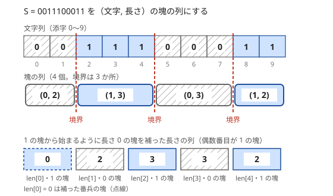

!!! abstract "要点"
    - **何ができるか**：同じ値（文字）の連続を（値, 長さ）の組にして、塊の単位で考える。多くの操作は塊の内部では一様で境界でだけ変化するので、境界の数や塊の列の尺取りで考えられる。
    - **いつ使うか**：
        - 同じ文字・値が続く部分を問われる。
        - 区間を反転して 1 の連続を最長にする。
        - 操作で塊（境界）の数がいくつ減るかを考える。
        - 入力がランレングス形式（文字と繰り返し回数の組）で与えられる。
    - **計算量**：圧縮・復元は $O(N)$。塊の数を $R$ とすると、圧縮した後の処理は $O(R)$ で、$R \le N$ である。
    - **前提**：なし

<!-- textlint-disable -->
別名：連長圧縮・RLE・塊ごとに考える・run-length encoding
<!-- textlint-enable -->

ランレングス圧縮は、列を「同じ値が続く極大な区間（塊）」に分け、各塊を（値, 長さ）の組で表す方法である。圧縮そのものは易しいが、本当の価値は塊の単位で考え直すことにある。区間の反転や移動のような操作は塊の内部では一様に働き、変化は塊の境界でしか起きないので、文字の列より短い塊の列の上で考えられる。

## 塊への分け方（最後の塊を忘れない・番兵の塊） {#split}

塊は、隣と値が違うところ（境界）で列を切って作る。次の図は $S = $ `0011100011` を 4 個の塊 (0, 2)・(1, 3)・(0, 3)・(1, 2) に分けた様子である。境界は 3 か所で、塊の数は常に「境界の数 + 1」になる。



分け方は「塊の先頭 $i$ から、違う文字が出るまで $j$ を進める」形で書くとよい。半開区間 $[i, j)$ が 1 つの塊で、次の塊は $j$ から始まる。

```cpp
--8<-- "run-length-encoding/encode.cpp:core"
```

この形なら、最後の塊もループの中で追加される。「$S[i] \ne S[i+1]$ になったら塊を閉じる」形で書くと、最後の塊はループの後で別に追加しなければならず、よく忘れる。各文字を 1 回ずつ見るので $O(N)$ である。復元は、塊ごとに値を長さの分だけ並べればよい。

**番兵の塊**。0 と 1 の列では、0 の塊と 1 の塊が交互に並ぶ。先頭が 0 か 1 かで「何番目が 1 の塊か」が変わると、場合分けが増えて添字を間違えやすい。先頭が 0 なら長さ 0 の 1 の塊を前に補い、末尾が 0 なら後ろにも補うと、列はいつも「1 の塊で始まって 1 の塊で終わる」形になる。偶数番目が 1 の塊、奇数番目が 0 の塊と決まり、塊の数は奇数になる。長さ 0 の塊は、どんな和や最大にも影響しない[番兵](../guide/glossary.md#sentinel)である。

**塊ごとに数える**。同じ文字だけからなる区間は、必ず 1 つの塊の中に収まる。長さ $k$ の塊の中の区間は $k(k + 1) / 2$ 個なので、「1 種類の文字だけからなる区間の数」は塊ごとの和で求まる。全区間の数 $N(N + 1) / 2$ から引けば、「2 種類以上の文字を含む区間の数」になる（[余事象](../thinking/complement.md)）。$N = 10^5$ でも $N(N + 1) / 2$ は約 $5 \times 10^9$ で `int` を超えるので、`long long` で数える。

## 境界の数で操作を数える {#count-boundaries}

操作の効果を「塊（境界）の数がどう変わるか」で測ると、最適な回数がすぐに分かることがある。代表は区間の反転（0 と 1、L と R などを入れ替える）である。

区間 $[l, r)$ を反転すると、区間の内側で隣り合う 2 文字はどちらも反転する。だから 2 文字が等しいかどうかは変わらず、内側の境界はそのまま残る。変わりうるのは、左端をまたぐ組 $(S[l-1], S[l])$ と右端をまたぐ組 $(S[r-1], S[r])$ だけである。よって **1 回の反転で境界は高々 2 減り**、塊の数も高々 2 減る。

境界を 2 減らすには、両端の組がどちらも境界である区間、つまり塊の切れ目から切れ目までを反転すればよい。たとえば 1 つの塊だけを反転すると、その塊は両隣と同じ文字になってつながる。境界の数を $b$ とすると、$K$ 回の操作の後の境界の数の最小は $\max(b - 2K, 0)$ で、上の理由から下回れない。「隣り合う 2 文字が同じ組の数」を最大にする問題なら、答えは $(N - 1) - \max(b - 2K, 0)$ になる（[不変量・単調量](../thinking/invariant.md)の考え方）。

境界は、隣との差が 0 でない位置そのものである。境界を数えることは、[差分列](../basics/difference-sequence.md)の 0 でない項を数えることと同じで、区間の反転は差分列の 2 か所だけを変える操作と見られる。

??? question "確認問題：端を含む反転"
    列の先頭を含む区間 $[0, r)$ を反転すると、境界は最大でいくつ減るか。

    ??? success "答え"
        1 つである。左端の外側に文字がないので、変わりうる組は右端の $(S[r-1], S[r])$ だけになる。末尾を含む区間も同じである。端の塊を消すのに 1 回の反転を使うと 1 しか減らないので、境界を 2 ずつ減らせるうちは内側の塊を反転する方が得である。

## 塊の列で尺取りする {#two-pointers-on-runs}

「区間の反転を $K$ 回まで行い、1 の連続を最長にする」問題は、塊の列の上の[尺取り法](../basics/two-pointers.md)になる。文字の上で窓を動かすと「窓の中の 0 の塊の数」を数えにくいが、塊の列にすれば窓は塊の個数で決まる。

最後にできる 1 の連続を区間 $T$ とする。$T$ の内側にもともとあった 0 の塊の数を $z$ とすると、$T$ を 1 だけにするには $z$ 回の反転が要り、$z$ 回で足りる。足りるのは 0 の塊を 1 つずつ反転すればよいからで、要る理由は[境界の数](#count-boundaries)で説明できる（下の証明）。よって答えは「0 の塊を $K$ 個まで含む区間の最大の長さ」であり、連続する 0 の塊 $K$ 個と、その間と両側の 1 の塊 $K + 1$ 個、合わせて塊 $2K + 1$ 個の長さの和の最大になる。

??? note "証明：0 の塊 1 つに反転 1 回が要る"
    $T$ の両外側に、反転されない仮の 1 を 1 つずつ置いて考える。こうすると $T$ の中の 0 の塊はどれも左右を 1 に挟まれ、境界の数はちょうど $2z$ になる。反転のうち $T$ にかかる部分は $T$ の中の区間の反転なので、[境界の数で操作を数える](#count-boundaries)の理由から、1 回で境界は高々 2 減り、$z$ は高々 1 減る。$z = 0$（すべて 1）にするには $z$ 回以上の反転が要る。

[番兵の塊](#split)を補って偶数番目を 1 の塊にしておくと、窓は偶数番目から始まる長さ $2K + 1$ の区間（末尾では短くなる）に決まる。左端を塊 2 個ずつ進めても右端は戻らないので、和を足し引きしながら $O(R)$ で動かせる。

```cpp
--8<-- "run-length-encoding/handstand.cpp:core"
```

窓の和は累積和の差 $\mathrm{sum}[\min(m, \ell + 2K + 1)] - \mathrm{sum}[\ell]$ でも求まる（[累積和](../basics/prefix-sum.md)）。どちらでも、番兵の塊のおかげで、先頭や末尾が 0 の場合を分けずに済む。

??? question "確認問題：窓の幅"
    $K = 2$ のとき、窓は塊いくつ分か。また、番兵を補わずに「先頭が 0 なら奇数番目から始める」と書くと、何に気をつける必要があるか。

    ??? success "答え"
        $2K + 1 = 5$ 個分である（1・0・1・0・1 の塊）。番兵がないと、先頭が 0 の列では最初の窓が 0 の塊から始まり、「1 の塊の数」と「0 の塊の数」の数え方が先頭の文字で変わる。末尾の窓の切り詰めでも同じ場合分けが要り、添字を 1 つずらすバグが起きやすい。

## 塊ごとに偶奇で振り分ける {#parity-per-run}

塊の内部が一様に動くとき、塊ごとに「最後にどこへ行くか」を長さの偶奇で決められることがある。代表は、各マスに L か R が書かれ、人が書かれた向きへ 1 歩ずつ動くことを非常に多く（偶数回）繰り返す問題である。

R の塊のすぐ右に L の塊が続く `RR…RLL…L`（R が $A$ 個、L が $B$ 個）を 1 つの単位にする。R の上の人は右へ進んで最後の R に、L の上の人は左へ進んで最初の L に着き、その後は「最後の R」と「最初の L」の 2 マスを行き来する。1 歩ごとに位置の偶奇が変わるので、偶数回動いた後にどちらのマスにいるかは、最初の位置から最後の R までの距離の偶奇だけで決まる。

- 最後の R にいる人数：$\lceil A / 2 \rceil + \lfloor B / 2 \rfloor$（R の側は距離が偶数の人、L の側は最後の R までの距離が偶数の人）
- 最初の L にいる人数：$\lfloor A / 2 \rfloor + \lceil B / 2 \rceil$
- ほかのマスは 0 人

単位どうしは人が行き来しないので、`RL` の境界ごとに別々に計算でき、全体で $O(N)$ になる。このように「塊の中の各要素は同じ動きをし、違いは端までの距離だけ」と見抜けると、シミュレーションを長さの式に置き換えられる。行き先を偶奇で決める考え方は[偶奇](../thinking/parity.md)と同じである。式を導けないときは、[ダブリング](../basics/doubling.md)で十分大きい偶数回の移動を計算しても解ける。

## ランレングスのまま処理する {#keep-compressed}

入力そのものがランレングス形式で与えられ、展開すると長さが $10^{12}$ のように大きくなる問題がある。この節は[尺取り法](../basics/two-pointers.md)を前提にする。展開せず、塊の列のまま処理する。

2 つのランレングスの列 $X$・$Y$（展開した長さは等しい）を同時に見る問題では、2 つの列を同じ区切りに細かくそろえる。それぞれの今の塊の残りの長さを $x$・$y$ とし、$c = \min(x, y)$ だけまとめて進める。

```text
i = 0, j = 0                      // X と Y の今の塊
rest_x = X[0].len, rest_y = Y[0].len
while i < |X| and j < |Y|:
    c = min(rest_x, rest_y)
    // この c 個の間は、X も Y も値が一定（X[i].val と Y[j].val）
    c 個分の寄与を O(1) で足し、状態を c 個分進める
    rest_x -= c, rest_y -= c
    if rest_x == 0: i += 1, rest_x = X[i].len（i < |X| のとき）
    if rest_y == 0: j += 1, rest_y = Y[j].len（j < |Y| のとき）
```

1 回の繰り返しで少なくとも一方の塊が終わるので、繰り返しは $\lvert X \rvert + \lvert Y \rvert$ 回以下である。各区切りの中では両方の値が一定なので、「2 人が同じ方向へ動くなら距離は変わらない」「違う方向なら距離は単調に変わり、出会うのは高々 1 回」のように、$c$ 歩分の寄与を式で求められる。

- 長さと位置は `long long` で持つ。合計が $10^{12}$ を超えうるので、`int` では足し算があふれて比較も誤る
- 長さ 0 の塊を含みうる入力では、`rest` が最初から 0 の場合も進むように書く
- 逆に、普通の文字列を圧縮してから別の手法にかけることもある。同じ文字の連続を 1 文字とその長さに置き換えて、部分文字列の種類を数える問題などである（[Suffix Array](../string/suffix-array.md)）

## 落とし穴 {#pitfalls}

**最後の塊を忘れる**。「$S[i] \ne S[i+1]$ で塊を閉じる」形で書くと、最後の塊はループの外で追加しないと失われる。[塊への分け方](#split)の「$j$ を進める」形にすれば起きない。全部が同じ文字の列（塊 1 個）で試すと気づける。

**範囲外を読む**。`s[i + 1]` と比べる書き方では、$i = N - 1$ で範囲外を読む。`std::string` の `s[n]` はたまたま `'\0'` なので動いてしまい、`vector` に変えると壊れる。比べる前に `j < n` を確かめる。

**先頭・末尾の文字で場合分けを誤る**。0 の塊と 1 の塊の交互の列で、先頭が 0 か 1 かを考えずに「偶数番目が 1」と決めつけると、半分の入力で答えがずれる。[番兵の塊](#split)を補うか、各塊に値も持たせて確かめる。

**反転の回数が塊の数より多い**。$K$ が 0 の塊の数以上なら、全部を 1 にできる。窓の右端を列の長さで切り詰めないと、範囲外を読む。

**区間の数のオーバーフロー**。$k(k + 1) / 2$ や $N(N + 1) / 2$ は $N = 10^5$ 程度でも `int` を超える。ランレングス形式の入力では長さ自体が大きいので、最初から `long long` で持つ。

## 使い分け {#comparison}

- 「条件を満たす最長の区間」で、条件が塊の個数で決まるなら、塊の列の上で[尺取り法](../basics/two-pointers.md)をする。条件が文字の個数で決まるなら、文字の上で尺取りすれば足りる
- 境界の数は[差分列](../basics/difference-sequence.md)の 0 でない項の数である。操作が「隣との差」を何か所変えるかで考えると、反転以外の操作にも同じ議論が使える
- 文字列としての比較・一致判定（部分文字列の検索など）が本体なら、[文字列の基本](../string/string-basics.md)の道具を使い、圧縮は前処理にとどめる

## 例題 {#examples}

### ABC124 D. Handstand {#abc124_d}

<div class="kp-problems" data-role="example" markdown>

- [ABC124 D. Handstand](https://atcoder.jp/contests/abc124/tasks/abc124_d)（diff 1138）：0 と 1 の列に区間の反転を K 回まで行い、連続する 1 の長さを最大化する。

</div>

最後にできる 1 の連続の中に、もともと 0 の塊が $z$ 個あったとすると、反転は $z$ 回要り、$z$ 回で足りる。だから答えは「0 の塊を $K$ 個まで含む区間の最長」で、塊の列の上で塊 $2K + 1$ 個の窓を動かせば求まる。

??? note "解法の詳細"
    - ランレングス圧縮し、先頭が 0 なら前に、末尾が 0 なら後ろに長さ 0 の塊を補う。偶数番目が 1 の塊、奇数番目が 0 の塊になる。
    - 偶数番目の各位置 $\ell$ から、塊 $\min(m, \ell + 2K + 1)$ 番目の手前までの長さの和を求め、最大を出力する（$m$ は塊の数）。
    - 和は窓を動かしながら足し引きするか、累積和の差で求める。全体で $O(N)$。
    - コードは[塊の列で尺取りする](#two-pointers-on-runs)の節のものと同じ形である。

## 練習問題 {#practice}

<div class="kp-problems" data-role="practice" markdown>

- [ABC380 C. Move Segment](https://atcoder.jp/contests/abc380/tasks/abc380_c)（diff 223）：0 と 1 の文字列で、K 番目の 1 の塊を K−1 番目の 1 の塊の直後に移した文字列を求める。
- [典型90 084. There are two types of characters（★3）](https://atcoder.jp/contests/typical90/tasks/typical90_cf)（diff —）：o と x からなる文字列で、o と x の両方を含む区間の数を求める。
- [ABC136 D. Gathering Children](https://atcoder.jp/contests/abc136/tasks/abc136_d)（diff 794）：各マスに L か R が書かれたマス目で、子どもが 10^100 回移動した後に各マスにいる人数を求める。
- [ABC140 D. Face Produces Unhappiness](https://atcoder.jp/contests/abc140/tasks/abc140_d)（diff 1074）：向き（L/R）の列に区間の反転を K 回まで行い、幸福な人の数を最大化する。

</div>

??? note "練習の方針"
    - **ABC380 C**：塊に分け、K−1 番目の 1 の塊の次にある 0 の塊と K 番目の 1 の塊を入れ替えてから復元する
    - **典型90 084**：全区間の数から、塊ごとの $k(k + 1) / 2$（1 種類の文字だけの区間）を引く。`long long` で数える
    - **ABC136 D**：`R…RL…L` の単位ごとに、R の個数 $A$ と L の個数 $B$ の偶奇で境界の 2 マスへ振り分ける。$10^{100}$ が偶数であることを使う
    - **ABC140 D**：幸福な人の数は「隣り合う 2 人が同じ向きの組の数」に言い換えられる。境界の数を $b$ とする。1 回の反転で $b$ は高々 2 減るので、答えは $(N - 1) - \max(b - 2K, 0)$

## 力試し {#challenge}

<div class="kp-problems" data-role="challenge" markdown>

- [ABC421 D. RLE Moving](https://atcoder.jp/contests/abc421/tasks/abc421_d)（diff 1321）：ランレングス形式で与えられた 2 人の移動で、同じマスにいる回数を求める。

</div>

??? note "力試しの方針"
    - **ABC421 D**：2 人の移動の列を、残りの長さの小さい方 $c$ ずつ同時に進める。同じ向きなら、同じマスにいれば $c$ 回とも数え、いなければ 0 回である。違う向きなら出会うのは高々 1 回で、マンハッタン距離の半分の歩数で出会えるかを確かめる。距離が奇数なら 2 人は一度も同じマスに来ない

## 参考 {#references}

- [drken「AtCoder ABC 124 D - Handstand (400 点)」](https://drken1215.hatenablog.com/entry/2019/04/14/222900)：例題の方針（番兵の塊を補った塊の列と、塊 2K + 1 個の窓）
- [drken「AtCoder ABC 380 C - Move Segment (7Q, 灰色, 300 点)」](https://drken1215.hatenablog.com/entry/2024/11/17/012903)：練習の方針（塊の入れ替えと復元）
- [Reputeless「tenkei_90 084」](https://github.com/Reputeless/tenkei_90/blob/main/084.md)：練習の方針（塊ごとの区間の数を全体から引く）
- [drken「AtCoder ABC 136 D - Gathering Children (400 点)」](https://drken1215.hatenablog.com/entry/2020/12/29/190100)：塊の長さの偶奇による振り分けと、ダブリングによる別解
- [drken「AtCoder ABC 140 D - Face Produces Unhappiness (400 点)」](https://drken1215.hatenablog.com/entry/2020/05/16/005300)：1 回の反転で境界が高々 2 減ることと、答えの式
- [ikatakos「AtCoder Beginner Contest 421 問題メモ」](https://ikatakos.com/pot/programming_algorithm/contest_history/atcoder/2025/0830_abc421)：力試しの方針（2 つのランレングスの列を同時に進める処理。解説の部分だけを参照）
