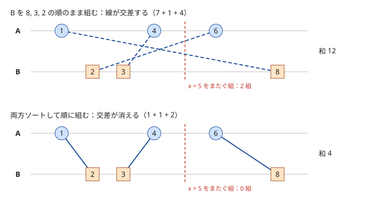

!!! abstract "要点"
    - **何ができるか**：並べ替えてよい問題では、ソートすると貪欲の順番が決まり、二分探索や尺取りが使えるようになる。比較関数は狭義の弱順序（`<=` を書かない）にし、比率は掛け算で比べる。
    - **いつ使うか**：
        - 順番を自由に並べ替えてよい。
        - 安い順・効果の大きい順に取る。
        - 2 つの集合を 1 対 1 に対応させて距離の和を最小化する。
        - 成功率などの比率の大小で並べる。
    - **計算量**：ソートは比較 1 回が $O(1)$ なら $O(N \log N)$。`stable_sort` は追加のメモリが取れるとき $O(N \log N)$、取れないとき $O(N \log^2 N)$。
    - **前提**：なし

<!-- textlint-disable -->
別名：ソート・安定ソート・ペアのソート・sorting
<!-- textlint-enable -->

ソートで考えるとは、入力の順番に意味がない問題で、まず要素を何かの順に並べ替えてから解き方を考えることである。並べると「どれから取るか」が決まり、隣どうしだけを見れば済むようになり、二分探索も使えるようになる。難しいのは何の順に並べるかと、その順を比較関数として正しく書くことである。

## ソートで貪欲の順が決まる {#greedy-order}

「合計 $M$ 個をできるだけ安く集める」「できるだけ少ない個数で目標に届く」という問題では、各要素の良さが 1 つの数（値段・効果）で決まるなら、良い順に並べて先頭から取ればよい。並べ替えた時点で、どれを取るかの判断は「次の要素を取るか」だけになる。

正しさは交換で示す。良い順に取らない解があるとすると、取らなかった要素の中に、取った要素より良いものがある。その 2 つを入れ替えても、ほかの選択には影響しないので、結果は悪くならない。これを繰り返せば、良い順に取る解と同じになる（[貪欲法](../basics/greedy-basics.md)の交換の考え方）。

この議論で要るのは「各要素の効果が、ほかに何を選んだかによらず決まる」ことである。次の 2 つの型がよく出る。

- **単価で並べる**：値段 $A_i$ の品が $B_i$ 個ずつあり、合計 $M$ 個を買う。安い店から順に、残りの必要数と在庫の小さい方だけ買う（[例題](#abc121_c)）
- **効果を 1 つの数にまとめてから並べる**：選ぶと 2 つの量が同時に変わるときは、目標に対する差がどれだけ縮むかを計算し、その値で並べる。たとえば「選ぶと自分の票が $A_i + B_i$ 増え、相手の票が $A_i$ 減る」なら、差は $2A_i + B_i$ 縮む。この値は選ぶ順番によらないので、大きい順に取ればよい

元の番号が後で要るときは、`pair` で（キー, 番号）を並べるか、番号の配列 `idx` を作ってキーで並べ替える。後者なら元の配列を動かさずに済み、複数の配列を同じ順で参照できる（[比率の節](#ratio-and-ties)のコード）。

??? question "確認問題：効果が順番に依存する場合"
    $N$ 個の仕事を 1 つずつ順に行う。仕事 $i$ は時間 $T_i$ かかり、終わった時刻に重み $W_i$ を掛けた値が罰金になる。罰金の合計を最小にしたい。$T_i$ の小さい順に並べればよいか。

    ??? success "答え"
        一般には正しくない。仕事の罰金は前に何をしたかで変わるので、各仕事の効果は、ほかの選択によらない 1 つの数にはならない。そこで隣り合う 2 つの仕事 $i, j$ を入れ替えたときの差を計算すると、$i$ を先にするべき条件が $T_i W_j < T_j W_i$ と分かる。$W_i > 0$ なら、これを整理すると $T_i / W_i$ の小さい順という 1 つのキーになる（比べるときは[比率の節](#ratio-and-ties)のとおり掛け算で）。このように 2 つの比較から並べる順を決める方法は[交換論法](../basics/exchange-argument.md)で扱う。$W_i$ がすべて等しければ、$T_i$ の小さい順で正しい。

## 2 つの列を 1 対 1 に対応させる（両方ソートして順に組む） {#matching-two-lists}

長さ $N$ の列 $A$ と $B$ の要素を 1 対 1 に組み、各組の差の絶対値 $\lvert A_i - B_j \rvert$ の和を最小にしたい。組み方は $N!$ 通りあるが、両方を小さい順にソートし、$i$ 番目に小さいものどうしを組めば最小になる。

次の図は $A = (1, 4, 6)$、$B = (8, 3, 2)$ の例である。番号順に組むと線が交差して和は 12 になる。両方ソートして組むと交差が消え、和は 4 になる。



なぜソート順が最適かは、数直線の各点を何組がまたぐかで数えると分かる。組の差の和は、各点 $x$ についてその点をまたぐ組の数を足し合わせたもの（区間の長さの和）に等しい。点 $x$ 以下に $A$ が $p$ 個、$B$ が $q$ 個あるなら、どう組んでも少なくとも $\lvert p - q \rvert$ 組は $x$ をまたぐ。ソート順に組むと、またぐ組はちょうど $\lvert p - q \rvert$ 組になる。すべての点で下限を達成するので、和も最小である。

??? note "証明"
    $A$・$B$ を小さい順に $a_1 \le \dots \le a_N$、$b_1 \le \dots \le b_N$ とする。組 $(a, b)$ が点 $x$ をまたぐとは、$a$ と $b$ の一方だけが $x$ 以下であることとする。組の差 $\lvert a - b \rvert$ は、組がまたぐ点の集合の長さに等しいので、差の和は「$x$ をまたぐ組の数」を $x$ について積分したものになる。

    - **下限**：$x$ 以下の $A$ の要素が $p$ 個、$B$ の要素が $q$ 個とする。$p > q$ なら、$x$ 以下の $A$ の要素 $p$ 個のうち、$x$ 以下の $B$ と組めるのは高々 $q$ 個なので、少なくとも $p - q$ 組は $x$ をまたぐ。$p < q$ も同じである
    - **ソート順で等号**：$a_i$ と $b_i$ を組むと、$a_i \le x$ は $i \le p$ と、$b_i \le x$ は $i \le q$ と同じである。一方だけが成り立つのは $\min(p, q) < i \le \max(p, q)$ のときで、ちょうど $\lvert p - q \rvert$ 組である

    すべての $x$ で下限に一致するので、ソート順の組み方の差の和が最小である。

実装は両方をソートして順に足すだけである。

```cpp
--8<-- "sorting-techniques/matching.cpp:core"
```

同じ考え方は次の形にも使える。

- **積の和**：$\sum A_i B_{\sigma(i)}$ は、両方を同じ向きに並べて組むと最大、逆向きに組むと最小になる（並べ替え不等式）
- **「$A_i \le B_j$ の組をできるだけ多く作る」**：両方をソートし、2 つの添字を進めながら組めるものから組む。これは尺取り法と同じ形になる（[尺取り法](../basics/two-pointers.md)）

## 比較関数の要件（狭義の弱順序） {#strict-weak-ordering}

`sort` に渡す比較関数 `comp(a, b)` は「$a$ を $b$ より前に置くべきなら true」を返す関数で、次の 3 つを満たす必要がある。これを[狭義の弱順序](../guide/glossary.md#strict-weak-ordering)という。

- **非反射**：`comp(a, a)` は false
- **推移**：`comp(a, b)` と `comp(b, c)` が true なら `comp(a, c)` も true
- **同等の推移**：`comp(a, b)` と `comp(b, a)` がどちらも false のとき、$a$ と $b$ は同等という。$a \sim b$ かつ $b \sim c$ なら $a \sim c$（$\sim$ は同等）

1 つ目と 2 つ目から、`comp(a, b)` と `comp(b, a)` が同時に true にならないこと（非対称）も従う。満たさない比較関数を渡すのは未定義動作で、結果が正しく並ばないだけでなく、実行時に落ちることがある。

よくある破り方は次の 3 つである。

- **`<=` を書く**：`[](int x, int y) { return x <= y; }` は `comp(a, a)` が true になり非反射を破る。g++ の `std::sort` は同じ値が多いと配列の外を読みにいく（AddressSanitizer で heap-buffer-overflow を確かめた）。`-D_GLIBCXX_DEBUG` を付けてコンパイルすると「irreflexive requirements」を満たさないと実行時に止まるので、手元の確認に使える
- **誤差で同じとみなす**：「差が $\varepsilon$ 以下なら同じ」とする比較は同等の推移を破る。$0 \sim 0.6\varepsilon$ かつ $0.6\varepsilon \sim 1.2\varepsilon$ なのに、$0$ と $1.2\varepsilon$ は同等でない
- **NaN を含む**：`0.0 / 0.0` などの NaN は、どの値と比べても `<` が false なので、すべての値と同等に見えて同等の推移を破る。分母が 0 になりうる比率を `double` で作ると起きる

逆に、`pair`・`tuple` の `<`（辞書順）や、キーの一部だけを `<` で比べる関数は狭義の弱順序である。降順にしたいときは `>` を使えばよく、`>=` は使わない。比較関数の書き方は [比較関数](../cpp/cpp-comparators.md) にまとめてある。

??? question "確認問題：<= の何がいけないか"
    同じ値を含まない配列なら、`<=` の比較関数で `sort` しても問題ないか。

    ??? success "答え"
        問題がある。どの要素も自分自身とは同じ値なので、配列の各要素 $a$ について `comp(a, a)` が true になり、非反射を破る。同じ値を含まなくても未定義動作で、`-D_GLIBCXX_DEBUG` を付けると実行時に止まる。実際の害が出やすいのは同じ値が多いときだが、`<` に直せば済むので、`<=` は書かないと覚える。

## 比率は掛け算で比べる・同点の順序（stable_sort） {#ratio-and-ties}

成功率 $\dfrac{A_i}{A_i + B_i}$ のような比率で並べるときは、割り算をせず、分母を払って整数で比べる。分母 $s_i, s_j$ が正なら

$$
\frac{a_i}{s_i} > \frac{a_j}{s_j} \iff a_i s_j > a_j s_i
$$

である。右辺は整数の掛け算だけなので誤差がなく、比較関数は狭義の弱順序になる。

`double` で比べると誤差で順序を取り違える。$A_i, B_i \le 10^9$ だと、2 つの率の差は $10^{-18}$ 程度まで小さくなるが、`double` の相対精度は約 $10^{-16}$ しかない。たとえば $\frac{999999998}{1999999997}$ と $\frac{999999999}{1999999999}$ は、`double` に直すと同じ値に丸められる（コード片で確かめた）。掛け算なら、$a \le 10^9$・$s \le 2 \times 10^9$ なので積は $2 \times 10^{18}$ 以下で、`long long`（約 $9.2 \times 10^{18}$ まで）に収まる。積がこれを超えるなら `__int128` を使う（[整数のオーバーフロー](../cpp/cpp-integer-overflow.md)）。

同じ率の人を番号の小さい順に並べたいなど、同点の順序が決まっているときは、次のどちらかにする。

- `stable_sort` を使う：同等な要素の元の並びを保つ。`sort` は保証しないので、番号順に並べた配列を `sort` すると同点の順は保たれるとは限らない
- 比較関数に番号を 2 つ目のキーとして足す：同等な要素がなくなるので `sort` でよい

次のコードは、成功率の高い順に番号を並べる（同率なら番号の小さい順）。番号の配列を `iota` で番号順に作り、`stable_sort` で並べる。

```cpp
--8<-- "sorting-techniques/ratio-sort.cpp:core"
```

## 落とし穴 {#pitfalls}

**効果を 2 つのキーの辞書順で代用する**。選ぶと自分の票が $A_i + B_i$ 増え、相手の票が $A_i$ 減る問題で、$(A_i + B_i, A_i)$ を辞書順で比べて大きい順に取るのは誤りである。たとえば $(A, B) = (0, 10), (6, 3), (6, 3)$ では、最初の差は $\sum A_i = 12$ である。$A + B$ の大きい順だと $(0, 10)$ を先に取り、差は $12 - 10 = 2$ でまだ足りず、2 つ目が要る。差を縮める量 $2A + B$ は $10, 15, 15$ なので、$(6, 3)$ を取れば 1 つで足りる。並べるキーは「目標までの差がいくら縮むか」を式で書いてから決める。

**`sort` が安定だと思い込む**。`sort` は同等な要素の順を保証しない。入力の順で同点を並べる問題で `sort` を使うと、小さい入力では偶然合っても大きい入力で崩れる。`stable_sort` にするか、番号をキーに足す。

**比較関数の中で重い計算をする**。比較は $O(N \log N)$ 回呼ばれるので、比較のたびに $O(N)$ の計算や `string` のコピーをすると間に合わない。キーを先に計算して配列に持ち、比較関数はその配列を引くだけにする。引数は `const T&` で受け取る。

**番号の配列を並べるときの添字**。番号の配列 `idx` を並べるときは、キーの配列を `[&]` で参照して受け取り、比較関数の引数は番号になる。これを忘れて、`a[i]` と書くべきところで `i` を比べてしまうことがある。並べ替えた後に `a[idx[k]]` で参照する。

## 上位の手法へのつながり {#next-steps}

ソートは多くの手法の下準備である。並べた後に何を使うかで、次の手法につながる。

- **二分探索**：ソート済みの配列なら、$x$ 以上の最初の位置を `lower_bound` で $O(\log N)$ で求められる（[二分探索](../basics/binary-search.md)）
- **尺取り法**：ソートすると、条件を満たす区間の右端を進めても左端が戻らない形になることが多い（[尺取り法](../basics/two-pointers.md)）
- **座標圧縮**：値をソートして重複を除き、何番目に小さいかに置き換える（[座標圧縮](../basics/coordinate-compression.md)）
- **区間とイベント**：区間を右端の順に並べて貪欲に選ぶ（[区間スケジューリング](../basics/interval-scheduling.md)）、端点を時刻の順に並べて走査する（[イベントソート](../basics/event-sort.md)）
- **中央値**：$\sum \lvert x - A_i \rvert$ を最小にする $x$ は、ソートしたときの中央の値（$N$ が偶数なら中央の 2 つの間のどれか）である（[絶対値の和の最小化と中央値](../basics/median-absolute.md)）
- **交換論法**：各要素のキーがすぐには 1 つの数で書けず、2 つの要素を比べて「どちらを先にするか」を決めるときは、隣り合う 2 つを入れ替えたときの差から比較関数を作る（[交換論法](../basics/exchange-argument.md)）。そこで作った比較関数も狭義の弱順序である必要がある

## 例題 {#examples}

### ABC121 C. Energy Drink Collector {#abc121_c}

<div class="kp-problems" data-role="example" markdown>

- [ABC121 C. Energy Drink Collector](https://atcoder.jp/contests/abc121/tasks/abc121_c)（diff 360）：値段と在庫の決まった店で、エナジードリンクを合計 M 本買うときの最小費用を求める。

</div>

どの店で買っても 1 本の価値は同じなので、各店の良さは値段だけで決まる。値段の安い順に店を並べ、先頭の店から買えるだけ買う。より高い店で買った 1 本と、安い店に残った 1 本を入れ替えれば費用は減るので、安い順に買い切るのが最適である。

??? note "解法の詳細"
    - 店を（値段, 在庫）の `pair` にして昇順にソートする。`pair` の比較は 1 つ目の値段から比べるので、比較関数は要らない。
    - 残りの必要数を $r = M$ とし、先頭の店から $\min(r, B_i)$ 本買って費用に足し、$r$ を減らす。$r = 0$ になったら止める。
    - 費用の合計は `long long` で持つ。全体はソートの $O(N \log N)$ である。

## 練習問題 {#practice}

<div class="kp-problems" data-role="practice" markdown>

- [典型90 014. We Used to Sing a Song Together（★3）](https://atcoder.jp/contests/typical90/tasks/typical90_n)（diff —）：N 人の小学生と N 校の学校を 1 対 1 に割り当て、距離の和を最小化する。
- [ABC308 C. Standings](https://atcoder.jp/contests/abc308/tasks/abc308_c)（diff 605）：コイン投げの成功率の高い順（同率なら番号の小さい順）に人を並べる。
- [ABC187 D. Choose Me](https://atcoder.jp/contests/abc187/tasks/abc187_d)（diff 650）：演説する町を選んで得票で相手を上回るための、最小の町の数を求める。

</div>

??? note "練習の方針"
    - **典型90 014**：小学生の位置と学校の位置をそれぞれソートし、同じ順位どうしの差の絶対値を足す（[2 つの列を 1 対 1 に対応させる](#matching-two-lists)）
    - **ABC308 C**：成功率を分母を払った掛け算で比べ、`stable_sort` で番号順を保つ。`double` で割ると誤差で順序を取り違える（[比率の節](#ratio-and-ties)）
    - **ABC187 D**：最初の差 $\sum A_i$ から、町を選ぶと差が $2A_i + B_i$ 縮む。この値の大きい順に引いていき、差が負になった時点の町の数を答える（[落とし穴](#pitfalls)の 1 つ目）

## 参考 {#references}

- [drken「AtCoder ABC 121 C - Energy Drink Collector (5Q, 灰色, 300 点)」](https://drken1215.hatenablog.com/entry/2019/05/15/012700)：例題の方針（安い店から買う貪欲）
- [Reputeless「tenkei_90 014」](https://github.com/Reputeless/tenkei_90/blob/main/014.md)：練習の方針（両方ソートして順に組む）
- [drken「AtCoder ABC 308 C - Standings (4Q, 茶色, 300 点)」](https://drken1215.hatenablog.com/entry/2023/10/22/124200)：比率を掛け算で比べる理由と安定ソート
- [drken「AtCoder ABC 187 D - Choose Me (2Q, 茶色, 400 点)」](https://drken1215.hatenablog.com/entry/2021/01/03/182300)：効果 $2A + B$ で並べる理由と、辞書順で代用する誤り
- [cppreference「C++ named requirements: Compare」](https://en.cppreference.com/w/cpp/named_req/Compare)：狭義の弱順序の要件
- [cppreference「std::stable_sort」](https://en.cppreference.com/w/cpp/algorithm/stable_sort)：安定性と計算量
