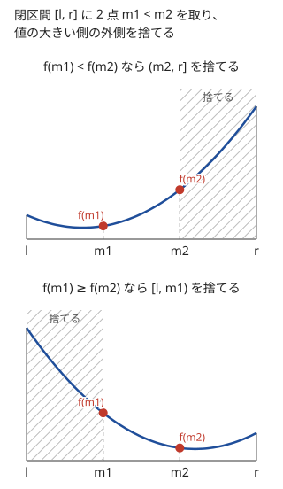
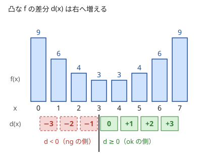
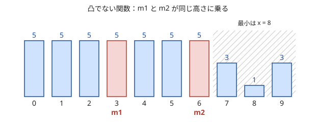

!!! abstract "要点"
    - **何ができるか**：下に凸（谷が 1 つ）な関数の最小値を、2 点の値を比べて外側を捨てながら求める。整数なら $f(x+1) - f(x)$ の符号で二分探索するほうが安全で、凸性は「凸関数の和・最大は凸」で確かめる。
    - **いつ使うか**：
        - 時刻や位置を 1 つ選んで、時間やコストを最小化する（谷形）。
        - 答えを実数で出力し、誤差が許される。
        - 1 つ増やすごとの増分が単調に増える。
    - **計算量**：関数の評価 1 回を $T$、探索する範囲の幅を $W$、許す誤差を $\varepsilon$ として、実数は $O(T \log (W / \varepsilon))$（反復は $\log_{3/2}(W / \varepsilon)$ 回。$W / \varepsilon$ が $10^{17}$ 程度までなら 100 回、$W$ が $10^{18}$ 近いなら 200 回）、整数は $O(T \log W)$。
    - **前提**：[答えで二分探索](../basics/binary-search-answer.md)

<!-- textlint-disable -->
別名：三分法・黄金分割探索・凸関数の極値・凸関数・離散凸・増分が単調・ternary search・3 分探索
<!-- textlint-enable -->

三分探索は、[下に凸](../guide/glossary.md#convex-function)な関数 $f$ の最小値を、区間の中の 2 点の値を比べて区間を縮めながら求める方法である。[答えで二分探索](../basics/binary-search-answer.md)は「$x$ で可能か」という判定が単調なときに使うが、「$x$ を大きくすると一方の量は減り、もう一方は増える」ような最適化では判定が作れない。値そのものが谷形なら、谷の底がどちら側にあるかを 2 点の比較で決められる。整数の範囲なら、差分の符号で二分探索に直すほうが書き間違えにくい。

## 実数版（反復回数の目安）と整数版（残りを全部調べる） {#real-and-integer}

三分探索の基本は、閉区間 $[l, r]$ に 2 点 $m_1 < m_2$ を取り、値の大きい側の外側を捨てることである。$f$ が下に凸なら、次の 2 つが成り立つ。

- $f(m_1) < f(m_2)$ なら、$m_2$ より右の点はどれも $f(m_2)$ 以上なので、$(m_2, r]$ を捨てる
- $f(m_1) \ge f(m_2)$ なら、$m_1$ より左の点はどれも $f(m_1)$ 以上なので、$[l, m_1)$ を捨てる



なぜ捨ててよいかは、凸関数の「傾きは右へ行くほど大きい」性質で分かる。$f(m_1) < f(m_2)$ なら $m_1$ から $m_2$ への傾きは正で、$m_2$ より右の傾きはそれ以上なので、$f$ は $m_2$ から先で増え続ける。逆も同じで、$f(m_1) \ge f(m_2)$ なら $m_1$ より左で $f$ は $f(m_1)$ を下回らない。どちらの場合も、捨てた点の値は残した点のどれかの値以上なので、最小値は残りの区間にある。等しいときにどちらを捨ててもよいのも、凸だからである（[平らな部分がある関数での失敗](#flat-pitfall)）。

**実数版**。$m_1 = l + (r - l)/3$、$m_2 = r - (r - l)/3$ に取ると、1 回で区間の幅は $2/3$ 倍になる。幅を $W$ から $\varepsilon$ まで縮めるには $\log_{3/2}(W / \varepsilon)$ 回かかり、$W = 10^9$、$\varepsilon = 10^{-9}$ なら約 102 回である。[実数の二分探索](../basics/binary-search-answer.md#real-number)と同じ理由で、ループは「幅が $\varepsilon$ 以下になるまで」ではなく回数を固定する。100 回で幅は $(2/3)^{100} \approx 2.5 \times 10^{-18}$ 倍になる。ただし $W = 10^{18}$ なら 100 回後の幅は $10^{18} \times 2.5 \times 10^{-18} \approx 2.5$ も残るので、200 回にする。200 回にしても評価は 400 回なので軽い。

次のコードは、$x \ge 0$ での $f(x) = x + c / (1 + x)$ の最小値を求める例である。$f(0) = c$ で、$x > c$ なら $f(x) > x > c$ なので、最小は $[0, c]$ にある。

```cpp
--8<-- "ternary-search/ternary-real.cpp:core"
```

完全なプログラム：[`ternary-real.cpp`](https://github.com/yuukougun/kyopro-atlas/blob/main/snippets/ternary-search/ternary-real.cpp)（GitHub）
{ .kp-code-src }

出力するのが最小値なら、最後は $x$ ではなく $f$ の値を出す。谷の底の近くでは $f$ がほとんど変わらないので、$x$ の誤差が大きめでも $f$ の値の誤差は小さい。

**整数版**。$x$ が整数のときは、区間が 3 点以下になったら縮めるのをやめ、残りを全部調べる。$r - l \ge 3$ の間は $l < m_1 < m_2 < r$ となり、1 回で区間が少なくとも 1 縮むので必ず止まる。

```cpp
--8<-- "ternary-search/ternary-int.cpp:core"
```

完全なプログラム：[`ternary-int.cpp`](https://github.com/yuukougun/kyopro-atlas/blob/main/snippets/ternary-search/ternary-int.cpp)（GitHub）
{ .kp-code-src }

1 回で幅がおよそ $2/3$ 倍になるので、反復は $O(\log W)$ 回、評価はその 2 倍である。$W = 10^9$ なら評価は約 100 回になる。

## 差分の符号で二分探索する方法 {#difference-sign}

整数の上の凸関数は、差分 $d(x) = f(x+1) - f(x)$ が $x$ について広義単調増加である（これを整数の凸性の定義にしてよい）。すると「$d(x) \ge 0$」は $x$ について単調な判定になり、[二分探索](../basics/binary-search.md#meguru)の ok と ng の形でそのまま書ける。$d(x) \ge 0$ となる最小の $x$ では、左からは減ってきて、右へは増えるので、そこが最小である。



```cpp
--8<-- "ternary-search/diff-sign.cpp:core"
```

完全なプログラム：[`diff-sign.cpp`](https://github.com/yuukougun/kyopro-atlas/blob/main/snippets/ternary-search/diff-sign.cpp)（GitHub）
{ .kp-code-src }

- **止まることが明らか**：ok と ng の幅が毎回半分になる二分探索なので、$m_1 = m_2$ になって止まらない、という整数版の三分探索の失敗が起きない
- **評価が少ない**：1 回の判定で 2 回評価し、幅は $1/2$ 倍になる。三分探索は 2 回の評価で $2/3$ 倍なので、同じ幅を縮めるのに要る評価の回数は約 $\log 2 / \log 1.5 \approx 1.7$ 分の 1 で済む
- **右端の番兵**：$x = R$ では $f(R + 1)$ が範囲の外なので評価しない。ok の初期値を $R$ にして「これより右がないので可」とみなす
- **平らな谷でもよい**：最小値が続く区間があるときも、$d(x) \ge 0$ となる最小の $x$（谷の左端）を返す

実数でも、導関数 $f'(x)$ が式で書けるなら $f'(x) \ge 0$ の符号で[実数の二分探索](../basics/binary-search-answer.md#real-number)をすればよい。ただし $f$ を `double` で計算して差分を取ると、差が丸め誤差に埋もれることがある（$f(x)$ が $10^{12}$ 程度で差分が 1 未満など）。そのときは差分を式で整理して直接計算するか、三分探索で幅を縮めてから残りを全部調べる。

## 凸性の確かめ方（凸関数の和・最大は凸、|x − a| と x^2 は凸） {#convexity}

三分探索が正しいのは、$f$ が谷を 1 つだけ持つときである。単に「グラフを描くと谷形に見える」だけでは足りないので、次の規則で凸性を確かめる。

- **基本の凸関数**：$\lvert x - a \rvert$、$x^2$、1 次関数 $ax + b$（凸かつ上に凸）、$e^x$、$x > 0$ での $1/x$。実数なら $f''(x) \ge 0$、整数なら差分の単調増加で確かめられる
- **和**：凸関数の和、および正の数倍は凸である。$\sum_i w_i \lvert x - a_i \rvert$（$w_i \ge 0$）は凸
- **最大**：凸関数の最大 $\max_i f_i(x)$ は凸である。「最も遠い点までの距離」「最も遅い人の到着時刻」は凸になりやすい
- **1 次式の代入**：$f$ が凸なら $f(ax + b)$ も凸である。平面の点 $(p, q)$ からの距離 $\sqrt{(x - p)^2 + (y - q)^2}$ も $(x, y)$ について凸である

凸にならない作り方も覚えておく。凸関数の**最小**は谷が 2 つになりうる（$\min(\lvert x \rvert, \lvert x - 10 \rvert)$）。凸関数の**積**も凸とは限らない（$x$ と $x^2$ はどちらも凸で、積の $x^3$ は $x < 0$ で上に凸になる）。外接長方形の面積のように凸な幅どうしを掛けたものも、上に凸な区間ができて谷が複数になりうる（[力試し ABC130 F](#challenge)）。$\lceil N / x \rceil$ のような切り上げ・切り捨てを含む式は、段差で谷が増えることがある。

たとえば $f(x) = Bx + A / \sqrt{1 + x}$（$A, B > 0$）を考える。$Bx$ は 1 次で、$A (1 + x)^{-1/2}$ の 2 階の導関数は $\frac{3}{4} A (1 + x)^{-5/2} > 0$ である。だから和の $f$ は凸である（[例題 ABC279 D](#abc279_d)）。

**2 変数のとき**。$f(x, y)$ が $(x, y)$ について凸なら、$g(x) = \min_y f(x, y)$ も $x$ について凸になる。だから外側で $x$ を三分探索し、$g(x)$ の計算の中で $y$ を三分探索する入れ子が使える。評価は外側と内側の回数の積になるので、反復 100 回ずつなら評価は $200 \times 200 = 4 \times 10^4$ 回である。$f$ の 1 回が $O(N)$ なら計算は約 $4 \times 10^4 N$ 回で、$N$ が $10^3$ 程度までなら十分に間に合う。

## 平らな部分がある関数での失敗 {#flat-pitfall}

三分探索で $f(m_1) = f(m_2)$ になったとき、凸関数ならどちらを捨ててもよい。凸関数で $f(m_1) = f(m_2)$ なら、$m_1$ から $m_2$ への傾きは 0 で、左右の傾きはそれぞれ 0 以下・0 以上なので、$[m_1, m_2]$ の外に $f(m_1)$ より小さい値はない。しかし、谷の底以外に平らな部分を持つ「凸でない」関数では、2 点が同じ高さに乗ると谷がどちらにあるか分からない。



この関数は「減ってから増える」ので谷形に見えるが、凸ではない（差分が $0, \dots, 0, -2, -2, +2$ と単調でない）。三分探索の比較を `f(m1) <= f(m2)` と書くと $(m_2, r]$ を捨て、答え 1 を見落とす。`<` にしても、谷が左側にある鏡像の関数で同じことが起きる。差分の符号の二分探索も、$d(x) \ge 0$ が単調でないので同じように失敗する。

平らな部分ができやすいのは次のような関数である。

- **切り上げ・切り捨て・整数への丸め**を含むコスト（$\lceil A / x \rceil$ 回の操作など）
- **場合分けで定義した関数**：一定の範囲で同じ値をとる料金表など

凸と言い切れないときは、凸性の規則で確かめ直すか、式が変わる点（候補）を列挙して全部調べる方法に切り替える。小さい範囲で全部の $x$ を計算し、三分探索の答えと比べるテストも効く。

## 黄金分割探索 {#golden-section}

三分探索は毎回 2 点を新しく評価するが、点の位置を黄金比で取ると、前の回の 1 点を次の回でそのまま使える。$\varphi = (1 + \sqrt 5)/2 \approx 1.618$ として、区間 $[l, r]$ の内分点を

$$
m_1 = r - \frac{r - l}{\varphi}, \qquad m_2 = l + \frac{r - l}{\varphi}
$$

に取る。$(m_2, r]$ を捨てて区間が $[l, m_2]$ になると、古い $m_1$ がちょうど新しい区間の $m_2$ の位置に来る。これは $1/\varphi^2 = 1 - 1/\varphi$ という黄金比の性質による。だから評価は 1 回ごとに 1 点だけで、幅は $1/\varphi \approx 0.618$ 倍になる。

```text
m1 = r - (r - l) / φ,  m2 = l + (r - l) / φ
f1 = f(m1),  f2 = f(m2)
100 回くり返す：
    f1 < f2 なら：r = m2,  m2 = m1,  f2 = f1,  m1 = r - (r - l) / φ,  f1 = f(m1)
    そうでなければ：l = m1,  m1 = m2,  f1 = f2,  m2 = l + (r - l) / φ,  f2 = f(m2)
答えは min(f1, f2)
```

幅を $10^{-18}$ 倍に縮めるのに要る評価は、三分探索の約 204 回に対して黄金分割探索は約 86 回である。差が効くのは、$f$ の評価が重いときや、[入れ子の三分探索](#convexity)で内側の評価の回数が外側に掛かるときである。$f$ が軽いなら普通の三分探索で足りる。普通の三分探索は点を使い回さないので、誤差の積み重ねを気にせずに済み、書き間違いも少ない。

## 増分が単調なら 1 単位ずつ貪欲に配る {#marginal-greedy}

この節は[優先度付きキューを使う貪欲](../basics/greedy-priority-queue.md)を前提にする。凸関数が 1 つではなく $N$ 個あり、合計 $K$ 単位を配る形を考える。

$$
\text{minimize } \sum_{i} f_i(x_i) \quad \text{subject to } \sum_i x_i = K,\ x_i \ge 0 \text{ は整数}
$$

各 $f_i$ が下に凸なら、すべて $x_i = 0$ から始めて、「次に 1 増やしたときの増分 $f_i(x_i + 1) - f_i(x_i)$ が最も小さい $i$」に 1 単位ずつ配る貪欲が最適である。

なぜ正しいか。$f_i$ を 0 から $x_i$ まで増やす費用は、増分の列 $\delta_i(1), \delta_i(2), \dots$ の先頭 $x_i$ 個の和である。配り方は「各 $i$ の列から先頭の何個かを、合わせて $K$ 個取る」ことに対応する。凸なので各列は小さい順に並んでいて、全部の列を合わせた中で小さい方から $K$ 個を取ると、それは各列の先頭の何個かになる。$K$ 個の和はこれより小さくならないので最適であり、貪欲はちょうどこの $K$ 個を順に取り出している。

```cpp
--8<-- "ternary-search/marginal-greedy.cpp:core"
```

完全なプログラム：[`marginal-greedy.cpp`](https://github.com/yuukougun/kyopro-atlas/blob/main/snippets/ternary-search/marginal-greedy.cpp)（GitHub）
{ .kp-code-src }

- **計算量**：優先度付きキューで $O((N + K) \log N)$
- **下限があるとき**：$x_i \ge 1$ なら全員に 1 ずつ配ってから、残りの $K - N$ 単位を同じ貪欲で配る
- **$K$ が大きいとき**：「増分が $\lambda$ 以下の単位の個数」は $\lambda$ について単調なので、$K$ 個以上になる最小の $\lambda$ を[答えで二分探索](../basics/binary-search-answer.md)によって求める。増分が $\lambda$ 未満の単位を全部配り、足りない分を増分がちょうど $\lambda$ の単位から配る。個数は $i$ ごとに、$f_i$ の増分の式から $O(1)$ で解くか二分探索で数える
- **凸関数の和を更新しながら追う**：$\lvert x - a \rvert$ を次々に足して最小値を答えるような問題は、[Slope Trick](../dp/slope-trick.md#operations) で傾きの変わる点を持つ

## 落とし穴 {#pitfalls}

**範囲に谷が入っていない**。三分探索は「最小が $[l, r]$ の中にある」ことを前提に縮めるので、上限が小さすぎると端の値を答えてしまう。上限は「その先では $f(x) > f(0)$ になる」ことを式で示して決める。$f(x) = Bx + A / \sqrt{1 + x}$ なら $f(x) \ge Bx$ なので、$x > A / B$ では $f(x) > A = f(0)$ になり、$[0, \lfloor A/B \rfloor]$ を調べれば足りる。

**整数版で止まらない**。`while (l < r)` の中で `m1 = (2 * l + r) / 3`、`m2 = (l + 2 * r) / 3` とすると、$r = l + 1$ で $m_1 = m_2 = l$ になり、`l = m1` で区間が縮まず無限ループになる。$r - l > 2$ の間だけ縮め、残りの 3 点以下は全部調べる。差分の符号の二分探索にすれば、この心配はない。

**実数版を幅で止める**。`while (r - l > 1e-9)` は、$l$ や $r$ が大きいと `double` の間隔より細かく縮められず止まらない。回数を固定する（[実数の二分探索](../basics/binary-search-answer.md#real-number)と同じ）。

**最小を与える $x$ を求めるときの同じ値**。整数で $f$ の最小値を答えるだけなら、谷の底が平らでも問題ない。最小を与える $x$ のうち最も左のものを答えるなど、$x$ そのものが要るときは、差分の符号の二分探索で谷の左端を求める。

**オーバーフロー**。$x$ の範囲が $10^{18}$ に近いと、$f$ を整数で計算したときの $Bx$ や $x^2$ が `long long` を超える。`double` や `__int128` で計算するか、範囲を狭める（[整数のオーバーフロー](../cpp/cpp-integer-overflow.md)）。

## 例題 {#examples}

### ABC279 D. Freefall {#abc279_d}

<div class="kp-problems" data-role="example" markdown>

- [ABC279 D. Freefall](https://atcoder.jp/contests/abc279/tasks/abc279_d)（diff 766）：重力を強くする操作の回数 x を選び、操作時間と落下時間の合計 Bx + A/√(1+x) を最小化する。

</div>

操作の回数 $x$ は 0 以上の整数で、操作を増やすと操作時間 $Bx$ は増え、落下時間 $A / \sqrt{1 + x}$ は減る。[凸性の確かめ方](#convexity)の規則で、$f(x) = Bx + A / \sqrt{1 + x}$ は 1 次関数と凸関数の和なので凸である。$x$ の範囲は $[0, \lfloor A/B \rfloor]$ で足り、その中で整数の三分探索をする。

??? note "解法の詳細"
    - 範囲：$f(x) \ge Bx$ なので、$x > A/B$ では $f(x) > A = f(0)$ になり、最小にならない。$l = 0$、$r = \lfloor A / B \rfloor$ とする。
    - 探索：[整数版](#real-and-integer)の三分探索で $r - l \le 2$ まで縮め、残りの $x$ で $f$ を計算して最小を取る。$f$ は `double` で計算し、$x$ は `long long` で持つ。
    - 出力：最小値を十分な桁数で出す（`fixed` と `setprecision`）。評価は $O(\log (A/B))$ 回である。
    - 差分の符号で二分探索してもよいが、$f$ が大きいと `double` の差分が丸めに埋もれやすい。三分探索で縮めてから残りを調べるほうが素直である。

### ARC054 B. ムーアの法則 {#arc054_b}

<div class="kp-problems" data-role="example" markdown>

- [ARC054 B. ムーアの法則](https://atcoder.jp/contests/arc054/tasks/arc054_b)（diff 1269・参考値）：x 年後に計算を始めると合計 P/2^(x/1.5) + x 年かかるとき、最短の年数を求める。

</div>

計算を始める時刻 $x$ は実数で、$f(x) = x + P \cdot 2^{-x/1.5}$ を最小にする。$2^{-x/1.5} = e^{-(\ln 2 / 1.5) x}$ は 1 次式を代入した指数関数なので凸で、$x$ との和も凸である。$f(0) = P$ で、$x > P$ では $f(x) > x > P$ なので、$[0, P]$ で実数の三分探索をする。

??? note "解法の詳細"
    - 範囲：$l = 0$、$r = P$。上の理由で最小はこの中にある。
    - 探索：実数版の三分探索を固定回数で回し、最後に $f(l)$ を出力する。$P$ は $10^{18}$ に達しうるので、100 回では幅が約 2.5 残って誤差が大きい。200 回回す。$P$ が大きくても、$2^{-x/1.5}$ は `pow(2.0, -x / 1.5)` で計算できる。
    - 別解：$f'(x) = 1 - P \cdot \frac{\ln 2}{1.5} \cdot 2^{-x/1.5}$ が 0 になる $x^\ast = 1.5 \log_2 (P \ln 2 / 1.5)$ が求まる。$x^\ast \le 0$ なら $x = 0$ が最小である。凸なので、導関数が 0 の点が最小になる。

## 練習問題 {#practice}

<div class="kp-problems" data-role="practice" markdown>

- [ABC151 F. Enclose All](https://atcoder.jp/contests/abc151/tasks/abc151_f)（diff 1671）：平面上の N 点をすべて含む円の半径の最小値を求める。
- [ABC359 F. Tree Degree Optimization](https://atcoder.jp/contests/abc359/tasks/abc359_f)（diff 1792）：木の各頂点の次数 d_i に対する Σ d_i^2 A_i の最小値を求める。

</div>

??? note "練習の方針"
    - **ABC151 F**：中心 $(x, y)$ を決めると、半径は最も遠い点までの距離である。距離の最大は凸なので、外側で $x$、内側で $y$ を三分探索する（[確認問題：入れ子の三分探索](#quiz)）。2 点を直径とする円と 3 点の外接円を候補として全部試す解き方もある（[円と幾何の最適化](../geometry/circle-geometry.md#min-enclosing-circle)）
    - **ABC359 F**：次数がすべて 1 以上で、和が $2N - 2$ なら木を作れる（[木の次数列と Prüfer 列](../tree/tree-degree.md#realizable)）。全員に 1 を配ってから、残りの $N - 2$ を増分 $A_i (2 d_i + 1)$ の小さい頂点へ 1 ずつ配る（[増分が単調なら 1 単位ずつ貪欲に配る](#marginal-greedy)）

## 力試し {#challenge}

<div class="kp-problems" data-role="challenge" markdown>

- [ABC130 F. Minimum Bounding Box](https://atcoder.jp/contests/abc130/tasks/abc130_f)（diff 2240）：上下左右に一定の速さで動く点群を囲む、軸に平行な長方形の面積の最小値を求める。

</div>

??? note "力試しの方針"
    - **ABC130 F**：横幅と縦幅はそれぞれ時刻の区分線形な関数だが、面積はその積なので凸とは限らない（[凸関数の積](#quiz)）。$x$ 座標の最大・最小と $y$ 座標の最大・最小を与える点の組が入れ替わる時刻を候補に列挙すると、候補の間では面積の最小が両端で達成されるので、候補の時刻（と時刻 0）で面積を計算して最小を取る。全体を三分探索する解き方は、凸でないので正しさが保証されない

## 確認問題 {#quiz}

??? question "確認問題：等しいときはどちらを捨てるか"
    下に凸な $f$ を三分探索していて、$f(m_1) = f(m_2)$ になった。$[l, m_1)$ と $(m_2, r]$ のどちらを捨ててよいか。

    ??? success "答え"
        どちらを捨ててもよい。凸なので、$m_1$ より左の傾きは $m_1$ から $m_2$ への傾き 0 以下、$m_2$ より右の傾きは 0 以上である。だから区間の外の値は $f(m_1)$ を下回らず、最小は $[m_1, m_2]$ にある。凸でない関数ではこの理由が成り立たない（[平らな部分がある関数での失敗](#flat-pitfall)）。

??? question "確認問題：凸関数の積"
    $f(x) = \lvert x \rvert$ と $g(x) = \lvert x - 4 \rvert$ はどちらも凸である。$h(x) = f(x) \cdot g(x)$ を三分探索してよいか。

    ??? success "答え"
        よくない。$h$ は $x = 0$ と $x = 4$ で 0 になり、その間の $x = 2$ で $h(2) = 4$ と山になるので、谷が 2 つある。凸関数の和と最大は凸だが、積と最小は凸とは限らない。

??? question "確認問題：入れ子の三分探索"
    平面の点 $(p_i, q_i)$ たちへの距離の最大 $F(x, y) = \max_i \sqrt{(x - p_i)^2 + (y - q_i)^2}$ を最小にしたい。外側で $x$、内側で $y$ を三分探索してよいのはなぜか。

    ??? success "答え"
        各点への距離は $(x, y)$ について凸で、その最大の $F$ も凸である。$F$ が凸なら $G(x) = \min_y F(x, y)$ も凸なので、外側の $x$ の三分探索が正しい。内側も、$x$ を固定した $F(x, \cdot)$ が凸なので正しい。

## 使い分け {#comparison}

- 「$x$ で可能か」の判定が単調に作れるなら[答えで二分探索](../basics/binary-search-answer.md)を使う。値そのものが谷形のときが三分探索である
- 整数の上の凸関数なら、三分探索より[差分の符号で二分探索する方法](#difference-sign)が書き間違えにくい
- $\sum \lvert x - a_i \rvert$ の最小は中央値で直接求まる（[絶対値の和の最小化と中央値](../basics/median-absolute.md)）
- 導関数が 0 になる点を式で解けるなら、探索しなくてよい（[例題 ARC054 B](#arc054_b)）
- 凸と言い切れない幾何の最適化は、式が変わる点を候補として列挙する（[円と幾何の最適化](../geometry/circle-geometry.md#geometry-optimization)）

## 参考 {#references}

- [oraclesqlpuzzle「ABC279-D Freefall」](https://oraclesqlpuzzle.ninja-web.net/kyoupro/05-atcoder-02-abc/kyoupro-abc279-d.html)：例題の凸性（2 階の導関数）と整数の三分探索
- [oraclesqlpuzzle「ARC054-B ムーアの法則」](https://oraclesqlpuzzle.ninja-web.net/kyoupro/05-atcoder-03-arc/kyoupro-arc054-b.html)：例題の実数の三分探索
- [drken「AtCoder ABC 151 F - Enclose All (2D, 青色, 600 点)」](https://drken1215.hatenablog.com/entry/2020/01/12/224200)：練習の方針（距離の最大の凸性と入れ子の三分探索）
- [drken「AtCoder ABC 359 F - Tree Degree Optimization (2D, 青色, 550 点)」](https://drken1215.hatenablog.com/entry/2024/06/23/032101)：増分が単調なときの貪欲（資源配分）と、次数列から木が作れる条件
- [drken「AtCoder ABC 130 F - Minimum Bounding Box (黄色, 600 点)」](https://drken1215.hatenablog.com/entry/2019/06/22/022600)：面積が凸でないことと、候補の時刻を列挙する方法
