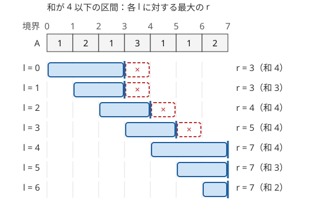

!!! abstract "要点"
    - **何ができるか**：区間 $[l, r)$ について、各 $l$ に対する最大（最小）の $r$ が $l$ とともに単調に増えるなら、$r$ を戻さずに動かして全体を $O(N)$ で調べられる。区間を縮めても条件が保たれるかで単調性を見抜く。
    - **いつ使うか**：
        - 条件を満たす最長（最短）の連続区間・連続区間の個数を求める。
        - 区間を縮めても（広げても）条件が保たれる。
        - 長さ $M$ の範囲に入るものの最大個数を求める。
        - $N \le 2 \times 10^5$ で、区間を全部は調べられない。
    - **計算量**：区間への要素の出し入れが $O(1)$ なら全体で $O(N)$。両端とも合計 $N$ 回しか進まない（ならし計算量）。出し入れに `map` を使うと $O(N \log N)$ になる。
    - **前提**：[累積和](../basics/prefix-sum.md)、[計算量の見積もり](../basics/complexity-estimation.md)

<!-- textlint-disable -->
別名：しゃくとり法・two pointers・2 ポインタ・スライディングウィンドウ・固定長の窓
<!-- textlint-enable -->

尺取り法は、連続する区間 $[l, r)$ を左端と右端の 2 つの添字で表し、どちらの端も右へだけ動かして、すべての左端（または右端）に対する答えを求める方法である。素朴には $O(N^2)$ 個ある区間を、端の動きが単調であることを使って $O(N)$ 回の操作で調べ尽くす。要は手順ではなく、「右端を戻さなくてよい」と言える単調性を問題の条件から見抜くことである。

添字は 0-indexed、区間は[半開区間](../guide/glossary.md#half-open-interval) $[l, r)$ で書く（$a_i = A_{i+1}$）。$l = r$ は空区間である。

## 2 つの型（部分区間も満たす型・より大きい区間も満たす型） {#two-types}

尺取り法が使える条件は、次の 2 つの型のどちらかである。

| 型 | 性質 | 例 | 各 $l$ で求める $r$ | 数え方 |
| --- | --- | --- | --- | --- |
| 部分区間も満たす | 満たす区間の内側の区間も満たす | 和 $\le K$（$a_i \ge 0$）、種類数 $\le K$、重複がない | 満たす最大の $r$ | 区間の数は $r - l$ |
| より大きい区間も満たす | 満たす区間を含む区間も満たす | 和 $\ge K$（$a_i \ge 0$）、種類数 $\ge K$ | 満たす最小の $r$ | 区間の数は $N - r + 1$ |

1 つ目の型では、$l$ を固定すると右端が $l, l + 1, \dots, r$ のときだけ条件を満たすので、満たす区間は $r - l$ 個ある（空区間を除く）。最長の区間なら $r - l$ の最大を取る。2 つ目の型では、右端が $r, r + 1, \dots, N$ のときに満たすので $N - r + 1$ 個ある。最短の区間なら $r - l$ の最小を取る。

どちらの型も、条件の否定を取るともう一方の型になる。「和が $K$ 以上の区間の数」は「全区間の数 $N(N + 1)/2$ から、和が $K - 1$ 以下（$K$ 未満）の区間の数を引いたもの」でもある。書きやすい方の型で数えてよい。

## 単調性の見抜き方（縮めても保たれるか） {#monotonicity}

部分区間も満たす型について、各 $l$ に対する最大の $r$ を $r(l)$ と書く。区間 $[l, r(l))$ は条件を満たすので、1 つ縮めた $[l + 1, r(l))$ も条件を満たす。よって $r(l + 1) \ge r(l)$ であり、$r(l)$ は $l$ について広義単調増加になる。次の図は $A = (1, 2, 1, 3, 1, 1, 2)$ で和が 4 以下の区間を調べたときの、各 $l$ に対する区間 $[l, r(l))$ である。



帯の右端（太い縦線）は左へ戻らない。だから $l$ を 1 つ進めたら、$r$ は前の位置から続けて伸ばせばよい。$r$ は全体で高々 $N$ 回、$l$ も $N$ 回しか進まないので、while の中で右端を伸ばしていても全体の操作は $O(N)$ 回で済む（[ならし計算量](../basics/complexity-estimation.md#amortized)）。より大きい区間も満たす型では、各 $l$ に対する最小の $r$ を $r(l)$ とする。$r < r(l)$ なら $[l, r)$ は満たさず、その内側の $[l + 1, r)$ も満たさない（満たすなら、それを含む $[l, r)$ も満たすはずである）。よって $r(l + 1) \ge r(l)$ で、こちらも単調に増える。

<div class="kp-viz" data-viz="two-pointers" data-config='{"array": [1, 2, 1, 3, 1, 1, 2], "K": 4, "mode": "at-most"}'></div>

動く図では、同じ列で右端を伸ばせるだけ伸ばし、伸ばせなくなったら左端を 1 つ進める様子を 1 ステップずつ示す。どのステップでも区間の和が 4 以下に保たれ、右端は戻らない。

単調性は「区間を 1 つ縮めても条件が保たれるか」を確かめて見抜く。保たれるなら部分区間も満たす型である。

- **和 $\le K$**：$a_i \ge 0$ なら、要素を取り除いても和は増えない。負の値があると崩れる（[負の値があるとき](#negative-values)）
- **積 $\le K$**：$a_i \ge 1$ なら、要素を取り除いても積は増えない。0 があると崩れる（[落とし穴](#pitfalls)）
- **種類数 $\le K$・重複がない**：要素を取り除いても種類は増えない
- **XOR 和と和が等しい**：$a \oplus b \le a + b$ で、等号は 2 数に共通して立つ bit がないときだけ成り立つ。区間の全体では「どの bit も 2 つ以上の要素で立っていない」と同じで、要素を取り除いても bit の重なりは増えない（[ARC098 D](#challenge) の型）

一方、「和がちょうど $K$」は、縮める向きにも広げる向きにも崩れるので、どちらの型でもない。正の値の列なら「和が $K$ 以下の区間の数 − 和が $K - 1$ 以下の区間の数」に分けて、どちらも尺取りで数えられる。

??? question "確認問題：和が K 以上の区間の右端"
    正の整数列で、和が $K$ 以上の区間を数える。各 $l$ について和が $K$ 以上になる最小の $r$ を $r(l)$ とする。なぜ $r(l + 1) \ge r(l)$ と言えるか。

    ??? success "答え"
        $r < r(l)$ なら $[l, r)$ の和は $K$ 未満である。$[l + 1, r)$ はそこから正の値 $a_l$ を除いたものなので、和はさらに小さく $K$ 未満になる。よって $l + 1$ でも $r(l)$ より手前の右端では足りず、$r(l + 1) \ge r(l)$ である。値に 0 を含む非負の列でも、除いた和は増えないので同じことが言える。

## 空区間・取り除く処理の書き方 {#implementation}

尺取り法の実装は、「今の区間 $[l, r)$ の状態」（和・各値の個数・種類数など）を 1 組だけ持ち、右端で要素を入れ、左端で要素を出して状態を更新する。保つ性質は「状態はいつも $[l, r)$ の中身と一致する」ことだけである。書き方は 2 通りあり、型に合わせて選ぶと空区間の扱いで迷わない。

**右端を 1 つずつ進める書き方（部分区間も満たす型）**。右端 $r$ の for で $a_r$ を入れ、条件を破っている間だけ左端を進めて直す。この書き方では、$a_r$ を入れた後の区間は $r$ を含む閉区間 $[l, r]$（半開区間で書けば $[l, r + 1)$）である。直した後の $l$ は、右端が $r$ の区間のうち条件を満たす最小の左端なので、右端が $r$ の区間は $r - l + 1$ 個数えられる。$a_r$ 1 つだけの区間も条件を破るとき（$K = 0$ など）も、$l = r + 1$（空区間）で止まるので、特別な扱いが要らない。次のコードは、値の種類数が $K$ 以下の区間を数える。

```cpp
--8<-- "two-pointers/at-most-k-kinds.cpp:core"
```

取り除く処理は入れる処理の逆にする。種類数を数えるときは値ごとの個数 `cnt` を持つ。個数が 0 から 1 になったら種類数を増やし、1 から 0 になったら減らす。`set` に値を入れるだけだと、同じ値が 2 個ある区間から 1 個を出したときに値ごと消えて種類数が狂う。値の範囲が広いときは[座標圧縮](../basics/coordinate-compression.md)してから配列で数えると、`map` より速い。

**左端を 1 つずつ進める書き方（より大きい区間も満たす型）**。左端 $l$ の for で、条件を満たすまで右端を伸ばし、満たせば $N - r + 1$ 個を数えてから $a_l$ を出す。右端を端まで伸ばしても満たさなければ、それより右の左端でも満たさないので打ち切る。次のコードは、正の整数列で和が $K$ 以上の区間を数える。

```cpp
--8<-- "two-pointers/at-least-k-sum.cpp:core"
```

左端の for で書くとき気をつけるのは、区間が空（$l = r$）のまま $a_l$ を出してしまうことである。2 つ目のコードでは $\mathrm{sum} \ge K \ge 1$ のときだけ出すので $r > l$ が保証される。一般には「$l = r$ なら $r$ も 1 つ進め、そうでなければ $a_l$ を出す」と書く。

## 固定長の窓をずらす {#fixed-window}

区間の長さが $M$ と決まっているときは、窓 $[i, i + M)$ を 1 つずつ右へずらし、入ってくる $a_{i + M}$ と出ていく $a_i$ だけで状態を更新する。長さ $M$ の区間の和の最大や、窓の中の種類数を、各窓で $O(1)$ で更新できる。和だけなら[累積和](../basics/prefix-sum.md)の $S_{i + M} - S_i$ でも求まる。

窓の長さが添字ではなく座標で決まる型もある。「数直線上の点を長さ $M$ の半開区間 $[x, x + M)$ で最大何個覆えるか」なら、次のように考える。

1. 区間を右へずらしても、左端が点を越えるまでは覆う点は減らない。だから左端はどれかの点に合わせた場合だけ考えればよい
2. 座標をソートし、左端の点 $l$ ごとに「$x_r < x_l + M$ を満たす間 $r$ を進める」。$x_l$ が増えると境界も右へ動くので、$r$ は戻らない
3. 覆える数は $r - l$ で、その最大が答えである

窓の中の最大値・最小値は、取り除くのが難しい（最大の要素が出ていくと、次の最大を探し直す必要がある）。この場合は[単調スタック](../ds/monotonic-stack.md#sliding-window-minimum)のスライド最小値を使う。範囲攻撃の効果が座標で切れる問題（[ABC153 F](#challenge) の型）では、効果の終わる座標と回数をキューに積み、今の座標より手前で切れたものを先頭から捨てる。これも端が戻らない尺取りの一種である。

## 負の値があるとき（累積和＋連想配列へ） {#negative-values}

値に負の数があると、和の条件は縮めても保たれない。たとえば $A = (-1, 2)$ で和が 1 以下の区間を考えると、$[0, 2)$ の和は 1 で条件を満たすが、その内側の $[1, 2)$ の和は 2 で満たさない。$l = 0$ の最大の右端は 2 だが、$l = 1$ では右端 2 の区間がもう条件を破るので、最大の右端は 1（空区間）に下がる。$r(l)$ が単調でなくなり、右端を戻す必要が出る。

このときは区間を 2 つの累積和の差 $S_r - S_l$ と見て、端を 1 つ固定して相手を数える。

- **和がちょうど $K$**：右端 $r$ ごとに $S_l = S_r - K$ となる $l < r$ の個数を連想配列で数える（[累積和と連想配列で区間を数える](../basics/prefix-sum-counting.md)）
- **和が $K$ 以上**：$S_l \le S_r - K$ となる $l$ の個数を数える。累積和を[座標圧縮](../basics/coordinate-compression.md)して [BIT](../ds/fenwick-tree.md) で数えると $O(N \log N)$ になる

値が非負と書かれていない問題では、まず制約で値の符号を確かめる。

## 二分探索との関係（O(N log N) でも解ける） {#vs-binary-search}

尺取り法が使える問題は、多くが[二分探索](../basics/binary-search.md)でも解ける。$a_i \ge 0$ なら累積和 $S$ は単調増加なので、左端 $l$ ごとに $S_r \ge S_l + K$ となる最小の $r$ を `lower_bound` で探せば、全体で $O(N \log N)$ になる。$N \le 2 \times 10^5$ ならどちらでも間に合う。

| 観点 | 尺取り法 | 二分探索 |
| --- | --- | --- |
| 計算量 | $O(N)$ | $O(N \log N)$ |
| 使える条件 | 端が単調に動く | 1 端を固定したとき境界を探せる |
| 状態 | 区間に出し入れできればよい（種類数など） | 任意の区間の値をすぐ求められる必要がある（累積和など） |

種類数のように任意の区間の値をすぐには求められない条件では、二分探索よりも尺取り法が書きやすい。逆に、和の条件で添字の境界を誤りやすいときは、累積和と `lower_bound` の方が確かめやすい。

尺取り法は、[答えで二分探索](../basics/binary-search-answer.md)の判定の中でもよく使われる。「$x$ 以下になる組が $K$ 個以上あるか」を、ソートした列の上の尺取りで $O(N)$ で数えれば、[K 番目の値](../basics/kth-value.md)がソートの後 $O(N \log V)$ で求まる（$V$ は答えの値の範囲の幅）。ソートした 2 つの列から和が条件を満たす組を数えるのも、片方を昇順、もう片方を降順に動かす尺取りである（[半分全列挙](../basics/meet-in-the-middle.md)で使う）。

## 落とし穴 {#pitfalls}

**値の符号を確かめずに使う**。和の条件で尺取りできるのは値が非負のときだけである。負の値があると答えが合わないのに、小さい例では偶然合うことがある。制約の $a_i$ の下限を確かめる。

**積の条件で 0 を見落とす**。積が $K$ 以下の最長の区間では、列に 0 が 1 つでもあれば、それを含む全体の積が 0 になり、答えは $N$ である。0 を含む区間からは、0 で割って取り除くことができない。0 がなければ $a_i \ge 1$ で積は単調なので、左端の値で割って取り除く尺取りができる。だから 0 を先に場合分けする。

**積や和のオーバーフロー**。積を持つときは、$K$ を超えたらすぐ左端を縮めて、積を $K$ 以下に保つ。$K \le 10^9$・$a_i \le 10^9$ なら、掛ける前の積が $K$ 以下なので掛けた後も $10^{18}$ 以下に収まり、`long long` で足りる。区間の個数は最大 $N(N + 1)/2 \approx 2 \times 10^{10}$ なので、数える変数も `long long` にする。

**取り除く処理が入れる処理の逆になっていない**。種類数を `set` の大きさで数える、出す要素の個数を減らし忘れる、などで状態が区間の中身とずれる。入れる処理と出す処理を並べて書き、`cnt` の 0 と 1 の境目だけで種類数を動かす。

**空区間から取り除く**。左端の for で書くと、$l = r$ のまま $a_l$ を出して和が負になったり、`cnt` が $-1$ になったりする。部分区間も満たす型は右端の for で書けば起きない。

**数え方の差 1**。部分区間も満たす型の個数は、左端の for なら $r - l$、右端の for なら $r - l + 1$（$r$ を含む閉区間 $[l, r]$ で数えるため）である。どちらの書き方で $r$ が何を指すかを決めてから数える。

## 例題 {#examples}

### ABC130 D. Enough Array {#abc130_d}

<div class="kp-problems" data-role="example" markdown>

- [ABC130 D. Enough Array](https://atcoder.jp/contests/abc130/tasks/abc130_d)（diff 865）：正の整数列の連続部分列のうち、和が K 以上のものの個数を求める。

</div>

値が正なので、和が $K$ 以上の区間を含む区間も和が $K$ 以上であり、より大きい区間も満たす型である。左端 $l$ ごとに和が $K$ 以上になる最小の右端 $r(l)$ は、$l$ とともに右へしか動かない。$r(l)$ が見つかれば、右端が $r(l)$ 以降の $N - r(l) + 1$ 個の区間がすべて条件を満たす。

??? note "解法の詳細"
    - 状態は区間 $[l, r)$ の和だけである。左端 $l$ を 0 から $N - 1$ まで動かし、和が $K$ 未満の間は右端を伸ばす。
    - 右端を $N$ まで伸ばしても $K$ に届かなければ、それより右の左端でも届かないので打ち切る。届いたら $N - r + 1$ を答えに足し、$a_l$ を和から引いて左端を進める。
    - 和と答えは `long long` で持つ。全体で $O(N)$。コードは[空区間・取り除く処理の書き方](#implementation)の 2 つ目のものと同じである。
    - 累積和を作って各 $l$ で $S_r \ge S_l + K$ の最小の $r$ を `lower_bound` で探しても、$O(N \log N)$ で解ける。

## 練習問題 {#practice}

<div class="kp-problems" data-role="practice" markdown>

- [ABC326 C. Peak](https://atcoder.jp/contests/abc326/tasks/abc326_c)（diff 292）：数直線上の贈り物を、長さ M の半開区間で最大何個取れるか求める。
- [典型90 034. There are few types of elements（★4）](https://atcoder.jp/contests/typical90/tasks/typical90_ah)（diff —）：K 種類以下の値からなる連続部分列の最大の長さを求める。
- [ABC032 C. 列](https://atcoder.jp/contests/abc032/tasks/abc032_c)（diff 1244）：積が K 以下になる連続部分列の最大の長さを求める。
- [ARC022 B. 細長いお菓子](https://atcoder.jp/contests/arc022/tasks/arc022_2)（diff 1395）：同じ値を 2 つ含まない連続部分列の最大の長さを求める。

</div>

??? note "練習の方針"
    - **ABC326 C**：座標をソートし、左端を各点に合わせて、$x_l + M$ より手前の点まで右端を進める（[固定長の窓をずらす](#fixed-window)）。`lower_bound` で境界を探してもよい
    - **典型90 034**：値ごとの個数と種類数を持ち、種類数が $K$ を超えたら左端を縮める。区間の数ではなく $r - l + 1$ の最大を取る
    - **ABC032 C**：0 が 1 つでもあれば答えは $N$。なければ積を持って尺取りし、積が $K$ を超えたら左端の値で割って縮める。$K$ より大きい要素だけの区間は長さ 0 になる
    - **ARC022 B**：値ごとの出現回数を持ち、新しく入れた値が 2 個になったら、1 個に戻るまで左端を縮める。値の範囲が小さいので配列で数えられる

## 力試し {#challenge}

<div class="kp-problems" data-role="challenge" markdown>

- [ABC153 F. Silver Fox vs Monster](https://atcoder.jp/contests/abc153/tasks/abc153_f)（diff 1393）：範囲内のモンスターの体力を一律に削る爆弾で、すべてのモンスターを倒す最小の爆弾の数を求める。
- [ARC098 D. Xor Sum 2](https://atcoder.jp/contests/arc098/tasks/arc098_b)（diff 1404）：XOR 和と和が等しい連続部分列の数を求める。

</div>

??? note "力試しの方針"
    - **ABC153 F**：座標の小さい順に見て、まだ倒れていない最も左のモンスターを左端に含むように爆弾を置くのが最適である（より左に置いても得がない）。置いた爆弾の効果が届く右端の座標と回数をキューに積み、今のモンスターより手前で切れた効果を先頭から捨てて、効いているダメージの合計を保つ。[いもす法](../basics/imos.md)で効果の切れ目に引き算を置いてもよい
    - **ARC098 D**：XOR 和と和が等しいのは、どの bit も 2 つ以上の要素で立っていないときで、部分区間も満たす型になる。区間が条件を満たす間は XOR 和と和が等しいので、和 $S$ だけを持てばよい。右端を伸ばす前に $S \oplus a_r = S + a_r$ か（$S$ と $a_r$ に共通の bit がないか）で確かめ、区間の数を $r - l$ ずつ足す

## 使い分け {#comparison}

- 1 端を固定したとき、もう 1 端の境界を累積和などで探せる → [二分探索](../basics/binary-search.md)でも $O(N \log N)$ で解ける
- 値に負があり、条件が累積和の等式・余りで書ける → [累積和と連想配列で区間を数える](../basics/prefix-sum-counting.md)
- 窓の中の最大値・最小値を保つ → [単調スタック](../ds/monotonic-stack.md#sliding-window-minimum)のスライド最小値
- 同じ値の連続（塊）を単位に考える → [ランレングス圧縮](../basics/run-length-encoding.md)してから塊の列で尺取りする

## 参考 {#references}

- [drken「しゃくとり法 (尺取り法) の解説と、それを用いる問題のまとめ」](https://qiita.com/drken/items/ecd1a472d3a0e7db8dce)：2 つの型、空区間の扱い、二分探索との関係
- [drken「AtCoder ABC 130 D - Enough Array (2Q, 緑色, 400 点)」](https://drken1215.hatenablog.com/entry/2019/06/17/004300)：例題の方針（最小の右端と $N - r + 1$ の数え方）
- [drken「AtCoder ABC 326 C - Peak (3Q, 灰色, 300 点)」](https://drken1215.hatenablog.com/entry/2023/11/11/204912)：練習の方針（左端を点に合わせてよいこと）
- [E869120「競プロ典型 90 問」034 の解答例](https://github.com/E869120/kyopro_educational_90/blob/main/sol/034.cpp)：練習の方針（個数と種類数の持ち方）
- [Reputeless「tenkei_90」](https://github.com/Reputeless/tenkei_90)：典型 90 問の解説の索引
- [oraclesqlpuzzle「ABC032-C 列」](https://oraclesqlpuzzle.ninja-web.net/kyoupro/05-atcoder-02-abc/kyoupro-abc032-c.html)：練習の方針（0 の場合分けと積の尺取り）
- [drken「AtCoder ARC 022 B - 細長いお菓子 (2Q, 試験管水色)」](https://drken1215.hatenablog.com/entry/2020/11/14/132258)：練習の方針（出現回数の管理）
- [drken「AtCoder ABC 153 F - Silver Fox vs Monster (1D, 水色, 600 点)」](https://drken1215.hatenablog.com/entry/2020/01/26/234000)：力試しの方針（左端に合わせる貪欲と効果の管理）
- [drken「AtCoder ABC 098 D - Xor Sum 2 (ARC 098 D) (1D, 水色, 500 点)」](https://drken1215.hatenablog.com/entry/2018/06/26/125054)：力試しの方針（XOR 和と和が等しい条件と単調性）
