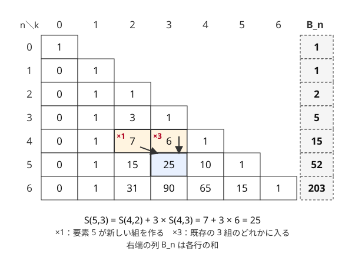

!!! abstract "要点"
    - **何ができるか**：区別できる $n$ 個を、区別しない $k$ 個の空でない組に分ける方法の数 $S(n, k)$ と、組の数を問わない総数 $B_n$（ベル数）を求める。表は最後の要素で場合分けした漸化式 $S(n, k) = S(n-1, k-1) + k \, S(n-1, k)$ で埋める。$B_{12} = 4213597 \approx 4.2 \times 10^6$ から分け方の全列挙が間に合うかを見積もる。
    - **いつ使うか**：
        - $N \le 10$〜$12$ で、グループ分けを全部試す。
        - $N$ 人を区別しない $K$ 組に分ける（どの組も空でない）方法の数を問われる。
    - **計算量**：$S(n, k)$ の表は $O(n^2)$、$B_n$ も $O(n^2)$（mod を取っても同じ）。分け方の全列挙は葉が $B_n$ 個で、葉 1 つを $O(1)$ で処理できれば $O(B_n)$。
    - **前提**：[二項係数の意味と性質](../comb/binomial-coefficient.md)、[DP の基本](../dp/dp-basics.md)

<!-- textlint-disable -->
別名：集合の分割の数・第 2 種スターリング数・ベル数・S(n,k)・B_n・Stirling numbers of the second kind・Bell number
<!-- textlint-enable -->

第 2 種スターリング数とベル数は、集合の分割を数える数である。$S(n, k)$ は $\{1, \dots, n\}$ を $k$ 個の空でない組に分ける方法の数、$B_n$ はそれを $k$ について足した総数である。競技プログラミングでは値そのものを問われるより、「グループ分けを全部試して間に合うか」を $B_n$ で見積もる場面の方が多い。

## S(n,k) の漸化式（最後の要素が新しい組を作るか既存の組に入るか） {#recurrence}

数える対象をはっきりさせておく。区別できる $n$ 個の要素（人・袋など）を、名前のない $k$ 個の組に分ける。どの組も空でなく、組の中の順番は区別しない。2 つの分け方は、「同じ組に入っている要素の組合せ」がすべて同じなら同じものとみなす。

$n = 4$、$k = 2$ で全部書き出すと次の 7 通りになる。

- 3 個と 1 個：$\{1,2,3\}\{4\}$・$\{1,2,4\}\{3\}$・$\{1,3,4\}\{2\}$・$\{2,3,4\}\{1\}$
- 2 個と 2 個：$\{1,2\}\{3,4\}$・$\{1,3\}\{2,4\}$・$\{1,4\}\{2,3\}$

組に番号 1・2 を付けて各要素に番号を割り当てると、$2^4 = 16$ 通りから「全員が同じ番号」の 2 通りを除いた 14 通りになる。番号を入れ替えただけのものが 2 回ずつ数えられているので、$14 / 2 = 7$ と一致する。一般に、組に番号を付けた数（各番号を 1 回以上使う割り当て、すなわち全射の数）は $k! \, S(n, k)$ である。どの組も空でないので、番号の付け方はちょうど $k!$ 通りずつある。

**漸化式**：要素 $n$（最後の要素）がどこにいるかで場合を分ける。

$$
S(n, k) = S(n-1, k-1) + k \, S(n-1, k) \qquad (n \ge 1,\ k \ge 1)
$$

- **要素 $n$ が 1 人だけの組を作る**：残りの $n - 1$ 個を $k - 1$ 組に分ければよく、$S(n-1, k-1)$ 通り
- **要素 $n$ がほかの要素と同じ組にいる**：要素 $n$ を取り除いても組は空にならず、残りの $n - 1$ 個の $k$ 組への分け方が残る。逆に $n - 1$ 個の $k$ 組への分け方に、要素 $n$ をどの組に入れるかで $k$ 通りずつ作れる。組は空でないので、中の要素で互いに見分けられ、$k$ 通りは全部違う。よって $k \, S(n-1, k)$ 通り

どの分け方も、要素 $n$ が 1 人の組にいるかどうかでちょうど一方に入るので、重複も漏れもない。2 つ目の場合の係数 $k$ が使えるのは、組が空でないから中身で区別できるためである。

境界は $S(0, 0) = 1$（0 個を 0 組に分ける「何もしない」分け方が 1 つ）、$n \ge 1$ なら $S(n, 0) = 0$、$k > n$ なら $S(n, k) = 0$ とする。$S(0, 0) = 1$ を忘れると表全体が 0 になる。

次の図は、漸化式で表を上の行から埋めた結果と、行の和であるベル数を並べたものである。



各行の両端は $S(n, 1) = 1$（全員が 1 つの組）と $S(n, n) = 1$（全員が 1 人ずつ）である。$S(n, 2) = 2^{n-1} - 1$ になるのは、上の 14 通りの計算と同じ理由である。表を埋めるコードは次のとおりで、$O(n^2)$ である。

```cpp
--8<-- "bell-number/stirling.cpp:core"
```

- **mod を取るとき**：`long long` を modint に変えるだけでよい。割り算がないので、法が素数でなくても使える
- **$n$ が大きく $k$ が小さいとき**：1 つの $S(n, k)$ だけが要るなら、全射の数を[包除原理](../comb/inclusion-exclusion.md#surjection)で数えて $k!$ で割る式 $S(n, k) = \frac{1}{k!} \sum_{i=0}^{k} (-1)^i \binom{k}{i} (k - i)^n$ を使う。繰り返し二乗法で $O(k \log n)$ になる。$k!$ の逆元が要るので、法は $k!$ と互いに素でなければならない（$k$ より大きい素数なら満たす）

??? question "確認問題：S(4,2) を漸化式で"
    $S(4, 2)$ を漸化式で求め、上の書き出しの 7 通りと一致することを確かめよ。2 つの場合が、書き出しのどれに当たるかも答えよ。

    ??? success "答え"
        $S(4, 2) = S(3, 1) + 2 \, S(3, 2) = 1 + 2 \times 3 = 7$ である。1 つ目の場合（要素 4 が 1 人の組を作る）は $\{1,2,3\}\{4\}$ の 1 通り。2 つ目の場合は、3 個の 2 組への分け方 $\{1,2\}\{3\}$・$\{1,3\}\{2\}$・$\{2,3\}\{1\}$ のそれぞれで、4 をどちらの組に入れるかの 2 通りずつで、残りの 6 通りになる。

## ベル数と全列挙の個数の見積もり（B_10 = 115975、B_12 = 4213597） {#size}

ベル数 $B_n$ は、組の数を決めずに $n$ 個を分ける方法の総数で、$B_n = \sum_{k=0}^{n} S(n, k)$ である。表の行の和で求めてもよいが、二項係数を使った次の漸化式もある。

$$
B_{m+1} = \sum_{j=0}^{m} \binom{m}{j} B_j
$$

要素 $m + 1$ の組に一緒に入る相手を、残りの $m$ 個から選ぶと考える。相手に選ばなかった $j$ 個は、要素 $m + 1$ の組と関係なく自由に分けられるので $B_j$ 通りある。選ばない $j$ 個の選び方が $\binom{m}{j}$ 通りなので、$j$ について足せば全部になる。

```cpp
--8<-- "bell-number/stirling.cpp:bell"
```

値は次のように増える（$B_0 = 1$）。

| $n$ | $B_n$ | $3^n$（比べる用） |
| --- | --- | --- |
| 8 | $4140$ | $6561$ |
| 10 | $115975$ | $59049$ |
| 11 | $678570$ | $177147$ |
| 12 | $4213597$ | $531441$ |
| 13 | $27644437$ | $1594323$ |
| 14 | $190899322$ | $4782969$ |
| 16 | $10480142147$ | $43046721$ |

$n = 10$ 前後では、$n$ が 1 増えるごとに $B_n$ は 5〜7 倍になる（倍率は $n$ とともにゆっくり大きくなる）。指数関数より速く増えるので、「$N \le 12$ なら全列挙できるが、$N = 14$ ではほぼ無理」と切り替わりが急である。分け方の全列挙の判断の目安は次のとおりである（1 秒に $10^8$ 回が目安。[計算量の見積もり](../basics/complexity-estimation.md#count-candidates)）。

- **$N \le 10$**：$B_{10} \approx 1.2 \times 10^5$ 通りなので、葉ごとに $O(N)$ や $O(N^2)$ の判定をしても十分間に合う
- **$N = 11$〜$12$**：$B_{12} \approx 4.2 \times 10^6$ 通りなので、葉 1 つあたり $O(1)$〜$O(N)$ に抑える。決めるたびに差分で値を更新し、葉では計算し直さない
- **$N = 13$**：$B_{13} \approx 2.8 \times 10^7$ 通りで、葉 1 つ $O(1)$ が必須である。葉で `vector` に値を積むなどの定数倍にも気を配れば間に合う
- **$N \ge 14$**：$B_{14} \approx 1.9 \times 10^8$ 通りで、全列挙はほぼ間に合わない。[部分集合の DP](#vs-subset-dp) などを考える

分け方を重複なく列挙するには、要素を番号の順に見て「今ある組のどれかに入れる」か「新しい組を作る」かを再帰で選ぶ（[再帰による全列挙の組分け型](../basics/recursive-enumeration.md#partition)）。この再帰の葉はちょうど $B_N$ 個である。途中の節点の数は $B_0 + B_1 + \dots + B_{N-1}$ で、$B_n$ の増え方が速いので、葉の数の 2 割ほどに収まる（$N = 12$ で約 $8.2 \times 10^5$ 個）。「人 $i$ の選び方は $i$ 通り以下だから葉は $N!$ 以下」という見積もりも正しいが、$12! \approx 4.8 \times 10^8$ と大きく見積もりすぎて、間に合う方法を捨てることになる。

組の数が $T$ と決まっている問題では、答えになる葉は $S(N, T)$ 個である。$S(N, T)$ は $T$ が $N$ の半分より少し小さいあたりで最大になり、$\max_T S(12, T) = S(12, 5) = 1379400$ である。ただし枝刈りがないと $T$ 組にならない葉まで進むので、計算量の上界は $B_N$ で見積もる。

値の大きさにも注意する。$B_{25} \approx 4.6 \times 10^{18}$ は `long long` に収まるが、$B_{26} \approx 5.0 \times 10^{19}$ はあふれる。mod を取らずに答える問題で $n$ が 26 以上なら `__int128` などを使う。表の途中の値 $k \, S(n-1, k)$ は $S(n, k) \le B_n$ 以下なので、$n \le 25$ なら途中でもあふれない。

??? question "確認問題：N = 12 の全列挙"
    $N = 12$ 個の値を組に分けるすべての方法について、組ごとの和を求めて条件を判定する。葉に着くたびに全部の組の和を $O(N)$ で計算し直すと、およそ何回の計算になるか。間に合わせるにはどうするか。

    ??? success "答え"
        葉は $B_{12} = 4213597$ 個なので、$4.2 \times 10^6 \times 12 \approx 5 \times 10^7$ 回で、1 秒に収まる見込みはある。ただし葉で `set` に入れるなどの重い処理を足すと危うい。要素を組に入れるたびに組の和を差分で更新し、葉では $O(1)$ で判定できるようにすると確実である。

## bitDP・3^N の部分集合 DP との使い分け {#vs-subset-dp}

この節は [bitDP](../dp/bit-dp.md) を前提にする。グループ分けの問題は、分け方を全列挙する以外に、集合を状態にした DP でも解けることがある。どちらを使うかは、分け方の評価が組ごとに分かれるかどうかで決まる。

**評価が組ごとに分かれるとき**：「各組の得点の和を最大化」「各組の中で条件を満たす分け方の数」のように、分け方の値が組ごとの値 $f(\text{組})$ の和・最大・積などで決まる場合である。このときは $\mathrm{dp}[S]$ ＝ 集合 $S$ を分けたときの最適値（または分け方の数）とする[部分集合を列挙する DP](../dp/subset-enumeration-dp.md) が使える。$S$ の中で番号が最小の要素を含む組 $T \subseteq S$ を選び、$\mathrm{dp}[S] = \max_T (f(T) + \mathrm{dp}[S \setminus T])$ と遷移する。最小の要素を含む組から決めるのは、組を選ぶ順番の違いで同じ分け方を何度も数えないためで、全列挙で「新しい組の番号は 1 通り」とするのと同じ考え方である。計算量は全体で $O(3^N)$ になる。

上の表のとおり、$N \ge 9$ では $3^N < B_N$ で、差は $N$ とともに開く。$N = 16$ なら $3^{16} \approx 4.3 \times 10^7$ で間に合うが、$B_{16} \approx 10^{10}$ の全列挙は間に合わない。組の数がちょうど $T$ なら、状態に組の数を足して $O(T \cdot 3^N)$ にする。

**評価が分け方全体で決まるとき**：「各組の和の XOR としてありうる値の種類数」のように、すべての組を見ないと値が決まらず、しかも答えが値の集合であるものは、DP の状態に押し込めない。$\mathrm{dp}[S]$ に「ありうる値の集合」を持たせると、集合の大きさが分け方の数の程度まで膨らむからである。この形は $N \le 12$ 程度の制約で出題され、分け方を全列挙する（[例題](#abc390_d)）。

| 評価の形 | 方法 | 計算量 | 目安の $N$ |
| --- | --- | --- | --- |
| 組ごとに分かれる | 部分集合の DP | $O(3^N)$ | 16 前後まで |
| 組ごとに分かれる・組の数が $T$ | 部分集合の DP（組の数を状態に足す） | $O(T \cdot 3^N)$ | 14〜15 程度まで |
| 分け方全体で決まる | 分け方の全列挙 | $O(B_N)$ | 12 程度まで |
| 分け方の数だけ（条件なし） | 表の漸化式・包除原理 | $O(N^2)$ など | 大きくてよい |

$O(2^N N)$ の bitDP は、要素を 1 つずつ足していき、順番や最後に使ったものが効く問題に向く。組に分ける問題は、組をまとめて選ぶ部分集合の DP の方が素直に書ける。

## 落とし穴 {#pitfalls}

**箱を区別しないのに $k!$ で割れない場合がある**。組に番号を付けて数えた数を $k!$ で割ってよいのは、どの組も空でないときだけである。空の組を許すと、空の組どうしの番号を入れ替えても割り当ては変わらないので、ちょうど $k!$ 回ずつにはならない。たとえば 2 人を空でもよい 3 つの組に分けると、番号付きでは $3^2 = 9$ 通りで、$3! = 6$ で割ると整数にならない。正しくは「2 人が同じ組」と「別々の組」の 2 通りで、$S(2, 1) + S(2, 2) = 2$ である。空を許す区別しない $k$ 組への分け方は $\sum_{j \le k} S(n, j)$ で数える（[写像 12 相](../comb/twelvefold-way.md)）。

**第 1 種スターリング数と係数を取り違える**。第 2 種の漸化式の係数は組の数 $k$ で、第 1 種（巡回の数で置換を数える）は $n - 1$ である（[第 1 種スターリング数](../comb/stirling-first.md)）。小さい値 $S(3, 2) = 3$・$S(4, 2) = 7$ で確かめると取り違えに気づける。

**組に番号を付けて全列挙する**。人ごとに組の番号 $0, \dots, T-1$ を割り当てる $T^N$ 通りの全探索は、どの組も空でない割り当てに限っても同じ分け方を $T!$ 回ずつ数えるうえに、$T = N = 10$ なら $10^{10}$ 通りで間に合わない。「新しい組の番号は今の組の数」とする列挙なら、葉は $B_N$ 個で重複もない。

**$S(0, 0) = 1$ を忘れる**。表を 0 で初期化したまま $S(0, 0)$ を置かないと、すべての値が 0 になる。要素が 0 個の問題（$N = 0$ を含む制約）では、答えが $B_0 = 1$ になることにも注意する。

**全列挙の葉で重いデータ構造を使う**。$B_{12} \approx 4.2 \times 10^6$ 個の値を `set` に入れると、木の操作の定数倍が重く、時間制限が厳しいと間に合わないことがある。値を `vector` に集めて最後にソートし、`unique` で数える方が速い。

## 例題 {#examples}

### ABC390 D. Stone XOR {#abc390_d}

<div class="kp-problems" data-role="example" markdown>

- [ABC390 D. Stone XOR](https://atcoder.jp/contests/abc390/tasks/abc390_d)（diff 1607）：N 個（N ≤ 12）の袋の石を、ある袋の石を全部別の袋へ移す操作で好きなだけ動かしたあと、各袋の石の数の XOR としてありうる値の種類数を求める。

</div>

操作を何回しても、最後の状態では袋がいくつかの組に分かれ、各組の石が組の中の 1 つの袋に集まっている。逆に、どんな分け方も「組ごとに 1 つの袋へ全部移す」ことで作れる。空の袋の石は 0 で XOR に影響しないので、ありうる値は「袋の集合の分け方ごとの、組の和の XOR」である。$N \le 12$ なので分け方は $B_{12} = 4213597$ 通り以下で、全列挙が間に合う。

??? note "解法の詳細"
    - 袋を番号の順に見て、今ある組のどれかに入れるか、新しい組を作るかを再帰で選ぶ。組ごとの和を配列で持ち、入れるときに足して戻るときに引く。
    - 全体の XOR も差分で更新する。組 $g$ の和が $s$ から $s'$ に変わるとき、XOR に $s \oplus s'$ を XOR すればよい。こうすると葉では $O(1)$ で値が分かる。
    - 葉で得た値は `vector` に集め、最後にソートして `unique` で異なる値を数える。$A_i \le 10^{17}$ で和は最大 $1.2 \times 10^{18}$ なので `long long` に収まる。
    - 全体で $O(B_N \log B_N)$（ソートの分）である。

    ```cpp
    --8<-- "bell-number/partition-xor.cpp:core"
    ```

## 練習問題 {#practice}

<div class="kp-problems" data-role="practice" markdown>

- [ABC310 D. Peaceful Teams](https://atcoder.jp/contests/abc310/tasks/abc310_d)（diff 1368）：N 人（N ≤ 10）を T 個のチームに分ける方法のうち、指定された仲の悪い 2 人の組がどれも同じチームにならないものの数を求める。

</div>

??? note "練習の方針"
    - **ABC310 D**：チームに名前はないので、人を番号順に「今あるチームに入れる」か「新しいチームを作る」かで決める。仲の悪い人がいるチームには入れない。分け方は全部でも $B_{10} = 115975$ 通りなので、葉で $O(N)$ かけても間に合う。チームの数がちょうど $T$ の葉だけを数える（新しいチームは $T$ 未満のときだけ作ると枝刈りになる）。

## 確認問題 {#quiz}

??? question "確認問題：3 個の分け方"
    $\{1, 2, 3\}$ の分け方をすべて書き、$B_3 = 5$ であることを確かめよ。それぞれの組の数で分けると、$S(3, k)$ の値はいくつか。

    ??? success "答え"
        $\{1,2,3\}$、$\{1,2\}\{3\}$、$\{1,3\}\{2\}$、$\{2,3\}\{1\}$、$\{1\}\{2\}\{3\}$ の 5 通りである。組の数で分けると $S(3, 1) = 1$、$S(3, 2) = 3$、$S(3, 3) = 1$ で、和は 5 になる。

??? question "確認問題：全列挙か DP か"
    $N = 16$ 人をいくつかのグループに分け、グループごとに決まる得点の和を最大にしたい。分け方を全列挙してよいか。

    ??? success "答え"
        分け方は $B_{16} \approx 1.0 \times 10^{10}$ 通りで、全列挙は間に合わない。得点が組ごとの和なので、$\mathrm{dp}[S]$ ＝ 集合 $S$ を分けたときの最大得点とし、$S$ の最小の要素を含む組を選ぶ部分集合の DP にすれば $3^{16} \approx 4.3 \times 10^7$ 回で済む。

??? question "確認問題：番号付きの組"
    5 人を、1 号室・2 号室・3 号室の 3 部屋に、どの部屋も空にならないように割り当てる方法は何通りか。

    ??? success "答え"
        部屋には番号があるので、区別しない 3 組への分け方 $S(5, 3) = 25$ に、組と部屋の対応のつけ方 $3! = 6$ を掛けて $150$ 通りである。包除原理でも $3^5 - 3 \cdot 2^5 + 3 \cdot 1^5 = 243 - 96 + 3 = 150$ と一致する。

## 使い分け {#comparison}

- **[写像 12 相](../comb/twelvefold-way.md)**：玉と箱の区別の有無と各箱の個数の制限から、どの数を使うかを引く。区別できる玉を区別しない箱へ入れるマスが、このページの $S(n, k)$ と $B_n$ である
- **[整数の分割と分割数](../comb/partition-number.md)**：要素も区別しない（組の大きさの多重集合だけを数える）なら分割数である。$p(12) = 77$ と、ベル数よりずっと小さい
- **[包除原理](../comb/inclusion-exclusion.md)**：組（色・箱）に名前があり「どれも 1 回以上使う」なら、全射の数を包除で直接数える。1 つの $S(n, k)$ を $n$ が大きいときに求めるのにも使う
- **[第 1 種スターリング数](../comb/stirling-first.md)**：分けた組の中の並び（巡回）まで区別するなら第 1 種である
- **[再帰による全列挙](../basics/recursive-enumeration.md)**：分け方を実際に作って調べる書き方はそちらにある。このページは個数の見積もりと数え方を受け持つ

## 参考 {#references}

- [drken「よくある「写像12相」を総整理！ 〜 数え上げ問題の学びの宝庫 〜」](https://qiita.com/drken/items/f2ea4b58b0d21621bd51)：第 2 種スターリング数とベル数の漸化式、箱を区別しないときの扱い
- [Yuulis「【AtCoder】ABC 390 D - Stone XOR | 緑コーダーが解くAtCoder」](https://yuulis.hatenablog.com/entry/ABC-390-D)：例題の方針（分け方の全列挙と B(12) = 4213597 による見積もり、重複除去の注意）
- [oraclesqlpuzzle「ABC390-D Stone XOR」](https://oraclesqlpuzzle.ninja-web.net/kyoupro/05-atcoder-02-abc/kyoupro-abc390-d.html)：例題の方針（ハッシュ集合が重く、ソートして数える方法）
- [drken「AtCoder ABC 310 D - Peaceful Teams (1Q, 水色, 400 点)」](https://drken1215.hatenablog.com/entry/2023/07/17/213800)：練習の方針（最小番号から組を決める全列挙）
