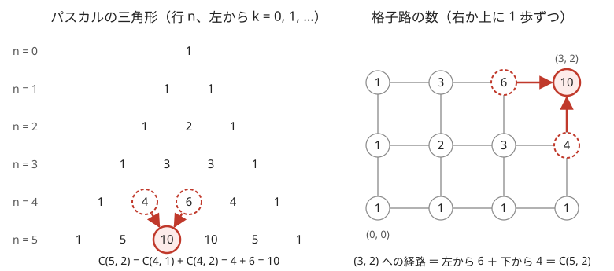

!!! abstract "要点"
    - **何ができるか**：$n$ 個から $k$ 個を選ぶ数 $\binom{n}{k}$ を、選び方・1 が $k$ 個の 0/1 列・格子路の 3 つの意味で使い分ける。パスカルの漸化式と対称性、範囲外を 0 とする約束を使い、辞書順 K 番目の組合せも作れる。
    - **いつ使うか**：
        - N 個から K 個を選ぶ方法の数
        - 0 と 1 の列で 1 がちょうど K 個のもの
        - 辞書順で K 番目の並べ方・与えられた並べ方が何番目か
        - $N \le 60$ 程度で、mod を取らない正確な値を求める
    - **計算量**：パスカルの三角形の表は $O(N^2)$ で作り、値は $O(1)$ で引く。辞書順 K 番目の列とその順位は、表を引きながら $O(N)$ で求まる。
    - **前提**：[和・積の法則と順列・組合せ](../comb/counting-basics.md)

<!-- textlint-disable -->
別名：二項係数・nCr・パスカルの三角形・辞書順 K 番目の組合せ・組合せの順位・binomial coefficient
<!-- textlint-enable -->

二項係数 $\binom{n}{k}$ は、区別できる $n$ 個のものから $k$ 個を選ぶ方法の数である。定義と $\frac{n!}{k!\,(n-k)!}$ の式は[和・積の法則と順列・組合せ](../comb/counting-basics.md)に任せ、ここでは問題を二項係数に結びつける読み替え、表の作り方と境界の約束、mod を取らないときの大きさ、辞書順の K 番目を扱う。

## 3 つの意味（選ぶ・0/1 列・格子路） {#meanings}

$\binom{n}{k}$ には、同じ数を数える 3 つの見方がある。問題がどの形で出ても $\binom{n}{k}$ だと気づけるように、互いの対応を押さえておく。

| 見方 | 数える対象 | $n = 4$, $k = 2$ の例 |
| --- | --- | --- |
| 選ぶ | $\{0, 1, \dots, n-1\}$ の $k$ 個の部分集合 | $\{0,1\}, \{0,2\}, \dots, \{2,3\}$ |
| 0/1 列 | 長さ $n$ で 1 がちょうど $k$ 個の列 | 0011, 0101, 0110, 1001, 1010, 1100 |
| 格子路 | $(0, 0)$ から $(n-k, k)$ へ右か上に 1 歩ずつ進む経路 | 右→右→上→上、右→上→右→上、… |

どれも 6 通りで、重複や漏れなく 1 対 1 に対応する。表の各列はそれぞれ辞書順に並べただけで、同じ行どうしが対応するわけではない。対応は次のとおりである。先頭を 0 文字目として、部分集合 $S$ に対しては「$i \in S$ なら $i$ 文字目を 1」とした列が決まる（たとえば $\{0, 1\}$ は 1100）。逆に列から 1 の位置を集めれば $S$ に戻る。列の 0 を「右」、1 を「上」と読めば経路になる。

- **0/1 列の形**：a が $A$ 個・b が $B$ 個の文字列や、2 種類の操作をそれぞれ決まった回数ずつ行う順番は、$\binom{A+B}{A}$ 通りである
- **格子路の形**：グリッドを右か下へ進む最短路は、縦横の歩数を $a$, $b$ として $\binom{a+b}{a}$ 通りである。障害物や移動の種類が変わる場合は[格子路の数え上げ](../comb/lattice-paths.md)で扱う
- **選ぶ形に直す**：区別のない玉を箱に分ける問題は、玉と仕切りの 0/1 列に直してから二項係数で数える（[重複組合せ](../comb/stars-and-bars.md)）

## パスカルの漸化式と対称性 {#pascal}

二項係数には、次の 2 つの性質がある。

$$
\binom{n}{k} = \binom{n-1}{k-1} + \binom{n-1}{k}, \qquad \binom{n}{k} = \binom{n}{n-k}
$$

1 つ目のパスカルの漸化式は、最後の 1 個（$n-1$ 番）を選ぶかどうかで場合を分けると分かる。選ぶなら残りの $n-1$ 個から $k-1$ 個、選ばないなら $n-1$ 個から $k$ 個を選ぶ。2 つの場合は重ならず、すべての選び方がどちらかに入るので、和になる。2 つ目の対称性は、「選ぶ $k$ 個」と「選ばない $n-k$ 個」が 1 対 1 に対応することから従う。



図の左右は同じ数の表である。格子の点 $(x, y)$ に着く経路は、最後の 1 歩が右か上かで分けると「左の点の数 + 下の点の数」になる。これは 0/1 列の最後の文字が 0 か 1 かで分けることと同じで、パスカルの漸化式そのものである。格子を 45 度回すと三角形になる。

漸化式は足し算だけで済むので、次の場面で役に立つ。

- **mod が素数でない・入力で与えられる**：割り算（逆元）が使えなくても、足し算だけで表を作れる。$n \le 5000$ 程度なら $O(n^2)$ で間に合う
- **mod を取らない正確な値**：掛け算がないので、表のすべての値が `long long` に収まる範囲（[次の節](#overflow)で $n \le 66$）ならあふれない。答えが小さくても、表の途中の行の真ん中の値は大きくなるので、条件は答えでなく表の行数で決まる

$\binom{n}{k}$ は $k$ を $0$ から増やすと、真ん中まで増えて、そこから減る。$\binom{n}{k+1} / \binom{n}{k} = \frac{n-k}{k+1}$ が 1 より大きいのは $k < \frac{n-1}{2}$ のときだけだからである。最大は $k = \lfloor n/2 \rfloor$（と、対称な $\lceil n/2 \rceil$）でとる。

??? question "確認問題：漸化式を言葉で"
    $\binom{5}{2} = \binom{4}{1} + \binom{4}{2}$ を、5 人の中から 2 人の係を選ぶ場面で説明せよ。

    ??? success "答え"
        5 人目が係に入るかどうかで分ける。入るなら、残りの 4 人から 1 人を選ぶので $\binom{4}{1} = 4$ 通り。入らないなら、4 人から 2 人を選ぶので $\binom{4}{2} = 6$ 通り。どの選び方もちょうど一方に入るので、合わせて $10$ 通りである。

## 範囲の外の k（負や n 超え）を 0 とする約束 {#out-of-range}

$k < 0$ や $k > n$ のとき、$n$ 個から $k$ 個を選ぶ方法はないので $\binom{n}{k} = 0$ と約束する。$\frac{n!}{k!\,(n-k)!}$ の式は負の数の階乗を含むので、この範囲では使えない。値を返す関数の中で範囲外を 0 にしておけば、使う側で場合分けがいらなくなる。

この約束の下で、パスカルの漸化式は $n \ge 1$ のすべての整数 $k$ で成り立つ。たとえば $k = 0$ では $\binom{n-1}{-1} = 0$ なので、$\binom{n}{0} = 0 + 1 = 1$ になる。和の式も端を気にせず書ける。「$j$ 個を A から、残りを B から選ぶ」の総和 $\sum_j \binom{a}{j} \binom{b}{k-j}$ は、$j$ を広めの範囲で回しても、ありえない $j$ の項は 0 になって消える。

```cpp
--8<-- "binomial-coefficient/pascal.cpp:core"
```

表は $\mathrm{C}[n][0] = 1$ から始め、同じ行の $k > n$ の部分は 0 のままにする。グローバルの配列は 0 で初期化されるので、$\mathrm{C}[n-1][n]$ を参照しても 0 が返り、$\mathrm{C}[n][n] = 1$ が正しく作られる。

## mod を取らないときの大きさとオーバーフロー {#overflow}

$\binom{n}{k}$ は $n$ が増えると指数的に大きくなる。行の真ん中の値はおよそ $\frac{2^n}{\sqrt{\pi n / 2}}$ で、`long long`（$2^{63} - 1 \approx 9.2 \times 10^{18}$ まで）に収まるかの境目は次のとおりである。

| $n$ | $\binom{n}{\lfloor n/2 \rfloor}$ | `long long` |
| --- | --- | --- |
| 60 | 約 $1.18 \times 10^{17}$ | 収まる |
| 66 | 約 $7.22 \times 10^{18}$ | 収まる |
| 67 | 約 $1.42 \times 10^{19}$ | あふれる（`unsigned long long` には収まる） |
| 68 | 約 $2.85 \times 10^{19}$ | どちらもあふれる |

$n \le 66$ なら、パスカルの漸化式で作った表はすべて `long long` に収まる。制約が $N \le 60$ 程度で mod の指定がないときは、この表を作るのが最も安全である。

正確な値を 1 つだけ求める方法もある。先に対称性で $k$ を $\min(k, n-k)$ にしておき、$j = 1$ から $k$ まで順に $\binom{n}{j} = \binom{n}{j-1} \cdot \frac{n-j+1}{j}$ を使う。このとき「掛けてから割る」の順にすると、毎回割り切れる（$\binom{n}{j-1}(n-j+1) = j \binom{n}{j}$ だから）。逆に割ってから掛けると割り切れず、値がずれる。$k \le n/2$ にそろえておくと $\binom{n}{j}$ は $j \le k$ で増えるので、掛けた直後の値は最終の答えの $k$ 倍以下になる。$k$ をそろえないと、途中の値が行の真ん中の値まで大きくなり、`__int128` でも足りないことがある。そろえても、答えが収まって途中があふれることはある。その場合は途中を `__int128` で計算する（[整数のオーバーフロー](../cpp/cpp-integer-overflow.md)）。

## 辞書順 K 番目の組合せと順位 {#kth}

長さ $n$ で 1 が $k$ 個の 0/1 列を辞書順（0 が 1 より前）に並べたとき、$K$ 番目の列を作るには、先頭から 1 文字ずつ決める。辞書順では、先頭が 0 の列がすべて、先頭が 1 の列より前に来る。先頭を 0 にしたときの残りの並べ方は $c = \binom{n-1}{k}$ 通りなので、次のように決まる。

- $K \le c$ なら、先頭は 0 である。残りの $n-1$ 文字で、1 が $k$ 個の $K$ 番目を探す
- $K > c$ なら、先頭は 1 である。0 で始まる $c$ 個を飛ばすので、残りの $n-1$ 文字で、1 が $k-1$ 個の $K - c$ 番目を探す

$n = 4$, $k = 2$, $K = 4$ で動かす。先頭を 0 にすると $\binom{3}{2} = 3$ 通りで、$4 > 3$ なので先頭は 1、$K = 1$ になる。次は $\binom{2}{1} = 2 \ge 1$ なので 0、その次も $\binom{1}{1} = 1 \ge 1$ なので 0 で、最後は残った 1 になる。答えは 1001 で、[3 つの意味の表](#meanings)の 4 番目と一致する。

逆に、与えられた列が何番目かは、同じ見方で数える。先頭から見て 1 がある位置ごとに、そこより前は同じでそこを 0 にした列は、すべて前に来る。その個数は、後ろの長さを $m$、この位置の 1 を含めてまだ置いていない 1 の数を $j$ として $\binom{m}{j}$ である。これらの和が前にある列の数なので、1 始まりの順位はその和に 1 を足したものになる。たとえば 1001 では、0 文字目の 1 で $\binom{3}{2} = 3$、3 文字目の 1 で $\binom{0}{1} = 0$ なので、順位は $1 + 3 + 0 = 4$ である。

```cpp
--8<-- "binomial-coefficient/kth.cpp:core"
```

$K$ を 1 始まりと 0 始まりのどちらで扱うかを最初に決め、比べる不等号をそれに合わせる（1 始まりなら $K \le c$、0 始まりなら $K < c$）。問題の K は 1 始まりが多い。0/1 列でなく、a と b のような 2 種類の文字の並べ方でも手順は同じである。これは[辞書順の貪欲](../basics/lexicographic-greedy.md)で「この文字にしたときに作れる数」を二項係数で数えた形である。並べ方の数を表で持てない一般の場合は、DP で数を数えてから同じ手順で復元する（[DP の復元](../dp/dp-reconstruction.md)）。

??? question "確認問題：K 番目を手で求める"
    a が 2 個・b が 2 個の文字列を辞書順に並べたとき、5 番目は何か。

    ??? success "答え"
        先頭を a にすると残りは a 1 個・b 2 個で $\binom{3}{1} = 3$ 通りなので、$5 > 3$ より先頭は b で、残りの 2 番目を探す。次を a にすると a 1 個・b 1 個で $\binom{2}{1} = 2$ 通りで、$2 \le 2$ より a。その次を a にすると残りは b 1 個だけで 1 通り、$2 > 1$ なので b、最後は a になる。答えは baba である。

## 落とし穴 {#pitfalls}

**階乗の式をそのまま計算する**。$\binom{n}{k} = \frac{n!}{k!\,(n-k)!}$ で計算すると、$21!$ がすでに `long long` を超えるので、答えが小さくても途中であふれる。mod を取らないならパスカルの表か「掛けてから割る」逐次計算を使う。mod を取るなら階乗と逆階乗を前計算する（[二項係数の前計算](../comb/binomial-precompute.md)）。

**mod を取った値で大小を比べる**。「$\binom{n}{k}$ が最大になる組」のように大小を問われたとき、mod を取った値は大小の順を保たないので比べられない。大きな $n$ では、[増えてから減る形](#pascal)などの性質から最大の位置を決める。

**表の大きさが足りない**。$\binom{A+B}{A}$ のように、表の行は入力の値の和まで要ることがある。最大で引く $n$ を先に見積もり、それが 66 を超えるなら mod を取る方法か `__int128` に切り替える。

**範囲外の引数をそのまま配列に渡す**。$k - 1$ や $n - k$ が負になる引数で `C[n][k]` を直接引くと、範囲外の参照になる。値を引くのは、範囲外で 0 を返す関数だけにする。

## 使い分け {#comparison}

| 状況 | 方法 |
| --- | --- |
| mod なしで $n \le 66$ | パスカルの三角形の表（[範囲外の約束](#out-of-range)のコード） |
| mod なしで値 1 つ、途中があふれうる | $k$ を $\min(k, n-k)$ にして、掛けてから割る逐次計算と `__int128` |
| mod が素数で $n \le 10^7$ 程度、質問が多い | 階乗と逆階乗の前計算（[二項係数の前計算](../comb/binomial-precompute.md)） |
| mod が素数でない、$n \le 5000$ 程度 | パスカルの三角形の表を mod を取りながら作る |

二項係数どうしの和や積をまとめる公式（ヴァンデルモンドの等式・hockey stick など）は[二項係数の恒等式](../comb/binomial-identities.md)で扱う。

## 例題 {#examples}

### ARC095 D. Binomial Coefficients {#arc095_b}

<div class="kp-problems" data-role="example" markdown>

- [ARC095 D. Binomial Coefficients](https://atcoder.jp/contests/arc095/tasks/arc095_b)（diff 867）：N 個の異なる整数から 2 つを選び、大きい方を n、小さい方を r として C(n, r) が最大になる組を求める。

</div>

値は非常に大きくなるので計算して比べることはできず、二項係数の性質だけで組を決める。$r$ を固定すると $\binom{n}{r}$ は $n$ について増えるので、$n$ は最大の値にしてよい。$n$ を固定すると $\binom{n}{r}$ は $r$ が $n/2$ に近いほど大きいので、残りの中で $n/2$ に最も近い値を $r$ にする。

??? note "解法の詳細"
    - $n$ の決め方：任意の組 $(n', r)$ について、$n$ を最大の値 $M$ に変えても $\binom{M}{r} \ge \binom{n'}{r}$ である（$n$ 個から選ぶ方法は $n+1$ 個から選ぶ方法に含まれる）。だから $n = M$ の組の中に最適な組がある。
    - $r$ の決め方：$\binom{M}{r}$ は $r$ について真ん中まで増えて減る対称な形なので、$\lvert 2r - M \rvert$ が最小の $r$ が最大を与える。$M/2$ を整数の割り算で丸めず、$\lvert 2r - M \rvert$ で比べると奇数の $M$ でも迷わない（等しい 2 つは対称性から同じ値になる）。
    - $M$ を除く $N - 1$ 個を 1 回ずつ見るので、全体で $O(N)$（ソートするなら $O(N \log N)$）。

## 練習問題 {#practice}

<div class="kp-problems" data-role="practice" markdown>

- [ABC202 D. aab aba baa](https://atcoder.jp/contests/abc202/tasks/abc202_d)（diff 966）：a を A 個、b を B 個並べてできる文字列のうち、辞書順で K 番目のものを求める。
- [ABC057 D. Maximum Average Sets](https://atcoder.jp/contests/abc057/tasks/abc057_d)（diff 1658）：N 個の品物から A 個以上 B 個以下を選んで価値の平均を最大にし、その最大値と、最大を実現する選び方の数を求める。

</div>

??? note "練習の方針"
    - **ABC202 D**：a を 0、b を 1 と読めば、[辞書順 K 番目](#kth)の手順そのものである。先頭を a にしたときの並べ方 $\binom{A+B-1}{A-1}$ と $K$ を比べて 1 文字ずつ決める。$A, B \le 30$ なので値は $\binom{60}{30}$ までで、パスカルの表が `long long` に収まる
    - **ABC057 D**：平均の最大は、大きい順に $A$ 個取ったときである。数えるのは、$A$ 番目の値 $v$ と同じ値を何個、全体の $v$ の個数 $V$ から選ぶかで、$\binom{V}{a}$ になる（$a$ は上位 $A$ 個の中の $v$ の個数）。上位 $A$ 個がすべて $v$ なら $v$ を何個足しても平均は変わらないので、$\sum_{j=A}^{B} \binom{V}{j}$ を足す。範囲外を 0 とする約束があれば $j > V$ の項を気にしなくてよい。$N \le 50$ なのでパスカルの表で足りる

## 参考 {#references}

- [hamayan「Binomial Coefficients [AtCoder Regular Contest 095 D]」](https://blog.hamayanhamayan.com/entry/2018/04/15/164633)：例題の方針（最大の値と、その半分に最も近い値を選ぶ）
- [ikatakos「エイシングプログラミングコンテスト2021（AtCoder Beginner Contest 202）D,E,F問題メモ」](https://ikatakos.com/pot/programming_algorithm/contest_history/atcoder/2021/0522_abc202)：練習の方針（先頭を a にしたときの個数と K を比べる。解説の部分だけを参照）
- [drken「AtCoder ABC 057 D - Maximum Average Sets (1Q, 青色, 400 点)」](https://drken1215.hatenablog.com/entry/2019/02/16/000900)：練習の方針（境目の値の個数から選び方を数える、パスカルの表）
