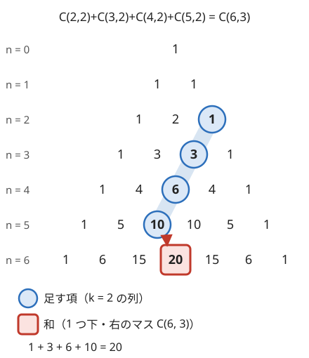

!!! abstract "要点"
    - **何ができるか**：二項係数を含む和を、二項定理・Vandermonde の恒等式・縦の和（hockey stick）・吸収公式で[閉じた式](../guide/glossary.md#closed-form)にする。どの公式も同じものを [2 通りに数え](../guide/glossary.md#double-counting)て説明でき、式変形は小さいケースで検算する。
    - **いつ使うか**：
        - 長方形領域の各点への経路数の総和。
        - 偶数個（奇数個）を選ぶ方法の数の和。
        - 全ペアの $(A_i + A_j)^x$ の和。
        - $\sum$ の中に二項係数があり、$N$ が大きく項ごとには足せない。
    - **計算量**：閉じた式にした後は、階乗の表の前計算 $O(N)$ の後に式 1 つが $O(1)$。全ペアの累乗の和を $x = 1, \dots, K$ について求めるなら $O(NK + K^2)$。
    - **前提**：[格子路の数え上げ](../comb/lattice-paths.md)

<!-- textlint-disable -->
別名：二項定理・Vandermonde の恒等式・hockey stick・縦の和の公式・吸収公式・二項係数の和・binomial theorem・Vandermonde's identity
<!-- textlint-enable -->

二項係数の恒等式と和の公式は、$\sum$ の中に二項係数が並んだ式を、二項係数 1 つや $2^n$ のような閉じた式（$\sum$ を含まず、決まった回数の演算で値が求まる式）に直す道具である。$N$ 項を足すと間に合わない和や、クエリごとに $N$ が変わる和でも、閉じた式なら階乗の表から $O(1)$ で求まる。公式を覚えるより「同じものを 2 通りに数える」で導けるようにしておくと、形が少し違う和にも使える。

このページでは $\binom{n}{k}$ を「$n$ 個から $k$ 個を選ぶ方法の数」とし、$k < 0$ や $k > n$ では 0 と約束する（[範囲の外の約束](../comb/binomial-coefficient.md#out-of-range)）。条件 $P$ が成り立てば 1、成り立たなければ 0 の値を $[P]$ と書く（[記法と用語の約束](../start/notation.md#math)）。

## 二項定理、二項係数の和 2^n と交代和 {#binomial-theorem}

二項定理は、$(a + b)^n$ を展開したときの各項の係数が二項係数になるという定理である。

$$
(a + b)^n = \sum_{k=0}^{n} \binom{n}{k} a^k b^{n-k}
$$

**なぜ正しいか**。$(a + b)^n$ は $(a + b)$ を $n$ 個掛けたもので、展開すると各因子から $a$ か $b$ を 1 つずつ選んだ積がすべて出てくる。$a^k b^{n-k}$ になるのは、$n$ 個の因子のうち $a$ を選ぶ $k$ 個の決め方の数だけあり、それが $\binom{n}{k}$ である。

$a, b$ に値を入れると、よく使う和が出る。

| 入れる値 | 得られる式 | 数え方での意味 |
| --- | --- | --- |
| $a = b = 1$ | $\sum_k \binom{n}{k} = 2^n$ | $n$ 個の部分集合の総数 |
| $a = -1, b = 1$ | $\sum_k (-1)^k \binom{n}{k} = [n = 0]$ | 偶数個と奇数個の部分集合は同数（$n \ge 1$） |
| $a = x, b = 1$ | $\sum_k \binom{n}{k} x^k = (1 + x)^n$ | 各要素を重み $x$ で選ぶ |
| $a = 2, b = 1$ | $\sum_k \binom{n}{k} 2^k = 3^n$ | 各要素を 3 通りに分ける |

交代和が $[n = 0]$ になる理由は、全単射で示せる。$n \ge 1$ なら、要素 1 を「入れる・外す」で切り替えると、偶数個の部分集合と奇数個の部分集合が 1 対 1 に対応する（[全単射](../guide/glossary.md#bijection)）。だから差は 0 になる。$n = 0$ では空集合 1 つしかなく、切り替える要素がないので 1 になる。この式は[包除原理](../comb/inclusion-exclusion.md)の正しさの根拠である。ちょうど $m \ge 1$ 個の条件に当てはまる要素を包除の式で数えると、回数は次のとおり 1 になる。

$$
\sum_{k \ge 1} (-1)^{k+1} \binom{m}{k} = 1 - \sum_{k} (-1)^k \binom{m}{k} = 1
$$

和の形が $\sum_k \binom{n}{k} x^k$ と見えたら、繰り返し二乗法で $(1 + x)^n$ を $O(\log n)$ で求めればよい。$n$ が $10^{18}$ でも同じである。

## 偶奇の条件つきの和 {#parity-sum}

偶数個を選ぶ方法の数は、二項定理の 2 つの式を足して 2 で割ると求まる。$(1 + 1)^n$ と $(1 - 1)^n$ を足すと奇数の $k$ の項が打ち消し合い、偶数の $k$ の項が 2 倍で残る。

$$
\begin{aligned}
\sum_{k \text{ が偶数}} \binom{n}{k} &= \frac{2^n + [n = 0]}{2} \\
&= \begin{cases} 2^{n-1} & (n \ge 1) \\ 1 & (n = 0) \end{cases}
\end{aligned}
$$

奇数個なら引いて 2 で割り、$n \ge 1$ で同じく $2^{n-1}$、$n = 0$ で 0 になる。重みがあるときも同じ考え方で、$\sum_{k \text{ が偶数}} \binom{n}{k} x^k = \frac{(1 + x)^n + (1 - x)^n}{2}$ となる。

**全体の個数が決まっているとき**。「$N$ 個から**ちょうど $K$ 個**を選び、そのうち特定の $p$ 個の中から選ぶ数が偶数」のように、全体の個数と偶奇の両方に条件があると、上の式は使えない。$p$ 個の側から $q$ 個、残り $N - p$ 個から $K - q$ 個を選ぶと考え、$q$ を偶数に限って足す。

$$
\sum_{q \text{ が偶数}} \binom{p}{q} \binom{N - p}{K - q}
$$

$q$ を偶奇で制限しない和は [Vandermonde の恒等式](#vandermonde)で $\binom{N}{K}$ になるが、偶数だけの和は一般に二項係数 1 つにはならない。項は $K + 1$ 個以下なので、階乗の表を作って $O(K)$ で足せばよい。閉じた式にこだわらず、1 重のループで済むなら十分である。

**偶奇の条件の言い換え**。グラフの問題では、「両端の色が違う辺の数」のような量の偶奇を、頂点ごとの量（次数）の偶奇に直すと、この形の和になることがある（[ABC262 E](#abc262_e)）。

$x \bmod 3$ ごとのように 3 つ以上に分けた和は、$\pm 1$ の代わりに 1 の 3 乗根を入れる必要があり、[母関数](../comb/generating-function-counting.md)の扱いになる。

## Vandermonde の恒等式（2 グループから合計 k 個） {#vandermonde}

Vandermonde の恒等式は、二項係数の積の和を 1 つの二項係数にまとめる式である。

$$
\sum_{i} \binom{a}{i} \binom{b}{k - i} = \binom{a + b}{k}
$$

**なぜ正しいか**。男子 $a$ 人と女子 $b$ 人から合わせて $k$ 人を選ぶ方法を 2 通りに数える。右辺は全員 $a + b$ 人の中で $k$ 人を選ぶ数である。左辺は、選んだ男子の人数 $i$ で場合を分け、男子の $i$ 人と女子の $k - i$ 人を選ぶ数を足したものである。$i$ は選び方ごとにただ 1 つ決まるので、重複も漏れもない。式の上では、$(1 + x)^a (1 + x)^b = (1 + x)^{a+b}$ の $x^k$ の係数を比べたものになる。

範囲外を 0 とする約束があるので、$i$ の範囲は書かなくてよい（$i > a$ や $k - i > b$ の項は 0 になる）。

形を変えたものもよく使う。

- **2 乗の和**：$\sum_i \binom{n}{i}^2 = \binom{2n}{n}$。$\binom{n}{i} = \binom{n}{n - i}$ と書き直すと、$a = b = n$、$k = n$ の場合になる
- **下の数がそろった積**：$\sum_i \binom{a}{i} \binom{b}{i} = \binom{a + b}{a}$。$\binom{b}{i} = \binom{b}{b - i}$ と書き直すと、合計が $b$ になる形である
- **上の数が動く形**：$\sum_{i=0}^{m} \binom{i}{a} \binom{m - i}{b} = \binom{m + 1}{a + b + 1}$。$0, 1, \dots, m$ から $a + b + 1$ 個を選び、小さい方から $a + 1$ 番目の数を $i$ とする。$i$ より小さい数から $a$ 個、大きい数から $b$ 個を選ぶので、$i$ ごとの数が左辺の各項になる

上の数が動く形は、因子が 3 つ以上でも同じ数え方で成り立つ。$b_1 + \dots + b_r = m$ を満たす非負整数の組すべてについての $\prod_j \binom{b_j}{a_j}$ の和は、$\binom{m + r - 1}{a_1 + \dots + a_r + r - 1}$ になる。数え方は次のとおりである。$m + r - 1$ 個の数から $\sum_j a_j + r - 1$ 個を選び、選んだ数のうち $a_1 + 1$ 番目・$a_1 + a_2 + 2$ 番目・… の $r - 1$ 個を区切りにする。$j - 1$ 番目と $j$ 番目の区切りの間を $j$ 番目の区間とする（先頭から 1 番目の区切りまでと、$r - 1$ 番目の区切りから末尾までも区間に含める）。すると、$j$ 番目の区間にある区切り以外の数の個数が $b_j$、その中で選んだ数の個数が $a_j$ になる。区切りを除いた数は $m$ 個なので、$b_1 + \dots + b_r = m$ である。$r = 2$ なら区切りは 1 個で、すぐ上の形（区切りが $i$）に戻る（[ARC110 D](#challenge)）。

**サイン**：「2 つのグループに分けて、合計で $k$ 個」「どこで分けるかを $\sum$ で足す」形で、二項係数の積が並ぶ。分ける位置 $i$ を足し上げる和は、分ける前の全体を 1 回で数えた式に戻せることが多い。

## 縦の和（hockey stick）と経路数の総和 {#hockey-stick}

縦の和の公式（hockey stick）は、下の数が同じ二項係数を、上の数を 1 ずつ変えながら足すと、1 つの二項係数になるという式である。

$$
\sum_{i=r}^{n} \binom{i}{r} = \binom{n + 1}{r + 1}
$$

次の図は、パスカルの三角形で $r = 2$ の項を $i = 2$ から $5$ まで足した様子である。斜めに並んだ 4 つの数の和が、最後の数の 1 つ下・右の数に等しい。斜めの列と最後に曲がる形が、ホッケーのスティックに似ている。



**なぜ正しいか**。$0, 1, \dots, n$ の $n + 1$ 個から $r + 1$ 個を選ぶ方法を、選んだ中で最大の数 $i$ で分ける。残りの $r$ 個は $0, \dots, i - 1$ の $i$ 個から選ぶので $\binom{i}{r}$ 通りで、$i$ は $r$ から $n$ まで動く。式の上では、パスカルの漸化式 $\binom{i}{r} = \binom{i + 1}{r + 1} - \binom{i}{r + 1}$ を足すと、隣どうしが打ち消し合って両端だけが残る。

**経路数の総和にする**。$(0, 0)$ から $(i, j)$ への右・上の最短路の数は $\binom{i + j}{i}$ である（[格子路](../comb/lattice-paths.md#basic)）。$i$ を固定して $j = 0, \dots, c$ について足すと、縦の和の公式で 1 つの二項係数になる。

$$
\sum_{j=0}^{c} \binom{i + j}{i} = \binom{i + c + 1}{i + 1}
$$

経路で見ると、右辺は $(0, 0)$ から $(i + 1, c)$ への経路数である。最後の右への移動の直前にいる点 $(i, j)$ で分けると、各項になる（[格子路の総和](../comb/lattice-paths.md#sum-of-paths)）。

長方形 $r_1 \le i \le r_2$、$c_1 \le j \le c_2$ の各点への経路数の総和は、行 $i$ ごとに「$j \le c_2$ の和 − $j \le c_1 - 1$ の和」とすれば、行の数の 1 重ループになる。点の数 $(r_2 - r_1 + 1)(c_2 - c_1 + 1)$ に比例する 2 重ループが、行の数 $r_2 - r_1 + 1$ 回の 1 重ループで済む。ほかに階乗の表の前計算 $O(r_2 + c_2)$ がかかる。コードの `binom(n, k)` は、前計算した階乗と逆階乗の表から $\binom{n}{k}$ を $O(1)$ で返す関数で、範囲外では 0 を返す（[二項係数の前計算](../comb/binomial-precompute.md#fact-ifact)）。

```cpp
--8<-- "binomial-identities/rect-sum.cpp:core"
```

完全なプログラム：[`rect-sum.cpp`](https://github.com/yuukougun/kyopro-atlas/blob/main/snippets/binomial-identities/rect-sum.cpp)（GitHub）。`mint` は ACL の `modint998244353`（[modint](../math/modint.md)）。
{ .kp-code-src }

階乗の表は、使う上の数の最大 $r_2 + c_2 + 1$ まで要る。$c_1 = 0$ のとき引く項は $\binom{i}{i + 1} = 0$ で、範囲外の約束がそのまま効く。さらに縦の和の公式を $i$ の側にも使えば、4 隅の二項係数の足し引き（$O(1)$）にもできる。

**累乗の和の公式にもなる**。$\binom{i}{1} = i$、$\binom{i}{2} = i(i - 1)/2$ なので、縦の和の公式から $\sum_{i=1}^{n} i = \binom{n + 1}{2}$、$\sum_{i=2}^{n} i(i - 1) = 2\binom{n + 1}{3}$ が出る。$i^2 = i(i - 1) + i$ と分ければ 2 乗の和も求まる（[よく使う和の公式](../math/sigma-manipulation.md#formulas)）。

## 吸収公式 k C(n,k) = n C(n−1, k−1) {#absorption}

吸収公式は、二項係数に掛かった下の数 $k$ を、上の数 $n$ に取り替える式である。

$$
k \binom{n}{k} = n \binom{n - 1}{k - 1}
$$

**なぜ正しいか**。$n$ 人から $k$ 人の委員を選び、その中から委員長を 1 人決める方法を 2 通りに数える。委員を先に選べば $\binom{n}{k}$ 通りで、委員長は $k$ 通りある。委員長を先に $n$ 人から選べば、残りの委員 $k - 1$ 人を $n - 1$ 人から選ぶ。

$k$ が掛かった和は、吸収公式で $k$ を外に出すと二項定理や Vandermonde の恒等式の形に戻る。

- **選んだ個数の総和**：$\sum_k k \binom{n}{k} = n \sum_k \binom{n-1}{k-1} = n 2^{n-1}$（$n \ge 1$）。すべての部分集合の大きさの合計である。要素ごとに「含む部分集合が $2^{n-1}$ 個」と[寄与](../thinking/contribution.md)で数えても同じになる
- **2 回使う**：$\sum_k k(k - 1) \binom{n}{k} = n(n - 1) 2^{n-2}$（$n \ge 2$）。$k^2 = k(k - 1) + k$ と分ければ $\sum_k k^2 \binom{n}{k} = n(n + 1) 2^{n-2}$ も出る
- **Vandermonde と組み合わせる**：$\sum_k k \binom{a}{k} \binom{b}{m - k} = a \binom{a + b - 1}{m - 1}$。$a + b$ 個から $m$ 個を選ぶとき、グループ $a$ から選ばれる個数の総和である
- **逆向きに使う**：$\frac{1}{k + 1} \binom{n}{k} = \frac{1}{n + 1} \binom{n + 1}{k + 1}$ なので、$\sum_k \frac{1}{k + 1} \binom{n}{k} = \frac{2^{n+1} - 1}{n + 1}$ になる

**サイン**：「選んだものの個数の総和」「長さ × 個数の和」のように、二項係数に $k$ や $k(k - 1)$ の重みが掛かった和。

??? question "確認問題：選んだ個数の総和を 2 通りに"
    $n = 3$ のとき、$\{1, 2, 3\}$ のすべての部分集合の大きさの合計を、書き出して求めよ。$n 2^{n-1}$ と一致するか。

    ??? success "答え"
        大きさ 0 が 1 個、1 が 3 個、2 が 3 個、3 が 1 個なので、合計は $0 + 3 + 6 + 3 = 12$ である。$n 2^{n-1} = 3 \cdot 4 = 12$ と一致する。要素ごとに見ると、各要素は 8 個の部分集合のうち 4 個に入るので、$3 \times 4 = 12$ とも数えられる。

## 二項定理で累乗の和を展開する {#power-sums}

全ペアの $(A_i + A_j)^x$ の和は、二項定理で展開すると、列 $A$ の累乗の和の積に分かれる。$S_t = \sum_i A_i^t$（$S_0 = N$）とおく。

$$
\begin{aligned}
&\sum_{i} \sum_{j} (A_i + A_j)^x \\
&= \sum_{t=0}^{x} \binom{x}{t} \sum_i A_i^t \sum_j A_j^{x-t} \\
&= \sum_{t=0}^{x} \binom{x}{t} S_t S_{x-t}
\end{aligned}
$$

左辺は $N^2$ 個の項があるが、右辺は $S_0, \dots, S_x$ があれば $O(x)$ で計算できる。$i$ と $j$ が別々の $\sum$ に分かれるのは、展開した各項が「$i$ だけの式」×「$j$ だけの式」になっているからである（[和の分解](../math/sigma-manipulation.md#linearity)）。

左辺は順序つきの組 $(i, j)$ すべてで、$i = j$ も含む。$i < j$ の組だけが欲しいときは、次の 2 段で直す。

1. $i = j$ の項 $(2A_i)^x$ の和 $2^x S_x$ を引く
2. 残りは $i < j$ と $i > j$ で同じ値なので、2 で割る（mod では 2 の逆元を掛ける）

$x = 1, \dots, K$ のすべてについて求めるなら、$S_0, \dots, S_K$ を $O(NK)$ で前計算し、各 $x$ で $O(x)$ かけて全体で $O(NK + K^2)$ になる。コードの `c[x][t]` は、$x \le K$ の $\binom{x}{t}$ をパスカルの三角形の漸化式から $O(K^2)$ 時間で前計算した表である（[パスカルの三角形で作る](../comb/binomial-precompute.md#composite-mod)）。

```cpp
--8<-- "binomial-identities/pair-powers.cpp:core"
```

完全なプログラム：[`pair-powers.cpp`](https://github.com/yuukougun/kyopro-atlas/blob/main/snippets/binomial-identities/pair-powers.cpp)（GitHub）。`mint` は ACL の `modint998244353`（[modint](../math/modint.md)）。
{ .kp-code-src }

同じ展開は、$\sum_i (A_i + c)^x$ のように全体に定数を足した累乗の和にも使える。$\sum_t \binom{x}{t} c^{x-t} S_t$ となるので、$c$ を変えて何度も聞かれても $S_t$ を作り直さずに済む。

## 式変形の検算（小さいケース） {#verify}

二項係数の和の式変形は、和の端や添字のずれで 1 つ間違えても見た目では気づきにくい。式を立てたら、提出の前に小さいケースで検算する。

**検算の 2 段**。

1. **恒等式そのもの**：変形に使った式の左辺と右辺を、mod を取らない正確な値で、小さい引数すべてについて比べる。パスカルの三角形の表は $n \le 66$ なら `long long` に収まる（[オーバーフロー](../comb/binomial-coefficient.md#overflow)）
2. **元の数え上げ**：問題の対象を全列挙した数と、最後の閉じた式の値を比べる。$N \le 8$ 程度なら、部分集合や列をすべて作って数えられる

1 段目の例として、縦の和の公式を $m \le 30$ のすべての $(m, r)$ で確かめるコードを示す。$r = m + 1$ の空の和も入れて、端の扱いまで確かめている。このコードの `binom(n, k)` は、mod を取らないパスカルの三角形の表（$n \le 63$）から $\binom{n}{k}$ を引く関数で、範囲外では 0 を返す（[パスカルの三角形で作る](../comb/binomial-precompute.md#composite-mod)）。

```cpp
--8<-- "binomial-identities/verify.cpp:core"
```

完全なプログラム：[`verify.cpp`](https://github.com/yuukougun/kyopro-atlas/blob/main/snippets/binomial-identities/verify.cpp)（GitHub）
{ .kp-code-src }

試す引数には、空の和（$r > m$）・$n = 0$・$k = 0$・$k = n$ の境界を必ず入れる。偶数個の和の $2^{n-1}$ が $n = 0$ で成り立たないように、一般の $n$ で正しい式が端だけ違うことがよくある。

mod を取った値どうしの一致でも検算はできるが、まずは正確な値で比べる方が、食い違ったときにどの項がずれたかを読み取りやすい。全列挙との比較を自動で繰り返すやり方は[ランダムテスト](../guide/stress-testing.md#procedure)にまとめてある。

## 落とし穴 {#pitfalls}

**$n = 0$ や空の和で式が変わる**。$\sum_{k \text{ が偶数}} \binom{n}{k} = 2^{n-1}$ は $n \ge 1$ のときだけで、$n = 0$ では 1 である。$\sum_k k\binom{n}{k} = n 2^{n-1}$ も $n = 0$ で $2^{-1}$ を作らないよう場合を分ける。mod で $2^{n-1}$ を `pow(2, n - 1)` と書くと、$n = 0$ で指数が $-1$ になる。

**階乗の表が 1 つ足りない**。縦の和の公式は上の数が $n$ から $n + 1$ に増える。長方形の総和なら表は $r_2 + c_2 + 1$ まで要り、$r_2 + c_2$ までしか作らないと最後の項で範囲外を読む。`binom` に表の範囲の `assert` を入れておくとすぐ分かる。

**範囲外の約束に頼れない項がある**。$\binom{n}{k}$ を $k < 0$・$k > n$ で 0 とする約束のおかげで、和の端を書き分けずに済む。ただし上の数が負になる項（$\binom{-1}{-1}$ など）も約束では 0 になる。空の組を数える式では、これを 1 としなければならないことがある。$x_1 + \dots + x_n = k$ の解の個数 $\binom{k + n - 1}{n - 1}$ の $n = k = 0$ や、[ABC290 F](#challenge) の $N = 2$ の $\binom{N - 3}{k - 1}$ がそうである。和の添字を付け替えたら、上の数が負になる項がないか、あれば正しい値かを確かめる（[範囲の外の約束](../comb/binomial-coefficient.md#out-of-range)）。

**順序つきの組と順序なしの組を取り違える**。$\sum_i \sum_j$ で展開した式は、$(i, j)$ と $(j, i)$ を別に数え、$i = j$ も含む。$i < j$ の組が欲しいなら、$i = j$ の項を引いてから 2 で割る。先に 2 で割ったなら $i = j$ の項も半分になっているので、引く量も半分にしなければならない。順番を決めて、その順に式を書く。

**閉じた式を探しすぎる**。偶奇の条件つきの和のように、一般には 1 つの二項係数にならない和もある。項の数が $10^6$ 程度で、1 回だけ求めればよいなら、1 重のループで足せば十分である。閉じた式が要るのは、$N$ が巨大なときか、$N$ を変えた質問が多いときである。

**mod の値で大きさを比べる**。$\binom{n}{k} \bmod p$ の値は、元の値の大小を表さない。「どちらの和が大きいか」を mod の値で決めてはいけない。

## 例題 {#examples}

### ABC262 E. Red and Blue Graph {#abc262_e}

<div class="kp-problems" data-role="example" markdown>

- [ABC262 E. Red and Blue Graph](https://atcoder.jp/contests/abc262/tasks/abc262_e)（diff 1719）：N 頂点 M 辺のグラフの頂点のうちちょうど K 個を赤、残りを青に塗るとき、両端の色が異なる辺の数が偶数になる塗り方の数を求める。

</div>

辺の数の偶奇は、辺を見なくても頂点の次数だけで決まる。赤い頂点の[次数](../guide/glossary.md#degree)の和は、両端が赤の辺を 2 回、両端の色が違う辺を 1 回数えるので、両端の色が違う辺の数と偶奇が同じである。さらに、次数が偶数の頂点は和の偶奇を変えないので、次数が奇数の赤い頂点の個数が偶数であればよい。[偶奇の条件つきの和](#parity-sum)の形になる。

??? note "解法の詳細"
    - 各頂点の次数を数え、次数が奇数の頂点の個数を $p$ とする。$O(N + M)$。
    - 赤い $K$ 個のうち、次数が奇数のものを $q$ 個（$q$ は偶数）、偶数のものを $K - q$ 個選ぶ。答えは $\sum_{q \text{ が偶数}} \binom{p}{q} \binom{N - p}{K - q}$ である。
    - 階乗の表を $N$ まで作れば各項は $O(1)$ で、$q$ は $0$ から $K$ までなので全体で $O(N + M)$。$q > p$ や $K - q > N - p$ の項は範囲外の約束で 0 になる。
    - $q$ を偶数に限らない和は Vandermonde の恒等式で $\binom{N}{K}$ になる。偶数の側だけでは閉じた式にならないので、ループで足す。

### ABC154 F. Many Many Paths {#abc154_f}

<div class="kp-problems" data-role="example" markdown>

- [ABC154 F. Many Many Paths](https://atcoder.jp/contests/abc154/tasks/abc154_f)（diff 1775）：r_1 ≤ i ≤ r_2、c_1 ≤ j ≤ c_2 のすべての (i, j) について、原点から (i, j) への右・上の最短路の数を求め、その総和を求める。

</div>

座標は $10^6$ まであり、長方形の点は最大 $10^{12}$ 個なので 1 点ずつは足せない。$(i, j)$ への経路数は $\binom{i + j}{i}$ で、$i$ を固定した 1 行の和は[縦の和の公式](#hockey-stick)で二項係数 2 つの差になる。行の数だけループすればよい。

??? note "解法の詳細"
    - 行 $i$ の和：$\sum_{j=c_1}^{c_2} \binom{i + j}{i} = \binom{i + c_2 + 1}{i + 1} - \binom{i + c_1}{i + 1}$。
    - 答えはこれを $i = r_1, \dots, r_2$ について足したもので、$O(r_2 - r_1)$。階乗の表は $r_2 + c_2 + 1$（最大で約 $2 \times 10^6$）まで作る。
    - コードは[縦の和の節](#hockey-stick)の `rect_sum` と同じ形で、法を問題に合わせる。
    - 列の側にも縦の和の公式を使うと、$g(x, y) = \binom{x + y + 2}{x + 1} - 1$（$0 \le i \le x$、$0 \le j \le y$ の和）を 4 隅で足し引きする $O(1)$ の式にもなる。

## 練習問題 {#practice}

<div class="kp-problems" data-role="practice" markdown>

- [ABC405 E. Fruit Lineup](https://atcoder.jp/contests/abc405/tasks/abc405_e)（diff 1259）：リンゴ A 個・オレンジ B 個・バナナ C 個・ブドウ D 個を、種類どうしの前後の条件を満たして一列に並べる方法の数を 998244353 で割った余りで求める。
- [ABC150 E. Change a Little Bit](https://atcoder.jp/contests/abc150/tasks/abc150_e)（diff 1851）：長さ N の 0/1 列の相異なる 2 つの組すべてについて、k 回目に位置 i を反転するとコストが k × C_i かかるとして一方を他方に変える最小コストを求め、その総和を 10^9+7 で割った余りで求める。
- [ARC106 D. Powers](https://atcoder.jp/contests/arc106/tasks/arc106_d)（diff 1988）：長さ N の列 A について、各 x = 1, …, K で全ペア L < R の (A_L + A_R)^x の和を求める。

</div>

??? note "練習の方針"
    - **ABC405 E**：境目の左にあるバナナの個数 $k$ で場合を分けると、各項が二項係数 2 つの積になる。上の数が動く Vandermonde の形に似ているが、和の範囲が途中で切れるので 1 つの二項係数にはまとまらない。$k$ についての $O(C)$ のループで足せばよい（閉じた式を探しすぎない）
    - **ABC150 E**：$C$ を降順に並べ、$n$ 番目（0-indexed）の要素の寄与を数える。前の $n$ 個のうち $k$ 個が異なる場合の係数 $\sum_k (k+1) \binom{n}{k}$ が要り、二項定理の $2^n$ と吸収公式の $\sum_k k \binom{n}{k} = n 2^{n-1}$ で $2^n + n 2^{n-1}$ という閉じた式になる。$N = 1$ は別に扱う
    - **ARC106 D**：[累乗の和の展開](#power-sums)の形そのものである。累乗の和 $S_0, \dots, S_K$ を前計算し、順序つきの組の和から $i = j$ の項を引いて 2 で割る。二項係数は $x \le K$ の範囲だけなので、パスカルの三角形の表でも足りる

## 力試し {#challenge}

<div class="kp-problems" data-role="challenge" markdown>

- [ARC110 D. Binomial Coefficient is Fun](https://atcoder.jp/contests/arc110/tasks/arc110_d)（diff 2078）：長さ N の非負整数列 A について、和が M 以下のすべての非負整数列 B にわたる Π C(B_i, A_i) の総和を求める。
- [ABC290 F. Maximum Diameter](https://atcoder.jp/contests/abc290/tasks/abc290_f)（diff 2300）：長さ N の正の整数列 X それぞれについて、次数列が X の木の直径の最大値（そのような木がなければ 0）を求め、その総和を求める。

</div>

??? note "力試しの方針"
    - **ARC110 D**：「和が $M$ 以下」は、余りの変数 $B_{N+1} = M - \sum B_i \ge 0$ を足して「和がちょうど $M$」にし、$\binom{B_{N+1}}{0} = 1$ を掛けたと見る。[上の数が動く Vandermonde の恒等式](#vandermonde)を $N + 1$ 個の因子に広げると、答えは $\binom{M + N}{\sum A_i + N}$ になる。$M$ は $10^9$ まであるので階乗の表は作らず、下の数 $\sum A_i + N$ 項の積と逆元で直接計算する
    - **ABC290 F**：次数列が木になる条件は、すべて 1 以上で和が $2N - 2$ であること。直径の最大値は「次数が 2 以上の頂点の数 ＋ 1」になる。次数が 2 以上の頂点を $k$ 個とする列の数を[重複組合せ](../comb/stars-and-bars.md)で数えると $\binom{N}{k}\binom{N - 3}{k - 1}$ 通りで、$(k + 1)$ を掛けて $k$ について足す。この和を[吸収公式](#absorption)と Vandermonde の恒等式で閉じた式にすると、多数の $N$ に $O(1)$ ずつで答えられる。$N = 2$ は別に確かめる

## 確認問題 {#quiz}

??? question "確認問題：0 から n までの C(i, 2) の和"
    $\sum_{i=0}^{n} \binom{i}{2}$ を閉じた式にせよ。なぜそうなるかを「3 つ選んだうちの最大の数」で説明せよ。

    ??? success "答え"
        $\binom{n + 1}{3}$ である。$0, 1, \dots, n$ の $n + 1$ 個から 3 個を選び、最大の数を $i$ とすると、残りの 2 個は $0, \dots, i - 1$ から選ぶので $\binom{i}{2}$ 通りある。$i = 0, 1$ の項は 0 で、$i$ ごとに足すと全体の $\binom{n + 1}{3}$ になる。

??? question "確認問題：偶数個の選び方の数"
    $n$ 個の異なる品物から偶数個（0 個を含む）を選ぶ方法の数を、$n = 0, 1, 2, 3$ について書き出して求めよ。$2^{n-1}$ と比べると、どこが違うか。

    ??? success "答え"
        $n = 0$ は空集合だけで 1、$n = 1$ は空集合だけで 1、$n = 2$ は空集合と 2 個の 2、$n = 3$ は空集合と 2 個の 3 通りで 4 になる。$n \ge 1$ では $2^{n-1}$ と一致するが、$n = 0$ では $2^{-1}$ ではなく 1 である。

??? question "確認問題：2 グループからの選び方"
    $\sum_{i=0}^{n} \binom{n}{i}^2$ を閉じた式にせよ。$n = 2$ で書き出して確かめよ。

    ??? success "答え"
        $\binom{2n}{n}$ である。$\binom{n}{i} = \binom{n}{n - i}$ と書き直すと、$n$ 人と $n$ 人の 2 グループから合わせて $n$ 人を選ぶ Vandermonde の恒等式になる。$n = 2$ なら左辺は $1 + 4 + 1 = 6$、右辺は $\binom{4}{2} = 6$ で一致する。

## 使い分け {#comparison}

- 和の範囲が途中で切れていて、$\sum_{k \le K} \binom{n}{k}$ のような二項係数の部分和を多くの $(n, K)$ で求めるなら、閉じた式はない。$n$ と $K$ を 1 ずつ動かして更新する（[二項係数の部分和](../comb/binomial-prefix-sum.md#update)）
- 因子が多い積の和や、条件が複雑で公式に当てはまらない和は、多項式の係数として扱う（[母関数](../comb/generating-function-counting.md)）
- 二重和の順序交換や添字の付け替えで形を整える段階は、[Σ の式変形](../math/sigma-manipulation.md)の手法を使う
- 「2 通りに数える」で式を見つけるときの、数える対象の言い換えは[対応づけ](../comb/counting-bijection.md)にまとめてある

## 参考 {#references}

- [Kazun「AtCoder Beginner Contest 262 E問題 Red and Blue Graph」](https://kazun-kyopro.hatenablog.com/entry/ABC/262/E)：例題の方針（色の違う辺の偶奇を、次数が奇数の赤い頂点の個数の偶奇に直す）
- [drken「AtCoder ABC 154 F - Many Many Paths (2D, 青色, 600 点)」](https://drken1215.hatenablog.com/entry/2020/02/09/225000)：例題の方針（行ごとの縦の和の公式と、その 2 通りの導き方）
- [kmjp「AtCoder ARC #106 : D - Powers」](https://kmjp.hatenablog.jp/entry/2020/10/26/1030)：練習の方針（二項定理による展開と、順序つきの組からの直し方）
- [drken「AtCoder ARC 110 D - Binomial Coefficient is Fun (3D, 黄色, 600 点)」](https://drken1215.hatenablog.com/entry/2020/12/06/070100)：力試しの方針（答えが 1 つの二項係数になることと、M が大きいときの計算）
- [cirrostratus「ABC290 F問題 Maximum Diameter」](https://cirrostratus.hatenablog.com/entry/2023/03/05/163234)：力試しの方針（直径の最大値と、Vandermonde の恒等式・吸収公式による和のまとめ方）
- [drken「AtCoder ABC 150 E - Change a Little Bit (1D, 青色, 500 点)」](https://drken1215.hatenablog.com/entry/2020/01/12/142100)：練習 ABC150 E の寄与の数え方と吸収公式による閉じた式
- [kmjp「AtCoder ABC #150 : E - Change a Little Bit」](https://kmjp.hatenablog.jp/entry/2020/01/11/0900)：練習 ABC150 E の同じ寄与をパスカルの漸化式で求める別の導き方
- [testcampus「【ABC405】AtCoder Beginner Contest 405【C++】」](https://qiita.com/testcampus/items/1389257a0c177ceb736a)：練習 ABC405 E の場合分けと二項係数の積の和
- [rsk0315「ABC 405 E についての雑談」](https://rsk0315.hatenablog.com/entry/2025/05/11/201737)：練習 ABC405 E の和が閉じた式にならないことの検討
