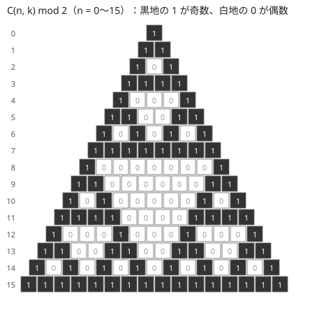

!!! abstract "要点"
    - **何ができるか**：素数 $p$ を法として階乗と逆階乗の表を前計算し、$\binom{n}{k} \bmod p$ を 1 回 $O(1)$ で求める。$n$ が巨大なら $O(k)$ の積、$p$ が小さく $n \ge p$ になるなら Lucas の定理、法が素数でなければパスカルの三角形を使う。
    - **いつ使うか**：
        - $N \le 2 \times 10^5$ 程度で $\binom{n}{k}$ を何度も求める。
        - $n \le 10^9$ で $k \le 10^6$ 程度。
        - 法 $M$ が入力で与えられ、素数とは限らない。
        - 隣り合う 2 つから新しい値を作る操作を繰り返し、最後に残る値を求める（三角形・ピラミッド）。
        - 答えを mod 2・mod 3 など小さい素数で求める。
    - **計算量**：表の大きさを $N$（$N < p$）として前計算 $O(N + \log p)$、1 回 $O(1)$。$n$ が巨大なら 1 回 $O(k + \log p)$。法が素数でなければ前計算 $O(N^2)$。Lucas の定理は前計算 $O(p^2)$、1 回 $O(\log_p n)$。
    - **前提**：[二項係数の意味と性質](../comb/binomial-coefficient.md)、[逆元と mod での割り算](../math/mod-inverse.md)

<!-- textlint-disable -->
別名：nCr mod p・階乗と逆階乗の表・fact と ifact・逆階乗・Combination テーブル・任意 mod の二項係数・Lucas の定理・nCr mod 2・Lucas's theorem
<!-- textlint-enable -->

二項係数の前計算は、$\binom{n}{k} = \dfrac{n!}{k!\,(n-k)!}$ の分母を[逆元](../math/mod-inverse.md)の積で表すため、階乗 $\mathrm{fact}[i] = i!$ と逆階乗 $\mathrm{ifact}[i] = (i!)^{-1}$ の表をあらかじめ作っておく方法である。「998244353 で割った余り」を答える数え上げの、ほぼすべての土台になる。表が使えない場合（$n$ が巨大・法が素数でない・$n \ge p$）は、それぞれ別の方法で求める。

## fact を前から、ifact を後ろから作る理由 {#fact-ifact}

階乗と逆階乗の表は、fact を添字の小さい方から、ifact を大きい方から作る。こうすれば、重い逆元の計算は全体で 1 回だけになる。

![N = 5 の例。fact は左から i を掛けて 1, 1, 2, 6, 24, 120 と作る。fact[5] の逆元を 1 回だけ求めて ifact[5] = 1/120 とする。ifact は右から i を掛けて 1/24, 1/6, 1/2, 1, 1 と作る](../img/binomial-precompute/fact-ifact.svg)

- **fact**：$\mathrm{fact}[0] = 1$、$\mathrm{fact}[i] = \mathrm{fact}[i-1] \times i$
- **ifact の最後**：$\mathrm{ifact}[N] = \mathrm{fact}[N]^{-1} = \mathrm{fact}[N]^{p-2}$（フェルマーの小定理と[繰り返し二乗法](../math/mod-pow.md)で $O(\log p)$）
- **ifact を後ろへ**：$\mathrm{ifact}[i-1] = \mathrm{ifact}[i] \times i$

最後の式は $\dfrac{1}{(i-1)!} = \dfrac{i}{i!}$ を mod $p$ で書いたものである。逆元どうしの積で次の逆元が得られるので、2 回目以降の逆元の計算が要らない。逆に前から $\mathrm{ifact}[i] = \mathrm{ifact}[i-1] \times i^{-1}$ と作ると、$i$ ごとに逆元が要り、全体で $O(N \log p)$ になる。$N = 10^7$ だと $\log p \approx 30$ 倍の差は無視できない。

表ができれば、1 回の計算は掛け算 2 回で済む。

$$
\binom{n}{k} \equiv \mathrm{fact}[n] \cdot \mathrm{ifact}[k] \cdot \mathrm{ifact}[n-k] \pmod{p}
$$

```cpp
--8<-- "binomial-precompute/binom.cpp:core"
```

完全なプログラム：[`binom.cpp`](https://github.com/yuukougun/kyopro-atlas/blob/main/snippets/binomial-precompute/binom.cpp)（GitHub）。`mint` は ACL の `modint998244353`（[modint](../math/modint.md)）。
{ .kp-code-src }

この方法には **表の最大の添字 $N$ が $p$ より小さい** という条件がある。$N \ge p$ だと $\mathrm{fact}[N]$ が $p$ の倍数になって 0 になり、逆元が存在しない（ACL の `inv()` は assert で止まる）。$p = 998244353$ や $10^9 + 7$ で $N \le 10^7$ 程度なら問題にならない。法が小さい素数の場合は [Lucas の定理](#lucas)を使う。

??? question "確認問題：前計算の 1 回の逆元"
    $\mathrm{ifact}[N]$ だけでなく、$1$ から $N$ までの各 $i$ の逆元 $i^{-1}$ も表で欲しくなった。新たに逆元を求めずに作れるか。

    ??? success "答え"
        作れる。$i^{-1} = \dfrac{(i-1)!}{i!} \equiv \mathrm{ifact}[i] \cdot \mathrm{fact}[i-1] \pmod{p}$ なので、2 つの表から $O(1)$ で求まる。

## 表の大きさ（H+W・N+K・2N など）と範囲外の 0 {#table-size}

表の大きさは、問題の $N$ ではなく、式に現れる $\binom{n}{k}$ の $n$ の最大で決める。数え上げの式では、上の添字が入力の値の和や 2 倍になることが多い。

| 数えるもの | 式 | 表に要る大きさ |
| --- | --- | --- |
| $H \times W$ のグリッドの最短路 | $\binom{H+W-2}{H-1}$ | $H + W$ |
| $K$ 個の区別のない玉を $N$ 個の箱へ（空の箱を許す） | $\binom{N+K-1}{K}$ | $N + K$ |
| 長さ $2N$ の正しい括弧列 | $\binom{2N}{N} - \binom{2N}{N+1}$ | $2N$ |

最短路は[格子路の数え上げ](../comb/lattice-paths.md)、玉と箱は[重複組合せ](../comb/stars-and-bars.md)、括弧列は[鏡像法](../comb/reflection-principle.md#catalan)で扱う。迷ったら、制約の最大値を式に代入して $n$ の最大を計算し、少し余裕を持たせて表を作る。表をはみ出すと範囲外の読み出しになり、正しく止まらずに誤った値を返すことがある。上のコードの `assert` はこれを見つけるためのものである。

もう 1 つの約束が **範囲外は 0 を返す** ことである。$k < 0$・$k > n$・$n < 0$ の $\binom{n}{k}$ を 0 と定めると、「選べない場合は 0 通り」という意味に合い、数え上げの式を場合分けなしで書ける。たとえば[練習の ABC132 D](#practice) では、青玉を $i$ 個のかたまりに分ける数 $\binom{K-1}{i-1}$ と、赤玉の間にかたまりを置く数 $\binom{N-K+1}{i}$ の積を各 $i$ で求める。$i > N - K + 1$ なら置き場所が足りないが、$\binom{N-K+1}{i} = 0$ になるので、式をそのまま使えばよい。範囲外を 0 にし忘れると `ifact[n - k]` の添字が負になり、範囲外の読み出しになる。

??? question "確認問題：グリッドの表の大きさ"
    $H, W \le 10^5$ のグリッドで、左上から右下への最短路の数を $\binom{H+W-2}{H-1}$ で求める。表は添字いくつまで要るか。

    ??? success "答え"
        上の添字の最大は $H + W - 2 \le 2 \times 10^5 - 2$ なので、$2 \times 10^5$ まであれば足りる。$10^5$ で作ると足りない。

## n が巨大で k が小さいときは O(k) で求める {#large-n}

$n \le 10^9$ のように $n$ が大きいと、$n$ までの表は作れない。$k$ が小さければ、$\binom{n}{k}$ を分子 $k$ 項の積と $k!$ の逆元で直接求める。

$$
\binom{n}{k} = \frac{n (n-1) \cdots (n-k+1)}{k!}
$$

分子の $k$ 項と $k!$ を mod $p$ で掛け、最後に $k!$ の逆元を 1 回だけ掛ける。1 回の計算は $O(k + \log p)$ である。同じ $n$ で $k$ を 1 つずつ増やしながら何度も使うなら、$\binom{n}{k+1} = \binom{n}{k} \cdot \dfrac{n-k}{k+1}$ で更新できる。$1, \dots, k$ の逆元は前の節の表から取れるので、更新 1 回は $O(1)$ になる。

```cpp
--8<-- "binomial-precompute/large-n.cpp:core"
```

完全なプログラム：[`large-n.cpp`](https://github.com/yuukougun/kyopro-atlas/blob/main/snippets/binomial-precompute/large-n.cpp)（GitHub）。`mint` は ACL の `modint998244353`（[modint](../math/modint.md)）。
{ .kp-code-src }

この式は $n \ge p$ でも正しい。分子は整数として $\binom{n}{k} \cdot k!$ に等しく、$k < p$ なら $k!$ は $p$ で割り切れず逆元を持つからである。分子のどこかの項が $p$ の倍数なら、答えは正しく 0 になる。たとえば $p = 998244353$、$n = p + 5$、$k = 3$ なら分子は $5 \cdot 4 \cdot 3$ と同じ余りで、答えは $\binom{5}{3} = 10$ になる。表を使う方法と違い、条件は $k < p$ だけである。

## 法が素数でないとき：n が小さければパスカルの三角形で作る {#composite-mod}

法 $M$ が入力で与えられ素数とは限らないとき、$k!$ と $M$ は互いに素とは限らず、逆元が存在しないことがある。このとき割り算を使わない漸化式で表を作る。

$$
\binom{i}{0} = 1, \qquad \binom{i}{j} = \binom{i-1}{j-1} + \binom{i-1}{j} \quad (1 \le j \le i)
$$

足し算だけなので、どの法でも mod を取りながら計算できる。$0 \le j \le i \le N$ の表を作るのに $O(N^2)$ の時間とメモリがかかるので、$N$ が数千までのときに使う。$N = 5000$ なら 64 bit の整数で約 200 MB になるので、法が $10^9$ 程度までなら 32 bit で持つ（足してから mod を取る間は 64 bit で計算する）か、使う行だけを残す。

```cpp
--8<-- "binomial-precompute/pascal.cpp:core"
```

完全なプログラム：[`pascal.cpp`](https://github.com/yuukougun/kyopro-atlas/blob/main/snippets/binomial-precompute/pascal.cpp)（GitHub）
{ .kp-code-src }

法が入力で与えられる問題では、ACL の `atcoder::modint`（法を `set_mod` で決める型）も使える。ただし逆元がない値で割ると assert で止まる。二項係数は足し算だけで作ると決めておくと安全である。$N$ が大きく法が合成数のときは、法を素数冪に分けて求め、[中国剰余定理](../math/crt.md)で合わせる方法もある。ABC の範囲ではまれである。

??? question "確認問題：前計算が使えない理由"
    法が $10^9$（合成数）のとき、階乗と逆階乗の表で $\binom{n}{k}$ を求められないのはなぜか。

    ??? success "答え"
        $10^9 = 2^9 \cdot 5^9$ なので、$k \ge 2$ なら $k!$ は 2 を含み、法と互いに素でなくなる（素因数を 1 つ共有すれば足りる。$k \ge 5$ なら 5 も含む）。逆元が存在しないので $\mathrm{ifact}[k]$ を作れない。パスカルの三角形なら割り算を使わないので求められる。

## 法が小さい素数で n ≥ p になるとき：Lucas の定理 {#lucas}

この節は [N 進法](../math/base-conversion.md)を前提にする。答えを mod 2・mod 3 などで求めると、$n \ge p$ になって階乗の表が使えない（[fact と ifact の節](#fact-ifact)の条件）。このときは $n$ と $k$ を $p$ 進法の各桁に分けて計算する。

$n$ と $k$ を $p$ 進法で $n = \sum_i n_i p^i$、$k = \sum_i k_i p^i$（$0 \le n_i, k_i < p$）と書くと、次が成り立つ。これを Lucas の定理という。

$$
\binom{n}{k} \equiv \prod_i \binom{n_i}{k_i} \pmod{p}
$$

ただし $k_i > n_i$ の桁があれば $\binom{n_i}{k_i} = 0$ で、全体も 0 になる。各桁の $\binom{n_i}{k_i}$ は $n_i, k_i < p$ なので、$p \times p$ のパスカルの三角形の表から引ける。1 回の計算は桁の数 $O(\log_p n)$ である。

??? note "証明"
    $p$ が素数なら、$1 \le j \le p - 1$ で $\binom{p}{j} = \dfrac{p!}{j!\,(p-j)!}$ は $p$ の倍数である（分子に $p$ があり、分母にはない）。よって多項式として $(1 + x)^p \equiv 1 + x^p \pmod{p}$ で、これを繰り返すと $(1 + x)^{p^i} \equiv 1 + x^{p^i}$ になる。

    $$
    (1 + x)^n = \prod_i \left( (1 + x)^{p^i} \right)^{n_i} \equiv \prod_i \left( 1 + x^{p^i} \right)^{n_i} \pmod{p}
    $$

    左辺の $x^k$ の係数は $\binom{n}{k}$ である。右辺で $i$ 番目の因子から $x^{p^i}$ を $c_i$ 個（$0 \le c_i \le n_i < p$）選ぶと $x^{\sum c_i p^i}$ が出る。$p$ 進法の表し方はただ 1 つなので、$\sum_i c_i p^i = k$ になるのは各桁で $c_i = k_i$ のときだけである。その係数は $\prod_i \binom{n_i}{k_i}$ になる。

```cpp
--8<-- "binomial-precompute/lucas.cpp:core"
```

完全なプログラム：[`lucas.cpp`](https://github.com/yuukougun/kyopro-atlas/blob/main/snippets/binomial-precompute/lucas.cpp)（GitHub）
{ .kp-code-src }

$p = 2$ でパスカルの三角形を塗ると、奇数の位置がシェルピンスキーの三角形と呼ばれる自己相似な模様になる。各行の奇数の個数は $2^{(n \text{ の 1 のビットの数})}$ で、Lucas の定理の各桁が $\binom{1}{0}$・$\binom{1}{1}$ の 2 通りずつ選べることに対応する。



図で各行の 1 を数えると、$n = 5 = 101_{(2)}$ の行は 4 個、$n = 7 = 111_{(2)}$ の行は 8 個、$n = 8 = 1000_{(2)}$ の行は 2 個で、どれも 2 の累乗（$n$ の 1 のビットの数を指数とする）になっている。

## p = 2 では (n & k) == k、ピラミッドの係数を二項係数と見抜く {#parity-pyramid}

この節は [Lucas の定理](#lucas)と [bit 演算](../basics/bit-operations.md)を前提にする。$p = 2$ では各桁の $\binom{n_i}{k_i}$ は $\binom{0}{0} = \binom{1}{0} = \binom{1}{1} = 1$、$\binom{0}{1} = 0$ なので、次のように言い換えられる。

$$
\binom{n}{k} \text{ が奇数} \iff k \text{ の 1 のビットが、} n \text{ でもすべて 1} \iff (n \text{ AND } k) = k
$$

C++ では `(n & k) == k` の 1 行で、表も要らない。たとえば $10 = 1010_2$、$3 = 0011_2$ では $3$ の最下位 bit が $10$ にないので、$\binom{10}{3} = 120$ は偶数である。

この判定が効くのは、**隣り合う 2 つから 1 つを作る操作を繰り返すピラミッド** の問題である。長さ $N$ の列 $a_0, \dots, a_{N-1}$ から $b_i = a_i + a_{i+1}$ で長さ $N - 1$ の列を作ることを繰り返すと、最後の 1 つは次の式になる。

$$
\sum_{i=0}^{N-1} \binom{N-1}{i} a_i
$$

$a_i$ は 1 段下がるごとに、添字が同じ位置か 1 つ小さい位置へ足し込まれる。頂上（添字 0）に届くのは、$N - 1$ 回のうち添字を小さくする回をちょうど $i$ 回選ぶ道で、それが $\binom{N-1}{i}$ 通りある（[格子路](../comb/lattice-paths.md)と同じ数え方）。$N = 3$ なら $a_0 + 2a_1 + a_2$ で、手で計算した結果と一致する。

操作が足し算そのものでなくても、mod を取ると足し算の形になることがある。

- 差の絶対値 $\lvert a - b \rvert$ は、偶奇だけを見れば $a + b$ と同じである（$\lvert a - b \rvert \equiv a - b \equiv a + b \pmod{2}$）。最後の値の偶奇は $\sum \binom{N-1}{i} a_i \bmod 2$ で決まり、係数の偶奇は `((N - 1) & i) == i` で分かる
- 3 色から「同じなら同じ色、違えば残りの色」を作る操作は、色を 0・1・2 に対応させると $-(a + b) \bmod 3$ になる。最後の色は $(-1)^{N-1} \sum \binom{N-1}{i} a_i \bmod 3$ で、係数は $p = 3$ の Lucas の定理で求める

$N$ が $10^5$ を超えると、ピラミッドを全部計算すると $O(N^2)$ で間に合わない。係数が二項係数だと見抜けば $O(N \log N)$ 以下で済む。

??? question "確認問題：二項係数の偶奇"
    $\binom{12}{4}$ と $\binom{12}{6}$ はそれぞれ奇数か偶数か。

    ??? success "答え"
        $12 = 1100_2$。$4 = 0100_2$ は 1 のビットがすべて $12$ にあるので $\binom{12}{4} = 495$ は奇数。$6 = 0110_2$ は $2^1$ のビットが $12$ にないので $\binom{12}{6} = 924$ は偶数である。

## mod を取らない正確な値（掛けてから割る・__int128） {#exact}

答えを mod なしで求めるときは、$c = \binom{n}{i}$ から $\binom{n}{i+1} = \dfrac{c \cdot (n - i)}{i + 1}$ を順に作る。**掛けてから割る** のが要点で、$c \cdot (n - i) = \binom{n}{i+1} \cdot (i + 1)$ なので毎回割り切れる。先に $c / (i + 1)$ を計算すると割り切れずに切り捨てが起き、値が狂う。

```cpp
--8<-- "binomial-precompute/exact.cpp:core"
```

完全なプログラム：[`exact.cpp`](https://github.com/yuukougun/kyopro-atlas/blob/main/snippets/binomial-precompute/exact.cpp)（GitHub）
{ .kp-code-src }

- **どこまで収まるか**：$\binom{66}{33} \approx 7.2 \times 10^{18}$ は `long long` に収まるが、$\binom{67}{33} \approx 1.4 \times 10^{19}$ は収まらない。$n \le 66$ なら答えはどの $k$ でも収まる
- **途中の値**：答えが収まっても、掛けた直後の $c \cdot (n - i)$ はその $(i + 1)$ 倍になる。`long long` のまま計算して安全なのは $n \le 61$ までなので、途中は `__int128` で持つ（[整数のオーバーフロー](../cpp/cpp-integer-overflow.md)）。$k$ を $\min(k, n - k)$ に直すと、掛ける回数も途中の値も小さくなる
- **パスカルの三角形**：足し算だけなので、`long long` で $n \le 66$ までの表を正確に作れる。多くの $\binom{n}{k}$ を正確に使うならこちらが簡単である
- **確率の計算**：$\binom{1000}{500}$ のような巨大な値と確率の積は、`long double` で掛けるか、$\log \binom{n}{k}$ を `lgamma` で求めてから戻す。値そのものを整数で持とうとしない

## ACL では modint998244353 の inv()・pow() で自作する {#acl}

ACL に二項係数の関数はない。[modint](../math/modint.md) を使って、fact と ifact の表を自分で作る。

!!! info "ACL では"
    `using mint = atcoder::modint998244353;`（法が $10^9 + 7$ なら `atcoder::modint1000000007`）。`x.inv()` は $O(\log p)$ で逆元を返し、法が素数で `x.val() == 0` なら assert で止まる。`x.pow(e)` は $O(\log e)$。`mint` は内部が 32 bit なので、$10^7$ 要素の表 2 本でも約 80 MB で済む。

表を作る関数は[fact と ifact の節](#fact-ifact)のコードがそのまま使える。$\binom{n}{k}$ の値を出力するときは `.val()` で整数に戻す。mod を取った値どうしの大小比較には意味がない（`mint` に `<` もない）ので、「$\binom{n}{k}$ が $K$ 以上か」を判定したいときは、[正確な値](#exact)か対数で比べる。

## 落とし穴 {#pitfalls}

**表の初期化を忘れる・表が小さい**。`init_binom` を呼ばずに `binom` を使うと、空の表を読む。表の大きさは[表の大きさの節](#table-size)のとおり、式の上の添字の最大で決める。テストケースが複数ある問題では、すべてのケースの最大で 1 回だけ作る。ケースごとに作り直すと $O(TN)$ になる。

**$n \ge p$ で表を使う**。法が 2・3 や入力の小さい素数のとき、$n \ge p$ で $\mathrm{fact}[n] \equiv 0$ になり、表の方法は使えない。[Lucas の定理](#lucas)に切り替える。

**int のまま掛ける**。modint を使わずに `int` や `long long` で書くと、`fact[i - 1] * i` を mod で取り忘れたり、`int` どうしの積で $2^{31}$ を超えたりする。2 つの余りの積は $10^{18}$ 近くになるので、`long long` で掛けて直後に mod を取るか、modint を使う。

**合成数の法で逆元を使う**。法が入力で与えられる問題に表の方法をそのまま使うと、逆元が存在しないことがある。[パスカルの三角形](#composite-mod)で作る。

**割ってから掛ける**。mod を取らない計算で $c / (i + 1) \times (n - i)$ と書くと割り切れずに値が狂う。[掛けてから割る](#exact)。

## 上位の手法へのつながり {#next-steps}

このページの考え方は、次の手法の部品になる。

- **格子路と多項係数**：前計算した表があれば、格子路の数 $\binom{a+b}{a}$ や種類ごとの個数を決めた並べ方 $n! / (a_1! \cdots a_m!)$ もすぐ求まる（[格子路の数え上げ](../comb/lattice-paths.md#basic)、[多項係数](../comb/multinomial-coefficient.md#meaning)）。
- **二項係数の部分和**：$\sum_{k \le K} \binom{n}{k}$ を、$(n, K)$ を 1 ずつ動かす更新式で求める（[二項係数の部分和](../comb/binomial-prefix-sum.md#update)）。
- **頂点を選んで数える DP**：連結なグラフの数え上げでは、成分に入る頂点を選ぶ二項係数を DP の遷移ごとに掛ける（[連結なグラフの数え上げ](../comb/counting-labeled-graphs.md#by-size)）。
- **確率・期待値を mod で答える**：分数の答えも、逆元を使って同じ法の値として扱う（[確率・期待値を mod 998244353 で答える](../comb/rational-mod.md)）。

## 使い分け {#comparison}

| 状況 | 方法 | 前計算 | 1 回 |
| --- | --- | --- | --- |
| $n < p$、$n \le 10^7$ 程度で何度も | fact と ifact の表 | $O(N + \log p)$ | $O(1)$ |
| $n$ が巨大で $k$ が小さい（$k < p$） | 分子 $k$ 項の積と $k!$ の逆元 | なし | $O(k + \log p)$ |
| 法が素数でない、$n$ が数千まで | パスカルの三角形 | $O(N^2)$ | $O(1)$ |
| 法が小さい素数（$n \ge p$ がある） | Lucas の定理 | $O(p^2)$ | $O(\log_p n)$ |
| 法が 2 | `(n & k) == k` | なし | $O(1)$ |
| mod なしの正確な値 | 掛けてから割る・`__int128` | なし | $O(k)$ |

同じものを含む順列 $\dfrac{n!}{a_1!\, a_2! \cdots a_m!}$ も、同じ表で $\mathrm{fact}[n] \prod \mathrm{ifact}[a_j]$ と求まる（[多項係数](../comb/multinomial-coefficient.md)）。

## 例題 {#examples}

### 鉄則本 A30. Combination {#tessoku_book_ad}

<div class="kp-problems" data-role="example" markdown>

- [鉄則本 A30. Combination](https://atcoder.jp/contests/tessoku-book/tasks/tessoku_book_ad)（diff なし）：n と r が与えられ、nCr を 10^9+7 で割った余りを求める。

</div>

$\binom{n}{r} = \dfrac{n!}{r!\,(n-r)!}$ の分母を、$10^9 + 7$ が素数であることを使って逆元に置き換える。1 回だけ答えるなら表は要らず、$n!$ と $r!\,(n-r)!$ を mod で計算し、分母の逆元を繰り返し二乗法で求めて掛ければよい。

??? note "解法の詳細"
    - `using mint = atcoder::modint1000000007;` とし、$i = 1, \dots, n$ で $n!$、$r!$、$(n - r)!$ を mint で掛けて求める。$O(n)$。
    - 分母 $r!\,(n-r)!$ の逆元を `inv()`（フェルマーの小定理で $p - 2$ 乗）で求め、分子に掛ける。$n$ までのループが回る大きさなので $n < p$ で、分母は 0 にならない。
    - 何度も答える問題なら、[fact と ifact の節](#fact-ifact)の表を $n$ の最大まで作り、1 回 $O(1)$ で答える。

## 練習問題 {#practice}

<div class="kp-problems" data-role="practice" markdown>

- [ABC156 D. Bouquet](https://atcoder.jp/contests/abc156/tasks/abc156_d)（diff 1014）：n 種類の花から 1 本以上を選んで作る花束のうち、本数が a でも b でもないものの数を求める（n は最大 10^9）。
- [ABC132 D. Blue and Red Balls](https://atcoder.jp/contests/abc132/tasks/abc132_d)（diff 1167）：N 個の玉のうち K 個が青のとき、各 i について、連続する青玉をまとめて回収する操作がちょうど i 回で済む並べ方の数を求める。
- [ARC117 C. Tricolor Pyramid](https://atcoder.jp/contests/arc117/tasks/arc117_c)（diff 1768）：3 色のブロックの列から、隣り合う 2 つで 1 つ下の段の色を決める操作を繰り返し、最後に残る 1 つの色を求める。
- [AGC043 B. 123 Triangle](https://atcoder.jp/contests/agc043/tasks/agc043_b)（diff 1945）：1・2・3 からなる列で、隣り合う 2 つの差の絶対値を取る操作を繰り返し、最後に残る値を求める。

</div>

??? note "練習の方針"
    - **ABC156 D**：全体 $2^n - 1$ から $\binom{n}{a}$ と $\binom{n}{b}$ を引く。$n$ は $10^9$ まであるので、$\binom{n}{a}$ を[分子 $a$ 項の積と $a!$ の逆元](#large-n)から $O(a)$ で求める
    - **ABC132 D**：$\binom{K-1}{i-1} \cdot \binom{N-K+1}{i}$ を各 $i$ で出力する。[範囲外を 0](#table-size) にしておけば、赤玉が足りない $i$ も式のままで 0 になる
    - **ARC117 C**：色を 0・1・2 にすると操作は $-(a + b) \bmod 3$ になり、最後の色は $\binom{N-1}{i}$ を係数にした和で決まる。係数は [Lucas の定理](#lucas)で $p = 3$ として求める
    - **AGC043 B**：最初に 1 回差を取って 0・1・2 からなる長さ $N-1$ の列にする。差の絶対値は偶奇だけなら和と同じなので、[最後の値の偶奇](#parity-pyramid)は $\binom{N-2}{i} \bmod 2$ を係数にした和で決まる（元の列で $\binom{N-1}{i}$ を使っても同じ）。1 を含むかどうかで答えを場合分けする

## 力試し {#challenge}

<div class="kp-problems" data-role="challenge" markdown>

- [ABC281 G. Farthest City](https://atcoder.jp/contests/abc281/tasks/abc281_g)（diff 2304）：頂点 1 から頂点 N への距離が他のどの頂点への距離よりも真に大きい、N 頂点の連結な単純無向グラフの数を、入力の M（素数とは限らない）で割った余りで求める。

</div>

??? note "力試しの方針"
    - **ABC281 G**：法が入力で与えられ素数とは限らないので、二項係数は[パスカルの三角形](#composite-mod)で作る。頂点 1 からの距離ごとに頂点を層に分け、層の大きさを状態にした DP で、層の間と層の中の辺の張り方を数えて掛ける。数え上げの本体は[連結なグラフの数え上げ](../comb/counting-labeled-graphs.md#bfs-layers)で扱う

## 参考 {#references}

- [E869120「競技プログラミングの鉄則 解答コード A30」](https://github.com/E869120/kyopro-tessoku/blob/main/codes/cpp/chap05/answer_A30.cpp)：例題の解き方（階乗とフェルマーの小定理による逆元）
- [drken「AtCoder ABC 156 D - Bouquet (2Q, 緑色, 400 点)」](https://drken1215.hatenablog.com/entry/2020/04/22/013400)：n が巨大なときの O(k) の計算
- [drken「AtCoder ABC 132 D - Blue and Red Balls (1Q, 緑色, 400 点)」](https://drken1215.hatenablog.com/entry/2019/06/30/183400)：練習の方針（かたまりへの分け方の式）
- [drken「AtCoder ARC 117 C - Tricolor Pyramid (2D, 青色, 600 点)」](https://drken1215.hatenablog.com/entry/2021/06/12/001400)：ピラミッドの係数と mod 3 への言い換え
- [drken「AtCoder AGC 043 B - 123 Triangle (青色, 700 点)」](https://drken1215.hatenablog.com/entry/2020/03/22/165200)：差の絶対値の偶奇と、1 を含むかの場合分け
- [drken「AtCoder ABC 281 G - Farthest City (黄色, 600 点)」](https://drken1215.hatenablog.com/entry/2022/12/13/173300)：法が素数とは限らないときのパスカルの三角形
- [AtCoder Library「modint」（document_ja）](https://github.com/atcoder/ac-library/blob/master/document_ja/modint.md)：`inv()`・`pow()` の計算量と要件
