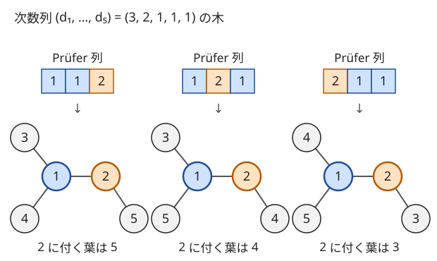

!!! abstract "要点"
    - **何ができるか**：頂点に $1$〜$N$ の番号がある $N$ 頂点の木を $N^{N-2}$ 個と数える。Prüfer 列に頂点 $v$ がちょうど $d_v - 1$ 回現れることから、各頂点の次数を $d_v$ に決めた木は $\dfrac{(N-2)!}{\prod_v (d_v - 1)!}$ 個になる。木ごとの値が次数だけで決まるなら、すべての木の総和を次数列ごとの和に直して求められる。
    - **いつ使うか**：
        - 頂点にラベルのある木の個数を求める。
        - 各頂点の次数を指定（制限）した木の個数を求める。
        - すべての木（すべての次数列）についての総和を求める。
    - **計算量**：階乗・逆階乗を $O(N + \log p)$ で前計算すれば、総数 $N^{N-2}$ は $O(\log N)$、次数列を決めた木の数は $O(N)$。次数の条件を多項式の累乗で数えるなら $O(N \log N)$〜$O(N \log^2 N)$。
    - **前提**：[多項係数](../comb/multinomial-coefficient.md)、[木の次数列と Prüfer 列](../tree/tree-degree.md)。

<!-- textlint-disable -->
別名：Cayley の公式・n^(n−2)・次数を指定した木の数・頂点にラベルのある木の個数・Cayley's formula
<!-- textlint-enable -->

[ラベル付き木](../guide/glossary.md#labeled-tree)の数え上げは、木を数える問題を「長さ $N - 2$ の列」を数える問題に直す方法である。Prüfer 列の全単射（[木の次数列と Prüfer 列](../tree/tree-degree.md#pruefer)）を使うと、木の総数・次数を決めた木の数・頂点ごとの重みを付けた総和が、どれも列の並べ方として閉じた式になる。

以下では、答えを素数 $p$（多くは $998244353$）で割った余りとして求める場面を考え、階乗 $\mathrm{fact}[n]$ と逆階乗 $\mathrm{ifact}[n]$ の表は[二項係数の前計算](../comb/binomial-precompute.md)で作ってあるものとする。頂点は $1$〜$N$（コードでは $0$〜$N-1$）、頂点 $v$ の次数を $d_v$ と書く。

## Cayley の公式 n^(n−2)（Prüfer 列の全単射から） {#cayley}

数える対象は、頂点 $1, \dots, N$ を結ぶ $N - 1$ 本の辺の集合で、全体が木になるものである。2 つの木は辺の集合が違えば別のものとして数える。言い換えると、$N$ 頂点の完全グラフの[全域木](../guide/glossary.md#spanning-tree)の個数である。形が同じでも番号の付き方が違えば別の木になる点が、番号のない木（同型を同じとみなす）の数え上げとの違いである。

小さい $N$ で全部を書くと次のようになる。

| $N$ | 木の数 | 内訳 |
| --- | --- | --- |
| 1 | 1 | 辺のない 1 頂点 |
| 2 | 1 | 辺 1−2 だけ |
| 3 | 3 | 真ん中の頂点を 3 通り選ぶパス |
| 4 | 16 | 星 4 個（中心を選ぶ）とパス 12 個（$4!/2$） |

どれも $N^{N-2}$（$1^{-1} = 1$、$2^0$、$3^1$、$4^2$）に一致する。これが Cayley の公式である。

$$
\#\{\, \text{頂点 } 1, \dots, N \text{ の木} \,\} = N^{N-2}
$$

**なぜ $N^{N-2}$ か**。$N \ge 2$ のとき、木から「番号が最小の葉を消して、その隣を書き出す」を $N - 2$ 回繰り返すと、値が $1$〜$N$ の長さ $N - 2$ の列（Prüfer 列）ができる。この対応は木と列の一対一の対応で、どの列からもちょうど 1 つの木が復元できる（証明は[Prüfer 列と木の全単射](../tree/tree-degree.md#pruefer)）。列の各項は $N$ 通りずつ自由に選べるので、列の数、つまり木の数は $N^{N-2}$ である。

計算は繰り返し二乗法の 1 回で済む。$N = 1$ では指数が $-1$ になるので、場合を分けて 1 を返す。

```cpp
--8<-- "cayley-pruefer/count.cpp:trees"
```

完全なプログラム：[`count.cpp`](https://github.com/yuukougun/kyopro-atlas/blob/main/snippets/cayley-pruefer/count.cpp)（GitHub）。`mint` は ACL の `modint998244353`（[modint](../math/modint.md)）。
{ .kp-code-src }

上のコードの元のプログラムは、$N \le 7$ で辺の選び方をすべて試して木を数え、この関数と次の節の `count_with_degrees` のどちらとも一致することを assert で確かめている。

**数える対象が少し違うとき**。よく出る変種は、Cayley の公式から 1 行で直せる。

- **根付き木**：木 1 つにつき根の選び方が $N$ 通りなので $N^{N-1}$ 個。
- **頂点 $v$ が葉の木**：Prüfer 列に $v$ が現れない列の数なので $(N-1)^{N-2}$ 個（$N \ge 2$）。木を一様に選んだとき $v$ が葉である確率は $(1 - 1/N)^{N-2}$ になる。
- **番号の付いていない木**（同型を同じとみなす）：Prüfer 列では数えられない。$N^{N-2}$ を $N!$ で割っても、自己同型のある木があるので正しくない。
- **決まったグラフの全域木**：使える辺が限られると Prüfer 列の対応が崩れる。[行列木定理](../graph/matrix-tree-theorem.md#laplacian)で求める。

## 次数を指定した木の数（多項係数） {#degree-sequence}

各頂点の次数を $d_1, \dots, d_N$ に決めた木の数は、$N \ge 2$ で次の式になる。

$$
\#\{\, \text{頂点 } v \text{ の次数が } d_v \text{ の木} \,\} =
\begin{cases}
\dfrac{(N-2)!}{\prod_v (d_v - 1)!} & (\text{すべての } d_v \ge 1 \text{ かつ } \sum_v d_v = 2N - 2) \\
0 & (\text{それ以外})
\end{cases}
$$

**なぜこの式か**。Prüfer 列では、頂点 $v$ がちょうど $d_v - 1$ 回現れる（理由は[Prüfer 列の節](../tree/tree-degree.md#pruefer)）。だから次数が $d$ の木は、「値 $v$ を $d_v - 1$ 個ずつ並べた長さ $N - 2$ の列」と一対一に対応する。並べる個数の合計は $\sum_v (d_v - 1) = (2N - 2) - N = N - 2$ でちょうど列の長さになる。同じ値を区別しない並べ方の数は[多項係数](../comb/multinomial-coefficient.md#meaning)で、上の式になる。

次の図は $N = 5$、次数列 $(3, 2, 1, 1, 1)$ の場合である。列には 1 を 2 個、2 を 1 個並べるので $\frac{3!}{2! \, 1!} = 3$ 通りあり、それぞれが違う木に戻る。



図の 3 個は「頂点 2 に付く葉を 3・4・5 から選ぶ」3 通りで、直接数えても 3 個になる。式の分母の $(d_v - 1)!$ は、同じ値 $v$ が列の中で入れ替わっても同じ列であることを表す。

計算は $\mathrm{fact}[N-2] \cdot \prod_v \mathrm{ifact}[d_v - 1]$ で、1 回 $O(N)$ である。次数 0 の頂点があると $\mathrm{ifact}[-1]$ を読むので、先に条件を確かめて 0 を返す。

```cpp
--8<-- "cayley-pruefer/count.cpp:degrees"
```

完全なプログラム：[`count.cpp`](https://github.com/yuukougun/kyopro-atlas/blob/main/snippets/cayley-pruefer/count.cpp)（GitHub）。`mint` は ACL の `modint998244353`（[modint](../math/modint.md)）。
{ .kp-code-src }

この式をすべての次数列について足すと $N^{N-2}$ に戻る。[多項定理](../comb/multinomial-coefficient.md#meaning)で $(1 + 1 + \cdots + 1)^{N-2}$（$1$ が $N$ 個）を展開した係数の和がちょうどこの和だからである。前の節の公式の検算になる。

**応用の型：1 頂点の次数だけを決める**（サイン：「頂点 1 の次数が $k$ の木の個数」）。列の $N - 2$ か所のうち $v$ を置く $k - 1$ か所を選び、残りに $v$ 以外の $N - 1$ 通りを置く。

$$
\#\{\, \text{頂点 } v \text{ の次数が } k \text{ の木} \,\} = \binom{N-2}{k-1} (N-1)^{N-1-k}
$$

ほかの頂点の次数を気にしないときは、多項係数を足し合わせるより、この形で列を直接数える方が早い。

## 次数列ごとに数えて総和を取る {#sum-over-degrees}

「すべての木についての $f(T)$ の和」を求める問題で、$f(T)$ が木の次数列だけで決まるなら、木を 1 つずつ見る代わりに次数列ごとにまとめられる。

$$
\sum_{T} f(T) = \sum_{d} \bigl(\text{次数列が } d \text{ の木の数}\bigr) \cdot f(d) = \sum_{d} \frac{(N-2)!}{\prod_v (d_v - 1)!} \, f(d)
$$

和は「$d_v \ge 1$ かつ $\sum_v d_v = 2N - 2$」の列すべてにわたる。この和をさらに閉じた式にできるかは $f$ の形で決まる。よく出るのは次の 2 つである。

**$f$ が頂点ごとの積のとき**（サイン：「各頂点に重み $a_v$ があり、木の値は $\prod_v a_v^{d_v}$」）。多項定理がそのまま使える。$e_v = d_v - 1$ とおくと $\sum_v e_v = N - 2$ なので、

$$
\sum_{d} \frac{(N-2)!}{\prod_v (d_v - 1)!} \prod_v a_v^{d_v}
= \Bigl(\prod_v a_v\Bigr) \sum_{e} \frac{(N-2)!}{\prod_v e_v!} \prod_v a_v^{e_v}
= \Bigl(\prod_v a_v\Bigr) \Bigl(\sum_v a_v\Bigr)^{N-2}
$$

になる。全員が $a_v = 1$ なら Cayley の公式に戻る。

この形の代表が「連結成分をつないで木にする方法の数」である。大きさ $s_1, \dots, s_k$ の連結成分（頂点は合わせて $N$ 個）に $k - 1$ 本の辺を足して全体を木にする方法は、成分を 1 つの頂点に縮めた $k$ 頂点の木を選び、各辺の両端を成分の中から選ぶことと一対一に対応する。縮めた木で成分 $i$ の次数が $d_i$ なら、端点の選び方は $s_i^{d_i}$ 通りである。そこで上の式を $k$ 頂点の木に当てはめ（指数は $k - 2$）、$a_i = s_i$ を入れる。$\sum_i s_i = N$ なので次の式になる。

$$
\#\{\, \text{足す辺の選び方} \,\} = \Bigl(\prod_i s_i\Bigr) N^{k-2} \quad (k \ge 2)
$$

$k = 1$ なら足す辺はなく 1 通りで、指数が負になるので分けて扱う。全員が大きさ 1 なら Cayley の公式である。

```cpp
--8<-- "cayley-pruefer/count.cpp:components"
```

完全なプログラム：[`count.cpp`](https://github.com/yuukougun/kyopro-atlas/blob/main/snippets/cayley-pruefer/count.cpp)（GitHub）。`mint` は ACL の `modint998244353`（[modint](../math/modint.md)）。
{ .kp-code-src }

元のプログラムは、$N \le 7$ で連続する番号を成分にした分け方をすべて試し、辺の選び方を全探索した数と一致することを確かめている。

**和が木ではなく次数列にわたるとき**（サイン：「次数列が $X$ である木があれば…、すべての列 $X$ についての和」）。和の 1 項が次数列 1 つに対応し、木の数を掛けない問題もある。このときに要るのは、[木が作れる次数列の条件](../tree/tree-degree.md#realizable)（$d_v \ge 1$ かつ和が $2N - 2$）と、その列の個数 $\binom{2N-3}{N-1}$（$N$ 個の正の整数で和が $2N - 2$。[重複組合せ](../comb/stars-and-bars.md#stars-bars)）である。木の数の式は使わない。どちらの和かを問題文で最初に確かめる（[ABC290 F](#abc290_f) は次数列についての和である）。

和の中身が「葉の数」のような数え上げの量なら、[寄与](../thinking/contribution.md)に分けて「頂点 $v$ が葉である列（または木）の数」を $N$ 倍すれば、和を 1 つの二項係数にできる。

## 多項式（母関数）と組み合わせる {#with-polynomials}

この節は[形式的冪級数と多項式の演算](../math/fps-basics.md)と[母関数の考え方](../comb/generating-function-counting.md)を前提にする。次数に「集合 $S$ に入る」のような条件が付き、前の節の $f$ が頂点ごとの因子の積 $\prod_v g_v(d_v)$ になるとき、和は冪級数の積の係数で書ける（$x^{N-2}$ より上は要らないので、$N - 2$ 次までの多項式として扱えばよい）。

$$
\sum_{d} \frac{(N-2)!}{\prod_v (d_v - 1)!} \prod_v g_v(d_v)
= (N-2)! \, [x^{N-2}] \prod_v F_v(x), \qquad F_v(x) = \sum_{k \ge 1} \frac{g_v(k)}{(k-1)!} x^{k-1}
$$

$[x^{m}] P(x)$ は $P$ の $x^m$ の係数である。右辺の積の $x^{N-2}$ の係数は、指数 $e_v = d_v - 1$ の合計が $N - 2$ になる選び方すべての $\prod_v \frac{g_v(d_v)}{e_v!}$ の和で、左辺と同じ項を集めている。

- **全頂点で同じ条件**（例：次数が集合 $S$ に入る木の数。$g_v(k) = [k \in S]$）：$F(x)^N$ の係数になる。$N - 2$ 次までの多項式の累乗は、繰り返し二乗法と[畳み込み](../math/convolution-ntt.md)で $O(N \log^2 N)$、形式的冪級数の累乗（log と exp）で $O(N \log N)$ である。
- **頂点ごとに条件が違う**：各 $F_v$ の次数の合計が $O(N)$ なら（例：頂点 $v$ の次数の上限 $D_v$ の合計が $O(N)$）、$N$ 個の多項式の積を、次数の小さいものどうしから掛ける分割統治で $O(N \log^2 N)$ にする。各 $F_v$ が $N - 2$ 次近くまで項を持つと、次数の合計が $\Theta(N^2)$ になり、この計算量には収まらない。
- **閉じた式に落ちる場合**：$F_v$ が $(1 + x)^{c}$ や $e^{ax}$ の形なら積も同じ形になり、係数は二項係数や累乗で書ける。前の節の $\prod_v a_v^{d_v}$ は $F_v(x) = a_v e^{a_v x}$ の場合である。

## 落とし穴 {#pitfalls}

- **$N = 1$ と $N = 2$**：$N^{N-2}$ は $N = 1$ で $1^{-1}$ になり、繰り返し二乗法にそのまま渡すと負の指数で壊れる。$N = 1$ の木は 1 個として分ける。$N = 2$ の Prüfer 列は長さ 0 で、木は 1 個（$2^0$）である。
- **$(d_v - 1)!$ であって $d_v!$ ではない**：分母を $\prod_v d_v!$ にすると、$N = 4$・次数列 $(2, 2, 1, 1)$ で $\frac{2!}{2! \, 2!}$ になり整数にもならない。正しくは $\frac{2!}{1! \, 1! \, 0! \, 0!} = 2$（パス 3−1−2−4 と 3−2−1−4）。
- **木がない次数列**：次数 0 の頂点があるか、和が $2N - 2$ でなければ答えは 0 である。式に入れる前に判定しないと $\mathrm{ifact}[-1]$ を読む。
- **木があるかを数え上げの値で判定しない**：$p$ で割った余りは、本当の個数が正でも 0 になりうる。木があるかは上の条件（次数と和）で決める。mod の値を 0 と比べたり大小比較したりしない。
- **ラベルの有無と根の有無**：問題の木が番号付きか、根付きか、決まったグラフの部分グラフかを最初に確かめる。根付きなら $N$ 倍、決まったグラフなら[行列木定理](../graph/matrix-tree-theorem.md#laplacian)、番号なしなら別の数え上げになる。
- **Prüfer 列の長さの流儀**：長さ $N - 1$ で末尾が必ず $N$ になる定義もある。資料の式を写すときは列の長さを確かめる。

## 例題 {#examples}

### ABC290 F. Maximum Diameter {#abc290_f}

<div class="kp-problems" data-role="example" markdown>

- [ABC290 F. Maximum Diameter](https://atcoder.jp/contests/abc290/tasks/abc290_f)（diff 2300）：長さ N の正の整数列 X それぞれについて、次数列が X の木の直径の最大値（そのような木がなければ 0）を求め、その総和を求める。

</div>

和は木ではなく次数列 $X$ にわたるので、木の個数の式は使わない（[次数列ごとの和の節](#sum-over-degrees)）。木がない列は 0 なので、和は「正の整数で和が $2N - 2$ の列」だけを見ればよい。次に、次数列を決めたときの直径の最大値を求め、それを寄与に分けて 1 つの二項係数の式にする。

??? note "解法の詳細"
    - **直径の最大値**：次数 2 以上の頂点の数を $k$ とする。次数 2 以上の頂点を 1 本のパスに並べ、両端に葉を 1 つずつ付けると、長さ $k + 1$ のパスができる。残りの葉は、パス上の頂点の余った次数に付ければ次数列どおりの木になる。どの木でも直径のパスの内側の頂点は次数 2 以上なので、$k + 1$ より長くはできない。$N = 2$ でも $k = 0$ で直径 1 になり合っている。
    - **和の変形**：$k + 1 = N - (\text{葉の数}) + 1$ なので、答えは $(N + 1) \cdot (\text{列の数}) - (\text{全部の列の葉の数の和})$ である。列の数は $\binom{2N-3}{N-1}$。
    - **葉の数の和**：頂点 $v$ が葉である列は、$d_v = 1$ を除いた $N - 1$ 個の正の整数で和が $2N - 3$ のものなので $\binom{2N-4}{N-2}$ 個ある。これを $N$ 頂点ぶん足す。
    - **答え**：$(N + 1)\binom{2N-3}{N-1} - N \binom{2N-4}{N-2}$。階乗の表を $2N$ まで作れば、各テストケースは $O(1)$ である。$k$ で場合分けした和 $\sum_k (k + 1)\binom{N}{k}\binom{N-3}{k-1}$ を Vandermonde の恒等式で閉じても同じ値になる（[二項係数の恒等式](../comb/binomial-identities.md#vandermonde)。参考の記事はこの形で求めている）。

    ```cpp
    --8<-- "cayley-pruefer/max-diameter.cpp:core"
    ```

    完全なプログラム：[`max-diameter.cpp`](https://github.com/yuukougun/kyopro-atlas/blob/main/snippets/cayley-pruefer/max-diameter.cpp)（GitHub）。`mint` は ACL の `modint998244353`（[modint](../math/modint.md)）。
    { .kp-code-src }

    元のプログラムは、$N \le 7$ で木をすべて作り、次数列ごとの直径の最大値を足したものと一致することを確かめている。

## 練習問題 {#practice}

<div class="kp-problems" data-role="practice" markdown>

- [NYC2015 E. ひも](https://atcoder.jp/contests/NYC2015/tasks/nyc2015_5)（diff なし）：完全グラフの全域木のうち、各頂点 v の次数がちょうど a_v（1〜3）であるものの数を 10^9+7 で割った余りで求める（N ≤ 10^5）。

</div>

??? note "練習の方針"
    - **NYC2015 E**：次数の和が $2N - 2$ でなければ 0 通りである。そうでなければ、Prüfer 列での頂点 $v$ の出現回数が $a_v - 1$ になる列の数 $(N-2)! / \prod_v (a_v - 1)!$ が答えで、階乗の前計算で $O(N)$ で求まる

## 力試し {#challenge}

<div class="kp-problems" data-role="challenge" markdown>

- [ABC303 Ex. Constrained Tree Degree](https://atcoder.jp/contests/abc303/tasks/abc303_h)（diff 2501）：各頂点の次数が与えられた集合 S に含まれる、N 頂点のラベル付き木の数を求める。
- [ARC106 F. Figures](https://atcoder.jp/contests/arc106/tasks/arc106_f)（diff 2755）：穴の数が決まった N 個の部品を、穴どうしをつなぐ N−1 本の接続で全体が連結になるように組み立てる方法の数を求める。

</div>

??? note "力試しの方針"
    - **ABC303 Ex**：次数列を決めた木の数の和なので、$F(x) = \sum_{k \in S} \frac{x^{k-1}}{(k-1)!}$ とおけば答えは $(N - 2)! \, [x^{N-2}] F(x)^N$ である（[多項式と組み合わせる節](#with-polynomials)）。累乗は形式的冪級数の累乗か、繰り返し二乗法と畳み込みで求める。
    - **ARC106 F**：部品を頂点、接続を辺とみると、部品 $v$ の次数が $e_v$ の木 1 つにつき、辺に穴を割り当てる方法が $d_v (d_v - 1) \cdots (d_v - e_v + 1)$ 通りある（$d_v$ は穴の数）。[頂点ごとの積の和](#sum-over-degrees)になり、$\frac{d_v (d_v - 1) \cdots (d_v - e_v + 1)}{(e_v - 1)!} = d_v \binom{d_v - 1}{e_v - 1}$ と Vandermonde の恒等式で、$S = \sum_v d_v$ として $(\prod_v d_v) \cdot (N - 2)! \binom{S - N}{N - 2}$ に閉じる。$S$ は大きいので、$\binom{S-N}{N-2} (N-2)!$ は $N - 2$ 個の積 $(S - N)(S - N - 1) \cdots (S - 2N + 3)$ として $O(N)$ で求める。

## 確認問題 {#quiz}

??? question "確認問題：4 頂点の木"
    頂点 1〜4 のラベル付き木は何個か。そのうち頂点 1 の次数が 3 のものは何個か。

    ??? success "答え"
        $4^{2} = 16$ 個である。頂点 1 の次数が 3 の木は $\binom{2}{2} \cdot 3^{0} = 1$ 個で、頂点 1 を中心にした星だけである。

??? question "確認問題：葉になる確率"
    頂点 1〜5 のラベル付き木を一様に 1 つ選ぶ。頂点 1 が葉である確率はいくつか。

    ??? success "答え"
        頂点 1 が葉である木は、Prüfer 列に 1 が現れない列の数 $4^3 = 64$ 個である。全体は $5^3 = 125$ 個なので、確率は $64/125$ である。

??? question "確認問題：成分をつなぐ"
    大きさ 2・2・1 の 3 つの連結成分（頂点は合わせて 5 個）に 2 本の辺を足して、全体を木にする方法は何通りか。

    ??? success "答え"
        $(2 \cdot 2 \cdot 1) \cdot 5^{3-2} = 20$ 通りである。成分を縮めた 3 頂点の木は 3 個（真ん中の成分を選ぶ）ある。真ん中が大きさ 2 の成分なら端点の選び方は $2^2 \cdot 2 \cdot 1 = 8$ 通りで、2 つあるので 16 通り。真ん中が大きさ 1 の成分なら $1^2 \cdot 2 \cdot 2 = 4$ 通り。合わせて 20 通りで一致する。

## 使い分け {#comparison}

- 次数列から木が作れるか・実際に作るか・次数のコストを最小にするかは[木の次数列と Prüfer 列](../tree/tree-degree.md)。木の個数を数えるならこのページ。
- 使える辺が決まったグラフの全域木の数は[行列木定理](../graph/matrix-tree-theorem.md#laplacian)。完全グラフ（どの 2 頂点も結べる）ならこのページの公式で済む。
- 列と木の対応そのものや、ほかの全単射による数え上げは[全単射で数える](../comb/counting-bijection.md#classic-bijections)。
- 次数の条件が複雑で、係数の取り出しや累乗が主役になるなら[母関数の考え方](../comb/generating-function-counting.md)。

## 参考 {#references}

- [drken「プリューファーコード：全域木の数え上げ (頂点次数制約つき)」](https://drken1215.hatenablog.com/entry/2020/10/25/132900)：次数を指定した木の数の式と、多項定理で Cayley の公式に戻す見方
- [cirrostratus「ABC290 F問題 Maximum Diameter」](https://cirrostratus.hatenablog.com/entry/2023/03/05/163234)：例題の直径の最大値の観察と、Vandermonde の恒等式で閉じた式
- [drken「AtCoder ABC 303 Ex - Constrained Tree Degree (橙色, 600 点)」](https://drken1215.hatenablog.com/entry/2023/05/28/010200)：力試しの方針（次数列の和を多項式の累乗の係数にする）
- [drken「AtCoder ARC 106 F - Figures (橙色, 800 点)」](https://drken1215.hatenablog.com/entry/2020/10/25/140600)：力試しの方針（穴の選び方を掛けて Vandermonde の恒等式で閉じる）
- [drken「New Year Contest 2015 E - ひも」](https://drken1215.hatenablog.com/entry/2023/09/07/000919)：練習 NYC2015 E の同じ式
