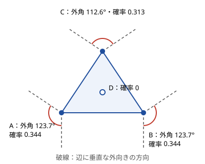

!!! abstract "要点"
    - **何ができるか**：[0, 1] の一様乱数のような連続な確率変数について、確率は長さ・面積・角度の比、期待値は積分で求める。$E[X] = \int_0^\infty P(X > t) \, dt$ や「$N$ 個の一様乱数の小さい方から $K$ 番目の期待値は $K/(N+1)$」を使う。
    - **いつ使うか**：
        - 実数を一様ランダムに選ぶ
        - 円内（区間内）のランダムな点
    - **計算量**：問題による。値の範囲が変数ごとに違うときの区分的な多項式の積分は、区分 $S$ 個・変数 $N$ 個で $O(S N^3)$
    - **前提**：[期待値と確率の変換](../comb/expectation-tail-sum.md)

<!-- textlint-disable -->
別名：連続確率・一様乱数・確率と積分・長さ・面積・角度の比・continuous probability
<!-- textlint-enable -->

連続値の確率は、整数の確率の「場合の数の比」と「和」を、「大きさの比」と「積分」に置き換えたものである。ABC では G・Ex 以降と AGC に現れる程度で、出題は少ない。考え方の芯は 2 つしかないので、それを押さえておけば、問題に出会ったら資料を引いて解ける。

## 何ができるか {#what}

値が実数の範囲から一様に選ばれるとき、1 点をちょうどとる確率は 0 になる。そこで、確率は次の 2 つの形で求める。

- **確率は大きさの比**：一様な点が領域 $D$ に落ちる確率は「$D$ の大きさ ÷ 全体の大きさ」である。大きさは、1 次元なら長さ、2 次元なら面積、方向なら角度になる。整数の場合の「条件を満たす場合の数 ÷ 全体の場合の数」（[確率の基本](../comb/probability-basics.md#ratio)）と同じ形である。
- **期待値は積分**：0 以上の値 $X$ について $E[X] = \int_0^\infty P(X > t) \, dt$ が成り立つ。整数のときの $E[X] = \sum_{k \ge 1} P(X \ge k)$ の和が積分に変わったものである。

$P(X = t) = 0$ なので、$X > t$ と $X \ge t$、また 2 つの値が等しくなる場合（同点）を区別しなくてよい。

問題文のサインは次のとおりである。

- 「実数を一様ランダムに選ぶ」「区間 $[L_i, R_i]$ から一様に選ぶ」
- 「円内（区間内）のランダムな点」「非常に大きい円の中から点を選ぶ」
- 答えを「mod 998244353 で出力」する確率・期待値で、値が実数をとる

範囲の端が有理数で、確率が区分的な多項式の積分で書けるときは、積分しても係数は有理数のままなので、答えは有理数になる。そのため mod 998244353 で答えさせる問題も多い（[確率・期待値を mod 998244353 で答える](../comb/rational-mod.md)）。

## 長さ・面積・角度の比 {#ratio}

一様な点がどこに落ちるかの確率は、図形の大きさの比で求める。たとえば $[0, 1]$ の一様乱数 $X, Y$ を独立に選ぶと、点 $(X, Y)$ は単位正方形に一様に落ちる。$X + Y \le 1$ となる確率は、直線 $x + y = 1$ の下の三角形の面積で $1/2$ である。$\lvert X - Y \rvert \le 1/2$ となる確率は、正方形から隅の 2 つの三角形（面積 $1/8$ ずつ）を除いた $3/4$ になる。

「非常に大きい円の中のランダムな点」は、大きさの比の極限として扱う。有界な（大きさが有限の）領域に落ちる確率は 0 になり、無限に伸びる領域だけが残る。遠くから見ると、無限に伸びる領域は原点から出るくさび形に見えるので、確率はくさびの**角度 ÷ $2\pi$** になる。幅が一定の帯のように、無限に伸びても遠くで開かない領域は角度が 0 なので、確率も 0 である。

次の図は、平面の点 A・B・C・D のうち、遠くのランダムな点に最も近いのはどれかを考えたものである。凸包の内側の D に最も近い点の集まりは有界なので、確率は 0 である。凸包の頂点 A・B・C の領域は、隣り合う 2 辺に垂直な外向きの方向で挟まれたくさびになる。その角は頂点の外角と等しい。外角の和は $2\pi$ なので、確率の和は 1 になる。



外角は、頂点に入る辺の向きと出る辺の向きの差（偏角の差）である。凸包は[凸包](../geometry/convex-hull.md)で求め、偏角の差は `atan2` で計算してよい（答えが実数で誤差が許されるなら。[atan2 の手軽さと限界](../geometry/argument-sort.md#atan2)）。この型は[例題](#agc021_b)の AGC021 B で使う。

## 積分と tail sum {#integral}

期待値を積分で求める式 $E[X] = \int_0^\infty P(X > t) \, dt$ の理由と、$N$ 個の一様乱数の最大値の例は[期待値と確率の変換](../comb/expectation-tail-sum.md#continuous)にある。この式の利点は、$X$ の密度（分布を微分したもの）を求めずに、$P(X > t)$ だけで期待値が出ることである。最大値や $K$ 番目の値は「$t$ より大きいものが何個あるか」で書けるので、$P(X > t)$ の方がずっと求めやすい。

よく使う結果として、$[0, 1]$ の一様乱数 $N$ 個を小さい順に並べたとき、**$K$ 番目の期待値は $K/(N+1)$** である。理由は対称性で説明できる。

- 長さ 1 の円周の上へ一様な点を $N + 1$ 個置き、1 個目の点で円周を切って線分 $[0, 1)$ に開く。残りの $N$ 個は、$[0, 1)$ へ独立かつ一様に置いた $N$ 個と同じ分布になる。
- 円周上の $N + 1$ 個の点は、円周を $N + 1$ 個の隙間に分ける。円周には特別な位置がないので、どの隙間も同じ分布で、期待値はどれも $1/(N+1)$ である。
- 小さい方から $K$ 番目の値は、端から $K$ 個の隙間の長さの和なので、期待値は $K/(N+1)$ になる。

$N = 1$ なら $1/2$、$N = 2$ の最大値（$K = 2$）なら $2/3$ で、積分で求めた値と合う。区間 $[a, b]$ の一様乱数なら、$a + (b - a) \cdot K/(N+1)$ になる。

??? question "確認問題：$[0, 1]$ の一様乱数 $X, Y$ について、$E[\lvert X - Y \rvert]$ はいくつか"
    $1/3$ である。2 点は $[0, 1]$ を 3 つの隙間に分け、$\lvert X - Y \rvert$ は真ん中の隙間の長さである。どの隙間も期待値は $1/3$ になる。$\lvert X - Y \rvert$ の分布から $\int_0^1 P(\lvert X - Y \rvert > t) \, dt = \int_0^1 (1 - t)^2 \, dt = 1/3$ と積分しても同じ値になる。

## 区分的な多項式の積分 {#piecewise}

変数ごとに範囲が違う（$X_i$ を閉区間 $[L_i, R_i]$ から一様に選ぶ）と、対称性をそのまま使えない。このときは $P(Y > t)$ を $t$ の式として求め、積分する。$Y$ は $K$ 番目に大きい値などである。

要になる性質は、**区間の端点で区切った各区分の中では、$P(Y > t)$ が $t$ の多項式になる**ことである。

- 1 つの変数について、$P(X_i > t)$ は $t < L_i$ で 1、$t > R_i$ で 0、その間で $(R_i - t)/(R_i - L_i)$ である。端点で区切った区分の中では、どれも $t$ の 1 次以下の式になる。
- 「$t$ より大きいものがちょうど $j$ 個」の確率は、変数ごとの $P(X_i > t)$ と $1 - P(X_i > t)$ の積の和である。よって $N$ 次以下の多項式になる。
- $P(K \text{ 番目に大きい値} > t)$ は「$t$ より大きいものが $K$ 個以上」の確率なので、$j \ge K$ の分を足した多項式になる。

多項式は、変数を 1 つずつ加える DP で求める。$f_j(t)$ を「ここまでの変数のうち $t$ より大きいものがちょうど $j$ 個である確率」とし、変数 $i$ を加えるたびに次のように更新する（$p_i(t) = P(X_i > t)$）。

$$
f_j(t) \leftarrow f_{j-1}(t) \, p_i(t) + f_j(t) \, (1 - p_i(t))
$$

初期値は $f_0 = 1$ である。各区分で多項式を $\int t^d \, dt = t^{d+1}/(d+1)$ で積分し、区分ごとの値を足せば期待値になる。区分の数を $S$（端点が $2N$ 個なら $S \le 2N - 1$）とすると、1 区分で状態 $O(N)$ 個 × 多項式の次数 $O(N)$ を $N$ 回更新するので、全体は $O(S N^3)$ になる。

端点が整数で値の範囲が小さいなら、長さ 1 の区分 $[x, x + 1)$ ごとに処理してもよい。区分の中で $t = x + u$（$0 \le u \le 1$）と置くと、$u^d$ を $[0, 1]$ で積分すると $1/(d+1)$ なので、積分は各係数を $d + 1$ で割った値の和になる。次のコード片はこの形である（完全なプログラムは [`snippets/continuous-probability/kth-max.cpp`](https://github.com/yuukougun/kyopro-atlas/blob/main/snippets/continuous-probability/kth-max.cpp)）。

```cpp
--8<-- "continuous-probability/kth-max.cpp:core"
```

完全なプログラム：[`kth-max.cpp`](https://github.com/yuukougun/kyopro-atlas/blob/main/snippets/continuous-probability/kth-max.cpp)（GitHub）
{ .kp-code-src }

長さ 1 の区分ごとに処理する場合は、多項式を使わない方法もある。区分に入った $j$ 個は区分の中で一様なので、[積分と tail sum](#integral) の $K/(N+1)$ が使える。「区分に入る個数 $j$」と「区分より上にある個数 $k$」の確率を DP で求め、$k < K \le j + k$ のとき、$K$ 番目の値の条件付きの期待値を $x + 1 - (K - k)/(j + 1)$ とする。コード片では 2 つの方法の値が一致することを `assert` で確かめている。

??? note "区分の中の順位を使う方法のコード"
    ```cpp
    --8<-- "continuous-probability/kth-max.cpp:order"
    ```

    完全なプログラム：[`kth-max.cpp`](https://github.com/yuukougun/kyopro-atlas/blob/main/snippets/continuous-probability/kth-max.cpp)（GitHub）
    { .kp-code-src }

## 自作するときの要点 {#library}

ACL に対応する機能はない。自作するときは次の点に気をつける。

- **多項式の操作は 3 つで足りる**：1 次式 $a + bt$ を掛ける、項ごとに積分する（$t^d \to t^{d+1}/(d+1)$）、値を代入する。係数の配列で持てばよい。
- **区分ごとに原点を移す**：$t$ のまま $[x, x+1)$ で積分すると、$x^{d+1}$ の大きな数どうしの差になり、`double` では桁落ちする。$t = x + u$ と置いて $[0, 1]$ で積分すれば、係数が小さいまま済む。
- **mod で答えるとき**：`double` を `atcoder::modint998244353` に置き換える。$1/(R_i - L_i)$ や $1/(d+1)$ は逆元を掛ける。区分の端は整数なので、代入する値も mod の値で表せる。
- **確かめ方**：小さい入力で、乱数で何度も試した平均（モンテカルロ法）と比べる。$N$ が 1〜3 で範囲が $[0, 1]$ なら $K/(N+1)$ と比べられる。

Library Checker に、連続値の確率そのものの問題はない（2026-10-22 に問題の一覧で確かめた）。角度の比の型で使う部品は、次の問題で確かめられる。

- Static Convex Hull：凸包の構築
- Sort Points by Argument：偏角の順の並べ替え

## 学ぶための資料 {#resources}

- [Wikipedia「Order statistic」](https://en.wikipedia.org/wiki/Order_statistic)（英語）：順序統計量（$K$ 番目の値）の分布と期待値 $K/(N+1)$ がまとまっている（一様分布の $K$ 番目はベータ分布に従う）
- [kmjp「AtCoder ABC #226 : H - Random Kth Max」](https://kmjp.hatenablog.jp/entry/2021/11/08/0930)と [ikatakos「AtCoder Beginner Contest 226 F,G,H 問題メモ」](https://ikatakos.com/pot/programming_algorithm/contest_history/atcoder/2021/1107_abc226)：区分ごとに個数を数える DP を、ABC226 H に沿って具体的に説明している
- [drken「AtCoder AGC 021 B - Holes (黄色, 600 点)」](https://drken1215.hatenablog.com/entry/2019/04/02/225600)：角度の比の型について、ボロノイ図から外角に至る筋道を図付きで説明している

## 例題 {#examples}

### AGC021 B. Holes {#agc021_b}

<div class="kp-problems" data-role="example" markdown>

- [AGC021 B. Holes](https://atcoder.jp/contests/agc021/tasks/agc021_b)（diff 2130）：平面上の N 個の点について、非常に大きな円の内部から一様に選んだ点に最も近い点が i である確率を、各 i について求める。

</div>

方針：各点に最も近い領域（ボロノイ図の領域）を考える。凸包の内側の点の領域は有界なので、確率は 0 である。凸包の頂点の領域は遠くでくさび形になり、その角は頂点の外角なので、確率は外角 ÷ $2\pi$ になる（[長さ・面積・角度の比](#ratio)）。

??? note "解法の詳細"
    - 凸包を求める。辺の途中にある点（3 点が一直線に並ぶときの真ん中）は、領域が 2 本の平行な境界に挟まれた帯になり、面積の比は 0 になる。凸包の頂点から外す。
    - 凸包の頂点ごとに、入る辺の向きと出る辺の向きの偏角の差を $[0, 2\pi)$ に直して外角とし、$2\pi$ で割る。
    - すべての点が一直線に並ぶときは、両端の 2 点が $1/2$ ずつになる。凸包を「行って戻る」2 本の辺とみると、両端の外角が $\pi$ になり、同じ式で扱える。
    - 計算量は凸包の $O(N \log N)$ である。

### ABC226 H. Random Kth Max {#abc226_h}

<div class="kp-problems" data-role="example" markdown>

- [ABC226 H. Random Kth Max](https://atcoder.jp/contests/abc226/tasks/abc226_h)（diff 2813）：N 個の実数をそれぞれ区間 [L_i, R_i] から一様に選んだとき、K 番目に大きい値の期待値を求める。

</div>

方針：区間の端は整数で範囲も小さいので、長さ 1 の区分ごとに処理する。区分ごとに、各変数が「区分より下」「区分の中」「区分より上」に入る確率を求め、個数の DP で $K$ 番目の値が区分に入る確率と、そのときの条件付きの期待値を足し合わせる（[区分的な多項式の積分](#piecewise)）。

??? note "解法の詳細"
    - 区分 $[x, x+1)$ で、変数 $i$ が区分の中に入る確率は $L_i \le x < R_i$ のとき $1/(R_i - L_i)$、区分より上に入る確率は $(R_i - x - 1)/(R_i - L_i)$（範囲が区分より上なら 1）である。
    - $\mathrm{dp}[j][k]$ ＝ ここまでの変数のうち、区分の中に $j$ 個、区分より上に $k$ 個ある確率。変数を 1 つずつ加えて更新する。
    - $k < K \le j + k$ なら、$K$ 番目の値は区分の中の $j$ 個のうち大きい方から $K - k$ 番目で、期待値は $x + 1 - (K - k)/(j + 1)$ である。確率を掛けて足す。
    - 区分の数を $V$ とすると計算量は $O(V N^3)$ である。答えは mod 998244353 で出すので、割り算は逆元を掛ける。各区分で $P(K \text{ 番目} > t)$ を多項式として求めて積分する方法（コード片の `kth_max_by_integral`）でも同じ計算量で解ける。

## 参考 {#references}

- [Wikipedia「Order statistic」](https://en.wikipedia.org/wiki/Order_statistic)：一様乱数の $K$ 番目の値がベータ分布に従い、期待値が $K/(N+1)$ であること
- [yosupo06「library-checker-problems」](https://github.com/yosupo06/library-checker-problems)：連続値の確率の問題がないことと、凸包・偏角ソートの問題の確認
- [drken「AtCoder AGC 021 B - Holes (黄色, 600 点)」](https://drken1215.hatenablog.com/entry/2019/04/02/225600)：例題 AGC021 B の方針（ボロノイ図・凸包の外角）
- [kmjp「AtCoder ABC #226 : H - Random Kth Max」](https://kmjp.hatenablog.jp/entry/2021/11/08/0930)：例題 ABC226 H の、長さ 1 の区分ごとの個数の DP
- [ikatakos「AtCoder Beginner Contest 226 F,G,H 問題メモ」](https://ikatakos.com/pot/programming_algorithm/contest_history/atcoder/2021/1107_abc226)：例題 ABC226 H の、区分の中の順位の期待値を使う方法（解法の節だけを読んだ）
