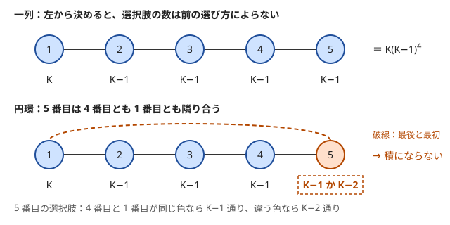

!!! abstract "要点"
    - **何ができるか**：排反な場合分けは足し、独立な段階の選択は掛けて数える。積の法則は、前の段階で何を選んでも次の段階の選択肢の数が同じときだけ使える。円環の塗り分けでは最後の要素の選択肢の数が前の選び方で変わるので、一列のときの式は使えない。
    - **いつ使うか**：
        - 隣り合うもの（距離 2 以内のもの）が異なるように塗り分ける方法の数を求める。
        - 円形に並べる・円環で最後と最初も隣り合う。
        - $N \le 10^{18}$ で、答えが段階ごとの選択肢の数の積になる。
        - 答えが $K(K-1)^{N-1}$ のような累乗の積の形になる。
    - **計算量**：式が段階の数 $N$ の累乗を含むなら、[繰り返し二乗法](../math/mod-pow.md)で $O(\log N)$。$N = 10^{18}$ でも一瞬で求まる。
    - **前提**：なし

<!-- textlint-disable -->
別名：和の法則・積の法則・円順列・重複順列・nPr・塗り分けの数・rule of product
<!-- textlint-enable -->

和・積の法則は、数え上げのすべての道具の土台である。重なりのない場合に分けて足すのが和の法則、段階ごとの選択肢の数を掛けるのが積の法則で、順列・組合せ・塗り分けの式はどれもこの 2 つから作られる。基礎で問われるのは式そのものより、積の法則が使える条件を確かめることと、使えないときに決める順番や場合分けを直すことである。

## 和の法則と積の法則（積の法則が使える条件） {#sum-and-product}

和の法則と積の法則は、数えたいものの集まりを分けて数えるための 2 つの規則である。

**和の法則**：数えたいものを、どの 2 つも重ならない（[排反](../guide/glossary.md#disjoint)な）グループに分けたら、総数は各グループの数の和である。重なりがあると、そのぶんを二重に数える。重なりを含むまま足したいときは[包除原理](../comb/inclusion-exclusion.md)を使う。

**積の法則**：数えたいものが、段階 1 から段階 $m$ までの選択の列で 1 つずつ作られるとする。次の 2 つが成り立つなら、総数は $c_1 c_2 \cdots c_m$ である。

- 段階 $i$ の選択肢の数 $c_i$ が、それより前に何を選んだかによらず一定である
- 違う選択の列からは違うものができる（1 つのものが 2 通りの列から作られない）

なぜ掛けてよいかは、和の法則に戻すと分かる。段階 1 の選択で $c_1$ 個のグループに分けると、どのグループでも残りの選び方の数は同じ $c_2 \cdots c_m$ である。同じ数を $c_1$ 回足すので掛け算になる。だから 1 つ目の条件が崩れて、グループごとに残りの数が違うと、掛け算では数えられない。

大事なのは、一定であるべきなのは選択肢の**数**で、選択肢の**中身**は変わってよいことである。$N$ 個を一列に並べ、隣り合う 2 個が違う色になるよう $K$ 色で塗るとき、2 個目に使える色の集合は 1 個目の色で変わる。それでも数はいつも $K - 1$ なので、積の法則で $K(K-1)^{N-1}$ と数えてよい。

2 つ目の条件は、順序をもたないものを数えるときに崩れる。$N$ 人から 2 人を選ぶのに「1 人目は $N$ 通り、2 人目は $N - 1$ 通り」と掛けると、$\{A, B\}$ を「A → B」と「B → A」の 2 回数える。1 つのものが何通りの列から作られるかが一定なら、その数で割れば直せる（[順列・組合せの節](#permutations)）。

??? question "確認問題：暗証番号"
    0〜9 の数字を 4 つ並べた暗証番号（先頭が 0 でもよい）のうち、同じ数字が隣り合わないものはいくつあるか。

    ??? success "答え"
        $10 \times 9^3 = 7290$ 個である。1 桁目は 10 通りで、2 桁目以降は直前の数字以外の 9 通りである。使える数字の中身は直前の数字で変わるが、数はいつも 9 なので積の法則が使える。

## 順列・組合せ・重複順列・円順列 {#permutations}

順列・組合せ・重複順列・円順列は、どれも積の法則に「同じものを何回数えたか」の割り算を足して作れる。$n$ 個のものは互いに区別できるとする。

| 数えるもの | 式 | 積の法則での見方 |
| --- | --- | --- |
| $n$ 個から $k$ 個を選んで並べる（順列） | ${}_n P_k = \dfrac{n!}{(n-k)!}$ | 先頭から $n, n-1, \dots, n-k+1$ 通り |
| $n$ 個から $k$ 個を選ぶ（組合せ） | $\binom{n}{k} = \dfrac{{}_n P_k}{k!}$ | 同じ組を $k!$ 通りの順で数えている |
| $n$ 種類から重複を許して $k$ 個並べる（重複順列） | $n^k$ | どの位置も $n$ 通り |
| $n$ 個を円形に並べる（円順列） | $(n-1)!$ | 一列の $n!$ 通りを、回転で同じもの $n$ 個ずつまとめる |

円順列は、回して重なる並べ方を同じとみなす。$n = 3$ で A・B・C を並べると、一列の並べ方 6 通りは次の 2 つに分かれ、円順列は $3!/3 = 2$ 通りになる。

- ABC・BCA・CAB（どれも時計回りに A → B → C）
- ACB・CBA・BAC（どれも時計回りに A → C → B）

$n$ で割れるのは、$n$ 個がすべて違うときは、1 つの円の並べ方を $n$ か所で切り開くと、$n$ 通りのすべて違う一列ができるからである。$r$ 個（$0 < r < n$）ずらした列が元と同じなら、位置 0 と位置 $r$ に同じものがあることになり、すべて違うことに反する。もう 1 つの見方として、A の位置を一番上に固定し、残りの $n - 1$ 個を時計回りに並べると考えても $(n-1)!$ が出る。

- **裏返しも同じとみなす（数珠順列）**：$n \ge 3$ なら $(n-1)!/2$ である。$n \le 2$ では裏返しても同じ並べ方なので 2 で割らない
- **同じものを含むと割れない**：赤 2 個・青 2 個を円形に並べると、一列の並べ方は $\binom{4}{2} = 6$ 通りだが、$6/4$ は整数にならない。赤赤青青の型は回すと 4 通りの列になるが、赤青赤青の型は 2 回ずらすと元に戻り、2 通りの列にしかならないからである（答えは 2 通り）。同じものを含む円形の並べ方は [Burnside の補題](../comb/burnside-lemma.md#necklace)で数える

${}_n P_k$ と $n^k$ は、$k$ が小さければ $k$ 回掛ける素朴なループで求まる。$n^k$ で $k$ が大きいなら、繰り返し二乗法で $O(\log k)$ 回の掛け算にする。$\binom{n}{k}$ を mod で何度も求めるなら、[階乗と逆階乗を前計算する](../comb/binomial-precompute.md)。mod を取らずに階乗を `long long` で持てるのは $20!$（約 $2.4 \times 10^{18}$）までで、$21!$ はあふれる。

## 一列の塗り分けと円環の塗り分け {#coloring}

隣り合うものが違う色になる塗り方の数は、一列なら積の法則でそのまま書けるが、円環では最後の 1 個で積の法則が崩れる。$K$ 色で $N$ 個を塗るとする。

**一列で隣が異なる**：左から決めると、1 個目は $K$ 通り、2 個目以降は直前の色以外の $K - 1$ 通りで、答えは $K(K-1)^{N-1}$ である。

**一列で距離 2 以内が異なる**：1 個目は $K$ 通り、2 個目は $K - 1$ 通りである。3 個目以降は直前の 2 個と違う色にする。直前の 2 個は隣り合うので互いに違う色であり、禁止される色はちょうど 2 色になる。だから選択肢はいつも $K - 2$ 通りで、$N \ge 2$ なら答えは $K(K-1)(K-2)^{N-2}$ である（[例題](#typical90_bq)）。

**円環で隣が異なる**：最後の $N$ 個目は、$N - 1$ 個目とも 1 個目とも隣り合う。次の図のように、$N - 1$ 個目と 1 個目が同じ色なら禁止は 1 色で $K - 1$ 通り、違う色なら禁止は 2 色で $K - 2$ 通りになる。前の選び方で選択肢の数が変わるので、積の法則は使えない。



円環は、和の法則で一列の数を分けて数える。一列で隣が異なる塗り方 $K(K-1)^{N-1}$ 通りを、両端（1 個目と $N$ 個目）の色が違うかどうかで分ける。

- 両端の色が違うもの：そのまま円環の条件を満たす。円環で $N$ 個の答えを $C_N$ とすると、$C_N$ 通り
- 両端の色が同じもの（$N \ge 3$）：1 個目と $N$ 個目を 1 個にまとめると、$N - 1$ 個の円環で隣が異なる塗り方と 1 対 1 に対応する。$N - 1$ 個目は $N$ 個目と違う色で、$N$ 個目は 1 個目と同じ色なので、$N - 1$ 個目は 1 個目と違う色になるからである。よって $C_{N-1}$ 通り

$$
\begin{aligned}
C_N &= K(K-1)^{N-1} - C_{N-1} \quad (N \ge 3), \\
C_2 &= K(K-1)
\end{aligned}
$$

$C_N$ と $(K-1)^N$ の差を $D_N$ とおく。漸化式から $D_N = (K-1)^{N-1} - C_{N-1} = -D_{N-1}$ で、$D_2 = K(K-1) - (K-1)^2 = K - 1$ である。よって $D_N = (-1)^N (K-1)$ で、$C_N = (K-1)^N + (-1)^N (K-1)$ になる。$K = 3$ なら $C_3 = 8 - 2 = 6$（3 色を 1 回ずつ使う $3!$ 通り）、$C_4 = 16 + 2 = 18$ で、全列挙の結果と一致する。$N = 2$ は 2 個が 1 か所で隣り合うと読み、$C_2 = K(K-1)$ とした。

??? note "証明：閉じた式が漸化式を満たすこと"
    $N = 2$ では $(K-1)^2 + (K-1) = K(K-1)$ で、$C_2$ と一致する。$N \ge 3$ で $C_{N-1} = (K-1)^{N-1} + (-1)^{N-1}(K-1)$ が成り立つとすると、

    $$
    \begin{aligned}
    &K(K-1)^{N-1} - C_{N-1} \\
    &= K(K-1)^{N-1} - (K-1)^{N-1} \\
    &\quad + (-1)^N (K-1) \\
    &= (K-1)^N + (-1)^N (K-1)
    \end{aligned}
    $$

    となり、$N$ でも成り立つ。

```cpp
--8<-- "counting-basics/cycle-coloring.cpp:core"
```

完全なプログラム：[`cycle-coloring.cpp`](https://github.com/yuukougun/kyopro-atlas/blob/main/snippets/counting-basics/cycle-coloring.cpp)（GitHub）。`mint` は ACL の `modint998244353`（[modint](../math/modint.md)）。
{ .kp-code-src }

式を導かずに、「1 個目と同じ色か」を状態に持つ DP でも数えられる。円環を 1 か所で切り、最初の要素の色を固定して DP を回す考え方は、[DP の状態の設計](../dp/dp-state-design.md#dp-cyclic)で扱う。

## 決める順番を変えて積の法則を使えるようにする {#order-of-choice}

積の法則が使えないとき、決める順番を変えたり、少数の場合に分けたりすると、選択肢の数が一定になることがある。0〜9 の数字から違う 3 つを使った 3 桁の偶数を数える例で試す。

先頭（百の位）から決めると、百の位は 0 以外の 9 通り、十の位は残りの 9 通りである。ところが一の位に使える偶数の数は、百の位と十の位で偶数をいくつ使ったかで変わる。この順番では積の法則が使えない。

条件の厳しい位から決める。一の位を先に決め、次に百の位を決めると、百の位に使えない数字は「0 と、一の位の数字」になる。一の位が 0 ならこの 2 つは同じ数字なので禁止は 1 つで、ほかの偶数なら禁止は 2 つになる。まだ一定ではないので、ここで和の法則で 2 つの場合に分ける。

- 一の位が 0：百の位 9 通り、十の位 8 通りで $1 \times 9 \times 8 = 72$
- 一の位が 2・4・6・8：百の位 8 通り、十の位 8 通りで $4 \times 8 \times 8 = 256$

合わせて $328$ 個で、全列挙と一致する。手順は次のようにまとめられる。

- 条件の多い要素、ほかの要素から影響を受けやすい要素から先に決める
- それでも選択肢の数が変わるなら、変わる原因（上の例では「一の位が 0 か」）で場合を分け、各場合の中で積の法則を使う
- 場合が多すぎるなら、その原因を状態にして DP で数える（[DP の状態の設計](../dp/dp-state-design.md)）

値の大きい順や小さい順に決めると、すでに置いたものとの関係だけで選択肢の数が決まることも多い。この考え方は[順序を固定して数える](../comb/counting-fix-order.md)で広げる。

??? question "確認問題：4 桁の 5 の倍数"
    0〜9 の数字から違う 4 つを使った 4 桁の整数のうち、5 の倍数はいくつあるか。

    ??? success "答え"
        $952$ 個である。一の位は 0 か 5 で、千の位に使えない数字の数が変わるので場合を分ける。一の位が 0 なら千の位 9 通り、百の位 8 通り、十の位 7 通りで $504$ である。一の位が 5 なら千の位は 0 と 5 以外の 8 通り、百の位 8 通り、十の位 7 通りで $448$ である。合わせて $952$ になる。

## 写像 12 相の「玉も箱も区別する」マス（k^n と順列） {#twelvefold-cells}

[写像 12 相](../comb/twelvefold-way.md#table)は、$n$ 個の玉を $k$ 個の箱に入れる方法を 12 通りに分けた表である。分け方は、玉・箱を区別するかと、箱に入れる個数の制限による。玉も箱も区別するマスのうち 2 つは、積の法則だけで数えられる。

| 箱に入れる個数の制限 | 数 | 積の法則での見方 |
| --- | --- | --- |
| 制限なし | $k^n$ | どの玉も $k$ 個の箱から 1 つ選ぶ |
| どの箱も 1 個以下 | ${}_k P_n$（$n > k$ なら 0） | 玉を順に、まだ空の箱へ入れる。$k, k-1, \dots$ 通り |
| どの箱も 1 個以上 | 積の法則では数えられない | 残りの玉で空の箱を埋められるかが前の選び方で変わる |

$k^n$ と $n^k$ を取り違えやすい。「選ぶ側」が 1 つずつ「選ばれる側」から 1 つを選ぶと考え、（選ばれる側の数）^（選ぶ側の数）とする。$N$ 人がそれぞれ $K$ 個の部屋から 1 つを選ぶなら $K^N$、長さ $N$ の英小文字の列なら $26^N$ である。

どの箱も 1 個以上（全射）は、積の法則の 1 つ目の条件が崩れる。$n = 3$、$k = 2$ なら、全体の $2^3 = 8$ 通りから「全部が片方の箱」の 2 通りを引いて 6 通りになる。一般には[包除原理](../comb/inclusion-exclusion.md#surjection)で $\sum_{i=0}^{k} (-1)^i \binom{k}{i} (k-i)^n$ と数える。玉や箱を区別しないマスは、割り算では直せないものが多い（[重複組合せ](../comb/stars-and-bars.md)など）。

## 落とし穴 {#pitfalls}

**$N$ が小さいときの指数**。$K(K-1)(K-2)^{N-2}$ は $N = 1$ で指数が $-1$ になる。$N = 1$ は $K$ 通りとして先に分ける。$N = 2$ は $(K-2)^0 = 1$ なので式のままでよい。式を作ったら $N = 1, 2$ と $K = 1, 2$ を手で数えて合わせる。たとえば $K = 2$、$N \ge 3$ なら 3 個目の色がないので 0 通りで、式も $(K-2)^{N-2} = 0$ を含んで 0 になる。

**mod を取る前に掛けてあふれる**。$K$ が $10^{18}$ まであると、$K \times (K-1)$ は `long long` に収まらない。$K$ を先に法で割った余りにしてから掛ける。[modint](../math/modint.md) は作るときに余りを取るので、`mint(k) * mint(k - 1)` と書けば済む（[整数のオーバーフロー](../cpp/cpp-integer-overflow.md)）。

**負の数の余り**。$K - 2$ や $C_N$ の式の引き算は負になりうる。C++ の `%` は負の数に負の余りを返すので、自分で書くなら `((x % p) + p) % p` にする（[整数の割り算](../math/integer-division.md)）。

**累乗を `pow` で計算する**。`std::pow` は `double` で計算するので、大きな累乗は誤差で値が壊れ、mod も取れない。$N$ が大きい累乗は[繰り返し二乗法](../math/mod-pow.md)で求める。

**和の法則で重なりを足す**。「0 を含む列」と「9 を含む列」を足すと、両方を含む列を二重に数える。重なりを引くか、「どちらも含まない」の側から数える（[余事象](../thinking/complement.md)）。

**mod の値で大小を比べる**。余りにした後の値は、元の数の大小を表さない。「円環の数が一列の数より小さいはず」のような確かめは、mod を取らない小さい $N$・$K$ で行う。

## 上位の手法へのつながり {#next-steps}

このページの考え方は、次の手法の部品になる。

- **二項係数**：組合せ $\binom{n}{k}$ の 3 つの意味と性質は[二項係数の意味と性質](../comb/binomial-coefficient.md#meanings)にある。
- **確率**：同様に確からしいときの確率は、場合の数の比で求める（[確率の基本](../comb/probability-basics.md#ratio)）。
- **順序を固定する**：一部の相対順序が決まっている並べ方は、全体の何分の一かとして数える（[順序を固定して数える](../comb/counting-fix-order.md#relative-order)）。
- **重なりを引く**：和の法則の場合が重なるときは、包除原理で重なりを足し引きする（[包除原理](../comb/inclusion-exclusion.md#general)）。
- **数え上げの手順**：対象の確定から検算までの流れは[数え上げの考え方](../comb/counting-mindset.md#procedure)にまとめてある。

## 使い分け {#comparison}

- 選ぶだけで順序を区別しない → [二項係数](../comb/binomial-coefficient.md)
- 区別しない玉を箱に分ける・個数の制限がある → [写像 12 相](../comb/twelvefold-way.md)・[重複組合せ](../comb/stars-and-bars.md)
- 「少なくとも 1 つ」「どれも 1 個以上」→ [余事象](../thinking/complement.md)・[包除原理](../comb/inclusion-exclusion.md)
- 回転して同じものを同一視し、同じ色を含む → [Burnside の補題](../comb/burnside-lemma.md#necklace)
- 選択肢の数を決める情報が少数の値にまとまる → [DP の状態の設計](../dp/dp-state-design.md)
- 何を数えるかの言い換え全般 → [数え上げの考え方](../comb/counting-mindset.md)

## 例題 {#examples}

### 典型90 069. Colorful Blocks 2（★3） {#typical90_bq}

<div class="kp-problems" data-role="example" markdown>

- [典型90 069. Colorful Blocks 2（★3）](https://atcoder.jp/contests/typical90/tasks/typical90_bq)（diff なし）：一列に並んだ N 個のブロックを K 色で塗り、距離 2 以内のブロックがすべて異なる色になる塗り方の数を求める。

</div>

左から 1 個ずつ色を決めると、1 個目は $K$ 通り、2 個目は $K - 1$ 通りである。3 個目以降は直前の 2 個と違う色にする。直前の 2 個はもともと違う色なので、どの段階でも選択肢は $K - 2$ 通りで一定になる。積の法則で $K(K-1)(K-2)^{N-2}$ と書け、$N$ が $10^{18}$ まであるので累乗は繰り返し二乗法で求める。

??? note "解法の詳細"
    - 答えは $N = 1$ なら $K$、$N \ge 2$ なら $K(K-1)(K-2)^{N-2}$ を $10^9 + 7$ で割った余りである。$N = 1$ は指数が負になるので分ける。
    - $K \le 10^9$ なので $K(K-1)$ は `long long` に収まるが、累乗を続けて掛けるとあふれる。mint にしてから掛ければ、$K$ が法以上の場合も含めて安全である。$K = 1$ では $K - 2$ が負になるが、$K - 1 = 0$ が掛かるので答えは 0 である（modint を使えば負の数もそのまま扱える）。
    - 累乗は $O(\log N)$ で、全体も $O(\log N)$ である。

    ```cpp
    --8<-- "counting-basics/distance2.cpp:core"
    ```

    完全なプログラム：[`distance2.cpp`](https://github.com/yuukougun/kyopro-atlas/blob/main/snippets/counting-basics/distance2.cpp)（GitHub）。`mint` は ACL の `modint1000000007`（[modint](../math/modint.md)）。
    { .kp-code-src }

## 練習問題 {#practice}

<div class="kp-problems" data-role="practice" markdown>

- [ABC178 C. Ubiquity](https://atcoder.jp/contests/abc178/tasks/abc178_c)（diff 653）：各要素が 0〜9 の長さ N の列のうち、0 と 9 をどちらも含むものの数を求める。
- [AGC031 A. Colorful Subsequence](https://atcoder.jp/contests/agc031/tasks/agc031_a)（diff 953）：文字列 S の部分列（取り出す位置が違えば別のものとする）のうち、含まれる文字がすべて異なるものの数を求める。
- [ABC307 E. Distinct Adjacent](https://atcoder.jp/contests/abc307/tasks/abc307_e)（diff 1240）：円形に並ぶ N 人に 0〜M−1 の整数を、隣り合う人どうしが異なるように配る方法の数を求める。

</div>

??? note "練習の方針"
    - **ABC178 C**：全体 $10^N$ から、0 を含まない $9^N$ と 9 を含まない $9^N$ を引き、二重に引いたどちらも含まない $8^N$ を足し戻す。mod を取っているので、引き算の後は負にならないよう法を足す
    - **AGC031 A**：文字ごとに「使わない」か「$S$ の中の出現位置の 1 つを選ぶ」かで（出現回数 + 1）通りある。文字どうしは独立なので積の法則で掛け、最後に空の部分列の 1 通りを引く。並べ方は $S$ の中の順で決まるので数えなくてよい
    - **ABC307 E**：円環の隣が異なる塗り分けそのものである。[一列と円環の節](#coloring)の漸化式 $C_N = M(M-1)^{N-1} - C_{N-1}$（$C_2 = M(M-1)$）を $N$ まで回すか、閉じた式 $(M-1)^N + (-1)^N (M-1)$ を使う。「1 人目と同じ値か」を状態にした DP でも解ける

## 力試し {#challenge}

<div class="kp-problems" data-role="challenge" markdown>

- [ABC133 E. Virus Tree 2](https://atcoder.jp/contests/abc133/tasks/abc133_e)（diff 1505）：N 頂点の木を K 色で塗り、距離 2 以下のどの 2 頂点も違う色になる塗り方の数を求める。

</div>

??? note "力試しの方針"
    - **ABC133 E**：根から順に色を決める。根は $K$ 通り、根の子は $K - 1$ 色から、ほかの頂点の子は自分と親の色を除く $K - 2$ 色から、兄弟どうしで違う色を選ぶ。選択肢の数が前の選び方によらず一定なので、全頂点の積で数えられる

## 参考 {#references}

- [E869120「kyopro_educational_90 sol/069.cpp」](https://github.com/E869120/kyopro_educational_90/blob/main/sol/069.cpp)：例題の式と、$N = 1$・$N = 2$・$K = 1$ の場合分け
- [drken「AtCoder ABC 307 E - Distinct Adjacent (1Q, 水色, 475 点)」](https://drken1215.hatenablog.com/entry/2024/06/10/024932)：円環の塗り分けを、両端の同じ色をまとめて $N - 1$ 個の円環に帰着する見方と、1 個目と同じかを状態にした DP
- [tmsn「AtCoder Beginer Contest 301~350 D or E までの要点・解答（Go）」](https://zenn.dev/shinonome81/articles/3e1c0c8a9c00fc)：ABC307 E の項。一列の数 $M(M-1)^{N-1}$ と円環の違い、1 人目と同じかを状態にした DP
- [drken「AtCoder ABC 178 C - Ubiquity (3Q, 茶色, 300 点)」](https://drken1215.hatenablog.com/entry/2020/10/09/162600)：練習 ABC178 C の全体から引く数え方
- [drken「AtCoder AGC 031 A - Colorful Subsequence (緑色, 200 点)」](https://drken1215.hatenablog.com/entry/2019/03/18/125300)：練習 AGC031 A の文字ごとの積
- [ikatakos「AtCoder Grand Contest 031 A,B,C,D 問題メモ」](https://ikatakos.com/pot/programming_algorithm/contest_history/atcoder/2019/0316_agc031)：練習 AGC031 A の同じ数え方（解説の部分だけを参照）
- [drken「AtCoder ABC 133 E - Virus Tree 2 (1Q, 水色, 500 点)」](https://drken1215.hatenablog.com/entry/2019/07/08/002700)：力試し ABC133 E の根から決める積
