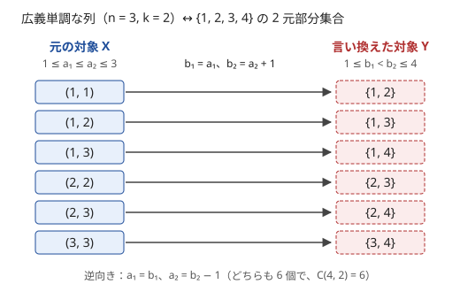
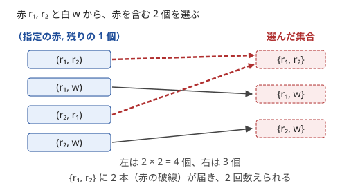

!!! abstract "要点"
    - **何ができるか**：数えにくい対象を、個数が同じで数えやすい対象に 1 対 1 で対応させて数える。逆向きの写像が作れることが正しさの確かめになり、[単射](../guide/glossary.md#injection)でない対応では同じものを重複して数えてしまう。
    - **いつ使うか**：
        - 単調な数列の個数。
        - 積（和）が決まった値になる数列の個数。
        - 途中で負にならない ±1 の列の個数。
        - 二項係数の積の和を、1 つの二項係数（経路の数）に直したい。
    - **計算量**：対応は数え方を変えるだけで、計算量は言い換えた先の数え方で決まる。二項係数に落ちれば、階乗の表の前計算 $O(n)$ の後 1 つ $O(1)$（$n$ は使う二項係数の上の数の最大）。
    - **前提**：[数え上げの考え方](../comb/counting-mindset.md)、[重複組合せ](../comb/stars-and-bars.md)、[格子路の数え上げ](../comb/lattice-paths.md)

<!-- textlint-disable -->
別名：全単射・1 対 1 対応・経路数に帰着・bijection・bijective proof
<!-- textlint-enable -->

対応づけは、数えたい集合 $X$ から、数え方の分かっている集合 $Y$ への 1 対 1 の対応を作り、$\lvert X \rvert = \lvert Y \rvert$ として数える考え方である。$Y$ は、ほとんどが二項係数・重複組合せ・格子路・積の形で数えられる集合になる。難しいのは式ではなく対応を見つけることで、見つけた対応が本当に 1 対 1 かを確かめる手順を持っておくと、思いつきを安心して使える。

このページでは、数えたい対象の集合を $X$、言い換えた先の集合を $Y$、対応を $f : X \to Y$ と書く。

## 全単射なら個数が等しい（逆に戻せるかで検算する） {#bijection}

$f : X \to Y$ が[全単射](../guide/glossary.md#bijection)（$X$ のどの要素も $Y$ のちょうど 1 つに移り、$Y$ のどの要素にも $X$ からちょうど 1 つが来る）なら、$\lvert X \rvert = \lvert Y \rvert$ である。全単射であることは、次の 3 つを確かめれば言える。

1. **行き先が $Y$ に入る**：$X$ のどの要素 $x$ についても、$f(x)$ が $Y$ の条件をすべて満たす
2. **逆向きの手順 $g : Y \to X$ が書ける**：$g(y)$ が $X$ の条件をすべて満たす
3. **行って戻ると元に戻る**：$g(f(x)) = x$ なら、違う $x$ が同じ $y$ に移ることはない。$f(g(y)) = y$ なら、どの $y$ にも来る $x$ がある

1 と 2 の「条件をすべて満たす」が見落としやすい所である。式の形が似ているだけで、値の範囲や不等号の向きが 1 つずれると、$Y$ からはみ出たり、$Y$ の一部にしか届かなかったりする。

例として、$1 \le a_1 \le a_2 \le \dots \le a_k \le n$ を満たす広義単調な列を数える。$b_i = a_i + (i - 1)$ と置くと、隣どうしの差が 1 ずつ広がるので $b_1 < b_2 < \dots < b_k$ になり、最大は $b_k \le n + k - 1$ である。狭義単調な列は値の集合で決まるので、$Y$ は $\{1, \dots, n + k - 1\}$ の $k$ 元部分集合になる。次の図は $n = 3$、$k = 2$ の場合で、左の 6 個と右の 6 個が 1 本ずつの線で結ばれる。



逆向きは $a_i = b_i - (i - 1)$ で、$b_{i+1} \ge b_i + 1$ から $a_{i+1} \ge a_i$、$b_k \le n + k - 1$ から $a_k \le n$ が出る。3 つの条件がそろうので、個数は $\binom{n+k-1}{k}$ である（この対応の別の見方は[重複組合せの単調な列の節](../comb/stars-and-bars.md#monotone)）。

確かめは、小さい場合の全列挙で機械的にもできる。$X$ と $Y$ をそれぞれ全部作り、$f$ と $g$ を通して 3 つの条件を `assert` で調べる（下の `in_X`・`in_Y` は $X$・$Y$ の条件をそのまま書いた判定で、ここでは定義を省く）。式が合っているかだけでなく、対応のどこが壊れているかまで分かる（式の検算の一般論は[小さいケースの全探索](../comb/counting-mindset.md#verify-small)）。

```cpp
--8<-- "counting-bijection/verify.cpp:core"
```

## 素因数ごと・軸ごとに分けて独立な成分の積にする {#decompose}

対象が「いくつかの成分の組」と 1 対 1 に対応し、どの条件も 1 つの成分の中だけで閉じていれば、個数は成分ごとの個数の積になる。$X$ を成分の組の集合 $Y_1 \times Y_2 \times \dots \times Y_m$ と対応させ、$\lvert X \rvert = \lvert Y_1 \rvert \cdots \lvert Y_m \rvert$ とする考え方である（分け方の一般論は[独立に分解する](../thinking/reformulation.md#independence)）。

**素因数ごとに分ける**。積が $M$ になる長さ $N$ の正の整数列は、$M = \prod p^{e_p}$ と素因数分解すると、素数 $p$ ごとの「指数の列 $(x_1, \dots, x_N)$ で和が $e_p$ のもの」の組と 1 対 1 に対応する。素因数分解の一意性が、列から指数の組への写像も、指数の組から列への逆向きも、ただ 1 通りに決まることを保証する。各素数の指数の配り方は[重複組合せ](../comb/stars-and-bars.md#applications)で $\binom{e_p + N - 1}{N - 1}$ 通りなので、答えはその積である。

```cpp
--8<-- "counting-bijection/factorization.cpp:core"
```

gcd・lcm の条件も素数ごとに分かれる。gcd は指数の最小値、lcm は指数の最大値になるからである（[素因数の指数ベクトル](../math/prime-exponent-vector.md#exponent-ops)）。たとえば $\operatorname{lcm}(a, b) = M$ となる順序付きの組 $(a, b)$ は、素数 $p$ ごとに $\max(x, y) = e_p$ となる指数の組 $(x, y)$ を選ぶことと対応する。その数は $(e_p + 1)^2 - e_p^2 = 2e_p + 1$ なので、答えは $\prod_p (2e_p + 1)$ である。

**bit ごとに分ける**。AND・OR・XOR の条件は、各 bit の値がその bit だけで決まる（[bit ごとに独立](../basics/bitwise-independence.md)）。長さ $N$ の列で、全体の AND が $x$、OR が $y$ になるものを数えるなら、bit ごとに「$N$ 個の 0/1 の選び方」を数えて掛ける。$x$ の bit が 1 なら全部 1 の 1 通り（$y$ の bit も 1 が要る）、$y$ の bit が 0 なら全部 0 の 1 通り、$x$ が 0 で $y$ が 1 なら全部 0 と全部 1 を除いた $2^N - 2$ 通りである。

**軸ごとに分ける**。上下左右に 1 ずつ動く移動は、座標を $u = x + y$、$v = x - y$ に取り直すと、$u$ の ±1 の列と $v$ の ±1 の列の組に 1 対 1 に対応する（[45 度回転](../comb/lattice-paths.md#independent-axes)）。

分けてよいかは、成分をまたぐ条件がないかで決まる。「積が $M$ で、どの項も $K$ 以下」のように項の大きさを制限すると、1 つの項の値が全素数の指数で決まるので、素数ごとには分かれない。「列の項がすべて異なる」も成分をまたぐ条件である。こうした条件があるときは、分けられる部分だけ分けてから[包除原理](../comb/inclusion-exclusion.md)や DP で残りを扱う。

## 格子路に帰着できないかを疑う {#to-lattice-paths}

二項係数の積や和が出てきたら、それを経路の数として読めないかを考える。$\binom{a+b}{a}$ は R を $a$ 個・U を $b$ 個並べる列の数、つまり[格子路](../comb/lattice-paths.md#basic)の数である。積は「途中の点で前半と後半に分けた経路」、和は「どの点を通るかで分けた経路」と読める。和の全体が 1 つの経路の集合になれば、答えは二項係数 1 つで済む。

**和を 1 つの経路数にまとめる**。次の恒等式（Vandermonde の恒等式）を経路で読む。

$$
\sum_{i} \binom{a}{i} \binom{b}{k - i} = \binom{a + b}{k}
$$

右辺は、長さ $a + b$ の R・U の列のうち U が $k$ 個のものの数である。列を前半の $a$ 文字と後半の $b$ 文字に切り、前半の U の数を $i$ とすると、前半は $\binom{a}{i}$ 通り、後半は $\binom{b}{k-i}$ 通りになる。どの列でも前半の U の数 $i$ はただ 1 つに決まるので、$i$ で分けた和は重複も漏れもない。分類に使う量は、経路ごとにただ 1 つ決まるもの（ここでは「前半の U の数」、禁止領域なら[境目を越える行](../comb/lattice-paths.md#forbidden-region)）を選ぶ。

**和と積の両方を位置の選び方にまとめる**。$N$ 個の数 $A_i$ と $M$ について、$B_1 + \dots + B_N = M$ となる非負整数列 $B$ すべてにわたる $\prod_i \binom{B_i}{A_i}$ の総和を考える。和の項数は多いが、全体は次の対応で 1 つの二項係数になる。

- 玉を $B_1$ 個、仕切りを 1 本、玉を $B_2$ 個、仕切りを 1 本、…、仕切りを 1 本、玉を $B_N$ 個と並べる。全部で $M + N - 1$ 個の位置になる
- $i$ 番目のかたまりの玉から $A_i$ 個を選び、仕切りは $N - 1$ 本とも選ぶ。選ぶ位置は合わせて $S + N - 1$ 個（$S = \sum A_i$）
- 逆に $M + N - 1$ 個から $S + N - 1$ 個の位置を選ぶと、選んだ位置を先頭から数えて $A_1 + 1$ 番目・$A_1 + A_2 + 2$ 番目・…・$A_1 + \dots + A_{N-1} + (N - 1)$ 番目を仕切りとする。すると $B$ と各かたまりの選び方がただ 1 つ戻る。仕切りの間の位置の数が $B_i$ で、そのうち選んだものがちょうど $A_i$ 個になる

この対応から、総和は $\binom{M + N - 1}{S + N - 1}$ である。たとえば $N = 2$、$A = (1, 1)$、$M = 3$ なら、$B = (1, 2), (2, 1)$ の 2 項で $2 + 2 = 4 = \binom{4}{3}$ となる。$B$ ごとの項 $\prod \binom{B_i}{A_i}$ が「$B$ を固定したときの選び方の数」になっていて、$B$ について足すことが「$B$ も含めて選ぶ」ことに当たる。二項係数の積の和を見たら、和を取る変数も選ぶものの一部にできないかを考えるとよい。

**±1 の列は高さの経路**。$+1$ を $a$ 個・$-1$ を $b$ 個並べた列は、$+1$ を右上、$-1$ を右下への 1 歩とすると、累積和をたどる折れ線と 1 対 1 に対応する。「途中で累積和が負にならない」は「折れ線が高さ 0 より下に出ない」になり、[鏡像法](../comb/reflection-principle.md#reflection)で数えられる。

## 括弧列と格子路、ラベル付き木と Prüfer 列 {#classic-bijections}

よく使う対応は、何が何に移るかを覚えておくと、問題の条件を言い換えた先の条件に直せる。

| 元の対象 | 言い換えた対象 | 条件の移り方 |
| --- | --- | --- |
| 長さ $2n$ の正しい括弧列 | $+1$・$-1$ を $n$ 個ずつ並べた列 | どの接頭辞でも ( の数 ≥ ) の数 ↔ 累積和が負にならない |
| ±1 の列 | 右上・右下に進む折れ線 | 累積和 ↔ 高さ、負にならない ↔ 高さ 0 より下に出ない |
| ラベル付き木（頂点 $n$） | 長さ $n - 2$ の列（値は $1$〜$n$） | 頂点 $v$ の次数 ↔ $v$ が列に出る回数 ＋ 1 |
| 広義単調な列 | 部分集合 | $a_i$ ↔ $a_i + (i - 1)$ |

**括弧列**。正しい括弧列は、( を $+1$、) を $-1$ とした列で、累積和が最後に 0 で、途中で負にならないものである（[括弧列の性質](../patterns/bracket-sequence.md#properties)）。これを折れ線にすると「高さ 0 より下に出ない経路」になり、その数はカタラン数 $\frac{1}{n+1}\binom{2n}{n}$ である。数え方は、条件を破る経路を最初に破った点から先で折り返し、終点の違う経路と 1 対 1 に対応させる（[鏡像法](../comb/reflection-principle.md#reflection)）。これも全単射による数え上げである。

**Prüfer 列**。頂点に $1$〜$n$ の番号が付いた木（$n \ge 2$）から、「番号が最小の葉を消し、その隣の頂点を書き出す」を $n - 2$ 回繰り返して長さ $n - 2$ の列を作る。逆に列から木がただ 1 つ復元できるので、木と列は 1 対 1 に対応し、木の数は $n^{n-2}$ である（[ラベル付き木の数え上げ](../comb/cayley-pruefer.md)）。各頂点 $v$ は、次数を $d_v$ とすると列にちょうど $d_v - 1$ 回現れる。だから「次数が $d_1, \dots, d_n$ の木の数」は、$v$ を $d_v - 1$ 個ずつ並べる列の数 $\frac{(n-2)!}{\prod_v (d_v - 1)!}$ になる（どの $d_v$ も 1 以上で $\sum_v d_v = 2n - 2$ のとき。そうでなければ 0）。木の条件が次数の条件だけなら、列の数え上げに直せる。

## 単射でない対応は重複する {#non-injective}

対応が単射でない（違う要素が同じ行き先に移る）まま数えると、同じものを何回も数える。この節では、数えやすい手順の結果の集合を $P$、数えたい対象の集合を $X$ と書く。「手順の結果 $p$ から対象 $h(p)$ が決まる」写像 $h : P \to X$ があるとき、$\lvert X \rvert$ の代わりに $\lvert P \rvert$ を数えてしまう誤りである。

例として、赤 $r_1, r_2$ と白 $w$ の 3 個から、赤を少なくとも 1 個含む 2 個を選ぶ。「赤を 1 個指定し、残りの 2 個から 1 個選ぶ」と数えると $2 \times 2 = 4$ 通りになるが、正しくは 3 通りである。



$\{r_1, r_2\}$ には、指定した赤が $r_1$ の場合と $r_2$ の場合の 2 つの手順が届く。写像 $h$ は[全射](../guide/glossary.md#surjection)だが単射ではない。直し方は 3 つある。

- **代表を 1 つに決める**：「指定する赤は、選んだ赤のうち番号が最小のもの」と決めれば、手順と対象が 1 対 1 になる。数え方は「最小の赤が $r_i$ で、それより番号の小さい赤を選ばない」に変わる
- **余事象で数える**：全体 $\binom{3}{2}$ から赤を含まない $\binom{1}{2} = 0$ を引いて 3 通り
- **重複の回数で割る**：どの対象にも同じ回数だけ手順が届くなら、その回数で割る。この例では $\{r_1, r_2\}$ に 2 回、ほかに 1 回で回数がそろわないので、割るだけでは直らない

操作の問題では、「操作の列」を数えて「操作の結果」の数を答えると同じ誤りになる。違う操作の列が同じ結果を作るからである。結果の数を問われたら、結果の側の特徴づけ（どんな状態がありうるか）を先に求め、それを数える。代表の決め方の型は[重複の除き方](../comb/counting-dedup.md)にある。

## 落とし穴 {#pitfalls}

**言い換えで条件を落とす**。$f$ の行き先の条件を全部書き出さずに式だけ移すと、上限や下限が抜ける。広義単調な列の例で $b_k \le n + k - 1$ を $b_k \le n$ と書くと、$Y$ が小さくなり答えが減る。行き先の集合を「何の、どんな条件を満たすものか」まで 1 文で書いてから数える。

**空の対象と境界**。$k = 0$（空の列）、$n = 1$（値が 1 通り）、頂点が 1 個の木などで、対応が成り立つかを確かめる。Prüfer 列は $n \ge 2$ で定義され、$n = 2$ では長さ 0 の列 1 つと木 1 つが対応する。頂点が 1 個の木では Prüfer 列が定義されない（木は 1 つで、$n^{n-2}$ も $n = 1$ で 1 になるが、これは偶然の一致である）。二項係数の範囲外を 0 とする約束だけに頼ると、空の組を落とすことがある（[重複組合せの落とし穴](../comb/stars-and-bars.md#pitfalls)）。

**成分をまたぐ条件を見落として分解する**。素因数ごと・bit ごと・軸ごとに分けて掛けるのは、条件が成分の中で閉じているときだけである。「どの項も $K$ 以下」「すべて異なる」「移動の合計が $T$ 回」などがあれば、そのままでは掛けられない。

**表の大きさ**。言い換えた先の二項係数の上の数は、元の問題の数より大きくなりやすい（広義単調な列なら $n + k - 1$、素因数ごとなら $N - 1 + e_p$）。階乗の表は言い換えた後の最大まで作る。

**小さい場合で式だけを合わせる**。式の値が全列挙の数と 1〜2 個の場合で合っても、対応が 1 対 1 とは限らない。検算は $n$ と $k$ をいくつも変えて行い、できれば $f$ と $g$ そのものを `assert` で確かめる（[検算のコード](#bijection)）。

## 例題 {#examples}

### ABC110 D. Factorization {#abc110_d}

<div class="kp-problems" data-role="example" markdown>

- [ABC110 D. Factorization](https://atcoder.jp/contests/abc110/tasks/abc110_d)（diff 1695）：積が M になる長さ N の正の整数列の個数を 10^9+7 で割った余りで求める。

</div>

列を直接数えるのは難しいが、素因数ごとの指数の配り方の組と 1 対 1 に対応する。各素数で指数 $e$ を $N$ 個の項へ配る方法は重複組合せで、素数ごとに独立なので積になる。

??? note "解法の詳細"
    - $M \le 10^9$ を $\sqrt{M}$ までの試し割りで素因数分解する。異なる素因数は 9 個以下、各指数は $\log_2 M < 30$ 以下である。
    - 素数ごとに $\binom{e + N - 1}{N - 1}$ を掛ける。$N \le 10^5$ なので、階乗の表は $N + 30$ 程度まで作れば足りる。
    - 試し割りの後に 1 より大きい数が残れば、それは指数 1 の素数である。$M = 1$ なら素因数がなく、答えは 1（すべて 1 の列）である。
    - 計算量は素因数分解の $O(\sqrt{M})$ と表の前計算の $O(N)$ である。コードは[素因数ごとに分ける節](#decompose)のものである。

## 練習問題 {#practice}

<div class="kp-problems" data-role="practice" markdown>

- [ABC145 D. Knight](https://atcoder.jp/contests/abc145/tasks/abc145_d)（diff 1009）：原点から (+1, +2) か (+2, +1) の移動を繰り返して、点 (X, Y) に着く方法の数を求める。
- [ARC058 D. Iroha and a Grid](https://atcoder.jp/contests/arc058/tasks/arc058_b)（diff 1905）：H×W のグリッドの左上から右下へ右と下だけで進むとき、左下の A×B の領域に入らない経路の数を求める。

</div>

??? note "練習の方針"
    - **ABC145 D**：移動の方法は、2 種類の移動を並べた列と 1 対 1 に対応する。各移動の回数は終点から連立方程式でただ 1 つに決まるので、並べ方の二項係数 1 つになる。詳しくは[格子路の例題](../comb/lattice-paths.md#abc145_d)
    - **ARC058 D**：経路を、禁止領域の右の境目を越える行で分類する。どの経路も境目をちょうど 1 回越えるので、行ごとの「前半の経路と後半の経路の組」との対応が 1 対 1 になり、二項係数の積を足せばよい（[禁止領域の節](../comb/lattice-paths.md#forbidden-region)）

## 力試し {#challenge}

<div class="kp-problems" data-role="challenge" markdown>

- [ARC110 D. Binomial Coefficient is Fun](https://atcoder.jp/contests/arc110/tasks/arc110_d)（diff 2078）：長さ N の非負整数列 A について、和が M 以下のすべての非負整数列 B にわたる Π C(B_i, A_i) の総和を求める。

</div>

??? note "力試しの方針"
    - **ARC110 D**：[格子路の節](#to-lattice-paths)の対応は和がちょうど $M$ の場合だった。和が $M$ 以下なら、$B_N$ の後ろにも仕切りを 1 本置き、その後ろに余りの玉を $M - \sum B_i$ 個並べる。余りの玉を $B_{N+1}$、$A_{N+1} = 0$ とみなせば和がちょうど $M$ の場合に戻る。位置は $M + N$ 個、選ぶのは $N$ 本の仕切りと各かたまりの $A_i$ 個なので、総和は $\binom{M + N}{S + N}$ になる（$S = \sum A_i$）。$M \le 10^9$ なので階乗の表は作れない。しかし下の数 $S + N$ は、$N \le 2000$・$A_i \le 2000$ から約 $4 \times 10^6$ 以下である。$\binom{M+N}{S+N} = \prod_{j=0}^{S+N-1} \frac{M + N - j}{S + N - j}$ を mod の値で直接掛けて割れば間に合う（割り算は逆元を掛ける。分母の積を先にまとめれば逆元は 1 回で済む）。$S > M$ なら 0 である

## 確認問題 {#quiz}

??? question "確認問題：単調な列の置き方を直す"
    (1) $0 \le a_1 \le a_2 \le \dots \le a_k \le n$（下限が 0）を満たす整数列の個数は何か。(2) $1 \le a_1$、$a_{i+1} \ge a_i + 2$、$a_k \le n$ を満たす整数列の個数は何か。それぞれ、どんな $b_i$ を置いて何に対応させるかも答えよ。

    ??? success "答え"
        (1) 値の範囲が $0$〜$n$ の $n + 1$ 通りになるので、$b_i = a_i + i$（$i$ は 1 から）と置くと $1 \le b_1 < \dots < b_k \le n + k$ になる。$\{1, \dots, n + k\}$ の $k$ 元部分集合と 1 対 1 に対応し、$\binom{n+k}{k}$ 個である。(2) 隣どうしの差が 2 以上なので、$b_i = a_i - (i - 1)$ と置くと差が 1 以上（狭義単調）になり、$1 \le b_1 < \dots < b_k \le n - k + 1$ である。逆向きは $a_i = b_i + (i - 1)$ で、$\binom{n-k+1}{k}$ 個になる（$n - k + 1 < k$ なら 0）。

??? question "確認問題：lcm が決まった組"
    $\operatorname{lcm}(a, b) = 12$ となる正の整数の順序付きの組 $(a, b)$ はいくつあるか。

    ??? success "答え"
        15 個である。$12 = 2^2 \cdot 3$ なので、素数 2 では $\max(x, y) = 2$ となる指数の組が $2 \cdot 2 + 1 = 5$ 個、素数 3 では $\max(x, y) = 1$ となる組が $3$ 個ある。素数ごとに独立なので $5 \times 3 = 15$ である。

??? question "確認問題：1 を含む 0/1 列の数え方"
    長さ $n$ の 0/1 列で 1 を少なくとも 1 つ含むものを、(a)「1 のどれか 1 つの位置を選び、残りの $n - 1$ 文字は自由」、(b)「最初の 1 の位置 $i$ を選び、それより前は 0、後ろは自由」と数える。どちらが正しいか。

    ??? success "答え"
        (b) が正しい。(a) は $n \cdot 2^{n-1}$ になり、1 を 2 つ以上含む列を 1 の個数の回数だけ重ねて数える（単射でない）。(b) は「最初の 1」という、列ごとにただ 1 つ決まる位置で分けているので 1 対 1 で、$\sum_{i=1}^{n} 2^{n-i} = 2^n - 1$ と余事象の答えに一致する。

## 使い分け {#comparison}

- 対応づけで二項係数・重複組合せ・積に落ちれば $O(1)$ や $O(\text{成分の数})$ で済む。どうしても閉じた形にならなければ、数える対象を状態にした DP で数える（[式で数えるか DP で数えるか](../comb/counting-mindset.md#formula-or-dp)）
- 対応が単射にならず、重複の回数がそろわないときは、代表を決める[重複の除き方](../comb/counting-dedup.md)を使う。条件を破るものを数えて引く形なら[包除原理](../comb/inclusion-exclusion.md)
- 数え上げに限らない言い換え（区間の操作を差分列にする、など）は[言い換え](../thinking/reformulation.md)にまとめてある

## 参考 {#references}

- [drken「AtCoder ABC 110 D - Factorization (1D, 青色, 400 点)」](https://drken1215.hatenablog.com/entry/2018/09/23/224100)：例題の素因数ごとに指数を配る見方と、素数ごとに独立に掛けてよいこと
- [drken「AtCoder ARC 110 D - Binomial Coefficient is Fun (3D, 黄色, 600 点)」](https://drken1215.hatenablog.com/entry/2020/12/06/070100)：力試しの答えが $\binom{M+N}{S+N}$ になることと、制約から直接掛けて割れば間に合うこと（ページの位置の選び方による対応は自分で確かめた）
- [drken「AtCoder ABC 145 D - Knight (2Q, 緑色, 400 点)」](https://drken1215.hatenablog.com/entry/2020/04/26/180000)：練習の移動の回数を連立方程式で決める方法
- [drken「AtCoder ABC 042 D - いろはちゃんとマス目 (ARC 058 D) (1Q, 青色, 400 点)」](https://drken1215.hatenablog.com/entry/2020/04/06/235844)：練習の境目を越える行で分類する方法
