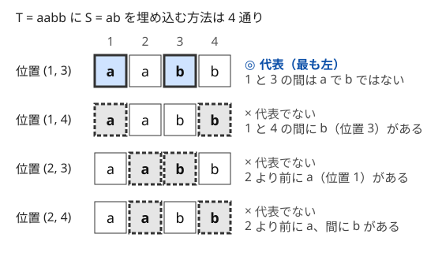

!!! abstract "要点"
    - **何ができるか**：同じ対象を何度も数えてしまう数え方を、ちょうど 1 回ずつの数え方に直す。どの対象もちょうど $c$ 回ずつ数えられているなら $c$ で割り、回数がばらばらなら対象ごとに代表元を 1 つ決めて代表元だけを数える。数え上げ DP では、最も左を取る・最小番号から決めるなどの規則で作り方を 1 通りにする。
    - **いつ使うか**：
        - 異なる〜の個数（種類数）を問われる。
        - 操作で作れる文字列（列）の種類数を問われる。
        - S を[部分列](../guide/glossary.md#subsequence)として含む文字列の個数を問われる。
        - 区別しないグループに分ける方法の数を問われる。
        - 作り方（遷移の列）を数える式で、同じ対象が複数回数えられてしまう。
    - **計算量**：割り算と代表元の式は、階乗の前計算 $O(N)$ の後に 1 つあたり $O(1)$〜$O(N)$。最小番号から決めるグループ分けの DP は $O(3^N)$。
    - **前提**：[数え上げの考え方](../comb/counting-mindset.md)、[DP の状態の設計](../dp/dp-state-design.md)

<!-- textlint-disable -->
別名：ダブルカウントを防ぐ・重複を除く・代表元・正規形・最左マッチ・最小添字規則
<!-- textlint-enable -->

重複の除き方は、「作り方」を数えると「できあがった対象」を何度も数えてしまうときに、数え方をちょうど 1 回に直す考え方である。数え上げでは、対象そのものより作り方の方が数えやすいことが多い。作り方から対象への対応が 1 対 1 でないときの直し方は、重複の回数（[重複度](../guide/glossary.md#multiplicity)）がそろっているかで決まる。

## 重複度が一定なら割る（同じものを含む順列・円順列） {#divide}

数えたいものを対象、数えやすいものを作り方と呼ぶ。作り方から対象への対応で、**どの対象にもちょうど $c$ 個の作り方が対応する**なら、対象の数は（作り方の数）$\div c$ である。割り算が使えるのはこの条件を確かめたときだけで、確かめ方は「1 つの対象を作る作り方が、対象によらず同じ数だけある」と言えるかどうかである。

| 対象 | 作り方 | 重複度 $c$ | 対象の数 |
| --- | --- | --- | --- |
| aab の並べ替え | 3 文字を区別した並べ方 | $2!$（2 つの a の入れ替え） | $3!/2! = 3$ |
| $n$ 人の円卓の座り方（回転は同じ） | 一列の並べ方 | $n$（どこから読むか） | $(n-1)!$ |
| $n$ 人を名前のない $k$ 組に分ける（どの組も 1 人以上） | 組に名前を付けた分け方 | $k!$（名前の付け方） | 名前付きの数 $\div k!$ |

どの例でも、重複度がそろう理由は「入れ替えた結果がどれも互いに違う」ことである。円卓では $n$ 人がみな違うので、読み始めを変えた $n$ 本の列は全部違う。組分けでは、どの組も 1 人以上を含み中身が違うので、名前の付け方 $k!$ 通りは全部違う名前付きの分け方になる。同じものを含む順列の式と、同じ大きさの組を割る式は[多項係数](../comb/multinomial-coefficient.md)にまとめてある。

入れ替えても変わらない対象が混ざると、重複度がそろわない。6 個の玉を輪にして 4 色で塗り、回転で重なるものを同じとみなすとき、$4^6 / 6$ は整数にすらならない。全部同じ色の輪は回転しても 1 通りの塗り方にしか対応しないからである。回転や裏返しで同一視する数え方は [Burnside の補題](../comb/burnside-lemma.md#why-not-divide)で扱う。

## 重複度が一定でないなら代表元を決める {#representative}

重複度がばらばらなときは、割り算をあきらめ、対象ごとに作り方を 1 つだけ選ぶ規則を決める。選ばれた作り方を[代表元](../guide/glossary.md#representative)（正規形）と呼ぶ。代表元だけを数えれば、どの対象もちょうど 1 回ずつ数えられる。

規則には次の 2 つが要る。

- **どの対象にも代表元がちょうど 1 つある**：規則が「最も左」「最小番号」「辞書順で最小」のように、候補の中から必ず 1 つを決める形であれば満たされる
- **ある作り方が代表元かどうかを局所的に判定できる**：作り方を 1 つずつ組み立てながら（DP の遷移の中で）代表元でないものを捨てられないと、数えられない

2 つ目が要の部分である。「最も左の埋め込み」は「間に次の文字が現れない」という、隣どうしの条件に言い換えられるので数えやすい。代表元の規則を考えるときは、規則を満たす作り方がどんな局所的な条件で書けるかまで詰める。

重複している作り方が少なく、どれが重なるかが見えているなら、全体から代表元でない作り方を引いてもよい。値が 1 つだけ 2 回現れる数列の部分列の種類数を数える[例題 ARC077 D](#arc077_b)がこの形で、重なるのは「重複した値を 1 つだけ使い、2 か所の間から何も選ばない」取り出し方だけである。

## 部分列として含む文字列は最も左の埋め込みで数える {#leftmost}

長さ $N$ の文字列 $S$ を[部分列](../string/subsequence-matching.md)として含む長さ $L$ の文字列 $T$ を数える。文字は $\sigma$ 種類（英小文字なら $\sigma = 26$）とする。「$T$ の中で $S$ に使う位置の組（埋め込み）」を作り方にすると、1 つの $T$ に埋め込みが何通りもあり、その数は $T$ ごとに違う。



代表元は**最も左の埋め込み**にする。$S$ の文字を先頭から順に、$T$ の中でまだ使っていない最も左の位置に合わせていく埋め込み（貪欲な照合）である。位置を 1-indexed で $p_1 < p_2 < \dots < p_N$ とすると、最も左であることは次の局所的な条件と同値になる。

- $p_1$ より前に $S_1$ が現れない
- 各 $i$ について、$p_{i-1}$ と $p_i$ の間に $S_i$ が現れない
- $p_N$ より後ろの文字は何でもよい

$p_{i-1}$ と $p_i$ の間に $S_i$ があれば、そこに $S_i$ を合わせる方が左なので、最も左ではない。逆にこの条件を満たせば、貪欲な照合が $p_1, p_2, \dots$ をこの順に選ぶ。こうして $T$ と「条件を満たす埋め込み」が 1 対 1 に対応する。

数えるときは、$p_N$ より後ろの文字数 $j$（$0 \le j \le L - N$）で分ける。$p_N = L - j$ で、その前の $L - j - 1$ 文字の中に $p_1, \dots, p_{N-1}$ の位置を選ぶ。埋め込みに使わない文字は、$p_N$ より前なら「次に合わせたい文字」以外の $\sigma - 1$ 通り、後ろなら $\sigma$ 通りである。

$$
\#\{T\} = \sum_{j=0}^{L-N} \binom{L-j-1}{N-1} (\sigma - 1)^{L-N-j} \, \sigma^{j}
$$

式に $S$ の中身が現れないので、答えは $S$ の長さだけで決まる。aab でも abc でも、含む文字列の数は同じである。式をそのまま計算すると次のようになる。コード片の全体では、$\sigma = 3$ の小さい場合に全列挙と一致することも確かめている。

```cpp
--8<-- "counting-dedup/leftmost.cpp:core"
```

完全なプログラム：[`leftmost.cpp`](https://github.com/yuukougun/kyopro-atlas/blob/main/snippets/counting-dedup/leftmost.cpp)（GitHub）。`mint` は ACL の `modint1000000007`（[modint](../math/modint.md)）。
{ .kp-code-src }

最も左の埋め込みは DP でも使える。「$T$ を左から作り、貪欲な照合で $S$ の何文字目まで合わせたか」を状態にすると、各文字で「次に合わせたい文字を置いて 1 進む」（1 通り）か「それ以外を置いて止まる」（$\sigma - 1$ 通り）に分かれる。全部合わせた後は $\sigma$ 通りである。1 つの文字列の異なる部分列の種類数も同じ考え方で数える。[部分列 DP](../dp/subsequence-dp.md#next-table-dp) では、次の出現位置の表を使って最も左の取り出し方だけを数える。

## グループ分けは未使用の最小番号から決める {#min-index}

番号の付いた $N$ 個を名前のないグループに分けるとき、「次に作るグループ」を自由に選ぶと、グループを作る順の分だけ同じ分け方を数えてしまう。グループの数が分け方ごとに違えば重複度もそろわず、割り算では直せない。代表元の規則は「**まだグループのない最小番号の要素を、次に作るグループに必ず入れる**」である。分け方が決まれば、グループを作る順は「各グループの最小番号の小さい順」の 1 通りに決まる。この規則は最小添字規則とも呼ばれる。

全列挙で使う形（各要素を順に「今あるグループに入れる」か「新しいグループを作る」か）は[再帰による全列挙の組分け型](../basics/recursive-enumeration.md#partition)にある。ここでは DP で使う 2 つの形を挙げる。

**部分集合の DP**。$\mathrm{dp}[X]$ ＝ 集合 $X$ を条件を満たすグループに分ける方法の数、とする。$X$ の最小番号の要素 $v$ を含むグループ $Y$（$v \in Y \subseteq X$）を選び、残りを $\mathrm{dp}[X \setminus Y]$ で数える。

$$
\begin{aligned}
\mathrm{dp}[X] &= \sum_{\substack{v \in Y \subseteq X \\[0.3em] Y \text{ がグループにできる}}} \mathrm{dp}[X \setminus Y], \\
\mathrm{dp}[\varnothing] &= 1
\end{aligned}
$$

部分集合の部分集合を回すので、全体で $O(3^N)$ になる（[部分集合の部分集合を回す DP](../dp/subset-enumeration-dp.md)）。

```cpp
--8<-- "counting-dedup/partition-dp.cpp:core"
```

完全なプログラム：[`partition-dp.cpp`](https://github.com/yuukougun/kyopro-atlas/blob/main/snippets/counting-dedup/partition-dp.cpp)（GitHub）
{ .kp-code-src }

**大きさで数える DP**。グループの作り方の数がグループの大きさだけで決まる（どの要素が入るかによらない）なら、状態を「使った要素の数」に縮められる。$\mathrm{dp}[n]$ は、最小番号の規則でグループを順に作り、合わせて $n$ 個を使い終えた途中の状態の数とする（どの $n$ 個を使ったかも区別して数える）。次のグループは残りの最小番号の要素を必ず含む。大きさ $k$ なら、ほかの $k - 1$ 個を残りの $N - n - 1$ 個から選び、$\mathrm{dp}[n + k] \mathrel{+}= \mathrm{dp}[n] \cdot \binom{N - n - 1}{k - 1} \cdot (\text{大きさ } k \text{ のグループの作り方})$ とする。以後の数え方は残りの個数だけで決まるので、どの $n$ 個を使ったかを状態に持たなくてよい。頂点に番号の付いたグラフを連結成分ごとに数えるとき（[力試し ABC180 F](#challenge)）がこの形である。

## DP の中で代表を決める（何も変えない操作を除く・最初に〜で場合分け・包除で重なりを引く） {#in-dp}

数え上げ DP では、どの決め方もちょうど 1 つの遷移の列に対応しなければならない（[状態の設計](../dp/dp-state-design.md)）。作り方が対象より多いときは、遷移に代表元の条件を組み込む。よく使う型は次の 4 つである。

- **最も左を取る**：異なる部分列・部分文字列の種類数を数えるとき、取り出す位置を最も左に限る。遷移先を「次にその文字が現れる位置」の 1 か所にする。[部分列 DP](../dp/subsequence-dp.md#leftmost) と[最も左の埋め込み](#leftmost)がこの型である
- **何も変えない操作を除く**：操作の結果の種類数を数えるとき、何も変えない操作や、同じ結果を作る別の操作を遷移から除く。たとえば「同じ色の 2 か所を選び、その間をその色で塗る」操作で作れる列を数えるなら、隣り合う 2 か所を選んでも何も変わらないので遷移に入れない。結果を作る操作の列を「最後に塗った区間の左端を、直前の同じ色の位置に限る」のように 1 通りに絞り、遷移元を 1〜2 個にする（[区間分割 DP の例題 AGC031 B](../dp/dp-sequence-partition.md#agc031_b)）
- **最初に〜したところで場合分け**：「条件を 1 回以上満たす」ものを数えるとき、条件を満たす位置が複数あると、どの位置で数えたかが重なる。「最初に満たした位置」で場合分けし、それより前では満たさないことを状態か式で保証する。グリッドの経路で「障害物を通る経路」を数えるなら、最初に通った障害物で分ける（[包除原理を DP に載せる](../comb/inclusion-exclusion-dp.md#first-obstacle)）
- **包除で重なりを引く**：「A を使わないもの」と「B を使わないもの」を足すと、両方を使わないものを 2 回数える。重なりが 1 つの状態で表せるなら、それを 1 回引く。2 つの列の共通部分列の組を数える [LCS のページの組の数](../dp/lcs.md#count-pairs)がこの型である

どの型でも、DP を書く前に「1 つの対象に対して、遷移の列が 1 通りに決まるか」を言葉で確かめる。確かめにくいときは、小さい入力で対象を全列挙し、DP の値と比べる（[数え上げの考え方](../comb/counting-mindset.md#verify-small)）。

## 落とし穴 {#pitfalls}

### グループの順序を区別して K! 倍に数える {#pitfall-order}

グループ分けの DP を「残りの要素から好きな部分集合を選んで次のグループにする」と書くと、グループを作る順の違いを別物として数える。3 人を名前のないグループに分ける方法は 5 通りだが、この DP は 13 通り（1 組が 1 通り、2 組が $3 \times 2! = 6$ 通り、3 組が $1 \times 3! = 6$ 通り）を出す。$K$ 組の分け方が $K!$ 倍されており、$K$ が分け方ごとに違うので、最後に 1 つの数で割っても直らない。避け方は 2 つある。

- 最小番号の要素を含むグループから作る（[最小番号から決める](#min-index)）。DP の遷移で「残りの最小番号を含む」を条件にするだけでよい
- グループの数 $K$ を状態に持ち、最後に $K!$ で割る。どのグループも空でなく中身が違うので、$K$ ごとには重複度が $K!$ でそろう

**重複度がそろわないのに割る**。「区別して数えて $c$ で割る」は、入れ替えても変わらない対象があると壊れる。回転で同一視する輪や、空のグループを許す分け方がこれにあたる。割る前に、重複度が対象によらないことを確かめる（[数え上げの考え方の落とし穴](../comb/counting-mindset.md#pitfalls)）。

**最も左の埋め込みで「間に現れない」を落とす**。部分列として含む文字列を「$S$ の位置を選んで、残りは $\sigma$ 通り」と数えると、埋め込みが複数ある文字列を何度も数える。$p_N$ より前の使わない文字は $\sigma - 1$ 通りに限る。後ろの文字は $\sigma$ 通りのままでよく、ここまで $\sigma - 1$ にすると逆に数え漏らす。

**「ちょうど 1 回」の確かめを例 1 つで済ませる**。重複は特別な形（同じ文字が続く・対称な形・空のグループ）でだけ起きることが多い。検算する小さい入力には、同じ値が並ぶものや、すべて同じ値のものを必ず入れる。

## 例題 {#examples}

### ARC077 D. 11 {#arc077_b}

<div class="kp-problems" data-role="example" markdown>

- [ARC077 D. 11](https://atcoder.jp/contests/arc077/tasks/arc077_b)（diff 1715）：1〜n がそれぞれ現れ、1 つの値だけが 2 回現れる長さ n+1 の数列について、各 k で長さ k の異なる部分列の数を求める。

</div>

取り出す位置の組を作り方にすると $\binom{n+1}{k}$ 通りある。ただし内容が同じ部分列を 2 回数えることがある。重なるのがどの取り出し方かを特定して、代表元でない方を引く。

??? note "解法の詳細"
    - 2 回現れる値の位置を 1-indexed で $l < r$ とする。重複した値を使わない取り出し方と、両方使う取り出し方は、内容から位置が 1 通りに決まる。
    - 重複した値を 1 つだけ使うとき、$l$ と $r$ の間から 1 つでも選んでいれば、$l$ を使うか $r$ を使うかで内容が変わる。間から何も選ばないときだけ、$l$ を使っても $r$ を使っても同じ内容になる。
    - 代表元を「$l$ の方を使う取り出し方」にすると、代表元でないのは「$r$ を使い、閉区間 $[l, r]$ の中から他に何も選ばない」取り出し方である。残りの $k - 1$ 個は区間の外の $n + 1 - (r - l + 1) = n + l - r$ 個から選ぶ。
    - 答えは $\binom{n+1}{k} - \binom{n + l - r}{k - 1}$ で、範囲外の二項係数は 0 とする。$k = 1$ なら $(n + 1) - 1 = n$ で、値の種類数に一致する。
    - 階乗と逆階乗を前計算しておけば、各 $k$ が $O(1)$、全体で $O(n)$ である（[二項係数の前計算](../comb/binomial-precompute.md)）。

### ABC171 F. Strivore {#abc171_f}

<div class="kp-problems" data-role="example" markdown>

- [ABC171 F. Strivore](https://atcoder.jp/contests/abc171/tasks/abc171_f)（diff 1795）：文字列 S に英小文字をちょうど K 回挿入してできる文字列の数を求める。

</div>

挿入の列を数えると、同じ文字列が何通りもの挿入で作れて重複する。まず数える対象を「$S$ を部分列として含む長さ $\lvert S \rvert + K$ の文字列」に言い換え、[最も左の埋め込み](#leftmost)を代表元にして数える。

??? note "解法の詳細"
    - $S$ に $K$ 文字挿入した文字列は $S$ を部分列として含む。逆に $S$ を部分列として含む長さ $\lvert S \rvert + K$ の文字列は、埋め込みに使わない $K$ 文字を挿入すれば作れる。だから 2 つの集合は等しい。
    - $N = \lvert S \rvert$、$L = N + K$、$\sigma = 26$ として、[最も左の埋め込み](#leftmost)の式 $\sum_{j=0}^{K} \binom{N+K-j-1}{N-1} 25^{K-j} 26^{j}$ を計算する。$S$ の中身は答えに効かない。
    - 階乗を $N + K$ まで前計算し、25 と 26 の累乗も前計算すれば $O(N + K)$ である。法は $10^9 + 7$ である。

## 練習問題 {#practice}

<div class="kp-problems" data-role="practice" markdown>

- [ABC310 D. Peaceful Teams](https://atcoder.jp/contests/abc310/tasks/abc310_d)（diff 1368）：N ≤ 10 人を T 個のチームに分ける方法のうち、仲の悪い組が同じチームにならないものの数を求める。
- [ABC130 E. Common Subsequence](https://atcoder.jp/contests/abc130/tasks/abc130_e)（diff 1676）：2 つの数列から、同じ値の列になる部分列の組（取り出す位置の組）の数を求める。
- [ABC311 F. Yet Another Grid Task](https://atcoder.jp/contests/abc311/tasks/abc311_f)（diff 1984）：一部のマスが黒い N×M のグリッドで、白いマスを黒く塗り、どの黒いマスについても真下と右下のマスが黒かグリッドの外になるようにする方法の数を求める。

</div>

??? note "練習の方針"
    - **ABC310 D**：チームに名前がないので、まだチームのない最小番号の人から入るチームを決める（[最小番号から決める](#min-index)）。全列挙の書き方は[再帰による全列挙の例題](../basics/recursive-enumeration.md#abc310_d)にある。
    - **ABC130 E**：取り出す位置が違えば別に数える。「$S$ の末尾を使わない組」と「$T$ の末尾を使わない組」を足すと両方を使わない組を 2 回数えるので、包除で引く（[LCS のページの組の数](../dp/lcs.md#count-pairs)）。
    - **ABC311 F**：黒いマスは下へ広がるので、各列の黒いマスは下側にまとまる。塗り終えた盤面を「各列の上から続く白いマスの数」の列で表すと、盤面と列が 1 対 1 に対応し、塗る順序の重複が出ない。あとは隣り合う列の白の数にどんな条件が要るかを考え、列ごとに DP する。

## 力試し {#challenge}

<div class="kp-problems" data-role="challenge" markdown>

- [ABC180 F. Unbranched](https://atcoder.jp/contests/abc180/tasks/abc180_f)（diff 2419）：自己ループのない（多重辺は許す）N 頂点 M 辺の無向グラフで、各連結成分がパスか閉路で、最大の連結成分の頂点数がちょうど L のものの数を求める。

</div>

??? note "力試しの方針"
    - 「最大の連結成分がちょうど $L$」は「$L$ 以下」の数から「$L - 1$ 以下」の数を引く（[「ちょうど」を「以下」の差で数える](../comb/counting-mindset.md#exactly-vs-at-most)）。
    - 連結成分を 1 つずつ足す DP にすると、成分を足す順の分だけ重複する。まだ使っていない最小番号の頂点を含む成分から決め、その成分のほかの頂点を残りから選ぶ（[大きさで数える DP](#min-index)）。状態は使った頂点の数と辺の数である。
    - 頂点数 $k$ の成分の作り方は、パスなら $k = 1$ で 1 通り、$k \ge 2$ で $k!/2$ 通り、閉路なら $k = 2$（2 本の辺）で 1 通り、$k \ge 3$ で $(k-1)!/2$ 通りである。境界の $k$ で式が変わる点に注意する。

## 確認問題 {#quiz}

??? question "確認問題：割ってよい理由"
    aab の並べ替えの数を、3 文字を区別した並べ方 $3!$ を $2!$ で割って求めてよいのはなぜか。

    ??? success "答え"
        2 つの a を区別した並べ方は、どの並べ替えに対してもちょうど 2 通り（a の入れ替え）ずつある。重複度が並べ替えによらず 2 でそろうので、$3!/2! = 3$ が並べ替えの数になる。

??? question "確認問題：輪を割ってはいけない理由"
    6 個の玉を輪にして 4 色で塗り、回転で重なるものを同じとみなす。$4^6 / 6$ が答えにならないのはなぜか。

    ??? success "答え"
        回転して自分自身に重なる塗り方は、回転させた 6 通りの中に同じ塗り方が何度も現れるので、重複度が 6 より小さい。全部同じ色の塗り方は 1 通りにしかならない。重複度がそろわないので割り算は使えず、実際 $4^6 / 6$ は整数にならない。[Burnside の補題](../comb/burnside-lemma.md#necklace)で数える。

??? question "確認問題：2 チームに分ける"
    3 人を名前のない 2 チーム（どちらも 1 人以上）に分ける方法は何通りか。「各人がチーム 0 とチーム 1 のどちらに入るか」の $2^3$ 通りから直すとどうなるか。

    ??? success "答え"
        3 通りである（1 人だけのチームを誰にするか）。$2^3 = 8$ 通りから、全員が同じチームの 2 通りを除くと 6 通りで、どの分け方もチームの名前の付け方 $2!$ 通りずつ数えているので 2 で割って 3 通りになる。空のチームを除いてから割るのが要で、除かずに $8 / 2 = 4$ とすると誤りである。

??? question "確認問題：含まない方から数える"
    $\sigma = 26$、$S$ の長さを $N$、$L = N + K$ とする。$S$ を部分列として含む長さ $L$ の文字列の数が $\sum_{i=0}^{K} \binom{L}{i} 25^{i}$ とも書けるのはなぜか。

    ??? success "答え"
        貪欲な照合で $S$ の先頭 $m$ 文字（$m < N$）までしか合わない文字列は、合った $m$ か所の位置を選び、残り $L - m$ 文字をそれぞれ「次に合わせたい文字以外」の 25 通りにしたものなので $\binom{L}{m} 25^{L-m}$ 個ある。全体 $26^L = \sum_{m=0}^{L} \binom{L}{m} 25^{L-m}$ から $m < N$ の項を引くと $\sum_{m=N}^{L} \binom{L}{m} 25^{L-m}$ が残り、$i = L - m$ と置けば式になる。

## 使い分け {#comparison}

- **割り算**：どの対象も同じ回数ずつ数えていると示せるときに使う。式が最も短い。示せなければ使わない
- **代表元**：重複度がばらばらでも使える。「最も左」「最小番号」「最初に〜」のように、局所的な条件で書ける規則を選ぶ。数え方は DP になることが多い
- **包除**：重なり方が「A と B の両方」のように少数の集合の共通部分で書けるときに使う。一般の形は[包除原理](../comb/inclusion-exclusion.md)
- **Burnside の補題**：回転・裏返しなどの対称性で同一視するときに使う。代表元の規則が局所的に書けない場合の受け皿である
- 対象を別のものに 1 対 1 で言い換えられるなら、重複を除く前に[対応づけ](../comb/counting-bijection.md)で数えやすい対象に移す方が早いこともある

## 参考 {#references}

- [kmjp「AtCoder ARC #077 : D - 11」](https://kmjp.hatenablog.jp/entry/2017/07/02/0900)：例題 ARC077 D の、重複した値の 2 か所の間から選ぶかどうかでの場合分け
- [drken「AtCoder ABC 171 F - Strivore (青色, 600 点)」](https://drken1215.hatenablog.com/entry/2020/06/27/125500)：例題 ABC171 F の、最も左の埋め込みによる数え方と、文字列の中身によらないこと
- [drken「AtCoder ABC 180 F - Unbranched (橙色, 600 点)」](https://drken1215.hatenablog.com/entry/2020/10/21/145700)：最小添字規則の考え方と、力試し ABC180 F の連結成分を足す DP
- [drken「AtCoder ABC 311 F - Yet Another Grid Task (青色, 525 点)」](https://drken1215.hatenablog.com/entry/2023/07/24/182416)：練習 ABC311 F の、列ごとの白いマスの数による DP
- [drken「AtCoder ABC 310 D - Peaceful Teams (1Q, 水色, 400 点)」](https://drken1215.hatenablog.com/entry/2023/07/17/213800)：練習 ABC310 D の、最小番号から組を決める全列挙
- [drken「AtCoder ABC 130 E - Common Subsequence (1D, 青色, 500 点)」](https://drken1215.hatenablog.com/entry/2019/06/21/230200)：練習 ABC130 E の、包除で重なりを引く DP
