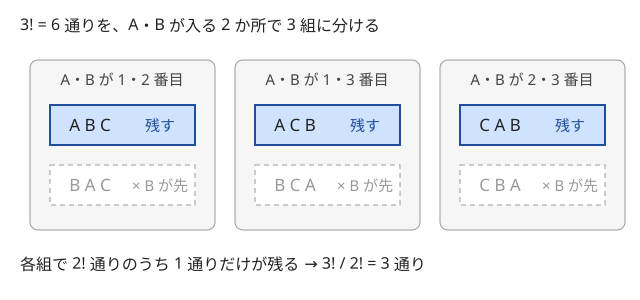
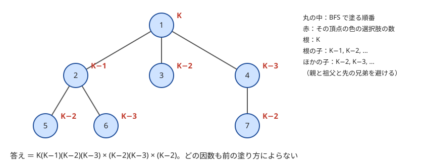

!!! abstract "要点"
    - **何ができるか**：並べ方の一部の相対順序を固定して数え、全体の何分の一かを掛ける。$k$ 個の順序が決まっていれば $n!/k!$ 通りである。ソート順や BFS 順など、次の選択肢の数が一定になる順番で決めれば積の法則が使える。
    - **いつ使うか**：
        - A は B より先に来る、という順番の制約がある並べ方の数
        - 選んだ K 個の最大値（最小値）の総和
        - 木の頂点に、親が子より先になるように番号を振る方法の数
    - **計算量**：$n!/k!$ は階乗の前計算 $O(N)$ の後 $O(1)$。ソートして数えるときは $O(N \log N)$。木の上の積は $O(N)$（逆元の計算を除く）
    - **前提**：[数え上げの考え方](../comb/counting-mindset.md)

<!-- textlint-disable -->
別名：相対順序の固定・ソートしてから数える・数える順番の工夫・n!/k!
<!-- textlint-enable -->

順序を固定して数えるとは、数える対象の「並び方の自由度」の一部を先に固定し、固定した分を割り算や掛け算で戻す考え方である。もう 1 つの使い方は、決める順番そのものを選び、各段階の選択肢の数を前の選び方によらない値にすることである。どちらも、積の法則（[和・積の法則と順列・組合せ](../comb/counting-basics.md)）が使える形に持ち込むための工夫である。

このページでは、並べる $n$ 個の物はすべて区別し、添字は 0-indexed で書く。答えは素数 $p$（998244353 など）で割った余りを求めるものとする。

## 相対順序を固定する（n!/k!） {#relative-order}

$n$ 個の物を一列に並べるとき、決められた $k$ 個がこの順に現れる並べ方は $n!/k!$ 通りである。「A は B より先」「1, 2, 3 がこの順に現れる」のような制約を、1 つずつ場合分けせずに数えられる。

小さい例で確かめる。A・B・C の 3 個を並べ、A が B より先に来るものを数える。6 通りを、A と B が入る 2 か所で 3 組に分けると次の図のようになる。



どの組も「A・B の入る位置」と「ほかの物の並び」が同じで、A と B の入れ替えだけが違う 2 通りからなる。そのうち A が先のものはちょうど 1 通りである。だから全体の $1/2!$ が残り、$3!/2! = 3$ 通りになる。

一般の場合も同じ組分けで示せる。$n!$ 通りの並べ方を「決められた $k$ 個が入る位置の集合」と「ほかの $n - k$ 個の並び」で組に分ける。各組は $k$ 個の入れ替えの $k!$ 通りからなり、決められた順のものはちょうど 1 つである。組どうしは重ならず、どの並べ方もちょうど 1 つの組に入る。だから重複も漏れもなく $n!/k!$ 通りになる。

$$
\frac{n!}{k!} = \binom{n}{k} (n - k)!
$$

右辺は「$k$ 個が入る位置を選び（順序は 1 通り）、残りの位置にほかの物を並べる」と数えた式で、同じ値になる。計算は階乗と逆階乗を前計算しておけば $O(1)$ である（[二項係数の前計算](../comb/binomial-precompute.md)）。

順序の決まった組が互いに重ならずに複数あるときは、組ごとに割る。大きさ $k_1, k_2, \dots, k_m$ の組がそれぞれ決まった順に現れる並べ方は $n!/(k_1! \, k_2! \cdots k_m!)$ 通りで、これは[多項係数](../comb/multinomial-coefficient.md)である。同じ文字を含む並べ方の数え方と同じ式になるのは、「同じ文字どうしは左から順に番号を振る」と決めれば、2 つが 1 対 1 に対応するからである。

確率で読むこともできる。$n!$ 通りから一様に 1 つ選ぶと、決められた $k$ 個の相対順序は $k!$ 通りが等しい確率で現れる。どの順序も入れ替えで移り合うからである。よって決まった順になる確率は $1/k!$ で、個数は $n! \times 1/k!$ になる（[対称性で確率を求める](../comb/probability-symmetry.md)）。

??? question "確認問題：1, 2, 3 がこの順に現れる並べ方"
    1〜5 を並べる $5!$ 通りのうち、1, 2, 3 がこの順に（間にほかの数を挟んでもよい）現れるものは何通りか。また、「1 が 2 より先、かつ 1 が 3 より先」のものは何通りか。

    ??? success "答え"
        前者は $5!/3! = 20$ 通りである。後者は 2 と 3 の順序を問わないので、条件は「1, 2, 3 の中で 1 が最初」である。3 個の相対順序 $3! = 6$ 通りのうち、1 が最初のものは 2 通りなので $5! \times 2/6 = 40$ 通りになる。後者を $5!/3!$ と数えると、2 と 3 の順序まで固定したことになり半分に減る。

## ソートして最大・最小を固定する {#sort-and-fix}

$N$ 個の値から $K$ 個を選ぶすべての選び方について、最大値の総和を求めたいとする。選び方は $\binom{N}{K}$ 通りあり、1 つずつ作ると間に合わない。そこで、値を昇順にソートして「どの要素が最大になるか」で選び方を分ける。

ソート後の列を $a_0 \le a_1 \le \dots \le a_{N-1}$ とする。$a_i$ が選んだ $K$ 個の中で最も右（添字が最大）になる選び方は、$a_i$ を選び、残りの $K - 1$ 個を $a_0, \dots, a_{i-1}$ から選ぶものなので $\binom{i}{K-1}$ 通りである。どの選び方でも「添字が最大の要素」はちょうど 1 つなので、この分け方には重複と漏れがない。

$$
\sum_{\text{選び方}} \max = \sum_{i=0}^{N-1} a_i \binom{i}{K-1}
$$

$a = (1, 2, 3, 4)$、$K = 2$ で確かめる。式の値は $1 \cdot 0 + 2 \cdot 1 + 3 \cdot 2 + 4 \cdot 3 = 20$ である。全列挙すると $\{1,2\}, \{1,3\}, \{1,4\}, \{2,3\}, \{2,4\}, \{3,4\}$ の最大値は $2, 3, 4, 3, 4, 4$ で、和は $20$ になり一致する。最小値の総和は、$a_i$ が添字の最小になる選び方 $\binom{N-1-i}{K-1}$ 通りを掛ければよい。

ソートの役目は、「$a_i$ が最大」という条件を「$a_i$ より左からだけ選ぶ」という位置の条件に変えることである。位置の条件なら選び方は二項係数 1 つで数えられる。これは各要素の[寄与](../thinking/contribution.md)を数える考え方と同じで、総和を「各要素 × それが最大になる回数」に入れ替えている。

同じ値があるときは、値ではなく**ソート後の添字**で最大を決める。「$a_i$ より小さい値から $K - 1$ 個」で数えると、同じ値を 2 つ含む選び方はどちらの要素でも数えられず漏れる。「$a_i$ 以下の（自分以外の）値から」にすると、逆に両方で数えられて重複する。添字で決めれば最大の要素は必ず 1 つで、その値は同じ値のどれを選んでも等しいので、総和は正しい。

## 積の法則が使える順番で決める（BFS 順） {#bfs-order}

積の法則が使えるのは、各段階の選択肢の**数**が、それまでの選び方によらず一定のときだけである。選択肢の中身は変わってもよい。決める順番を変えると、この条件が成り立つようになることがある（[決める順番を変えて積の法則を使えるようにする](../comb/counting-basics.md#order-of-choice)）。

最も素朴な例は、上限付きの値を互いに違うように選ぶ数え方である。各 $i$ について $1$ 以上 $C_i$ 以下の整数を、すべて異なるように選ぶ方法を数える。$C$ を昇順に並べ替え、並べ替えた後の $C_0 \le C_1 \le \dots$ の順に決めると、$i$ 番目（0-indexed）の時点で使われている $i$ 個の値はどれも $C_i$ 以下にある。だから選択肢は必ず $C_i - i$ 個で、答えは $\prod_i \max(0, C_i - i)$ になる。上限の大きい順に決めると、先に使われた値が $C_i$ 以下かどうかが選び方で変わり、選択肢の数が一定にならない。

木の塗り分けでも同じ考え方が効く。$N$ 頂点の木の各頂点を $K$ 色で塗り、距離 2 以下の 2 頂点がすべて異なる色になる塗り方を数える。根から BFS 順に塗ると、次の図のように各頂点の選択肢の数が決まる。



頂点 $v$ を塗るとき、距離 2 以内ですでに塗ってある頂点は、親・祖父・先に塗った兄弟だけである。子・孫・おじ（親の兄弟）・兄弟の子は、まだ塗っていないか距離が 3 以上ある。そして親・祖父・兄弟たちは**互いに距離 2 以内**なので、色がすべて異なる。よって避ける色の数は「親と祖父と先の兄弟の個数」そのもので、それらがどの色かによらない。

- 根：$K$ 通り
- 根の子：兄弟の順に $K - 1, K - 2, \dots$ 通り
- それ以外の頂点の子：兄弟の順に $K - 2, K - 3, \dots$ 通り

答えはこれらの積である。どこかの因数が 0 以下になったら塗り方はないので、答えは 0 になる。

```cpp
--8<-- "counting-fix-order/bfs-coloring.cpp:core"
```

大事なのは「どの頂点も親より後に塗る」ことだけである。この順番なら、$v$ を塗る時点で $v$ の子孫はまだ塗られていないので、距離 2 以内で塗り終わっているのは親・祖父・兄弟の一部に限られる。だから BFS 順に限らず、行きがけ順の DFS でも成り立つ。逆に、親より先に子孫を塗る順番では壊れる。たとえばパス $a - b - c - d - e$ で $a$ と $e$ を先に塗ると、$a$ と $e$ は距離 4 なので同じ色と違う色のどちらでもよい。次に $c$ を塗るとき、避ける色は $a$ と $e$ が同じ色なら 1 個、違えば 2 個になり、選択肢の数が一定にならない。

??? question "確認問題：兄弟の塗り方に依存しない理由"
    根から BFS 順に塗るとき、根でない頂点 $v$ の 3 番目の子の選択肢は $K - 4$ 通りである。これが、$v$・$v$ の親・先の 2 人の兄弟の具体的な色によらないのはなぜか。

    ??? success "答え"
        避ける色は $v$・$v$ の親・先に塗った 2 人の兄弟の 4 頂点の色である。この 4 頂点はどの 2 つも距離 2 以内（兄弟どうしは $v$ を挟んで距離 2、兄弟と $v$ の親も距離 2）なので、条件によりすべて異なる色で塗られている。だから避ける色は必ず 4 色で、残りは $K - 4$ 色になる。具体的な色は変わっても、数は変わらない。

## 木の上の順番 n!/Π 部分木の大きさ {#tree-order}

この節は[全方位木 DP](../dp/rerooting.md)と[逆元と mod での割り算](../math/mod-inverse.md)を前提にする。$N$ 頂点の根付き木の各頂点へ $1, 2, \dots, N$ の番号を 1 つずつ振り、どの頂点も親より大きい番号になるようにする方法の数は、次の式になる。$\mathrm{sz}[v]$ は $v$ の部分木の頂点数である。

$$
\frac{N!}{\prod_{v} \mathrm{sz}[v]}
$$

「親が子より先」という制約は、[相対順序を固定する](#relative-order)の「$k$ 個がこの順」を木の形に広げたものである。各頂点 $v$ について、$v$ は自分の部分木の $\mathrm{sz}[v]$ 個の中で最初に来なければならない。一様な並べ方でこれが起きる確率は $1/\mathrm{sz}[v]$ で、それらを掛けた割合が残ると読める。ただし、確率を掛けてよい（独立である）理由が自明でないので、次の帰納法で示す。

??? note "証明"
    $v$ の部分木の中での振り方の数を $f(v)$ とし、$f(v) = \mathrm{sz}[v]! / \prod_{u} \mathrm{sz}[u]$（$u$ は $v$ の部分木の頂点）を部分木の大きさについての帰納法で示す。葉なら $f(v) = 1 = 1!/1$ である。

    $v$ は部分木の中で最初でなければならないので、$v$ が最小の番号を取る。残りの $\mathrm{sz}[v] - 1$ 個の番号を、子 $c_1, \dots, c_m$ の部分木に配る。どの番号をどの部分木に配るかは多項係数で $(\mathrm{sz}[v] - 1)! / \prod_j \mathrm{sz}[c_j]!$ 通りある。部分木どうしの間には制約がないので、配った後は各部分木の中で独立に $f(c_j)$ 通りずつ決められる。

    $$
    f(v) = \frac{(\mathrm{sz}[v] - 1)!}{\prod_j \mathrm{sz}[c_j]!} \prod_j \frac{\mathrm{sz}[c_j]!}{\prod_{u \in c_j \text{ の部分木}} \mathrm{sz}[u]} = \frac{\mathrm{sz}[v]!}{\mathrm{sz}[v] \prod_{u \ne v} \mathrm{sz}[u]}
    $$

    最後の式は示したい形そのものである。根で $\mathrm{sz} = N$ とすれば全体の式になる。

小さい例で確かめる。根に葉が 3 つ付いた木では、根が 1 番で、残りの 3 個は自由なので $3! = 6$ 通りである。式では $4!/(4 \cdot 1 \cdot 1 \cdot 1) = 6$ で一致する。長さ 3 のパスを端から根付けると、番号は 1 通りしか振れず、式も $3!/(3 \cdot 2 \cdot 1) = 1$ になる。

すべての頂点を根としたときの値が欲しいなら、根を隣へ移すときの変化を見る。根を $u$ からその子 $v$ へ移すと、部分木の大きさが変わるのは $u$ と $v$ だけである。$u$ は $N$ から $N - \mathrm{sz}[v]$ に、$v$ は $\mathrm{sz}[v]$ から $N$ に変わる（$\mathrm{sz}$ は根 $u$ のときの値）。よって次の式で、根 0 の答えから全頂点の答えが $O(N)$ 回の掛け算と割り算で出る。

$$
\mathrm{ans}[v] = \mathrm{ans}[u] \cdot \frac{\mathrm{sz}[v]}{N - \mathrm{sz}[v]}
$$

```cpp
--8<-- "counting-fix-order/tree-order.cpp:core"
```

割り算は法 $p$ での逆元を掛けることで行う。$1 \le N - \mathrm{sz}[v] < p$ なので、逆元は必ずある。

## 順序を状態に持つ DP（挿入 DP・bitDP）との使い分け {#vs-dp}

ここまでの方法が使えるのは、制約が「1 本の鎖」「互いに重ならない鎖の集まり」「木（各頂点が部分木の中で最初）」の形で、閉じた式で割合が分かるときである。制約がそれより複雑なら、順序を状態に持つ DP に切り替える。

- **制約が一般の[半順序](../guide/glossary.md#partial-order)で $N \le 20$ 程度**：すでに並べた物の集合を状態にし、「前提がすべて並んだ物」を次に置く[bitDP](../dp/bit-dp.md)で数える。状態数 $2^N$ に遷移 $N$ を掛けて $O(2^N N)$ である
- **隣り合う 2 つの大小（「$<$」「$>$」の列）が決まっている**：左から 1 つずつ置き、「最後に置いた物が、これまでの中で何番目に小さいか」を状態にする[挿入 DP](../dp/insertion-dp.md#relative-rank)で数える。状態は $N \times N$ 個で、遷移を累積和でまとめて $O(N^2)$ にする
- **閉じた式があるか迷うとき**：$N \le 8$ 程度の全探索の値を並べて、$n!/k!$ や $N!/\prod \mathrm{sz}$ と合うかを確かめる。合わなければ DP を考える

木の制約が「親が子より先」ではなく「親が子より後」でも同じ式である。番号 $i$ を $N + 1 - i$ に付け替えると、「親が子より後」の振り方と「親が子より先」の振り方が 1 対 1 に対応するからである。一方、ある頂点だけ「子が親より先」のように向きが混ざると、部分木の中で最初とは言えなくなり、式は使えない。そのときは木 DP で部分木の中での順位を状態に持つ。

## 落とし穴 {#pitfalls}

**固定した割合を取り違える**。「A が B より先、かつ A が C より先」は 3 個の順序のうち A が最初になるものなので、割合は $2/3! = 1/3$ である。3 個が A, B, C の順と読んで $1/3!$ にすると、B と C の順序まで固定してしまう。どの順序が許されるかを小さい例で数えてから割る。

**重なる組を別々に割る**。「A が B より先」と「B が C より先」を、別々の組と見て $n!/(2! \cdot 2!)$ とするのは誤りである。B を共有するので、合わせて「A, B, C の順」の 1 組になり $n!/3!$ になる。組に分けて割るのは、組どうしが物を共有しないときだけである。

**同じ値の最大を値で数える**。[ソートして最大・最小を固定する](#sort-and-fix)では、最大を「添字が最大の要素」で決める。「自分より小さい値から $K - 1$ 個」で数えると、同じ値を含む選び方が漏れる。

**選択肢の数が順番によって変わる**。積の法則で掛ける前に、その段階で避ける物どうしが必ず互いに異なることを確かめる。[BFS 順](#bfs-order)の例では「避ける頂点どうしが距離 2 以内」がその理由だった。理由が言えない順番では、パスの例のように数が変わる。

**mod を取った後に負かどうかを判定する**。$K - 2$ や $C_i - i$ が負なら答えは 0 だが、余りにした後の値は元の大小を表さない。`max(0, k - used)` のように、mod を取る前の整数で 0 に止めてから掛ける。

**$n!/k!$ を整数の割り算で計算する**。法 $p$ で $n! \bmod p$ を $k! \bmod p$ で整数として割っても答えにならない。$k!$ の逆元を掛けるか、$(k+1)(k+2) \cdots n$ を直接掛ける。

## 例題 {#examples}

### ABC133 E. Virus Tree 2 {#abc133_e}

<div class="kp-problems" data-role="example" markdown>

- [ABC133 E. Virus Tree 2](https://atcoder.jp/contests/abc133/tasks/abc133_e)（diff 1505）：N 頂点の木の各頂点を K 色で塗るとき、距離 2 以下の 2 頂点がすべて異なる色になる塗り方の数を求める。

</div>

根を決めて、根から BFS 順に塗る。どの頂点でも、すでに塗ってある距離 2 以内の頂点は親・祖父・先の兄弟だけで、それらは互いに色が異なる。だから各頂点の選択肢の数は塗り方によらず一定で、積の法則で答えが出る（[積の法則が使える順番で決める](#bfs-order)）。

??? note "解法の詳細"
    - 頂点 1 を根にする。根は $K$ 通りである。
    - 根の子が $c$ 個なら、それらは $K - 1, K - 2, \dots, K - c$ 通りを順に掛ける。根でない頂点の子が $c$ 個なら、$K - 2, K - 3, \dots, K - 1 - c$ 通りを掛ける。
    - 因数が 0 以下になったら答えは 0 である。mod を取る前の整数で判定する。
    - 各頂点の子の数を数えるだけなので $O(N)$ で、コードは[積の法則が使える順番で決める](#bfs-order)の節と同じ形である。法は問題に合わせる。

## 練習問題 {#practice}

<div class="kp-problems" data-role="practice" markdown>

- [ABC209 C. Not Equal](https://atcoder.jp/contests/abc209/tasks/abc209_c)（diff 285）：各 i について 1 以上 C_i 以下の整数を、すべて異なるように選ぶ方法の数を求める。
- [ARC116 B. Products of Min-Max](https://atcoder.jp/contests/arc116/tasks/arc116_b)（diff 816）：整数列の空でない部分列すべてについて、最大値と最小値の積を足し合わせた値を求める。
- [ABC151 E. Max-Min Sums](https://atcoder.jp/contests/abc151/tasks/abc151_e)（diff 1344）：N 個から K 個を選ぶすべての選び方について、（最大値 − 最小値）の総和を求める。
- [ABC216 F. Max Sum Counting](https://atcoder.jp/contests/abc216/tasks/abc216_f)（diff 1541）：添字の集合のうち、選んだ要素の A の最大値が B の和以上になるものの個数を求める。

</div>

??? note "練習の方針"
    - **ABC209 C**：$C$ を昇順に並べて小さい順に決めると、$i$ 番目（0-indexed）の選択肢は前の選び方によらず $C_i - i$ 個になる。積の法則で掛け合わせればよい（0 以下になれば 0 通り）
    - **ARC116 B**：ソートして最小 $a_i$ と最大 $a_j$ を固定すると、間の $j - i - 1$ 個は自由なので寄与は $a_i a_j 2^{j-i-1}$ になる。$i$ ごとに係数をまとめれば $O(N \log N)$ である
    - **ABC151 E**：ソートして、最大値の総和と最小値の総和を別々に求めて引く。$a_i$ が最大になる選び方は $\binom{i}{K-1}$ 通り、最小になる選び方は $\binom{N-1-i}{K-1}$ 通りである。同じ値は添字で区別する（[ソートして最大・最小を固定する](#sort-and-fix)）
    - **ABC216 F**：$A$ の昇順に並べて最大になる要素を固定すると、ほかに選べるのはそれより前の要素だけになる。$B$ の和が $A_i - B_i$ 以下になる選び方を、ナップサックの数え上げ DP で数えればよい

## 力試し {#challenge}

<div class="kp-problems" data-role="challenge" markdown>

- [ABC160 F. Distributing Integers](https://atcoder.jp/contests/abc160/tasks/abc160_f)（diff 2048）：木の各頂点 k について、k に 1 を書き、書いた頂点に隣接する頂点へ 2, 3, … と順に書いていく方法の数を求める。

</div>

??? note "力試しの方針"
    - **ABC160 F**：頂点 $k$ を根にすると、「書いた頂点に隣接する頂点へ書く」は「親に書いてから子に書く」と同じである。よって答えは $N!/\prod \mathrm{sz}[v]$ で、根を移すときは $\mathrm{sz}[v]/(N - \mathrm{sz}[v])$ を掛ける（[木の上の順番](#tree-order)）。多項係数を合わせる全方位木 DP でも解ける

## 参考 {#references}

- [drken「AtCoder ABC 133 E - Virus Tree 2 (1Q, 水色, 500 点)」](https://drken1215.hatenablog.com/entry/2019/07/08/002700)：例題の問いと、根の子と深い頂点の子で選択肢の数が変わること
- [kmjp「AtCoder ABC #133 : E - Virus Tree 2」](https://kmjp.hatenablog.jp/entry/2019/07/07/1000)：例題を DFS 順に塗り、親・祖父・先の兄弟の数だけ選択肢を減らす方針
- [drken「AtCoder ABC 151 E - Max-Min Sums (1Q, 水色, 500 点)」](https://drken1215.hatenablog.com/entry/2020/01/12/224100)：練習の問い（隣り合う差の寄与で数える別の方針）
- [kmjp「AtCoder ABC #160 : F - Distributing Integers」](https://kmjp.hatenablog.jp/entry/2020/03/28/1030)：力試しの問いと、部分木を多項係数で合わせる全方位木 DP
- [AKpirion「ABC209 C - Not Equal から学んだ」](https://qiita.com/AKpirion/items/21b1aead96fec77d67ef)：上限の小さい順に決めると選択肢が $C_i - i$ 個になること
- [ikatakos「AtCoder Regular Contest 116 A,B,C,D,E,F問題メモ」](https://ikatakos.com/pot/programming_algorithm/contest_history/atcoder/2021/0328_arc116)：練習 ARC116 B の最小と最大を固定した寄与（解説の部分だけを参照）
- [ikatakos「AtCoder Beginner Contest 216 F,G,H問題メモ」](https://ikatakos.com/pot/programming_algorithm/contest_history/atcoder/2021/0829_abc216)：練習 ABC216 F のソートで最大を固定する方針（解説の部分だけを参照）
