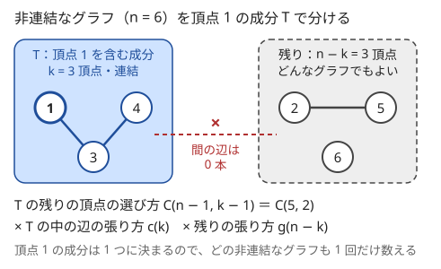
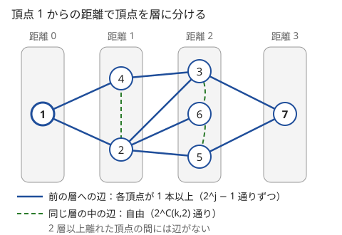

!!! abstract "要点"
    - **何ができるか**：連結なグラフの数を「全体 − 非連結なもの」で求める。非連結なものは頂点 1 を含む連結成分の大きさか頂点集合で分類して DP で数え、頂点 1 の成分は 1 つに決まるので、成分の順序による重複が出ない。
    - **いつ使うか**：
        - 条件を満たす（連結な）グラフの個数。
        - 辺の部分集合のうち、指定した頂点どうしが連結になるものの数。
        - $N \le 17$ 程度の頂点数で、条件を満たす辺の選び方を数える。
        - 最大の連結成分の大きさがちょうど $L$。
    - **計算量**：成分の数え方が大きさだけで決まるなら $O(N^2)$、頂点集合ごとの DP は $O(3^N)$、距離の層ごとに頂点を配る DP は $O(N^3)$。
    - **前提**：[数え上げの考え方](../comb/counting-mindset.md)、[二項係数の前計算](../comb/binomial-precompute.md)、[部分集合を列挙する DP](../dp/subset-enumeration-dp.md)。

<!-- textlint-disable -->
別名：連結グラフの数え上げ・全体から非連結を引く・頂点 1 を含む成分で分類・条件を満たすグラフの個数
<!-- textlint-enable -->

連結なグラフの数え上げは、頂点に番号の付いたグラフのうち連結なもの（や、連結成分に条件の付いたもの）の個数を求める手法である。連結という条件は辺どうしが絡み合うので直接は数えにくいが、「全体」は辺ごとに張る・張らないを選ぶだけで数えやすい。そこで全体から非連結なものを引き、非連結なものは頂点 1 を含む成分を先に決めて数える。

このページでは、頂点の番号は問題文に合わせて 1 から書き、コード片では 0 から書く（頂点 1 はコードの頂点 0）。$n$ 頂点のグラフの全体の数を $g(n)$、そのうち連結なものの数を $c(n)$ と書く。単純無向グラフなら頂点の組 $\binom{n}{2}$ 個のそれぞれに辺を張るか選ぶので $g(n) = 2^{\binom{n}{2}}$ である。

## 連結 = 全体 − 非連結 {#complement}

連結なグラフを直接数えようとすると、「この辺を張ったから、あの頂点にはもう届く」のように辺の選び方が互いに影響し、積の法則が使えない。反対に、連結とは限らないグラフの全体 $g(n)$ は辺ごとに独立なので $2^{\binom{n}{2}}$ ですぐ求まる。そこで[余事象](../comb/counting-mindset.md)の形にする。

$$
c(n) = g(n) - (\text{非連結な } n \text{ 頂点のグラフの数})
$$

この式が役に立つのは、非連結なグラフが「連結な部分」と「残り」に分かれ、連結な部分をより小さい $c(k)$ で数えられるからである。小さい $n$ から順に $c(n)$ を決めていけば、右辺に出てくる $c(k)$（$k < n$）はすでに求まっている。

小さい例で確かめる。$n = 3$ では $g(3) = 2^3 = 8$ で、全列挙すると次のとおりである。

| 張った辺の数 | グラフの数 | 連結か |
| --- | --- | --- |
| 0 本 | 1 | 非連結 |
| 1 本 | 3 | 非連結（1 頂点が孤立する） |
| 2 本 | 3 | 連結（パス） |
| 3 本 | 1 | 連結（三角形） |

非連結なものは 4 個なので $c(3) = 8 - 4 = 4$ になる。次の節の分類を使えば、この 4 を全列挙なしで $c(1)$・$c(2)$ から計算できる。

## 頂点 1 を含む成分で分類する（重複を防ぐ代表） {#component-of-1}

非連結なグラフを数えるには、どれか 1 つの連結成分に注目する。注目する成分を自由に選ぶと、成分が 2 つ以上あるグラフはどの成分に注目したかの数だけ重複して数えられる。成分の数はグラフごとに違うので、後から割って直すこともできない。

そこで、**頂点 1 を含む連結成分 $T$ だけに注目する**。どのグラフでも頂点 1 を含む成分はちょうど 1 つに決まるので、この成分が[代表元](../guide/glossary.md#representative)になり、どの非連結なグラフもちょうど 1 回だけ数えられる。[重複を除く数え方の最小番号の規則](../comb/counting-dedup.md#min-index)と同じ考え方である。



$T$ の大きさを $k$ とする（非連結なので $1 \le k \le n - 1$）。グラフは次の 3 つを独立に決めれば 1 つに決まる。

- **$T$ の頂点**：頂点 1 は必ず入るので、残りの $k - 1$ 頂点を頂点 1 以外の $n - 1$ 頂点から選ぶ。$\binom{n-1}{k-1}$ 通り。
- **$T$ の中の辺**：$T$ が連結になる張り方なので $c(k)$ 通り。
- **残りの $n - k$ 頂点の中の辺**：何でもよいので $g(n - k)$ 通り。$T$ と残りの間には辺を張らない（張ると $T$ が成分でなくなる）。

$$
c(n) = g(n) - \sum_{k=1}^{n-1} \binom{n-1}{k-1}\, c(k)\, g(n-k), \qquad c(1) = 1
$$

$n = 3$ なら $c(3) = 8 - \bigl(\binom{2}{0} c(1) g(2) + \binom{2}{1} c(2) g(1)\bigr) = 8 - (1 \cdot 1 \cdot 2 + 2 \cdot 1 \cdot 1) = 4$ で、全列挙と一致する。$k = 1$ の項は「頂点 1 が孤立し、ほかの 2 頂点は自由」、$k = 2$ の項は「頂点 1 ともう 1 頂点がつながり、3 頂点目が孤立」にあたる。

残りの頂点のグラフは $c$ ではなく $g$ で数える点が要である。残りが連結である必要はなく、残りがさらに複数の成分に分かれていても、頂点 1 の成分が $T$ であることは変わらない。残りを $c(n-k)$ で数えると、残りが 2 つ以上の成分に分かれるグラフが引かれずに残る。

## 大きさだけで決まるときは二項係数で頂点を選ぶ {#by-size}

連結な成分の作り方の数が成分の大きさだけで決まる（どの頂点が入るかによらない）なら、状態は「頂点の数」だけでよい。[頂点 1 の成分で分類する節](#component-of-1)の式がこの形で、$c(n)$ を $n = 1, 2, \dots, N$ の順に求めると、各 $n$ で $k$ を回すので全体で $O(N^2)$ になる。二項係数はパスカルの三角形か[階乗の前計算](../comb/binomial-precompute.md)で作る。

```cpp
--8<-- "counting-labeled-graphs/connected-count.cpp:core"
```

コード片の全体では、辺の部分集合をすべて試す全探索と $n \le 5$ で一致することを確かめている。値は $c(1), c(2), \dots = 1, 1, 4, 38, 728, 26704, \dots$ になる。

同じ分類は、逆向きにも使える。「どの連結成分も条件 $P$ を満たすグラフ」の数 $a(n)$ は、大きさ $k$ の連結成分で $P$ を満たすものの数 $h(k)$ が分かれば、頂点 1 の成分の大きさで分けて次のように数えられる。

$$
a(n) = \sum_{k=1}^{n} \binom{n-1}{k-1}\, h(k)\, a(n-k), \qquad a(0) = 1
$$

$h(k)$ を全部の連結なグラフ $c(k)$ にすれば $a(n) = g(n)$ に戻る。つまり「連結なものから全体を組み立てる」向きと「全体から連結なものを引き出す」向きは、同じ式を移項しただけである。成分がパスかサイクルに限られる、成分の大きさが $L$ 以下に限られる、のような条件は $h(k)$ を変えるか $k$ の範囲を絞って表す（[練習 ABC180 F](#practice)）。辺の数も数えるなら、状態に辺の数を足して $\mathrm{dp}[n][m]$ にする。

!!! tip "応用の型"
    - 頂点の数だけが入力で、辺の張り方に頂点ごとの違いがない →「大きさ $k$ の成分の作り方」$h(k)$ を求め、$\binom{n-1}{k-1}$ を掛けて足す。
    - **森（どの成分も木）**：全体が先に分からないので逆向きに使う。$h(k)$ に大きさ $k$ の木の数 $k^{k-2}$（[Cayley の公式](../comb/cayley-pruefer.md#cayley)）を入れて $a(n)$ を組み立てる。
    - **連結な二部グラフ**：二部グラフの全体は直接数えにくいので、頂点を 2 色に塗ったグラフ（辺は色の違う頂点の間だけ）を全体にする。その数は $b(n) = \sum_{k} \binom{n}{k} 2^{k(n-k)}$ である。$g$ を $b$ に替えた引く式で、連結な塗ったグラフを求める。連結な二部グラフの塗り方はちょうど 2 通りなので、最後に 2 で割る。

## 頂点集合ごとの DP（3^N） {#subset-dp}

グラフが入力で与えられ、その辺の部分集合を選ぶ問題では、頂点ごとに使える辺が違うので、大きさだけでは数が決まらない。このときは頂点集合 $S$ ごとに値を持つ。

- $e(S)$ ＝ 両端が $S$ に入っている辺の数。$S$ の中の辺の選び方の全体は $2^{e(S)}$ 通り。
- $c(S)$ ＝ $S$ の中の辺から部分集合を選んで、$S$ 全体が連結になる選び方の数。

$S$ の中で最小の番号の頂点 $v$ を代表にし（[最小の要素を含むグループから決める](../dp/subset-enumeration-dp.md#fix-minimum)のと同じ）、$v$ を含む連結成分 $T$（$v \in T \subsetneq S$）で非連結な場合を分類する。$T$ の中は連結、$S \setminus T$ の中は自由、$T$ と $S \setminus T$ の間の辺はどれも選ばない。

$$
c(S) = 2^{e(S)} - \sum_{v \in T \subsetneq S} c(T) \cdot 2^{e(S \setminus T)}
$$

計算の順は $S$ を整数として小さい順でよい。$T$ と $S \setminus T$ はどちらも $S$ の真部分集合で、整数としても $S$ より小さいからである。$e(S)$ は、$S$ の最小の頂点 $v$ を除いた集合の値に、$v$ と $S$ の中の頂点を結ぶ辺の数（隣接する頂点の bit と $S$ の AND の [popcount](../guide/glossary.md#popcount)）を足せば $O(2^N)$ で全部求まる。

```cpp
--8<-- "counting-labeled-graphs/subset-connected.cpp:core"
```

$S$ ごとに $S \setminus \{v\}$ の部分集合を回すので、全体の回数は[部分集合の部分集合を回す DP](../dp/subset-enumeration-dp.md#why-3n) と同じく $O(3^N)$ になる。$N = 17$ なら $3^{17} \approx 1.3 \times 10^8$ で、1 回の遷移が掛け算と引き算だけなので間に合う。$v$ を含む集合に限るので、実際の回数はその半分ほどである。

コード片の全体では、辺の部分集合をすべて試す全探索と比べている。$S$ が 1 頂点のときは辺がなくても連結なので $c(S) = 1$ とし、引く項を作らない（`rest == 0` で飛ばす）。

!!! tip "応用の型"
    - **2 頂点が連結になる選び方**：頂点 1 と頂点 $k$ が連結 ⇔ 頂点 1 を含む成分 $S$ が $k$ も含む。$S$ を決めたら $S$ と外の間の辺は選ばず、外の辺は自由に選ぶ。答えは $\sum_{S \ni 1, k} c(S) \cdot 2^{e(V \setminus S)}$ になる（[力試し ABC213 G](#challenge)）。
    - **全体が辺の部分集合でないとき**：$2^{e(S)}$ を「$S$ の中だけで作れるものの数」$f(S)$ に置き換えれば同じ式が使える。たとえば各頂点に決まった数の端点があり、$S$ の中の端点を 2 つずつ組にして辺にする方法を数えるとする。$S$ の中の端点が $2m$ 個なら $f(S) = (2m - 1)!! = (2m)! / (2^m\, m!)$（奇数個なら 0）で、そこから連結なものを引き出す。

## 距離の層ごとに頂点を配る {#bfs-layers}

「頂点 1 からの距離」に条件が付いたグラフを数えるときは、連結成分ではなく距離で頂点を分ける。[幅優先探索](../graph/bfs.md)の距離 $d$ ごとに頂点を集めたものを層と呼ぶ。連結なグラフの層には次の性質があり、逆にこの性質を満たすように辺を張れば、層がそのとおりの連結なグラフになる。

- 距離 $d \ge 1$ の層の各頂点は、距離 $d - 1$ の層の頂点と 1 本以上の辺で結ばれる。
- 同じ層の中の辺は自由に張ってよい（距離は変わらない）。
- 2 つ以上離れた層の間には辺がない（あれば距離が縮む）。



前の層が $j$ 頂点で、新しい層に $k$ 頂点を置くとき、辺の張り方は次の積になる。

- 新しい層の各頂点から前の層への辺：空でない部分集合を選ぶので $2^j - 1$ 通り。$k$ 頂点で $(2^j - 1)^k$ 通り。
- 新しい層の中の辺：$2^{\binom{k}{2}}$ 通り。

層の並びはグラフから一通りに決まる（距離は辺の張り方で決まる）ので、層の大きさの列と各層の頂点の選び方を決めれば重複なく数えられる。$\mathrm{dp}[i][j]$ ＝ 頂点 1 以外の頂点を $i$ 個まで層に配り、最後の層が $j$ 頂点であるときの辺の張り方の数、とする。前の層より前の頂点は新しい層と結ばないので、状態に距離そのものは要らない。

$$
\mathrm{dp}[i + k][k] \mathrel{+}= \mathrm{dp}[i][j] \cdot \binom{R - i}{k} \cdot (2^j - 1)^k \cdot 2^{\binom{k}{2}}
$$

ここで $R$ は層に配る頂点の数、$\binom{R - i}{k}$ はまだ配っていない頂点から新しい層の $k$ 頂点を選ぶ数である。初期値は $\mathrm{dp}[0][1] = 1$（距離 0 の層は頂点 1 だけ）である。頂点 1 以外のすべてを配るなら $R = N - 1$ である。どの頂点も頂点 1 から届くので、$\sum_j \mathrm{dp}[R][j]$ が連結なグラフの数 $c(N)$ になる（$N = 4$ なら 38）。状態は $O(N^2)$ 個、遷移は $O(N)$ 通りなので、全体で $O(N^3)$ になる。距離の条件（最も遠い頂点が何か、偶数の距離の頂点がいくつか、など）は、最後の層の置き方や状態の追加で表す（[例題 ABC281 G](#abc281_g)）。

!!! tip "応用の型"
    - 「頂点 1 からの距離が〜」「頂点 $N$ が最も遠い」→ 層の大きさを状態にした DP。
    - 辺の数も問われる → 層の間の辺の数ごとの張り方を前計算し、状態に辺の数を足す。

## 「ちょうど L」を「L 以下」の差で数える {#exactly-l}

「最大の連結成分の大きさがちょうど $L$」は、成分の分類の DP にそのままでは載らない。「どの成分も $L$ 以下」なら、[大きさの節](#by-size)の式で成分の大きさ $k$ を $L$ 以下に絞るだけで数えられる。そこで[「ちょうど」を「以下」の差で数える](../comb/counting-mindset.md#exactly-vs-at-most)。

$$
(\text{最大がちょうど } L) = F(L) - F(L - 1), \qquad F(x) = (\text{どの成分も大きさ } x \text{ 以下のものの数})
$$

最大が $L$ 以下のものから $L - 1$ 以下のものを除くと、最大がちょうど $L$ のものだけが残る。DP を 2 回回すだけで、計算量は 2 倍で済む。状態に「大きさ $L$ の成分を作ったか」の印を足しても数えられるが、差を取る方が DP の中身を変えなくてよい。

## 落とし穴 {#pitfalls}

**残りを連結なものの数で掛ける**。非連結なグラフを引く式で、頂点 1 の成分の外を $c(n - k)$ で数える誤りである。外はどんなグラフでもよいので $g(n - k)$（頂点集合の DP なら $2^{e(S \setminus T)}$）を掛ける。$c$ で掛けると $n = 3$ から値がずれる（[確認問題](#quiz)）。

**頂点の選び方を $\binom{n}{k}$ にする**。成分の頂点を $n$ 頂点から自由に選ぶと、頂点 1 を含まない成分も選ばれ、成分が複数あるグラフを何度も数える。頂点 1 を必ず入れて $\binom{n-1}{k-1}$ とする。頂点集合の DP でも、$S$ の最小の頂点を含む $T$ だけを回す。

**$T = S$ を引いてしまう**。頂点集合の DP で $S \setminus \{v\}$ の部分集合をすべて回すと、$T = S$（連結そのもの）まで引いてしまう。真部分集合だけを回すように、`(rest - 1) & rest` から始める。$S$ が 1 頂点のときはループに入らない。

**全体の数を問題に合わせない**。$g(n) = 2^{\binom{n}{2}}$ は単純無向グラフの場合である。多重辺や自己ループを許す、辺の数が決まっている、などのときは全体と成分の作り方を数え直す。入力のグラフの辺の部分集合を選ぶ問題で同じ頂点の組に辺が複数あるなら、隣接を bit で持つと辺の数を取り違えるので、辺ごとに数える。

**指数を整数のシフトで作る**。$2^{\binom{n}{2}}$ の指数は $n = 500$ で約 $1.25 \times 10^5$ になる。`1 << x` ではあふれるので、$2$ の累乗を mod で前計算した表を使う。

**法が素数でないのに逆元を使う**。法が入力で与えられて素数とは限らないときは、二項係数を階乗の逆元で作れない。割り算を使わない[パスカルの三角形](../comb/binomial-precompute.md#composite-mod)で作る。[modint](../math/modint.md) を使うなら、法を実行時に決める型を選ぶ。

**前の層への辺を「自由」にする**。距離の層の DP で前の層への辺を $2^j$ 通りとすると、前の層と結ばれない頂点が混じり、その頂点の距離が層と合わなくなる。1 本以上なので $2^j - 1$ 通りである。

## 例題 {#examples}

### ABC281 G. Farthest City {#abc281_g}

<div class="kp-problems" data-role="example" markdown>

- [ABC281 G. Farthest City](https://atcoder.jp/contests/abc281/tasks/abc281_g)（diff 2304）：頂点 1 から頂点 N への距離が他のどの頂点への距離よりも真に大きい、N 頂点の連結な単純無向グラフの数を、入力の M（素数とは限らない）で割った余りで求める。

</div>

頂点 $N$ だけが最も遠いので、頂点 $N$ は 1 頂点だけの最後の層になる。頂点 1 と頂点 $N$ 以外の $N - 2$ 頂点を、[距離の層](#bfs-layers)に配る DP を回し、最後に頂点 $N$ を前の層とつなぐ。

??? note "解法の詳細"
    頂点 1 と頂点 $N$ を除いた $R = N - 2$ 頂点を層に配る。$\mathrm{dp}[i][j]$ ＝ $R$ 頂点のうち $i$ 個を層に配り、最後の層が $j$ 頂点のときの辺の張り方の数で、初期値は $\mathrm{dp}[0][1] = 1$ である。遷移は距離の層の節の式のとおりで、次の層の大きさ $k$ を $1$ から $R - i$ まで回す。

    $R$ 頂点を配り終えたら、頂点 $N$ を最後の層の $j$ 頂点のうち 1 つ以上とつなぐ。頂点 $N$ の層には頂点 $N$ しかないので、層の中の辺はない。答えは次の式である。

    $$
    \sum_{j} \mathrm{dp}[R][j] \cdot (2^j - 1)
    $$

    頂点 $N$ がこの層にいれば、ほかのどの頂点よりも距離が 1 以上大きいので条件を満たす。逆に条件を満たすグラフでは、頂点 $N$ だけの層が最後に来るので、この数え方で 1 回だけ数えられる。

    法 $M$ は素数とは限らないので、二項係数は[パスカルの三角形](../comb/binomial-precompute.md#composite-mod)で作る。$2^x$ と $(2^j - 1)^k$ も表にしておくと、遷移 1 回は掛け算 3 回で済む。状態は $O(N^2)$、遷移は $O(N)$ で、全体で $O(N^3)$ である。$N = 500$ でも $\mathrm{dp}[i][j]$ は $j \le i + 1$ に限られるので、回数はおよそ $N^3 / 6$ になる。

    ```cpp
    --8<-- "counting-labeled-graphs/farthest-layers.cpp:core"
    ```

    コード片の全体では、$N \le 6$ で辺の部分集合をすべて試し、BFS で距離を調べた全探索と一致することを確かめている。

## 練習問題 {#practice}

<div class="kp-problems" data-role="practice" markdown>

- [ABC180 F. Unbranched](https://atcoder.jp/contests/abc180/tasks/abc180_f)（diff 2419）：自己ループのない（多重辺は許す）N 頂点 M 辺の無向グラフで、各連結成分がパスかサイクルで、最大の連結成分の頂点数がちょうど L のものの数を求める。
- [ABC321 G. Electric Circuit](https://atcoder.jp/contests/abc321/tasks/abc321_g)（diff 2439）：N ≤ 17 個の部品の赤い端子と青い端子（どちらも M 個）を一様にランダムに 1 対 1 でつなぐとき、できるグラフの連結成分の個数の期待値を求める。

</div>

??? note "方針"
    - **ABC180 F**：[「ちょうど L」を「L 以下」の差](#exactly-l)にし、「どの成分も $x$ 頂点以下」のものを[大きさの節](#by-size)の DP で数える。$\mathrm{dp}[n][m]$ ＝ $n$ 頂点を使って $m$ 本の辺を張った数とし、まだ使っていない最小の頂点を含む成分の大きさ $k$ を選ぶ（係数 $\binom{N-n-1}{k-1}$）。大きさ $k$ のパスは $k = 1$ なら 1 通り、$k \ge 2$ なら $k!/2$ 通りで辺は $k - 1$ 本である。サイクルは $k = 2$ なら二重辺の 1 通り、$k \ge 3$ なら $(k-1)!/2$ 通りで辺は $k$ 本である。多重辺を許すので $k = 2$ のサイクルを忘れない。
    - **ABC321 G**：期待値の線形性で「頂点集合 $S$ がちょうど 1 つの成分になる」確率の和にする。$S$ の中だけでつなぐ方法の数 $f(S)$ は赤と青の数が等しければその階乗、違えば 0 である。最小の頂点を含む真部分集合 $T$ について $c(T) f(S \setminus T)$ を引いて連結なものの数 $c(S)$ を求め、$O(3^N)$ になる

## 力試し {#challenge}

<div class="kp-problems" data-role="challenge" markdown>

- [ABC213 G. Connectivity 2](https://atcoder.jp/contests/abc213/tasks/abc213_g)（diff 2663）：N 頂点（N ≤ 17）のグラフで、辺の部分集合を残したとき頂点 1 と頂点 k が連結になる選び方の数を、各 k について求める。
- [ABC389 G. Odd Even Graph](https://atcoder.jp/contests/abc389/tasks/abc389_g)（diff 2762）：素数 P と N について、辺の数 M ごとに、頂点 1 からの距離が偶数の頂点と奇数の頂点の数が等しい N 頂点の連結な単純無向グラフの数を P で割った余りで求める。

</div>

??? note "方針"
    - **ABC213 G**：[頂点集合ごとの DP](#subset-dp) で、各頂点集合 $S$ について $S$ の中の辺だけで $S$ が連結になる選び方の数 $c(S)$ を $O(3^N)$ で求める。頂点 1 を含む成分が $S$ になる選び方は $c(S) \cdot 2^{e(V \setminus S)}$ なので、各 $k$ について $S \ni 1, k$ の和を取る。$e(S)$ は全集合について先に求めておく。
    - **ABC389 G**：頂点 1 からの距離の層ごとに頂点を配る DP に、偶奇の差と辺の数を状態として足す。前の層と新しい層の間の辺の張り方（新しい層の各頂点が前の層に 1 本以上つながる）と層の中の辺を、辺の数ごとに前計算しておく

## 確認問題 {#quiz}

??? question "確認問題：残りを連結なものの数で掛けたら"
    $c(n) = g(n) - \sum_{k=1}^{n-1} \binom{n-1}{k-1} c(k)\, c(n-k)$ と書いてしまった。この式で引いているのはどんなグラフか。$n = 4$ で値はいくつになるか。

    ??? success "答え"
        頂点 1 の成分と、残りの頂点からなるもう 1 つの連結成分の、ちょうど 2 つの成分に分かれるグラフだけを引いている。3 つ以上の成分に分かれるグラフは引かれずに残る。$n = 3$ で早くもずれ、辺のない 3 頂点のグラフが引かれずに $8 - (1 + 2) = 5$ になる。この値を使うと $n = 4$ は $64 - (1 \cdot 1 \cdot 5 + 3 \cdot 1 \cdot 1 + 3 \cdot 5 \cdot 1) = 41$ で、正しい $38$ と合わない。正しい式は残りを $g(n - k)$ で掛ける。

??? question "確認問題：代表を決めないと何回数えるか"
    非連結なグラフを「どれか 1 つの連結成分 $T$（$T$ は連結）と、残り（自由、$T$ との間に辺なし）」として、$T$ の頂点を $\binom{n}{k}$ で選んで数えた。連結成分が $r$ 個あるグラフは何回数えられるか。

    ??? success "答え"
        $r$ 回数えられる。どの成分を $T$ に選んでも、残りは自由なので同じグラフができる。$r$ はグラフごとに違うので、全体を一律に割っても直らない。頂点 1 を含む成分に限れば、$T$ は 1 つに決まる。

??? question "確認問題：層の並びが重複しない理由"
    距離の層の DP で、同じグラフが層の大きさの列の違う 2 通りで数えられることはないか。

    ??? success "答え"
        ない。グラフが決まれば頂点 1 からの各頂点の距離が決まり、層はその距離で分けたものなので 1 通りに決まる。DP は層を距離の小さい順に作り、各層の頂点は前の層と 1 本以上の辺で結ばれ、2 つ以上離れた層とは結ばれないので、作ったグラフの距離は層の番号と一致する。

## 使い分け {#comparison}

| 数えるもの | 使う手法 |
| --- | --- |
| 頂点の数だけが入力の連結なグラフ・成分に条件の付いたグラフ | 大きさの DP（$O(N^2)$〜） |
| 入力のグラフの辺の部分集合で、連結になるもの（$N \le 17$ 程度） | 頂点集合の DP（$O(3^N)$） |
| 頂点 1 からの距離に条件の付いたグラフ | 距離の層の DP（$O(N^3)$） |
| 全域木の数（辺をちょうど $N - 1$ 本選んで連結） | [行列木定理](../graph/matrix-tree-theorem.md#laplacian) |
| 番号の付いた木の数・次数を決めた木の数 | [ラベル付き木の数と Prüfer 列](../comb/cayley-pruefer.md) |

頂点集合の DP は、集合べき級数の exp・log（[高速ゼータ変換](../comb/zeta-mobius-subset.md)を発展させたもの）を使うと $O(N^2 2^N)$ にできるが、$N \le 17$ 程度なら $O(3^N)$ で足りる。数えるのではなく、与えられたグラフ 1 つが連結かを判定するだけなら、[連結成分](../graph/connected-components.md)を求めればよい。

## 参考 {#references}

- [drken「AtCoder ABC 281 G - Farthest City (黄色, 600 点)」](https://drken1215.hatenablog.com/entry/2022/12/13/173300)：例題 ABC281 G の距離の層ごとの DP と、法が素数でないためのパスカルの三角形
- [drken「AtCoder ABC 180 F - Unbranched (橙色, 600 点)」](https://drken1215.hatenablog.com/entry/2020/10/21/145700)：練習 ABC180 F の成分の数え方（多重辺を許す大きさ 2 のサイクル）と最小添字規則、「L 以下」の差
- [drken「AtCoder ABC 213 G - Connectivity 2 (4D, 橙色, 600 点)」](https://drken1215.hatenablog.com/entry/2021/08/12/132500)：力試し ABC213 G の頂点集合ごとの包除の式と答えの集め方
- [drken「AtCoder ABC 321 G - Electric Circuit (橙色, 600 点)」](https://drken1215.hatenablog.com/entry/2023/09/26/105540)：練習 ABC321 G の期待値の線形性と連結なものの数の部分集合 DP
- [kmjp「AtCoder ABC #321 (サントリープログラミングコンテスト2023) : G - Electric Circuit」](https://kmjp.hatenablog.jp/entry/2023/09/23/0900)：練習 ABC321 G の同じ方針
- [kmjp「AtCoder ABC #389 (トヨタ自動車プログラミングコンテスト2025) : G - Odd Even Graph」](https://kmjp.hatenablog.jp/entry/2025/01/19/1000)：力試し ABC389 G の層ごとの DP
