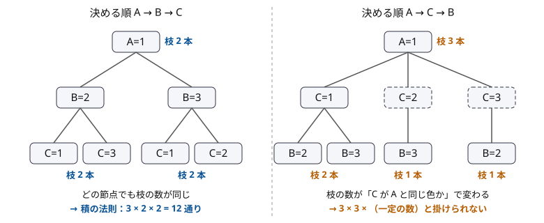

!!! abstract "要点"
    - **何ができるか**：数え上げを、対象の確定 → 数えやすい言い換え → 排反な場合の和と独立な段階の積 → 重複と漏れの確認 → 小さいケースでの検算、の順に組み立てる。「ちょうど」は「以下」の差で、全通りの総和は寄与で数える。
    - **いつ使うか**：
        - 最大値（最小値）がちょうど K になるものの個数
        - すべての選び方についての〜の総和
        - 答えが「K 以下」の個数の差 $f(K) - f(K-1)$ で書ける
    - **計算量**：考え方なので固有の計算量はない。式で数えるなら階乗の前計算 $O(N)$ と場合の数だけの和、DP で数えるなら状態数 × 遷移数になる。
    - **前提**：[二項係数の意味と性質](../comb/binomial-coefficient.md)

<!-- textlint-disable -->
別名：数え上げの基本方針・ちょうど 1 回数える・ちょうど＝以下の差・式で数えるか DP で数えるか
<!-- textlint-enable -->

数え上げの考え方は、個々の公式ではなく「どの対象もちょうど 1 回数える」ための組み立て方である。二項係数・包除原理・DP などの道具は、この組み立ての部品として使う。水色の数え上げで詰まる原因の多くは、道具を知らないことではなく、積の法則を使えない順に決めている・場合分けが重なっている・「ちょうど」をそのまま数えようとしている、のどれかである。

## 数え上げの手順と「ちょうど 1 回」 {#procedure}

数え上げの答えが正しいとは、数えたい対象の 1 つひとつが、ちょうど 1 回ずつ数えられていることである。そのために、次の順で組み立てる。

1. **対象を確定する**：何を 1 個と数えるかを決める。区別するもの（人・箱・位置）と区別しないもの、空を許すか、並べるのか選ぶだけか、を問題文から読み取る
2. **数えやすい形に言い換える**：同じ個数の、構造が単純な対象に移す（0/1 列・格子路・空き部屋の位置など。[対応づけ](../comb/counting-bijection.md)）。「少なくとも 1 つ」は全体から引く（[余事象](../thinking/complement.md)）
3. **排反な場合に分けて和、独立な段階に分けて積**：場合分けは重なりも漏れもないように分け、各場合の中では段階ごとの選択肢の数を掛ける
4. **重複と漏れを確かめる**：1 つの対象が 2 通りの決め方から作られないか（重複）、作れない対象がないか（漏れ）を確かめる
5. **小さいケースで検算する**：全探索の値と式の値を比べる（[検算の節](#verify-small)）

和の法則と積の法則には、それぞれ使える条件がある（[和・積の法則](../comb/counting-basics.md)）。

- **和の法則**：場合分けが[排反](../guide/glossary.md#disjoint)（どの対象も 2 つの場合に入らない）かつ網羅的（どの対象もどれかの場合に入る）なら、各場合の個数を足してよい
- **積の法則**：前の段階で何を選んでも、次の段階の選択肢の**数**が同じなら掛けてよい。選択肢の中身は前の選び方で変わってよい

積の法則の条件は、決める順番で成り立ったり崩れたりする。次の図は、3 マス A・B・C を 3 色で、隣り合うマス（A と B、B と C）が違う色になるように塗る数を、A を色 1 に決めた後の樹形図で比べたものである。



A → B → C の順なら、B は A 以外の 2 色、C は B 以外の 2 色で、どの枝でも選択肢は 2 つである。だから $3 \times 2 \times 2 = 12$ 通りになる。A → C → B の順では、C を決めた時点で B の選択肢が「C が A と同じ色なら 2、違えば 1」と変わる。全体の数は同じ 12 通りだが、段階ごとの数を掛けるだけでは求まらず、C が A と同じかどうかで場合分けが要る。

積の法則が使えないと気づいたら、まず決める順番を変える。木の頂点を塗るなら根から幅優先探索の順に、列なら端から順に決めると、決めるときに見る「すでに決まった近くの点」の数が一定になりやすい（[順序を固定して数える](../comb/counting-fix-order.md)）。順番を変えても一定にならないなら、選択肢の数を変える情報で場合分けするか、その情報を状態にして DP にする（[次の節](#formula-or-dp)）。

??? question "確認問題：区別するかしないか"
    3 人を 2 つの組に分ける（どちらの組も 1 人以上）方法は何通りか。2 つの組を「赤組」「白組」と区別するとどうなるか。

    ??? success "答え"
        組を区別しないなら、1 人だけの組に入る人を選べば決まるので 3 通りである。組を区別するなら、各人が赤か白を選ぶ $2^3 = 8$ 通りから、全員が同じ組の 2 通りを引いて 6 通りになる。区別しない場合は、区別した 6 通りが組の名前の付け替えでちょうど 2 つずつ同じものになるので、$6 / 2 = 3$ とも求まる。重複の数が一定（どれも 2 回）だから割ってよい。

## 式で数えるか DP で数えるか {#formula-or-dp}

数え上げの解き方は、閉じた式（二項係数や累乗の積を、少数の場合について足すもの）と、[DP](../dp/dp-basics.md) の 2 つに大きく分かれる。どちらで数えるかは、選択肢の数が何によって決まるかで判断する。

| 選択肢の数を決めるもの | 数え方 |
| --- | --- |
| 何にもよらない（どの順でも一定） | 積の法則の 1 つの式 |
| 少数の値（個数・桁数・空きの数など）で決まる | その値で場合分けし、各場合を式で数えて足す |
| 直前までの選び方の一部（最後の値・使った個数など） | その一部を状態にした DP |
| 状態にすると大きすぎるが、場合分けすると式になる | 場合分けの値を固定して、式と DP を組み合わせる |

場合分けの値は、それを固定すると残りが独立な段階に分かれるものを選ぶ。たとえば $N$ 個のブロックを $M$ 色で塗り、隣が同じ色の組がちょうど $j$ 組になる塗り方は、「どの組で同じ色になるか」を先に固定すると数えやすい。隣り合う組は $N - 1$ 個あり、そのうち同じ色になる $j$ 組の選び方は $\binom{N-1}{j}$ 通りである。位置を決めると、左端は $M$ 色、同じ色と決めた組の右側は 1 色、違う色と決めた組の右側は $M - 1$ 色で、どれも前の色によらない数になる。

$$
\binom{N-1}{j} \cdot M \cdot (M-1)^{N-1-j}
$$

DP で「$\mathrm{dp}[i][j]$ ＝ 左から $i$ 個を塗り、同じ色の組が $j$ 組の塗り方」とすれば式を見つけなくても数えられるが、状態数が $N \times N$ になる。$N$ が $2 \times 10^5$ なら間に合わないので、この DP は小さいケースの検算に回し、本番は式で数える（[例題 ABC167 E](#abc167_e)）。

もう 1 つの典型は、数の桁数で場合分けする形である。2 つの整数を 10 進法でつないだ数 $10^d x + y$（$y$ が $d$ 桁）は、$y$ の桁数 $d$ を固定すると $x$ と $y$ の 1 次式になり、条件が $x$ だけ・$y$ だけの条件に分かれることがある。分かれれば、$d$ ごとに「$x$ の個数 × $y$ の個数」を足せばよい。

逆に、式で数えようとして場合分けが増え続けるなら、DP に切り替える合図である。式と DP の折衷として、DP の遷移で二項係数を掛ける形（「残りの中から $k$ 個を選んで 1 つのまとまりにする」など）もよく出る（[力試し](#challenge)の ABC180 F）。

## 「ちょうど」を「以下」の差で数える {#exactly-vs-at-most}

「最大値がちょうど $k$」のように「ちょうど」が付く条件は、そのままでは数えにくいことが多い。一方、「すべて $k$ 以下」は各要素の条件が独立になり、積の法則で数えやすい。そこで「以下」で数えてから差を取る。

値が $1$ 以上 $m$ 以下の長さ $N$ の列で、最大値がちょうど $k$ のものを数える。「すべて $k$ 以下」の列は $k^N$ 個あり、これは「最大値がちょうど $k$」と「すべて $k - 1$ 以下」に排反に分かれる。よって、最大値がちょうど $k$ の列の数は次の式になる。

$$
k^N - (k-1)^N
$$

$N = 2$、$k = 2$ なら、$2^2 - 1^2 = 3$ で、$(1, 2)$・$(2, 1)$・$(2, 2)$ の 3 つと一致する。

一般に、累積の量 $F(k)$（「$k$ 以下」の個数）が数えやすければ、「ちょうど $k$」は $F(k) - F(k-1)$ である。向きが逆の「$K$ 個以上」も同じで、「ちょうど $K$ 個」＝「$K$ 個以上」−「$K + 1$ 個以上」と数える。同じ発想を広げたものが、gcd がちょうど $g$ の組を「$g$ の倍数」から引いて数える[約数包除](../comb/divisor-inclusion-exclusion.md#partition)と、「どの条件も満たさない」を「少なくともこれらを満たす」の足し引きで数える[包除原理](../comb/inclusion-exclusion.md)である。期待値では、最大値の期待値を「最大値が $k$ 以上である確率」の和で求める形になる（[期待値と確率の変換](../comb/expectation-tail-sum.md#kth-value)）。

逆向きの変換もある。問題が「$K$ 以下」を問い、「ちょうど $j$」の方が式で数えやすいなら、$j = 0, 1, \dots, K$ について「ちょうど $j$」を足す。どちらの向きでも、扱いやすい方の形で数えてから、排反な分け方で行き来すればよい。

差を取るときは下の端に注意する。$k = 1$ なら $F(0)$ を使い、値が 1 以上の列では「すべて 0 以下」は存在しないので $0^N = 0$ である（$N \ge 1$ のとき）。$F(k-1)$ を配列で引くなら、添字 $-1$ にならないよう $F(0)$ を番兵として用意する。

??? question "確認問題：最小値がちょうど k"
    値が $1$ 以上 $m$ 以下の長さ $N$ の列で、最小値がちょうど $k$ のものの数を式で書け。

    ??? success "答え"
        「すべて $k$ 以上」の列は $(m - k + 1)^N$ 個あり、「最小値がちょうど $k$」と「すべて $k + 1$ 以上」に排反に分かれる。よって $(m - k + 1)^N - (m - k)^N$ である。

## 二項係数と組み合わせた寄与（残りの選び方を掛ける） {#contribution-with-binomial}

この節は[寄与](../thinking/contribution.md)の考え方を前提にする。「$\binom{N}{K}$ 通りの選び方それぞれについて $f$ を求め、その総和を求める」問題では、選び方を 1 つずつ見るのではなく、$f$ を小さな部分の和に分け、各部分が何通りの選び方で効くかを数える。

$$
\begin{aligned}
&\sum_{\text{選び方 } S} \ \sum_{\text{部分 } p \text{ が } S \text{ で効く}} w(p) \\
&= \sum_{\text{部分 } p} w(p) \cdot \#\{S \mid p \text{ が } S \text{ で効く}\}
\end{aligned}
$$

左辺と右辺は同じ $(S, p)$ の組を、外側の和の順番を変えて足しているだけなので等しい。右辺の「効く選び方の数」は、部分 $p$ が使う要素を固定し、残りを選ぶ数として二項係数で書けることが多い。

- **組の量の総和**：$N$ 個から $K$ 個を選び、選んだものの全ペアについての量 $w$ の和を、すべての選び方について足す。ペア $\{u, v\}$ を含む選び方は、残り $N - 2$ 個から $K - 2$ 個を選ぶ $\binom{N-2}{K-2}$ 通りなので、答えは「全ペアの $w$ の和」$\times \binom{N-2}{K-2}$ である（[例題 ABC127 E](#abc127_e)）
- **最大値の総和**：$K$ 個を選んだときの最大値の総和を求める。昇順に並べた $a_1 \le \dots \le a_N$ で $a_i$ が最大になる選び方は、$a_i$ を選んで小さい側の $i - 1$ 個から残りを選ぶ $\binom{i-1}{K-1}$ 通りである。よって総和は $\sum_i a_i \binom{i-1}{K-1}$ になる

最大値の総和で同じ値があるときは、「添字の大きい方を最大とみなす」と決めておけば、各選び方の最大がちょうど 1 つに決まり、ちょうど 1 回数えられる。値だけで「$a_i$ が最大」と言うと、同じ値の要素がどちらも最大として数えられてしまう。

二項係数の端にも注意する。$K < 2$ ならペアがないので答えは 0 で、$\binom{N-2}{K-2}$ も範囲外として 0 にしておけば式のままで正しい（[範囲外を 0 とする約束](../comb/binomial-coefficient.md#out-of-range)）。総和を総数 $\binom{N}{K}$ で割れば平均（期待値）になるので、同じ問題を[期待値の線形性](../comb/linearity-of-expectation.md#sum-vs-expectation)で考えてもよい。

## 小さいケースの全探索で式を検算する {#verify-small}

式を立てたら、提出の前に小さいケースの全探索と比べる。数え上げの誤り（積の法則の条件の見落とし・場合分けの重なり・端の扱い）は入出力例では見つからないことが多く、全探索との比較なら短時間で見つかる。

次のコードは、値が $1$ 以上 $m$ 以下の長さ $n$ の列をすべて作り、「最大値がちょうど $k$」の数と「隣が同じ値の組がちょうど $j$ 組」の数を、それぞれ上の 2 つの式と照らし合わせる。列は $m$ 進数を 1 ずつ増やす要領で順に作る。

```cpp
--8<-- "counting-mindset/verify-small.cpp:core"
```

完全なプログラム：[`verify-small.cpp`](https://github.com/yuukougun/kyopro-atlas/blob/main/snippets/counting-mindset/verify-small.cpp)（GitHub）
{ .kp-code-src }

検算のときは次の点に気をつける。

- **mod を取らない**：小さいケースでは値が `long long` に収まるので、mod を取らずに比べる。mod を取った値は大小比較ができず、規則も見えにくい
- **端のケースを入れる**：$n = 1$・$m = 1$（$j = n - 1$ で $(m-1)^0$）など、式の中に $0^0$ や $\binom{n}{-1}$ が現れるケースを必ず試す。上のコードは $0^0 = 1$ として作った累乗で比べている
- **式を推測するときにも使う**：式が立たないときは、$n = 1, 2, \dots, 8$ 程度の値を並べ、差・比・素因数分解を見る。数列の検索サイト（OEIS）で既知の数列が見つかることもある（[ストレステストと実験](../guide/stress-testing.md#experiment)）

## 落とし穴 {#pitfalls}

**操作の列を数えて、結果を数えたつもりになる**。「操作の後にありうる状態は何通りか」を問われているのに、操作の順番の数を数えると、同じ状態を作る別の操作の列を重ねて数える。数える対象は状態そのものにして、状態の側の条件（「空き部屋が $k$ 個以下」など）に言い換えてから数える（[例題 ABC156 E](#abc156_e)）。

**「ちょうど $k$ 回」を「$k$ 回以下」と同じとみなす**。操作を余分に行って打ち消せるなら同じになるが、打ち消せない小さい $k$ では違う。ABC156 E では、部屋が 3 つ以上あり $k \ge 2$ なら、往復（2 回）や 3 部屋をめぐる移動（3 回）を組み合わせて余りの移動を使い切れる。一方 $k = 1$ では何もしない状態にできない。言い換えたら、小さい $k$ で全探索と比べる。

**重複度が一定でないのに割る**。「区別しない」ものを数えるときに、区別して数えてから $k!$ で割ってよいのは、どの対象もちょうど $k!$ 回ずつ数えられているときだけである。回転で同じとみなす数珠のように、対称な形の重複が少ないものが混ざると、割った値は正しくない（[重複の除き方](../comb/counting-dedup.md#divide)）。

**mod の値で大小を比べる・引き算で負にする**。$998244353$ で割った余りは大きさの情報を失っているので、「$A > B$ なら」のような判定には使えない。大小を比べたいなら、mod を取る前の値（または対数）で比べる。$F(k) - F(k-1)$ のような差は、`long long` で mod を取るなら負になりうるので `(a - b + mod) % mod` とする（[modint](../math/modint.md) なら気にしなくてよい）。

**0 個・空の場合を落とす**。「空の組を許すか」「$K = 0$ のときの答え」「$N - 1 - j$ が 0 のときの $(M-1)^0$」を確かめる。$M = 1$ では $(M - 1)^0 = 0^0$ を 1 と扱わないと、全部同じ色の塗り方 1 通りが消える。ACL の modint では `mint(0).pow(0)` も 1 を返す。

## 例題 {#examples}

### ABC167 E. Colorful Blocks {#abc167_e}

<div class="kp-problems" data-role="example" markdown>

- [ABC167 E. Colorful Blocks](https://atcoder.jp/contests/abc167/tasks/abc167_e)（diff 1442）：N 個のブロックを M 色で塗るとき、隣り合う同じ色の組が K 組以下になる塗り方の数を求める。

</div>

「$K$ 組以下」を「ちょうど $j$ 組」の和に分ける。ちょうど $j$ 組なら、同じ色になる組の位置を先に固定すると、左から塗るときの選択肢の数がどれも前の色によらなくなり、積の法則で数えられる。位置の集合が違えば塗り方も違い、どの塗り方にも位置の集合がちょうど 1 つ決まるので、重複も漏れもない。

??? note "解法の詳細"
    - ちょうど $j$ 組の塗り方は $\binom{N-1}{j} \cdot M \cdot (M-1)^{N-1-j}$ である（[式で数えるか DP で数えるか](#formula-or-dp)）。
    - 答えは $j = 0, 1, \dots, K$ についての和である。階乗と逆階乗を $O(N)$ で前計算し（[nCr mod p の前計算](../comb/binomial-precompute.md)）、$(M-1)$ の累乗も表にしておけば全体で $O(N)$ になる。
    - $M = 1$ のときは、$j = N - 1$ の項だけが $0^0 = 1$ で残り、答えは 1 または 0 になる。累乗の関数が $0^0 = 1$ を返すことを確かめる。

### ABC156 E. Roaming {#abc156_e}

<div class="kp-problems" data-role="example" markdown>

- [ABC156 E. Roaming](https://atcoder.jp/contests/abc156/tasks/abc156_e)（diff 1514）：n 部屋に 1 人ずついる状態から、1 人が別の部屋へ移る移動をちょうど k 回行った後の、各部屋の人数の組としてありうるものの数を求める。

</div>

移動の列を数えると、同じ人数の組を作る列を重ねて数えてしまう。数える対象は人数の組 $(c_1, \dots, c_n)$ である。合計が $n$ の組のうち、空き部屋が $z$ 個ある組を作るには少なくとも $z$ 回の移動が要り、余った移動は往復や 3 部屋をめぐる移動で使い切れる（部屋が 3 つ以上のとき）。そこで「空き部屋の数が $k$ 以下（かつ $n - 1$ 以下）」と言い換え、空き部屋の数 $z$ で場合分けして足す。

??? note "解法の詳細"
    - 空き部屋が $z$ 個の組：空き部屋の選び方が $\binom{n}{z}$ 通り。残りの $n - z$ 部屋に 1 人ずつ置いた後、余りの $z$ 人を $n - z$ 部屋へ配る[重複組合せ](../comb/stars-and-bars.md)が $\binom{n-1}{z}$ 通りである。
    - 答えは $z = 0, 1, \dots, \min(k, n - 1)$ についての $\binom{n}{z}\binom{n-1}{z}$ の和で、階乗の前計算をすれば $O(n)$ で求まる。
    - $k = 1$ では何もしない状態（$z = 0$）が作れないので、$z = 0$ の項を除く（答えは $n(n-1)$）。$k \ge 2$ なら、余りが偶数のときはある人が別の部屋へ移って戻る 2 回、奇数のときは 3 部屋をめぐる 3 回（A→B・B→C・C→A）を組み合わせて、余った移動を消費できる。部屋が 2 つしかないと人数の組の偶奇が変わらず、この式は成り立たない。小さい $n$・$k$ で移動の列を全探索して確かめるとよい。

### ABC127 E. Cell Distance {#abc127_e}

<div class="kp-problems" data-role="example" markdown>

- [ABC127 E. Cell Distance](https://atcoder.jp/contests/abc127/tasks/abc127_e)（diff 1938）：N×M のマス目から K 個を選ぶすべての選び方について、選んだマスの全ペアのマンハッタン距離の和を求め、その合計を求める。

</div>

選び方は膨大なので、ペアの寄与で数える。2 マスの組 $\{u, v\}$ を含む選び方は残り $NM - 2$ マスから $K - 2$ 個を選ぶ $\binom{NM-2}{K-2}$ 通りなので、答えは「全マスの組の距離の和」$\times \binom{NM-2}{K-2}$ である（[二項係数と組み合わせた寄与](#contribution-with-binomial)）。距離の和はさらに、行の差と列の差の和に分けて数える。

??? note "解法の詳細"
    - 行の差が $d$（$1 \le d \le N - 1$）の組は、行の組の選び方が $N - d$ 通り、列はそれぞれ自由で $M^2$ 通りなので、行の差の総和は $\sum_{d} d (N - d) M^2$ である。列の差の総和も同様に $\sum_{d} d (M - d) N^2$ である。
    - 2 つの和を足して $\binom{NM-2}{K-2}$ を掛ける。階乗を $NM$ まで前計算すれば、全体で $O(NM)$ になる。
    - 積は mod を取りながら計算する。距離の総和そのものは `long long` に収まるが、$\binom{NM-2}{K-2}$ を掛ける前に mod を取らないとあふれる。

## 練習問題 {#practice}

<div class="kp-problems" data-role="practice" markdown>

- [ABC460 E. x + y ≡ x + y](https://atcoder.jp/contests/abc460/tasks/abc460_e)（diff 1362）：N 以下の正の整数の組 (x, y) のうち、x と y を 10 進法でつないだ数が M を法として x + y と合同になるものの個数を求める（複数のテストケース）。
- [ABC150 E. Change a Little Bit](https://atcoder.jp/contests/abc150/tasks/abc150_e)（diff 1851）：長さ N の 0/1 列の異なる 2 つの組すべてについて、一方を他方に変える最小コストを求め、その総和を求める。
- [ABC173 F. Intervals on Tree](https://atcoder.jp/contests/abc173/tasks/abc173_f)（diff 1892）：N 頂点の木で、すべての区間 [L, R] について頂点 L〜R だけを残した森の連結成分の数を求め、その総和を求める。

</div>

??? note "練習の方針"
    - **ABC460 E**：$y$ の桁数 $d$ で場合分けする。つないだ数は $10^d x + y$ なので、条件は $(10^d - 1) x \equiv 0 \pmod{M}$ になり $y$ が消える。$d$ ごとに「条件を満たす $x$ の個数 × $d$ 桁の $y$ の個数」を足す。$x$ は $M / \gcd(10^d - 1, M)$ の倍数である。$N$ が大きいので、積は mod を取ってから掛ける
    - **ABC150 E**：1 つの組のコストは、変える桁をコストの大きい順に行うのが最小である。コストを降順に並べ、各桁が「何番目に変えられるか」の和を全組について数える（寄与）。各桁の係数は、自分より大きい桁が変わる組の数を 2 の累乗で数えて求まる
    - **ABC173 F**：森の連結成分の数は頂点数 − 辺数である。頂点の寄与（各区間の長さの和）から、各辺 $(u, v)$（$u < v$）を含む区間の数 $u (N - v + 1)$ の和を引く

## 力試し {#challenge}

<div class="kp-problems" data-role="challenge" markdown>

- [ABC180 F. Unbranched](https://atcoder.jp/contests/abc180/tasks/abc180_f)（diff 2419）：自己ループのない（多重辺は許す）N 頂点 M 辺の無向グラフで、各連結成分がパスか閉路で、最大の連結成分の頂点数がちょうど L のものの数を求める。

</div>

??? note "力試しの方針"
    - **ABC180 F**：「最大の成分が $L$ 以下」の数から「$L - 1$ 以下」の数を引く。「$L$ 以下」は、まだ使っていない頂点のうち番号が最小のものを含む成分の大きさ $k$ を決めていく DP で数える（最小の頂点を必ず含めることで、同じ分け方を重ねて数えない）。残りから $k - 1$ 頂点を選ぶ二項係数と、$k$ 頂点のパス・閉路の作り方の数を掛けて遷移する。パスは $k = 1$（1 通り）、閉路は $k = 1$（自己ループになるので 0 通り）と $k = 2$（多重辺の 2 本で 1 通り）の扱いが特別になる

## 確認問題 {#quiz}

??? question "確認問題：積の法則が使えるか"
    $1$ から $5$ の数字を 1 回ずつ使って 5 桁の数を作る。奇数の桁と偶数の桁が交互に並ぶ（隣り合う数字の偶奇が違う）ものは何通りか。左の桁から順に決める方法で積の法則が使えるか考えよ。

    ??? success "答え"
        奇数は 3 個、偶数は 2 個なので、交互に並べるには「奇偶奇偶奇」の形しかない。形を先に固定すれば、奇数の位置に奇数を並べる $3!$ 通りと、偶数の位置に偶数を並べる $2!$ 通りの積で $12$ 通りである。左から順に決める方法では、1 桁目に偶数を選ぶと後が続かず、選択肢の数が前の選び方で変わるので、そのままでは積の法則が使えない。偶奇の形という少数の値で先に場合分けするのが要点である。

??? question "確認問題：ちょうど K 個"
    長さ $N$ の 0/1 列で、1 がちょうど $K$ 個のものの数を「$K$ 個以上」の差として書くと、何と何の差になるか。直接書いた $\binom{N}{K}$ と一致することを確かめよ。

    ??? success "答え"
        「1 が $K$ 個以上」は $\sum_{i \ge K} \binom{N}{i}$、「$K + 1$ 個以上」は $\sum_{i \ge K+1} \binom{N}{i}$ で、差は $\binom{N}{K}$ になる。この例では直接数える方が速いが、「以上」の側にしか式がない問題では差の形が役に立つ。

## 使い分け {#comparison}

- $N$ が 8〜10 程度までなら、式を探さずに全探索で数える（[全探索](../basics/brute-force.md)）
- 「少なくとも 1 つ」は全体から引く（[余事象](../thinking/complement.md)）。条件が 3 つ以上に増えたら[包除原理](../comb/inclusion-exclusion.md)
- 「総和」を問われたら寄与で、「平均」や「期待値」なら[期待値の線形性](../comb/linearity-of-expectation.md)で考える。両者は総数を掛けるか割るかの違いである
- 選択肢の数が直前の選び方の一部で変わるなら DP、場合分けの値を固定すれば独立になるなら式で数える

## 参考 {#references}

- [kmjp「AtCoder ABC #167 : E - Colorful Blocks」](https://kmjp.hatenablog.jp/entry/2020/05/10/0900)：例題の式（同じ色の組の位置を選ぶ）
- [kmjp「AtCoder ABC #156 : E - Roaming」](https://kmjp.hatenablog.jp/entry/2020/02/23/0900)：例題の言い換え（空き部屋の数で場合分け）と k = 1 の扱い
- [drken「AtCoder ABC 127 E - Cell Distance」](https://drken1215.hatenablog.com/entry/2019/06/15/111500)：例題の寄与と残りの選び方 C(NM−2, K−2)、行と列に分ける数え方
- [comet725「ABC460Eを解いた【桁ごとの数え上げ】」](https://qiita.com/comet725/items/7ac6436793b6e5d1ee4f)：練習の方針（y の桁数で場合分けする）
- [ikatakos「AtCoder Beginner Contest 460 E,F,G問題メモ」](https://ikatakos.com/pot/programming_algorithm/contest_history/atcoder/2026/0530_abc460)：練習の方針（条件から y が消えること。解説の部分だけを参照）
- [drken「AtCoder ABC 150 E - Change a Little Bit (1D, 青色, 500 点)」](https://drken1215.hatenablog.com/entry/2020/01/12/142100)：練習の方針（降順に変えることと各桁の係数）
- [hamayan「Intervals on Tree [AtCoder Beginner Contest 173 F]」](https://blog.hamayanhamayan.com/entry/2020/07/05/235609)：練習の方針（頂点数 − 辺数と辺を含む区間の数）
- [drken「AtCoder ABC 180 F - Unbranched (橙色, 600 点)」](https://drken1215.hatenablog.com/entry/2020/10/21/145700)：力試しの方針（以下の差と、最小の頂点を含む成分を決める DP）
