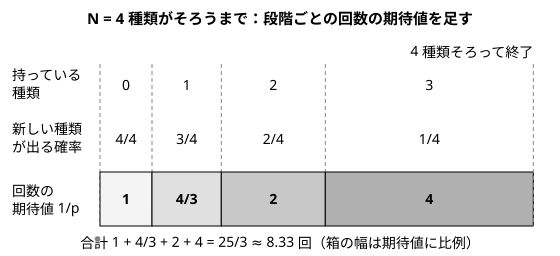

!!! abstract "要点"
    - **何ができるか**：成功確率 $p$ の試行を成功するまで繰り返す回数の期待値は $1/p$ である。$N$ 種類が等確率で出るとき全種類がそろうまでの回数の期待値は、段階ごとの $N/(N-k)$ を足した $N(1 + 1/2 + \dots + 1/N)$ になる。
    - **いつ使うか**：
        - 成功するまで繰り返すときの回数の期待値
        - すべての種類を集める（全頂点を訪れる）までの回数の期待値
        - 〜が出るまでサイコロを振り続ける
    - **計算量**：幾何分布の期待値は $O(1)$。$N$ 段階の和は $O(N)$（法 $P = 998244353$ で答えるなら、逆元の計算を含めて $O(N \log P)$）
    - **前提**：[確率の基本](../comb/probability-basics.md)

<!-- textlint-disable -->
別名：幾何分布・成功するまでの回数・1/p・コンプガチャ・クーポンコレクター・N H_N・coupon collector's problem・geometric distribution
<!-- textlint-enable -->

幾何分布とコンプリートガチャは、「何かが起きるまで繰り返す回数」の期待値を求める最も基本の型である。1 回で成功する確率が $p$ なら平均 $1/p$ 回かかる。全種類を集める問題は、「新しい種類が出るまで」を段階ごとに区切ると、この $1/p$ の和になる。

このページで使う記法：期待値を $E[X]$、確率を $P(A)$ と書く（[記法と用語の約束](../start/notation.md#probability)）。$H_N = 1 + 1/2 + \dots + 1/N$ を調和数と呼ぶ。

## 幾何分布：E = 1 + (1 − p)E から 1/p {#geometric}

成功確率 $p$（$0 < p \le 1$）の試行を、成功するまで独立に繰り返す。成功したその回を含めた試行の回数 $X$ の分布を幾何分布という。$k$ 回目に初めて成功する確率は、$k - 1$ 回続けて失敗してから成功する確率なので $P(X = k) = (1 - p)^{k-1} p$ である。

期待値は $E[X] = 1/p$ になる。サイコロで 6 が出るまで振るなら $p = 1/6$ で、平均 6 回である。

**なぜ $1/p$ か（1 回目で場合分け）**：求める期待値を $E$ とおく。1 回目は必ず振るので 1 回を数える。成功すれば（確率 $p$）そこで終わり、失敗すれば（確率 $1 - p$）最初とまったく同じ状況に戻るので、残りの回数の期待値はまた $E$ である。

$$
E = 1 + p \cdot 0 + (1 - p) \cdot E \quad\Longrightarrow\quad pE = 1 \quad\Longrightarrow\quad E = \frac{1}{p}
$$

この移項は $E$ が有限のときだけ許される。$p > 0$ なら $k$ 回以上かかる確率 $(1 - p)^{k-1}$ は指数的に小さくなるので、$E$ は有限である。実際、「$k$ 回以上かかる確率」を $k = 1, 2, \dots$ について足すと期待値になる（[期待値を「k 以上」の確率の和で求める](../comb/expectation-tail-sum.md#identity)）ので、等比級数で同じ値が出る。

$$
E[X] = \sum_{k \ge 1} P(X \ge k) = \sum_{k \ge 1} (1 - p)^{k-1} = \frac{1}{1 - (1 - p)} = \frac{1}{p}
$$

「同じ状況に戻るなら、自分自身の期待値を式に入れて移項する」という操作は、[期待値 DP の自己ループの移項](../comb/expected-value-dp.md#self-loop)と同じものである。幾何分布はその最小の例になっている。

**応用の型**：

- **1 回にコストがかかる**：1 回の試行に $c$ の時間や費用がかかるなら、合計の期待値は $c/p$ である。回数 $X$ に定数 $c$ を掛けただけなので $E[cX] = c\,E[X]$ が使える
- **全部同時に成功するまでやり直す**：独立な $M$ 個の判定がそれぞれ確率 $q$ で通り、全部通るまで最初からやり直すなら、1 回の成功確率は $p = q^M$ で、回数の期待値は $1/q^M$ になる。1 個ずつ通るまで繰り返すのとは違う（その場合は $M/q$）
- **成功を $K$ 回得るまで**：1 回目の成功まで、2 回目の成功まで…と区切ると、各区間が同じ幾何分布になる。線形性から $K/p$ である

## 失敗の回数（1/p − 1）との違い {#failures}

数えるのが「試行の回数」か「失敗の回数」かで答えが 1 ずれる。成功した回を含めた試行の回数の期待値は $1/p$、失敗の回数はそれより 1 少ないので $1/p - 1 = (1 - p)/p$ である。

問題文の言い回しで、どちらを数えるかを確かめる。

| 問われ方 | 数える量 | 期待値 |
| --- | --- | --- |
| 成功するまでに振る回数 | 成功した回を含む | $1/p$ |
| やり直す回数・失敗する回数 | 成功した回を含まない | $1/p - 1$ |

もう 1 つ、最初の状態がすでに条件を満たしていることがある問題に注意する。たとえば「はじめに $s$ 種類持っていて、全種類そろうまで引く」で $s = N$ なら、1 回も引かずに終わるので答えは 0 回である。このように「1 回目の試行の前に終わっている」場合があるときは、$1/p$ をそのまま使わず、最初の状態で場合分けする。

??? question "確認問題：コインを表が出るまで投げる。裏が出る回数の期待値は？"
    $p = 1/2$ なので、投げる回数の期待値は $1/p = 2$ である。裏の回数は投げる回数から最後の 1 回（表）を引いたものなので、$2 - 1 = 1$ 回になる。

## 段階に分けて幾何分布の期待値を足す（コンプガチャ） {#staged}

$N$ 種類のものが毎回等確率 $1/N$ で 1 つずつ出るとき、全種類がそろうまでの回数を $T$ とする。$T$ を直接扱うのは難しいが、「すでに $k$ 種類持っている」段階で区切ると、各段階は幾何分布になる。

- 段階 $k$（$k = 0, 1, \dots, N-1$）：すでに $k$ 種類を持っている。次の 1 回で新しい種類が出る確率は、まだ持っていない $N - k$ 種類のどれかが出る確率なので $p_k = (N - k)/N$ である
- 段階 $k$ にいる回数 $T_k$ は、確率 $p_k$ の試行を成功するまで繰り返す回数なので、$E[T_k] = 1/p_k = N/(N - k)$ である
- $T = T_0 + T_1 + \dots + T_{N-1}$ なので、[期待値の線形性](../comb/linearity-of-expectation.md#split)から各段階の期待値を足せばよい。$E[X + Y] = E[X] + E[Y]$ は $X, Y$ が独立でなくても成り立つ

$$
E[T] = \sum_{k=0}^{N-1} \frac{N}{N - k} = N\left(\frac{1}{N} + \frac{1}{N-1} + \dots + \frac{1}{1}\right) = N H_N
$$

次の図は $N = 4$ の場合である。段階が進むほど新しい種類が出にくくなり、最後の 1 種類を待つ段階だけで全体の約半分の回数を使う。



**なぜ段階に分けてよいか**：段階 $k$ の中では、何回外れても持っている種類の数は $k$ のままなので、新しい種類が出る確率は $p_k$ で一定である。だから各段階は幾何分布になる。段階どうしが独立かどうかは、線形性を使うので気にしなくてよい。分けたのは「何種類持っているか」という数だけで、どの種類を持っているかは確率に関係しない。これは全種類が等確率だから言えることである（確率が違うときは[次の節](#next-steps)）。

**小さい例で確かめる**：$N = 2$ なら $E[T] = 2(1 + 1/2) = 3$ である。1 回目で必ず 1 種類目が出て、2 種類目は確率 $1/2$ で出るので、平均 $1 + 2 = 3$ 回になる。直接 $P(T = t) = (1/2)^{t-2} \cdot (1/2)$（$t \ge 2$、2 回目以降で初めて違う種類が出る）から $\sum_t t\,P(T = t) = 3$ と計算しても一致する。

**大きさの見当**：$H_N$ は $\ln N + 0.577\ldots$ に近い（[調和級数](../math/harmonic-sum.md)と同じ和）。サイコロの全部の目を出すには $6 H_6 = 14.7$ 回、$N = 10^5$ 種類なら約 $1.2 \times 10^6$ 回かかる。乱択の手法で「ランダムに選び続けて全部に当たるまで」の回数を見積もるときにも使える。

実装は段階ごとに $N/(N - k)$ を足すだけである。

```cpp
--8<-- "coupon-collector/expected.cpp:core"
```

**応用の型**：

- **一部だけそろえる**：$N$ 種類のうち $K$ 種類（どれでもよい）そろうまでなら、段階 $0$ から $K - 1$ までだけを足して $\sum_{k=0}^{K-1} N/(N - k)$ である
- **最初から持っている種類がある**：はじめに $s$ 種類持っているなら、段階 $s$ から足す。「頂点 1 から出発して全頂点を訪れる」なら頂点 1 は最初から訪問済みである（[ABC194 D](#abc194_d)）
- **段階ごとに確率の形が違う**：段階 $k$ で次に進む確率 $p_k$ が段階の中で一定でありさえすれば、どんな $p_k$ でも $\sum 1/p_k$ で求まる。たとえば毎回 $M$ 通り（$M > N$、$N$ 種類以外は外れ）から等確率で引くなら $p_k = (N - k)/M$ で、答えは $\sum_{k=0}^{N-1} M/(N - k) = M H_N$ になる

??? question "確認問題：サイコロを、1〜6 のうち 3 種類の目が出るまで振る。回数の期待値は？"
    $N = 6$ で段階 0・1・2 を足す。$6/6 + 6/5 + 6/4 = 1 + 1.2 + 1.5 = 3.7$ 回である。

## 上位の手法へのつながり {#next-steps}

段階に分けて $1/p$ を足す方法が使えるのは、「何個そろったか」だけで次に進む確率が決まり、段階が後戻りしないときである。そうでなければ、次の手法に進む。

- **種類ごとに出る確率が違う**：どの種類を持っているかで次の確率が変わるので、持っている種類の集合を状態にする。$N \le 20$ 程度なら集合を bit で持つ[期待値 DP](../comb/expected-value-dp.md) で解ける。別の見方として、全種類のそろう時刻を「各種類が最初に出る時刻の最大」と考え、最大を最小の符号付きの和に直す min-max 包除がある。部分集合 $S$ に入る種類のうち 1 つでも出るまでの回数は、確率 $\sum_{i \in S} p_i$ の幾何分布である。ここでも $1/p$ が部品になる。各確率を小さい整数 $W$ を使って $w_i / W$ と書けるなら、部分集合を重みの和ごとに DP でまとめて数えられ、$N$ が大きくても計算できる（[包除原理](../comb/inclusion-exclusion.md#min-max)の min-max 包除の節、発展）
- **段階が戻る・飛ぶ**：失敗すると前の段階に戻る、一度に何段階も進むといった遷移があるなら、段階ごとの期待値を後ろから求める[期待値 DP](../comb/expected-value-dp.md#self-loop) にする。自分に戻る遷移は、$E = 1 + (1 - p)E$ と同じように移項して消す
- **回数そのものではなく確率を問う**：「$K$ 回以内にそろう確率」は $1/p$ の和では求まらない。全種類が出る確率を包除原理で数えるか、確率 DP で回数ごとに追う。回数の期待値を「$k$ 回目までに終わらない確率」の和で求める方法は[期待値を「k 以上」の確率の和で求める](../comb/expectation-tail-sum.md#waiting-time)にある
- **集まった種類数の期待値**：「$M$ 回引いたとき何種類持っているか」の期待値は、待ち時間ではなく個数の期待値なので、種類ごとの[指示確率変数](../comb/linearity-of-expectation.md#indicator)で求める。種類 $i$ が 1 回も出ない確率は $(1 - 1/N)^M$ なので、答えは $N\bigl(1 - (1 - 1/N)^M\bigr)$ である

## 落とし穴 {#pitfalls}

**整数の割り算で期待値が切り捨てられる**。`n / (n - k)` は `int` どうしの割り算なので、$N = 4, k = 1$ で $4/3$ が 1 になる。`(double)n / (n - k)` のように片方を実数にしてから割る。

**確率が違うのに $N H_N$ を使う**。$N H_N$ は全種類が等確率のときだけの式である。確率が種類ごとに違うと、段階 $k$ の確率が「どの $k$ 種類を持っているか」で変わり、段階が幾何分布にならない。問題文で「等確率」「一様に」とあるかを確かめる。

**最初の 1 回の扱いを誤る**。何も持っていない段階 0 は確率 1 で進むので 1 回である。「最初の 1 個は持っている」問題で段階 0 も足すと 1 回多くなり、「最初は何も持っていない」問題で段階 0 を飛ばすと 1 回少なくなる。$N = 1$ や $N = 2$ で手計算と比べると気づける。

**成功しない場合がある**（$p = 0$）。$1/p$ は $p > 0$ のときだけ有限である。$p = 0$ になる段階があれば、期待値は無限大（そろわない）なので、問題文の「必ずそろう」条件を確かめるか、別に処理する。

**答えを mod で出す**。期待値を mod 998244353 で答える問題では、$N/(N - k)$ を逆元を使って足す（[確率・期待値を mod 998244353 で答える](../comb/rational-mod.md)）。mod の値どうしは大小を比べられないので、途中で比べる処理がある問題では実数で比べる。

```cpp
--8<-- "coupon-collector/expected-mod.cpp:core"
```

## 例題 {#examples}

### ABC194 D. Journey {#abc194_d}

<div class="kp-problems" data-role="example" markdown>

- [ABC194 D. Journey](https://atcoder.jp/contests/abc194/tasks/abc194_d)（diff 1078）：N 頂点で辺のないグラフで、頂点 1 から始めて一様に選んだ頂点との間に辺を張ってそこへ移る操作を繰り返すとき、グラフが連結になるまでの操作回数の期待値を求める。

</div>

辺は今いる頂点と移った先の間に張られるので、張られた辺は訪れた頂点どうしを 1 本の道でつなぐ。だから「グラフが連結になる」は「全頂点を 1 回以上訪れる」と同じで、コンプガチャの型になる。頂点 1 は最初から訪問済みなので、段階 1 から始める。

??? note "解法の詳細"
    - $k$ 頂点を訪問済みの段階では、選ばれた頂点が未訪問である確率は $(N - k)/N$ である。すでに訪れた頂点（今いる頂点を含む）を選んでも段階は変わらない
    - 段階 $k$ にいる回数の期待値は $N/(N - k)$ なので、答えは $\sum_{k=1}^{N-1} N/(N - k) = \sum_{i=1}^{N-1} N/i$ である
    - $O(N)$ で計算し、実数で出力する。小数点以下を十分な桁数（`setprecision(10)` など）で出す

## 練習問題 {#practice}

<div class="kp-problems" data-role="practice" markdown>

- [アルゴ数学 026. Coin Gacha](https://atcoder.jp/contests/math-and-algorithm/tasks/math_and_algorithm_z)（diff —）：N 種類のコインが等確率で 1 枚ずつ出るとき、全種類がそろうまでの回数の期待値を求める。
- [ARC085 C. HSI](https://atcoder.jp/contests/arc085/tasks/arc085_a)（diff 752）：N 個のテストのうち M 個はそれぞれ確率 1/2 で通る提出を、全部通るまで繰り返すときの総実行時間の期待値を求める。

</div>

??? note "練習の方針"
    - **アルゴ数学 026**：段階 0 から $N - 1$ まで $N/(N - k)$ を足す。[段階に分ける節](#staged)のコードそのものである
    - **ARC085 C**：1 回の提出で全部通る確率は $1/2^M$ なので、提出の回数の期待値は $2^M$ である。1 回の提出の実行時間を掛ける（1 回にコストがかかる型）

## 参考 {#references}

- [ikatakos「AtCoder Beginner Contest 194 C,D,E,F問題メモ」](https://ikatakos.com/pot/programming_algorithm/contest_history/atcoder/2021/0306_abc194)：例題の方針（コンプガチャ型への言い換えと段階ごとの $N/i$ の和、自己ループの移項による DP との一致）。解説の部分だけを参照
- [drken「AtCoder ABC 078 C - HSI (ARC 085 C) (3Q, 茶色, 300 点)」](https://drken1215.hatenablog.com/entry/2019/03/23/175300)：幾何分布の期待値 $1/p$ の 2 通りの導出（1 回目での場合分けと $P(X \ge k)$ の和）と練習の方針
- [E869120「アルゴリズム×数学」解答例 3.4 節 問題 4](https://github.com/E869120/math-algorithm-book/blob/main/editorial/chap3-4/prob3-4-4.cpp)：練習のコイン集めの期待値を段階ごとの和で求める実装
