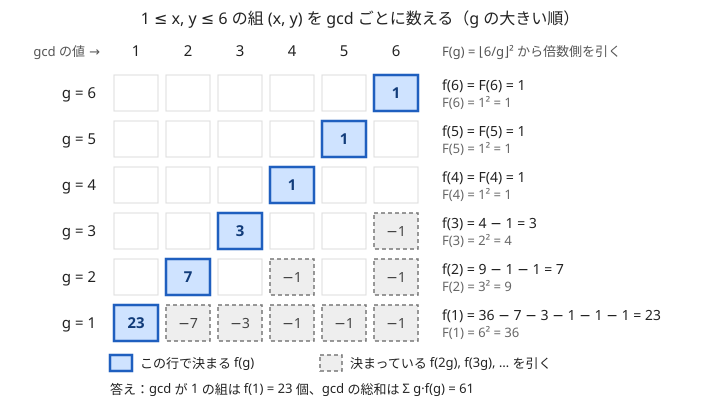

!!! abstract "要点"
    - **何ができるか**：gcd がちょうど $g$ のものの個数 $f(g)$ を、すべて $g$ の倍数のものの個数 $F(g)$ から、大きい $g$ の順に $f(g) = F(g) - f(2g) - f(3g) - \cdots$ で求める。値の上限を $M$ とすると、全体で $O(M \log M)$ になる。
    - **いつ使うか**：
        - gcd の総和を求める
        - gcd が 1 になる（互いに素な）組の個数
        - 最小周期が d の列（文字列）の個数
        - 値の上限 ≤ 10^6 程度で、すべての g について数える
    - **計算量**：$F(1), \dots, F(M)$ がそろっていれば、$f(1), \dots, f(M)$ をまとめて $O(M \log M)$（調和級数）。$F$ を作る手間は別に足す
    - **前提**：[数え上げの考え方](../comb/counting-mindset.md)、[GCD・LCM とユークリッドの互除法](../math/gcd-lcm.md)、[調和級数と倍数の列挙](../math/harmonic-sum.md)

<!-- textlint-disable -->
別名：約数系包除・gcd がちょうど g・倍数から引く・互いに素な組の数・gcd の総和
<!-- textlint-enable -->

約数包除は、「gcd がちょうど $g$」という数えにくい条件を、「すべて $g$ の倍数」という数えやすい条件に置き換えてから、余分に数えた分を倍数の側から引いて戻す数え方である。[包除原理](../comb/inclusion-exclusion.md)を、集合の包含の代わりに約数・倍数の関係の上で行うものと見られる。

このページでは、数える対象（列・組・部分集合など）の gcd を $\gcd$、値の上限を $M$ とし、次の 2 つの量を使う。

- $f(g)$ ＝ gcd がちょうど $g$ である対象の個数。
- $F(g)$ ＝ すべての要素が $g$ の倍数である対象の個数。

## 「g の倍数」は gcd = g, 2g, 3g, … に排反に分かれる {#partition}

例として「$1$ 以上 $K$ 以下の整数からなる長さ $N$ の列すべてについての gcd の総和」を考える（[例題の ABC162 E](#abc162_e)）。列は $K^N$ 通りあるので、1 つずつ gcd を計算していては間に合わない。$f(g)$ が分かれば答えは $\sum_g g \cdot f(g)$ だが、「gcd がちょうど $g$」を直接数えるのも難しい。

一方、$F(g)$ はすぐに分かる。各項を $g$ の倍数から選べばよいので、選び方は項ごとに $\lfloor K/g \rfloor$ 通りで、$F(g) = \lfloor K/g \rfloor^N$ である。

$F$ と $f$ をつなぐのが次の性質である。

> すべての要素が $g$ の倍数である ⇔ $g$ が gcd を割り切る ⇔ gcd が $g, 2g, 3g, \dots$ のどれか

1 つ目の ⇔ は、公約数がすべて gcd の約数になることから従う（[GCD・LCM](../math/gcd-lcm.md)）。gcd はただ 1 つに決まるので、$F(g)$ が数える対象は「gcd が $g$」「gcd が $2g$」「gcd が $3g$」… へ[排反に](../guide/glossary.md#disjoint)分かれる。よって次の式が成り立つ。

$$
\begin{aligned}
F(g) &= f(g) + f(2g) + f(3g) + \cdots \\
&= \sum_{k \ge 1,\ kg \le M} f(kg)
\end{aligned}
$$

この式を $f(g)$ について解いたものが、このページの中心の式である。

$$
f(g) = F(g) - \sum_{k \ge 2,\ kg \le M} f(kg)
$$

次の図は、$1 \le x, y \le 6$ の組 $(x, y)$（順序あり、36 通り）を gcd ごとに数える様子である。$F(g) = \lfloor 6/g \rfloor^2$ で、各行の青い枠がその行で決まる $f(g)$、灰色の破線の枠が引く $f(2g), f(3g), \dots$ である。



図の流れを文章で追うと次のとおりである。

- $g = 6, 5, 4$ では、$2g$ が 6 を超えるので引くものがなく、$f(g) = F(g) = 1$ である（それぞれ $(6, 6)$・$(5, 5)$・$(4, 4)$）。
- $g = 3$ では $F(3) = 2^2 = 4$ から $f(6) = 1$ を引いて $f(3) = 3$ になる。
- $g = 2$ では $F(2) = 3^2 = 9$ から $f(4)$ と $f(6)$ を引いて $f(2) = 7$ になる。
- $g = 1$ では $36$ から $f(2), \dots, f(6)$ を引いて、互いに素な組の数 $f(1) = 23$ が求まる。

## 大きい g から引く理由と計算量 O(M log M) {#order}

中心の式の右辺に出てくる $f(2g), f(3g), \dots$ は、どれも添字が $g$ より大きい。$g = M, M - 1, \dots, 1$ の大きい順に計算すれば、$f(g)$ を計算する時点でこれらはすべて決まっている。小さい順では、$f(1)$ を求めるのに $f(2), \dots, f(M)$ がすべて要るので進めない。

```text
for g = M, M-1, ..., 1:
    f[g] = F(g)
    for k = 2g, 3g, ... (k <= M):
        f[g] -= f[k]
```

内側のループは $g$ ごとに $\lfloor M/g \rfloor - 1$ 回なので、合計は $\sum_{g=1}^{M} M/g \approx M \ln M$ で $O(M \log M)$ である（[調和級数の計算量](../math/harmonic-sum.md#why-n-log-n)）。$M = 10^6$ なら約 $1.4 \times 10^7$ 回で、十分に速い。

$M$ は「対象に現れうる値の上限」である。gcd は要素の値を超えないので、$g > M$ では $F(g) = f(g) = 0$ として打ち切ってよい。配列の長さや列の長さ $N$ ではなく、値の上限まで回す。

$F(g)$ を作る手間は、何を数えるかで変わる。

- 範囲の整数から選ぶなら、$g$ の倍数の個数は $\lfloor K/g \rfloor$（閉区間 $[L, R]$ なら $\lfloor R/g \rfloor - \lfloor (L-1)/g \rfloor$）で $O(1)$ である。
- 与えられた数列から選ぶなら、値ごとの出現回数から「$g$ の倍数である要素の個数」$c[g]$ を倍数をたどって集める。これも $O(M \log M)$（[倍数の側から集める](../math/harmonic-sum.md#collect-multiples)）。
- $F(g)$ が $c^N$ や $2^c$ の形なら、[繰り返し二乗法](../math/mod-pow.md)で $g$ ごとに指数の log の手間（$c^N$ なら $O(\log N)$）がかかる。

## gcd の総和・互いに素な組 {#gcd-sum}

$f$ がすべて求まれば、gcd で決まる量の総和はどれも $\sum_g h(g) \cdot f(g)$ で計算できる。gcd の総和なら $h(g) = g$、[互いに素](../guide/glossary.md#coprime)なものの個数なら $f(1)$ そのものである。

変わるのは、何を対象にするかと、それに合わせた $F(g)$ の形だけである。$c[g]$ を「$g$ の倍数である要素の個数」とする。

| 数える対象 | $F(g)$ |
| --- | --- |
| $1$ 以上 $K$ 以下の整数からなる長さ $N$ の列 | $\lfloor K/g \rfloor^N$ |
| 数列から選ぶ順序つきの組 $(i, j)$（$i = j$ も含む） | $c[g]^2$ |
| 数列から選ぶ組 $i < j$ | $\binom{c[g]}{2}$ |
| 数列の空でない部分集合 | $2^{c[g]} - 1$ |

部分集合のときは空集合を除く。空集合はどの $g$ の倍数の条件も満たす（条件が 1 つもない）ので、除かないとすべての $F(g)$ に 1 ずつ紛れ込み、$f$ がずれる（[落とし穴](#pitfalls)）。

次のコードは、数列の空でない部分集合を gcd ごとに数える。返した $f$ から、$f[1]$ が gcd が 1 の部分集合の個数、$\sum_g g \cdot f[g]$ が gcd の総和になる。

```cpp
--8<-- "divisor-inclusion-exclusion/subset-gcd.cpp:core"
```

完全なプログラム：[`subset-gcd.cpp`](https://github.com/yuukougun/kyopro-atlas/blob/main/snippets/divisor-inclusion-exclusion/subset-gcd.cpp)（GitHub）。`mint` は ACL の `modint998244353`（[modint](../math/modint.md)）。
{ .kp-code-src }

$c$ を集めるループと $f$ を決めるループを 1 つにまとめているが、どちらも $g$ の倍数をたどるので、合わせて $O(M \log M + M \log N)$（$N$ は数列の長さ）である。組 $i < j$ だけを数える同じ形のコードは、[倍数の箱を後ろから決める](../math/harmonic-sum.md#decide-from-back)にある。

!!! tip "gcd の総和は φ でも書ける"
    $n = \sum_{d \mid n} \varphi(d)$（$\varphi$ は[オイラーの φ 関数](../math/euler-phi.md)）を使うと、$\gcd = \sum_{d \mid \gcd} \varphi(d)$ である。$d \mid \gcd$ は「すべての要素が $d$ の倍数」なので、gcd の総和は $\sum_d \varphi(d) F(d)$ と書ける。$f$ を経由せずに 1 本の和で求まる。φ の表は[線形篩](../math/spf-sieve.md#linear-sieve)によって $O(M)$ で作れる。

## 周期の数え上げ（約数の周期で重複した分を引く） {#period}

同じ考え方は、文字列の[周期](../guide/glossary.md#period)の数え上げにも使える。ただし向きが逆で、今度は「約数の側」から引く。

長さ $N$ の文字列 $S$ が周期 $d$（$d \mid N$）を持つとは、$S$ を $d$ 文字だけ巡回シフトしても変わらないことと同じである。周期 $d_1, d_2$（どちらも $N$ の約数）を持てば、シフトを組み合わせて $a d_1 + b d_2$ 文字（$a, b$ は整数）のシフトでも変わらない。拡張ユークリッドの互除法から $\gcd(d_1, d_2)$ もこの形で書けるので、$\gcd(d_1, d_2)$ も周期になる。

したがって、$S$ が持つ「$N$ の約数である周期」のうち最小のもの $e$ はただ 1 つに決まり、ほかの約数の周期はすべて $e$ の倍数である。そこで次の 2 つを考える。

- $F(d)$ ＝ 周期 $d$ を持つ文字列の個数。余り $i \bmod d$ が同じ位置の文字はすべて等しいので、$\sigma$ 種類の文字なら $\sigma^d$ である。
- $f(d)$ ＝ $N$ の約数である周期のうち、最小のものが $d$ である文字列の個数。

周期 $d$ を持つ文字列は、最小の $e$ が $d$ の約数のどれかになる。よって $F(d) = \sum_{e \mid d} f(e)$ で、$d$ の小さい順に $f(d) = F(d) - \sum_{e \mid d,\ e < d} f(e)$ と求める。gcd のときと比べて、倍数と約数、大きい順と小さい順が入れ替わっている。

$N = 6$ の 2 種類の文字で確かめる。$F(1) = 2$・$F(2) = 4$・$F(3) = 8$・$F(6) = 64$ から、$f(1) = 2$・$f(2) = 4 - 2 = 2$・$f(3) = 8 - 2 = 6$・$f(6) = 64 - 2 - 2 - 6 = 54$ になる。6 未満の周期を持つ文字列は $2 + 2 + 6 = 10$ 個で、$000000$・$010101$・$001001$ などが重複なく 1 回ずつ数えられている。

$N$ の約数の個数を $D$ とすると、約数の組をすべて見ても $O(D^2)$ で、$N \le 10^6$ なら $D \le 240$ なので軽い。文字に制約がある場合（$F(d)$ の数え方が変わる場合）や、メビウス関数で 1 本の式にまとめる書き方は、[KMP 法の周期を数える節](../string/kmp.md#count-periodic)にある（[練習問題](#practice)の ABC304 F）。巡回シフトで同じになるものを同一視するネックレスの数え上げは、[Burnside の補題](../comb/burnside-lemma.md#necklace)で扱う。

## 累乗数の重複を指数ごとに除く {#perfect-powers}

$a^b$（$a \ge 1$、$b \ge 2$）の形で書ける[累乗数](../guide/glossary.md#perfect-power)（完全累乗）を $N \le 10^{18}$ まで数えるときも、指数の倍数関係で同じ形になる（[練習問題](#practice)の ABC361 F）。

2 以上の整数 $x$ を素因数分解して $x = \prod p^{a_p}$ とし、指数の gcd を $e(x) = \gcd_p a_p$ とする。$x$ が $c^b$（$c \ge 2$）と書けることは、$b$ がすべての $a_p$ を割り切ること、すなわち $b \mid e(x)$ と同じである（[素因数の指数で考える](../math/prime-exponent-vector.md#exponent-ops)）。$e(x)$ は「$x$ を表せる最大の指数」である。

- $F(b)$ ＝ $N$ 以下の 2 以上の整数で $c^b$ と書けるものの個数 ＝ $\lfloor N^{1/b} \rfloor - 1$。
- $f(b)$ ＝ $N$ 以下の 2 以上の整数で $e(x) = b$ のものの個数。

$c^b$ と書ける数は $e(x) = b, 2b, 3b, \dots$ へ排反に分かれる。gcd のときとまったく同じく、$b$ の大きい順に $f(b) = F(b) - f(2b) - f(3b) - \cdots$ で求まる。累乗数は $e(x) \ge 2$ の数なので、答えは $1 + \sum_{b \ge 2} f(b)$ である（最初の 1 は $1 = 1^2$）。

$N = 99$ で確かめる。$F(2) = 9 - 1 = 8$、$F(3) = 3$、$F(4) = 2$、$F(5) = F(6) = 1$ で、$b \ge 7$ は $2^7 > 99$ なので 0 である。大きい順に $f(6) = 1$（64）、$f(5) = 1$（32）、$f(4) = 2$（16・81）、$f(3) = 3 - f(6) = 2$（8・27）、$f(2) = 8 - f(4) - f(6) = 5$（4・9・25・36・49）となり、答えは $1 + 5 + 2 + 2 + 1 + 1 = 12$ である。

$2^{60} > 10^{18}$ なので指数は 59 までで足りる（下のコードは余裕をみて 62 まで回す）。$\lfloor N^{1/b} \rfloor$ は浮動小数点の `pow` では誤差で 1 ずれることがあるので、[整数の K 乗根](../math/integer-root.md#kth-root)を使う。

```cpp
--8<-- "divisor-inclusion-exclusion/perfect-powers.cpp:core"
```

完全なプログラム：[`perfect-powers.cpp`](https://github.com/yuukougun/kyopro-atlas/blob/main/snippets/divisor-inclusion-exclusion/perfect-powers.cpp)（GitHub）
{ .kp-code-src }

指数 3 以上を列挙して平方数と重複を除く方法は[累乗数の数え上げ](../math/integer-root.md#perfect-powers)にある。列挙の方法はソートに $O(N^{1/3} \log N)$ かかるが、約数包除なら $K$ 乗根を 60 回ほど求めるだけで済む。

## メビウス関数での書き方との対応 {#vs-mobius}

中心の式 $f(g) = F(g) - \sum_{k \ge 2} f(kg)$ の右辺の $f$ を、同じ式で展開し続けると、最後は $F$ だけの式になる。

$$
f(g) = \sum_{k \ge 1,\ kg \le M} \mu(k) \, F(kg)
$$

$\mu(k)$ は[メビウス関数](../comb/mobius-function.md)で、$k$ が平方数（1 以外）で割り切れれば 0、そうでなければ異なる素因数の個数を $r$ として $(-1)^r$ である。$1 \le x, y \le 6$ の例では $\mu(1), \dots, \mu(6) = 1, -1, -1, 0, -1, 1$ なので、$f(1) = 36 - 9 - 4 + 0 - 1 + 1 = 23$ となり、図と一致する。

2 つの書き方は同じ値を求める。違いは手間と、何が一度に求まるかである。

- **大きい順に引く**：$\mu$ が要らず、$f(1), \dots, f(M)$ が全部まとめて $O(M \log M)$ で求まる。gcd ごとの重みを掛けて足すとき（gcd の総和など）に向く。
- **メビウス関数の式**：$f(g)$ を 1 つだけ求めるなら、$\mu$ の表があれば $O(M/g)$ で済む。$\mu$ の表は[線形篩](../math/spf-sieve.md#linear-sieve)によって $O(M)$ で作れる。$F(k)$ が $\lfloor M/k \rfloor$ だけで決まるなら、$\mu$ の累積和と[商の列挙](../math/floor-quotient-enum.md)で同じ商をまとめられる。

累乗数の数え上げで「素数の指数だけを考え、素数の組合せについて包除する」解き方は、$\mu(b) \ne 0$ の $b$（相異なる素数の積）だけを足し引きする、メビウス関数の式そのものである。周期の数え上げのように約数の側から引く形では、$f(N) = \sum_{d \mid N} \mu(N/d) F(d)$ になる。

## 落とし穴 {#pitfalls}

**小さい順に計算する**。$g = 1, 2, \dots$ の順に $f(g) = F(g) - \sum f(kg)$ を計算すると、まだ 0 のままの $f(2g), f(3g), \dots$ を引くことになり、$f(g) = F(g)$ のまま誤った値が残る。倍数から引くなら $g$ の大きい順、約数から引く（周期の形）なら小さい順である。

**空集合や「1」を数えたままにする**。空の部分集合は、どの $g$ についても「すべての要素が $g$ の倍数」を満たす。$F(g) = 2^{c[g]}$ のままにすると、空集合がすべての $F(g)$ に入り、$f(g)$ の値が狂う（個数が負になることもある。[確認問題](#quiz)）。累乗数の $1 = 1^b$ も、すべての指数 $b$ で数えられるので、$F(b)$ から除いて最後に 1 回だけ足す。

**値の上限ではなく個数まで回す**。$g$ のループは、要素の個数 $N$ ではなく、値の上限（$K$ や $\max A_i$）まで回す。$N = 3$・$A = (10^6, 999999, 500000)$ のように、個数が少なくても値が大きければ $g$ は $10^6$ まで要る。範囲 $[L, R]$ から選ぶなら $R$ まで回す。

**数える対象と $F$ の形が合っていない**。順序つきの組を数えたいのに $\binom{c}{2}$ を使う、組 $i < j$ を数えたいのに $c^2$ を使う（$i = j$ や逆順が混ざる）などの取り違えが起きやすい。$F(g)$ は $f$ と同じ種類の対象を数えていなければならない。小さい入力で全列挙と比べて確かめる（[小さいケースの全探索で式を検算する](../comb/counting-mindset.md#verify-small)）。

**mod の引き算で負になる**。`long long` で mod を取りながら $f[g] \mathrel{-}= f[k]$ をくり返すと負の値になる。そのまま掛け算や出力に使うと誤る。modint を使うか、引くたびに法を足して直す（[負の数を 0 以上に直す](../math/mod-arithmetic.md#negative)）。

## 例題 {#examples}

### ABC162 E. Sum of gcd of Tuples (Hard) {#abc162_e}

<div class="kp-problems" data-role="example" markdown>

- [ABC162 E. Sum of gcd of Tuples (Hard)](https://atcoder.jp/contests/abc162/tasks/abc162_e)（diff 1662）：1 以上 K 以下の整数からなる長さ N の列すべてについて gcd を求め、その総和を求める。

</div>

[「g の倍数」は排反に分かれる](#partition)で扱った例そのものである。$F(g) = \lfloor K/g \rfloor^N$ を作り、$g$ の大きい順に倍数側の $f$ を引いて $f(g)$ を求め、$\sum_g g \cdot f(g)$ を答える。

??? note "解法の詳細"
    答えは mod $10^9 + 7$ で求める。$g = K, K-1, \dots, 1$ の順に、$F(g)$ を繰り返し二乗法で $O(\log N)$ で計算し、$f(2g), f(3g), \dots$ を引く。全体で $O(K \log K + K \log N)$ である。mod の引き算で負にならないよう modint を使う。φ を使う書き方なら、$\sum_g \varphi(g) \lfloor K/g \rfloor^N$ でも同じ答えになる（[gcd の総和は φ でも書ける](#gcd-sum)）。

### ABC206 E. Divide Both {#abc206_e}

<div class="kp-problems" data-role="example" markdown>

- [ABC206 E. Divide Both](https://atcoder.jp/contests/abc206/tasks/abc206_e)（diff 1745）：L 以上 R 以下の整数の組 (x, y) のうち、gcd(x, y) が 1 でなく、x と y のどちらも gcd(x, y) と等しくないものの数を求める。

</div>

条件は 2 つに分けられる。「gcd が 1 でない」は、gcd ごとに組を数えて $g \ge 2$ の分を足せばよい。「どちらも gcd と等しくない」は、満たさない組（$x = g$ か $y = g$）が数えやすいので、後から引く。

??? note "解法の詳細"
    $c(g) = \lfloor R/g \rfloor - \lfloor (L-1)/g \rfloor$ を閉区間 $[L, R]$ にある $g$ の倍数の個数とする。順序つきの組なので $F(g) = c(g)^2$ で、$g = R, \dots, 1$ の大きい順に $f(g)$ を求め、$\sum_{g \ge 2} f(g)$ を作る。

    次に、gcd が $g \ge 2$ で $x = g$ か $y = g$ の組を引く。$x = g$ なら、$g \mid y$ であることと $\gcd(x, y) = g$ は同じなので、$y$ は $[L, R]$ の $g$ の倍数の $c(g)$ 通りである。$y = g$ も同じで、$x = y = g$ の 1 組を 2 回数えているので、$g$ ごとに $2c(g) - 1$ 組を引く。ただし $x = g$ が範囲に入る $g$、すなわち $\max(L, 2) \le g \le R$ だけが対象である。全体で $O(R \log R)$ になる。

## 練習問題 {#practice}

<div class="kp-problems" data-role="practice" markdown>

- [ABC361 F. x = a^b](https://atcoder.jp/contests/abc361/tasks/abc361_f)（diff 1606）：1 以上 N 以下の整数のうち、正の整数 a と 2 以上の整数 b で a^b と書けるものの個数を求める（N ≤ 10^18）。
- [ABC304 F. Shift Table](https://atcoder.jp/contests/abc304/tasks/abc304_f)（diff 1619）：N の約数 M を周期に持つという条件を満たすシフト表の数を求める。

</div>

??? note "練習の方針"
    - **ABC361 F**：[累乗数の重複を指数ごとに除く](#perfect-powers)の数え方そのものである。指数 $b$ ごとに $\lfloor N^{1/b} \rfloor - 1$ を整数の K 乗根で求め、$b$ の大きい順に倍数の指数の分を引く。1 を最後に足すのを忘れない。
    - **ABC304 F**：$N$ 未満の $N$ の約数 $d$ ごとに、周期 $d$ を持つ表の数 $F(d)$ を数える。周期 $d$ を持つ表は $d$ で割った余りの類ごとに決まり、類ごとの選び方が 1 通りか 2 通りかは、その類に決まった日が含まれるかで決まる。[周期の数え上げ](#period)のとおり、$d$ の小さい順に約数の分を引いて、最小の周期ごとの個数を足す。

## 確認問題 {#quiz}

??? question "確認問題：1 以上 4 以下の互いに素な組"
    $1 \le x, y \le 4$ の順序つきの組 $(x, y)$ のうち、$\gcd(x, y) = 1$ のものの個数を、$F(g) = \lfloor 4/g \rfloor^2$ から大きい順に引いて求めよ。

    ??? success "答え"
        $F(4) = 1$、$F(3) = 1$、$F(2) = 4$、$F(1) = 16$。大きい順に $f(4) = 1$、$f(3) = 1$、$f(2) = 4 - f(4) = 3$、$f(1) = 16 - 3 - 1 - 1 = 11$ である。全 16 組から、gcd が 2 の $(2, 2)$・$(2, 4)$・$(4, 2)$、gcd が 3 の $(3, 3)$、gcd が 4 の $(4, 4)$ を除いた 11 組と一致する。

??? question "確認問題：空集合を除き忘れると"
    数列 $A = (2, 4)$ の空でない部分集合を gcd ごとに数えたい。$F(g) = 2^{c[g]}$（空集合を除かない）のまま大きい順に引くと、$f(1)$ はいくつになるか。正しい値と比べよ。

    ??? success "答え"
        $c[4] = 1$、$c[3] = 0$、$c[2] = 2$、$c[1] = 2$ なので、$F(4) = 2$、$F(3) = 1$、$F(2) = 4$、$F(1) = 4$ になる。$f(4) = 2$、$f(3) = 1$、$f(2) = 4 - 2 = 2$、$f(1) = 4 - 2 - 1 - 2 = -1$ と、個数が負になる。正しくは $F(g) = 2^{c[g]} - 1$ で、$f(4) = 1$（$\{4\}$）、$f(3) = 0$、$f(2) = 3 - 1 = 2$（$\{2\}$・$\{2, 4\}$）、$f(1) = 3 - 2 - 0 - 1 = 0$ である。

??? question "確認問題：lcm がちょうど L"
    $L$ の約数だけからなる数列について、lcm がちょうど $L$ の空でない部分集合の個数を数えたい。約数包除のどちらの向きを使えばよいか。

    ??? success "答え"
        「すべての要素が $d$ の約数」⇔「lcm が $d$ を割り切る」である。$F(d) = 2^{(d \text{ の約数である要素の個数})} - 1$ が数える部分集合の lcm は $d$ の約数 $e$ のどれか 1 つなので、$F(d)$ は lcm が $e$ のものへ $e$ ごとに排反に分かれ、$F(d) = \sum_{e \mid d} f(e)$ となる。[周期の数え上げ](#period)と同じく $L$ の約数を小さい順に見て約数の側から引き、答えは $f(L)$ である。

## 使い分け {#comparison}

- 条件が「少なくとも 1 つ満たす」「どれも満たさない」で、条件の集合の包含で重なるなら[包除原理](../comb/inclusion-exclusion.md)。重なりが約数・倍数の関係で決まるなら約数包除。
- $f(g)$ を 1 つだけ求める、あるいは式変形の中で $[\gcd = 1]$ を和に直すなら[メビウス関数](../comb/mobius-function.md)の式。すべての $g$ についてまとめて求めるなら大きい順に引く。
- $M$ が $10^7$ を超えて $O(M \log M)$ が重いときは、素数の倍数だけをたどる[約数・倍数のゼータ変換とメビウス変換](../comb/zeta-mobius-divisor.md)で $O(M \log \log M)$ にする。
- gcd の総和だけが要るなら、[オイラーの φ 関数](../math/euler-phi.md)で $\sum_d \varphi(d) F(d)$ と書いてもよい。互いに素な組 $1 \le x, y \le N$ の個数は $2 \sum_{i=1}^{N} \varphi(i) - 1$ でも求まる。

## 参考 {#references}

- [kmjp「AtCoder ABC #162 : E - Sum of gcd of Tuples (Hard)」](https://kmjp.hatenablog.jp/entry/2020/04/12/1000)：例題の方針（$g$ の倍数だけの列の数から大きい順に引く）
- [drken「AtCoder ABC 206 E - Divide Both (1D, 青色, 500 点)」](https://drken1215.hatenablog.com/entry/2021/06/25/121800)：例題の方針（gcd ごとの組の数と、gcd 自身と等しい組を後から引くこと）
- [drken「AtCoder ABC 361 F - x = a^b (1D, 青色, 500 点)」](https://drken1215.hatenablog.com/entry/2024/07/07/020716)：練習の方針（素数の指数についての包除。本文ではそれを指数の倍数関係で書き直した）
- [drken「AtCoder ABC 304 F - Shift Table (1D, 青色, 525 点)」](https://drken1215.hatenablog.com/entry/2023/06/07/153403)：練習の方針（周期ごとの数と、最小の周期で分けて約数の分を引くこと）
