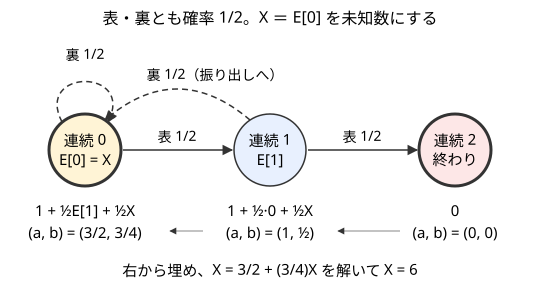

!!! abstract "要点"
    - **何ができるか**：閉路があって後ろ向きに埋められない期待値を、戻る先の期待値を未知数 $X$ とおき、各状態を $a + bX$ の形で持って、最後に $X = a + bX$ を解いて求める。一般の状態は連立一次方程式で解く。
    - **いつ使うか**：
        - 振り出し（スタート）に戻るマスがある
        - 円形に並んだ人が順番に〜する
        - 無限に続く可能性がある
        - 2 人が交互に繰り返し、決着がつくまで続ける
    - **計算量**：未知数 1 つで閉じるなら、状態数 × 1 状態の遷移の数（解くための割り算は最後の 1 回）。未知数が $k$ 個なら、その $k$ 倍に $k \times k$ の連立方程式の $O(k^3)$ を足す。一般の $n$ 状態は掃き出し法で $O(n^3)$
    - **前提**：[期待値 DP](../comb/expected-value-dp.md)

<!-- textlint-disable -->
別名：期待値の方程式・a + bX の形で持つ・吸収マルコフ連鎖・閉路のある DP・振り出しに戻る・absorbing Markov chain
<!-- textlint-enable -->

閉路のある期待値の求め方は、[期待値 DP](../comb/expected-value-dp.md) の漸化式が「ほかの状態の期待値の 1 次式」であることを使って、まだ値の分からない状態を未知数のまま運び、最後に方程式として解く手法である。[自己ループの移項](../comb/expected-value-dp.md#self-loop)は、閉路の長さが 1 の場合にあたる。

このページで使う記法：$E[s]$ は状態 $s$ から終わるまでの量（回数・費用）の期待値、$P(s \to t)$ は状態 $s$ から 1 手で状態 $t$ へ移る確率である（[記法と用語の約束](../start/notation.md)）。

## 自己ループの移項の一般化（戻る先が 1 か所） {#generalize}

期待値 DP は、1 手ごとに単調に動く量（残りの HP・進んだマスなど）があり、後ろの状態から順に埋められることを前提にしている。「振り出しに戻る」マスがあると、後ろのマスの式に最初のマスの期待値 $E[0]$ が入り、その $E[0]$ は後ろのマスの値から決まる。どちらから埋めても、まだ計算していない値を使うことになる。

自己ループなら、右辺に出る未知の値は左辺と同じ $E[s]$ だけなので、その場で移項すれば済んだ。戻る先が 1 か所なら、同じことを少し広げればよい。戻る先の期待値を未知数 $X$ とおくと、$X$ を数として扱う限り、ほかの状態は普通の順序で埋められる。各状態の値は $X$ を含んだまま求まり、最後に「戻る先の値は $X$ 自身である」という式を解けば $X$ が決まる。

小さな例で動かす。コインを投げ、表が 2 回続いたら止める（表・裏とも確率 $\frac{1}{2}$）。裏が出ると連続の回数は 0 に戻る。状態を連続の回数 0・1・2 とし、$X = E[0]$ とおく。



図の流れを式で追うと次のとおりである。

- $E[2] = 0$（終わり）
- $E[1] = 1 + \frac{1}{2} E[2] + \frac{1}{2} X = 1 + \frac{1}{2} X$
- $E[0] = 1 + \frac{1}{2} E[1] + \frac{1}{2} X = \frac{3}{2} + \frac{3}{4} X$
- $E[0] = X$ なので $X = \frac{3}{2} + \frac{3}{4} X$、移項して $X = 6$

**なぜ正しいか**：期待値 DP の式 $E[s] = c(s) + \sum_t P(s \to t) E[t]$ は、右辺の $E[t]$ について 1 次式である。1 次式に 1 次式を代入しても 1 次式なので、どの状態の値も $a + bX$ の形のまま運べる。そして本当の期待値の組は、すべての式を同時に満たす。$X = E[0]$ を代入した各式も成り立つので、最後の式 $X = a + bX$ を満たす $X$ は本当の $E[0]$ である。$b \ne 1$ ならこの式の解はただ 1 つで、$X = a / (1 - b)$ と決まる（$b = 1$ のときは [b = 1 のとき](#infinite)）。

$b$ には意味がある。$b$ は「始めの状態から、終わる前にもう一度始めの状態へ戻ってくる確率」である。上の例なら、連続 0 から表で連続 1 へ進んでも、裏で戻ることがある。戻る確率は $\frac{1}{2} + \frac{1}{2} \cdot \frac{1}{2} = \frac{3}{4}$ で、これが $b$ に一致する。$X = a / (1 - b)$ は、自己ループの $E = (c + \dots)/(1 - p)$ と同じ形をしている。

## 未知数を 1 つ残して a + bX で運ぶ {#unknown}

処理の流れは、普通の期待値 DP の値を「$a$ と $b$ の組」に置き換えるだけである。

1. 戻る先の期待値を $X$ とおく。各状態の値を組 $(a, b)$ で持ち、$a + bX$ を表す
2. 終状態は $(0, 0)$、戻る先の状態を右辺で参照するときは $(0, 1)$ とする
3. 普通の順序で漸化式を計算する。足し算は成分ごと、確率 $p$ を掛けるのは両方の成分に掛ける。定数 $c$ を足すのは $a$ だけに足す
4. 戻る先の状態の組 $(a, b)$ を求めたら、$X = a / (1 - b)$ とする
5. ほかの状態の値も要るなら、$a + bX$ に $X$ を代入する

状態から 1 手で移る先が連続する区間なら、普通の期待値 DP と同じく累積和で 1 状態 $O(1)$ にできる。累積和も組の成分ごとに取ればよい（[遷移を累積和でまとめる](../comb/expected-value-dp.md#prefix-sum)）。

次のコード片は、表が 2 回続くまでコインを投げる例（[#generalize](#generalize)）を「表の確率が $q$ で、表が $K$ 回続くまで」に広げたものである。答えは mod 998244353 で求める。

```cpp
--8<-- "expectation-linear-equations/restart.cpp:core"
```

!!! info "ACL では"
    `using mint = atcoder::modint998244353;` で $a$・$b$ を持てば、組の計算はそのまま書ける。最後の `a / (1 - b)` の割り算は逆元の掛け算で、1 回 $O(\log \mathrm{mod})$ である。終わらないかどうかは `b == 1` の比較ではなく、[b = 1 のとき](#infinite)のとおり終状態に着けるかで判定する。上のコード片では、表の確率が 0（$P = 0$）のときだけ着けない。

未知数を置かずに、$X$ を仮定して二分探索する方法もある。仮の値 $y$ を戻る先に入れて計算した $E[0]$ を $f(y)$ とすると、$f(y) = a + by$（$0 \le b < 1$）なので、$f(y) > y$ なら本当の $X$ は $y$ より大きく、$f(y) < y$ なら小さい。答えを実数で出す問題ならこれでも解ける。ただし反復の回数だけ DP をやり直すので遅く、mod で答える問題には使えない。最適な行動を選ぶ問題で、$X$ が $\min$ の中に入って 1 次式にならないときは、こちらを使う（[最適戦略の期待値](../comb/optimal-strategy-expectation.md#guess-answer)）。

## 円環状の依存を 1 周させて閉じる {#cycle}

状態が円環に並び、各状態の値が 1 つ前の状態の値で決まる形もある。

$$
f_0 = c_0 + d_0 f_{n-1}, \qquad f_i = c_i + d_i f_{i-1} \quad (1 \le i < n)
$$

どこから計算を始めても、1 周して自分に戻ってくる。そこで $f_0 = x$ とおき、$f_1, f_2, \dots, f_{n-1}$ を $a_i + b_i x$ の形で順に求める。最後に $f_0$ の式に戻って $x = c_0 + d_0 (a_{n-1} + b_{n-1} x)$ を解く。$b_{n-1} = d_1 d_2 \cdots d_{n-1}$ なので、すべての $d_i$ の積が 1 でなければ、解はただ 1 つに決まる。確率の問題では各 $d_i$ が 1 未満のことが多く、積も 1 未満になる。

例として、$N$ 人の列で残り 1 人になるまで次の操作を続ける過程を考える。先頭の人は確率 $\frac{1}{2}$ で列から抜け、確率 $\frac{1}{2}$ で末尾に回る。$p[n][i]$ を「$n$ 人の列で前から $i$ 番目（0-indexed）の人が最後に残る確率」とする。

- 先頭（$i = 0$）は、抜ければ残れず、回れば末尾になる。$p[n][0] = \frac{1}{2} p[n][n-1]$
- $i \ge 1$ の人は、先頭が回れば $n$ 人のまま 1 つ前へ、先頭が抜ければ $n - 1$ 人の列の 1 つ前へ進む。$p[n][i] = \frac{1}{2} p[n][i-1] + \frac{1}{2} p[n-1][i-1]$

人数 $n$ は減るだけなので、$n$ の小さい順に求めればよい。同じ $n$ の中では $0 \to 1 \to \dots \to n-1 \to 0$ と円環に依存するので、$p[n][0] = x$ とおいて 1 周させる。$b_{n-1} = (\frac{1}{2})^{n-1}$ なので、閉じる式の係数 $1 - \frac{1}{2} b_{n-1}$ は 0 にならない。全体で $O(N^2)$ である（逆元は人数ごとに 1 回で、$O(N \log \mathrm{mod})$ が加わる）。

```cpp
--8<-- "expectation-linear-equations/ring.cpp:core"
```

**検算**：どの $n$ でも、誰か 1 人は必ず最後に残るので、$p[n][0] + \dots + p[n][n-1] = 1$ になる。コード片の `main` はこれを確かめている。円環を閉じる式を立て間違えると、この和が 1 からずれる。

## 等比級数で閉じる（交互に繰り返す） {#geometric-series}

2 人が交互に試行を繰り返し、決着がつくまで同じ状態にとどまる形では、とどまる間に手番が入れ替わる。手番まで状態に入れると、「A の手番」と「B の手番」が互いに行き来する長さ 2 の閉路になる。この閉路は、等比級数の和でも、2 つの未知数の方程式でも閉じられる。

先に試行する人を A、もう 1 人を B とする。1 回の試行で、確率 $p$ で状態が変わらずに罰金 1 を払い、確率 $1 - p$ で状態が進む（罰金はない）とする。

**等比級数で求める**：A の $k$ 回目（$k = 0, 1, \dots$）の試行が行われるのは、それまでの $2k$ 回の試行がすべて「とどまる」だったときで、その確率は $p^{2k}$ である。その試行で罰金を払う確率は $p$ である。B の $k$ 回目の試行は、それまでの $2k + 1$ 回がすべて「とどまる」だったときに行われる。よって、この状態にいる間の罰金の期待値は次のようになる。

$$
\text{A}：\sum_{k \ge 0} p^{2k} \cdot p = \frac{p}{1 - p^2}, \qquad \text{B}：\sum_{k \ge 0} p^{2k+1} \cdot p = \frac{p^2}{1 - p^2}
$$

状態が進むときに次の試行をするのが誰かも、同じように求まる。A の試行で進む確率は $\sum_k p^{2k} (1 - p) = \frac{1}{1 + p}$ で、このとき次の状態は B から始まる。B の試行で進む確率は $\frac{p}{1 + p}$ で、次の状態は A から始まる。

**方程式で求める**：同じ値は、未知数 2 つの方程式からも出る。$u$ を「今の手番の人がこの状態で払う罰金の期待値」、$v$ を「もう 1 人が払う罰金の期待値」とする。1 回試行すると、確率 $p$ で罰金を払って手番が入れ替わり、役割が逆になる。

$$
u = p (1 + v), \qquad v = p \, u
$$

これを解くと $u = \frac{p}{1 - p^2}$、$v = \frac{p^2}{1 - p^2}$ で、等比級数の結果と一致する。公比が分かりやすいときは等比級数、遷移が込み入っているときは方程式、と書きやすい方を選べばよい。mod で等比級数の和を求めるときの注意は[等比数列の和の mod](../math/geometric-series-mod.md#formula) にある。

状態が $N$ 段あるなら、段ごとに「A から始まる確率」を前向きに運び、各段の罰金の期待値をその確率で重み付けして足す。[ARC174 C](#arc174_c) がこの形である。

## 一般の連立方程式（掃き出し法は math へ） {#linear-system}

閉路が 1 か所に集まらず、状態が互いに複雑に行き来するなら、状態数 $n$ 個の未知数の連立一次方程式として解く。終状態以外の各状態 $s$ について次の式を並べる。

$$
E[s] - \sum_{t \text{ は終状態でない}} P(s \to t) \, E[t] = c(s)
$$

行列で書くと $(I - P) E = c$ である。$P$ は終状態以外どうしの遷移確率の $n \times n$ 行列、$I$ は単位行列である。この形の過程を吸収マルコフ連鎖といい、終状態が「吸収される状態」にあたる。どの状態からも確率 1 で終状態に着くなら $I - P$ は逆行列を持ち、解はただ 1 つに決まる。解き方は[掃き出し法](../math/gaussian-elimination.md)で、$O(n^3)$ かかる。$n$ が数百までなら間に合う。

未知数 1 つの方法は、この連立方程式を賢く解いたものとみなせる。閉路をすべて断ち切るのに必要な状態（戻る先）が $k$ 個なら、それらを未知数 $X_1, \dots, X_k$ とおく。各状態の値を「定数 $+ \sum b_j X_j$」の $k + 1$ 個の成分で運び、最後に $k$ 個の未知数の連立方程式を解く。状態数を $n$、遷移の総数を $m$ とすると、$O(k \, m + k^3)$ になる。状態が多くても戻る先が少ないなら、こちらがずっと速い。

mod $p$ で解くときは、途中のピボットが mod $p$ で 0 になることがあるので、行の入れ替えが要る（[mod p の掃き出し](../math/gaussian-elimination.md#mod-p)）。

## b = 1 のとき（期待値が無限大） {#infinite}

$X = a + bX$ で $b = 1$ になるのは、始めの状態から、終わる前に確率 1 で始めの状態へ戻るときである。すなわち、始めの状態から終状態に着く確率が 0 で、期待値は無限大になる（$a > 0$ なら式 $X = a + X$ に解がない）。問題文で「終わらない場合は −1 を出力」などと指定されるのは、この場合である。

この判定を $1 - b$ の値だけで行うのは危ない。

- **実数のとき**：本当は $b = 1$ でも、誤差で $1 - b$ が小さな正の数になり、巨大な値を答えにしてしまう。逆に、本当は 1 にとても近いだけの $b$ を 1 と判定する誤りもある
- **mod のとき**：本当の $b$ が 1 でなくても、mod の値がたまたま 1 になることがある。mod の値で確かに言えるのは「1 でない」側だけで、mod の値が 1 になっても本当の $b$ が 1 とは限らない

そこで、終状態に着けるかどうかを、確率の値ではなくグラフの到達可能性で判定する。確率が正の遷移だけを辺にして、始めの状態から終状態へ道があるかを調べればよい。すごろくなら「戻るマスが $M$ 個（サイコロの目の最大）以上続く区間があると、そこを越えられない」のように、条件を直接書けることも多い。

一般の連立方程式でも同じで、終状態に着けない状態があると $I - P$ は逆行列を持たない。先に到達可能性を調べ、着けない状態を取り除くか、答えを無限大と判定してから解く。

## 落とし穴 {#pitfalls}

- **閉路を見落として順に埋める**：振り出しへ戻る遷移の先 $E[0]$ を、まだ計算していない 0 のまま使ってしまう。エラーにならず、答えが小さくずれるだけなので気づきにくい。遷移の矢印を書き、後ろへ戻る矢印がないかを確かめる
- **戻る先を $(0, 1)$ にし忘れる**：戻る先の状態を右辺で参照するときに、計算中の自分の組（$E[0]$ の途中の値）を使うと式が変わる。右辺の「戻る先」はいつも $X$ そのもの、つまり $(0, 1)$ である
- **定数を $b$ にも足す**：1 手ぶんの定数 $c$ は $a$ だけに足す。確率を掛けるときは $a$ と $b$ の両方に掛ける
- **$b = 1$ を値で判定する**：実数の誤差や mod の偶然で判定を誤る。終状態に着けるかはグラフで調べる（[b = 1 のとき](#infinite)）
- **最適な選択を mod の値で比べる**：$\min$ や $\max$ の中に $X$ が入る問題は、1 次式のまま運べないうえ、mod の値では大小を比べられない。実数で二分探索するか、選び方の形を先に決めてから式を立てる（[mod の値では大小比較できない](../comb/rational-mod.md#no-compare)）

## 例題 {#examples}

### ARC174 C. Catastrophic Roulette {#arc174_c}

<div class="kp-problems" data-role="example" markdown>

- [ARC174 C. Catastrophic Roulette](https://atcoder.jp/contests/arc174/tasks/arc174_c)（diff 1706）：2 人が交互にルーレットを回し、すでに出た数が出たら回した人が罰金を払うとき、すべての数が出るまでの各人の罰金の期待値を求める。

</div>

これまでに出た数の種類 $i$ を状態にすると、状態 $i$ では確率 $p = i/N$ で状態がとどまって回した人が罰金を払い、確率 $1 - p$ で $i + 1$ へ進む。とどまる間に手番が交互に入れ替わるので、[等比級数で閉じる](#geometric-series)の式がそのまま使える。状態ごとに「先手がその状態の最初に回す確率」を前向きに運べば、各人の罰金の期待値の和が求まる。

??? note "解法の詳細"
    - 最初の 1 回は必ず新しい数なので、先手が回して状態 $i = 1$ になり、状態 1 は後手から始まる
    - 状態 $i$（$1 \le i < N$）で $p = i/N$ とする。その状態の最初に回す人は $\frac{p}{1 - p^2}$、もう 1 人は $\frac{p^2}{1 - p^2}$ の罰金を期待値で払う
    - $r_i$ を「状態 $i$ の最初に回すのが先手である確率」とすると、$r_1 = 0$ で、$r_{i+1} = r_i \cdot \frac{p}{1 + p} + (1 - r_i) \cdot \frac{1}{1 + p}$ である（最初に回した人が進めたら、次の状態はもう 1 人から始まる）
    - 先手の答えは $\sum_i \left( r_i \frac{p}{1 - p^2} + (1 - r_i) \frac{p^2}{1 - p^2} \right)$ で、後手も同じように求める。答えは mod 998244353 なので、割り算は逆元の掛け算にする。全体で $O(N \log \mathrm{mod})$
    - 検算：2 人の罰金の合計は「回した回数 − $N$」の期待値である。新しい数が出るまでの回数は幾何分布なので、合計は $\sum_{i=1}^{N-1} \frac{i}{N - i}$ になる（[幾何分布](../comb/coupon-collector.md#geometric)）
    - 別の解き方として、$k$ 回目に罰金が発生する確率を包除原理で式にし、先手の回（偶数回目）と後手の回（奇数回目）ごとに公比 $\left(\frac{N - j}{N}\right)^2$ の等比級数で足す方法もある

### ABC333 F. Bomb Game 2 {#abc333_f}

<div class="kp-problems" data-role="example" markdown>

- [ABC333 F. Bomb Game 2](https://atcoder.jp/contests/abc333/tasks/abc333_f)（diff 1770）：N 人が並ぶ列で、先頭の人が確率 1/2 で列から抜けるか末尾に回る操作を残り 1 人になるまで続けるとき、各人が最後に残る確率を求める。

</div>

人数と列の中の位置を状態にすると、人数は減るだけだが、同じ人数の中では先頭が末尾に回るので位置が円環状に依存する。[円環状の依存を 1 周させて閉じる](#cycle)の例そのもので、人数ごとに先頭の確率を未知数 $x$ とおいて 1 周させれば、人数の小さい順に求まる。

??? note "解法の詳細"
    - $p[n][i]$ ＝ $n$ 人の列で前から $i$ 番目（0-indexed）の人が最後に残る確率。$p[1][0] = 1$ で、答えは $p[N][0], \dots, p[N][N-1]$
    - $p[n][0] = \frac{1}{2} p[n][n-1]$、$p[n][i] = \frac{1}{2} p[n][i-1] + \frac{1}{2} p[n-1][i-1]$（$i \ge 1$）
    - $p[n][0] = x$ として $p[n][i] = a_i + b_i x$ を $i = 1, \dots, n - 1$ の順に求め、$x = \frac{1}{2}(a_{n-1} + b_{n-1} x)$ を解く
    - 人数ごとに $O(n)$ で、逆元は人数ごとに 1 回なので、全体で $O(N^2 + N \log \mathrm{mod})$ である。中心は[円環状の依存](#cycle)のコード片のとおり

## 練習問題 {#practice}

<div class="kp-problems" data-role="practice" markdown>

- [ABC189 F. Sugoroku2](https://atcoder.jp/contests/abc189/tasks/abc189_f)（diff 2154）：マス 0〜N のすごろくで、1〜M の目が等確率のサイコロを振り、指定されたマスに止まると振り出しに戻るとき、ゴールまでの振る回数の期待値を求める。

</div>

??? note "練習の方針"
    - **ABC189 F**：スタートの期待値を $X$ とおき、各マスの期待値を $(a, b)$ の組で後ろのマスから求める（[未知数を 1 つ残して a + bX で運ぶ](#unknown)）。振り出しに戻るマスを $(0, 1)$、ゴール以降を $(0, 0)$ にする。後ろの $M$ マスの平均は、組の成分ごとの累積和で $O(1)$ にする。戻るマスが $M$ 個以上続くと越えられないので、そのときは終わらない（[b = 1 のとき](#infinite)）。答えは実数で出す。$X$ を仮定して二分探索する方法でも解ける

## 力試し {#challenge}

<div class="kp-problems" data-role="challenge" markdown>

- [ABC224 G. Roll or Increment](https://atcoder.jp/contests/abc224/tasks/abc224_g)（diff 2374）：1〜N の目のサイコロの出目 S を、A 円払って 1 増やすか B 円払って振り直すかを選びながら T にするとき、費用の期待値の最小値を求める。

</div>

??? note "力試しの方針"
    - **ABC224 G**：振り直した直後の期待値を $R$ とおくと、出目 $s$ の状態の期待値は、$s \le T$ なら $\min(A(T - s), B + R)$、$s > T$ なら $B + R$ で、$R$ はそれらの $s = 1, \dots, N$ での平均である。$R$ が $\min$ の中に入るので 1 次式のまま運べない。最適な行動は「$T$ との差が $x$ 未満なら 1 ずつ増やし、ほかは振り直す」の形になる。$x$ を決めると、$R$ は $R = \frac{1}{N}\left(A \frac{x(x-1)}{2} + (N - x)(B + R)\right)$ の 1 次方程式になり、解くと $x$ の式になる。$x$ について凸なので、三分探索か最適な点の近くを調べて最小を取る。最初の出目 $S$ が増やす範囲にあるなら答えは $A(T - S)$、ないなら $B + R$ である（[最適戦略の期待値](../comb/optimal-strategy-expectation.md)）

## 確認問題 {#quiz}

??? question "確認問題：a + bX の b が「始めの状態へ戻ってくる確率」になるのはなぜか"
    $X$ の係数 $b$ は、右辺で $X$ を参照した遷移の確率を、始めの状態からその遷移までの道の確率で重み付けして足したものである。これは「始めの状態から出発し、終状態に着く前に、戻る遷移を通って始めの状態へ戻る確率」そのものである。戻ってきた後は始めからやり直すので、始めの状態にいる回数の期待値は $\frac{1}{1 - b}$ 回である。$X = \frac{a}{1 - b}$ は「1 回あたり $a$ が $\frac{1}{1 - b}$ 回」と読める。

??? question "確認問題：表が 3 回続くまでコインを投げる（表・裏とも確率 1/2、裏で連続は 0 に戻る）。a + bX の形で期待値を求めよ"
    $X = E[0]$ とおく。$E[3] = 0$、$E[2] = 1 + \frac{1}{2} \cdot 0 + \frac{1}{2} X = 1 + \frac{1}{2} X$ である。$E[1] = 1 + \frac{1}{2} E[2] + \frac{1}{2} X = \frac{3}{2} + \frac{3}{4} X$、$E[0] = 1 + \frac{1}{2} E[1] + \frac{1}{2} X = \frac{7}{4} + \frac{7}{8} X$ となる。$X = \frac{7}{4} + \frac{7}{8} X$ を解いて $X = 14$ である。$b = \frac{7}{8}$ は、表が 3 回続く前に裏が出る確率 $1 - \frac{1}{8}$ に一致する。

??? question "確認問題：円環状の依存 $f_i = c_i + d_i f_{i-1}$ で、すべての $d_i = 1$ だとどうなるか"
    1 周したときの係数 $d_0 d_1 \cdots d_{n-1}$ が 1 になり、閉じる式は $x = (c_0 + \dots + c_{n-1}) + x$ になる。$c$ の和が 0 でなければ解がなく、0 なら $x$ は何でもよい（解が無数）。確率の問題でこの形になるのは、円環から抜け出す確率が 0 のときで、期待値は無限大か、条件が足りていない。

## 使い分け {#comparison}

| 閉路の形 | 使う手法 |
| --- | --- |
| 自分自身だけに戻る（自己ループ） | [自己ループの移項](../comb/expected-value-dp.md#self-loop) |
| 1 か所（振り出し）に戻る | [未知数を 1 つ残して a + bX で運ぶ](#unknown) |
| 円環に並ぶ | [円環状の依存を 1 周させて閉じる](#cycle) |
| 交互に入れ替わってとどまる | [等比級数で閉じる](#geometric-series) |
| 戻る先が少数 $k$ 個 | 未知数 $k$ 個の連立方程式（[一般の連立方程式](#linear-system)） |
| 状態が数百以下で複雑に行き来する | [掃き出し法](../math/gaussian-elimination.md) |
| 戻る先が $\min$ や $\max$ の中に入る | 答えを仮定して二分探索（[最適戦略の期待値](../comb/optimal-strategy-expectation.md#guess-answer)） |

## 参考 {#references}

- [drken「AtCoder ARC 174 C - Catastrophic Roulette (青色, 500 点)」](https://drken1215.hatenablog.com/entry/2024/03/17/233040)：例題 ARC174 C の、先手・後手の回ごとに等比級数で足す方法（包除原理による別解）
- [kmjp「AtCoder ABC #189 : F - Sugoroku2」](https://kmjp.hatenablog.jp/entry/2021/01/23/0900)：練習 ABC189 F の、スタートの期待値を仮定する解き方・累積和・戻るマスが続くときの判定
- [kmjp「AtCoder ABC #224 : G - Roll or Increment」](https://kmjp.hatenablog.jp/entry/2021/10/26/0900)：力試し ABC224 G の、振り直す範囲を決めて期待値を式にし、凸性で最小を探す方法
