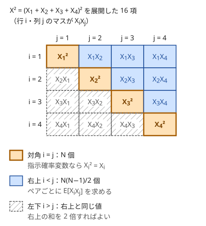

!!! abstract "要点"
    - **何ができるか**：$E[X^2]$ を求める。線形性では直接は求まらないので、$X^2 = \sum_i \sum_j X_i X_j$ と展開してペアごとの期待値を足すか、DP で「確率」「期待値 × 確率」「二乗の期待値 × 確率」の 3 つを同時に運ぶ。[分散](../guide/glossary.md#variance)は $E[X^2] - E[X]^2$ で求める。
    - **いつ使うか**：
        - 〜の二乗の期待値。
        - 分散を求める（最小化する）。
        - スコアの二乗の期待値。
    - **計算量**：ペアに分ける方法では、ペアの期待値が少ない種類にまとまれば $\sum_{i<j} A_i A_j$ を和の二乗から $O(N)$ で求められる。DP で運ぶ方法は、元の確率 DP と同じ状態数・遷移数で、運ぶ量が 3 倍になるだけである。
    - **前提**：[期待値の線形性と指示確率変数](../comb/linearity-of-expectation.md)

<!-- textlint-disable -->
別名：二乗の期待値・分散・E[X^2]・確率・期待値・二乗を同時に運ぶ・variance
<!-- textlint-enable -->

二乗の期待値は、[期待値の線形性](../comb/linearity-of-expectation.md)がそのままでは使えない量の代表である。$X^2$ を「ペアの積の和」か「1 つ前の値の 1 次式」に書き直すと、ふたたび線形性で扱える形になる。分散も $E[X^2]$ と $E[X]$ から求まるので、同じ道具で扱える。

このページでは、確率変数を $X$、その期待値を $E[X]$、分散を $V[X]$ と書く。添字は 1-indexed で、記法は[記法と用語の約束](../start/notation.md)にそろえる。

## 二乗の期待値と期待値の二乗の違い {#difference}

$E[X^2]$（二乗してから平均する）と $E[X]^2$（平均してから二乗する）は、一般には等しくない。サイコロ 1 個の目 $X$ なら次のようになる。

$$
E[X]^2 = \left(\frac{7}{2}\right)^2 = \frac{49}{4}, \qquad E[X^2] = \frac{1 + 4 + 9 + 16 + 25 + 36}{6} = \frac{91}{6}
$$

差は $\frac{91}{6} - \frac{49}{4} = \frac{35}{12}$ で、これが[分散](#variance)である。$X$ が定数でない限り、$E[X^2]$ の方が必ず大きい。$V[X] = E[(X - E[X])^2] \ge 0$ を展開すると $E[X^2] - E[X]^2$ になるからである。

線形性が使えないのは、$x \mapsto x^2$ が 1 次式でないからである。線形性は「和の期待値 = 期待値の和」で、二乗の中には和が入っているので外に出せない。期待値の線形性が保証するのは、$E[aX + b] = aE[X] + b$ のような 1 次式までである。

この違いで実際に起きるバグは次の形である。

- **期待値だけを DP で運び、最後に二乗する**：「$K$ 回後のレベル $L$ の二乗の期待値」を、$E[L]$ を求めてから $E[L]^2$ として答える。分散の分だけ小さい値が出る
- **状態ごとの期待値を二乗して足す**：状態 $v$ にいる確率 $P_v$ とそこでの $L$ の期待値 $e_v$ から $\sum_v P_v e_v^2$ を答える。同じ状態に違う $L$ で来る道が混ざると、やはり小さく出る
- **入力例で気づかない**：$L$ が確定している（ばらつかない）小さな入力では $E[L^2] = E[L]^2$ なので、入力例が通ってしまう

正しく求めるには、$X^2$ そのものを線形性が使える形に書き直す。方法は 2 つある。$X$ が多くの部分の和なら[ペアに分ける](#pairs)。$X$ が 1 ステップずつ変わるなら [3 つの量を同時に運ぶ](#carry-three)。

## ペアに分ける（i = j の項を忘れない） {#pairs}

$X$ が $X = X_1 + X_2 + \dots + X_N$ と和に分かれているとき、二乗を展開すると $N^2$ 項の積の和になる。

$$
X^2 = \sum_{i=1}^{N} \sum_{j=1}^{N} X_i X_j = \sum_{i} X_i^2 + 2 \sum_{i < j} X_i X_j
$$

右辺は和なので線形性が使える。$E[X^2]$ は「対角の項 $E[X_i^2]$ の和」と「ペアの項 $E[X_i X_j]$ の和の 2 倍」になる。



図のように、展開した項は対角・右上・左下の 3 つに分かれる。よくある誤りは、ペア $i < j$ だけを足して対角を落とすことである。

$X_i$ が[指示確率変数](../guide/glossary.md#indicator)（0 か 1）なら、$X_i^2 = X_i$ で $X_i X_j = [i \text{ と } j \text{ が両方起きる}]$ である。よって次の式になる。

$$
E[X^2] = \sum_i P(\text{$i$ が起きる}) + 2 \sum_{i < j} P(\text{$i$ と $j$ が両方起きる})
$$

ペアの確率は独立でなくてよい。独立なら $P(\text{両方}) = P(i)P(j)$ と積にできるが、独立でなければ「両方起きる確率」を直接求める。

**独立な例**：確率 $p$ で表が出るコインを $N$ 回投げ、表の回数を $X$ とする。$X_i$ を「$i$ 回目が表」とすると、対角の和が $Np$ になる。ペアは $\binom{N}{2}$ 個あり、どれも確率 $p^2$ で両方表になる。

$$
E[X^2] = Np + N(N-1)p^2
$$

$N = 2$、$p = 1/2$ で確かめる。表の回数は 4 通りで $0, 1, 1, 2$、二乗の平均は $(0 + 1 + 1 + 4)/4 = 3/2$ で、式の値 $1 + 2 \cdot \frac{1}{4} = \frac{3}{2}$ と一致する。

**独立でない例**：一様ランダムな順列 $p$ の固定点（$p_i = i$ となる $i$）の個数を $F$ とする。$P(p_i = i) = 1/N$ で、$i \ne j$ なら $P(p_i = i \text{ かつ } p_j = j) = \frac{(N-2)!}{N!} = \frac{1}{N(N-1)}$ である。$N \ge 2$ なら次のようになる。

$$
E[F^2] = N \cdot \frac{1}{N} + 2 \binom{N}{2} \cdot \frac{1}{N(N-1)} = 1 + 1 = 2
$$

$N = 3$ の 6 個の順列の固定点の数は $3, 1, 1, 1, 0, 0$ で、二乗の平均は $12/6 = 2$ になる。$E[F] = 1$ なので分散は $2 - 1 = 1$ である。2 つの事象 $p_i = i$ と $p_j = j$ は独立でない（$\frac{1}{N(N-1)} \ne \frac{1}{N^2}$）。それでも展開と線形性に独立性は要らない。

**重みの付いた和**：$X = \sum_i c_i A_i$ のように、確率的な係数 $c_i$ と定数 $A_i$ の和なら次のようになる。

$$
E[X^2] = \sum_i E[c_i^2] A_i^2 + 2 \sum_{i < j} E[c_i c_j] A_i A_j
$$

ペアの値 $E[c_i c_j]$ が[対称性](../comb/probability-symmetry.md)ですべて等しい値 $r$ になれば、残りは $\sum_{i<j} A_i A_j$ だけである。これは $N^2$ 項を足さずに $O(N)$ で求まる。

$$
\sum_{i < j} A_i A_j = \frac{1}{2} \left( \Bigl(\sum_i A_i\Bigr)^2 - \sum_i A_i^2 \right)
$$

mod で計算するなら $1/2$ は 2 の逆元を掛ける。あるいは $A_j$ を足す前の累積和 $S$ を使い、$\sum_j A_j S$ と左から足していけば割り算は要らない。[例題の ABC450 G](#abc450_g) はこの形である。

- **応用の型**：「ランダムに選んだ集合の大きさの二乗」「操作の後の値の二乗」のように、量が部分の和で書けて、ペアの同時確率が対称性で少ない種類にまとまる問題
- **応用の型**：ペアの確率が距離 $\lvert i - j \rvert$ だけで決まるなら、距離ごとにペアの個数を数えて掛ける

## (x + 1)^2 = x^2 + 2x + 1 で 3 つの量を同時に運ぶ {#carry-three}

この節は[確率 DP](../comb/probability-dp.md) を前提にする。レベルやコンボのように、値 $L$ が 1 ステップずつ変わり、その二乗が問われるときは、DP で二乗の期待値を直接運ぶ。

鍵は、$L$ が $L + c$（$c$ は定数）に変わるときの二乗の変化が、元の $L$ の 1 次式で書けることである。

$$
(L + c)^2 = L^2 + 2cL + c^2
$$

右辺は $L^2$・$L$・$1$ の 1 次結合なので、期待値をとると $E[L^2]$・$E[L]$・確率から次の値が決まる。$E[L^2]$ を更新するには $E[L]$ が要り、$E[L]$ を更新するには確率が要る。3 つを組にすれば、その組だけで次のステップの組が決まる。

**運ぶ量**：状態 $v$ ごとに、条件付きの期待値ではなく「確率を掛けた形」で持つ。$[v \text{ にいる}]$ は $v$ にいれば 1、いなければ 0 の指示確率変数である。

| 量 | 意味 | $L \to L + c$ の後 |
| --- | --- | --- |
| $P_v$ | $v$ にいる確率 | $P_v$ |
| $S_v$ | $E[L \cdot [v \text{ にいる}]]$ | $S_v + c P_v$ |
| $T_v$ | $E[L^2 \cdot [v \text{ にいる}]]$ | $T_v + 2c S_v + c^2 P_v$ |

確率を掛けた形で持つ理由は、合流で足すだけで済むからである。ある状態に 2 本の道から来るとき、$P$・$S$・$T$ のどれも、それぞれの道の値の和になる。$L$ の条件付きの期待値 $S_v / P_v$ で持つと、合流のたびに確率で重み付けした平均をとり直すことになる。そのうえ確率が 0 の状態で割り算が起きる。遷移の確率 $q$ で配るときは、3 つとも $q$ 倍する。最後に答えが $E[L^2]$ なら $\sum_v T_v$、$E[L]$ なら $\sum_v S_v$ を足す。

**小さな例**：挑戦を順に行い、$i$ 回目は確率 $q_i$ で成功する。成功するたびにコンボ $L$ が 1 増えて $L^2$ 点を得て、最初の失敗で終わる。状態は「続いている」の 1 つで、失敗した側は捨てる。

| 回 | $P$ | $S$ | $T$ | 得る点の期待値 |
| --- | --- | --- | --- | --- |
| 始め | $1$ | $0$ | $0$ | — |
| 1 回目（$q_1 = 1/2$） | $1/2$ | $1/2$ | $1/2$ | $1/2$ |
| 2 回目（$q_2 = 1/2$） | $1/4$ | $1/2$ | $1$ | $1$ |

成功した側に移る遷移なので、表の式で $c = 1$ の更新をしてから 3 つとも $q_i$ 倍する。どちらも 1 次式なので、順を入れ替えても同じ値になる。2 回目の $T$ は $\frac{1}{2}(T + 2S + P) = \frac{1}{2}(\frac{1}{2} + 1 + \frac{1}{2}) = 1$ である。合計は $3/2$ になる。全列挙で確かめると、1 回だけ成功（確率 $1/4$、1 点）と 2 回とも成功（確率 $1/4$、$1 + 4 = 5$ 点）で、$\frac{1}{4} + \frac{5}{4} = \frac{3}{2}$ である。$P$ を持たずに $T + 2S + 1$ と書くと、この例では 2 回目の $T$ が $\frac{1}{2}(\frac{1}{2} + 1 + 1) = \frac{5}{4}$ になり誤る。「$+1$」は「続いている確率の分だけ $+1$」なので、$+P$ と書く必要がある。

```cpp
--8<-- "expectation-of-square/combo.cpp:core"
```

完全なプログラム：[`combo.cpp`](https://github.com/yuukougun/kyopro-atlas/blob/main/snippets/expectation-of-square/combo.cpp)（GitHub）。`mint` は ACL の `modint998244353`（[modint](../math/modint.md)）。
{ .kp-code-src }

更新は $T$ を先に、$S$ を後に書くか、上のように新しい値を別の変数に作ってから入れ替える。$S$ を先に書き換えると、$T$ の更新が新しい $S$ を使ってしまう。

- **応用の型（グラフ上のランダムウォーク）**：頂点を状態にし、辺ごとに $P$・$S$・$T$ を $1/\deg$ 倍して配る。レベルが上がる頂点へ入ったら表の式で更新し、得点の頂点へ入ったら $T$ を答えに足す。時刻 $K$ までなら $O(K(N + M))$ である（[力試し](#challenge)の問題）
- **応用の型（3 乗以上）**：$E[L^k]$ なら $(L + c)^k = \sum_{t} \binom{k}{t} c^{k-t} L^t$ なので、$E[L^0], \dots, E[L^k]$ の $k + 1$ 個を運ぶ
- **応用の型（定数倍）**：$L \to aL + c$ でも $(aL + c)^2 = a^2 L^2 + 2acL + c^2$ なので同じ 3 つで閉じる。$\max$ や $\min$ が入ると 1 次式でなくなり、閉じない
- **区間の二乗和**：区間に $c$ を足して区間の二乗和を問うクエリは、同じ式で（和, 二乗和, 長さ）を運ぶ。長さが確率 $P$ の役である（[遅延セグメント木で区間の長さを持たせる](../ds/lazy-segment-tree.md#size-in-node)）

## 分散と二乗和の関係 {#variance}

分散は、平均 $\mu = E[X]$ からのずれの二乗の期待値である。展開して線形性を使うと $E[X^2]$ と $E[X]$ で書ける。

$$
V[X] = E[(X - \mu)^2] = E[X^2] - 2\mu E[X] + \mu^2 = E[X^2] - E[X]^2
$$

だから分散を問われたら、$E[X^2]$ と $E[X]$ を別々に求めて引けばよい。確率の問題でなくても、$N$ 個の値 $x_1, \dots, x_N$ の分散は「一様に 1 つ選んだ値」の分散として同じ式になる。

$$
V = \frac{1}{N} \sum_i x_i^2 - \left( \frac{1}{N} \sum_i x_i \right)^2 = \frac{N \sum_i x_i^2 - \left(\sum_i x_i\right)^2}{N^2}
$$

右の形は分子が整数なので、整数の入力なら誤差なしで比べられる。区間 $[l, r)$ の分散を何度も問われるなら、$x_i$ と $x_i^2$ の[累積和](../basics/prefix-sum.md)を両方作れば 1 回 $O(1)$ である。

- **平均が決まっているなら、分散の最小化は二乗和の最小化**：$N$ 個の品物を $D$ 個のグループに分け、グループの和 $x_1, \dots, x_D$ の分散を最小にする問題を考える。全体の和は分け方によらないので、平均 $\mu$ も分け方によらない。$V = \frac{1}{D} \sum_k x_k^2 - \mu^2$ なので、$\sum_k x_k^2$ を最小にすればよい。グループごとの二乗の和に分かれるので、DP の遷移で 1 グループずつ足せる（[部分集合を列挙する DP](../dp/subset-enumeration-dp.md)の型）。空のグループの値 $0$ も二乗和に入る
- **独立な和の分散**：$X$ と $Y$ が独立なら $V[X + Y] = V[X] + V[Y]$ である。一般には $V[X + Y] = V[X] + V[Y] + 2(E[XY] - E[X]E[Y])$ で、独立なら最後の項が 0 になる。最後の項の $E[XY]$ は、[ペアに分ける](#pairs)ときの右上の項であり、そこから $E[X]E[Y]$ を引いたものが残る。コインの例では各回の分散 $p(1-p)$ の $N$ 倍で $Np(1-p)$ になり、$E[X^2] - E[X]^2 = Np + N(N-1)p^2 - N^2p^2$ と一致する
- **定数倍とずらし**：$V[aX + b] = a^2 V[X]$。全体を定数だけずらしても分散は変わらないので、値が大きいときは平均に近い値を引いてから計算すると、浮動小数点の桁落ちを減らせる

## 落とし穴 {#pitfalls}

- **$E[X]^2$ を答える**：期待値だけを運んで最後に二乗すると、分散の分だけ小さくなる。$L$ がばらつかない入力例では一致するので、確率が $1/2$ の小さな例を手で計算して確かめる
- **対角の項を落とす**：$X^2 = 2 \sum_{i<j} X_i X_j$ ではない。指示確率変数なら対角の和は $E[X]$ そのものである
- **$i$ と $j$ を独立とみなす**：同じ操作から決まる 2 つの量（順列の 2 か所、同じ乱数で決まる係数）は独立でない。$P(\text{両方})$ を直接求める
- **更新の順序**：$S$ を先に書き換えてから $T$ を更新すると、$T + 2cS$ に新しい $S$ が入る。新しい値は別の変数に作ってから入れ替える
- **$+c^2$ を $+c^2 P$ にし忘れる**：確率を掛けた形で持つときは、定数の項にも $P$ を掛ける。確率の和が 1 でない状態（途中で終わる、複数の状態に分かれる）で誤る
- **分散を mod で比べる**：答えを mod 998244353 で出す問題でも、分散を最小にする選択の比較は mod の値ではできない（[mod の値では大小比較できない](../comb/rational-mod.md#no-compare)）。比べるのは整数のままの $N \sum x_i^2 - (\sum x_i)^2$ か実数で行う
- **オーバーフロー**：$N \sum x_i^2$ は $x_i \le 10^6$、$N = 2 \times 10^5$ でも $4 \times 10^{22}$ ほどになり、`long long` を超える。`__int128` を使うか、平均に近い値を引いてから計算する

## 例題 {#examples}

### ABC450 G. Random Subtraction {#abc450_g}

<div class="kp-problems" data-role="example" markdown>

- [ABC450 G. Random Subtraction](https://atcoder.jp/contests/abc450/tasks/abc450_g)（diff 2227）：整数列から 2 つの要素を一様ランダムに選び、一方から他方を引いた値に置き換える操作を、要素が 1 つになるまで繰り返す。残る値の二乗の期待値を求める。

</div>

残る値 $x$ は、元の要素に $+1$ か $-1$ の符号を付けた和 $x = \sum_i c_i A_i$ になる。$c_i^2 = 1$ なので対角は $\sum_i A_i^2$ である。ペア $(i, j)$ の $E[c_i c_j]$ は、操作が要素の値を見ないので対称性からすべて同じ値 $r_N$ になる。答えは $\sum_i A_i^2 + 2 r_N \sum_{i<j} A_i A_j$ で、残りは $r_N$ を求めることだけである。

??? note "解法の詳細"
    $r_N$ を、最初の 1 回の操作で場合分けして求める。ペア $(u, v)$ に注目し、最初に選ばれる 2 つ $\{a, b\}$ との関係で 3 通りに分ける。最初の操作の後は要素が $N - 1$ 個の同じ過程なので、そこでの符号の積の期待値は $r_{N-1}$ である。

    - **$\{a, b\} = \{u, v\}$**（確率 $\frac{2}{N(N-1)}$）：$u$ と $v$ は逆の符号で 1 つにまとまるので、$c_u c_v = -1$ である
    - **片方だけが選ばれる**：選ばれた側の符号は、引く側か引かれる側かで $\pm$ が等確率に入れ替わる。もう一方との積の期待値は $0$ である
    - **どちらも選ばれない**（確率 $\frac{(N-2)(N-3)}{N(N-1)}$）：$u$ と $v$ は別々の要素のまま残り、積の期待値は $r_{N-1}$ である

    $$
    r_2 = -1, \qquad r_N = -\frac{2}{N(N-1)} + \frac{(N-2)(N-3)}{N(N-1)} \, r_{N-1}
    $$

    $N = 3$ なら $r_3 = -\frac{1}{3}$ で、帰納法で $N \ge 3$ では $r_N = -\frac{2}{3(N-1)}$ となる。$N = 2$ なら $x = \pm(A_1 - A_2)$ なので $x^2 = A_1^2 + A_2^2 - 2A_1A_2$ で、$r_2 = -1$ と合う。漸化式は小さい $N$ の全探索とも一致することを確かめた。答えを mod 998244353 で求めるなら、$\sum_{i<j} A_i A_j$ を[ペアに分ける](#pairs)の累積和で $O(N)$ で作り、割り算は逆元を掛ける。全体で $O(N)$ である。

    漸化式に気づかなくても、$N \le 6$ 程度を全探索して $E[c_i c_j]$ を並べれば規則が見える。展開して「ペアの値は 1 種類」と分かっていれば、調べる量が 1 つの数列に絞られる。

## 練習問題 {#practice}

<div class="kp-problems" data-role="practice" markdown>

- [ABC332 E. Lucky bag](https://atcoder.jp/contests/abc332/tasks/abc332_e)（diff 1883）：N ≤ 15 個の品物を D 個の袋に分け（空の袋も許す）、袋ごとの重さの分散の最小値を求める。

</div>

??? note "練習の方針"
    - **ABC332 E**：どの分け方でも平均は一定なので、分散の最小化は袋の重さの二乗和の最小化に言い換えられる。部分集合の部分集合を列挙する DP で袋を 1 つずつ決める。空の袋の値 0 も二乗和に入れる

## 力試し {#challenge}

<div class="kp-problems" data-role="challenge" markdown>

- [ABC277 G. Random Walk to Millionaire](https://atcoder.jp/contests/abc277/tasks/abc277_g)（diff 2491）：グラフ上をランダムに歩き、レベルが 1 上がる頂点と、レベルの二乗だけお金を得る頂点があるとき、K 歩で得るお金の期待値を求める。

</div>

??? note "力試しの方針"
    時刻 $k$ と頂点 $v$ ごとに、確率 $P$・レベル × 確率 $S$・レベルの二乗 × 確率 $T$ を運ぶ（[3 つの量を同時に運ぶ](#carry-three)）。各頂点から隣接する頂点へ 3 つとも $1/\deg$ 倍して配り、レベルが上がる頂点に着いたら $T \leftarrow T + 2S + P$、$S \leftarrow S + P$ の順で更新する。お金を得る頂点に着いたら、その $T$ を答えに足す。1 歩あたり $O(N + M)$ で、全体で $O(K(N + M))$ である。

## 確認問題 {#quiz}

??? question "確認問題：コインを $N$ 回投げた表の回数 $X$ の $E[X^2]$ を、ペアに分ける方法で求めよ（表の確率は $1/2$）"
    ??? success "答え"
        $X_i$ を「$i$ 回目が表」とする。対角の和は $\sum_i E[X_i] = N/2$ である。ペアは $\binom{N}{2}$ 個あり、どれも $P(\text{両方表}) = 1/4$ になる。$E[X^2] = \frac{N}{2} + 2 \cdot \frac{N(N-1)}{2} \cdot \frac{1}{4} = \frac{N(N+1)}{4}$ になる。分散は $\frac{N(N+1)}{4} - \frac{N^2}{4} = \frac{N}{4}$ である。

??? question "確認問題：3 つの量を運ぶとき、$+1$ ではなく $+P$ と書くのはなぜか"
    ??? success "答え"
        $T_v$ は $E[L^2 \cdot [v \text{ にいる}]]$ で、確率を掛けた形である。$(L + 1)^2 = L^2 + 2L + 1$ の $1$ の期待値も $E[1 \cdot [v \text{ にいる}]] = P_v$ になる。確率 1 で同じ状態が続く場合だけ $+1$ と書いても合うが、途中で終わったり状態が分かれたりすると誤る。

??? question "確認問題：$N$ 個の値を $D$ 個のグループに分ける。グループの和の分散を最小にする分け方と、グループの和の二乗和を最小にする分け方は同じか"
    ??? success "答え"
        同じである。どの分け方でも和の合計は変わらないので、平均 $\mu$ は一定である。$V = \frac{1}{D} \sum_k x_k^2 - \mu^2$ の第 2 項は定数なので、$V$ の最小化は $\sum_k x_k^2$ の最小化と同じになる。値をすべて使わなくてよい問題では平均が変わるので、この言い換えはできない。

??? question "確認問題：ランダムな順列の固定点の個数 $F$ について、$E[F^2]$ を $E[F]^2$ と誤ると、いくつになるか"
    ??? success "答え"
        $E[F] = 1$ なので $E[F]^2 = 1$ になる。正しい値は $E[F^2] = 2$（$N \ge 2$）で、差の 1 が分散である。

## 使い分け {#comparison}

| 量の形 | 使う方法 |
| --- | --- |
| 部分の和で、ペアの同時確率が求まる | [ペアに分ける](#pairs) |
| 1 ステップずつ $L \to aL + c$ と変わる | [3 つの量を同時に運ぶ](#carry-three) |
| 二乗でなく和・個数の期待値 | [期待値の線形性](../comb/linearity-of-expectation.md) |
| 終わるまでの回数・コストの期待値 | [期待値 DP](../comb/expected-value-dp.md) |

両方の方法が使える問題も多い。ペアの確率が対称性で 1 種類だけになるなら、ペアへの分解が短い。遷移に分岐や合流があるなら DP で運ぶ方が素直である。[3 つの量を運ぶ節](#carry-three)のコンボの例は、確かめやすさのために最初の失敗で終わる形にしたので、$k$ 回続く確率に $k^2$ を掛けて足すだけでも解ける。失敗で $L$ が 0 に戻って続く形にすると、同じ時刻の $L$ がばらつくので、3 つの量を運ぶ方法が要る。

## 参考 {#references}

- [kmjp「AtCoder ABC #450 : G - Random Subtraction」](https://kmjp.hatenablog.jp/entry/2026/03/23/0900)：例題 abc450_g の符号付きの和への言い換え、ペアの期待値がすべて等しいことと漸化式（漸化式の導き方はこのページで書き、全探索で確かめた）
- [kmjp「AtCoder ABC #277 (大和証券プログラミングコンテスト2022 Autumn) : G - Random Walk to Millionaire」](https://kmjp.hatenablog.jp/entry/2022/11/13/0900)：力試し abc277_g の 3 つの量と更新の順序
- [rareshana「ABC332 E - Lucky bag 解説」](https://qiita.com/rareshana/items/76af4e8d8dcbedfc8714)：平均が決まっているときの分散の最小化と、空のグループの扱い
