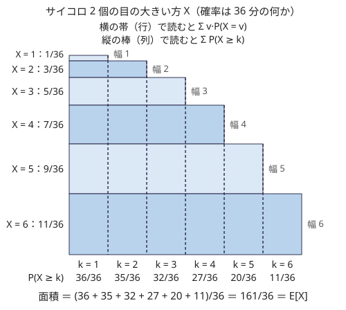

!!! abstract "要点"
    - **何ができるか**：非負整数の確率変数 $X$ について $E[X] = \sum_{k \ge 1} P(X \ge k)$ が成り立つ。最大値・最小値・$K$ 番目の値の期待値を「$X \ge k$ となる確率」の和に直して求め、「〜になるまでの回数」の期待値にも使う。
    - **いつ使うか**：
        - 最大値（最小値・K 番目の値）の期待値を求める。
        - 〜がそろうまでに取り出す回数の期待値を求める。
        - 値の範囲 $M \le 5000$ 程度で、各 $k$ について $P(X \ge k)$ を数える。
    - **計算量**：$P(X \ge k)$ を 1 つ求める計算量を $T$、値の範囲を $M$ として $O(MT)$。独立な $N$ 個の値の $K$ 番目なら、二項係数の前計算のうえで $O(NM)$。
    - **前提**：[期待値の線形性と指示確率変数](../comb/linearity-of-expectation.md)、[数え上げの考え方](../comb/counting-mindset.md)

<!-- textlint-disable -->
別名：E[X] = Σ P(X ≥ k)・tail sum・期待値と確率の行き来・最大値の期待値・K 番目の値の期待値
<!-- textlint-enable -->

期待値と確率の変換は、期待値を「値がちょうど $v$ になる確率」ではなく「値が $k$ 以上になる確率」から求める方法である。最大値や $K$ 番目の値は「ちょうど $v$」の確率が数えにくいが、「$k$ 以上」なら「すべて」「少なくとも何個」の条件になり、独立性や二項係数で数えやすい。和と定数倍にしか使えない[期待値の線形性](../comb/linearity-of-expectation.md)を、$\max$ のような線形でない量に届かせる道具でもある。

## X を「X ≥ k」の個数の和に分けて線形性を使う {#identity}

$X$ が非負整数の値をとる確率変数なら、次の等式が成り立つ。

$$
E[X] = \sum_{k \ge 1} P(X \ge k) = \sum_{k \ge 0} P(X > k)
$$

**なぜ成り立つか**。$X = v$ のとき、$1, 2, \dots, v$ のうち $X$ 以下のものはちょうど $v$ 個ある。だから $X$ は、事象「$X \ge k$」の[指示確率変数](../guide/glossary.md#indicator) $[X \ge k]$ の和に分けられる。

$$
X = \sum_{k \ge 1} [X \ge k]
$$

両辺の期待値をとり、右辺に線形性を使うと、$E[[X \ge k]] = P(X \ge k)$ なので上の等式になる。独立性はどこにも使っていない。$k \ge 1$ の和を $k - 1$ でずらすと、$k \ge 0$ についての $P(X > k)$ の和になる。2 つの形は同じもので、問題に合わせて数えやすい方を使う。

**小さい例**。サイコロ 2 個の目の大きい方を $X$ とする。$X$ が $k$ 未満になるのは 2 個とも $k - 1$ 以下のときなので、$P(X \ge k) = 1 - \left(\frac{k-1}{6}\right)^2$ である。次の図は、$X = v$ となる確率を高さ、$v$ を幅にした帯を積んだものである。帯を横に読めば定義どおりの $\sum_v v \cdot P(X = v)$、縦の列で読めば $\sum_k P(X \ge k)$ になり、どちらも同じ面積 $161/36$ を表す。



「ちょうど $v$」の確率 $P(X = v) = \frac{2v - 1}{36}$ を求めて $\sum v \cdot P(X = v)$ を計算しても同じ値になる。ただし「ちょうど」は「$k$ 以上」の差で求めることが多いので（[「ちょうど」と「以上」の行き来](#exactly-vs-at-least)）、最初から「$k$ 以上」の和で書けば 1 段少なく済む。

**値がとびとびのとき**。値が $10^9$ までのように広く、実際にとる値が $0 < v_1 < v_2 < \dots < v_m$ だけなら、$k$ を 1 ずつ動かす必要はない。$v_{j-1} < k \le v_j$ の範囲では $P(X \ge k) = P(X \ge v_j)$ で一定なので、まとめて次のように書ける（$v_0 = 0$）。

$$
E[X] = \sum_{j=1}^{m} (v_j - v_{j-1}) \, P(X \ge v_j)
$$

図で言えば、列の幅を 1 ではなく値の差にしたものである。[座標圧縮](../basics/coordinate-compression.md)した値の上で、隣との差を掛けて足せばよい。

**負の値をとるとき**。等式は $X \ge 0$ が前提である。$X$ が $L$ 以上の整数をとるなら、$Y = X - L \ge 0$ に直して $E[X] = L + \sum_{k \ge 1} P(Y \ge k)$ とする。

## 最大値・K 番目の値：「すべて k 未満」の余事象 {#kth-value}

最大値・最小値・$K$ 番目の値の期待値は、「$k$ 以上か」を数えやすい条件に言い換えて、前の節の等式に入れる。$N$ 個の値 $X_1, \dots, X_N$ が独立なら、次のように積で書ける。

| 量 | 「$\ge k$」の言い換え | 確率 |
| --- | --- | --- |
| 最大値 | 少なくとも 1 つが $k$ 以上 | $1 - \prod_i P(X_i < k)$ |
| 最小値 | すべてが $k$ 以上 | $\prod_i P(X_i \ge k)$ |
| 小さい方から $K$ 番目 | $k$ 以上が $N - K + 1$ 個以上 | 個数の分布の上側の和 |

最大値は「少なくとも 1 つ」なので、余事象の「すべて $k$ 未満」を積で求めて 1 から引く。最小値は「すべて」なのでそのまま積になる。

**K 番目の値**。昇順に並べた $K$ 番目が $k$ 以上であることは、「$k$ 未満の値が $K - 1$ 個以下」すなわち「$k$ 以上の値が $N - K + 1$ 個以上」と同じである。$N$ 個が独立で、どれも確率 $p_k$ で $k$ 以上になるなら、$k$ 以上の個数は二項分布に従う。

$$
P(K \text{ 番目} \ge k) = \sum_{j = N-K+1}^{N} \binom{N}{j} p_k^{\,j} (1 - p_k)^{N-j}
$$

$K = N$ なら最大値、$K = 1$ なら最小値の式に戻る。値の範囲が $1$〜$M$ なら $k = 1, \dots, M$ について足すので、二項係数を[前計算](../comb/binomial-precompute.md)しておけば全体で $O(NM)$ である。

次のコード片は、すでに値が決まった項と、$1$〜$M$ から一様に選ぶ項（入力では 0）が混ざった列の、$K$ 番目の値の期待値を mod 998244353 で求める。決まった項のうち $x$ 以上の個数を先に引き、残りを未定の項の二項分布で数える。$x$ ごとに確率のべき乗の表を作り直すので、$x$ ごとに $O(N)$ で、全体で $O(NM)$ である。

```cpp
--8<-- "expectation-tail-sum/kth-value.cpp:core"
```

完全なプログラム：[`kth-value.cpp`](https://github.com/yuukougun/kyopro-atlas/blob/main/snippets/expectation-tail-sum/kth-value.cpp)（GitHub）。`mint` は ACL の `modint998244353`（[modint](../math/modint.md)）。
{ .kp-code-src }

**独立でないとき**。$1$〜$M$ から異なる $N$ 個を一様に選ぶ場合は、値どうしが独立でないので積にはできない。それでも「すべて $k$ 未満」は「$1$〜$k - 1$ から $N$ 個を選んだ」と同じなので、$P(\max < k) = \binom{k-1}{N} \Big/ \binom{M}{N}$ と場合の数の比で数えられる。「$k$ 以上」の側の事象は、独立でなくても数えやすい形になることが多い。

**値の範囲が広いとき**。各 $X_i$ が 6 面のサイコロで、面の値が $10^9$ までのように広い場合は、[値がとびとびのとき](#identity)の式を使い、出てくる値だけで足す。$P(\max < v)$ は各サイコロの「$v$ 未満の面の割合」の積で、値を小さい順に見ていくと、1 つのサイコロの割合が変わるのは自分の面の値を通るときだけである。その変わり目ごとに積を更新すればよい（0 を含む積の扱いは[落とし穴](#pitfalls)）。

## 「〜になるまでの回数」= Σ P(k 回目までに終わらない) {#waiting-time}

試行を繰り返して、条件がそろったら止める。止まるまでの回数 $T$（$T \ge 1$）の期待値は、$k \ge 0$ についての $P(T > k)$ の和である。$T > k$ は「$k$ 回目が終わった時点でまだ止まっていない」という事象で、状態の推移を追わずに、$k$ 回分の結果だけを見て確率を数えられることが多い。

$$
E[T] = \sum_{k \ge 0} P(T > k) = \sum_{k \ge 0} P(k \text{ 回目までに終わらない})
$$

**幾何分布**。1 回ごとに確率 $p$ で成功し、成功したら止めるなら、$P(T > k) = (1 - p)^k$ である。等比級数の和で $E[T] = \sum_{k \ge 0} (1 - p)^k = 1/p$ になる（[幾何分布](../comb/coupon-collector.md#geometric)の「1 回目で場合分け」の式と同じ値）。

**回数に上限があるとき**。$N$ 種類の靴下が $A_i$ 枚ずつ（合計 $S$ 枚）袋に入っていて、同じ種類の 2 枚がそろうまで 1 枚ずつ取り出すとする。[鳩の巣原理](../thinking/symmetry-pigeonhole-casework.md#pigeonhole)より $N + 1$ 枚目までに必ずそろうので、和は $k = 0, \dots, N$ で終わる。$T > k$ は「最初の $k$ 枚の種類がすべて違う」ことである。靴下は同じ種類でも 1 枚ずつ区別して数える。最初の $k$ 枚を集合として見ると、取り出し方は $\binom{S}{k}$ 通りが等確率である。そのうち種類が違う $k$ 種類 $i_1, \dots, i_k$ を選んで各種類から 1 枚ずつ選ぶ方法は $A_{i_1} \cdots A_{i_k}$ 通りある。

$$
P(T > k) = \frac{e_k}{\binom{S}{k}}, \qquad e_k = \sum_{i_1 < \dots < i_k} A_{i_1} A_{i_2} \cdots A_{i_k}
$$

$e_k$ は多項式 $\prod_i (1 + A_i x)$ の $x^k$ の係数なので、多項式の積で全部の $k$ について一度に求まる（[力試し](#challenge)の ABC352 G）。

**途中で状態が変わる過程**。全種類がそろうまでのように段階が進むものは、段階ごとに幾何分布の期待値を足す方が簡単である（[クーポンコレクター](../comb/coupon-collector.md)）。出る確率が種類ごとに違うときの「全種類がそろうまで」は、$P(T > k)$ を[包除原理](../comb/inclusion-exclusion.md#min-max)で書いてから $k$ について等比級数で足す。状態が複雑に行き来するなら、[期待値 DP](../comb/expected-value-dp.md) で状態ごとに残りの期待値を持つ。

## 連続値の場合（積分） {#continuous}

この節は[連続値の確率](../comb/continuous-probability.md)を前提にする。$X$ が 0 以上の実数をとるときは、和が積分になる。

$$
E[X] = \int_0^\infty P(X > t) \, dt
$$

理由は整数のときと同じで、$X = \int_0^\infty [X > t] \, dt$（$0 \le t < X$ の区間の長さ）に期待値をとり、積分と期待値の順序を入れ替える。連続値では $P(X = t) = 0$ なので、$P(X > t)$ と $P(X \ge t)$ を区別しなくてよい。

たとえば $[0, 1]$ から一様に選んだ $N$ 個の実数の最大値は、$P(\max > t) = 1 - t^N$ なので次のようになる。

$$
E[\max] = \int_0^1 (1 - t^N) \, dt = 1 - \frac{1}{N + 1} = \frac{N}{N + 1}
$$

値ごとに区間 $[L_i, R_i]$ が違うときは、$P(K \text{ 番目} > t)$ が区間の端点で区切られた区分ごとの多項式になるので、区分ごとに積分して足す。この形の問題は[連続値の確率](../comb/continuous-probability.md#piecewise)で扱う。

## 「ちょうど」と「以上」の行き来 {#exactly-vs-at-least}

「以上」の確率 $G(k) = P(X \ge k)$ と「ちょうど」の確率は、隣どうしの差で行き来できる。累積の形 $P(X \le k)$ からも同じように求まる。

$$
P(X = k) = G(k) - G(k + 1) = P(X \le k) - P(X \le k - 1)
$$

数え上げで「ちょうど」を「以下」の差で数えるのと同じ考え方である（[「ちょうど」を「以下」の差で数える](../comb/counting-mindset.md#exactly-vs-at-most)）。$E[X]$ だけが欲しいなら差をとる必要はなく、$G(k)$ をそのまま足せばよい。差をとって分布を求めるのは、$X$ の関数の期待値が欲しいときである。

**関数の期待値**。$f(0) = 0$ の関数 $f$ について、$f(v) = \sum_{k=1}^{v} \bigl(f(k) - f(k-1)\bigr)$ と分けて同じように線形性を使うと、次の式になる。

$$
E[f(X)] = \sum_{k \ge 1} \bigl(f(k) - f(k-1)\bigr) \, P(X \ge k)
$$

$f(v) = v$ なら最初の等式に戻る。$f(v) = v^2$ なら差は $2k - 1$ なので、$E[X^2] = \sum_{k \ge 1} (2k - 1) P(X \ge k)$ である。サイコロ 2 個の大きい方なら $(1 \cdot 36 + 3 \cdot 35 + 5 \cdot 32 + 7 \cdot 27 + 9 \cdot 20 + 11 \cdot 11)/36 = 791/36$ になり、$\sum v^2 P(X = v)$ と一致する。和や積のような量の二乗の期待値は、別の方法を使う（[二乗の期待値](../comb/expectation-of-square.md#pairs)）。

**どちらを数えるか**。「以上」と「ちょうど」のどちらが数えやすいかは条件の形で決まる。

- 「すべて」「少なくとも何個」の形になる量（最大値・最小値・$K$ 番目・そろうまでの回数）は「以上」（または「以下」）が数えやすい
- 値ごとの場合分けが自然な量（サイコロの目そのもの、DP で値ごとの確率を持っているとき）は、「ちょうど」の分布から $\sum v \cdot P(X = v)$ で求めてよい

mod 998244353 で答える問題でも、差 $G(k) - G(k + 1)$ はそのまま mod の値で計算してよい（[確率・期待値を mod で答える](../comb/rational-mod.md)）。大小の比較が要るときだけ実数で考える。

## 落とし穴 {#pitfalls}

**和の始まりを 1 つずらす**。「$\ge$」なら $k \ge 1$ から、「$>$」なら $k \ge 0$ から足す。$\sum_{k \ge 0} P(X \ge k)$ と書くと、$P(X \ge 0) = 1$ の分だけ答えが 1 大きくなる。回数の問題では「$k$ 回目までに終わらない」は $T > k$ なので、$k = 0$（1 回も試していない時点。確率 1）の項から足す。

**$X$ が負の値をとる**。等式は $X \ge 0$ が前提である。負の値をとりうる量（差・得点の増減）には、最小値 $L$ を引いて 0 以上にしてから使い、最後に $L$ を足し戻す。

**独立でないのに積にする**。$P(\max < k) = \prod_i P(X_i < k)$ は値が独立なときだけ正しい。異なる値を選ぶ・袋から戻さずに取り出すなどのときは、場合の数の比で数える（[最大値・K 番目の値](#kth-value)の「独立でないとき」）。

**$K$ 番目の向きと不等号**。「小さい方から $K$ 番目 $\ge k$」は「$k$ 以上が $N - K + 1$ 個以上」であって、「$K$ 個以上」ではない。大きい方から数える問題なら「$k$ 以上が $K$ 個以上」になる。$K = 1$ と $K = N$ で最小値と最大値の式に戻るかを確かめると、取り違えに気づける。

**0 を含む積を割り算で更新する**。値を小さい順に見て $\prod_i P(X_i < v)$ を更新するとき、まだ面が 1 つも $v$ 未満にない値 $X_i$ の因子は 0 である。「古い因子で割って新しい因子を掛ける」更新は、0 で割ることになって壊れる。0 の因子の個数を別に数えて 0 以外の積だけを持つか、各 $X_i$ の最小値のうち最大のもの以下の値では積を 0 として扱う（その値ちょうどでも、最小値がその値の $X_i$ の因子 $P(X_i < v)$ はまだ 0 である）。

**範囲の広い値を 1 ずつ回す**。値が $10^9$ までなら $k$ を 1 ずつ動かすと間に合わない。出てくる値に圧縮し、[値がとびとびのとき](#identity)の差を掛ける式で足す。

## 例題 {#examples}

### ABC295 E. Kth Number {#abc295_e}

<div class="kp-problems" data-role="example" markdown>

- [ABC295 E. Kth Number](https://atcoder.jp/contests/abc295/tasks/abc295_e)（diff 2157）：長さ N の列の 0 の項を 1〜M の一様な値に置き換え、ソートしたときの K 番目の値の期待値を mod 998244353 で求める。

</div>

$K$ 番目の値は $1$〜$M$ の整数なので、$x = 1, \dots, M$ について $P(K \text{ 番目} \ge x)$ を足せばよい。$K$ 番目が $x$ 以上であることは「$x$ 以上の項が $N - K + 1$ 個以上ある」ことと同じである。決まった項のうち $x$ 以上のものを先に数えておけば、残りは 0 の項のうち何個が $x$ 以上になるかの問題である。0 の項はそれぞれ独立に確率 $(M - x + 1)/M$ で $x$ 以上になるので、その個数は二項分布に従う。

??? note "解法の詳細"
    - 0 の項の個数を $z$、決まった項のうち $x$ 以上の個数を $c_x$ とする。$c_x$ は値ごとの個数の後ろからの累積和で、すべての $x$ について $O(N + M)$ で求まる
    - 0 の項から $x$ 以上になる必要がある個数は $r = N - K + 1 - c_x$ である。$r \le 0$ なら確率 1、$r > z$ なら確率 0
    - それ以外は $p = (M - x + 1)/M$ として $\sum_{j=r}^{z} \binom{z}{j} p^j (1 - p)^{z-j}$。$x$ ごとに $p$ と $1 - p$ のべき乗の表を作れば $O(N)$ で、全体で $O(NM)$ である
    - 答えはこの確率の $x = 1, \dots, M$ についての和で、割り算は逆元にする。中心は[最大値・K 番目の値](#kth-value)の節のコード片のとおり

## 練習問題 {#practice}

<div class="kp-problems" data-role="practice" markdown>

- [ABC411 E. E [max]](https://atcoder.jp/contests/abc411/tasks/abc411_e)（diff 1400）：N 個の 6 面のサイコロを振ったときの、出た目の最大値の期待値を mod 998244353 で求める。

</div>

??? note "練習の方針"
    - **ABC411 E**：目の値は大きいので、現れる値だけを小さい順に並べて（座標圧縮）掃く。$P(\text{最大値} \le v)$ は各サイコロの「$v$ 以下の面の数 $/ 6$」の積で、値を 1 つ進めるごとに変わるサイコロの因子だけを掛け直す。$E[\max] = \sum_v v \cdot (P(\max \le v) - P(\max \le v^-))$（$v^-$ は 1 つ前の値）と差で足す。まだ $v$ 以下の面がないサイコロは因子が 0 なので、0 の因子の個数を別に数え、0 で割る（逆元を取る）ことを避ける。参考の記事は因子の掛け直しを双対セグメント木の区間の掛け算で行っている

## 力試し {#challenge}

<div class="kp-problems" data-role="challenge" markdown>

- [ABC352 G. Socks 3](https://atcoder.jp/contests/abc352/tasks/abc352_g)（diff 2413）：N 種類の靴下が A_i 枚ずつ袋に入っており、同じ種類の 2 枚がそろうまで 1 枚ずつ取り出すときの、取り出す回数の期待値を 998244353 で割った余りで求める。
- [HHKB2020 F. Random Max](https://atcoder.jp/contests/hhkb2020/tasks/hhkb2020_f)（diff 2691）：N 個の実数をそれぞれ区間 [L_i, R_i] から一様に選んだときの最大値の期待値に (N+1)!·Π(R_i − L_i) を掛けた値を mod 10^9+7 で求める。

</div>

??? note "力試しの方針"
    - **ABC352 G**：取り出す回数を $T$ とし、$E[T] = \sum_{k=0}^{N} P(T > k)$ に直す。$T > k$ は最初の $k$ 枚の種類がすべて違うことで、確率は $[x^k] \prod_i (1 + A_i x) \big/ \binom{S}{k}$ である（[「〜になるまでの回数」](#waiting-time)の節）。$N$ 個の 1 次式の積は、分割統治で 2 つずつ畳み込む（NTT）と $O(N \log^2 N)$ で求まる。$\binom{S}{k}$ は $S$ が大きいので、$k$ を 1 つ増やすごとに $\frac{S - k}{k + 1}$ を掛けて作る
    - **HHKB2020 F**：$P(\text{最大値} \le x)$ は各値の因子の積で、端点で区切った区分ごとに多項式になる。区分ごとに積分して足す（解説は $\int x F'(x) \, dx$ の形で、$\int P(X > t) \, dt$ と部分積分で同じ値になる）

## 確認問題 {#quiz}

??? question "確認問題：サイコロ 2 個の目の小さい方の期待値を、「k 以上」の確率の和で求めよ"
    ??? success "答え"
        小さい方が $k$ 以上なのは 2 個とも $k$ 以上のときなので、$P(\min \ge k) = \left(\frac{7 - k}{6}\right)^2$ である。$k = 1, \dots, 6$ で足すと $(36 + 25 + 16 + 9 + 4 + 1)/36 = 91/36$ になる。大きい方の $161/36$ と足すと $252/36 = 7$ で、2 個の目の和の期待値 $7$ に一致する（$\min + \max$ は 2 個の目の和なので）。

??? question "確認問題：0・10・1000 のどれかを確率 1/2・1/4・1/4 でとる X の期待値を、とびとびの値の式で求めよ"
    ??? success "答え"
        値を小さい順に $v_0 = 0, v_1 = 10, v_2 = 1000$ と並べると、$P(X \ge 10) = 1/2$、$P(X \ge 1000) = 1/4$ である。$E[X] = (10 - 0) \cdot \frac{1}{2} + (1000 - 10) \cdot \frac{1}{4} = 5 + 247.5 = 252.5$ になる。$\sum v \cdot P(X = v) = 10 \cdot \frac{1}{4} + 1000 \cdot \frac{1}{4} = 252.5$ と一致する。値の範囲が広くても、現れる値の個数だけの項を足せばよい。

??? question "確認問題：1〜M から異なる N 個を一様に選んだときの最大値の期待値を、和の形で書け"
    ??? success "答え"
        最大値が $k$ 未満なのは $N$ 個とも $1$〜$k - 1$ から選んだときなので、$P(\max \ge k) = 1 - \binom{k-1}{N} \Big/ \binom{M}{N}$ である（$k - 1 < N$ なら $\binom{k-1}{N} = 0$）。答えは $\sum_{k=1}^{M} \left(1 - \binom{k-1}{N} \Big/ \binom{M}{N}\right)$ である。値は独立ではないが、「すべて $k$ 未満」は場合の数で数えられる。

??? question "確認問題：確率 1/3 で当たるくじを当たるまで引く。引く回数の期待値を、P(T > k) の和で求めよ"
    ??? success "答え"
        $k$ 回引いてまだ当たらない確率は $(2/3)^k$ なので、$E[T] = \sum_{k \ge 0} (2/3)^k = \frac{1}{1 - 2/3} = 3$ である。

## 使い分け {#comparison}

- **期待値の線形性（指示確率変数）**：数えたいものが「条件を満たす要素の個数」なら、要素ごとの指示確率変数の和にする（[指示確率変数](../comb/linearity-of-expectation.md#indicator)）。期待値と確率の変換は、要素ではなく「しきい値 $k$」ごとの指示確率変数に分ける方法で、$\max$ や $K$ 番目のような順序で決まる量に使う
- **期待値 DP**：状態が推移する過程で、$P(T > k)$ が $k$ 回分の結果から直接数えられないなら、状態ごとに残りの期待値を持つ[期待値 DP](../comb/expected-value-dp.md) を使う
- **段階ごとの幾何分布**：「新しい種類が出るまで」のように段階が進むだけの過程は、段階ごとの $1/p$ を足す（[クーポンコレクター](../comb/coupon-collector.md)）
- **min-max 包除**：確率が種類ごとに違い、「全部そろうまで」を問うなら、最後にそろう時刻（最大値）を部分集合の最初の時刻（最小値）の符号付きの和に直す（[包除原理](../comb/inclusion-exclusion.md#min-max)）

## 参考 {#references}

- [PHarr「AtCoder Beginner Contest 295」](https://www.cnblogs.com/PHarr/p/17266778.html)：例題の方針（$K$ 番目が $x$ 以上になる確率を、0 の項の二項分布の上側の和で数える）
- [drken「AtCoder ABC 352 G - Socks 3 (3D, 橙色, 600 点)」](https://drken1215.hatenablog.com/entry/2024/05/05/023117)：力試しの方針（$P(T > k)$ の和と $\prod (1 + A_i x)$ の係数）
- [drken「「〜がすべて終わるまでの試行回数の期待値」を求める一般的なフレームワーク」](https://drken1215.hatenablog.com/entry/2019/03/23/214500)：回数の期待値を「$k$ 回以上かかる確率」の和に直し、包除原理と等比級数でまとめる考え方
- [drken「AtCoder ABC 078 C - HSI (ARC 085 C) (3Q, 茶色, 300 点)」](https://drken1215.hatenablog.com/entry/2019/03/23/175300)：幾何分布の期待値を「$k$ 回以上かかる確率」の等比級数で求める説明
- [Shizen_Tota「ABC411個人的備忘録[A-C,E]」](https://qiita.com/Shizen_Tota/items/687ddc17baff09e97176)：値の範囲が広いサイコロの最大値の期待値（累積の確率の差と、0 の因子の扱い）
- [drken「HHKB プログラミングコンテスト 2020 F - Random Max (4D, 橙色, 600 点)」](https://drken1215.hatenablog.com/entry/2020/10/11/145500)：力試し HHKB2020 F の区分ごとの多項式の積分
- [ikatakos「HHKB プログラミングコンテスト 2020 D,E,F問題メモ」](https://ikatakos.com/pot/programming_algorithm/contest_history/atcoder/2020/1010_hhkb2020)：力試し HHKB2020 F の同じ方針（解説の部分だけを参照）
