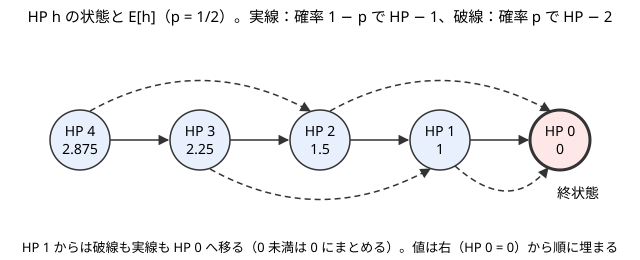

!!! abstract "要点"
    - **何ができるか**：終わるまでの量の期待値 $E[s]$ を、最初の一手で場合分けした $E[s] = c(s) + \sum_t P(s \to t) E[t]$ で、終状態の $E = 0$ から後ろ向きに埋める。自己ループは移項して消し、選択がある状態では max を取る。
    - **いつ使うか**：
        - 〜になるまでの操作回数の期待値
        - 終わるまでにかかる費用の期待値
        - 出た目が〜なら振り直し・確率 $p$ で何も起きない
        - 状態数 $N \le 10^5$ 程度で、各状態の遷移が少数（または区間）
        - $E[s]$ が、$s$ から 1 手で移る状態の $E$ の平均に定数を足した式になる
    - **計算量**：状態数 × 1 状態の遷移の数。遷移先が連続する区間なら累積和で 1 状態 $O(1)$ にできる。mod 998244353 で割り算をするなら、1 回ごとに $O(\log \mathrm{mod})$ が掛かる
    - **前提**：[期待値の線形性と指示確率変数](../comb/linearity-of-expectation.md)、[DP の計算順序](../dp/dp-order.md)

<!-- textlint-disable -->
別名：後ろから決める期待値・残りの期待値・全期待値の公式・自己ループ・振り直し・移項して解く・選択は max・偶然は平均
<!-- textlint-enable -->

期待値 DP は、「状態 $s$ から終わるまでにかかる量の期待値」$E[s]$ を状態ごとの値として持ち、1 手先の状態の値から後ろ向きに求める DP である。式は「1 手目で何が起きたか」で場合分けするだけで立ち、終わった状態の値が 0 と分かっていることが出発点になる。

このページで使う記法：$E[s]$ は状態 $s$ から終わるまでの量（回数・費用）の期待値、$P(s \to t)$ は状態 $s$ で 1 手進めたときに状態 $t$ へ移る確率、$c(s)$ は状態 $s$ で 1 手進めるのに掛かる量である（[記法と用語の約束](../start/notation.md)）。

## 全期待値の公式（最初の一手で場合分け） {#total-expectation}

期待値 DP の漸化式は、確率の全確率の公式を期待値に移した「全期待値の公式」そのものである。状態 $s$ から終わるまでの量を確率変数 $X_s$ とおく。最初の 1 手で移る先 $t$ ごとに場合を分けると、次の式が成り立つ。

$$
E[X_s] = \sum_t P(s \to t) \, E[X_s \mid \text{1 手目で } t \text{ へ移った}]
$$

以下、$E[X_s]$ を $E[s]$ と書く。1 手目で $t$ へ移ったなら、残りの量は「1 手目の量 $c(s)$」と「$t$ から終わるまでの量」の和である。$t$ から先の進み方は $t$ にいることだけで決まり、どうやって $t$ に来たかによらない。だから条件付きの期待値は $c(s) + E[t]$ になる（和を分けるのは[期待値の線形性](../comb/linearity-of-expectation.md)による）。遷移確率の和は 1 なので、まとめると次の漸化式になる。

$$
E[s] = \sum_t P(s \to t) \bigl(c(s) + E[t]\bigr) = c(s) + \sum_t P(s \to t) \, E[t]
$$

1 手の量が移る先で変わるなら、$c(s)$ を $\sum_t P(s \to t) \, c(s \to t)$ に置き換えればよい。

小さな例で動かす。HP が $h$ の相手に、確率 $p$ で 2、確率 $1 - p$ で 1 のダメージを与える攻撃を、HP が 0 以下になるまで繰り返す。攻撃回数の期待値を $E[h]$ とすると、1 回攻撃してから HP $h - 2$ か $h - 1$ の状態に移るので、次の式になる。

$$
E[h] = 1 + p \, E[\max(h - 2, 0)] + (1 - p) \, E[h - 1], \qquad E[0] = 0
$$

$p = 1/2$ なら、$E[1] = 1$、$E[2] = 1 + \frac{1}{2} \cdot 0 + \frac{1}{2} \cdot 1 = 1.5$、$E[3] = 1 + \frac{1}{2} \cdot 1 + \frac{1}{2} \cdot 1.5 = 2.25$ と、HP の小さい方から順に決まる。



次の動く図では、終状態から $E$ を 1 つずつ埋めていく様子をステップ送りで確かめられる。前半はこの HP の例（$p = 1/2$）である。後半は、自分自身へ戻る矢印（自己ループ）のある例で、マス 0〜3 のすごろくを使う。マス $i$ では 0〜$A_i$ の目が等確率で出て、出た目だけ進み（$A = 3, 2, 1$）、0 の目ではそのマスにとどまる。

<div class="kp-viz" data-viz="expected-value-dp" data-config='{"hp": {"n": 4, "p": "1/2"}, "sugoroku": {"a": [3, 2, 1]}}'></div>

図の流れを文章で書くと次のとおりである。終状態の HP 0 に 0 を書き、そこから矢印を逆にたどって、移る先の値がすべて決まった状態から順に式を当てはめる。どの状態でも、矢印の確率の和が 1 になっていることを確かめておくと、式の写し間違いに気づける。自己ループのある状態では、移項前の式と移項後の式を並べてから値を埋める（[自己ループの移項](#self-loop)）。すごろくの例では、マス 3・2・1・0 の順に $E = 0, 2, 5/2, 17/6$ と決まり、マス 0 からの答えは $17/6 \approx 2.83$ 回である。

## なぜ後ろ向きか（終状態が 0 の境界条件） {#why-backward}

期待値 DP を後ろ向きに埋めるのは、「ここから先にかかる量」なら終状態での値が 0 と分かっているからである。値を持つ向きを逆にして「ここまでにかかった量の期待値」を前から配ろうとすると、2 つの困りごとが起きる。

1 つ目は、その状態を通らない場合があることである。HP の例では、HP 3 から 2 のダメージを受けると HP 2 を飛ばす。「HP 2 になるまでの回数の期待値」は、HP 2 を通った場合だけで考える条件付きの値になり、通る確率で重みを付け直さないと正しく足せない。

2 つ目は、終わる時刻がばらばらなことである。答えは「終わったときの回数」の期待値なので、前から求めるなら、各終状態に着く確率と、そこまでの回数を確率で重み付けた和の 2 つを持つ必要がある。後ろ向きなら、値は 1 つで済み、答えは出発点の $E[\text{始状態}]$ を読むだけである。

??? note "前向きでも求められる場合"
    1 手ごとの量が状態だけで決まるなら、期待値の線形性から「答え $= \sum_s (\text{状態 } s \text{ を通る回数の期待値}) \times c(s)$」とも書ける。通る回数の期待値は、DAG なら前向きの[確率 DP](../comb/probability-dp.md) で「$s$ に着く確率」として求まる。前向きの DP をすでに書いているならこの形が手早い。ただし、自己ループや選択（max）があると扱いにくいので、まずは後ろ向きで式を立てるのがよい。

## 状態の設計：区別しない・個数の組にする {#state-design}

状態に持つべきものは、「そこから先の確率と量が、状態だけで決まる」のに足りる情報である。足りないと漸化式が立たず、多すぎると状態数が爆発する。

**区別しなくてよいものは区別しない**。寿司が 1〜3 個乗った皿が $N$ 枚あり、一様に選んだ皿から 1 個食べる操作を考える（[EDPC J](#dp_j)）。皿ごとの残りを並べると $4^N$ 通りの状態になる。だが皿はどれも同じ確率で選ばれるので、残りが同じ皿どうしは入れ替えても先の進み方は変わらない。「残り 1 個・2 個・3 個の皿の数」$(i, j, k)$ を状態にすれば、$i + j + k \le N$ なので $O(N^3)$ 通りで済む。残り 0 個の皿の数は $N - i - j - k$ で分かるので持たない。

**個数の組にする**。袋の硬貨を取り出して戻す操作（[ABC184 D](#abc184_d)）では、金・銀・銅の枚数の組 $(a, b, c)$ が状態である。取り出す確率 $a/(a+b+c)$ などは枚数だけで決まる。

**足りないものを足す**。回数に上限があるなら残りの回数を、どの対象が残っているかで確率が変わるなら残りの集合（[bitDP](../dp/bit-dp.md) の添字）を状態に入れる。状態の確かめ方は、「同じ状態に別の経路で着いたとき、そこから先の確率と量が変わらないか」を問うことである。変わるなら、その違いを生む情報が状態に足りない。状態の設計の一般論は [DP の状態の設計](../dp/dp-state-design.md)にまとめる。

## 計算順序とメモ化再帰 {#order}

$E[s]$ は、1 手先の状態 $t$ の値から決まる。だから、$t$ を $s$ より先に計算する順序が要る。1 手ごとに必ず減る（または増える）量を見つけ、その順に埋めればよい。

| 問題の形 | 1 手ごとに単調に動く量 | 埋める順 |
| --- | --- | --- |
| HP を減らす | HP | HP の小さい順 |
| 硬貨を 1 枚ずつ増やす | 枚数の合計 $a + b + c$ | 各枚数の大きい順 |
| 寿司を 1 個ずつ食べる | 残りの総数 $i + 2j + 3k$ | 総数の小さい順（メモ化再帰が楽） |
| 残りの集合が減る | 集合の要素 | 集合を表す整数の小さい順 |

寿司の例の遷移 $(i, j, k) \to (i + 1, j - 1, k)$ のように、添字のどれかが増えるのに順序が保たれる場合、for 文の入れ子の向きを考えるのは間違えやすい。そういうときは[メモ化再帰](../dp/memoized-recursion.md)で書くと、計算順序を考えなくて済む。終状態なら 0 を返し、計算済みなら表の値を返し、そうでなければ漸化式で求めて表に書く。

メモ化再帰は、出てくる状態がまばらなときにも向く。$N$ を $\lfloor N/b \rfloor$ に変える操作なら、出てくる値は $\lfloor N/k \rfloor$ の形のものだけなので、配列ではなく `map` に覚えさせる（[ABC350 E](#practice) の型）。

!!! warning "まだ計算していない印"
    表を $-1$ で初期化して「未計算」の印にするなら、期待値が $-1$ になりえないことを確かめる。mod の値や負の費用のときは、`vector<bool>` などで計算済みかどうかを別に持つ方が確実である。

1 手ごとに単調に動く量が見つからず、自分自身以外の状態へ戻る閉路があるときは、この順序では埋められない。未知数を置いて方程式で解く（[期待値の方程式を解く](../comb/expectation-linear-equations.md)）。

## 自己ループの移項 E = (c + Σ …)/(1 − p) {#self-loop}

自己ループとは、確率 $p$ で状態が変わらない遷移のことである。「0 の目が出たら進まない」「選んだ皿が空なら何もしない」などがこれにあたる。そのまま式を書くと、右辺に求めたい $E[s]$ 自身が出てくる。

$$
E[s] = c + p \, E[s] + \sum_{t \ne s} P(s \to t) \, E[t]
$$

この式は $E[s]$ についての 1 次方程式なので、移項して解けばよい。$p < 1$ なら次のようになる。

$$
E[s] = \frac{c + \sum_{t \ne s} P(s \to t) \, E[t]}{1 - p}
$$

右辺にはほかの状態の値しか残らないので、普通の順序で埋められる。

**なぜ移項してよいか**：$p < 1$ なら、状態 $s$ にとどまる回数は幾何分布に従い、その期待値は有限の $1/(1 - p)$ 回である。だから $E[s]$ は有限の値で、上の 1 次方程式のただ 1 つの解になる。式の意味も読める。「$s$ を抜けるまでに $1/(1 - p)$ 回の手番があり、そのたびに $c$ が掛かる」から分子の $c$ が $1/(1 - p)$ 倍される。抜けたときの行き先は「$s$ 以外へ移る」という条件の下の確率 $P(s \to t)/(1 - p)$ で決まる。

最も簡単な例は、成功確率 $q$ の試行を成功するまで繰り返す回数である。失敗すると同じ状態に戻るので $E = 1 + (1 - q) E$ で、移項すると $E = 1/q$ になる（[幾何分布とコンプリートガチャ](../comb/coupon-collector.md)）。寿司の例では、空の皿を選ぶ確率は $(N - i - j - k)/N$ である。この項を移項すると次の式になる。

$$
E[i][j][k] = \frac{N + i \, E[i-1][j][k] + j \, E[i+1][j-1][k] + k \, E[i][j+1][k-1]}{i + j + k}
$$

自己ループを見落として、移項せずに `e[s]` を右辺に書いてしまうと、まだ計算していない値（0 や前の値）が使われる。エラーにならず、答えが小さくずれるだけなので気づきにくい。式を立てたら、右辺に左辺と同じ状態がないかを必ず見る。

??? question "確認問題：$1 - p = 0$ になるのはどんなときか"
    状態 $s$ から確率 1 で $s$ にとどまるとき、すなわち $s$ から抜け出せないときである。このとき終わるまでの回数は無限大で、期待値は定まらない。終状態ではない状態で $p = 1$ になるなら、その状態に着く確率が 0 であるか、問題の読み違いである。

## 選択がある期待値：選択は max、偶然は平均 {#choice}

プレイヤーが行動を選べるなら、選ぶ状態では各行動の期待値の max（費用なら min）を取り、偶然で決まる状態では確率で平均を取る。後ろから埋めるとき、先の状態ではすでに最適な行動を取った値が決まっている。だから各状態で「この行動を取り、その後は最適に動く」期待値を行動ごとに比べ、最もよいものを選べばよい。

サイコロを最大 $N$ 回振れ、振るたびに「やめてその目を得点にする」か「振り直す」かを選べる遊びで確かめる。残り $k$ 回振れるときの得点の期待値を $E_k$ とする。目 $d$ を見てからやめると $d$、振り直すと $E_{k-1}$ が得られるので、大きい方を選ぶ。

$$
E_k = \frac{1}{6} \sum_{d=1}^{6} \max(d, E_{k-1}), \qquad E_1 = 3.5
$$

$E_2 = \frac{1}{6}(3.5 \times 3 + 4 + 5 + 6) = 4.25$ になる。2 回振れるなら、1 回目の目が 4 以上ならやめるのがよい。

- **選択の後に偶然がある形**：行動ごとに偶然の平均（と自己ループの移項）を先に計算し、そのあとで行動どうしの max・min を取る。移項する前の式で比べると、右辺の $E[s]$ が未計算なので比べられない
- **mod の値は比べられない**：答えを mod 998244353 で出す問題で選択があるなら、比較は実数（`double`）で行い、選んだ行動で mod の値を計算し直す（[確率・期待値を mod 998244353 で答える](../comb/rational-mod.md)）
- **「期待値が最大になる戦略」を求める**：全部の結果を見てから最大のものを選べる場合の期待値（$E[\max]$）とは違い、各状態ではそれまでに見た情報だけで 1 つの行動を選び、その行動のもとでの平均を取る

最初からやり直す行動があるなど、答え自身が式に入る選択の問題は[最適戦略の期待値](../comb/optimal-strategy-expectation.md)で扱う。

## 遷移を累積和でまとめる {#prefix-sum}

この節は [DP の累積和による高速化](../dp/dp-prefix-sum.md)を前提にする。遷移先が連続する区間の状態で、どれも同じ確率なら、$E$ の区間の和を累積和で $O(1)$ で求められる。

すごろくを考える。マスは 0-indexed でゴールをマス $N - 1$ とする。マス $i$ では 0〜$A_i$ の目が等確率で出て、出た目だけ進むとする（$i + A_i \le N - 1$ で、ゴールを越える目はない）。マス $i$ からゴールまでに振る回数の期待値 $E[i]$ は、0 の目の自己ループを移項すると次の式になる。

$$
E[i] = \frac{A_i + 1}{A_i} + \frac{1}{A_i} \sum_{k=1}^{A_i} E[i + k]
$$

和をそのまま計算すると 1 状態 $O(A_i)$ で、全体は最悪 $O(N^2)$ になる。後ろから埋めるので、$E[i + 1], E[i + 2], \dots$ はすでに決まっている。後ろからの累積和 $\mathrm{suf}[i] = E[i] + E[i + 1] + \dots + E[N - 1]$ を一緒に更新すれば、区間の和は $\mathrm{suf}[i + 1] - \mathrm{suf}[i + A_i + 1]$ で求まり、全体は $O(N)$ になる。

```cpp
--8<-- "expected-value-dp/self-loop.cpp:core"
```

累積和は「すでに値が決まった区間」の和にしか使えない。後ろから埋めるなら後ろからの累積和を、埋めた値を足しながら作る。遷移先の区間が任意の位置にあり、まだ決まっていない値を含むなら、計算順序から考え直す。

## 前向きの確率 DP との使い分け {#vs-probability-dp}

確率・期待値の DP には、前向きに確率を配る[確率 DP](../comb/probability-dp.md) と、後ろ向きに期待値を求める期待値 DP がある。どちらを使うかは、何を問われているかで決まる。

| 問われ方 | 向き | 持つ値 |
| --- | --- | --- |
| 終わるまでの回数・費用の期待値 | 後ろ向き | 残りの期待値 $E[s]$ |
| $K$ 回後にある状態にいる確率・分布 | 前向き | その時刻に $s$ にいる確率 |
| いつか $s$ に着く（ちょうど $N$ になる）確率 | 後ろ向き | $s$ から目標に着く確率 |
| 選択がある（最適に行動する） | 後ろ向き | 最適に動いたときの期待値 |

「いつか着く確率」は期待値ではないが、終状態（着いたら 1、着けなくなったら 0）から後ろ向きに同じ形の式で求まり、自己ループの移項も同じように使える。

2 つを組み合わせる問題もある。1 回の操作の結果の分布が複雑なら、まずその分布を前向きの確率 DP で求め、それを遷移確率として後ろ向きの期待値 DP に入れる（[ABC382 E](#practice) の型）。

## 落とし穴 {#pitfalls}

- **終状態をはみ出す**：HP の例で $h - 2 < 0$ になる遷移のとき、配列の外を読む。終状態が「0 以下」なら $\max(h - 2, 0)$ のように 1 つにまとめるか、配列を余分に取ってその範囲を 0 にする
- **確率の和が 1 にならない**：遷移の場合分けに漏れや重複がある。式を立てたら、係数の和が 1 になるか（移項したなら $1 - p$ になるか）を確かめる
- **自己ループを見落とす**：$E[s]$ が右辺に残ったまま計算すると、未計算の値が使われて答えがずれる（[自己ループの移項](#self-loop)）
- **1 − p で 0 除算する**：抜け出せない状態があるか、終状態を自己ループとして扱っている。終状態は式を使わず 0 にする
- **状態を区別しすぎる**：同じ働きをする対象を区別して $N$ 乗の状態にする（[状態の設計](#state-design)）
- **mod の値を比べる**：選択がある問題で、mod 998244353 の値の大小で行動を選ぶ。比較は実数で行う
- **出力の桁数**：実数で答えるなら `cout << fixed << setprecision(10)` のように桁を指定する。既定の有効数字 6 桁では、誤差 $10^{-6}$ の判定に落ちることがある
- **再帰が深い**：メモ化再帰で状態の連鎖が $10^5$ を超えると、環境によってはスタックがあふれる。単調な量の順に for 文で埋めれば避けられる

!!! info "ACL では"
    mod 998244353 で答えるなら `using mint = atcoder::modint998244353;` を使う。`mint(P) / 100` で確率 $P\%$ を mod の値にでき、割り算は $O(\log \mathrm{mod})$、ほかの四則は $O(1)$ である。割り算の要件は割る数が法と互いに素であること（法は素数なので、0 でなければよい）。

## 例題 {#examples}

### ABC280 E. Critical Hit {#abc280_e}

<div class="kp-problems" data-role="example" markdown>

- [ABC280 E. Critical Hit](https://atcoder.jp/contests/abc280/tasks/abc280_e)（diff 1251）：HP が N のモンスターに、確率 P% で 2、それ以外は 1 のダメージを与える攻撃を繰り返すとき、HP が 0 以下になるまでの攻撃回数の期待値を mod 998244353 で求める。

</div>

残りの HP ごとに「そこから倒すまでの攻撃回数の期待値」を持ち、HP 0 を終状態にして小さい方から埋める。[全期待値の公式](#total-expectation)の例そのものである。確率 $P/100$ は 100 の逆元を掛けて mod の値にする。

??? note "解法の詳細"
    - $E[h]$ ＝ HP が $h$ のときから倒すまでの攻撃回数の期待値。$E[0] = 0$ で、答えは $E[N]$
    - $p = P \cdot 100^{-1} \bmod 998244353$ として、$E[h] = 1 + p \, E[\max(h - 2, 0)] + (1 - p) \, E[h - 1]$ を $h = 1, 2, \dots, N$ の順に求める
    - HP 1 で 2 のダメージを受けた場合も倒したことになるので、$\max(h - 2, 0)$ で終状態にまとめる
    - 全体で $O(N)$（逆元は 1 回だけ求める）。中心は次のとおりである

    ```cpp
    --8<-- "expected-value-dp/hp-mod.cpp:core"
    ```

### ABC184 D. increment of coins {#abc184_d}

<div class="kp-problems" data-role="example" markdown>

- [ABC184 D. increment of coins](https://atcoder.jp/contests/abc184/tasks/abc184_d)（diff 1276）：金・銀・銅の硬貨が入った袋から 1 枚取り出し、同じ種類を 2 枚戻す操作を、いずれかの硬貨が 100 枚になるまで繰り返すときの操作回数の期待値を求める。

</div>

3 種類の枚数の組 $(a, b, c)$ を状態にし、どれかが 100 枚になった状態を終状態（値 0）にする。1 回の操作で 1 種類が 1 枚増えるので、枚数の大きい方から埋めるか、メモ化再帰で書く。

??? note "解法の詳細"
    - $E[a][b][c]$ ＝ 金 $a$・銀 $b$・銅 $c$ 枚のときから終わるまでの操作回数の期待値。$a, b, c$ のどれかが 100 なら 0
    - $s = a + b + c$ として、$E[a][b][c] = 1 + \frac{a}{s} E[a+1][b][c] + \frac{b}{s} E[a][b+1][c] + \frac{c}{s} E[a][b][c+1]$
    - 枚数が 0 の種類は取り出されないので、その項は確率 0 で消える（添字が範囲外になることもない）
    - $a, b, c$ をそれぞれ 99 から入力の値まで下げる 3 重ループで埋めるか、終状態で 0 を返すメモ化再帰で書く。状態は $100^3$ 個以下で、各 $O(1)$
    - 実数で出力するので、桁数を指定する

### EDPC J. Sushi {#dp_j}

<div class="kp-problems" data-role="example" markdown>

- [EDPC J. Sushi](https://atcoder.jp/contests/dp/tasks/dp_j)（diff —）：寿司が 1〜3 個乗った N 枚の皿から毎回一様に 1 枚を選び、寿司があれば 1 個食べるとき、すべて食べ終わるまでの操作回数の期待値を求める。

</div>

皿を区別せず、残り 1 個・2 個・3 個の皿の数 $(i, j, k)$ を状態にする（[状態の設計](#state-design)）。空の皿を選ぶと何も起きないので自己ループがあり、[移項した式](#self-loop)で求める。

??? note "解法の詳細"
    - $E[i][j][k]$ ＝ 残り 1・2・3 個の皿がそれぞれ $i, j, k$ 枚のときから食べ終わるまでの操作回数の期待値。$E[0][0][0] = 0$
    - 1 回の操作で、確率 $i/N$ で $(i-1, j, k)$、$j/N$ で $(i+1, j-1, k)$、$k/N$ で $(i, j+1, k-1)$ に移り、残りの確率 $(N - i - j - k)/N$ でとどまる
    - とどまる項を移項して $N/(i + j + k)$ を掛けると、$E[i][j][k] = \bigl(N + i E[i-1][j][k] + j E[i+1][j-1][k] + k E[i][j+1][k-1]\bigr)/(i + j + k)$
    - 寿司の総数 $i + 2j + 3k$ は 1 回ごとに 1 減るので、総数の小さい順に埋まる。ループの向きを考えずに済むメモ化再帰で書くのが手早い。係数が 0 の項は読まない（添字が負になるのを防ぐ）
    - 状態は $i + j + k \le N$ の $O(N^3)$ 個で、各 $O(1)$。$N \le 300$ なので `double` の 3 次元配列でも収まる

## 練習問題 {#practice}

<div class="kp-problems" data-role="practice" markdown>

- [ABC266 E. Throwing the Die](https://atcoder.jp/contests/abc266/tasks/abc266_e)（diff 1227）：6 面のサイコロを最大 N 回振れ、振るたびにやめてその目を得点にできるとき、得点の期待値の最大値を求める。
- [ABC300 E. Dice Product 3](https://atcoder.jp/contests/abc300/tasks/abc300_e)（diff 1354）：1 から始めて 1〜6 の目が等確率のサイコロの出目を掛けていくとき、ちょうど N になる確率を mod 998244353 で求める。
- [ABC350 E. Toward 0](https://atcoder.jp/contests/abc350/tasks/abc350_e)（diff 1385）：整数 N を、X 円払って ⌊N/A⌋ にするか、Y 円払ってサイコロの出目 b で ⌊N/b⌋ にするかを選びながら 0 にするとき、費用の期待値の最小値を求める。
- [ABC263 E. Sugoroku 3](https://atcoder.jp/contests/abc263/tasks/abc263_e)（diff 1659）：マス 1〜N のすごろくで、マス i では 0〜A_i の目が等確率のサイコロを振ってその分進むとき、マス N に着くまでの振る回数の期待値を mod 998244353 で求める。
- [ABC382 E. Expansion Packs](https://atcoder.jp/contests/abc382/tasks/abc382_e)（diff 1671）：カードのパックを開け続けて、レアカードが X 枚集まるまでに開けるパックの数の期待値を求める。
- [ABC314 E. Roulettes](https://atcoder.jp/contests/abc314/tasks/abc314_e)（diff 1722）：N 個のルーレットからどれを回すかを選びながら M 点以上を得るまで繰り返すとき、払う費用の期待値の最小値を求める。

</div>

??? note "練習の方針"
    - **ABC266 E**：残り $k$ 回のときの期待値 $E_k$ を、出目と $E_{k-1}$ の大きい方の平均で求める（[選択がある期待値](#choice)の例そのもの）
    - **ABC300 E**：$x$ からちょうど $N$ に着く確率を、$x = N$ で 1、$x > N$ で 0 として後ろ向きに求める。1 の目は $x$ を変えないので移項し、残り 5 つの目の平均にする。出てくる値は $N$ の約数だけなので、メモ化再帰で `map` に覚えさせる
    - **ABC350 E**：$N$ からの費用の期待値を、$\lfloor N/A \rfloor$ へ移る操作と、サイコロを振る操作（1 の目の自己ループを移項）の小さい方として求める。出てくる値は $\lfloor N/k \rfloor$ の形だけなので、メモ化再帰で `map` に覚えさせる
    - **ABC263 E**：0 の目の自己ループを移項し、後ろの $A_i$ マスの期待値の和を後ろからの累積和で求める（[遷移を累積和でまとめる](#prefix-sum)）。答えは mod 998244353 なので、$A_i$ での割り算は逆元の掛け算にする
    - **ABC382 E**：1 パックのレアの枚数が $j$ 枚になる確率 $R_j$ を前向きの確率 DP で求める。そのあと「あと何枚要るか」ごとの期待値を後ろから求め、$j = 0$ の自己ループを移項する
    - **ABC314 E**：得点ごとの費用の期待値を後ろから求める。ルーレットごとに 0 点の目の自己ループを移項した値を計算してから、最小のルーレットを選ぶ

## 力試し {#challenge}

<div class="kp-problems" data-role="challenge" markdown>

- [ABC144 F. Fork in the Road](https://atcoder.jp/contests/abc144/tasks/abc144_f)（diff 2189）：部屋 1 から部屋 N へ向かう DAG で、各部屋から出る通路を一様に選んで進むとき、事前に通路を 1 本だけ塞いで、通る通路の数の期待値を最小にする。
- [TDPC J. ボール](https://atcoder.jp/contests/tdpc/tasks/tdpc_ball)（diff —）：位置 0〜15 にある的を、位置 x を狙うと x−1・x・x+1 のどれかに等確率でボールが当たる投げ方で倒していくとき、最適に狙ったときの全部倒すまでの投げる回数の期待値を求める。

</div>

??? note "力試しの方針"
    - **ABC144 F**：部屋ごとのゴールまでの期待値を後ろから求める（DAG なので部屋番号の大きい順）。塞ぐ通路は、出口が 2 本以上ある部屋で、行き先の期待値が最大の通路だけを試せばよい。塞ぐ部屋ごとに DP をやり直して $O(NM)$
    - **TDPC J**：残っている的の集合を状態にし、狙う位置ごとに「当たった的が倒れて集合が小さくなる」遷移を書く。的のない位置に当たると集合が変わらないので移項する。狙う位置の中で期待値の最小を取り、集合を表す整数の小さい順に埋める

## 確認問題 {#quiz}

??? question "確認問題：コインを投げ続け、表が 2 回続けて出たら止める。投げる回数の期待値は？"
    状態を「直前が表でない（始めを含む）」$A$ と「直前が表」$B$ にする。$A$ から 1 回投げると、表なら $B$、裏なら $A$ に移る。$B$ から投げると、表なら終わり、裏なら $A$ に戻る。$E_A = 1 + \frac{1}{2} E_B + \frac{1}{2} E_A$、$E_B = 1 + \frac{1}{2} \cdot 0 + \frac{1}{2} E_A$ である。1 つ目を移項して $E_A = 2 + E_B$、2 つ目に代入して $E_B = 1 + \frac{1}{2}(2 + E_B)$ から $E_B = 4$、$E_A = 6$ になる。$B$ から $A$ へ戻る閉路があるので、この問題は順に埋めるだけでは解けず、2 つの式を連立させた。

??? question "確認問題：サイコロで 6 が出るまで振る。振る回数の期待値と、6 以外が出る回数の期待値は？"
    $E = 1 + \frac{5}{6} E$ を移項して $E = 6$ 回である。6 以外が出る回数は最後の 1 回を除いたものなので $6 - 1 = 5$ 回になる。「試行の回数」と「失敗の回数」を取り違えないこと。

## 使い分け {#comparison}

- 求める量が要素ごとの和に分けられ、状態を持たなくても各部分の期待値が求まるなら、[期待値の線形性](../comb/linearity-of-expectation.md)で足す方が速い
- 自分自身以外の状態へ戻る閉路（振り出しに戻る・円環を回る）があるなら、[期待値の方程式を解く](../comb/expectation-linear-equations.md)
- 成功するまで繰り返すだけ、または段階ごとに成功確率が決まるだけなら、[幾何分布とコンプリートガチャ](../comb/coupon-collector.md)の公式で済む

## 参考 {#references}

- [drken「AtCoder ABC 280 E - Critical Hit (1D, 水色, 500 点)」](https://drken1215.hatenablog.com/entry/2022/12/07/113800)：例題 ABC280 E の HP ごとの漸化式と、0 以下を 0 にまとめる扱い
- [drken「AtCoder ABC 184 D - increment of coins (1Q, 水色, 400 点)」](https://drken1215.hatenablog.com/entry/2020/11/23/010500)：例題 ABC184 D の状態と、ループの向き・メモ化再帰による実装
- [drken「Educational DP Contest の F ～ J 問題の解説と類題集」](https://qiita.com/drken/items/03c7db44ccd27820ea0d)：例題 EDPC J の状態の圧縮と自己ループの移項
- [kazun「ABC 263 E」](https://kazun-kyopro.hatenablog.com/entry/ABC/263/E)：練習 ABC263 E の移項と累積和
- [プログラミングのひろば「ABC350 E」](https://programming-hiroba.com/abc350-e/)：練習 ABC350 E の移項した式とメモ化再帰
- [ikatakos「ABC382」](https://ikatakos.com/pot/programming_algorithm/contest_history/atcoder/2024/1130_abc382#e_-_expansion_packs)：練習 ABC382 E の 1 パックの分布と後ろ向きの期待値（解法の部分だけを参照）
- [DeltaStruct「ABC314 E」](https://qiita.com/DeltaStruct/items/08a55509095a471c5371)：練習 ABC314 E のルーレットごとの移項と最小の選び方
- [kmjp「ABC144 F」](https://kmjp.hatenablog.jp/entry/2019/10/28/0930)：力試し ABC144 F の塞ぐ通路の選び方と計算量
- [kmjp「Typical DP Contest : J - ボール」](https://kmjp.hatenablog.jp/entry/2013/09/09/1030)：力試し TDPC J の問いと、集合の状態・移項・最小の取り方
- [AC Library の modint のドキュメント](https://github.com/atcoder/ac-library/blob/master/document_ja/modint.md)：割り算の要件と計算量
