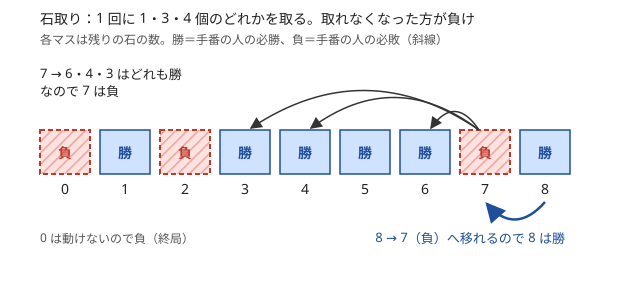

!!! abstract "要点"
    - **何ができるか**：二人零和有限確定完全情報ゲームの各局面が、手番の人の必勝か必敗かを決める。終局から「負け局面へ 1 手で移れるなら勝ち、どこへ移っても勝ち局面なら負け」と DP で埋める。状態が大きすぎるなら、手数の偶奇や真似戦略で勝敗が決まらないかを疑う。
    - **いつ使うか**：
        - 先手と後手が交互に操作し、両者が最適に行動したとき勝つのはどちらかを問われる。
        - First / Second（Takahashi / Aoki）を出力する。
        - カードの枚数 $N \le 18$ 程度で、残りのカードの集合が局面になる。
        - 盤面（配置）が対称、または同じものが偶数個ずつある。
        - 最終的な形が戦略によらず決まる。
        - ジャッジと対戦する（インタラクティブ）。
    - **計算量**：局面の数 × 1 局面の手の数。石取りなら $O(NK)$、$N$ 枚のカードの集合を局面にするなら $O(2^N N^2)$。
    - **前提**：[メモ化再帰](../dp/memoized-recursion.md)、[DP の計算順序](../dp/dp-order.md)

<!-- textlint-disable -->
別名：ゲーム DP・必勝法・必勝・必敗・勝ち局面・負け局面・二人零和有限確定完全情報ゲーム・手数の偶奇・真似戦略・ペアリング戦略
<!-- textlint-enable -->

ゲームの基本と勝敗の DP は、2 人が交互に手を打つゲームで「両者が最適に動くと誰が勝つか」を決める考え方である。各局面の勝ち負けは終局から後ろ向きに確定するので、局面を[状態](../guide/glossary.md#state)にした DP で求められる。局面が多すぎるときは、勝敗が手数の偶奇や対称性だけで決まる形を探す。

## ゲームの前提（零和・有限・確定・完全情報） {#assumptions}

勝敗の DP がそのまま使えるのは、次の 4 つを満たすゲームである。競技プログラミングの「2 人が交互に最適に行動する」問題は、ほとんどがこの形をしている。

- **零和**：一方の得は他方の損である（勝ち負けを競う）
- **有限**：どう打っても有限の手数で必ず終わる
- **確定**：サイコロのような偶然の要素がない
- **完全情報**：手札などの隠れた情報がなく、両者が局面のすべてを見ている

このページでは、さらに引き分けのないゲームを扱う。引き分けがあるときは、下の表の 1 行目と同じく後退解析を使う。

どれかが崩れると、別の道具に移る。

| 崩れる前提・違い | 起きること | 使うもの |
| --- | --- | --- |
| 同じ局面に戻れる（有限でない） | 引き分けが生じ、メモ化再帰が止まらない | [後退解析](../comb/game-retrograde-analysis.md) |
| 勝敗でなく得点を競う | 値が 2 通りでなく数になる | [ミニマックス](../comb/minimax.md) |
| 独立なゲームがいくつも並ぶ | 局面の数が積になって DP できない | [Nim](../comb/nim.md)・[Grundy 数](../comb/grundy-number.md) |

有限かどうかは問題文から明らかでないことがある。そのときは、1 手ごとに必ず減る量（残りの石の数・手札の枚数・場にある最大の数など）を見つけて確かめる。減る量が見つかれば、同じ局面に戻ることはない。

## 必勝・必敗の定義と後ろ向きに決まる理由 {#win-lose}

局面とは、ゲームの途中の様子と手番のことである。相手がどう打っても手番の人が勝てる打ち方を持つ局面を、**必勝**（勝ち局面）と呼ぶ。手番の人がどう打っても、相手が最適に打てば負ける局面を、**必敗**（負け局面）と呼ぶ。

各局面の勝ち負けは次の規則で決まる。

- 手のない局面（終局）は、問題文の規則どおりに決める。「動けなくなった方が負け」なら必敗である
- 必敗の局面へ 1 手で移れるなら、その局面は必勝である（その手を打てば、相手が必敗の局面の手番になる）
- どの手で移っても必勝の局面になるなら、その局面は必敗である（相手は必ず勝ち局面の手番を得る）

次の図は、1 回に 1・3・4 個のどれかを取る石取りで、残りの石が 0〜8 個の局面を埋めたものである。



0 個は動けないので負けである。1・3・4 個は全部取って 0 個（負け）を相手に渡せるので勝ち、2 個は 1 個取るしかなく 1 個（勝ち）を渡すので負けになる。7 個からは 6・4・3 個へ移れるが、どれも勝ち局面なので 7 個は負けである。

この規則で、すべての局面がどちらか一方に決まる。ゲームが有限なので、局面を頂点、手を辺にしたグラフは閉路のない有向グラフ（[DAG](../guide/glossary.md#dag)）になる。終局からの最長の手数で局面を並べると、各局面の行き先はどれも手数が短く、すでに勝ち負けが決まっている。だから、手数の短い順に上の規則を当てはめれば、すべての局面が矛盾なく決まる（ゲーム理論の Zermelo の定理の、競技プログラミングで使う形）。

「相手も最適に動く」とは、相手は自分にとって最悪の手を選ぶという意味である。必勝は「相手のどんな手にも対応できる打ち方がある」ことなので、相手の手を 1 つずつ試すのではなく、行き先の局面の値を見れば足りる。

??? question "確認問題：1〜3 個取れる石取り"
    石が $N$ 個あり、1 回に 1〜3 個を取る。最後の石を取った方が勝ちのとき、先手が負けるのは $N$ がどんなときか。

    ??? success "答え"
        $N$ が 4 の倍数のときである。「最後の石を取った方が勝ち」は「動けなくなった方が負け」と同じなので、0 個は負けである。1〜3 個は全部取れるので勝ち、4 個はどう取っても 1〜3 個（勝ち）を渡すので負けになる。以後も、4 の倍数からは 4 の倍数でない数にしか移れず、4 の倍数でない数からは 4 の倍数へ移れる。

## 勝敗の DP とメモ化再帰 {#game-dp}

勝ち負けの規則を DP にすると次のようになる。$\mathrm{win}[s]$ ＝ 局面 $s$ の手番の人が勝てるか（true なら必勝）とする。

$$
\mathrm{win}[s] = \bigvee_{s \to t} \lnot\, \mathrm{win}[t]
$$

右辺は「行き先 $t$ のどれか 1 つで相手が負ける」という論理和である。手が 1 つもなければ空の論理和で false になり、「動けなくなった方が負け」の終局と一致する。

石取りなら局面は残りの石の数だけで、石は減る一方なので、石の少ない順に埋めればよい。次のコードは、取れる個数の集合 $a$ が与えられたときの表である。

```cpp
--8<-- "game-basics/stones.cpp:core"
```

完全なプログラム：[`stones.cpp`](https://github.com/yuukougun/kyopro-atlas/blob/main/snippets/game-basics/stones.cpp)（GitHub）
{ .kp-code-src }

答えは $\mathrm{win}[K]$ で、true なら先手、false なら後手が勝つ。取れる個数の集合 $a$ の大きさを $N$、石の数を $K$ とすると、$O(NK)$ である。

計算順序が分かりにくい局面では、[メモ化再帰](../dp/memoized-recursion.md)で書くのが確実である。初期の局面から再帰で行き先を調べ、結果を表に残す。有限なゲームなら再帰は必ず止まり、到達しない局面は計算しない。表は「未計算」「勝ち」「負け」の 3 値で持つ（`vector<int>` で -1 を未計算にする）。`vector<bool>` だと未計算と負けを区別できない。

1 局面で必勝の手が見つかったら、残りの手を調べずに打ち切ってよい。計算量は最悪で（局面の数）×（1 局面の手の数）で、これがそのまま見積もりになる。

## 状態の設計：集合（bitDP）・3^N・余り {#state-design}

勝敗の DP の状態には、「この先に打てる手と勝敗を決めるもの」だけを持つ。ここまでの手の順序のような、先に影響しない情報は持たない。持つものを減らすほど局面の数が減る。

| ゲームの形 | 状態 | 局面の数 |
| --- | --- | --- |
| カードを取り除いていく | 残りのカードの集合 | $2^N$ |
| しりとりで単語を 1 回ずつ使う | 使った単語の集合と最後の単語 | $2^N \cdot N$ |
| 各カードが 3 か所のどこかにある | カードごとの置き場所 | $3^N$ |
| 数を作っていき、最後に余りで勝敗が決まる | 何手目かと、今の数の余り | $N \cdot m$ |

**集合を状態にする**（bitDP）。カードの組を取り除くゲームなら、どのカードが残っているかだけで先が決まる。取り除いた順は関係ない。残りの集合をビット列で持つと、取り除くたびに数としての値が小さくなるので、集合の値の小さい順に埋めれば行き先が先に決まっている。集合を回すときの注意は [bitDP の「ゲームの状態を集合で持つ」](../dp/bit-dp.md#games)にある。例は [ABC354 E](#abc354_e) で、メモ化再帰で書くと次のようになる。

```cpp
--8<-- "game-basics/set-game.cpp:core"
```

完全なプログラム：[`set-game.cpp`](https://github.com/yuukougun/kyopro-atlas/blob/main/snippets/game-basics/set-game.cpp)（GitHub）
{ .kp-code-src }

$N = 18$ なら局面は $2^{18} \approx 2.6 \times 10^5$ 個、組は $\binom{18}{2} = 153$ 組なので、合わせて約 $4 \times 10^7$ 回の判定で済む。

**3 か所の置き場所**。2 人の手札と場のようにカードの置き場所が 3 か所なら、局面は $3^N$ 通りである。2 人の手札をそれぞれビット列で持ち、どちらにもないカードは場にあるとすれば、2 つのビット列の組で表せる。$N = 12$ なら $3^{12} \approx 5.3 \times 10^5$ 個である。表を $2^N \times 2^N$ の配列で取ると $1.7 \times 10^7$ 要素になり、大半は使わない組である。`char` の配列にすれば約 17 MB で済む。

**余りだけを持つ**。数を作っていき、最後に 7 の倍数かで勝敗が決まるなら、今の数そのものでなく 7 で割った余りだけで先が決まる。末尾に数字を足す操作は余りだけで計算できるからである。何手目か（$N$ 通り）と余り（7 通り）の組を状態にすれば、局面は $7N$ 個になる。

## 手番で取れる手が違うときは手番を状態に入れる {#turn}

「$\mathrm{win}[s]$ ＝ 手番の人が勝てるか」という書き方は、両者が同じ局面で同じ手を打てるときに使える。先手は 1〜2 個、後手は 1〜3 個取れるように、手番によって打てる手が違うときは、同じ石の数でも誰の手番かで勝敗が変わる。このときは手番を状態に入れ、$\mathrm{win}[s][p]$（$p$ は手番の人）とする。

もう 1 つの書き方は、値を一方の人の視点に固定することである。$\mathrm{f}[s]$ ＝ 局面 $s$ から高橋君が勝てるか、とすると、遷移は手番で変わる。

- 高橋君の手番：行き先のどれか 1 つで $\mathrm{f}$ が true なら true（論理和）
- 青木君の手番：行き先のすべてで $\mathrm{f}$ が true なら true（論理積）

各桁で誰が打つかが入力で決まっているゲームでは、何手目かが状態に入っているので、手番は何手目かから分かる。[練習の ABC195 E](#practice) がこの形で、後ろの桁から余りごとに論理和と論理積で埋める。

手札のやりとりのように、両者の立場が入れ替えられる形なら、状態を（手番の人の手札, 相手の手札）の順で持つとよい。手を打つたびに 2 つを入れ替えれば、手番の印を持たずに「手番の人が勝てるか」の 1 本の式で書ける。

## 総手数の偶奇・不変量で決まるゲーム（最終形から数える） {#move-parity}

局面が多すぎて DP できないときは、どう打っても総手数が同じにならないかを疑う。総手数 $T$ が戦略によらず決まるなら、「動けなくなった方が負け」のゲームでは最後の手を打つ人が勝つ。$T$ が奇数なら先手、偶数なら後手の勝ちで、途中の手は勝敗に関係しない。

総手数を決めるには、最終形（もう手がない局面）が戦略によらず決まることを示し、そこまでの手数を数える。

奇閉路を作らないように辺を足していくゲームでは、1 手で辺が 1 本ずつ増え、最後は 2 色の頂点の間に辺がすべてある完全二部グラフになる。連結なグラフなら 2 色の分け方は（色の入れ替えを除いて）1 通りなので、最終的な辺の数が決まる（[ABC398 E](#abc398_e)）

最終形が 1 通りに決まらなくても、その「大きさ」の偶奇が不変なら同じ議論が使える。手を打っても変わらない量（[不変量](../thinking/invariant.md)）を[偶奇](../thinking/parity.md)と組み合わせて探す。

たとえば、隣り合う文字が異なる文字列から両端以外の文字を消していくゲーム（[練習の ARC064 D](#practice)）では、1 手で 1 文字減る。最終形は 2 文字が交互に並ぶ列で、その長さは打ち方で変わる。しかし両端は消えないので、両端が異なれば長さは偶数、同じなら奇数に決まる。だから総手数 $N - (\text{最終の長さ})$ の偶奇が決まり、勝敗が決まる。

規則が見えないときは、小さい局面について勝敗の DP を全探索し、勝ち負けの表を眺めるとよい。表が $N$ の偶奇だけで分かれていれば、総手数が決まっている見込みが高い。

??? question "確認問題：板チョコを割るゲーム"
    $H \times W$ 個のマスからなる板チョコがある。2 人が交互に、どれか 1 つのかけらを選び、マスの境目に沿って 2 つに割る。割れるかけらがなくなった方を負けとする。勝つのはどちらか。

    ??? success "答え"
        1 回割るとかけらの数がちょうど 1 増え、最後はすべてのかけらが 1 マスになる。かけらは 1 個から $HW$ 個になるので、総手数はどう割っても $HW - 1$ 回である。$HW - 1$ が奇数、つまり $HW$ が偶数なら先手、$HW$ が奇数なら後手が勝つ。

## 真似戦略・ペアリング戦略（真似した手が合法かを確かめる） {#mirror-strategy}

この節は[対称性](../thinking/symmetry-pigeonhole-casework.md)の考え方を前提にする。盤面を同じ形の 2 つに分けられるとき、後手は先手の手をもう一方で真似し続ければ、常に手を打てる。相手より先に手がなくなることはないので、「動けなくなった方が負け」なら真似する側が勝つ。

真似戦略で示すことは 2 つある。

1. **対称な状態を保てる**：自分の手番が終わるたびに盤面が対称になっている
2. **真似した手が常に合法である**：相手の手に対応する手を、自分の番に必ず打てる

2 つ目を確かめ忘れるのが典型的な誤りである。真似が成り立たないのは、中央の要素のように自分自身と対応するものや、2 つの半分にまたがる手があるときである。一方の半分での手で、他方の半分の打てる手が減る場合も成り立たない。

**先手が最初に対称にする**。最初の盤面が対称でなくても、先手が 1 手目で対称にできれば、以後は先手が真似する側に回る。たとえば一列に並んだコインから隣り合う 1〜2 枚を取るゲームでは、先手は中央の 1 枚（奇数枚のとき）か 2 枚（偶数枚のとき）を取って、同じ長さの 2 列に分ける。以後は相手の取った位置の鏡像を取ればよい。2 つの列の間は空いているので、1 回の手が両方の列にまたがることはなく、真似した手は常に合法である。

**ペアリング戦略**。盤面の要素を 2 つずつの組に分け、相手が組の片方を使ったらもう片方を使う。木の頂点を交互に塗るゲームなら、木の完全マッチングを組にすると、後手は先手の塗った頂点の相方を塗り続けられる（[力試しの AGC014 D](#challenge)）。木の完全マッチングは、葉とその親を組にして取り除くことを繰り返せば $O(N)$ で求められる。

**同じものが偶数個ずつある**。同じ枚数の袋が偶数個ずつあるとする（[練習の ARC105 D](#practice)）。先手が $x$ 枚の袋を、いま $y$ 枚ある皿に置いたとする。後手はもう 1 つの $x$ 枚の袋を、別の $y$ 枚の皿に置く。すると袋と皿は、どちらも同じ枚数の組に分かれたままである。袋がなくなった後は、相手が取った皿の相方から同じ枚数を取る。この真似を続ければ、後手が最後に取る。

??? question "確認問題：円形に並んだコイン"
    $N$ 枚のコインが円形に並んでいる。2 人が交互に、隣り合う 1 枚か 2 枚を取る。最後のコインを取った方が勝ちのとき、$N \ge 3$ なら後手が勝つのはなぜか。

    ??? success "答え"
        先手が 1 枚か 2 枚取ると、円が切れて $N - 1$ 枚か $N - 2$ 枚の一列になる。後手はその列の中央の 1 枚（奇数枚のとき）か 2 枚（偶数枚のとき）を取り、同じ長さの 2 列に分ける。残りが 1〜2 枚なら全部取って勝つ。以後は先手が一方の列で取った位置の鏡像を、もう一方の列で取る。2 列の間は空いているので、真似した手は常に合法である。したがって後手が最後のコインを取る。$N \le 2$ なら先手が全部取って勝つので、$N \ge 3$ が要る。

## インタラクティブ：必勝戦略を実行する {#interactive}

[インタラクティブ](../misc/interactive.md)の問題では、勝つ側を答えるだけでなく、ジャッジと実際に対戦して勝たなければならない。勝敗の判定に加えて、毎手「必勝を保つ手」を見つける処理が要る。

- **先手か後手かを選ぶ**：初期の局面が必勝なら先手、必敗なら後手を名乗る
- **自分の手番**：今の局面から、相手が必敗になる局面への手を 1 つ探して打つ。勝ちの局面には、定義からそのような手が必ずある
- **相手の手番**：ジャッジの手を読み、局面を更新する。相手の手の後は、自分が勝ちの局面の手番に戻っている

勝敗の DP を使うなら、表を作った後に行き先を調べれば必勝の手が分かる。石取りなら次のように探す。

```cpp
--8<-- "game-basics/stones.cpp:move"
```

完全なプログラム：[`stones.cpp`](https://github.com/yuukougun/kyopro-atlas/blob/main/snippets/game-basics/stones.cpp)（GitHub）
{ .kp-code-src }

総手数の偶奇で決まるゲームなら、どの合法な手を打っても総手数は変わらないので、合法な手を 1 つ選べばよい。ただし、合法かの判定は自分で正しく行う。不正な手を出力するとその時点で不正解になる。真似戦略なら、相手の手に対応する手を計算して打つ。

実装の注意は次のとおりである。

- 出力のたびにフラッシュする（`cout << endl` か `cout.flush()`）。`'\n'` だけではジャッジに届かず、待ち合って TLE になる
- ゲームの終わりの合図（ジャッジが手を打てないときの決まった出力）を読んだら、すぐ終了する
- 相手が打った手を、自分の候補の一覧からも消し忘れない

## 落とし穴 {#pitfalls}

**終局の勝敗を読み違える**。「最後の石を取った方が勝ち」と「動けなくなった方が負け」は同じ規則である。一方、「最後の石を取った方が負け」は逆形で、終局の値が逆になる。終局の値を 1 つ間違えると、そこから後ろ向きに埋める表全体が変わってしまう。問題文を読み、手のない局面が誰の勝ちかを最初に決める。

**論理和と論理積を取り違える**。手番の人の視点の $\mathrm{win}$ では、どれか 1 つの行き先が負けなら勝ちである。「すべての行き先が負けなら勝ち」と書くと誤る。高橋君の視点に固定したときは、高橋君の手番で論理和、青木君の手番で論理積を取る。どちらの視点の表かをコメントに書いておく。

**手番を状態に入れ忘れる**。両者の打てる手が違うのに $\mathrm{win}[s]$ だけで書くと、先手の局面と後手の局面を同じ値で扱ってしまう。手番によって打てる手が違うなら、手番を状態に入れる（[手番の節](#turn)）。

**同じ局面に戻れるのにメモ化再帰する**。局面のグラフに閉路があれば、再帰は同じ局面に戻り続けて止まらない（スタックオーバーフローか TLE）。「無限に続く場合は Draw」のような規則があれば閉路を疑い、[後退解析](../comb/game-retrograde-analysis.md)を使う。

**貪欲に打つ**。「一番多く取る」「相手が取れる数を最小にする」のような 1 手先だけを見た打ち方は、一般には最適でない。最適な手は、行き先の局面の値をすべて比べて初めて分かる。

**出力の文字列を間違える**。First / Second、Takahashi / Aoki、Alice / Bob など、問題ごとに出力が違う。先手と後手のどちらを先に書くかも確かめる。

## 例題 {#examples}

### EDPC K. Stones {#dp_k}

<div class="kp-problems" data-role="example" markdown>

- [EDPC K. Stones](https://atcoder.jp/contests/dp/tasks/dp_k)（diff なし）：K 個の石の山から、集合 A のどれかの個数を交互に取り、取れなくなった方が負けのとき、勝つのはどちらかを求める。

</div>

残りの石の数を局面にした勝敗の DP の基本形である。石は減る一方なので、0 個から順に、取れる個数を 1 つずつ試して埋める。

??? note "解法の詳細"
    - $\mathrm{win}[i]$ ＝ 石が $i$ 個で手番の人が勝てるか。$\mathrm{win}[0]$ は false（動けない）
    - $i = 1, \dots, K$ の順に、$a_j \le i$ かつ $\mathrm{win}[i - a_j]$ が false となる $j$ があれば $\mathrm{win}[i]$ を true にする
    - $\mathrm{win}[K]$ が true なら先手、false なら後手。$O(NK)$ で、コードは[勝敗の DP の節](#game-dp)のものと同じである

### ABC354 E. Remove Pairs {#abc354_e}

<div class="kp-problems" data-role="example" markdown>

- [ABC354 E. Remove Pairs](https://atcoder.jp/contests/abc354/tasks/abc354_e)（diff 1223）：表と裏に数の書かれた N 枚（N ≤ 18）のカードから、表どうしか裏どうしが等しい 2 枚を交互に取り除き、取り除けなくなった方が負けのとき、勝つのはどちらかを求める。

</div>

どのカードが残っているかだけで先が決まるので、残りのカードの集合を局面にする。$N \le 18$ なので集合は $2^{18}$ 通りで、各局面で取り除ける組をすべて試せる。

??? note "解法の詳細"
    - 局面：残りのカードの集合 $S$（ビット列）。$\mathrm{win}[S]$ ＝ 手番の人が勝てるか
    - 遷移：$S$ の 2 枚 $i < j$ で、表どうしか裏どうしが等しい組を試す。$S$ から 2 枚を除いた集合が負けなら、$\mathrm{win}[S]$ は true
    - 取り除くと集合の値は小さくなるので、$S$ の小さい順に埋めるか、全体の集合からメモ化再帰する（[状態の設計の節](#state-design)のコード）
    - 全体の集合が勝ちなら Takahashi、負けなら Aoki。$O(2^N N^2)$

### ABC398 E. Tree Game {#abc398_e}

<div class="kp-problems" data-role="example" markdown>

- [ABC398 E. Tree Game](https://atcoder.jp/contests/abc398/tasks/abc398_e)（diff 1238）：N 頂点の木に、奇閉路を作らないように辺を交互に足していき、足せなくなった方が負けのゲームを、ジャッジと対戦して勝つ（インタラクティブ）。

</div>

奇閉路がないことは二部グラフであることと同じである。木を 2 色に塗り分けると、足せる辺は「色の違う 2 頂点で、まだ辺のない組」に限られ、どの順に足しても最後はそれが全部足される。だから総手数は戦略によらず決まり、その偶奇で先手か後手かを選べば、あとは足せる辺を何でも足せばよい。

??? note "解法の詳細"
    - 木を頂点 1 から DFS か BFS で 2 色に塗る。木は連結なので、塗り分けは色の入れ替えを除いて 1 通りである
    - 色の違う頂点の組の数は（白の数）×（黒の数）で、そこから木の $N - 1$ 本を引いたものが総手数 $T$ になる
    - $T$ が奇数なら First、偶数なら Second を出力する
    - 候補の組（色が違い、まだ辺がない組）の一覧を持つ。自分の手番では 1 つ出力して消し、ジャッジの手を読んだらその組を消す。出力のたびにフラッシュし、ジャッジから終わりの合図が来たら終了する
    - 頂点の組を全部並べても間に合う大きさなので、一覧は配列で持てる

## 練習問題 {#practice}

<div class="kp-problems" data-role="practice" markdown>

- [ABC270 D. Stones](https://atcoder.jp/contests/abc270/tasks/abc270_d)（diff 1300）：N 個の石から、決まった個数 A_1, …, A_K のどれかを交互に取り、両者が自分の取る石の数を最大にするとき、先手が取れる石の数を求める。
- [ABC278 F. Shiritori](https://atcoder.jp/contests/abc278/tasks/abc278_f)（diff 1452）：単語を 1 回ずつしか使えないしりとりで、続けられなくなった人が負けるとき、両者が最適に行動したときの勝者を求める。
- [ABC195 E. Lucky 7 Battle](https://atcoder.jp/contests/abc195/tasks/abc195_e)（diff 1609）：数字列を先頭から順に、決められた手番の人がその数字か 0 を末尾に付けていき、最後にできた数が 7 の倍数かで勝敗が決まる 2 人ゲームの勝者を求める。
- [ABC380 F. Exchange Game](https://atcoder.jp/contests/abc380/tasks/abc380_f)（diff 1769）：2 人の手札と場のカードを使う 2 人ゲームで、両者が最適に行動したときの勝者を求める。
- [ARC064 D. An Ordinary Game](https://atcoder.jp/contests/arc064/tasks/arc064_b)（diff 1814）：隣り合う文字が異なる文字列から、両端以外の文字を、取り除いた後も隣り合う文字が異ならないように交互に取り除き、取り除けなくなった方が負けのとき、勝つのはどちらかを求める。
- [ARC105 D. Let's Play Nim](https://atcoder.jp/contests/arc105/tasks/arc105_d)（diff 1871）：N 個の袋の硬貨を交互に皿へ移し、袋が空になったら皿から 1 枚以上の硬貨を交互に取り除くゲームで、動けなくなった方が負けのとき、勝つのはどちらかを求める。

</div>

??? note "練習の方針"
    - **ABC270 D**：勝ち負けでなく取れる数を競う。$\mathrm{dp}[n]$ ＝ 石が $n$ 個で手番の人が以後に取れる最大数とする。石の合計は $n$ なので $\mathrm{dp}[n] = \max_{A_i \le n} (n - \mathrm{dp}[n - A_i])$ になる。一番多く取る貪欲は誤る
    - **ABC278 F**：使った単語の集合と最後の単語を状態にした勝敗の DP。次の単語の先頭は最後の単語の末尾の文字で決まる
    - **ABC195 E**：後ろの桁から「余りが $r$ の状態でこの桁を迎えたとき高橋君が勝てるか」を埋める。高橋君の桁は論理和、青木君の桁は論理積で、最後に余りが 0 なら高橋君の勝ち
    - **ABC380 F**：各カードは先手の手札・後手の手札・場のどこかにあるので、2 人の手札のビット列の組で局面を表し、メモ化再帰する。1 手で手札から $x$ を出し、取れるのは $x$ より小さい $y$ だけである。2 人の手札に書かれた数の合計は、取らなければ $x$、取れば $x - y$ だけ毎手減るので、ゲームは必ず終わる
    - **ARC064 D**：最終形は 2 文字の交互の列で、その長さの偶奇が両端の文字で決まる。それで総手数の偶奇が決まり、勝敗が分かる
    - **ARC105 D**：袋を移す段階はちょうど $N$ 手なので、$N$ の偶奇で後半の先手が決まる。$N$ が奇数なら後手の勝ち。偶数なら先手が勝つが、同じ枚数の袋が偶数個ずつあるときは後手が真似をして勝つ

## 力試し {#challenge}

<div class="kp-problems" data-role="challenge" markdown>

- [AGC014 D. Black and White Tree](https://atcoder.jp/contests/agc014/tasks/agc014_d)（diff 2266）：木の頂点を先手が白、後手が黒で交互に塗り、塗り終えた後に黒と隣り合う白を黒に変えたとき、白が残れば先手の勝ちとなるゲームで、勝つのはどちらかを求める。

</div>

??? note "力試しの方針"
    - **AGC014 D**：木に完全マッチングがあれば、後手は先手の塗った頂点の相方を黒で塗り続け、どの白も黒と隣り合うので後手が勝つ。完全マッチングがなければ先手が勝つ。マッチングは葉と親を組にして取り除くことを繰り返して判定する

## 使い分け {#comparison}

- 勝ち負けでなく得点（の差）を最大にするなら、値を数にした[ミニマックス](../comb/minimax.md)の DP にする
- 独立なゲームが並び、どれか 1 つを選んで動かすなら、[Nim](../comb/nim.md) か [Grundy 数](../comb/grundy-number.md)で局面ごとの値の XOR を取る
- 同じ局面に戻れて引き分けがありうるなら、[後退解析](../comb/game-retrograde-analysis.md)で終局から逆向きに確定させる
- 局面の数が多すぎるなら、総手数の偶奇か真似戦略で勝敗が決まらないかを考え、小さい局面の全探索で確かめる

## 参考 {#references}

- [kyopro_friends「EDPC解説 F～L」](https://kyopro-friends.hatenablog.com/entry/2019/01/12/231000)：例題 EDPC K の勝ち状態・負け状態の定義と遷移
- [drken「AtCoder ABC 354 E - Remove Pairs (1D, 水色, 475 点)」](https://drken1215.hatenablog.com/entry/2024/05/19/011051)：例題の集合を局面にした DP と計算量
- [gotoki_no_joe「ABC398 A～F をHaskellで」](https://qiita.com/gotoki_no_joe/items/5fbb19b3022933cc370b)：例題 ABC398 E の 2 色の塗り分けと偶奇による手番の選び方
- [nakst_hide「ABC398:Rustで解く！問題解説」](https://zenn.dev/nakst_hide/articles/a62a21128b03af)：例題 ABC398 E の対戦の流れ（手番の選択と終わりの合図）
- [drken「AtCoder ABC 270 D - Stones (1Q, 水色, 400 点)」](https://drken1215.hatenablog.com/entry/2023/07/22/020725)：練習 ABC270 D の DP
- [プロひろ「ABC278 F問題（Shiritori）を解く」](https://programming-hiroba.com/abc278-f/)：練習 ABC278 F の状態の取り方
- [ikatakos「パナソニックプログラミングコンテスト（AtCoder Beginner Contest 195）E,F問題メモ」](https://ikatakos.com/pot/programming_algorithm/contest_history/atcoder/2021/0313_abc195)：練習 ABC195 E の後ろからの DP と論理和・論理積（解説の部分だけを参照）
- [torus711「AtCoder Beginner Contest 380, F : Exchange Game」](https://torus711.hatenablog.com/entry/2024/11/17/144754)：練習 ABC380 F の局面の表し方・終わる理由・手番の入れ替え
- [drken「AtCoder ABC 048 D - An Ordinary Game (ARC 064 D) (1D, 青色, 500 点)」](https://drken1215.hatenablog.com/entry/2019/02/02/181600)：練習 ARC064 D の最終形と手数の偶奇
- [drken「AtCoder ARC 105 D - Let's Play Nim (青色, 600 点)」](https://drken1215.hatenablog.com/entry/2020/10/14/120100)：練習 ARC105 D の真似戦略
- [drken「AtCoder AGC 014 D - Black and White Tree (2D, 黄色, 900 点)」](https://drken1215.hatenablog.com/entry/2019/05/30/021200)：力試し AGC014 D のペアリング戦略と完全マッチングの判定
