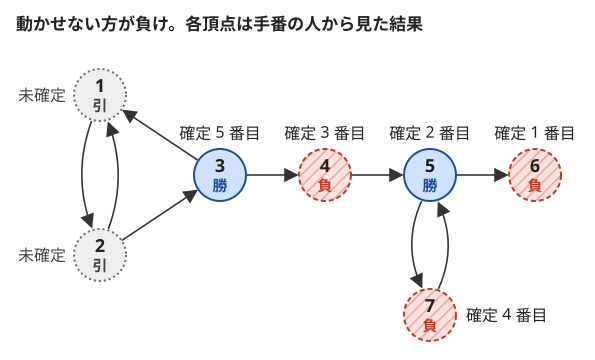

!!! abstract "要点"
    - **何ができるか**：局面の遷移に閉路があり、引き分け（終わらない）もありうるゲームで、各局面の勝ち・負け・引き分けを決める。終局から[逆辺](../guide/glossary.md#reverse-edge)をたどり、負け局面へ移れる局面を勝ち、勝ちと確定していない行き先の数が 0 になった局面を負けと確定させ、最後まで決まらない局面を引き分けとする。
    - **いつ使うか**：
        - 無限に続く場合は Draw（引き分け）を出力する。
        - 同じ局面が繰り返し現れうる。
        - グラフ上でコマを動かすゲームや、しりとりの勝敗を問われる。
    - **計算量**：局面の数を $N$、手の数を $M$ として $O(N + M)$。得点のあるゲームは優先度付きキューを使って $O((N + M) \log (N + M))$。
    - **前提**：[ゲームの基本と勝敗の DP](../comb/game-basics.md)、[幅優先探索（BFS）と無重み最短路](../graph/bfs.md)

<!-- textlint-disable -->
別名：retrograde analysis・引き分けのあるゲーム・閉路のあるグラフ上のゲーム・グラフ上のゲーム
<!-- textlint-enable -->

後退解析は、勝敗が確定している終局から逆向きに、勝ち負けが確定する局面を 1 つずつ増やしていく方法である。[勝敗の DP](../comb/game-basics.md#game-dp) と同じ規則を使うが、計算順序を「終局からの手数」ではなく「確定した順」に取るので、局面のグラフに閉路があっても使える。どこまで進めても確定しない局面が残り、それがちょうど引き分けの局面になる。

このページでは、局面を頂点、手を辺とする有向グラフで考える。各頂点の値は、その局面で手番の人から見た勝ち・負け・引き分けである。

## メモ化再帰が止まらない理由 {#why-not-memo}

[勝敗の DP](../comb/game-basics.md#game-dp) は、ゲームが有限で局面のグラフが [DAG](../guide/glossary.md#dag) になることを使っていた。行き先の値を先に求め、それを見て自分の値を決める。同じ局面に戻れるゲームでは、この「先に求める」が成り立たない。

局面 A から B へ、B から A と C へ移れ、C では動けないとする。動けない方が負けなら、C は負け、B は C へ移れるので勝ち、A は B へしか移れないので負けである。ところが A からメモ化再帰を始めると、A は B の値を求め、B は A の値を求めて、計算中の A に戻ってくる。印を付けなければ再帰は止まらない。

「計算中の局面に戻ったら引き分けとみなす」と直しても誤る。B から始めて、B が先に A を調べたとする。A は計算中の B を引き分けとみなし、A の値を引き分けとしてメモする。その後 B は C へ移れることが分かって勝ちになるが、A のメモは引き分けのまま残る。本当の A は負けである。仮の値をメモすると、結果が調べる順に左右される。

閉路があるときに値を確定させてよいのは、行き先の値が確定しているときだけである。後退解析は、この「確定した値だけを使う」ことを計算順序そのものにする。

## 確定の規則（負けへ移れる → 勝ち、すべて勝ちへ → 負け） {#rules}

後退解析では、すべての局面を「未確定」から始め、次の 3 つの規則で確定させていく。

- 手のない局面（終局）は、問題文の規則どおりに確定させる。「動けない方が負け」なら負けである。
- 負けと確定した行き先が 1 つでもあれば、その局面は勝ちと確定する（その手を打てば、相手は負け局面の手番になる）。
- すべての行き先が勝ちと確定したら、その局面は負けと確定する（どの手を打っても、相手が勝ち局面の手番になる）。

規則は勝敗の DP と同じである。違いは、勝ちの規則が行き先の 1 つだけを見て確定させ、負けの規則はすべての行き先を待つという非対称さにある。勝ちと確定していない行き先が 1 つでも残る間は、負けとは言えない。

次の図は、7 個の局面で規則を当てはめた結果である。矢印が手で、6 は動けない。



6 は動けないので負けである。5 は 6（負け）へ移れるので勝ちになる。4 と 7 は行き先が 5（勝ち）だけなので負けになる。3 は 4（負け）へ移れるので勝ちになる。2 の行き先は 1 と 3 で、3 は勝ちと確定したが 1 が未確定なので、2 は負けと言えない。1 の行き先は 2 だけで、これも未確定である。ここで確定は止まり、1 と 2 が残る。

5 と 7 も閉路を作っているが、5 は閉路の外の 6 へ移れるので確定した。閉路の上にあるだけでは引き分けにならない。引き分けになるのは、規則をどれだけ当てはめても確定しない局面である（[決まらない局面 = 引き分け](#draw)）。

手番で打てる手が違うゲーム（先手と後手で動かせる駒が違うなど）では、手番を状態に入れ、（頂点, 手番）の組を局面にする（[手番の節](../comb/game-basics.md#turn)）。局面の数が 2 倍になるだけで、規則は同じである。

## 逆辺と、勝ちと確定していない行き先の数のカウンタ {#counter}

規則を速く当てはめるには、局面が確定したときに、その局面へ移れる局面（手前の局面）だけを調べ直せばよい。値が変わりうるのは手前の局面だけだからである。そこで次の 2 つを用意する。

- 逆辺：辺 $u \to v$ ごとに $v$ から $u$ を引けるようにした隣接リスト。
- $\mathrm{cnt}[u]$：$u$ の行き先のうち、勝ちと確定していないものの数。最初は $u$ の[出次数](../guide/glossary.md#in-degree)にする。

処理の流れは [BFS](../graph/bfs.md) と同じで、確定した局面をキューに入れて順に取り出す。

```text
すべての局面を未確定にする
cnt[u] = u の出次数
cnt[u] = 0（動けない）の局面を負けと確定させ、キューに入れる
キューが空でない間：
    v を取り出す
    v へ移れる各局面 u（逆辺）について、u が未確定なら：
        v が負け → u を勝ちと確定させ、キューに入れる
        v が勝ち → cnt[u] を 1 減らす。0 になれば u を負けと確定させ、キューに入れる
最後まで未確定の局面は引き分け
```

C++ では次のようになる。$\mathrm{res}[v]$ は 0 が未確定、1 が勝ち、−1 が負けである。

```cpp
--8<-- "game-retrograde-analysis/retrograde.cpp:core"
```

各局面は確定したときに 1 回だけキューに入り、取り出したときに逆辺を 1 回ずつ見る。よって計算量は局面の数 $N$ と手の数 $M$ について $O(N + M)$ である。$\mathrm{cnt}$ は辺の本数で数えるので、同じ行き先への手が 2 本ある（多重辺）なら 2 と数え、逆辺にも 2 本入れる。数え方と減らし方がそろっていれば正しく動く。

出次数を減らしながら確定させる形は、[トポロジカルソートの、出次数 0 の頂点から逆向きに剥がす操作](../graph/topological-sort.md#peel-sinks)と同じである。違いは、負けと確定した局面が、手前の局面をカウンタを待たずにすぐ勝ちと確定させる点である。

## 決まらない局面 = 引き分け {#draw}

後退解析が止まったときに未確定の局面が、ちょうど引き分けの局面である。これには 2 つのことを確かめる。確定した局面の値が正しいことと、未確定の局面ではどちらも勝てないことである。

確定した値は、確定した順の帰納法で正しい。勝ちと確定した局面は負けの局面へ移る手を持ち、負けと確定した局面のどの手も勝ちの局面へ移る。勝ちの側が有限の手数で勝ち切れることは、次の折りたたみで示す。

未確定の局面 $v$ では、どちらも勝てない。$v$ が未確定のまま残ったので、次の 2 つが成り立つ。

- 負けと確定した行き先はない（あれば $v$ は勝ちと確定している）。
- 勝ちと確定していない行き先が 1 つ以上ある（なければ $\mathrm{cnt}[v] = 0$ で負けと確定している）。

よって $v$ の行き先には、未確定の局面が必ずある。手番の人はそこへ移ればよく、相手も同じ理由で未確定の局面へ移り続けられる。終局は確定した局面なので、未確定の局面だけを渡り歩く限りゲームは終わらない。どちらの人も、相手を確定した局面へ追い込むことはできない。

??? note "勝ちの側が有限の手数で勝てる理由"
    勝ちと確定した局面には、確定した時刻より前に負けと確定した行き先がある。負けと確定した局面の行き先は、すべてそれより前に勝ちと確定している。勝ちの側が「確定した時刻の早い負け局面へ移る」と決めておけば、相手がどう打っても、移った先の局面の確定した時刻は 1 手ごとに真に小さくなる。時刻は有限個しかないので、いずれ終局に着く。

逆に言えば、未確定の局面が引き分けなのは、問題が「終わらなければ引き分け」と決めているときである。終わらないときの扱いが違う問題（終わらなければ後手の勝ちなど）では、未確定の局面をその規則で読み替える。

## 得点のあるゲームはダイクストラ法の要領で確定させる {#weighted}

この節は、[ダイクストラ法](../graph/dijkstra.md)と[ミニマックス](../comb/minimax.md)を前提にする。

勝ち負けではなく得点を競うゲームでも、閉路があれば後退解析の形で値を確定させる。次の形を考える。辺に非負の重みがあり、ゲームが終わったときの得点は通った辺の重みの和である。先手は、ゲームを有限の手数のうちに終わらせ、そのうえで得点を小さくしたい。後手は終わらせないことを望み、それが無理なら得点を大きくしたい。

手番を状態に入れ、（頂点, 手番）を局面にする。後手（max）の局面は、勝敗のときの負けの規則と同じく、すべての行き先の値が確定するまで待つ。行き先が 1 つでも確定しない（終わらない）なら、後手はそこへ移って終わらせない。そこで後手の局面ごとに、値が確定していない行き先の数 $\mathrm{cnt}$（最初は出次数）を持ち、0 になったら、行き先の値に重みを足した最大値で確定させる。

先手（min）の局面は、勝ちの規則と同じく、確定した行き先だけを見て決めたい。ただし値は 2 通りでなく数なので、最初に見つかった行き先で確定させることはできない。そこで、候補の値を優先度付きキューに入れ、最も小さい候補を取り出したときに確定させる。これはダイクストラ法と同じ論法で正しい。重みが非負なので、後から確定する局面の値は、いま取り出した値 $x$ より小さくならない。先手の局面の候補は $x + w$ の形で、後手の局面の値は最後に確定した行き先の値 $x$ に $w$ を足したもの以上なので、どちらも $x$ を下回らない。だから、取り出した候補より良い候補は後から現れない。

```cpp
--8<-- "game-retrograde-analysis/weighted.cpp:core"
```

最後まで確定しない先手の局面は、後手が終わらせない戦略を持つ局面である。各局面はキューから 1 回だけ確定し、辺ごとに候補を高々 1 回積むので、キューに入る要素は $O(N + M)$ 個で、計算量は $O((N + M) \log (N + M))$ である。

重みに負があると、後から確定する局面の値が小さくなりうるので、取り出した順に確定させる論法が崩れる。ダイクストラ法が負の辺で壊れるのと同じである。

## 落とし穴 {#pitfalls}

**メモ化再帰で書く**。閉路があると再帰が止まらないか、計算中の局面を仮に引き分けとみなしてメモし、調べる順によって誤った値が残る（[メモ化再帰が止まらない理由](#why-not-memo)）。小さい入力では通ってしまうことがあるので、閉路があるなら初めから後退解析で書く。

**負けの規則を「行き先に勝ちがある」で確定させる**。勝ちと確定した行き先が見つかっても、手前の局面はまだ何も決まらない。$\mathrm{cnt}$ を 1 減らすだけにし、0 になったときだけ負けと確定させる。

**閉路の上の局面を引き分けと決めつける**。閉路の上にあっても、閉路の外の負け局面へ移れるなら勝ちである。閉路検出で引き分けを判定せず、後退解析で確定しなかった局面を引き分けとする。

**確定した局面を上書きする**。逆辺で調べる局面がすでに確定していれば何もしない。勝ちと確定した局面を、後から $\mathrm{cnt}$ が 0 になって負けに書き換えると誤る。

**答えを手番の人の視点で読み違える**。値は「その局面で手番の人から見た」勝ち負けである。しりとりのように先手が 1 手打った後の局面を調べるなら、その局面の手番は後手なので、負けなら先手の勝ちである。

**逆辺でなく順辺をたどる**。確定した局面から調べるのは、その局面へ移れる局面（手前）である。入力の辺 $u \to v$ を、$v$ の逆辺のリストに $u$ として入れる。

## 例題 {#examples}

### ABC209 E. Shiritori {#abc209_e}

<div class="kp-problems" data-role="example" markdown>

- [ABC209 E. Shiritori](https://atcoder.jp/contests/abc209/tasks/abc209_e)（diff 2153）：N 個の単語でしりとりをし、同じ単語を何度使ってもよく、続けられなくなった方が負けのとき、各単語から始めたときの勝敗（引き分けを含む）を求める。

</div>

次に言う単語は、直前の単語の末尾の 3 文字だけで決まる。そこで「直前の単語の末尾の 3 文字」を局面にし、単語ごとに「先頭の 3 文字 → 末尾の 3 文字」の辺を張る。同じ単語を何度でも使えるので、局面のグラフには閉路があり、引き分けが起きる。

??? note "解法の詳細"
    頂点は単語に現れる 3 文字の列で、単語 1 つから高々 2 個なので、頂点は $2N$ 個以下である。3 文字の列を整数に直して（座標圧縮や連想配列で番号を振って）、辺を $N$ 本張る。英大文字と小文字を区別するので 3 文字の列は $52^3$ 通りで、配列の添字に直接直してもよい。

    局面「末尾が $x$」の手番の人は、先頭が $x$ の単語を言う。言えなければ負けなので、出次数 0 の頂点が負けになる。ここから[カウンタを使った後退解析](#counter)を行い、各頂点を勝ち・負け・引き分けに分ける。

    単語 $i$ から始めるとき、高橋君が単語 $i$ を言った後の局面は「末尾が単語 $i$ の末尾の 3 文字」で、手番は青木君である。この頂点が負けなら高橋君の勝ち、勝ちなら青木君の勝ち、未確定なら引き分けである。計算量は $O(N)$ に、3 文字の列に番号を振る分を足したものになる。

## 練習問題 {#practice}

<div class="kp-problems" data-role="practice" markdown>

- [ABC245 F. Endless Walk](https://atcoder.jp/contests/abc245/tasks/abc245_f)（diff 1451）：有向グラフで、そこから辺をたどって無限に移動し続けられる頂点の数を求める。

</div>

??? note "練習の方針"
    - **ABC245 F**：出次数 0 の頂点をキューに入れ、逆辺をたどって行き先の頂点の出次数のカウンタを減らし、0 になった頂点を次々と取り除く。最後まで残った頂点を数える。2 人のゲームではないが、カウンタで決まる局面を広げ、決まらない局面が残るという後退解析の骨組みだけを練習できる

## 力試し {#challenge}

<div class="kp-problems" data-role="challenge" markdown>

- [ABC261 Ex. Game on Graph](https://atcoder.jp/contests/abc261/tasks/abc261_h)（diff 2531）：重み付きの有向グラフで 2 人が交互に駒を辺に沿って動かし、動かせなくなると終わる。先手は有限で終わらせて通った辺の重みの和を小さく、後手は終わらせないか和を大きくしたいとき、両者が最適に動いたときの和を求める（終わらないなら、そのことを出力する）。
- [ARC038 D. 有向グラフと数](https://atcoder.jp/contests/arc038/tasks/arc038_d)（diff 3009）：各頂点に値のある有向グラフで、頂点 1 の駒を 2 人が交互に辺に沿って動かすか終了を宣言し、終了時（または非常に多くの手で打ち切られた時）の頂点の値を先手は大きく後手は小さくしたいとき、最適に動いたときの値を求める。

</div>

??? note "力試しの方針"
    - **ABC261 Ex**：辺の重みが非負なので、[得点のあるゲームはダイクストラ法の要領で確定させる](#weighted)の形そのものである。（頂点, 手番）を局面にし、後手の局面は行き先がすべて確定するまで待ち、先手の局面は候補の最小値を優先度付きキューから取り出して確定させる。最後まで確定しない先手の局面は、終わらない
    - **ARC038 D**：答えを二分探索し、「値が $D$ 以上で終われるか」を（頂点, 手番）の $2N$ 状態のゲームとして判定する。終了の宣言で勝敗が決まる状態を起点に、逆辺と出次数のカウンタで勝ち・負けを確定させ、確定しない状態は先手の勝ちとは扱わない

## 確認問題 {#quiz}

??? question "確認問題：3 つの局面"
    局面 A から B へ、B から A と C へ移れ、C では動けない。動けない方が負けのとき、各局面は勝ち・負け・引き分けのどれか。

    ??? success "答え"
        C は負け、B は C へ移れるので勝ち、A は行き先が B（勝ち）だけなので負けである。引き分けはない。A と B は閉路を作るが、B が閉路の外の負け局面 C へ移れるので、すべて確定する。

??? question "確認問題：自己ループ"
    局面 A からは A 自身へだけ移れる（パスのような手だけがある）。A は勝ち・負け・引き分けのどれか。

    ??? success "答え"
        引き分けである。$\mathrm{cnt}[A] = 1$ で、行き先の A が勝ちと確定しない限り減らず、A を確定させる規則はどれも当てはまらない。実際、両者がパスを続ければゲームは終わらない。

??? question "確認問題：終わらなければ後手の勝ち"
    「ゲームが終わらなければ後手の勝ち」と決まっている問題では、後退解析の結果をどう読めばよいか。

    ??? success "答え"
        確定した局面は、そのまま勝ち・負けで読む。未確定の局面は後手の勝ちと読む。未確定の局面の行き先には未確定の局面が必ずあり、後手はいつでも未確定の局面へ移ってゲームを終わらせずにいられる。先手が未確定の局面から確定した局面へ移ると、その行き先は勝ちと確定した局面（後手の手番で後手の勝ち）しかない。どちらにしても先手は勝てない。

## 使い分け {#comparison}

- 1 手ごとに必ず減る量があり、同じ局面に戻れないなら、[勝敗の DP](../comb/game-basics.md#game-dp) かメモ化再帰で足りる。後退解析でも解けるが、逆辺とカウンタが余分に要る。
- 勝ち負けでなく得点を競い、閉路がないなら、[ミニマックス](../comb/minimax.md)の DP にする。閉路があれば[ダイクストラ法の要領](#weighted)で確定させる。
- 独立なゲームがいくつも並ぶなら、[Grundy 数](../comb/grundy-number.md)で分けて考える。閉路のあるゲームの和は Grundy 数だけでは扱えない。
- ゲームでなく「無限に動き続けられる頂点」を数えるだけなら、[出次数 0 の頂点から剥がす](../graph/topological-sort.md#peel-sinks)だけで足りる。

## 参考 {#references}

- [hamayan「Shiritori [AtCoder Beginner Contest 209 E]」](https://blog.hamayanhamayan.com/entry/2021/07/11/154140)：例題 abc209_e の 3 文字の列を頂点にしたグラフと、逆辺と出次数のカウンタで勝ち・負けを確定させる手順、答えの読み方
- [kmjp「AtCoder ABC #261 : Ex - Game on Graph」](https://kmjp.hatenablog.jp/entry/2022/07/24/0930)：力試し abc261_h の手番ごとの値の持ち方と、max の局面はカウンタ・min の局面は優先度付きキューで確定させる方法。メモ化した DFS では誤る点
- [kyo-pro「ABC245F - Endless Walk」](https://kyo-pro.hatenablog.com/entry/ABC245F)：練習 ABC245 F の出次数のカウンタと逆辺で取り除く手順
- [drken「AtCoder ARC 038 D - 有向グラフと数 (4D, 試験管赤色)」](https://drken1215.hatenablog.com/entry/2019/01/28/103000)：力試し ARC038 D の二分探索と 2N 状態の後退解析
- [kmjp「AtCoder ARC #038 : D - 有向グラフと数」](https://kmjp.hatenablog.jp/entry/2015/05/03/1000)：力試し ARC038 D の同じ方針
